# 뒤통수를 조심해 (Watch Your Back) — 첫 개인 프로젝트

## 1. 개요

### 1-1. 무엇을 만들었나


「뒤통수를 조심해」는 배신당한 플레이어가 자신을 버린 동료들에게 복수하며 진실을 알아 가는 **2D 탑다운 잠입·전투 액션 게임**입니다.
플레이어는 **적의 뒤통수를 때려야만 이기고**, 적에게 **한 번이라도 맞으면 게임 오버**가 되는 비대칭 규칙을 가지고 있습니다.
조작은 간단하지만, 뒤통수를 때리는 순간을 **컷씬**으로 크게 강조해 타격감과 통쾌함을 극대화하는 데 가장 공을 들였습니다.

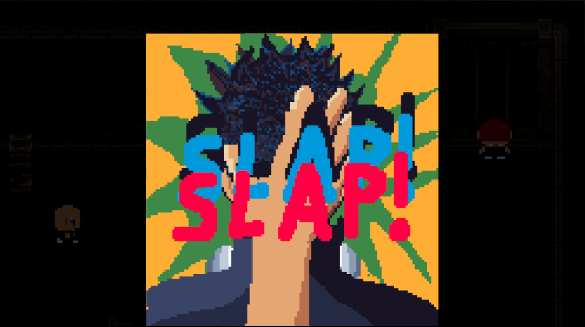

### 1-2. 왜 만들었나

**게임을 만든 계기**
살다 보면 누구나 한 번쯤은 통쾌한 복수를 하고 싶다는 생각이 듭니다. 특히 나의 뒤통수를 먼저 친 사람이라면, 물리적으로나 정신적으로나 그에 대한 복수를 하고 싶은 마음이 생기기 마련입니다. 현실에서는 리스크가 커서 실행하기 어렵지만, 게임에서는 가능합니다. 게임 아이디어를 고민하다 문득 이 생각이 떠올랐고, 한 줄로 정리되었습니다 — **"뒤통수를 조심해"**.

**그래서 풀어야 했던 문제**
규칙이 "한 대 맞으면 끝"으로 단순한 만큼, 누가 먼저 때렸는지의 판정 정확도와 적의 움직임이 게임의 완성도를 좌우했습니다.

| 플레이하며 생길 수 있는 문제 | 어떻게 풀려고 했나 | 절 |
|---|---|---|
| 플레이어와 적이 동시에 때리면 둘 다 이기거나 둘 다 짐 | 프레임 단위 잠금을 통해 먼저 때린 쪽만 승리 처리 | 4-2 |
| 쓰러진 적이 넉다운 연출 중에도 공격하거나 다시 움직임 | 넉다운 상태 진입 시 공격 판정 차단 및 상태 전환 잠금 | 4-1 · 7-2 A |
| 보스 4명은 기본 행동이 같고 고유 패턴만 다름 | 공통 몸(`EnemyStateManager`) 하나에 보스 패턴만 상태(옷)로 추가 | 3-1 · 5-2 |
| 적이 플레이어 방향으로 직진만 하면 벽에 막힘 | 부채꼴 방향으로 앞을 살펴 비어 있는 방향으로 회피 이동 | 4-3 |
| 적 여러 명이 동시에 쫓아와도 BGM은 한 번만 바뀌어야 함 | 추격 중인 적의 수를 카운팅하여 처음과 마지막에만 전환 | 4-4 |

[사실 보강 예정: 위 문제 요약표는 기존 본문 내용을 요약·재구성한 항목이므로, 개발 당시 실제로 가장 신경 썼던 문제와 표현이 본인 의도와 일치하는지 검토]

### 1-3. 개발 환경 · 링크

| 항목 | 내용 |
|---|---|
| 장르 | 탑다운 액션 잠입 게임 (2D) |
| 플랫폼 | Windows PC |
| 엔진·도구 | Unity 6000.3.15f1, Visual Studio 2026, C# |
| 기간 | 2026-06-15 ~ 2026-07-07 (기획 1주 · 개발 2주) |
| 인원 | 1명 개발 · 아트: 아내 (픽셀아트 — 캐릭터 초상화, 피격 컷씬, 공격·이동 모션) |
| 영상 | [소개 쇼츠 (59초)](https://youtube.com/shorts/moNh2DrYCas) · [플레이 시연 영상 (YouTube, 3분 32초)](https://youtu.be/MgwuP_ErnK4) |
| GitHub | https://github.com/KooHoo-Dev/3rd-2D-Project-pinkshield |

[사실 보강 예정: 제출 전 GitHub 레포지토리(`3rd-2D-Project-pinkshield`) Public 전환 여부 및 링크 정상 접속 확인]

---

## 2. 게임 디자인

### 2-1. 규칙 — 뒤통수를 치면 이기고, 맞으면 진다

**단순한 핵심 메커니즘**
프로그래머 과정에서 게임 개발을 처음 배우고 제작한 첫 프로젝트인 만큼, 핵심 메커니즘을 명확하고 단순하게 정했습니다. **적의 뒤통수를 치면 승리, 플레이어가 맞으면 패배**이며 다른 승패 조건은 없습니다. 플레이어와 적 모두 원 히트 원 킬(One-Hit One-Kill) 규칙을 따르기 때문에, 규칙은 단순해도 매 순간 높은 긴장감이 유지됩니다.

### 2-2. 코어 루프 — 숨어서 다가가고, 뒤통수를 친다

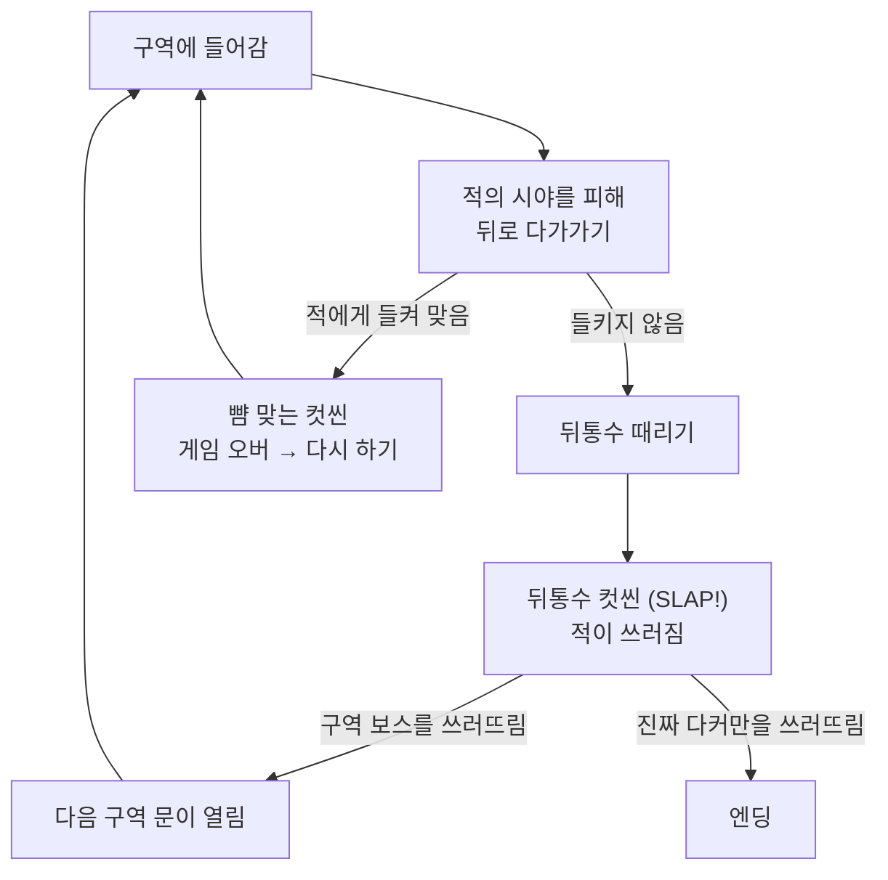

한 판의 반복 구조는 명쾌합니다. 적의 시야를 피해 뒤로 돌아가 뒤통수를 치면 컷씬과 함께 적이 쓰러지고, 구역 보스를 처치하면 다음 구역으로 이동합니다. 반대로 한 번이라도 공격받으면 즉시 게임 오버가 됩니다. 이 "한 대로 승패가 갈리는" 루프가 통쾌한 복수심과 팽팽한 긴장감을 동시에 만듭니다.

[사실 보강 예정: 코어 루프 다이어그램과 설명 문단이 실제 스테이지 진행 흐름과 일치하는지 확인 및 본인 어투로 다듬기]

### 2-3. 기획에 영감을 받은 게임

**「장미와 동백 (Rose and Camellia)」**
NIGORO가 제작한 과장된 막장 드라마풍의 뺨 때리기 격투 게임입니다. 게임의 시스템을 차용한 것은 아니지만, **뺨 때리기**라는 단순하고도 강렬한 행동이 주는 시각적·청각적 카타르시스에서 영감을 얻어 **뒤통수 때리기**를 게임의 핵심 컨셉으로 잡았습니다.

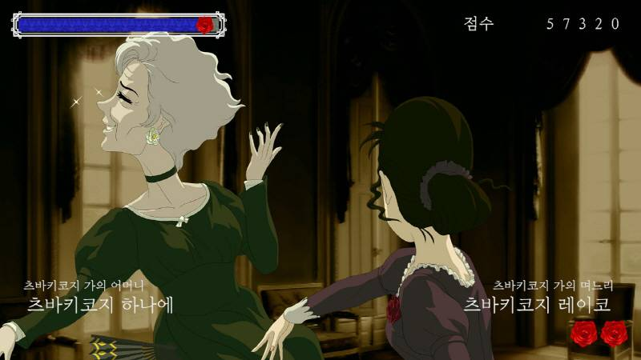

### 2-4. 레벨과 적 — 캐릭터와 레벨 디자인은 함께 간다

맵 레벨과 적의 능력을 하나로 묶어 디자인했습니다. 보스의 이름, 담당 구역, 고유 능력이 직관적으로 연결되는 구조로 설계했습니다.

| 보스 | 구역 | 능력 |
|---|---|---|
| 앨리만 (Alleyman) | 튜토리얼 | 플레이어를 감지하면 추격한다 (모든 보스의 공통 요소) |
| 와치만 (Watchman) | 감옥 | 속박된 감시자가 플레이어를 감지하면, 구역 보스인 와치만이 감시자가 지키는 구역으로 출동 |
| 랫만 (Ratman) | 시궁창 | 쥐를 밟으면 랫만이 쥐가 죽은 장소로 이동하여 순찰 |
| 다커만 (Darkerman) | 어두운 방 | 분신 둘과 본체 하나로 구성. 본체를 처치해야만 게임 클리어 |

---

## 3. 시스템 구조

### 3-1. 인터페이스를 활용한 적 AI — 몸은 하나, 옷만 갈아입는다

적 AI 시스템을 비유하자면, `EnemyStateManager`는 **몸**이고 각 `IEnemyState`는 그 몸이 상황에 따라 갈아입는 **옷**입니다.
몸(콜라이더, 애니메이터, 이동·회전 함수, `Player` 참조)은 하나뿐이며, 현재 어떤 행동을 수행할지는 지금 입고 있는 옷(상태 클래스)이 결정합니다. 옷을 갈아입어도(`ChangeState`) 몸의 위치와 컴포넌트 참조는 그대로 유지됩니다.

보스 4명은 외형만 다르고 기본 공격과 이동 로직은 동일합니다. 따라서 이동·회전·전투 판정처럼 공통으로 쓰는 기능은 몸에 두고, 보스마다 달라지는 행동 패턴만 상태 클래스로 분리했습니다.

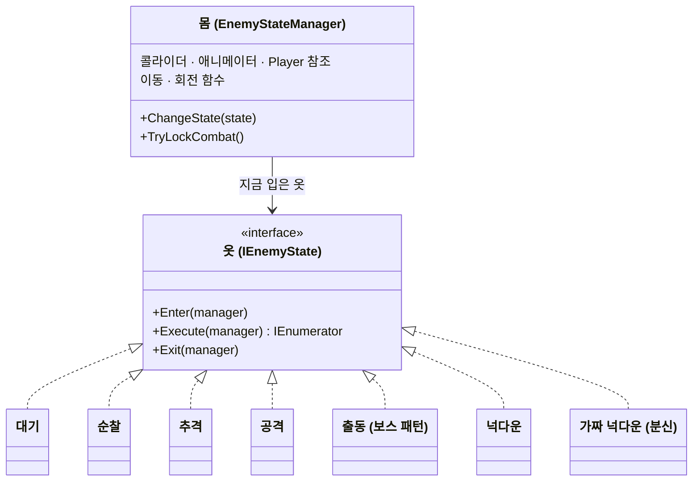

`IEnemyState` 인터페이스는 세 가지 메서드만 정의합니다.

```csharp
public interface IEnemyState
{
    void Enter(EnemyStateManager stateManager);          // 상태에 진입할 때 한 번
    IEnumerator Execute(EnemyStateManager stateManager); // 상태의 실제 행동 루프 — 코루틴으로 실행
    void Exit(EnemyStateManager stateManager);           // 상태에서 빠져나올 때 한 번
}
```

상태는 오브젝트에 미리 붙여 두는 것이 아니라, 전환할 때마다 인스턴스를 새로 생성해 입힙니다. 매 프레임 `Update`를 돌리는 대신 `Execute`를 **코루틴**으로 구현하여, "2초 대기 후 복귀"(`WaitForSeconds`) 같은 시간 흐름을 상태 내부에 직관적으로 작성할 수 있게 했습니다.

코루틴을 선택한 이유는 당시 수업에서 코루틴을 처음 배웠고 **배운 개념을 직접 활용해 보고 싶은 마음**이 컸기 때문입니다. 구현 당시에는 편리하다고 느꼈지만, 이후 상태의 수와 전환 조건이 늘어나면서 코루틴 생명주기 관리가 까다로워진다는 점을 체감했습니다.

**실행 방식 비교**

| 방식 | 장점 | 단점 |
|---|---|---|
| 코루틴 (현재 방식) | "2초 대기 후 복귀" 같은 시간 흐름을 위에서 아래로 읽히게 작성 가능 | 상태 전환 시 `StopCoroutine` 관리가 필수적이며, 실행 지점 디버깅이 어려움 |
| `Update`에서 `Tick()` 호출 | 매 프레임 실행 흐름이 단순하고 명확하여 디버깅과 테스트가 용이함 | 대기 시간을 타이머 변수로 직접 누적해야 하므로 코드가 길어짐 |
| `async`/`await` | 코루틴처럼 순차적으로 읽히면서 반환값과 예외 처리가 가능함 | 오브젝트 비활성화 시 자동 중단되지 않아 `CancellationToken` 관리 필요 |

다음 리팩토링에서는 디버깅과 테스트가 용이한 **`Update` 기반 `Tick()` 호출 방식**으로 개선하는 것을 고려하고 있습니다.

**역할 분담 구조**

| 비유 | 담당 스크립트 | 역할 |
|---|---|---|
| 몸 | `EnemyStateManager` | 이동, 시야 감지, 박스 회전, 넉다운 연출 등 모든 보스의 공통 동작 |
| 옷 | 상태 7종 (`IEnemyState`) | 현재 수행할 행동과 다음 상태로의 전환 결정 (3-2) |
| 감각 | 박스 스크립트 3종 | 충돌 감지 시 몸(`EnemyStateManager`)에 이벤트 전달 (3-4) |
| 하수인 | 감시자 · 쥐 | 플레이어 포착 또는 피격 시 보스에게 목표 위치 전달 (3-2) |

보스 4명은 모두 동일한 `EnemyStateManager`를 사용하며, 보스별 고유 기믹은 **주변 보조 스크립트**로 분리해 결합도를 낮췄습니다.

| 보스 | 추가 스크립트 | 역할 |
|---|---|---|
| 와치만 | `Watcher` (감시자) | 감시자의 시야 박스에 플레이어가 들어오면 말풍선·"Hey" 효과음 재생 0.5초 뒤 와치만에게 `AlertMovePatternState` 적용 |
| 랫만 | `RatController` (쥐) | 좌우 왕복(`Mathf.PingPong`)하다 플레이어에게 밟히면 사망 연출 1초 후, 랫만에게 쥐 위치를 넘기고 `AlertMovePatternState` 적용 |
| 다커만 | `DarkermanIdentity` · `DarkermanInvisibleEffect` · `DarkermanBossManager` | 인스펙터 플래그로 본체/분신 구분. 본체만 40초마다 0.3초간 반투명해지며, 본체가 쓰러지면 엔딩 씬 로드 |

### 3-2. 상태 전환

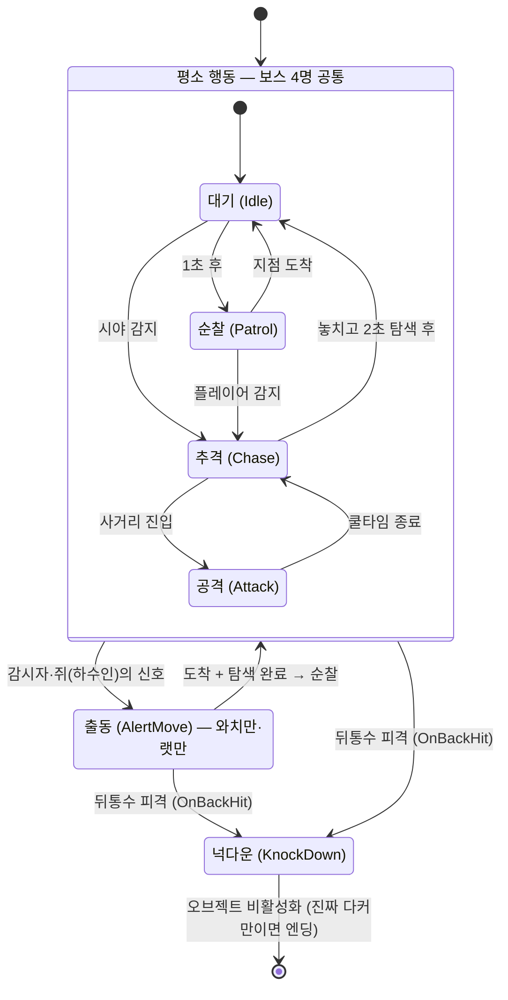

| 상태 클래스 | 역할 | 진입 조건 | 종료 후 전환 |
|---|---|---|---|
| `EnemyIdleState` (대기) | 제자리에서 무작위 방향 둘러보기 | 시작 시 / 추격 실패 후 복귀 | 1초 후 Patrol, 시야 감지 시 Chase |
| `EnemyPatrolState` (순찰) | 지정 지점 왕복 이동 | Idle 종료 | 도착 시 Idle, 플레이어 감지 시 Chase |
| `EnemyChaseState` (추격) | 시야 및 마지막 목격 위치 추적 | 시야 내 플레이어 감지 | 사거리 진입 시 Attack, 놓치고 2초 탐색 후 Idle |
| `EnemyAttackState` (공격) | 공격 애니메이션 재생 및 쿨타임 대기 | 공격 사거리 진입 | 쿨타임 종료 후 Chase |
| `AlertMovePatternState` (출동) | 알림 위치(감시자 구역 / 쥐 사망 위치)로 이동 후 4방향 탐색 | 감시자 / 쥐 오브젝트의 외부 호출 | 도착 + 탐색 완료 시 Patrol |
| `EnemyKnockDownState` / `EnemyFakeKnockdownState` (넉다운) | 넉다운 연출 재생 | 뒤통수 피격 (`OnBackHit`) | 오브젝트 비활성화 (본체 다커만 처치 시 엔딩 씬 로드) |

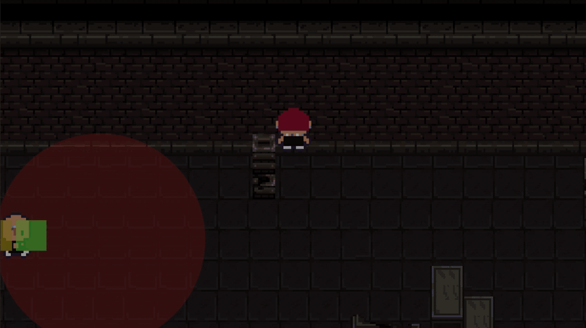

전환 조건은 시야 박스와 공격 범위 박스로 판정합니다. "플레이어가 보이는가", "때릴 수 있는 거리인가"를 판정하는 함수는 몸(`EnemyStateManager`)에 두고, 이를 호출해 다음 상태를 결정하는 역할은 각 상태(옷)에 맡겼습니다. 예를 들어 `EnemyChaseState`는 플레이어가 공격 범위 안에 들어오면 직접 `EnemyAttackState`로 전환합니다. 예외적으로 뒤통수 피격(`OnBackHit`)에 의한 넉다운만 `EnemyStateManager`가 즉시 전환을 처리합니다.

2-4의 와치만(감시자 구역으로 출동)과 랫만(쥐가 죽은 곳으로 이동) 패턴은 모두 `AlertMovePatternState` 하나로 재사용했습니다. 외부 스크립트(감시자·쥐)는 보스의 내부 상태를 알 필요 없이 **목표 위치만 넘기고 `ChangeState`를 호출**하면 됩니다.

```csharp
// RatController.cs — 쥐가 죽는 연출(1초)이 끝난 뒤
Ratman.LastPlayerPosition = transform.position;      // 쥐가 죽은 자리
Ratman.ChangeState(new AlertMovePatternState());

// Watcher.cs — 감시자가 플레이어를 본 뒤 0.5초 후
Watchman.LastPlayerPosition = SightBox.transform.position;
Watchman.ChangeState(new AlertMovePatternState());
```

### 3-3. 시야·공격 박스 — 4방향으로만 움직이니 박스도 4방향으로

**왜 박스로 만들었나**
이 게임은 적의 뒤통수를 때려야만 이기고, 적에게 한 번이라도 맞으면 패배합니다(1-1). 따라서 적이 **현재 어느 방향을 바라보고 있는지**가 승패 판정의 핵심입니다. 적이 플레이어를 감지하는 영역(시야 박스), 공격이 닿는 영역(공격 박스), 뒤통수 피격을 판정하는 영역(뒤통수 피격 박스)을 각각 자식 콜라이더 박스로 구성하고, 적이 바라보는 방향에 맞춰 함께 회전하도록 설계했습니다.

[사실 보강 예정: 위 '왜 박스로 만들었나' 도입부 문장이 개발 당시 실제 의도와 자연스럽게 이어지는지 확인]

-노란색(허트박스)-초록색(히트박스).png>)

**왜 정해진 각도로 돌리나**
이 게임의 이동과 공격은 상하좌우 4방향으로 제한됩니다. 따라서 시야 박스와 히트 박스 역시 아날로그 각도가 아닌, 이동 방향에 맞춘 **4개의 고정 각도로 회전**시키는 것이 가장 명확하고 효과적이라고 판단했습니다.

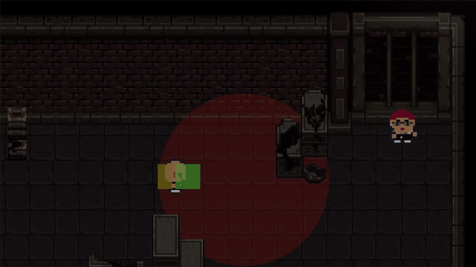

대각선으로 이동할 때는 가로·세로 축 중 **이동량이 더 큰 축**을 기준으로 방향을 결정하며, 정지 상태에서는 마지막으로 바라보던 방향을 유지합니다.

공격·피격 판정 박스는 즉시 회전시키고, 시야 박스는 부드럽게 보간 회전시킵니다(상세 비교는 5-1 참조). 방향별 설정 각도는 다음과 같습니다.

| 이동 방향 | 공격·피격 판정 박스 각도 (즉시 회전) | 시야 박스 각도 (보간 회전) |
|---|---|---|
| 오른쪽 | 90° | 0° |
| 왼쪽 | 270° | 180° |
| 위 | 180° | 90° |
| 아래 | 0° | 270° |

**4방향으로만 설계한 이유**
아내가 직접 그린 픽셀아트 애니메이션이 상하좌우 4방향 기준이었기 때문입니다. 수작업 픽셀아트의 방향을 늘리면 제작 기간이 크게 늘어나고, 당시 제 개발 역량으로 2주 안에 구현하기에도 4방향 구조가 가장 현실적인 선택이었습니다.

### 3-4. 박스와 매니저의 연결 — 박스는 알리기만, 판단은 매니저가

각 판정 박스(자식 오브젝트)에는 최소한의 충돌 감지 스크립트만 부착하고, 충돌이 발생하면 **몸(`EnemyStateManager`)에 이벤트만 전달**하도록 구성했습니다. 수업에서 배운 이벤트 구독 패턴을 적용해 본 시도였으나, 지금 돌아보면 역할 분리를 끝까지 밀어붙이지는 못했습니다. 박스의 알림을 받아 판정 로직을 전담 처리한 뒤 매니저에 결과만 넘기는 **중간 판정 계층**이 있었다면 `EnemyStateManager`의 책임을 훨씬 줄일 수 있었을 것입니다(7-3).

| 박스 | 충돌 시 수행하는 역할 |
|---|---|
| 시야 박스 (빨강) | 플레이어 진입 시 감지 상태를 기록하고, 이탈 시 해제 |
| 공격 범위 박스 (초록) | 추격 중인 적이 공격 사거리 내에 들어왔는지 확인 |
| 공격 타격 박스 (초록) | 플레이어와 충돌 시, 현재 프레임에 승패가 결정되지 않았을 때만 플레이어 넉다운 처리 |
| 뒤통수 피격 박스 (노랑) | 충돌 대상을 몸에 전달. 유효한 플레이어 공격 여부는 몸에서 최종 판단 |

시야 박스 영역 안에 플레이어가 들어오더라도 곧바로 추격하지 않고, 적과 플레이어 사이에 **벽(장애물)이 가로막고 있는지 레이캐스트로 추가 검사**합니다. 그래서 빨간 원(시야 박스) 안에 있더라도 벽 뒤에 숨어 있으면 들키지 않지만, 시야 범위 자체가 화면에 표시되지 않아 플레이어가 이 규칙을 직관적으로 체감하기는 어려웠습니다(7-3 · 7-4).

**벽 가림 판정을 넣은 이유**
초기 기획이 잠입 액션이었기 때문에 은폐·엄폐 요소를 구현하고자 벽 가림 판정을 추가했습니다. 원래는 「Darkwood」처럼 캐릭터의 시야각만 밝고 나머지 영역은 어둡게 가려지는 시야 시스템을 만들고 싶었으나, 당시 실력으로는 구현이 어렵다고 판단해 강사님의 조언에 따라 원형 시야 박스로 방향을 선회했습니다. 돌이켜보면 탑다운 시점에서 보이지 않는 원형 시야 박스는 잠입의 긴장감보다 불합리함을 유발했기에, 처음부터 시야 표현에 더 도전해 보지 못한 점이 아쉽게 남습니다(7-4).

---

## 4. 핵심 기능

### 4-1. 상태 전환 — 정리와 가드를 함께

외부 객체가 적의 내부 로직을 모르더라도 `ChangeState` 호출만으로 안전하게 상태를 전환할 수 있도록 두 가지 방어 장치를 두었습니다.

- **넉다운 가드** — 이미 쓰러진 적이 외부 이벤트(감시자·쥐 알림 등)로 인해 다시 다른 상태로 전환되는 것을 차단합니다.
- **정리 순서 보장** — `Exit`과 `StopCoroutine`을 먼저 호출해 이전 상태의 이동·사운드를 완전히 정리한 뒤, 새 상태의 코루틴을 시작합니다.

```csharp
public void ChangeState(IEnemyState newState)
{
    if (IsKnockDown == true) return;                        // ① 넉다운 가드 — 쓰러진 적은 다시 움직이지 않음

    if (currentState != null) currentState.Exit(this);      // ② 이전 상태 정리 (정지·전투 BGM 해제)
    if (stateCoroutine != null) StopCoroutine(stateCoroutine); // ③ 이전 상태 루프 중단

    currentState = newState;
    currentState.Enter(this);                               // ④ 새 상태 진입
    stateCoroutine = StartCoroutine(currentState.Execute(this)); // ⑤ 새 상태 루프 시작
}
```

넉다운 여부를 별도의 `bool` 플래그로 관리하지 않고 **현재 상태 클래스(`currentState`)의 타입**으로 판별하기 때문에, 상태 변경 시 플래그 갱신을 누락하는 실수를 원천 방지했습니다. 이 가드는 7월 22일 커밋("넉다운 상태일때 다른 상태 전환을 하지 않도록 예외처리 추가")에서 추가했으며, 감시자·쥐 등 여러 외부 지점에서 `ChangeState`를 호출하는 구조상 진입점 한 곳에서 차단하는 것이 가장 확실했습니다.

| 방어 로직이 없을 때 | 플레이 중 발생하는 문제 |
|---|---|
| ① 넉다운 가드 누락 | 쓰러지는 연출 중에 쥐를 밟거나 감시자에게 들키면, 쓰러지던 보스가 다시 일어나 출동함 |
| ② 이전 상태 정리 누락 | 추격이 종료되어도 전투 중인 적 카운트가 줄어들지 않아 평상시 BGM으로 복귀하지 않음 |

[사실 보강 예정: 위 비교표의 두 가지 시나리오가 실제 디버깅/테스트에서 확인된 사례인지, 코드 로직상 역추론한 사례인지 구분하여 표현 다듬기]

### 4-2. 같은 프레임 동시 피격 방지

플레이어와 적이 **동일한 프레임에 서로를 공격**하면 둘 다 승리하거나 둘 다 패배하는 모순된 판정이 발생할 수 있습니다. 이를 방지하기 위해 프레임 단위 잠금(Lock)을 도입했습니다. 같은 프레임 안에서는 **먼저 `TryLockCombat()`을 호출해 잠금을 획득한 쪽만** 판정 권한을 가지므로, 승패가 반드시 한쪽으로만 결정됩니다.

```csharp
// EnemyStateManager.cs
private bool combatResolved = false;

public bool TryLockCombat()
{
    if (combatResolved == true) return false; // 이번 프레임에 이미 승패가 결정됨
    combatResolved = true;
    return true;
}

private void LateUpdate()
{
    combatResolved = false; // 프레임 종료 시 잠금 해제 → 다음 프레임 판정 준비
}
```

잠금 확인은 공격 판정과 피격 판정 양쪽 입구(`EnemyAttackHitBox.cs`와 `EnemyStateManager.OnBackHit`)에서 동일하게 수행합니다.

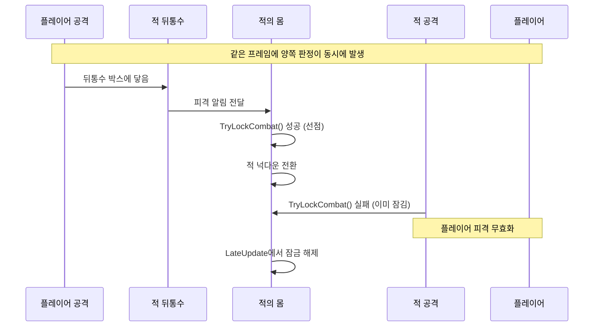

뒤통수 피격 판정(`OnBackHit`) 시에는 잠금 외에도 세 가지 조건을 순차적으로 검증합니다.

| 뒤통수 피격 시 검증 조건 | 누락 시 플레이 중 발생하는 문제 |
|---|---|
| ① 유효한 플레이어 공격 판정인가 | 적의 뒤통수에 플레이어 캐릭터 몸체만 스쳐도 적이 넉다운됨 |
| ② 공격한 플레이어가 이미 쓰러진 상태인가 | 먼저 공격받아 쓰러지는 중인 플레이어의 판정으로 적까지 동반 넉다운됨 |
| ③ 이번 프레임에 이미 승패가 결정되었는가 (잠금) | 동시 타격 시 플레이어와 적이 함께 쓰러짐 |

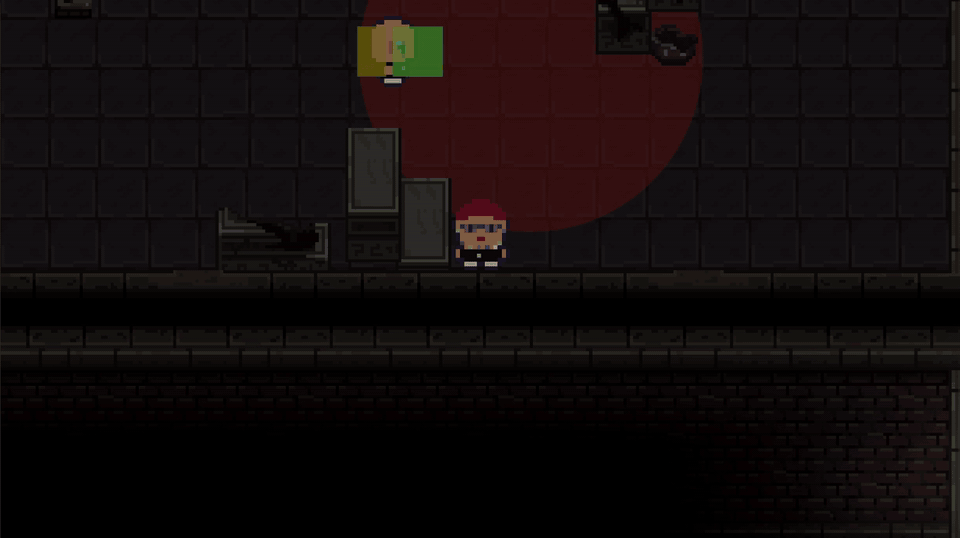

**이 잠금이 필요했던 배경**
플레이어가 적의 뒤통수를 때렸음에도, 적의 넉다운 컷씬이 재생되는 동안 적이 비활성화되지 않은 채 공격 판정을 내어 **플레이어까지 함께 쓰러지는 현상**이 반복되었습니다. 당시에는 디버깅 경험이 부족해 정확한 원인을 좁히기 어려웠고, 동시 판정 충돌을 막기 위해 프레임 잠금을 우선 적용했습니다(→ 7-2 A).

### 4-3. 장애물 회피 이동

순찰·추격·출동 상태는 모두 동일한 이동 메서드를 공유합니다. 목표 지점으로 직선 이동하다 벽에 걸리는 것을 막기 위해, 진행 방향 기준 **부채꼴 모양으로 여러 각도를 탐색해 장애물이 없는 첫 번째 방향**으로 이동합니다. 또한 얇은 레이(`Raycast`) 대신 적의 **충돌체 크기만 한 상자(`BoxCast`)**를 투사하여, 실제 캐릭터 몸체가 통과할 수 있는 공간인지 검사합니다. 당시에는 A\* 길찾기 알고리즘을 직접 구현하기 어렵다고 판단해, 현재 역량으로 구현 가능한 조향(Steering) 기반 회피 방식을 먼저 선택했습니다(→ 7-4에서 A\*로 개선 예정).

탐색 순서는 정면(`0°`)을 기준으로 좌우로 번갈아 가며 시야를 넓히도록 의도했습니다. 그러나 이후 디버그 로그로 실제 탐색 각도를 출력해 본 결과, 정수 나눗셈 계산 오류로 인해 한쪽 방향만 중복 탐색하고 반대쪽 끝 각도는 전혀 검사하지 않고 있었습니다.

| 탐색 순서 | 1 | 2 | 3 | 4 | 5 |
|---|---|---|---|---|---|
| 의도한 각도 | 0° | 30° | -30° | 60° | **-60°** |
| 실제 탐색 각도 | 0° | -30° | 30° | **-30°** | 60° |

이로 인해 `-60°` 방향만 열려 있는 좁은 길목에서는 탈출 경로를 찾지 못하고 벽 앞에서 제자리걸음을 하는 현상이 발생했습니다. 구체적인 코드 원인과 검증 과정은 6-1(AI 코드 리뷰 #1)에서 다룹니다.

### 4-4. 전투 BGM — 추격 중인 적 수 카운팅

**전투 BGM을 도입한 이유**
초기 빌드에서는 적의 시야 박스를 화면에 표시하지 않았기 때문에, 플레이어 입장에서는 언제 적에게 발각되었는지 알 수 없어 "왜 갑자기 들켰지?"라는 불합리함을 느끼기 쉬웠습니다. 이를 청각적으로 보완하기 위해, 적에게 발각되는 순간 배경음악을 즉시 전환하여 **"지금 적에게 들켰다"**는 신호를 명확히 전달하고자 했습니다.

추격(`EnemyChaseState`) 및 공격(`EnemyAttackState`) 상태의 `Enter`에서 `NotifyCombatStarted()`를, `Exit`에서 `NotifyCombatEnded()`를 호출합니다. `SoundManager`는 현재 플레이어를 추격 중인 적의 수(`engagedEnemyCount`)를 관리하며, **0 → 1이 되는 순간** 전투 BGM으로, **1 → 0이 되는 순간** 평상시 BGM으로 크로스페이드 전환합니다. 덕분에 여러 적이 동시에 추격하더라도 BGM 전환은 한 번만 깔끔하게 일어납니다.

```csharp
public void NotifyCombatStarted()
{
    engagedEnemyCount++;
    if (engagedEnemyCount == 1) SwitchBgm(combatBgmClip);   // 첫 적이 추격을 시작한 순간
}

public void NotifyCombatEnded()
{
    engagedEnemyCount = Mathf.Max(0, engagedEnemyCount - 1);
    if (engagedEnemyCount == 0) SwitchBgm(normalBgmClip);   // 모든 적이 추격을 멈춘 순간
}
```

---

## 5. 고민과 선택

이 프로젝트를 진행하며 내린 주요 설계 결정과, 그 선택으로 인해 감수한 트레이드오프를 정리했습니다. 첫 개인 프로젝트인 만큼 당시에는 대안을 알지 못해 선택하지 못한 부분도 함께 기록했습니다.

| 고민 | 대안 | 선택한 방식과 이유 | 감수한 단점 (트레이드오프) |
|---|---|---|---|
| 보스 4명 구조 설계 (5-2) | 보스별 개별 클래스 작성 | **공통 몸 + 상태(옷) 분리** — 기본 행동이 같으므로 공통 로직을 재사용하고 고유 패턴만 상태로 확장 | `EnemyStateManager` 한 클래스에 책임이 집중되어 약 400줄로 비대해짐 |
| 판정 박스 회전 방식 (5-1) | 모든 박스에 동일 회전 적용 | **역할별 차등 회전** — 공격 판정은 정확성을 위해 즉시 회전, 시야는 자연스러운 고개 돌림을 위해 보간 회전 | 시야 박스를 화면에 숨김 처리하면서 보간 회전 연출이 플레이어에게 전달되지 못함 |
| 상태 행동 루프 구현 (3-1) | `Update` 매 프레임 체크 | **코루틴(`Execute`)** — 시간 지연 로직을 순차적으로 읽기 쉽게 작성할 수 있고, 배운 기술을 활용하고자 함 | 상태 종류가 늘어나면서 코루틴 중단 및 생명주기 추적이 어려워짐 |
| 동시 피격 방지 처리 (4-2) | 전역 히트 판정 매니저 *(당시 미숙지)* | **개별 적 단위 프레임 잠금** — 당시 알고 있던 범위 내에서 가장 직관적인 해결책 | 적 두 명이 동시에 플레이어를 타격하는 상황은 제어하지 못함 (6-1 #4 → 7-4 개선 예정) |

[사실 보강 예정: 위 트레이드오프 표의 각 항목('대안' 및 '감수한 단점')이 본인의 실제 설계 고민과 정확히 부합하는지 최종 확인]

### 5-1. 박스 회전 — 즉시 회전 vs 보간 회전

| 박스 종류 | 회전 방식 | 선택 이유 |
|---|---|---|
| 공격·피격 판정 박스 | **즉시 회전** | 판정 정확도와 즉각적인 조작 반응성이 중요하므로 `LerpAngle` 없이 즉시 방향 전환 |
| 시야 박스 (`SightBox`) | **보간 회전** (`Mathf.LerpAngle`) | 적이 주변을 살피며 고개를 부드럽게 돌리는 자연스러운 움직임을 구현하기 위함 |

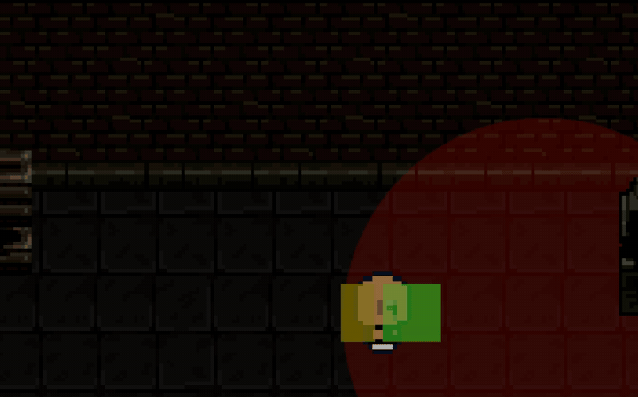

같은 방향 동기화 박스라도 게임플레이에 미치는 역할에 따라 **의도적으로 회전 방식을 분리**했습니다.

다만 과제 제출 빌드에서는 **시야 박스를 화면에 렌더링하지 않도록** 설정했기 때문에, 공들여 구현한 시야 보간 회전 연출이 플레이어에게 시각적으로 전달되지 못하는 한계가 있었습니다(→ 7-3).

### 5-2. 보스 4명 — 공통 몸 + 상태(옷) vs 보스마다 따로

| 방식 | 장점 | 단점 |
|---|---|---|
| 보스별 독립 클래스 작성 | 보스마다 완전히 다른 행동과 구조를 자유롭게 구현 가능 | 이동·회전·전투 판정 등 모든 보스가 공유하는 기능을 중복 구현해야 함 |
| **공통 몸(`EnemyStateManager`) + 상태 클래스 (선택)** | 공통 이동·회전·전투 판정을 한 번만 구현하고, 보스별 특유 패턴만 상태 클래스(예: `AlertMovePatternState`, `EnemyFakeKnockdownState`)로 추가 | `EnemyStateManager`에 이동·감지·박스 회전·넉다운 연출이 집중되어 약 400줄로 비대해짐(7-3, 6-1 #6). 또한 공통 몸의 버그(예: 회피 각도 식 오류)가 모든 보스에게 동시에 영향을 미침(6-1 #1) |

보스 4명의 기본 공격과 이동 메커니즘이 동일했기 때문에, 고유 기믹만 **보스별 상태(State)로 추가하는 구조**가 2주라는 짧은 개발 기간 내에 가장 효율적이라고 판단했습니다.

---

## 6. AI 협업

### 6-1. AI 코드 리뷰로 다시 본 내 코드

첫 프로젝트 제출을 마친 뒤, **혼자서는 원인을 짚기 어려웠던 부자연스러운 동작들**의 근본 원인을 찾기 위해 AI(Claude)에게 전체 코드 리뷰를 의뢰했습니다. 7-3에서 체감한 "시야 판정의 부자연스러움", "벽 끼임 현상", "클래스 역할 집중"이 **실제 코드의 어느 지점에서 비롯되었는지** 규명하는 것이 목표였습니다.

코드 리뷰를 AI와 함께 진행해 보니, 제출 당시에는 원인을 찾지 못해 막막했던 버그들의 핵심 원인을 짧은 시간 안에 정확히 짚어낼 수 있었습니다. AI가 도출한 9가지 리뷰 항목은 추측으로 남기지 않고 코드 대조와 디버그 로그 삽입을 통해 하나씩 직접 검증했습니다.

**AI 코드 리뷰 지적 사항 및 직접 검증 결과**

| # | AI가 짚은 문제 | 직접 확인한 결과 |
|---|---|---|
| 1 | 장애물 회피 각도 식의 정수 나눗셈 오류(`i=3`일 때 `3/4 = 0`)로 `-30°`를 두 번 탐색하고 **`-60°`는 탐색하지 않음** | 디버그 로그로 검증 — `-60°`는 단 한 번도 출력되지 않았으며, **벽 끼임 현상**의 직접적 원인이었음 |
| 2 | 대기(`Idle`) 상태 지속 시간에 의도한 3초 대신 **1초** 값이 적용됨 | 디버그 로그로 검증 — 278회 실행 모두 약 1초로 찍힘. 적이 주변을 충분히 둘러보지 않고 바로 순찰로 전환됨 |
| 3 | 와치만이 플레이어 위치가 아닌 감시자가 지키는 구역으로 출동함 | 버그가 아닌 의도된 레벨 디자인 사양임을 확인 (2-4) |
| 4 | 동시 피격 잠금(`combatResolved`)이 **적 인스턴스마다 개별 존재**함 | 코드로 확인 — 적 두 명이 동일한 프레임에 플레이어를 공격하는 경우 동시 판정을 막지 못함 |
| 5 | 재시도(씬 리로드) 이후 추격 BGM 카운터가 초기화되지 않고 남음 | 제출 당시 미해결 버그로 확인 (7-2 B) |
| 6 | `EnemyStateManager` 한 클래스가 다섯 가지 책임을 동시에 수행함 (약 400줄) | 개발 당시 직접 느낀 구조적 한계와 일치함 (7-3) |
| 7 | `DoorManager.Update`에서 보스 사망 여부를 매 프레임 폴링함 | 코드로 확인 — 이벤트 기반 전환으로 개선 가능 |
| 8 | 메뉴 UI 스크립트 3종의 코드가 거의 중복됨 | 기존 버그·개선 목록에 이미 기록해 둔 항목임을 확인 |
| 9 | `null` 참조 체크 누락 및 일부 스크립트 파일명 오타 | 코드로 확인 (`EnemyChaseState`·`EnemyAttackState`의 `Exit` 메서드 등) |

**#1 회피 각도 오류 상세 검증**
디버그 로그를 통해 확인한 결과, 와치만·랫만·다커만 모두 `0°, -30°, 30°, -30°, 60°` 순서로만 탐색을 수행했습니다. 4번째 탐색에서 이미 막혀 있던 `-30°` 방향을 중복 검사하는 동안 반대편 `-60°` 방향은 전혀 살피지 못했고, 이로 인해 앨리만이 가구 모서리 앞에서 4초 동안 제자리걸음을 하는 현상이 녹화 영상에서도 확인되었습니다.

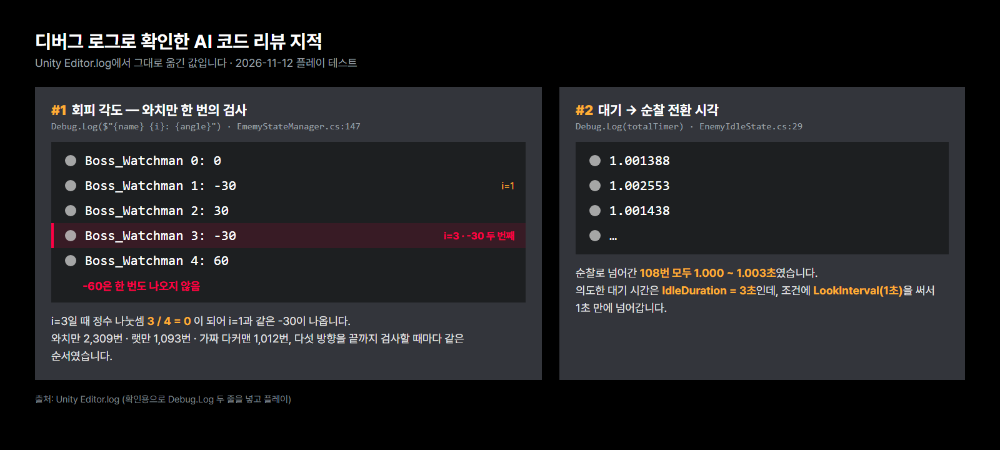

[사실 보강 예정: 지뢰 넉백 등 그 외 실제 플레이/로그 검증 장면이나 AI 리뷰 후 테스트 영상·스크린샷 보강 필요 여부 확인]

**AI 코드 리뷰를 통해 배운 점**
- **AI의 지적은 가설이고, 검증은 개발자의 몫입니다.** AI가 제시한 9가지 지적 중 #3(와치만 출동 위치)처럼 의도된 기획을 버그로 오인한 항목도 있었습니다. AI의 분석을 맹신하지 않고 회피 각도(#1)와 대기 시간(#2)은 디버그 로그로, 나머지 항목은 실제 코드와 실행 흐름을 대조하며 스스로 검증하는 기준을 세웠습니다.
- **주석보다 실제 런타임 값을 믿어야 합니다.** 회피 각도 코드의 주석에는 `0, 30, -30, 60, -60`이라고 적어 두었지만, 실제 런타임 로그에는 전혀 다른 값이 찍히고 있었습니다. 작성한 의도나 주석을 믿기보다 **실제 실행 값을 로그로 직접 확인하는 디버깅 습관**의 중요성을 체감했습니다.

---

## 7. 결과 및 배운 점

**목표한 게임 경험은 달성했는가**
1-2에서 설정한 핵심 경험 목표는 뒤통수를 치는 **통쾌한 복수**와, 한 대 맞으면 끝나는 **팽팽한 긴장감**이었습니다.
- **통쾌한 복수는 성공적으로 전달되었습니다.** 뒤통수 타격 순간을 전용 컷씬(SLAP!)과 타격음으로 연출해 단순한 단발성 공격에 강한 쾌감을 부여했습니다(7-1). 실제로 플레이해 본 동료들도 "연출이 화려하다", "사운드 활용이 적절하다"는 점을 가장 큰 장점으로 꼽았습니다.
- **긴장감은 절반의 성공에 그쳤습니다.** 원 히트 원 킬 규칙이 긴장감을 형성하기는 했으나, 적의 시야 범위가 화면에 보이지 않아 발각 시점을 예측하기 어려웠고 그로 인해 긴장감과 함께 "왜 들켰지?"라는 불합리함도 동반되었습니다(5-1, 7-3). 첫 플레이에서 판정이 다소 가혹하게 느껴졌지만, 오히려 그 점이 승부욕을 자극해 반복 도전을 이끌어냈다는 동료 피드백도 있었습니다.
- **의도와 달라진 플레이 감각** — 적의 시야를 읽고 은밀히 파고드는 잠입 액션을 의도했으나, 시야 정보가 시각적으로 제공되지 않다 보니 실제 플레이는 잠입보다 **순발력과 피지컬에 의존하는 액션 게임**에 가까워졌습니다. 이를 해결하기 위한 시야 시각화 계획은 7-4에 정리했습니다.

**핵심 문제 해결 결과 요약**

| 1-2에서 정의한 문제 | 구현 결과 | 남은 과제 |
|---|---|---|
| 동시 타격 판정 충돌 | 적 1명과 동시 타격 시 프레임 잠금으로 한쪽만 승리 처리 | 적 2명 이상이 동시에 타격하는 상황은 제어 불가 (6-1 #4) |
| 쓰러진 적의 잔여 공격 | 넉다운 가드 3중 적용 후 재테스트(2026-11-12)에서 재발하지 않음 | 장시간 플레이 환경에서의 추가 안정성 검증 필요 (7-2 A) |
| 보스 4명 구조 설계 | 공통 `EnemyStateManager`와 상태 패턴으로 보스 4명 구현 완료 | 단일 매니저 클래스 비대화(약 400줄) 리팩토링 필요 (6-1 #6) |
| 장애물 회피 이동 | `BoxCast` 부채꼴 탐색으로 기본적인 장애물 우회 구현 | 탐색 각도 계산식 오류 수정 및 A\* 길찾기 전환 필요 (6-1 #1) |
| 전투 BGM 전환 | 첫 플레이 세션에서는 추격 시작·종료에 맞춰 정상 전환 | 씬 재시도(리로드) 이후 BGM이 전환되지 않는 버그 미해결 (7-2 B) |

### 7-1. 배운 점

**게임 연출의 중요성**
코어 루프인 뒤통수 때리기와 회피 메커니즘 자체는 매우 단순합니다. 그 단순함이 단조로움으로 이어지지 않도록, 뒤통수 타격 순간과 피격 순간을 강렬한 **전용 컷씬**으로 시각화하여 플레이에 생동감과 카타르시스를 불어넣을 수 있었습니다.

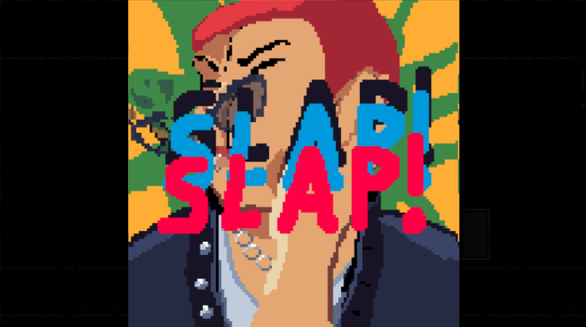

**사운드 디자인의 중요성**
발걸음과 타격 효과음(SFX)을 적용하기 전까지는 테스트 플레이에서 큰 재미를 느끼지 못했습니다. 적절한 타이밍에 타격음과 BGM 전환을 결합하자 액션의 손맛과 긴장감이 크게 살아났고, 게임 완성도에서 사운드가 차지하는 비중을 깊이 체감했습니다.

**피치 변조를 통한 사운드 단조로움 해소**
감시자가 플레이어를 발견할 때 재생되는 "Hey" 효과음은 처음에 고정된 톤으로만 재생되어 반복 플레이 시 단조롭게 느껴졌습니다. 효과음 리소스를 여러 개 추가하는 대신, 재생 시마다 **음높이(Pitch)를 무작위로 미세 조정(`pitch = Random.Range(0.9f, 1.1f)`)**하는 기법을 적용해 적은 리소스로도 훨씬 자연스러운 청각적 변화를 만들어냈습니다.

### 7-2. 트러블슈팅

**A. 적을 쓰러뜨렸는데 플레이어도 함께 쓰러지는 현상**

| 단계 | 내용 |
|---|---|
| 문제 | 뒤통수를 타격해 적이 넉다운 컷씬을 재생하는 도중, 플레이어 역시 피격 판정을 받아 게임 오버가 되는 현상이 빈번하게 발생했습니다. |
| 원인 | 넉다운 컷씬이 재생되는 동안 적 오브젝트가 즉시 비활성화되지 않은 채 유지되면서, 적의 공격 타격 박스가 계속 활성 상태로 판정을 내고 있었습니다. |
| 해결 | ① 1차 수정(7/6): 공격 타격 박스(`EnemyAttackHitBox`)와 피격 처리(`OnBackHit`) 진입부에 `IsKnockDown` 예외 처리를 추가했습니다.<br>② 2차 수정(7/22): `ChangeState` 입구에도 넉다운 가드를 추가하여, 감시자나 쥐 이벤트가 쓰러진 보스를 다시 다른 상태로 전환시키는 경로까지 원천 차단했습니다. |
| 결과 | 주로 적을 쓰러뜨린 직후 플레이어가 제자리에 멈춰 있을 때 발생하던 문제였으나, 두 차례의 방어 로직 적용 후 재검증 테스트(2026-11-12)에서는 동일 현상이 재발하지 않음을 확인했습니다. |

**B. 추격 BGM이 첫 번째 시도에만 재생되고 재시도 후 나오지 않는 현상**

| 단계 | 내용 |
|---|---|
| 문제 | 첫 플레이에서 적에게 발각되었을 때는 추격 BGM이 정상 재생되나, 게임 오버 후 재시도(씬 리로드)한 뒤에는 추격 BGM으로 전환되지 않았습니다. |
| 원인 (추정) | `SoundManager`가 씬 전환 후에도 유지되는 싱글톤(`DontDestroyOnLoad`)으로 구현되어 있어, 추격 도중 플레이어가 사망해 씬이 리로드되면 기존 적 오브젝트의 `Exit()`가 호출되지 않은 채 파괴됩니다. 이로 인해 `engagedEnemyCount`가 `0`으로 감소하지 않고 누적되어, 다음 판에서 첫 추격이 발생해도 카운트가 `1`이 아닌 `2` 이상이 되어 전환 조건(`engagedEnemyCount == 1`)을 통과하지 못하는 것으로 추정됩니다. |
| 시도 | 씬 초기화 시점에 `GameSceneInitializer`가 `SoundManager.ResetCombatMusicState()`를 호출해 카운터를 `0`으로 강제 초기화하도록 추가했습니다. |
| 결과 | 제출 당시에는 해당 조치 이후에도 간헐적으로 문제가 재현되어 완전히 해결하지 못했습니다. 추후 리팩토링 단계에서 씬 언로드 이벤트 및 상태 생명주기를 추적해 근본 원인을 수정할 예정입니다. |

[사실 보강 예정: 클로드 Pro에서 `SoundManager.cs` 및 `GameSceneInitializer.cs` 실제 코드를 대조하여 추격 BGM 카운터 미초기화 문제의 정확한 원인 규명]

### 7-3. 아쉬운 점 · 개선 계획

- **`EnemyStateManager`에 과도한 책임 집중** — 이동, 애니메이션 제어, 감지 조건 판정, 박스 회전, 넉다운 연출까지 단일 클래스가 모두 담당하면서 코드가 비대해졌습니다(6-1 #6). 기능별로 컴포넌트를 분리하는 설계를 초기 단계에 적용하지 못한 점이 아쉽습니다.
- **적 AI 이동 및 감지 버그** — 회피 각도 계산 오류로 인한 벽 끼임과 감지 판정의 부자연스러움 때문에 적이 어색하게 움직이는 장면이 발생했습니다.
- **시각화되지 않은 적의 시야 범위** — Trigger Collider로 플레이어를 감지하는 로직은 구현했으나, 적이 바라보는 시야 영역을 플레이어에게 시각적으로 보여 주지 못해 발각 판정이 불합리하게 느껴지는 한계가 있었습니다. 시야 내 벽 가림 판정(3-4)까지 겹치면서 플레이어가 은폐 여부를 직관적으로 파악하기 어려웠습니다.
- **보스별 상이한 판정 박스 기준 각도** — 히트·시야·허트 박스의 초기 회전 기준 각도가 보스 프리팹마다 통일되지 않아, 애니메이션 클립마다 각도를 개별 보정해야 했습니다. 다음 프로젝트에서는 프리팹 제작 단계에서 기준 좌표계와 초기 각도를 먼저 통일하고 시작할 계획입니다.
- **수작업 위주의 비효율적인 리소스 연결** — 픽셀아트 리소스를 전달받은 뒤 모든 캐릭터의 애니메이션 이벤트에 발걸음·공격 SFX와 히트 박스를 수작업으로 일일이 배치했습니다. 반복 작업을 줄일 수 있는 자동화 스크립트나 공통 프리팹 구조를 활용하지 못한 점이 아쉽습니다.
- **체계적인 디버깅 습관의 부재** — 첫 개발 당시에는 디버거와 로그를 활용해 원인을 추적하는 습관이 자리 잡지 않아, 버그의 현상만 확인하고 근본 원인을 해결하지 못한 채 제출한 항목들이 남았습니다.

**플레이 테스트 피드백**
- 와치만과 랫만의 출동 패턴이 유사하므로, 쥐가 처치되었을 때 랫만의 이동 속도가 증가하는 등 보스별 차별화 요소가 있으면 좋겠습니다.
- 적의 시야각을 화면에 시각화하고, 상태 전환 시 머리 위에 `!`·`?` 같은 직관적인 상태 아이콘을 표시하면 플레이 경험이 크게 개선될 것입니다.

### 7-4. 개선 계획 (리팩토링 로드맵)

기존에 작성한 업데이트 기획서에 6-1 AI 코드 리뷰 결과를 반영하여 구체적인 **리팩토링 우선순위**를 수립했습니다.

| 개선 영역 | As-Is (현재 구조) | To-Be (개선 목표) |
|---|---|---|
| 적 시야 인지 및 발각 UX | 시야 박스가 화면에 보이지 않으며, 접촉 즉시 추격 상태로 전환 | **「Darkwood」 스타일 시야 시각화** — 적의 시야각을 화면에 표시하고, 시야 진입 시 **발견 게이지**가 차오른 뒤 추격하도록 변경하여 은신·회피의 전략성 강화 |
| 장애물 회피 및 길찾기 | `BoxCast` 부채꼴 조향 회피 (정수 나눗셈 각도 오류 포함, 6-1 #1) | 각도 계산 오류 수정 후, 타일맵 그리드 기반 **A\* 길찾기 알고리즘**으로 교체하여 벽 끼임 완전 해소 |
| 동시 피격 및 판정 제어 | 적 인스턴스별 개별 프레임 잠금 (6-1 #4) | 전역 **히트 판정 매니저**를 도입해 한 프레임 내 모든 공격·피격 우선순위를 단일 지점에서 통제 |
| `EnemyStateManager` 책임 분리 | 단일 클래스에 5가지 역할 집중 (약 400줄, 6-1 #6) | 이동·감지·박스 회전·넉다운 연출을 개별 컴포넌트로 분리하고, 매니저는 상태 전환 조율만 담당 |

**리팩토링 진행 순서**
1. **단순 버그 및 네이밍 수정 (6-1 #1·#2·#9)** — 회피 각도 정수 나눗셈 수정, `Idle` 대기 시간 보정, `null` 체크 및 오타 수정 등 사이드 이펙트가 적은 항목부터 우선 처리
2. **전역 히트 판정 매니저 도입 (#4)** — 게임의 핵심 규칙인 "원 히트 원 킬" 판정의 일관성을 보장하기 위한 중앙 판정 구조 구축
3. **`EnemyStateManager` 컴포넌트 분리 (#6)** — 책임을 분리한 뒤, 독립된 이동 모듈만 A\* 길찾기로 안전하게 교체
4. **이벤트 기반 구조 전환 및 UI 중복 제거 (#7·#8)** — `DoorManager`의 매 프레임 폴링을 보스 사망 이벤트 구독 방식으로 전환하고, 중복된 메뉴 UI 스크립트 3종을 공통 부모 클래스로 통합

**회고를 마치며**
개발 당시에는 **설계 → 검토 → 구현**으로 이어지는 체계적인 개발 사이클과 AI 활용법을 충분히 알지 못했습니다. 이번 프로젝트를 통해 구조 설계의 중요성과 디버깅의 기본기를 배웠으며, 다음 프로젝트에서는 초반 아키텍처 설계 단계부터 AI와 함께 검토하며 훨씬 완성도 높은 게임을 만들어 갈 것입니다.

특히 위 로드맵 중 아래 두 가지는 잠입 액션 게임의 정체성을 완성하기 위해 최우선으로 개선하고 싶은 과제입니다.
- **A\* 길찾기 직접 구현** — 라이브러리에 의존하지 않고 직접 구현해 보며 길찾기 알고리즘의 원리를 체득하고자 합니다.
- **시야각 시각화 및 발견 게이지 도입** — 플레이어가 적의 시야를 눈으로 읽고 계산하며 잠입할 수 있어야 본래 기획했던 잠입 게임의 재미가 온전히 살아납니다.

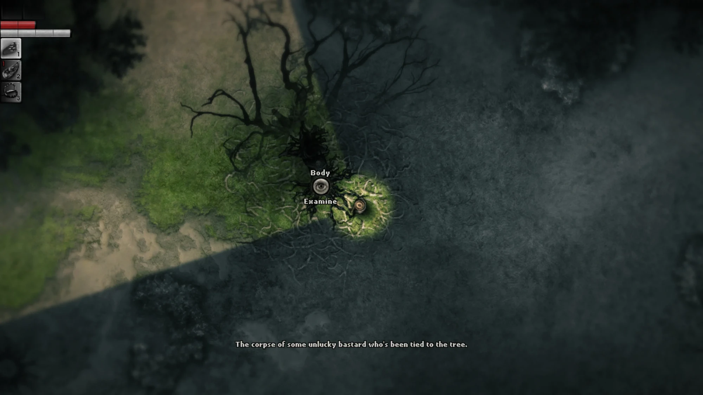