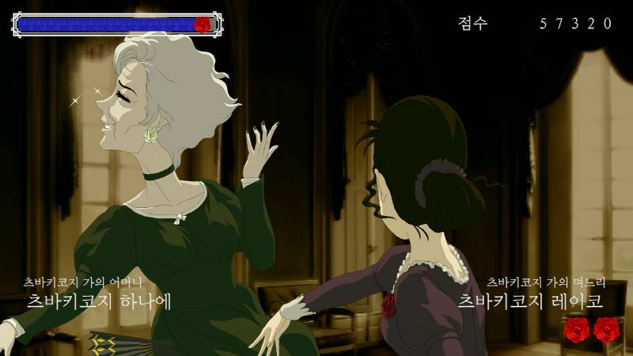
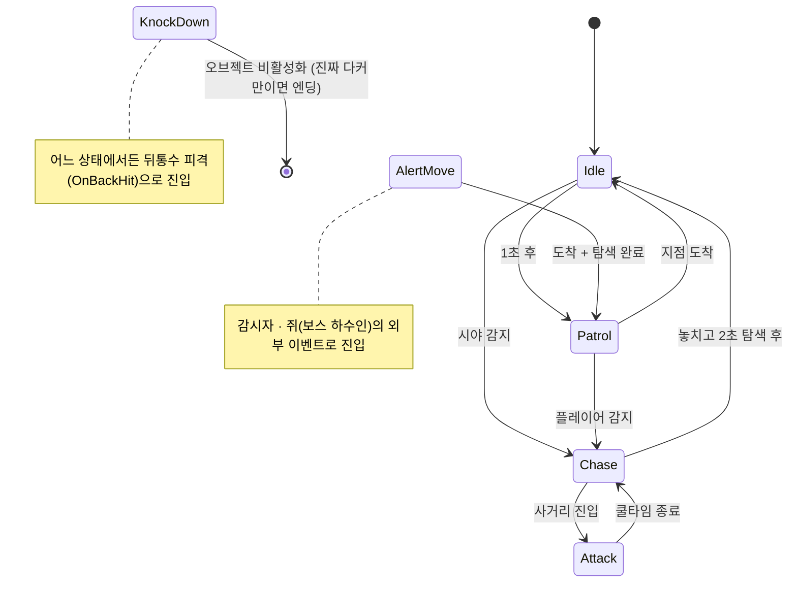
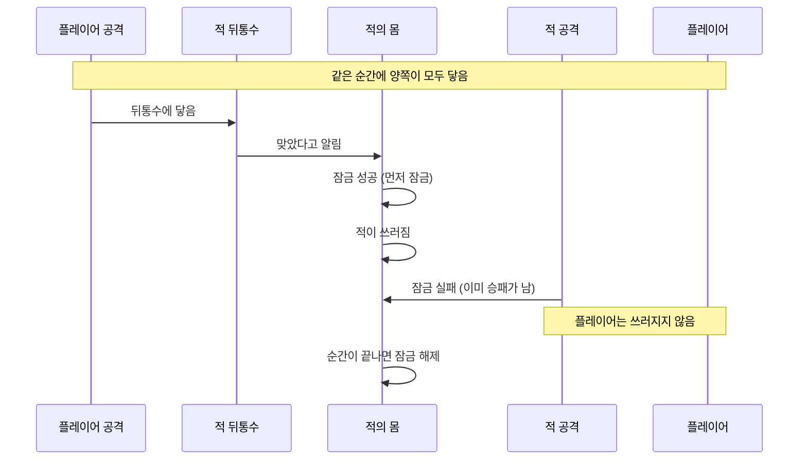
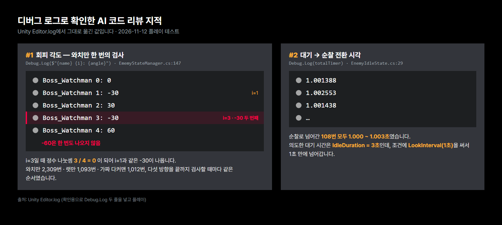
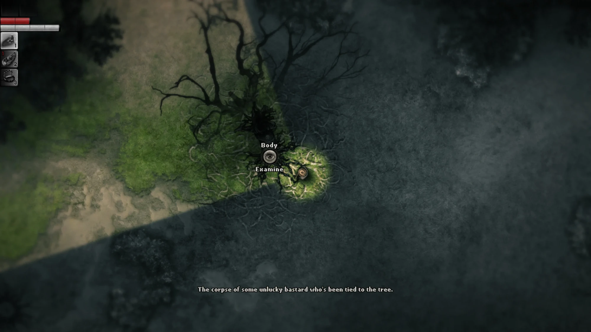

# 뒤통수를 조심해 (Watch Your Back) — 첫 개인 프로젝트 기술 문서

<!--
 출처 표시 뜻 (면접 대비 메모 — 화면에는 안 보임)
   · (출처: 본인 정리) = 「프로젝트 포트폴리오용 정리 내용.docx」
   · (출처: 초안 PDF) = 「뒤통수를 조심해 기술문서 초안 작업 중.pdf」
   · (출처: 본인 답변) = Claude와 작업하며 직접 답한 내용 (2026-11-09 ~ 11-12)
   · (출처: 코드·커밋) = 레포 3rd-2D-Project-pinkshield. 핵심 .cs는 code/ 폴더에 복사
 2026-11-12 퇴고 완료. 남은 표시: 5-2 B "(추정)"(해결 못 한 버그라 그대로 둠), 5-5 "리팩토링 순서 (Claude 제안)"
 2026-11-12 오후: 동기 「사천성」 문서 틀(색인표·문제 표·"없으면" 표·고민 요약·결과 표)을 넣고, 코드 설명을 쉬운 말로 줄인 뒤 다시 퇴고함
-->


## 1. 개요

### 1-1. 무엇을 만들었나 (What)

「뒤통수를 조심해」는 배신당한 플레이어가 자신을 버린 동료들에게 복수하며 진실을 알아 가는 **2D 탑다운 잠입·전투 액션 게임**입니다.
플레이어는 **적의 뒤통수를 때려야만 이기고**, 적에게 **한 번이라도 맞으면 게임 오버**입니다. 불공평한 싸움입니다.
조작은 간단하지만, 뒤통수를 때리는 순간을 **컷씬**으로 크게 보여 주는 데 가장 공을 들였습니다. *(출처: 초안 PDF)*


### 1-2. 왜 만들었나 (Why) — 기획 의도

**게임을 만든 계기** *(출처: 초안 PDF)*
살다 보면 누구나 한 번쯤은 통쾌한 복수를 하고 싶다는 생각이 듭니다. 특히 나의 뒤통수를 먼저 친 사람이라면, 물리적으로나 정신적으로나
그에 대한 복수를 하고 싶은 마음이 생기기 마련입니다. 그러나 실제로는 리스크가 너무 커서 그 행동을 하기 어렵습니다.
하지만 게임에서는 가능합니다. 게임 아이디어를 고민하다 문득 이 생각이 났고, 한 줄로 정리되었습니다 — **"뒤통수를 조심해"**.

**단순한 핵심 메커니즘** — 디벨로켓 프로그래머 과정에서 게임 개발을 처음 배우고 처음 만든 게임입니다. 아직 코드를 혼자 짜는 힘이 부족해서
핵심 메커니즘을 단순하게 정했습니다. **적의 뒤통수를 치면 승리, 플레이어가 맞으면 패배.** 다른 승패 조건은 없습니다.
플레이어와 적 모두 원 히트 원 킬이기 때문에, 규칙은 단순해도 긴장감이 생깁니다. *(출처: 초안 PDF · 본인 정리)*

**기술 목표** — 당시 수업에서 처음 배운 **코루틴**을 적 AI의 상태 행동에 직접 써 보는 것이었습니다(2-1). 써 보고 알게 된 한계와 다음 계획은 2-1·5-5에 있습니다. *(출처: 본인 답변)*

**기획에 영감을 받은 게임** — 「장미와 동백 (Rose and Camellia)」 *(출처: 본인 정리)*
「장미와 동백」은 NIGORO가 만든 병맛 막장 드라마풍의 뺨 때리기(싸대기) 격투 게임입니다. 게임 시스템을 가져온 것은 아닙니다.
**뺨 때리기**라는 단순하지만 강렬한 행동의 시각적 재미에서 영감을 얻어, **뒤통수 때리기**를 게임의 핵심으로 잡았습니다.



<!-- 2026-11-12 Claude 정리: 아래 표는 2·3장에 흩어진 문제를 한곳에 모은 것 — 확인 필요 -->

**그래서 풀어야 했던 문제** — 규칙이 "한 대 맞으면 끝"으로 단순한 만큼, 누가 먼저 때렸는지와 적의 움직임이 정확해야 했습니다.

| 플레이하며 생길 수 있는 문제 | 어떻게 풀려고 했나 | 절 |
|---|---|---|
| 플레이어와 적이 동시에 때리면 둘 다 이기거나 둘 다 짐 | 먼저 때린 쪽만 이기도록 잠금 | 3-2 |
| 쓰러진 적이 쓰러지는 연출 중에도 공격하거나 다시 움직임 | 쓰러진 적은 공격·이동을 못 하게 막음 | 3-1 · 5-2 A |
| 보스 4명은 기본 행동이 같고 특유 패턴만 다름 | 공통 몸 하나에 보스 패턴만 상태(옷)로 추가 | 2-1 · 4-2 |
| 적이 플레이어 쪽으로만 가면 벽에 막힘 | 몇 갈래로 앞을 살펴 비어 있는 방향으로 이동 | 3-3 |
| 적 여러 명이 쫓아와도 음악은 한 번만 바뀌어야 함 | 쫓아오는 적의 수를 세서 처음과 마지막에만 전환 | 3-4 |

### 1-3. 개발 환경 · 링크

| 항목 | 내용 |
|---|---|
| 장르 | 탑다운 액션 잠입 게임 (2D) |
| 플랫폼 | Windows PC |
| 엔진·도구 | Unity 6000.3.15f1, Visual Studio 2026, C# |
| 기간 | 2026-06-15 ~ 2026-07-07 (기획 1주 · 개발 2주) |
| 인원 | 1명 개발 · 아트: 아내 (픽셀아트 — 캐릭터 초상화, 피격 컷씬, 공격·이동 모션) |
| 영상 | [소개 쇼츠 (59초)](https://youtube.com/shorts/moNh2DrYCas) · [플레이 시연 영상 (YouTube, 3분 32초)](https://youtu.be/MgwuP_ErnK4) |
| GitHub | https://github.com/KooHoo-Dev/3rd-2D-Project-pinkshield |


<!-- ✍ GitHub 레포는 아직 비공개입니다(추후 공개 예정). 제출 전에 공개로 바꾸고 링크가 열리는지 확인하세요. -->

### 1-4. 레벨과 적 — 캐릭터와 레벨 디자인은 함께 간다

맵 레벨과 적의 능력을 묶어서 디자인했습니다. *(출처: 본인 정리)*

| 보스              | 구역 | 능력 |
|-----------------|---|---|
| 앨리만 (Alleyman) | 튜토리얼 | 플레이어를 감지하면 추격한다 (모든 보스의 공통 요소) |
| 와치만 (Watchman)  | 감옥 | 속박된 감시자가 플레이어를 감지하면, 구역 보스인 와치만이 감시자가 지키는 구역으로 이동 |
| 랫만 (Ratman)     | 시궁창 | 쥐를 밟으면 랫만이 쥐가 죽은 장소로 이동하여 순찰 |
| 다커만 (Darkerman) | 어두운 방 | 분신 둘과 본체 하나. 본체를 처치해야만 게임 클리어 |


보스 4명은 모두 같은 `EnemyStateManager`를 쓰고, 보스마다 다른 점은 **곁에 붙은 작은 스크립트**로만 만들었습니다. *(출처: 코드)*

| 보스 | 추가 스크립트 | 하는 일 |
|---|---|---|
| 와치만 | `Watcher` (감시자) | 감시자의 시야 박스에 플레이어가 들어오면 말풍선·"Hey" 효과음 후 0.5초 뒤 와치만에게 `AlertMovePatternState`를 입힘 |
| 랫만 | `RatController` (쥐) | 좌우 왕복(`Mathf.PingPong`)하다 플레이어에게 밟히면 죽는 연출 1초 후, 랫만에게 쥐 위치를 넘기고 `AlertMovePatternState`를 입힘 |
| 다커만 | `DarkermanIdentity` · `DarkermanInvisibleEffect` · `DarkermanBossManager` | 인스펙터 체크 하나로 진짜/가짜 구분. 진짜만 40초마다 0.3초간 반투명해지고, 진짜가 쓰러지면 엔딩 씬 로드 |

### 1-5. 이 문서에서 다루는 것

**적 AI 시스템** — 인터페이스로 상태를 나눈 FSM, 이동 방향에 맞춰 도는 시야·공격 박스, 동시 공격 판정.

| 구분 | 시스템 | 핵심 내용 | 절 |
|---|---|---|---|
| 핵심 A | 적 AI 구조 | 보스 4명이 몸 하나를 같이 쓰고, 행동만 상태(옷)로 갈아입음 | 2-1 · 2-2 · 3-1 · 4-2 |
| 핵심 B | 누가 먼저 때렸나 | 동시에 때려도 한쪽만 이기게, 쓰러진 적은 다시 못 움직이게 | 3-2 · 5-2 A |
| 보조 C | 판정 박스와 이동 | 적이 보는 방향으로 도는 박스, 벽을 피해 가는 이동 | 2-3 · 2-4 · 3-3 · 4-1 |
| 보조 D | 전투 음악 | 여러 적이 쫓아와도 음악은 한 번만 바뀌게 | 3-4 · 5-2 B |
| 돌아보기 | AI 코드 리뷰 · 개선 계획 | 부족했던 점의 원인을 디버그 로그로 직접 확인 | 5-4 · 5-5 |

프로그래밍을 배우고 만든 첫 게임이라 부족한 점이 많았습니다. 그래서 잘한 점만큼 **부족했던 점과, AI 코드 리뷰로 그 원인이 코드 어느 줄에 있는지 찾아본 과정**(5-4), 그리고 **개선 계획**(5-5)에 무게를 두었습니다.

---

## 2. 시스템 구조

### 2-1. 인터페이스를 활용한 적 AI — 몸은 하나, 옷만 갈아입는다

*(출처: 초안 PDF)*

적 AI 시스템을 비유하자면, `EnemyStateManager`는 **몸**이고, 각 `IEnemyState`는 그 몸이 잠깐 입는 **옷**입니다.
몸(콜라이더, 애니메이터, 이동·회전 함수, Player 참조)은 하나뿐이고, 지금 어떤 행동을 하는지는 지금 입고 있는 옷(상태 클래스)이 결정합니다.
옷을 갈아입어도(`ChangeState`) 몸의 위치와 컴포넌트 참조는 그대로 유지됩니다.

보스 4명은 외형만 다르고 공격·이동은 모두 같습니다. 그래서 이동·회전·전투 판정처럼 누가 해도 똑같은 기능은 몸에 두고,
"지금 무엇을 하는가"처럼 보스마다 달라질 수 있는 부분은 옷(상태 클래스)으로 뺐습니다. **몸은 4명이 같이 쓰고 옷만 갈아입는 구조**입니다.


`IEnemyState`는 세 메서드만 정합니다. *(출처: 코드 `IEnemyState.cs`)*

```csharp
public interface IEnemyState
{
    void Enter(EnemyStateManager stateManager);          // 상태에 진입할 때 한 번
    IEnumerator Execute(EnemyStateManager stateManager); // 상태의 실제 행동 루프 — 코루틴으로 실행
    void Exit(EnemyStateManager stateManager);           // 상태에서 빠져나올 때 한 번
}
```

상태는 오브젝트에 붙여 두는 것이 아니라, 바꿀 때마다 새로 만들어 입힙니다.
매 프레임 `Update`를 돌리는 대신 `Execute`를 **코루틴**으로 두어, "2초 기다렸다가 복귀"(`WaitForSeconds`) 같은 시간 흐름을 상태 안에 그대로 적을 수 있게 했습니다. *(출처: 코드)*

코루틴을 고른 이유는, 당시 수업에서 코루틴을 처음 배웠고 **배운 것을 직접 활용해 보고 싶은 마음**이 컸기 때문입니다. 그 당시에는 큰 문제가 없다고 느꼈지만, 지금은 상태가 많아지면 코루틴 관리가 어렵다는 것을 알게 되었습니다. *(출처: 본인 답변)*

**다른 방식과 비교** *(비교: Claude 정리)*

| 방식 | 장점 | 단점 |
|---|---|---|
| 코루틴 (지금 방식) | "2초 기다렸다가 복귀"를 한 줄로, 위에서 아래로 읽히게 쓸 수 있습니다 | 상태를 바꿀 때 `StopCoroutine`을 챙겨야 하고, 지금 어디까지 실행됐는지 디버깅하기 어렵습니다 |
| `Update`에서 `Tick()` 호출 | 매 프레임 한 번씩 불려 실행 흐름이 단순하고, 디버깅과 테스트가 쉽습니다 | 기다리는 시간을 타이머 변수로 직접 세야 해서 코드가 길어집니다 |
| `async`/`await` | 코루틴처럼 읽히면서, 값을 돌려받거나 예외를 잡을 수 있습니다 | 오브젝트가 꺼져도 저절로 멈추지 않아, 취소를 직접 챙겨야 합니다 |

다음 리팩토링 때는 디버깅과 테스트가 쉬운 **`Update`에서 `Tick()`을 부르는 방식**으로 바꿔 보는 것을 고려하고 있습니다. *(출처: 본인 답변)*

**누가 무엇을 맡나** *(출처: 코드)*

| 비유 | 맡은 스크립트 | 하는 일 |
|---|---|---|
| 몸 | `EnemyStateManager` | 이동, 보기, 박스 돌리기, 쓰러지는 연출 — 모든 보스가 같이 씀 |
| 옷 | 상태 7종 (`IEnemyState`) | 지금 무엇을 할지, 다음에 무엇을 할지 (2-2) |
| 감각 | 박스 스크립트 3종 | 무언가 닿으면 몸에 알리기만 함 (2-4) |
| 하수인 | 감시자 · 쥐 | 보스에게 "여기로 와"라고 위치만 알려 줌 (2-2) |

### 2-2. 상태 전환

*(출처: 초안 PDF)*



| 상태 클래스 | 역할 | 진입 조건 | 종료 후 전환 |
|---|---|---|---|
| `EnemyIdleState` (대기) | 제자리에서 랜덤 방향 둘러보기 | 시작 시 / 추격 실패 후 복귀 | 1초 후 Patrol, 시야 감지 시 Chase |
| `EnemyPatrolState` (순찰) | 지정 지점 왕복 이동 | Idle 종료 | 도착 시 Idle, 플레이어 감지 시 Chase |
| `EnemyChaseState` (추격) | 시야·마지막 목격 위치 추적 | 시야 내 플레이어 감지 | 사거리 진입 시 Attack, 놓치고 2초 탐색 후 Idle |
| `EnemyAttackState` (공격) | 공격 애니메이션 재생 + 쿨타임 | 공격 사거리 진입 | 쿨타임 종료 후 Chase |
| `AlertMovePatternState` (보스 패턴 1) | 알림 위치(감시자가 지키는 구역 / 쥐가 죽은 곳)로 이동 후 4방향 탐색 | 감시자 / 쥐(보스 하수인) 오브젝트의 외부 이벤트 | 도착 + 탐색 완료 시 Patrol |
| `EnemyKnockDownState` / `FakeKnockdownState` (넉다운) | 넉다운 연출 재생 | 뒤통수 피격 (`OnBackHit`) | (마지막 상태) 오브젝트 비활성화, 진짜 다커만이면 엔딩 씬 로드 |

전환 조건은 시야 박스와 공격 범위 박스로 판정합니다. "플레이어가 보이는가", "때릴 수 있는 거리인가"를 판정하는 함수는 몸(`EnemyStateManager`)에 있고, 이 함수를 불러 다음 상태를 정하는 것은 각 상태(옷)입니다.
예를 들어 Chase 상태는 플레이어가 공격 범위 박스 안에 들어오면 직접 Attack 상태로 전환합니다. 뒤통수 피격(넉다운)만 `EnemyStateManager`가 직접 전환합니다. *(출처: 코드 `EnemyChaseState.cs`·`EnemyStateManager.cs`)*

1-4의 와치만(감시자가 지키는 구역으로 이동)과 랫만(쥐가 죽은 곳으로 이동) 패턴은 `AlertMovePatternState` 하나로 만들었습니다.

외부 스크립트(감시자·쥐)는 보스의 내부를 몰라도 **목표 위치 하나만 넘기고 `ChangeState`를 부르면** 됩니다. *(출처: 코드 `Watcher.cs`·`RatController.cs`)*

```csharp
// RatController.cs — 쥐가 죽는 연출(1초)이 끝난 뒤
Ratman.LastPlayerPosition = transform.position;      // 쥐가 죽은 자리
Ratman.ChangeState(new AlertMovePatternState());

// Watcher.cs — 감시자가 플레이어를 본 뒤 0.5초 후
Watchman.LastPlayerPosition = SightBox.transform.position;
Watchman.ChangeState(new AlertMovePatternState());
```

### 2-3. 시야·공격 박스 회전

*(출처: 초안 PDF)*

적의 시야·공격·피격 판정 박스는 이동 방향에 맞춰 아래 표처럼 회전합니다.

| 이동 방향 | 공격·피격 판정 박스 각도 (바로 돌림) | 시야 박스 각도 (부드럽게 돌림) |
|---|---|---|
| 오른쪽 | 90° | 0° |
| 왼쪽 | 270° | 180° |
| 위 | 180° | 90° |
| 아래 | 0° | 270° |

-노란색(허트박스)-초록색(히트박스).png>)

대각선으로 움직일 때는 가로·세로 중 **더 많이 움직이는 쪽**으로 방향을 정합니다. 멈춰 있을 때는 마지막 방향을 그대로 봅니다. *(출처: 코드 `UpdateBoxRotations`)*

### 2-4. 박스와 매니저의 연결 — 박스는 알리기만, 판단은 매니저가

*(출처: 코드)*

각 박스(자식 오브젝트)에는 아주 작은 스크립트만 붙어 있고, 무언가 닿으면 **몸(`EnemyStateManager`)에 알리기만** 합니다.

| 박스 | 무언가 닿았을 때 하는 일 |
|---|---|
| 시야 박스 (빨강) | 플레이어가 들어오면 기억하고, 나가면 잊음 |
| 공격 범위 박스 (초록) | 추격 중인 적이 "때릴 수 있는 거리인가"를 확인할 때 씀 |
| 공격 타격 박스 (초록) | 플레이어에 닿으면, 이번 순간에 승패가 아직 안 났을 때만 플레이어를 쓰러뜨림 |
| 뒤통수 피격 박스 (노랑) | 무엇이 닿았는지 몸에 알리기만 함. 진짜 플레이어의 공격인지는 몸이 판단 |

시야 박스 안에 들어와도 바로 추격하지는 않습니다. 적과 플레이어 사이가 **벽에 가려 있으면** 못 본 것으로 칩니다.
그래서 빨간 원(시야 박스) 안에 있어도 벽에 가리면 들키지 않는데, 실제로 플레이어가 이를 눈치채기는 어려웠습니다(→ 5-3·5-5). *(출처: 본인 답변)*

---

## 3. 핵심 기능

### 3-1. 쓰러진 적은 다시 움직이지 않는다 — 상태 전환 (`ChangeState`), 정리와 가드를 함께

*(출처: 초안 PDF)*

밖에서는 내부 동작을 몰라도 `ChangeState` 하나만 부르면 상태가 바뀌도록 만들었습니다.
전환할 때 생길 수 있는 문제를 막으려고 두 가지를 넣었습니다.

- **넉다운 가드** — 이미 쓰러진 적이 다른 상태로 바뀌지 않게 막습니다.
- **순서 보장** — `Exit`과 `StopCoroutine`을 먼저 불러 이전 상태의 이동·사운드를 멈춘 뒤, 새 상태의 코루틴을 시작합니다.

```csharp
public void ChangeState(IEnemyState newState)
{
    if (IsKnockDown == true) return;                        // ① 넉다운 가드 — 쓰러진 적은 다시 움직이지 않음

    if (currentState != null) currentState.Exit(this);      // ② 이전 상태 정리 (정지·전투 BGM 해제)
    if (stateCoroutine != null) StopCoroutine(stateCoroutine); // ③ 이전 상태 루프 중단

    currentState = newState;
    currentState.Enter(this);                               // ④ 새 상태 진입
    stateCoroutine = StartCoroutine(currentState.Execute(this)); // ⑤ 새 상태 루프 시작
}
```

*(출처: 코드 `EnemyStateManager.cs`)*
넉다운 여부를 따로 `bool`로 들고 있지 않고 **지금 입은 옷(상태)의 종류**로 판단하기 때문에, 값을 깜빡하고 안 바꾸는 실수가 생기지 않습니다.
이 가드는 7월 22일 커밋("넉다운 상태일때 다른 상태 전환을 하지 않도록 예외처리 추가")에서 들어갔습니다. 감시자·쥐·테스트 키처럼 **밖에서** `ChangeState`를 부르는 곳이 여럿이라, 입구 한 곳에서 막는 것이 가장 확실했습니다.

<!-- 2026-11-12 Claude 정리: "없으면" 표는 코드 동작에서 거꾸로 짚은 것 — 확인 필요 -->

| 이것이 없으면 | 플레이 중에 보이는 문제 |
|---|---|
| ① 넉다운 가드 | 쓰러지는 연출 중에 쥐를 밟거나 감시자에게 들키면, 그 보스가 다시 출동함 |
| ② 이전 상태 정리 | 추격이 끝나도 "쫓는 적" 수가 줄지 않아 평상시 음악으로 돌아오지 않음 |

### 3-2. 동시에 때려도 한쪽만 이긴다 — 같은 프레임 동시 피격 방지 (`TryLockCombat`)

*(출처: 초안 PDF)*

플레이어와 적이 **동시에 공격**하면 둘 다 이기거나 둘 다 지는 판정이 나올 수 있습니다. 이를 막으려고 프레임 단위 잠금(Lock)을 넣었습니다.
같은 프레임에서는 **먼저 `TryLockCombat()`을 부른 쪽만** 판정을 가져가므로, 승패가 한쪽으로만 갈립니다.

```csharp
// EnemyStateManager.cs
private bool combatResolved = false;

public bool TryLockCombat()
{
    if (combatResolved == true) return false; // 이번 프레임에 이미 승패가 났음
    combatResolved = true;
    return true;
}

private void LateUpdate()
{
    combatResolved = false; // 프레임이 끝나면 잠금 해제 → 다음 프레임부터 다시 판정
}
```

잠금은 양쪽 입구에서 똑같이 확인합니다. *(출처: 코드 `EnemyAttckHitBox.cs`·`EnemyStateManager.OnBackHit`)*



뒤통수를 맞았을 때는 잠금 말고도 몇 가지를 차례로 확인합니다. *(출처: 코드)*

| 뒤통수를 맞았을 때 확인하는 것 | 없으면 플레이 중에 보이는 문제 |
|---|---|
| ① 플레이어의 공격이 맞나 | 적의 뒤통수에 플레이어 몸이 스치기만 해도 적이 쓰러짐 |
| ② 때린 플레이어가 이미 쓰러졌나 | 먼저 맞아 쓰러지는 중인 플레이어에게 적도 쓰러짐 |
| ③ 이번 순간에 이미 승패가 났나 (잠금) | 동시에 때리면 플레이어와 적이 함께 쓰러짐 |

**이 잠금이 필요했던 이유** *(출처: 본인 답변)*
플레이어가 뒤통수를 쳤는데도, 넉다운 컷씬이 재생되는 동안 보스가 꺼지지 않고 공격해서 **플레이어도 같이 죽는** 현상이 계속 일어났습니다.
당시에는 코딩 지식이 부족했고, 무료 AI로는 정확한 원인을 찾기 어려웠습니다. (→ 5-2 A)

### 3-3. 벽 앞에서 빈 길을 찾아 돌아간다 — 장애물 회피 이동 (`MoveWithAvoidance`)

*(출처: 코드 `EnemyStateManager.cs`)*

순찰·추격·출동 상태는 모두 같은 이동 함수를 씁니다. 가려는 방향으로 바로 가지 않고, **부채꼴로 몇 갈래를 살펴서 처음으로 비어 있는 방향**으로 움직입니다.
가는 선이 아니라 적의 **몸 크기만 한 상자**(`BoxCast`)로 살펴서, 몸이 실제로 지나갈 수 있는지 봅니다.

살피는 순서는 가운데부터 좌우로 번갈아 넓혀 가려고 했습니다. 그런데 나중에 디버그 로그로 확인해 보니, 실제로는 같은 쪽을 두 번 보고 한쪽 끝은 보지 않았습니다. *(출처: 5-4 디버그 로그, 기본값 30° · 5갈래)*

| 살피는 순서 | 1 | 2 | 3 | 4 | 5 |
|---|---|---|---|---|---|
| 의도한 각도 | 0° | 30° | -30° | 60° | **-60°** |
| 실제로 살핀 각도 | 0° | -30° | 30° | **-30°** | 60° |

그래서 -60° 쪽만 비어 있는 곳에서는 그 길을 못 찾고 벽에 끼일 수 있습니다. 원인과 확인 과정은 5-4(AI 리뷰 #1)에서 다룹니다.

### 3-4. 여러 명이 쫓아와도 음악은 한 번만 바뀐다 — 전투 BGM, 몇 명이 나를 쫓고 있나 세기

*(출처: 코드 `SoundManager.cs`·`EnemyChaseState.cs`)*

추격·공격 상태의 `Enter`에서 `NotifyCombatStarted()`, `Exit`에서 `NotifyCombatEnded()`를 부릅니다.
`SoundManager`는 지금 전투 중인 적의 수(`engagedEnemyCount`)를 세어, **0 → 1이 되는 순간** 전투 BGM으로, **1 → 0이 되는 순간** 평상시 BGM으로 크로스페이드합니다.
그래서 적 여러 명이 동시에 쫓아와도 음악이 한 번만 바뀝니다.

```csharp
public void NotifyCombatStarted()
{
    engagedEnemyCount++;
    if (engagedEnemyCount == 1) SwitchBgm(combatBgmClip);   // 첫 적이 전투를 시작한 순간
}

public void NotifyCombatEnded()
{
    engagedEnemyCount = Mathf.Max(0, engagedEnemyCount - 1);
    if (engagedEnemyCount == 0) SwitchBgm(normalBgmClip);   // 마지막 적까지 전투에서 벗어난 순간
}
```

---

## 4. 고민과 선택

<!-- 2026-11-12 Claude 정리: 2~4장에 흩어진 결정을 한 표로 모음. "다른 방법"·"내준 것" 칸 확인 필요 -->

이 게임에서 내린 결정과, 그 결정으로 내준 것을 한 표로 모았습니다. 첫 게임이라 **그때는 다른 방법을 몰라서 고르지 못한 것**도 있어, 그런 줄에는 "그때는 몰랐음"이라고 적었습니다. 4-1·4-2는 아래에서 자세히 다룹니다.

| 고민 | 다른 방법 | 고른 것과 이유 | 내준 것 |
|---|---|---|---|
| 보스 4명을 어떻게 만들까 (4-2) | 보스마다 따로 만들기 | **몸 하나 + 상태(옷)** — 기본 행동이 같으니 한 번만 만들고, 보스 패턴만 상태로 추가 | 몸 스크립트 하나에 일이 몰려 약 400줄이 됨 |
| 박스를 어떻게 돌릴까 (4-1) | 모든 박스를 같은 방식으로 | **역할마다 다르게** — 공격 판정은 정확하게 바로, 시야는 고개 돌리듯 부드럽게 | 정작 시야를 화면에 안 보이게 해서 그 연출이 전달되지 않음 |
| 상태의 행동을 무엇으로 돌릴까 (2-1) | 매 프레임 확인하기 | **코루틴** — "2초 기다렸다 돌아가기"를 그대로 적을 수 있고, 수업에서 배운 것을 써 보고 싶었음 | 상태가 많아지면 관리가 어려움 |
| 동시에 때리는 것을 어떻게 막을까 (3-2) | 판정을 한곳에서 하는 매니저 *(그때는 몰랐음)* | **적마다 잠금** — 그때 제가 아는 방법은 이것뿐이었음 | 적 둘이 같은 순간에 때리면 막지 못함 (5-4 #4) → 판정 매니저로 바꿀 계획 (5-5) |

### 4-1. 박스 회전 — 즉시 회전 vs 보간 회전

*(출처: 초안 PDF)*

| 박스 | 회전 방식 | 이유 |
|---|---|---|
| 공격·피격 판정 박스 | **즉시 회전** | 정확도와 즉각적인 반응이 중요하므로 `LerpAngle` 없이 바로 돌림 |
| 시야 박스 (`SightBox`) | **보간 회전** (`Mathf.LerpAngle`) | 적이 "고개를 부드럽게 돌리는 연출"을 살리기 위해 |

같은 "방향에 맞춰 도는 박스"라도 역할에 따라 **의도적으로 다르게** 처리했습니다.

다만 과제 제출 당시 마지막 빌드에서는 **시야 박스를 화면에 보이지 않게** 만들어, 플레이어가 적에게 발견되는 순간을 쉽게 알아채지 못했습니다.
시야를 부드럽게 돌리는 연출을 넣었지만 정작 그 시야가 보이지 않았던 것입니다. 플레이해 본 학원 동기들의 피드백을 보고, 시야 박스를 보여 주는 것이
더 합리적인 시스템이었을 수도 있다고 생각하게 되었습니다(→ 5-3). *(출처: 본인 답변)*

### 4-2. 보스 4명 — 공통 몸 + 상태(옷) vs 보스마다 따로

| 방법 | 장점 | 단점 |
|---|---|---|
| 보스마다 클래스를 따로 | 보스마다 행동을 자유롭게 다르게 만들 수 있습니다 | 이동·회전·전투 판정처럼 모든 보스가 같은 기능을 보스마다 반복해서 만들어야 합니다 |
| **공통 몸(`EnemyStateManager`) + 상태 클래스 (선택)** | 이동·회전·전투 판정을 한 번만 만들면 됩니다. 보스마다 다른 행동은 상태(옷)로 추가합니다 (예: `AlertMovePatternState`, `FakeKnockdownState`) | 공통 몸인 `EnemyStateManager`에 이동·감지·박스 회전·넉다운 연출이 모두 몰려 약 400줄이 되었습니다 (5-3, 5-4 #6). 또 공통 몸을 고치면 보스 4명이 모두 영향을 받습니다. 예를 들어 회피 각도 식의 오류가 모든 보스에게 똑같이 나타났습니다(5-4 #1) |

보스의 기본 공격은 모두 같기 때문에, 보스 특유의 패턴은 **보스마다 패턴 상태(state)로 추가**하는 것이 좋다고 생각했습니다.
실제로 만들어 보니 그 패턴은 해당 보스만 쓰기 때문에 문제가 없다고 판단했습니다. *(출처: 본인 답변)*

---

## 5. 결과 및 배운 점

<!-- 2026-11-12 Claude 정리: 1-2의 "그래서 풀어야 했던 문제"와 짝을 맞춘 결과 표. 내용은 3장·5-2·5-4에서 옮김 — 확인 필요 -->

**구현 결과** — 1-2에서 정한 문제가 어디까지 풀렸는지 정리했습니다. 다 풀지는 못했고, 남은 부분은 5-2~5-5에서 다룹니다.

| 1-2의 문제 | 결과 | 남은 것 |
|---|---|---|
| 동시에 때리기 | 적 한 명과 동시에 때리면 한쪽만 이김 | 적 둘이 같은 순간에 때리면 막지 못함 (5-4 #4) |
| 쓰러진 적의 공격 | 막는 곳을 세 군데 넣은 뒤 함께 쓰러지는 일이 줄어듦 | 가끔 다시 일어남 (5-2 A) |
| 보스 4명 | 몸 하나로 보스 4명. 와치만·랫만 패턴은 상태 하나로 만듦 | 몸 스크립트에 일이 몰림 (5-4 #6) |
| 벽 피하기 | 몇 갈래로 앞을 살펴 빈 방향으로 이동 | 각도 계산이 틀려 한쪽을 살피지 못해 벽에 끼임 (5-4 #1) |
| 전투 음악 | 첫 판에서는 의도대로 바뀜 | 다시 하기 뒤에는 바뀌지 않음, 해결하지 못함 (5-2 B) |

### 5-1. 배운 점

**게임 연출의 중요성** — 메인 루프인 뒤통수 때리기와 회피는 아주 단순합니다.
그래서 뒤통수를 때리는 순간과 뺨을 맞는 순간을 **컷씬**으로 보여 주어 플레이에 생동감을 더했습니다. *(출처: 본인 정리)*


**사운드의 중요성** — SFX(발걸음·타격음)를 넣기 전에는 테스트해도 큰 재미를 느끼지 못했습니다.
SFX를 넣자 플레이어와 적의 타격이 훨씬 재미있어졌고, SFX와 BGM의 중요성을 다시 한번 깨달았습니다. *(출처: 본인 정리)*

### 5-2. 트러블슈팅

**A. 적을 쓰러뜨렸는데 플레이어도 쓰러지는 문제**

| 단계 | 내용 |
|---|---|
| 문제 | 뒤통수를 쳐서 적이 넉다운 연출을 하는 중인데, 플레이어도 넉다운되어 게임 오버가 되었습니다. 계속 반복해서 일어났고, 당시 지식과 무료 AI로는 원인을 정확히 진단하기 어려웠습니다 *(출처: 버그 목록 · 본인 답변)* |
| 원인 | 넉다운 컷씬이 재생되는 동안 적 오브젝트가 아직 켜져 있어, 적의 공격 타격 박스가 계속 판정을 냈습니다 *(출처: 업데이트 기획서 "컷씬 재생 중에는 적이 비활성화 되지 않아 공격이 가능함")* |
| 해결 | ① 7/6 — 공격 타격 박스(`EnemyAttackHitBox`)와 `OnBackHit` 앞에 `IsKnockDown` 확인을 추가했습니다 ② 7/22 — `ChangeState` 입구에도 같은 가드를 넣어, 감시자·쥐가 쓰러진 보스를 다시 움직이게 하는 길까지 막았습니다 *(출처: 커밋 5e6e3d2·c964a73)* |
| 결과 | 이 문제는 주로 적을 쓰러뜨린 뒤 가만히 있을 때 적이 플레이어를 때려서 일어났습니다. 수정 뒤 다시 테스트해 보니(2026-11-12), 적을 쓰러뜨리고 가만히 있어도 적이 플레이어를 때리지 않아 더는 일어나지 않는 것으로 보입니다. *(출처: 본인 답변)* |

**B. 추격 음악이 처음 한 번만 나오는 문제**

| 단계 | 내용 |
|---|---|
| 문제 | 처음 추격 상태가 되었을 때는 추격 BGM이 나오지만, 재시도한 뒤에는 나오지 않았습니다 *(출처: 버그 목록)* |
| 원인 (추정) | `SoundManager`는 씬이 바뀌어도 남는 싱글톤(`DontDestroyOnLoad`)입니다. 추격 중에 플레이어가 죽고 씬을 다시 불러오면, 적의 `Exit`가 불리지 않아 `engagedEnemyCount`가 0으로 돌아가지 않습니다. 다음 판에서 첫 추격이 와도 카운트가 1이 아니라 2가 되어 BGM이 바뀌지 않습니다 |
| 시도 | 씬이 시작될 때 `GameSceneInitializer`가 `SoundManager.ResetCombatMusicState()`로 카운트를 0으로 되돌리게 했습니다 *(출처: 코드)* |
| 결과 | 과제 제출 당시에는 해결하지 못했습니다. 카운트를 되돌린 뒤에도 남은 문제라 다른 원인이 더 있을 수 있고, 추후 리팩토링 때 다시 확인할 예정입니다. *(출처: 본인 답변)* |

### 5-3. 아쉬운 점 · 개선 계획

- **`EnemyStateManager`에 역할이 몰림** — 이동·애니메이션 호출·감지(전환 조건 판정 함수)·박스 회전·넉다운 연출을
  `EnemyStateManager` 한 클래스가 모두 맡게 되었습니다(5-4 #6). 역할별로 클래스를 나누는 것까지는 생각하지 못했습니다. *(출처: 초안 PDF)*
- **적 FSM의 버그** — 플레이어 감지, 벽 끼임 같은 버그 때문에 적이 부자연스럽게 움직이는 장면이 생겼습니다. *(출처: 본인 정리)*
- **보이지 않는 적 시야** — Trigger Collider로 플레이어를 발견하고 추적하는 시야는 만들었지만,
  적이 나를 봤는지 플레이어가 **눈으로 확인할 수 없어서** 불합리하게 느껴지는 문제가 있었습니다. *(출처: 본인 정리)*
  시야 안에 있어도 벽에 가리면 들키지 않는 판정(2-4)까지 겹쳐, 언제 들키는지 짐작하기 더 어려웠습니다. 5-5의 발견 게이지는 이 문제를 풀려는 계획입니다. *(출처: 본인 답변)*
- **보스마다 다른 박스 시작 각도** — 히트·시야·허트 박스의 시작 각도가 보스마다 달랐는데, 이를 하나로 맞추지 않고
  애니메이션에서 보스마다 각도를 따로 조정했습니다. 그래서 각도 값이 보스마다 복잡하게 나뉘었습니다.
  처음 게임을 만들면서 기준을 먼저 정하지 못한 초보적인 실수였고, 지금 돌아보면 부족했던 부분입니다. *(출처: 본인 답변)*
- **하나하나 손으로 한 작업** — 아트는 아내가 직접 픽셀아트로 그려 주었기 때문에, 애니메이션은 제가 직접 연결해서 만들어야 했습니다.
  발걸음·공격 같은 SFX도 모든 캐릭터의 애니메이션 동작마다 일일이 붙였고, 적과 플레이어의 히트 박스도 하나씩 손으로 설정했습니다.
  지금 돌아보면 굉장히 비효율적인 작업이 많았습니다. *(출처: 본인 답변)*
- **버그를 찾지 못한 채 제출** — 처음으로 코드를 직접 짜면서 무료 AI를 쓰던 때였고, 디버그를 배우기는 했지만 아직 손에 익지 않아 디버그하는 습관이 없었습니다.
  그래서 버그를 발견해도 원인을 제대로 파악하지 못했고, 해결하지 못한 채로 과제를 제출했습니다. *(출처: 본인 답변)*

**플레이 테스트 피드백** *(출처: 레포 「게임 업데이트 기획서」 1.4)*
- 와치만과 랫만의 패턴이 비슷하다 — 쥐가 죽을 때 보스가 얻는 이점(예: 속도 증가)이 있으면 좋겠다.
- 적의 시야각을 화면에 표시하고, 상태가 바뀔 때 머리 위에 `!`·`?`를 띄우면 더 직관적이겠다.

### 5-4. AI 코드 리뷰로 다시 본 내 코드

<!--
 면접 대비: "이 식이 왜 -60°를 안 보나요?" → i=3일 때 정수 나눗셈 3/4 = 0이라 i=1과 같은 -30이 나옴. 로그 그림 ai-review-debug-log.png 참고.
-->

첫 게임을 끝낸 뒤, **혼자서는 어디가 문제인지 짚기 어려웠던 부분**을 AI(Claude)에게 코드 리뷰를 맡겨 다시 살펴보았습니다.
5-3에서 느낀 "부자연스러움"·"벽 끼임"·"역할 몰림"이 **코드의 어느 줄에서 나오는지** 찾는 것이 목표였습니다.

AI에게 코드 리뷰를 맡기는 것은 생각해 본 적이 없었는데, 해 보니 **오랫동안 찾지 못했던 원인을 짧은 시간에 찾을 수 있었습니다.** *(출처: 본인 답변)*

AI가 짚은 9건은 하나씩 직접 확인했습니다. 회피 각도(#1)와 대기 시간(#2)은 코드에 디버그 로그를 넣고 플레이한 뒤, 남은 로그를 Claude와 함께 분석했습니다.

**AI가 짚은 문제와 내가 확인한 결과** *(AI 지적 칸 출처: 코드 — Claude 분석)*

| # | AI가 짚은 문제 | 코드 위치 | 내가 확인한 결과 | 이어지는 아쉬움 |
|---|---|---|---|---|
| 1 | 회피 각도 식이 0°, -30°, 30°, **-30°**, 60° 순서로 나와 -30°를 두 번 보고 **-60°는 검사하지 않음** (주석의 의도는 0, 30, -30, 60, -60) | `EnemyStateManager.MoveWithAvoidance` | 디버그 로그로 확인했습니다. 와치만·랫만·다커만은 0, -30, 30, -30, 60 순서로만 찍히고 -60은 한 번도 나오지 않았습니다. 3번째(-30)와 4번째(60)를 검사한 횟수가 늘 같아(랫만 15,670번), 두 번째 -30은 이미 막힌 방향을 다시 볼 뿐 한 번도 길을 찾지 못했습니다. 9갈래·45°인 앨리만도 0, -45, 45, -45, 90, -90으로 -45를 두 번 봅니다. 앨리만이 가구 앞에서 90과 -90을 번갈아 고르며 4초 동안 제자리걸음을 하는 모습도 녹화에 찍혔습니다(매 프레임 같은 순서로 다시 고르기 때문으로 추정) | 벽 끼임 |
| 2 | 대기 시간에 `IdleDuration`(3초) 대신 `LookInterval`(1초)을 써서, 둘러보기는 1번만 하고 바로 순찰로 넘어감 | `EnemyIdleState.Execute` | 디버그 로그로 확인했습니다. 순찰로 넘어갈 때까지 기다린 시간 278번이 모두 1.00~1.01초였고, 3초는 한 번도 없었습니다 | 적 AI 부자연스러움 |
| 3 | 와치만이 가는 곳이 플레이어 위치가 아니라 **감시자 시야 박스의 위치** | `Watcher.FindAlrert` | 의도한 동작입니다. 와치만은 감시자가 지키는 구역으로 출동하도록 설계했습니다 | 와치만·랫만 패턴이 비슷함 |
| 4 | 동시 피격 잠금(`combatResolved`)이 **적 한 마리마다** 따로 있어, 적 둘이 같은 프레임에 판정하면 막지 못함. "먼저 호출한 쪽"은 물리 콜백 순서로 정해짐 | `EnemyStateManager.TryLockCombat` | 코드로 확인 — 잠금이 적마다 따로 있습니다. 동시 판정은 아직 재현하지 못했습니다 | 판정 문제 |
| 5 | 추격 BGM 카운터가 씬을 다시 불러와도 남아 있어, 두 번째 판부터 음악이 안 바뀜 | `SoundManager` (싱글톤) | 제출 당시 해결하지 못했습니다 (5-2 B) | 추격 음악 1회성 |
| 6 | 한 클래스가 이동·감지·박스 회전·넉다운 연출·진행도 기록까지 맡음 (약 400줄) | `EnemyStateManager` | 5-3에서 스스로 느낀 점과 같습니다 | 역할 몰림 |
| 7 | 보스가 쓰러졌는지 매 프레임 `Update`에서 확인함 | `DoorManager.Update` | 코드로 확인 — 매 프레임 보스 3명의 활성 상태와 문 콜라이더를 확인합니다 | 역할 몰림 |
| 8 | 메뉴 3종의 입력·강조·효과음 코드가 거의 같음 | `GameMenu`·`GameOverUIController`·`GameClearMenuController` | 버그 목록에 이미 적어 두었습니다 | 중복 코드 |
| 9 | `Exit`에서 `SoundManager.Instance`의 null 확인이 빠짐 (`Enter`에서는 확인함). 파일 이름과 클래스 이름이 다름 (`EmemyStateManager.cs`, `EnemyAttckHitBox.cs`) | 여러 곳 | 코드로 확인 — 추격·공격 상태의 `Exit` 두 곳에 null 확인이 없습니다 | 기본기 |



**가장 크게 배운 것** — 과제를 낼 때는 디버그하는 습관이 없어서 버그를 찾지 못했습니다.
이번에는 AI가 짚은 문제를 그대로 믿지 않고, 직접 디버그 로그를 찍어 값을 확인했습니다. 다만 코드에 대한 제 지식은 아직 많이 부족한 편입니다.
그래서 기초부터 차근차근 다시 공부해서, **AI가 만든 코드를 검토할 수 있는 눈**을 갖고 싶습니다. *(출처: 본인 답변)*

**하나 더 배운 것** — 주석과 실제 동작은 다를 수 있습니다. 회피 각도 식의 주석에는 0, 30, -30, 60, -60이라고 적었지만,
실제로 값을 찍어 보니 -30을 두 번 보고 -60은 보지 않았습니다. 그래서 주석을 믿기보다 **값을 직접 찍어 확인하는 습관**이 필요하다고 배웠습니다. *(출처: 본인 답변)*

### 5-5. 개선 계획 (아직 하지 않음)

미리 세워 둔 업데이트 기획서에, 5-4 리뷰 결과를 바탕으로 **리팩토링 순서**를 더했습니다. 리팩토링은 아직 하지 않았습니다.
*(출처: 레포 「게임 업데이트 기획서」 2.3·「UpdateAndBugList.md」 + 5-4)*

| 아쉬운 점 | As-Is (지금) | To-Be (계획) |
|---|---|---|
| 적이 플레이어를 보는지 알 수 없음 | 시야 박스에 닿는 순간 추격, 시야는 화면에 안 보임 | Darkwood식 시야 — 적의 시야를 화면에 보여 주고, 적 시야에 들어가면 **발견 게이지**가 차오르다 가득 찰 때 추격. 바로 들키지 않고, 적이 나를 보고 있다는 것을 미리 알 수 있게 |
| 장애물 우회·벽 끼임 | BoxCast 부채꼴 우회 (각도 식 오류 포함, 5-4 #1) | 각도 식부터 고친 뒤, 타일맵 격자 기반 **A\* 길찾기**로 교체해 더 똑똑한 적으로 |
| 동시 피격·넉다운 중 판정 | 적마다 잠금 (5-4 #4) | **히트 판정 매니저** 한 곳에서 판정 |
| `EnemyStateManager` 역할 몰림 | 한 클래스에 다섯 가지 역할 (5-4 #6) | 이동·감지·박스 회전·넉다운 연출로 나누고, 매니저는 상태 전환만 |

**리팩토링 순서**
1. 작은 버그와 이름 (5-4 #1·#2·#9) — 위험이 적고 결과가 바로 보임
2. 히트 판정 매니저 (#4) — 게임의 핵심 규칙 "원 히트 원 킬"이 여기 달려 있음
3. `EnemyStateManager` 나누기 (#6) — 나눈 뒤에는 이동 클래스만 A\*로 바꾸면 됨
4. `DoorManager`를 이벤트 방식으로 (#7), 메뉴 3종을 공통 부모로 묶기 (#8)

**다음 프로젝트에서 바꾼 것** — 다음 프로젝트였던 WeGotOne에서는, 이 게임의 적 FSM과 비슷한 `FishStateManager`는 **상태 전환만** 관리하고
`FishMovement`는 **움직임만** 맡도록 나눠서 설계해 보았습니다. *(출처: 본인 답변)*

**지금 다시 만든다면** — 당시에는 AI를 활용하는 방법을 잘 몰라서, **설계 → 검토 → 구현** 순서로 만드는 방식은 생각도 하지 못했습니다.
지금 이 프로젝트를 AI(Claude)와 그 순서로 협업해서 다시 만든다면, 완전히 다른 품질의 게임이 나올 것이라고 확신합니다.

특히 두 가지를 바꾸고 싶습니다. 지금의 게임은 잠입 액션 게임보다는 **피지컬 게임**에 더 가깝기 때문입니다.
- **적의 길찾기** — 맵이 타일맵이라 격자 기반 **A\* 길찾기**를 적용해, 지금보다 더 똑똑한 적을 만들고 싶습니다. 직접 구현해 보면서 길찾기의 원리도 이해하고 싶습니다.
- **보이는 시야** — 적의 시야 박스를 Darkwood의 시야처럼 화면에 보여 줘서, 플레이어가 적의 시야를 눈으로 확인하며 피해 다닐 수 있게 하고 싶습니다. 그래야 **잠입 게임의 정체성**이 살아납니다.

*(출처: 본인 답변)*



<!--
 📸 시연 영상 촬영 목록: _intake/촬영목록.md (git 제외 — 작업인계.md에도 요약)
-->
