# 뒤통수를 조심해 (Watch Your Back)
<!-- 11-23 지움: 제목의 "— 첫 개인 프로젝트" — 다른 작품과의 순서라(강사님 핵심 ②) -->

> 배신당한 전 보스가 옛 부하들의 뒤통수를 쳐서 복수하는 2D 탑다운 잠입 액션 게임입니다. 적의 뒤통수를 치면 이기고, 한 대라도 맞으면 집니다.
> 기획 · 레벨 · 애니메이션 연결 · 효과음을 혼자 맡았고, 스크립트는 대부분 AI가 짜 준 코드를 붙여 만들었습니다. 픽셀아트는 아내가 그렸습니다.
<!-- ✏️ 11-25 v3 머리 두 줄 신설 — 근거: 1-1 소개 · Ending.unity 대사("오랜만이군요 보스, 아니 Mahogany.") · 1-4 인원 칸 · 건우 님 11-25 답("대부분 ai가 짜준 것을 붙여서") -->

<!-- 확인 목록 (11-25 v3 코드 대조 · 재배치): 저장소 3rd-2D-Project-pinkshield main 29e03b1 대조 (작업 사본은 renewal 브랜치라 git show main:으로 읽음).
     코드 근거: ✅ 저장소 대조 · 📄 3 (다커만 "분신 둘" — 씬의 진짜/가짜 설정을 찾지 못함 · 7-3 #2 "278번" — 로그 그림 · 6-1 다시 하기 뒤 음악 원인 "(추정)") · ❓ 2 (① 문제 해결 4-5 · 5-4의 수정 코드를 누가 짰나 — 건우 님 11-25 답: 대부분 당시 AI가 짜 준 코드를 붙임, 집 PC 대화 기록으로 확인 예정 ② TopDownEnemyController 출처 — 건우 님 11-25 답: 수업에서 선생님이 만들어 주신 LLM으로 만듦, 자료 받기로 함).
     11-25 코드대로 고친 곳(건우 님 "모두 코드대로"): 감지 박스 줄(3-2) · 추격 → 대기 "2초 멈춘 뒤"(4-2) · 출동 → 추격 전환(4-2) · 앨리만 45° · 9갈래(4-4) · 박스 연결(5-2, 공격 타격 박스는 직접 쓰러뜨림, 참조 방식) · 주석 원문(7-2) · 코드 발췌 5곳 머리줄(SoundManager 발췌의 빠진 줄 되살림). 고친 문장마다 ✏️.
     11-25 참고 자료로 더한 것(건우 님 구글 문서 3개 — 「게임 개발 중 생긴 문제점 및 해결 방안」 메모 · 「적 AI 및 전투 판정 시스템 기술 문서」 · 「게임기획서 (통합본)」, 모두 저장소와 대조): 2-5 기획이 바뀐 곳 · 2-4 장막과 엔딩 대사 · 4-5 다커만 엔딩 버그 · 5-4 발견 경위 · 4-6 결정 표의 실제 순서 · 7-1 AI에게 준 조건.
     11-25 v3 재배치(건우 님 목차 안 확인): 예전 번호 → 새 번호 — 1-3→1-4 · 2-1→2-2 · 2-2→2-1 · 3장→4장 · 4장→5장 · 5장→6-1 · 6장→7장 · 7-1→6-2 · 7-2 A→5-4 · 7-2 B→6-1 · 7-3 · 7-4→8-3.
     11-26 통합본 v4 적용: 관문(2-2 「처음 배운」 · 「제 수준/실력」 3곳 · 강조 부사 · 「학원」) · 4-2 · 4-3 제목 · 결정 표 「정한 사람」 행(4-6 · 5-5) · 캡션 줄 12개 · 4장 머리 GIF(boss-styles) · 6-1 영상 시간 링크 · 7장 AI 네 칸(7-1 가리키기 표 신설 · 7-2 실제 지시문 원문 2개 · 7-3 AI가 틀린 곳) · 소결정 #### 제목. 남은 것: 「지금 고른다면」(4-6 · 5-5) · 📷 상태 컴포넌트 인스펙터 · 분량 935줄(기준선 650).
     ✏️ 설명 연습 목록(면접): 4-6 왜 몸+상태인가 · [A]였다면 · 보스가 10명이면 / 5-5 왜 시야만 보간인가 · 판정까지 보간이면 / 4-5 · 5-4 원인 한 문장 · 고친 규칙 한 문장 / 6-1 왜 카운터가 남는다고 보나 · 다음에 무엇을 찍어 볼까 / 7-3 #1 i=3에서 왜 -30이 나오나.
     code/ 폴더는 저장소와 같음 — EnemyStateManager.cs만 저장소 이름이 EmemyStateManager.cs이고 29e03b1의 디버그 로그 한 줄이 없음. -->

<!--
 출처 표시 뜻 (면접 대비 메모 — 화면에는 안 보임)
   · (출처: 본인 정리) = 「프로젝트 포트폴리오용 정리 내용.docx」
   · (출처: 초안 PDF) = 「뒤통수를 조심해 기술문서 초안 작업 중.pdf」
   · (출처: 본인 답변) = Claude와 작업하며 직접 답한 내용 (2026-11-09 ~ 11-12)
   · (출처: 코드·커밋) = 레포 3rd-2D-Project-pinkshield. 핵심 .cs는 code/ 폴더에 복사
   · (출처: 개발 메모) = 구글 문서 「게임 개발 중 생긴 문제점 및 해결 방안」 (11-25 받음)
   · (출처: 기획서) = 구글 문서 「뒤통수를 조심해 게임기획서 (통합본)」 (11-25 받음)
 2026-11-12 퇴고 완료. 남은 표시: 6-1 다시 하기 뒤 음악 "(추정)"(해결 못 한 버그라 그대로 둠)
 2026-11-12 오후: 동기 「사천성」 문서 틀(색인표·문제 표·"없으면" 표·고민 요약·결과 표)을 넣고, 코드 설명을 쉬운 말로 줄인 뒤 다시 퇴고함
-->

## 1. 개요

### 1-1. 무엇을 만들었나


*플레이 화면. 빨간 머리가 플레이어이고, 뒤쪽에는 앞으로 상대해야 할 적들이 미리 보입니다.* <!-- ✏️ 11-26 v4: alt가 파일 이름(플레이사진.png)이라 그림을 보고 설명으로 바꾸고 캡션 줄을 더함. 캡션 줄은 건우 님 11-26 문장(「뒤에는 상대해야 할 적들이 뒤에 미리 보여집니다」)을 다듬음. 플레이어 = 빨간 머리는 backstab.gif(앨리만 시야 원 · 뒤통수 컷씬)로 확인 -->

「뒤통수를 조심해」는 배신당한 플레이어가 자신을 버린 동료들에게 복수하며 진실을 알아 가는 **2D 탑다운 잠입·전투 액션 게임**입니다.
플레이어는 **적의 뒤통수를 때려야만 이기고**, 적에게 **한 번이라도 맞으면 게임 오버**입니다. 불공평한 싸움입니다.
조작은 간단하지만, 뒤통수를 때리는 순간을 **컷씬**으로 크게 보여 주는 데 가장 공을 들였습니다. <!-- 출처: 초안 PDF -->

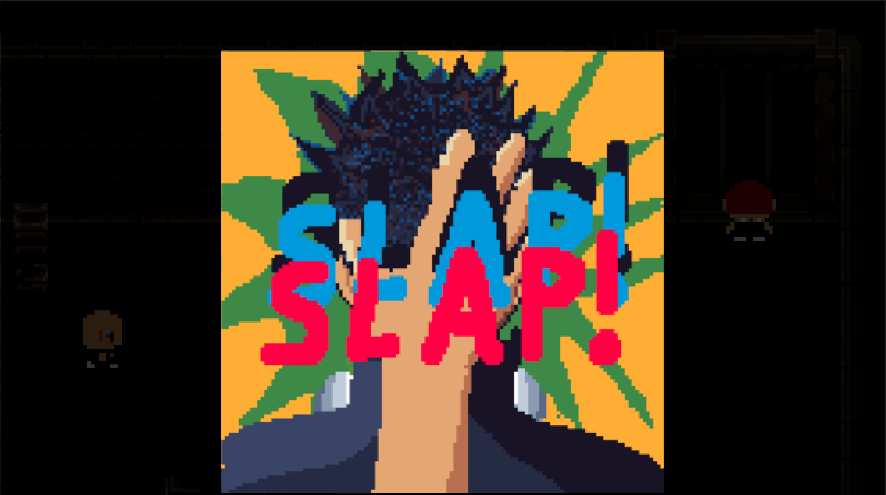
*뒤통수 타격 컷씬. 플레이어가 적의 뒤통수 공격에 성공하면 이 장면이 화면을 덮습니다(6-2).* <!-- ✏️ 11-26 v4 캡션 줄 — alt를 옮기고 6-2(컷씬으로 보여 줌)를 가리킴 -->

| 항목 | 내용 |
|---|---|
| 한 판 | 구역 4개를 차례로 지나갑니다. 구역마다 보스를 쓰러뜨리면 다음 구역 문이 열립니다 (2-1) |
| 구역 · 보스 | 튜토리얼 앨리만 · 감옥 와치만 · 시궁창 랫만 · 어두운 방 다커만 (2-4) |
| 규칙 | 플레이어와 적 모두 한 대 맞으면 쓰러집니다. 적은 뒤통수로만 쓰러뜨릴 수 있습니다 |
| 조작 | 이동 WASD · 방향키, 공격 Space |
| 이어 하기 | 게임 오버 뒤 「이어 하기」를 고르면 마지막으로 클리어한 구역의 다음 구역부터 다시 시작합니다 |
| 끝 | 진짜 다커만을 쓰러뜨리면 엔딩 대화(보스 4명이 배신한 이유) |
<!-- ✏️ 11-25 v3 사양 표 신설 — 근거: DoorManager.cs 59~61행(보스가 꺼지면 다음 문), EnemyAttckHitBox.cs · EmemyStateManager.OnBackHit(원 히트), PlayerMovement.cs 153행(Key.Space) · InputSystem_Actions Move(WASD · 방향키), GameOverUIController.ContinueFromLastRoom 148행 · GameSceneInitializer.MovePlayerToNextRoom, DarkermanBossManager.RealDarkermanDefeated · Ending.unity 대사 (main 29e03b1, 11-25 대조 ✅). 플레이 시간은 재지 않아 쓰지 않습니다 -->

**게임을 만든 계기** <!-- 출처: 초안 PDF -->
살다 보면 누구나 한 번쯤은 통쾌한 복수를 하고 싶다는 생각이 듭니다. 특히 나의 뒤통수를 먼저 친 사람이라면, 물리적으로나 정신적으로나
그에 대한 복수를 하고 싶은 마음이 생기기 마련입니다. 그러나 실제로는 리스크가 너무 커서 그 행동을 하기 어렵습니다.
하지만 게임에서는 가능합니다. 게임 아이디어를 고민하다 문득 이 생각이 났고, 한 줄로 정리되었습니다 — **"뒤통수를 조심해"**.

### 1-2. 풀어야 했던 문제

<!-- 2026-11-12 Claude 정리: 아래 표는 2·3장에 흩어진 문제를 한곳에 모은 것 — 확인 필요 -->
<!-- ✏️ 11-25 v3: 「다룬 장」 칸을 새 번호로, 「결과 한 줄」 칸은 8-1 결과 표에서 가져옴. 줄 순서를 기능 장 순서(4 → 5 → 6장)로 바꿈. 다섯 줄은 서로 다른 문제라 줄이지 않음(건우 님 11-25 확인) -->

규칙이 "한 대 맞으면 끝"으로 단순한 만큼, 누가 먼저 때렸는지와 적의 움직임이 정확해야 했습니다.

| 플레이하며 생길 수 있는 문제 | 어떻게 풀려고 했나 | 다룬 장 | 결과 한 줄 |
|---|---|---|---|
| 보스 4명은 기본 행동이 같고 특유 패턴만 다릅니다 | 공통 몸 하나에 보스 패턴만 상태(옷)로 더합니다 | 4-1 · 4-6 | 몸 하나로 보스 4명, 와치만·랫만 패턴은 상태 하나로 만들었습니다 |
| 적이 플레이어 쪽으로만 가면 벽에 막힙니다 | 몇 갈래로 앞을 살펴 비어 있는 방향으로 움직입니다 | 4-4 | 각도 계산이 틀려 한쪽을 살피지 못해 벽에 끼입니다 |
| 플레이어와 적이 동시에 때리면 둘 다 이기거나 둘 다 집니다 | 먼저 때린 쪽만 이기도록 잠급니다 | 5-3 | 적 한 명과 동시에 때리면 한쪽만 이깁니다 |
| 쓰러진 적이 쓰러지는 연출 중에도 공격하거나 다시 움직입니다 | 쓰러진 적은 공격·이동을 못 하게 막습니다 | 4-3 · 5-4 | 막는 곳을 세 군데 넣은 뒤 다시 테스트에서 일어나지 않았습니다 |
| 적 여러 명이 쫓아와도 음악은 한 번만 바뀌어야 합니다 | 쫓아오는 적의 수를 세서 처음과 마지막에만 바꿉니다 | 6-1 | 첫 판에서는 의도대로 바뀌고, 다시 하기 뒤에는 바뀌지 않습니다 |

### 1-3. 만든 방식

| 누가 | 무엇을 |
|---|---|
| 저 | 기획(기획서 · 보스와 구역 설계), 맵과 레벨 배치, 애니메이션 연결, 캐릭터마다 효과음 붙이기, 판정 박스 설정, AI에게 줄 기능과 조건 정리(7-2), 플레이 테스트와 버그 조건 좁히기(4-5 · 5-4) |
| AI | 스크립트 대부분 — 제가 정리한 기능과 조건으로 짜 준 코드를 붙여 썼습니다(7-2). 게임을 완성한 뒤에는 Claude가 코드 리뷰로 문제 9건을 짚었습니다(7-3) |
| 아내 | 픽셀아트 — 캐릭터 초상화, 피격 컷씬, 공격·이동 모션 |
<!-- ✏️ 11-25 v3 「만든 방식」 신설 — 근거: 건우 님 11-25 답("대부분 ai 가 짜준 것을 붙여서 써서 작업"), 1-4 인원 칸, 8-3 손작업 문단(본인 답변 11-12), 개발 메모 · 기획서의 AI 요청문, 7-2. 「저」 칸의 기획서는 구글 문서 「게임기획서 (통합본)」 -->

### 1-4. 개발 환경 · 링크

| 항목 | 내용 |
|---|---|
| 장르 | 탑다운 액션 잠입 게임 (2D) |
| 플랫폼 | Windows PC |
| 엔진·도구 | Unity 6000.3.15f1, Visual Studio 2026, C# |
| 기간 | 2026-06-15 ~ 2026-07-07 (기획 1주 · 개발 2주) |
| 인원 | 1명 개발 · 아트: 아내 (픽셀아트 — 캐릭터 초상화, 피격 컷씬, 공격·이동 모션) |
| 영상 | [소개 쇼츠 (59초)](https://youtube.com/shorts/moNh2DrYCas) · [플레이 시연 영상 (YouTube, 3분 32초)](https://youtu.be/MgwuP_ErnK4) |
| GitHub | https://github.com/KooHoo-Dev/3rd-2D-Project-pinkshield |


<!-- ✍ GitHub 레포는 아직 비공개입니다(추후 공개 예정). 제출 전에 공개로 바꾸고 링크가 열리는지 확인하세요. -->
<!-- 11-25 레포 공개 전환 확인(PUBLIC). 위 메모는 끝난 일입니다. -->

---

## 2. 게임 디자인

<!-- 2026-11-21 강사님 피드백("모든 문서에 게임 디자인 파트")으로 만든 장. 2-2·2-3·2-4는 1장에 있던 문단을 옮긴 것.
     ✏️ 2-1 코어 루프 그림과 그 아래 문단은 Claude가 1-1·2-4·8-1의 사실로 이어 쓴 것 — 본인 말로 확인 필요 -->

### 2-1. 한 스테이지의 흐름 — 숨어서 다가가고, 뒤통수를 친다

**경험 목표 — 뒤통수를 치는 통쾌한 복수와, 한 대 맞으면 끝나는 긴장감을 함께 주는 것입니다.**
<!-- ✏️ 11-25 v3: 경험 목표 문장은 8-1 「목표한 경험은 어떻게 됐나」의 두 가지를 옮긴 것 -->

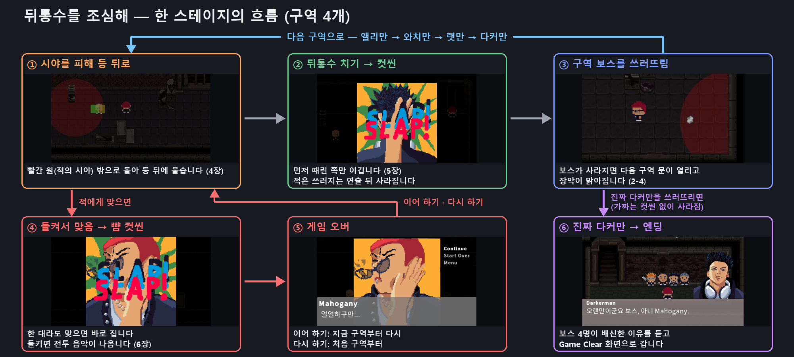
*한 스테이지의 흐름입니다. 적의 시야를 피해 등 뒤로 다가가 뒤통수를 치면 적이 쓰러지고, 구역 보스가 사라지면 다음 구역으로 갑니다. 한 대라도 맞으면 게임 오버이고, 이어 하기는 지금 구역부터 · 다시 하기는 처음 구역부터 시작합니다.* <!-- ✏️ -->
<!-- ✏️ 11-27 강사님 피드백(Asana "하루 흐름이 이상함" — 시퀀스 다이어그램 또는 이미지, 건우 님이 모든 문서의 흐름 그림에 적용하기로 함)으로 흐름도를 화면 그림으로 바꿈.
     화면: backstab.gif 3초 · cutscene-slap-back · 「알리만 버그 및 처치」 영상 0:29(앨리만이 사라지는 순간, 밝기 +30%) · cutscene-slap-face · GameOver · 「다커만 구간 플레이 이후 엔딩」 영상 1:30
     예전 그림과 다르게 고친 곳 (저장소 main 29e03b1, 11-27 대조 ✅):
     · 지는 조건은 들킴이 아니라 맞음 — EnemyAttckHitBox.OnTriggerEnter2D → PlayerMovement.KnockDown, KnockDownRoutine에서 hitCutScene → gameOverUI
     · 실패 뒤 길이 둘 — GameOverUIController.ContinueFromLastRoom(진행 유지) · RestartCurrentScene(ResetProgress 뒤 처음부터) 136~151행
     · 가짜 다커만은 컷씬 없이 사라짐 — OnBackHit → EnemyFakeKnockdownState → PlayKnockDownRoutine(false)
     예전 흐름도(지운 것):
     flowchart TB
         A["구역에 들어감"] → B["적의 시야를 피해<br/>뒤로 다가가기<br/>→ 4장"]
         B →|"들키지 않음"| C["뒤통수 때리기<br/>→ 5장"]
         C → D["뒤통수 컷씬 (SLAP!)<br/>적이 쓰러짐"]
         D →|"구역 보스를 쓰러뜨림"| E["다음 구역 문이 열림"]
         E → A
         B →|"적에게 들켜 맞음<br/>(들키면 음악이 바뀜 → 6장)"| F["뺨 맞는 컷씬<br/>게임 오버 → 다시 하기"]
         F → A
         D →|"진짜 다커만을 쓰러뜨림"| G["엔딩"] -->

한 판의 반복은 단순합니다. 적의 시야를 피해 뒤로 돌아가 뒤통수를 치면 컷씬과 함께 적이 쓰러지고, 구역 보스를 쓰러뜨리면 다음 구역으로 갑니다.
반대로 한 번이라도 맞으면 바로 게임 오버입니다. 이 "한 대로 끝나는" 반복이 통쾌한 복수와 긴장감을 함께 만듭니다.

다가가는 동안 적이 어떻게 움직이는지는 4장, 때리고 맞는 순간의 판정은 5장, 들켰을 때 바뀌는 음악은 6장에서 다룹니다. <!-- ✏️ 11-25 v3 다리 문장 -->

### 2-2. 규칙 — 뒤통수를 치면 이기고, 맞으면 진다

**단순한 핵심 메커니즘** — 핵심 메커니즘을 단순하게 정했습니다. **적의 뒤통수를 치면 승리, 플레이어가 맞으면 패배.** 다른 승패 조건은 없습니다. <!-- ✏️ 11-26 v4 관문(1-6 「처음 배운」): 앞머리 "디벨로켓 프로그래머 과정에서 게임 개발을 처음 배우고 처음 만든 게임이라," 지움 — 과정 이야기는 자기소개서에서 -->

플레이어와 적 모두 원 히트 원 킬이기 때문에, 규칙은 단순해도 긴장감이 생깁니다. <!-- 출처: 초안 PDF · 본인 정리 -->

### 2-3. 기획에 영감을 받은 게임

「장미와 동백 (Rose and Camellia)」 <!-- 출처: 본인 정리 -->
「장미와 동백」은 NIGORO가 만든 병맛 막장 드라마풍의 뺨 때리기(싸대기) 격투 게임입니다. 게임 시스템을 가져온 것은 아닙니다.
**뺨 때리기**라는 단순하지만 강렬한 행동의 시각적 재미에서 영감을 얻어, **뒤통수 때리기**를 게임의 핵심으로 잡았습니다.

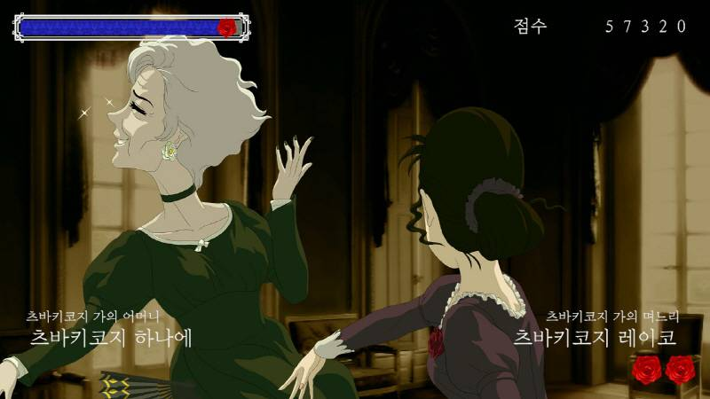
*참고 그림 — 「장미와 동백」(NIGORO)의 뺨 때리기 장면입니다. 이 게임의 화면이 아닙니다.*

### 2-4. 레벨과 적 — 캐릭터와 레벨 디자인은 함께 간다

맵 레벨과 적의 능력을 묶어서 디자인했습니다. <!-- 출처: 본인 정리 -->
보스의 이름과 구역, 능력이 서로 잘 어울리는 구조로 만들고 싶었습니다. <!-- 출처: 본인 답변 -->

| 구역 | 보스 | 능력 |
|---|---|---|
| 튜토리얼 | 앨리만 (Alleyman) | 플레이어를 감지하면 추격한다 (모든 보스의 공통 요소) |
| 감옥 | 와치만 (Watchman) | 속박된 감시자가 플레이어를 감지하면, 구역 보스인 와치만이 감시자가 지키는 구역으로 이동 |
| 시궁창 | 랫만 (Ratman) | 쥐를 밟으면 랫만이 쥐가 죽은 장소로 이동하여 순찰 |
| 어두운 방 | 다커만 (Darkerman) | 분신 둘과 본체 하나. 본체를 처치해야만 게임 클리어 |
<!-- ✏️ 11-25 v3: 레벨 표로 칸 순서를 「구역 | 보스 | 능력」으로 바꿈(내용 그대로) -->

**다음 구역을 가린 장막** — 아직 가지 않은 구역은 어두운 장막으로 가려 두었습니다. 보스를 쓰러뜨리면 다음 구역 장막의 불투명도가 255에서 177로 내려가 안이 비쳐 보이고,
마지막 다커만의 방만 213으로 더 어둡게 남깁니다. 「어두운 방」이라는 구역 이름을 장막으로도 보여 주려고 했습니다.
<!-- ✏️ 11-25 개발 메모(「맵 커튼 오브젝트의 스크립트」 요청문 — 보스가 비활성화되면 다음 장막 알파 177, Darkerman 213) · 근거: DoorManager.cs 12~14행(StandardCurtainAlpha 177 · DarkerCurtainAlpha 213) · 59~61행, 커밋 d03f25e 7/3 「DoorManager 맵 커튼 추가」 (main 29e03b1 대조 ✅). 마지막 문장(의도)은 Claude가 이은 것 — 본인 말로 확인 -->

**엔딩 — 보스들이 배신한 이유는 각자의 능력에 있었다** — 진짜 다커만을 쓰러뜨리면 엔딩 대화가 나오고, 플레이어(전 보스 「마호가니」)는 부하들이 배신한 이유를 듣습니다.
앨리만은 "끝없이 순찰만 했다", 와치만은 죄수들이 "헤이!"를 외칠 때마다 확인하러 가야 했다, 랫만은 자기 쥐들을 잘도 밟아 죽이더라, 다커만은 분신들과 밥 한 번 같이 먹은 적이 있었느냐고 말합니다.
보스마다 게임 속 능력(2-4 표)이 대사에 그대로 나와, 플레이어가 겪은 패턴이 이야기의 끝으로 이어지게 했습니다.
<!-- ✏️ 11-25 근거: Ending.unity EndingDialogueUI 대사 10줄(speaker 0 Mahogany ~ 4 Ratman) · 개발 메모 「엔딩 씬 EndingDlalogue 스크립트」 요청문의 대화 텍스트 (main 29e03b1 대조 ✅). 마지막 문장(의도)은 Claude가 이은 것 — 본인 말로 확인 -->

### 2-5. 기획이 바뀐 곳

처음 기획서와 실제로 만든 게임은 아래가 다릅니다. <!-- ✏️ 11-25 신설 — 왼쪽 칸은 기획서, 오른쪽 칸은 코드에서 확인 -->

| 기획서 | 만든 게임 | 다룬 곳 |
|---|---|---|
| 공격은 Z 키 | 공격은 Space 키입니다 (`PlayerMovement.cs` 153행) | — |
| 적의 시야는 앞쪽 부채꼴 | 적 둘레의 동그란 시야 박스와 벽 가림 판정을 썼습니다 | 5-2 |
| 모든 캐릭터의 등 뒤 180도가 뒤통수 판정 | 적에게만 뒤통수 피격 박스를 두고, 적이 보는 방향에 맞춰 4방향으로 돌립니다 | 5-1 |
| 타격 순간 화면 멈춤(히트 스탑) · 화면 흔들림 · 타격 파티클 | 넣지 않았고, 대신 뒤통수 · 뺨 컷씬과 타격음으로 보여 줍니다 | 6-2 |
| 대기 2초 뒤 순찰 | 코드 값은 3초로 정했지만 실제로는 1초 값을 써서 1초 뒤 순찰합니다 | 7-3 #2 |
| 실패하면 「다시 시도」 | 「다시 하기」와 함께, 마지막으로 클리어한 구역 다음부터 시작하는 「이어 하기」를 만들었습니다 | 1-1 |
| 플레이어가 공격했는데 빗나가면 적이 반격 | 만들지 않았습니다 | — |
<!-- ✏️ 11-25 근거: 기획서 1.2 ①②③ · 1.3 · 2.1 · 적 AI 조건 「1. 대기 … 2초간 대기 후」 「1.2 반격공격」. 코드: PlayerMovement.cs 153행 SimpleInput Key.Space, 시야 SightBox(원형 — 5-1 그림), EnemyBoxType.cs · EmemyStateManager.UpdateBoxRotations, 저장소 전체에 timeScale · Shake · ParticleSystem 없음, EnemyIdleState.cs 8 · 27행, GameOverUIController.cs 136~160행, 반격 상태 없음 (main 29e03b1 대조 ✅). 바뀐 이유는 5-1(4방향 아트) · 5-2(동그란 시야)에만 있고 나머지는 적지 않음 -->

---

## 3. 전체 구조 — 한 스테이지를 코드에서 다시 그리면

<!-- ✏️ 11-25 v3 장 신설. 클래스 · 화살표 · 「하지 않는 일」은 모두 저장소 main 29e03b1에서 확인 -->

2-1의 흐름(다가가기 → 때리기 · 맞기 → 쓰러진 뒤)을 코드 쪽에서 다시 그린 지도입니다. 4 · 5 · 6장은 이 지도의 한 구역씩을 확대합니다.

### 3-1. 구조 그림

이 그림에서 볼 것은 **보스 4명이 같은 적 본체 하나를 쓰고, 적이 하는 일은 본체 · 상태 · 박스로 나뉜다**는 점입니다. 주황 상자는 본체와 상태(4장), 파랑 상자는 시야 · 피격 · 타격 박스(5장), 초록 상자는 보스가 쓰러진 뒤나 들켰을 때 움직이는 것(4 · 6장)입니다. 실선은 직접 호출, 점선은 매 프레임 살펴보기입니다. <!-- ✏️ 11-27 묶음 상자 → 색 구분 -->
<!-- 11-27 전 문장: 이 그림에서 볼 것은 **보스 4명이 같은 적 본체 하나를 쓰고, 적이 하는 일은 본체 · 상태 · 박스로 나뉜다**는 점입니다. 실선은 직접 호출, 점선은 매 프레임 살펴보기입니다. -->

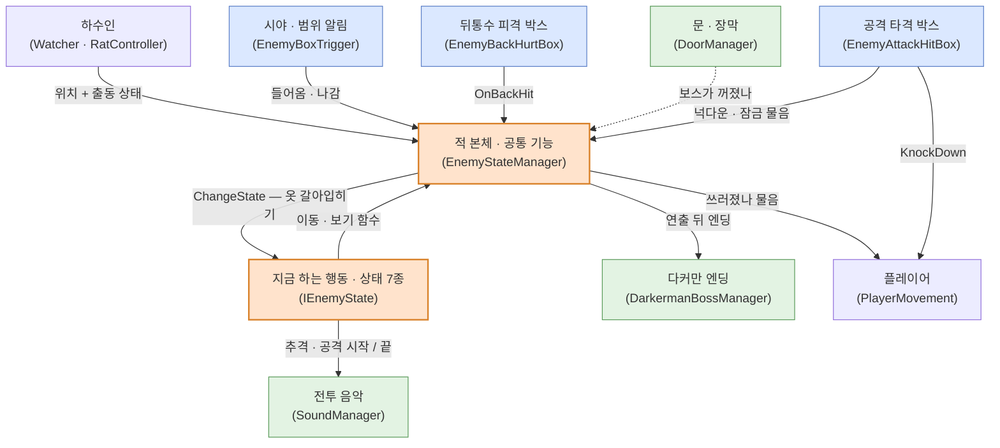
<!-- 11-27 색 구분 구조도로 바꾸기 전 그림(11-25 v3) 원문 — 주석이 닫히지 않게 화살표의 꺾쇠 앞에만 역슬래시를 넣어 적었습니다:
flowchart TB
    subgraph S1["다가가기 — 4장"]
        Minion["하수인 (Watcher · RatController)"]
        State["지금 하는 행동 · 상태 7종 (IEnemyState)"]
        Body["적 본체 · 공통 기능 (EnemyStateManager)"]
    end
    subgraph S2["때리기 · 맞기 — 5장"]
        Sense["시야 · 범위 알림 (EnemyBoxTrigger)"]
        Back["뒤통수 피격 박스 (EnemyBackHurtBox)"]
        Hit["공격 타격 박스 (EnemyAttackHitBox)"]
        Player["플레이어 (PlayerMovement)"]
    end
    subgraph S3["쓰러진 뒤 · 들켰을 때 — 4 · 6장"]
        Door["문 · 장막 (DoorManager)"]
        End["다커만 엔딩 (DarkermanBossManager)"]
        Sound["전투 음악 (SoundManager)"]
    end
    Minion --\>|"위치 + 출동 상태 입히기"| Body
    Body --\>|"ChangeState — 옷 갈아입히기"| State
    State --\>|"이동 · 보기 함수 부름"| Body
    Sense --\>|"플레이어가 들어옴 · 나감"| Body
    Back --\>|"OnBackHit"| Body
    Hit --\>|"넉다운 · 잠금 물음"| Body
    Hit --\>|"KnockDown"| Player
    Body --\>|"때린 쪽이 쓰러졌나 물음"| Player
    State --\>|"추격 · 공격 시작 / 끝"| Sound
    Body --\>|"연출 뒤 엔딩"| End
    Door -.-\>|"보스가 꺼졌나"| Body
-->
<!-- ✏️ 근거(main 29e03b1 ✅): Watcher.cs 80~81 · RatController.cs 98~99(LastPlayerPosition + ChangeState) / EmemyStateManager.cs 120~131(ChangeState) / 상태들의 manager.MoveWithAvoidance · Stop · CheckPlayerInSight · CheckPlayerInAttackRange / EnemyBoxType.cs 21~33 → OnBoxTriggerEnter · Exit / EnemyBackHurtBox.cs 17~20 → OnBackHit / EnemyAttckHitBox.cs 21~31(IsKnockDown · TryLockCombat · player.KnockDown) / OnBackHit 225~226(IKnockDownStatus — PlayerMovement가 구현) / EnemyChaseState · EnemyAttackState Enter · Exit → SoundManager.Notify… / PlayKnockDownRoutine 270~273 → RealDarkermanDefeated / DoorManager.cs 57~61 · 110(Update에서 activeSelf 확인) -->

그래서 보스 4명이 본체 하나를 같이 쓰고, 보스마다 다른 점은 곁에 붙인 작은 스크립트(하수인 · 다커만)와 상태 하나(출동)로만 더했습니다(4-1).

### 3-2. 핵심 클래스

| 역할 (이름) | 하는 일 | 하지 않는 일 | 다룬 장 |
|---|---|---|---|
| 적 본체 · 공통 기능 (EnemyStateManager) | 이동, 보이는지 · 때릴 수 있는지 판정, 박스 돌리기, 뒤통수 판정, 쓰러지는 연출을 맡고, 모든 보스가 같이 씁니다 | 넉다운 말고는 다음에 무엇을 할지 정하지 않습니다 — 상태가 정합니다 | 4 · 5장 |
| 지금 하는 행동 · 상태 7종 (IEnemyState) | 지금 무엇을 할지, 다음에 무엇을 할지 정합니다 | 이동 · 시야 계산을 직접 하지 않습니다 — 본체 함수를 부릅니다 | 4-1 · 4-2 |
| 하수인 (Watcher · RatController) | 플레이어를 보거나 밟히면 보스에게 위치를 넘기고 출동 상태를 입힙니다 | 보스의 이동을 직접 다루지 않습니다 — 위치 하나만 넘깁니다 | 4-2 |
| 시야 · 범위 알림 (EnemyBoxTrigger) | 플레이어가 박스에 들어오고 나가는 것을 본체에 알립니다 | 추격 여부를 정하지 않습니다 — 벽 가림은 본체가, 추격은 상태가 정합니다 | 5-2 |
| 뒤통수 피격 박스 (EnemyBackHurtBox) | 닿은 것을 그대로 본체에 넘깁니다 | 플레이어의 공격인지 가리지 않습니다 — 본체가 태그로 확인합니다 | 5-2 · 5-3 |
| 공격 타격 박스 (EnemyAttackHitBox) | 본체에 넉다운 · 잠금을 물은 뒤 플레이어를 쓰러뜨립니다 | 언제 공격할지 정하지 않습니다 — 공격 상태가 공격 애니메이션을 켭니다 | 5-2 · 5-3 |
| 플레이어 (PlayerMovement) | 움직이고, 공격하고, 맞으면 쓰러집니다 | 적을 쓰러뜨리는 판정을 하지 않습니다 — 적의 뒤통수 박스와 본체가 합니다 | 5장 |
| 문 · 장막 (DoorManager) | 보스가 꺼지면 다음 문을 열고 장막을 밝힙니다 | 보스에게서 알림을 받지 않습니다 — 매 프레임 직접 봅니다 | 2-4 · 7-3 #7 |
| 전투 음악 (SoundManager) | 쫓는 적의 수를 세어 음악을 바꿉니다 | 적이 쫓는지 직접 보지 않습니다 — 추격 · 공격 상태가 알려 줍니다 | 6-1 |
<!-- ✏️ 11-25 v3: 예전 3-1 「누가 무엇을 맡나」 표를 여기로 올리고 나눔. 「하지 않는 일」 근거(main 29e03b1 ✅): 본체의 ChangeState 호출은 Start(대기) · OnBackHit(넉다운)뿐 / 상태 7종에 Rb · Physics2D 없음 / Watcher · RatController는 LastPlayerPosition · ChangeState만 / EnemyBoxType.cs는 manager.OnBoxTrigger…만, CheckPlayerInSight 289행 Raycast는 본체 / EnemyBackHurtBox.cs는 OnBackHit(collision)만, 태그는 OnBackHit 221행 / EnemyAttckHitBox.cs에 공격 시작 코드 없음, EnemyAttackState.cs 28행 Anim IsAttack / PlayerMovement.cs에 OnTrigger 없음 / DoorManager.Update 57~61 / SoundManager에 적 참조 없음 -->

### 3-3. 약속 — 클래스끼리 무엇으로 이어지나

| 약속 | 보내는 쪽 | 받는 쪽 | 무엇이 일어나나 |
|---|---|---|---|
| 인터페이스 `IEnemyState` (`Enter` · `Execute` · `Exit`) | 본체의 `ChangeState` | 상태 7종 | 이전 상태를 정리하고 새 상태를 시작합니다 (4-3) |
| `LastPlayerPosition` + `ChangeState(new AlertMovePatternState())` | 감시자 · 쥐 | 와치만 · 랫만 본체 | 보스가 그 위치로 출동합니다 (4-2) |
| 태그 `Player` | 플레이어 몸 | 시야 · 범위 알림, 공격 타격 박스, 감시자, 쥐 | 닿은 것이 플레이어일 때만 반응합니다 |
| 태그 `PlayerAttack` | 플레이어 공격 박스 | 본체 `OnBackHit` | 플레이어의 공격이 뒤통수에 닿았을 때만 넉다운합니다 (5-3) |
| 인터페이스 `IKnockDownStatus` (`IsKnockDown`) | 본체가 묻습니다 | 플레이어 · 적 본체가 답합니다 | 이미 쓰러진 쪽의 공격은 무효입니다 (5-3) |
| `TryLockCombat` | 뒤통수 판정 · 공격 타격 박스 | 그 적의 본체 | 한 순간에 한쪽만 이깁니다 (5-3) |
| `NotifyCombatStarted` · `NotifyCombatEnded` | 추격 · 공격 상태의 `Enter` · `Exit` | `SoundManager` | 첫 적이 쫓기 시작하면 전투 음악, 마지막 적이 그만두면 평상시 음악 (6-1) |
| 보스 오브젝트 꺼짐 (`SetActive(false)`) | 넉다운 연출이 끝난 본체 | `DoorManager` | 다음 문이 열리고 장막이 밝아집니다 (2-4) |
<!-- ✏️ 11-25 근거(main 29e03b1 ✅): IEnemyState.cs · ChangeState / Watcher.cs 80~81 · RatController.cs 98~99 / CompareTag("Player") — EnemyBoxType.cs 23 · 30, EnemyAttckHitBox.cs 18, Watcher.cs 56, RatController.cs 55 / CompareTag("PlayerAttack") — OnBackHit 221 / IKnockDownStatus — EmemyStateManager.cs 7 · 19, PlayerMovement.cs 10 / TryLockCombat — OnBackHit 228, EnemyAttckHitBox.cs 25 / EnemyChaseState · EnemyAttackState Enter · Exit / PlayKnockDownRoutine 277 · DoorManager.cs 110 -->

---

## 4. 적 AI — 보스마다 다른 방식으로 나를 찾아온다
<!-- ✏️ 11-24 장 재구성(건우 님 요청): 예전 3장 시스템 구조 · 4장 핵심 기능 · 5장 고민과 선택에 흩어진 적 AI 절을 한 장으로 모음.
     ✏️ 11-25 v3: 3장 → 4장. 장 제목을 「몸은 하나, 옷만 갈아입는다」에서 플레이어가 겪는 말로 바꿈(제목 앞부분 — Claude 제안, 건우 님 목차 안 확인) -->

1-2의 「보스 4명」과 「벽에 막힘」 문제를 푸는 장입니다. 한 스테이지의 흐름에서 **적의 시야를 피해 다가가는** 단계, 3장 그림의 「다가가기」 묶음입니다. <!-- ✏️ 11-25 v3 다리 문장 -->

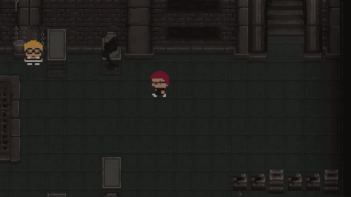
*감옥(앞 5.5초)과 시궁창(뒤 6.5초). 감시자의 말풍선 뒤에 와치만이, 쥐를 밟은 뒤에 랫만이 시야(빨간 원)와 함께 다가옵니다. 두 보스 모두 같은 출동 상태 하나로 움직입니다(4-2).*
<!-- ✏️ 11-26 v4 GIF(GIF 촬영 목록 2절 1번, 건우 님 장면 · 시간 확인) — ✂ 원본: Videos\화면 녹화\와치만 구간 플레이.mp4 0:06.5–0:12 + 랫만 구간 플레이 (…).mp4 0:05.5–0:12, 게임 창 1576×886 (172, 125) 자름 · 밝기 +0.06 · 10fps · 가로 720px(960px는 10MB를 넘어 줄임) · 8.3MB. 녹화 11-12 = 저장소 29e03b1 무렵 빌드 -->

### 4-1. 몸은 하나, 옷만 갈아입는다 — 인터페이스를 활용한 적 AI

<!-- 출처: 초안 PDF -->

적 AI는 보스 4명이 함께 쓰는 **적 본체**(`EnemyStateManager` — 이동 · 회전 · 승패 판정 같은 공통 기능)와 **지금 하는 행동**(`IEnemyState` — 대기 · 순찰 · 추격 등 상태 7종)으로 나뉩니다. 비유하자면 본체는 **몸**이고, 행동은 그 몸이 잠깐 입는 **옷**입니다. <!-- ✏️ 11-23 역할 → 이름 → 비유 순서로 고침 (클래스 설명 규칙) -->
몸(콜라이더, 애니메이터, 이동·회전 함수, Player 참조)은 하나뿐이고, 지금 어떤 행동을 하는지는 지금 입고 있는 옷(상태 클래스)이 결정합니다.
옷을 갈아입어도(`ChangeState`) 몸의 위치와 컴포넌트 참조는 그대로 유지됩니다.

보스 4명은 외형만 다르고 공격·이동은 모두 같습니다. 그래서 이동·회전·전투 판정처럼 누가 해도 똑같은 기능은 몸에 두고,
"지금 무엇을 하는가"처럼 보스마다 달라질 수 있는 부분은 옷(상태 클래스)으로 뺐습니다. **몸은 4명이 같이 쓰고 옷만 갈아입는 구조**입니다.

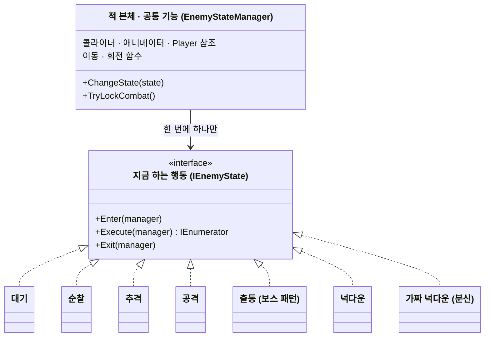

`IEnemyState`는 `Enter` · `Execute` · `Exit` 세 메서드만 정합니다(코드는 부록 A-1). <!-- 출처: 코드 `IEnemyState.cs` --> <!-- ✏️ 11-26 메서드 이름과 부록 가리키기를 더함 -->

<!-- ✏️ 11-26 v4 분량: 인터페이스 코드는 부록 A-1로 옮김(위 그림에 같은 세 메서드가 있음) -->

상태는 오브젝트에 붙여 두는 것이 아니라, 바꿀 때마다 새로 만들어 입힙니다.
매 프레임 `Update`를 돌리는 대신 `Execute`를 **코루틴**으로 두어, "2초 기다렸다가 복귀"(`WaitForSeconds`) 같은 시간 흐름을 상태 안에 그대로 적을 수 있게 했습니다. <!-- 출처: 코드 -->

코루틴을 고른 이유는, 그때 배운 코루틴을 **이 게임에 직접 써 보려고** 했기 때문입니다. 그 당시에는 큰 문제가 없다고 느꼈지만, 지금은 상태가 많아지면 코루틴 관리가 어렵다는 것을 알게 되었습니다. <!-- 출처: 본인 답변 --> <!-- ✏️ 11-26 v4 관문(1-6 「처음 배운」, 건우 님 확인): "당시 수업에서 코루틴을 처음 배웠고 배운 것을 직접 활용해 보고 싶은 마음이 컸기" → 위 문장 -->

코루틴 · `Update`에서 `Tick()` 호출 · `async`/`await` 세 방식의 장단점 비교는 부록 A-2에 있습니다. <!-- ✏️ 11-26 v4 분량: 비교 표를 부록 A-2로 옮김 -->

다시 만들 때는(8-3) 디버깅과 테스트가 쉬운 **`Update`에서 `Tick()`을 부르는 방식**으로 바꿔 보는 것을 고려하고 있습니다. <!-- 출처: 본인 답변 -->

<!-- ✏️ 11-25 v3: 「누가 무엇을 맡나」 표는 3-2 핵심 클래스 표로 올림 -->

보스 4명은 모두 같은 `EnemyStateManager`를 쓰고, 보스마다 다른 점은 **곁에 붙은 작은 스크립트**로만 만들었습니다. <!-- 출처: 코드 -->

| 보스 | 추가 스크립트 | 하는 일 |
|---|---|---|
| 와치만 | `Watcher` (감시자) | 감시자의 시야 박스에 플레이어가 들어오면 말풍선·"Hey" 효과음 후 0.5초 뒤 와치만에게 `AlertMovePatternState`를 입힙니다 |
| 랫만 | `RatController` (쥐) | 좌우 왕복(`Mathf.PingPong`)하다 플레이어에게 밟히면 죽는 연출 1초 후, 랫만에게 쥐 위치를 넘기고 `AlertMovePatternState`를 입힙니다 |
| 다커만 | `DarkermanIdentity` · `DarkermanInvisibleEffect` · `DarkermanBossManager` | 인스펙터 체크 하나로 진짜/가짜를 나눕니다. 진짜만 40초마다 0.3초간 반투명해지고, 진짜가 쓰러지면 엔딩 씬을 불러옵니다 |
<!-- ✏️ 11-26 v4: 표 칸의 음슴체를 "~습니다"로 (내용 그대로) -->
<!-- 📷 자리: 적 하나에 붙은 상태 컴포넌트 인스펙터 (몸은 하나, 옷만 갈아입는 구조) — GIF 촬영 목록 2절 4번 enemy-states-inspector.png (📷 건우 님) · 11-27 넣음(14 · 29번) -->

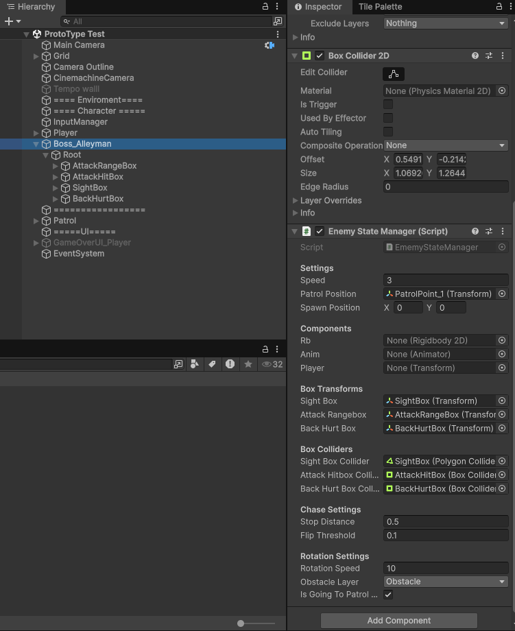
*앨리만(Boss_Alleyman) 오브젝트에는 몸인 `EnemyStateManager` 하나와 시야 · 공격 · 뒤통수 박스만 붙어 있습니다. 상태(옷)는 여기에 붙이지 않습니다.* <!-- ✏️ 근거: 2026-06-28 에디터 화면 -->

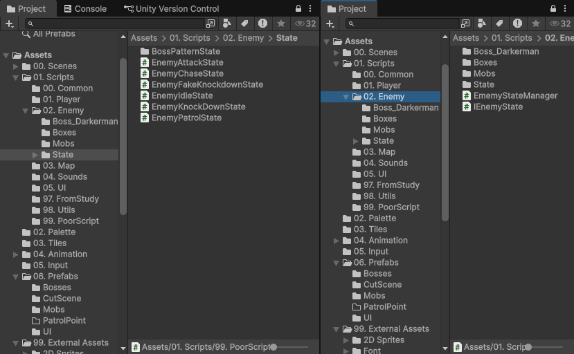
*상태는 `State` 폴더의 클래스로 따로 두고, 바꿀 때마다 새로 만들어 입힙니다.* <!-- ✏️ 근거: 2026-07-06 프로젝트 창 · 4-1 위 문단 -->

### 4-2. 다음 행동은 지금 입은 옷이 정한다
<!-- ✏️ 11-26 v4: 제목 「상태 전환」이 4-3과 겹쳐 규칙 문장으로 바꿈(건우 님 11-26 확인) -->

<!-- 출처: 초안 PDF · 11-21 강사님 피드백("FSM 같지 않다")으로 공통 네 상태를 「평소 행동」으로 묶어 다시 그림 — 전이는 부록 A-3 표와 같음 -->

이 그림에서 볼 것은 **평소 행동 네 가지는 보스 4명이 같고, 출동만 와치만 · 랫만에게 더해진다**는 점입니다. <!-- ✏️ 11-25 그림 앞 문장 -->

```mermaid
stateDiagram-v2
    direction TB
    state "평소 행동 — 보스 4명 공통" as Normal {
        direction LR
        state "대기 (Idle)" as Idle
        state "순찰 (Patrol)" as Patrol
        state "추격 (Chase)" as Chase
        state "공격 (Attack)" as Attack
        [*] --> Idle
        Idle --> Patrol : 1초 후
        Idle --> Chase : 시야 감지
        Patrol --> Idle : 지점 도착
        Patrol --> Chase : 플레이어 감지
        Chase --> Attack : 사거리 진입
        Attack --> Chase : 쿨타임 종료
        Chase --> Idle : 놓친 자리에서 2초 멈춘 뒤
    }
    state "출동 (AlertMove)<br/>와치만 · 랫만" as AlertMove
    state "넉다운<br/>(KnockDown)" as KnockDown
    state "가짜 넉다운<br/>(FakeKnockdown)<br/>가짜 다커만" as Fake
    [*] --> Normal
    Normal --> AlertMove : 감시자·쥐(하수인)의 신호
    AlertMove --> Normal : 도착 + 탐색 완료 → 순찰
    AlertMove --> Normal : 가는 중 플레이어 발견 → 추격
    Normal --> KnockDown : 뒤통수 피격 (OnBackHit)
    AlertMove --> KnockDown : 뒤통수 피격 (OnBackHit)
    KnockDown --> [*] : 오브젝트 비활성화<br/>(진짜 다커만이면 엔딩)
    Normal --> Fake : 가짜 다커만이 뒤통수 피격
    Fake --> [*] : 컷씬 없이 오브젝트 비활성화
```
<!-- ✏️ 11-27 가짜 넉다운을 더함(건우 님 확인) — 근거: OnBackHit의 isFakeDarkerman → EnemyFakeKnockdownState(EmemyStateManager.cs 231~238행) → PlayKnockDownRoutine(false)는 컷씬 없이 SetActive(false), IsKnockDown은 두 넉다운 상태 모두 참(19행) (main 29e03b1 대조 ✅). 다커만은 출동 상태가 없어 AlertMove → Fake 화살표는 없음 -->
<!-- ✏️ 11-27 그림 정리: 평소 행동 상자 안만 왼→오(direction LR)로 눕혀 세로로 긴 그림(893×1113, 슬라이드 글자 6.9px)을 1081×722로 바꿨습니다. 상태 7개 · 화살표 15개와 그 글은 그대로이고, 상자 글이 꺾이지 않게 줄바꿈만 넣었습니다. 슬라이드는 theme/deck-layout.css에서 그림 칸을 넓혔습니다 -->
<!-- 11-27 평소 행동을 눕히기 전 그림 원문 —
```mermaid
stateDiagram-v2
    direction TB
    state "평소 행동 — 보스 4명 공통" as Normal {
        state "대기 (Idle)" as Idle
        state "순찰 (Patrol)" as Patrol
        state "추격 (Chase)" as Chase
        state "공격 (Attack)" as Attack
        [*] -\> Idle
        Idle -\> Patrol : 1초 후
        Idle -\> Chase : 시야 감지
        Patrol -\> Idle : 지점 도착
        Patrol -\> Chase : 플레이어 감지
        Chase -\> Attack : 사거리 진입
        Attack -\> Chase : 쿨타임 종료
        Chase -\> Idle : 놓친 자리에서 2초 멈춘 뒤
    }
    state "출동 (AlertMove) — 와치만·랫만" as AlertMove
    state "넉다운 (KnockDown)" as KnockDown
    state "가짜 넉다운 (FakeKnockdown) — 가짜 다커만" as Fake
    [*] -\> Normal
    Normal -\> AlertMove : 감시자·쥐(하수인)의 신호
    AlertMove -\> Normal : 도착 + 탐색 완료 → 순찰
    AlertMove -\> Normal : 가는 중 플레이어 발견 → 추격
    Normal -\> KnockDown : 뒤통수 피격 (OnBackHit)
    AlertMove -\> KnockDown : 뒤통수 피격 (OnBackHit)
    KnockDown -\> [*] : 오브젝트 비활성화 (진짜 다커만이면 엔딩)
    Normal -\> Fake : 가짜 다커만이 뒤통수 피격
    Fake -\> [*] : 컷씬 없이 오브젝트 비활성화
```
-->

그래서 와치만 · 랫만의 패턴은 평소 행동과 따로, 출동 상태 하나를 더해 만들었습니다. <!-- ✏️ 11-25 그림 뒤 문장 — 근거: AlertMovePatternState.cs 하나를 Watcher · RatController가 함께 씀 -->

상태 일곱 가지의 진입 조건과 종료 후 전환은 부록 A-3 표에 있습니다. <!-- ✏️ 11-26 v4 분량: 위 그림과 같은 전환을 다시 보여 주는 표라 부록 A-3으로 옮김 -->

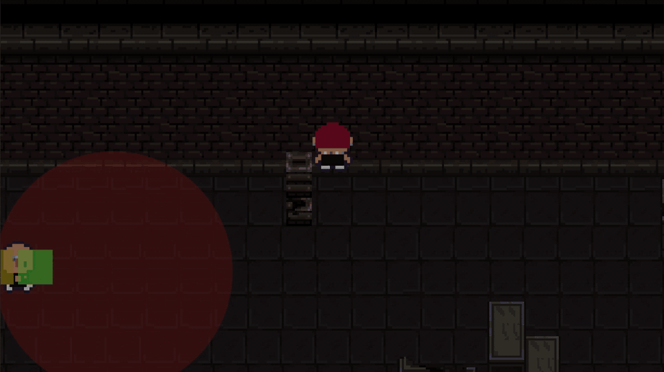
*들켰을 때. 시야(빨간 원)에 들키면 적이 추격 상태로 바뀌어 쫓아오고, 공격에 한 번 맞으면 뺨 컷씬과 함께 끝납니다.* <!-- ✏️ 11-26 v4 캡션 줄 — alt를 옮기고 「추격 상태로 바뀌어」(위 표의 Patrol → Chase)를 더함 -->

전환 조건은 시야 박스와 공격 범위 박스로 판정합니다. "플레이어가 보이는가", "때릴 수 있는 거리인가"를 판정하는 함수는 몸(`EnemyStateManager`)에 있고, 이 함수를 불러 다음 상태를 정하는 것은 각 상태(옷)입니다.
예를 들어 Chase 상태는 플레이어가 공격 범위 박스 안에 들어오면 직접 Attack 상태로 전환합니다. 뒤통수 피격(넉다운)만 `EnemyStateManager`가 직접 전환합니다. <!-- 출처: 코드 `EnemyChaseState.cs`·`EnemyStateManager.cs` -->

2-4의 와치만(감시자가 지키는 구역으로 이동)과 랫만(쥐가 죽은 곳으로 이동) 패턴은 `AlertMovePatternState` 하나로 만들었습니다.

외부 스크립트(감시자·쥐)는 보스의 내부를 몰라도 **목표 위치 하나만 넘기고 `ChangeState`를 부르면** 됩니다. 실제 두 줄은 부록 A-4에 있습니다(약속 표는 3-3). <!-- 출처: 코드 `Watcher.cs`·`RatController.cs` · ✏️ 11-26 부록 가리키기 문장 -->

<!-- ✏️ 11-26 v4 분량: 감시자 · 쥐 코드 두 줄은 3-3 약속 표 둘째 줄과 같아 부록 A-4로 옮김 -->

### 4-3. 쓰러진 적은 옷을 갈아입지 않는다
<!-- ✏️ 11-26 v4: 제목 「상태 전환 — 정리와 가드를 함께」가 4-2와 겹쳐 규칙 문장으로 바꿈(건우 님 11-26 B안 확인). 「정리」(Exit · StopCoroutine 순서)는 아래 본문 두 번째 글머리표에 그대로 있음 -->

<!-- 출처: 초안 PDF -->

밖에서는 내부 동작을 몰라도 `ChangeState` 하나만 부르면 상태가 바뀌도록 만들었습니다.
전환할 때 생길 수 있는 문제를 막으려고 두 가지를 넣었습니다.

- **넉다운 가드** — 이미 쓰러진 적이 다른 상태로 바뀌지 않게 막습니다.
- **순서 보장** — `Exit`과 `StopCoroutine`을 먼저 불러 이전 상태의 이동·사운드를 멈춘 뒤, 새 상태의 코루틴을 시작합니다.

```csharp
// EmemyStateManager.ChangeState (120~131행 발췌, ①~⑤ 주석은 문서용 — 파일 이름의 오타는 저장소 그대로)
public void ChangeState(IEnemyState newState)
{
    if (IsKnockDown == true) return;                        // ① 넉다운 가드 — 쓰러진 적은 다시 움직이지 않음

    if (currentState != null) currentState.Exit(this);      // ② 이전 상태 정리 (정지·전투 BGM 해제)
    if (stateCoroutine != null) StopCoroutine(stateCoroutine); // ③ 이전 상태 루프 중단

    currentState = newState;
    currentState.Enter(this);                               // ④ 새 상태 진입
    stateCoroutine = StartCoroutine(currentState.Execute(this)); // ⑤ 새 상태 루프 시작
}
```

<!-- 출처: 코드 `EnemyStateManager.cs` -->
넉다운 여부를 따로 `bool`로 들고 있지 않고 **지금 입은 옷(상태)의 종류**로 판단하기 때문에, 값을 깜빡하고 안 바꾸는 실수가 생기지 않습니다.
이 가드는 7월 22일 커밋("넉다운 상태일때 다른 상태 전환을 하지 않도록 예외처리 추가")에서 들어갔습니다. 감시자·쥐·테스트 키처럼 **밖에서** `ChangeState`를 부르는 곳이 여럿이라, 입구 한 곳에서 막는 것이 가장 확실했습니다.
이 가드를 넣게 된 버그는 5-4에서 다룹니다. <!-- ✏️ 11-25 v3 번호로 잇기 -->

<!-- 2026-11-12 Claude 정리: "없으면" 표는 코드 동작에서 거꾸로 짚은 것 — 확인 필요 -->

| 이것이 없으면 | 플레이 중에 보이는 문제 |
|---|---|
| ① 넉다운 가드 | 쓰러지는 연출 중에 쥐를 밟거나 감시자에게 들키면, 그 보스가 다시 출동합니다 |
| ② 이전 상태 정리 | 추격이 끝나도 "쫓는 적" 수가 줄지 않아 평상시 음악으로 돌아오지 않습니다 |
<!-- ✏️ 11-26 v4: 표 칸의 음슴체를 "~습니다"로 -->

### 4-4. 장애물 회피 이동

<!-- 출처: 코드 `EnemyStateManager.cs` -->

순찰·추격·출동 상태는 모두 같은 이동 함수를 씁니다. 가려는 방향으로 바로 가지 않고, **부채꼴로 몇 갈래를 살펴서 처음으로 비어 있는 방향**으로 움직입니다.
가는 선이 아니라 적의 **몸 크기만 한 상자**(`BoxCast`)로 살펴서, 몸이 실제로 지나갈 수 있는지 봅니다.
당시에는 A\* 길찾기 대신, 바로 만들 수 있는 방식으로 먼저 설계했습니다(→ 8-3에서 A\*로 바꿀 계획). <!-- 출처: 본인 답변 --> <!-- ✏️ 11-26 v4 관문(1-6 깎아내리는 평가): "A* 길찾기가 제 수준에서 구현하기 어렵다고 생각해, 제가 만들 수 있는 방식으로" → 위 문장 -->

살피는 순서는 가운데부터 좌우로 번갈아 넓혀 가려고 했습니다. 그런데 나중에 디버그 로그로 확인해 보니, 실제로는 같은 쪽을 두 번 보고 한쪽 끝은 보지 않았습니다. <!-- 출처: 7-2 디버그 로그, 기본값 30° · 5갈래 -->

아래 표는 와치만 · 랫만 · 다커만의 값(30° 간격 · 5갈래)입니다. 앨리만은 45° 간격 · 9갈래로 살피는데, 같은 식 때문에 -45°와 -90°를 두 번씩 보고 -135°는 보지 않습니다.
<!-- ✏️ 11-25 코드 대조: 각도 식 EmemyStateManager.cs 145행 `AvoidanceAngle * (i % 2 == 0 ? i / 2 : -(i / 4 + 1))`. 프리팹 값 Boss_Alleyman AvoidanceAngle 45 · RayCount 9, Boss_WatchMan · Ratman · Darkerman 30 · 5 (씬 덮어쓰기 없음). 앨리만 실제 순서 0, -45, 45, -45, 90, -90, 135, -90, 180 (main 29e03b1 대조 ✅) -->

| 살피는 순서 | 1 | 2 | 3 | 4 | 5 |
|---|---|---|---|---|---|
| 의도한 각도 | 0° | 30° | -30° | 60° | **-60°** |
| 실제로 살핀 각도 | 0° | -30° | 30° | **-30°** | 60° |

그래서 -60° 쪽만 비어 있는 곳에서는 그 길을 못 찾고 벽에 끼일 수 있습니다. 플레이 중에는 랫만이 장애물에 걸려 한 방향으로 계속 가는 모습으로 보였습니다. 원인과 확인 과정은 7-3(AI 리뷰 #1)에서 다룹니다.
<!-- ✏️ 11-25 「랫만이 장애물에 걸려 한 방향으로 계속 가는 모습」은 건우 님 11-25 답(참고 자료 「적 AI 및 전투 판정 시스템 기술 문서」의 "추격 상태 고정 이동 현상"과 같은 것). 고치지 않은 버그라 문제 해결 절이 아니라 여기와 8-2 요약 표에 둠 -->

### 4-5. 문제와 해결 — 진짜 다커만을 쓰러뜨리면 컷씬 없이 엔딩으로 넘어가던 버그

<!-- ✏️ 11-25 신설 — 출처: 개발 메모 「엔딩씬 연출 버그 발견: 진짜 다크맨을 죽였을 때 바로 씬으로 넘어가 뒷통수 연출이 되지 않음. EnemyKnockdown state 이후에 다크맨 엔딩으로 바꿔야 함」 · 커밋 4ce1f3d(7/6 「엔딩 씬 완성」) 전 → 후 (main 29e03b1 대조 ✅) -->

#### ① 진짜 다커만을 쳤을 때만 뒤통수 컷씬이 나오지 않고 바로 엔딩 씬으로 넘어갔습니다
<!-- ✏️ 11-26 v4.1(1-10 소결정 제목): 굵은 글 한 줄 → #### 제목. 날짜 · 커밋은 아래 줄로 -->

2026-07-06, 커밋 `4ce1f3d`
- **역할** — 발견 · 고칠 자리: 저(플레이 테스트) · 수정 코드: 당시 AI가 짜 준 코드를 붙임 · 확인: 저 <!-- ❓ 집 PC 대화 기록으로 확인 예정 (인계-11-25 1-1) -->
- **발견** — 다른 보스와 가짜 다커만은 컷씬 → 쓰러짐이 나오는데, **진짜 다커만만** 맞는 순간 엔딩으로 넘어가 뒤통수 연출이 보이지 않았습니다. 개발 메모에 "넉다운 상태 뒤에 엔딩으로 바꿔야 한다"고 고칠 자리를 적어 두었습니다.
- **원인** — 뒤통수를 맞는 순간(`OnBackHit`) 바로 엔딩 씬을 불러, 넉다운 연출이 재생될 틈이 없었습니다.
- **해결** — **"엔딩은 넉다운 연출이 다 끝난 뒤에만 부른다."** 엔딩 호출을 넉다운 연출 코루틴(`PlayKnockDownRoutine`)의 끝으로 옮겼습니다.
- **결과** — 진짜 다커만도 컷씬(1.8초) → 쓰러지는 애니메이션(0.3초 + 0.9초)이 끝난 뒤에 엔딩 씬이 불립니다.

```csharp
// 고치기 전 — EmemyStateManager.OnBackHit (커밋 4ce1f3d 이전, 발췌)
if (identity != null)
{
    bossManager.RealDarkermanDefeated();   // 맞는 순간 엔딩 씬으로
}

// 고친 뒤 — EmemyStateManager.PlayKnockDownRoutine (269~274행 발췌)
// 진짜 Darkerman이라면, 모든 넉다운 연출이 끝난 이 시점에만 엔딩 씬으로 전환
if (identity != null && identity.IsRealDarkerman == true && bossManager != null)
{
    bossManager.RealDarkermanDefeated();
    yield break; // 씬이 곧 전환되므로 아래 비활성화는 불필요
}
```
- 🔍 **확인** — `git show 4ce1f3d`에서 `OnBackHit`의 엔딩 호출이 빠지고 `PlayKnockDownRoutine` 끝에 들어간 것을 확인했습니다(11-25).

### 4-6. 고민과 선택 — 보스 4명: 공통 몸 + 상태(옷) vs 보스마다 따로

<!-- ✏️ 11-24 장 재구성: 예전 5장 요약 표에서 적 AI 줄 둘을 가져오고, 예전 5-2를 이어 붙임
     ✏️ 11-25 v3: 결정 표 v2 양식으로 바꿈. [A]는 실제로 처음 받은 코드(TopDownEnemyController)로 — 근거: 커밋 e0ada5f 6/24(Scripts/AI/TopDownEnemyController.cs 377줄 추가, 「simple coroutine-based FSM: Idle -> Patrol -> Attack -> ReturnToOrigin」) · 43e9d1d 6/25(직접 EnemyMovement.cs) · f025423 6/25(Interface/ 폴더에 AI 초안) · 4aef91f 6/26(「인터페이스 스테이트로 변경」) · 지금 99. PoorScript/ 폴더 (main 29e03b1 대조 ✅). TopDownEnemyController 출처는 건우 님 11-25 답(수업에서 선생님이 만들어 주신 LLM) — 자료 받으면 보강.
     요약 표의 「상태의 행동을 무엇으로 돌릴까 — 코루틴」 줄은 4-1 「다른 방식과 비교」에 같은 내용이 있어 뺌 -->

> **결정 대상** 보스 4명의 행동을 보스마다 한 클래스에 모을지, 공통 몸 하나에 상태 클래스를 갈아입힐지.

| | [A] 보스마다 한 클래스 | **[B] 공통 몸(`EnemyStateManager`) + 상태 클래스 ✓** |
|---|---|---|
| 방식 | 처음 받은 `TopDownEnemyController`처럼 대기 → 순찰 → 공격 → 복귀를 한 파일 안의 코루틴으로 이어 부릅니다 | 몸 하나에 상태 7종을 `ChangeState`로 갈아입힙니다 |
| 장점 | 보스마다 행동을 자유롭게 다르게 만들 수 있습니다 | 이동·회전·전투 판정을 한 번만 만들면 됩니다. 보스마다 다른 행동은 상태(옷)로 추가합니다 (예: `AlertMovePatternState`, `FakeKnockdownState`) |
| 단점 | 이동·회전·전투 판정처럼 모든 보스가 같은 기능을 보스마다 반복해서 만들어야 합니다 | 공통 몸인 `EnemyStateManager`에 이동·감지·박스 회전·넉다운 연출이 모두 몰려 약 400줄이 되었습니다 (8-3, 7-3 #6). 또 공통 몸을 고치면 보스 4명이 모두 영향을 받습니다. 예를 들어 회피 각도 식의 오류가 모든 보스에게 똑같이 나타났습니다(7-3 #1) |
| 정한 사람 | 기준: 저(보스의 기본 공격이 모두 같음) · 두 안: [A] 수업용 LLM이 만든 코드 · [B] AI가 낸 인터페이스 상태 초안 · 고름: 저 | |
<!-- ✏️ 11-26 v4 「정한 사람」 행 — 근거: 아래 기울임꼴 줄의 커밋 4개(e0ada5f · 43e9d1d · f025423 · 4aef91f), 「고름 · 기준」은 아래 [B] 이유 문단(본인 답변). 과정 줄은 날짜가 있는 이야기라 그대로 둠 -->

**[B]를 골랐습니다.** 보스의 기본 공격은 모두 같기 때문에, 보스 특유의 패턴은 **보스마다 패턴 상태(state)로 추가**하는 것이 좋다고 생각했습니다.
실제로 만들어 보니 그 패턴은 해당 보스만 쓰기 때문에 문제가 없다고 판단했습니다. <!-- 출처: 본인 답변 -->
그 대가로 몸 스크립트 하나에 일이 몰려 약 400줄이 되었고, 다시 만들 때는 이동 · 감지 · 박스 회전 · 넉다운 연출을 처음부터 나누고 몸은 상태 전환만 맡길 계획입니다(8-3). <!-- ✏️ 11-25 v2 끝맺음 — 내준 것은 예전 요약 표 「내준 것」 칸, 계획은 8-3 표에서 -->
**지금 고른다면** — [B]를 고르되, 몸을 처음부터 나눕니다. 이유: 보스 패턴을 상태로 더하는 구조는 그대로 쓸 수 있었지만, 몸 하나에 일이 몰렸기 때문입니다. <!-- ✏️ 11-26 건우 님 답(「[B] + 몸을 나눔」을 고름). 이유 문장은 위 [B] 문단 · 대가 문장에서 — 본인 말로 확인 -->
*고른 과정 — 처음 코드는 수업용 LLM이 만든 한 클래스(`TopDownEnemyController`, 6/24)였습니다. 6/25에 적 이동을 직접 다시 짜 보다가 AI가 낸 인터페이스 상태 초안을 가져왔고, 6/26에 지금의 몸 + 상태 구조로 정리했습니다.* <!-- ✏️ 11-25 — 근거는 위 주석의 커밋 4개 -->

---

## 5. 박스와 판정 — 먼저 때린 쪽만 이긴다
<!-- ✏️ 11-24 장 재구성: 예전 3-3 · 3-4 · 4-2 · 5-1을 한 장으로.
     ✏️ 11-25 v3: 4장 → 5장. 장 제목을 「한 대 맞으면 끝」에서 바꿈(Claude 제안, 건우 님 목차 안 확인). 예전 7-2 A를 5-4로 -->

1-2의 「동시에 때리기」와 「쓰러진 적의 공격」 문제를 푸는 장입니다. 한 스테이지의 흐름에서 **뒤통수를 때리거나 맞는** 순간, 3장 그림의 「때리기 · 맞기」 묶음입니다. <!-- ✏️ 11-25 v3 다리 문장 -->

### 5-1. 시야·공격 박스 — 4방향으로만 움직이니 박스도 4방향으로

<!-- 2026-11-17 퇴고: 각도 값보다 "왜"를 먼저. "왜 박스로 만들었나" 문단은 Claude가 1-1의 규칙과 5-2의 박스 역할을 이어 쓴 문장 — 본인 말로 확인 필요. "왜 정해진 각도로 돌리나"는 본인 답변(11-17) -->

**왜 박스로 만들었나** — 이 게임은 적의 뒤통수를 때려야만 이기고, 적에게 한 번이라도 맞으면 집니다(1-1).
그래서 적이 **지금 어느 쪽을 보고 있는지**가 승패를 가릅니다. 적이 플레이어를 볼 수 있는 곳(시야 박스), 때릴 수 있는 곳(공격 박스),
뒤통수를 맞는 곳(뒤통수 피격 박스)을 각각 박스로 만들고, 적이 보는 방향을 따라 함께 돌게 했습니다. 

이 그림에서 볼 것은 **시야(빨간 원)가 적의 몸보다 크게, 적이 보는 쪽으로 펼쳐져 있다**는 점입니다. <!-- ✏️ 11-25 그림 앞 문장 — 그림을 보고 씀 · 11-26 v4 강조 부사 「훨씬」 뺌 -->

-노란색(허트박스)-초록색(히트박스).png>)
*적의 판정 박스 — 빨강은 시야 박스, 노랑은 뒤통수 피격 박스, 초록은 공격 범위 · 타격 박스입니다. 셋 다 적이 보는 방향을 따라 함께 돕니다.* <!-- ✏️ 11-26 v4 캡션 줄 — alt를 옮기고 위 「왜 박스로 만들었나」의 마지막 문장을 더함 -->

**왜 정해진 각도로 돌리나** — 이 게임의 공격과 이동은 상하좌우 4방향입니다.
그래서 시야 박스와 히트 박스도 이동 방향에 맞춰 **정해진 각도로 돌리는 것이 가장 효과적**이라고 생각했습니다. <!-- 출처: 본인 답변 -->

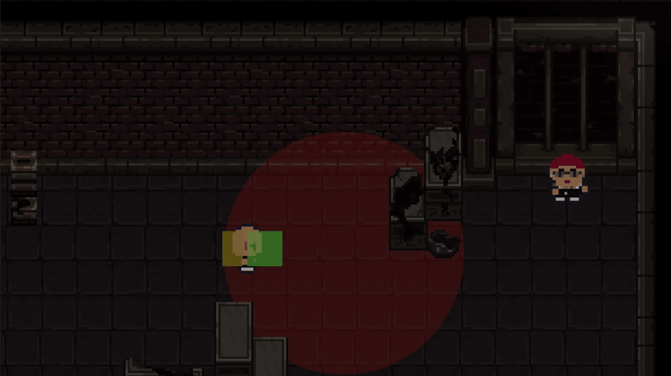
*박스 회전. 적이 방향을 틀면 시야(빨간 원)와 공격 박스(초록)도 그 방향으로 돌아갑니다. 이동이 상하좌우 4방향이라 박스도 네 각도로만 돕니다.* <!-- ✏️ 11-26 v4 캡션 줄 — alt를 옮기고 바로 위 「왜 정해진 각도로 돌리나」를 한 문장으로 -->

대각선으로 움직일 때는 가로·세로 중 **더 많이 움직이는 쪽**으로 방향을 정합니다. 멈춰 있을 때는 마지막 방향을 그대로 봅니다. <!-- 출처: 코드 `UpdateBoxRotations` -->

공격·피격 판정 박스는 바로 돌리고 시야 박스는 부드럽게 돌립니다. 이렇게 나눈 이유는 5-5에서 다룹니다. 방향마다 실제로 쓴 각도는 아래 표와 같습니다. <!-- 출처: 초안 PDF -->

| 이동 방향 | 공격·피격 판정 박스 각도 (바로 돌림) | 시야 박스 각도 (부드럽게 돌림) |
|---|---|---|
| 오른쪽 | 90° | 0° |
| 왼쪽 | 270° | 180° |
| 위 | 180° | 90° |
| 아래 | 0° | 270° |

**4방향으로만 돌린 이유** — 아내가 그려 준 픽셀아트 모션이 4방향이었기 때문입니다. 손으로 직접 그리는 아트라 방향을 늘리면 시간이 많이 걸렸고,
개발 기간(2주) 안에 구현하기에도 4방향이 맞다고 판단했습니다. <!-- 출처: 본인 답변 --> <!-- ✏️ 11-26 v4 관문(1-6 깎아내리는 평가): "당시 제 실력으로 기간 안에 구현하기에도 4방향이 최선이라고" → 위 문장. 기간은 1-4 표 -->


그래서 박스 각도는 방향마다 값 네 개로 끝났고, 애니메이션의 방향 값(`MoveX` · `MoveY`)만 보면 박스를 돌릴 수 있었습니다. <!-- ✏️ 11-25 그림 뒤 문장 — 근거: UpdateBoxRotations 347~375행(Anim.GetFloat MoveX · MoveY → SetTargetAngles 네 갈래) -->

### 5-2. 박스와 몸의 연결 — 시야 · 뒤통수 박스는 알리고, 공격 박스는 직접 쓰러뜨린다

<!-- 출처: 코드 · ✏️ 11-25 절 제목을 코드에 맞게 바꿈(예전 「박스는 알리기만, 판단은 매니저가」) -->

각 박스(자식 오브젝트)에는 작은 스크립트만 붙어 있습니다. 시야 · 뒤통수 박스는 무언가 닿으면 **몸(`EnemyStateManager`)에 알리기만** 합니다.
뒤통수 박스 스크립트는 처음에 부모의 몸을 찾아 두고(`GetComponentInParent`), 시야 박스의 알림 스크립트는 인스펙터에 넣어 둔 몸을 씁니다. 닿으면 몸의 함수(`OnBackHit` 등)를 바로 부릅니다.
**공격 타격 박스만 다릅니다.** 이 박스는 몸에 넉다운 여부와 잠금(5-3)을 물은 뒤, 플레이어를 **직접** 쓰러뜨립니다(`player.KnockDown()`).
공격 범위 박스에도 알림 스크립트가 붙어 있지만 몸은 이 알림을 쓰지 않고, 추격 중에 플레이어가 박스에 닿아 있는지를 직접 확인합니다.
<!-- ✏️ 11-25 코드 대조: "모든 박스는 알리기만 · 모두 GetComponentInParent" → EnemyBackHurtBox · EnemyAttckHitBox는 Awake에서 GetComponentInParent, EnemyBoxTrigger(EnemyBoxType.cs 15~33행)는 [SerializeField] manager. EnemyAttckHitBox.cs 15~33행은 IsKnockDown · TryLockCombat을 묻고 PlayerMovement.KnockDown을 직접 부름. 공격 범위 박스: 프리팹에 EnemyBoxTrigger(boxType 1)가 붙어 있으나 OnBoxTriggerEnter는 Sight만 처리(EmemyStateManager.cs 199~205행), 사거리는 CheckPlayerInAttackRange의 IsTouching(332~344행) (main 29e03b1 대조 ✅) -->
때린 쪽이 이미 쓰러졌는지는 **`IKnockDownStatus` 인터페이스**로 묻기 때문에, 몸은 상대가 누구인지 몰라도 넉다운 여부만 확인할 수 있습니다. 
박스의 알림을 받아 판단까지 정리한 뒤 몸에 넘겨주는 **중간 단계**가 있었다면, `EnemyStateManager`가 더 가벼워졌을 것이라고 생각합니다(8-3). <!-- 출처: 본인 답변 -->

| 박스 | 무언가 닿았을 때 하는 일 |
|---|---|
| 시야 박스 (빨강) | 플레이어가 들어오면 기억하고, 나가면 잊습니다 |
| 공격 범위 박스 (초록) | 추격 중인 적이 "때릴 수 있는 거리인가"를 확인할 때 씁니다 |
| 공격 타격 박스 (초록) | 플레이어에 닿으면, 이번 순간에 승패가 아직 안 났을 때만 플레이어를 쓰러뜨립니다 |
| 뒤통수 피격 박스 (노랑) | 무엇이 닿았는지 몸에 알리기만 합니다. 진짜 플레이어의 공격인지는 몸이 판단합니다 |
<!-- ✏️ 11-26 v4: 표 칸의 음슴체를 "~습니다"로 -->

시야 박스 안에 들어와도 바로 추격하지는 않습니다. 적과 플레이어 사이가 **벽에 가려 있으면** 못 본 것으로 칩니다.
그래서 빨간 원(시야 박스) 안에 있어도 벽에 가리면 들키지 않는데, 실제로 플레이어가 이를 눈치채기는 어려웠습니다(→ 8-1·8-3). <!-- 출처: 본인 답변 -->

**벽 가림 판정을 넣은 이유** — 처음 기획이 잠입 액션 게임이었기 때문에, 잠입 요소의 하나로 이 판정을 넣었습니다.
원래는 Darkwood처럼 내가 보는 시야각만 밝고, 그 밖은 어두워 다른 대상을 볼 수 없는 구조로 만들려고 했습니다.
이번에는 선생님께서 추천해 주신 간단한 방식대로, 둘레가 동그란 시야 박스로 만들었습니다.
그 결과 시야가 화면에 보이지 않아 플레이어가 언제 들키는지 알기 어려웠고, 실제 플레이는 잠입보다 피지컬 게임에 가까워졌습니다(8-1). 보이는 시야는 8-3에 계획으로 적었습니다. <!-- 출처: 본인 답변 -->
<!-- ✏️ 11-26 v4 관문(1-6 깎아내리는 평가 · 소감, 건우 님 확인): 예전 문장 "하지만 제 실력으로는 어렵다고 스스로 단정했고, 선생님께서도 간단하게 구현하는 방식을 추천해 주셔서 동그란 시야 박스로 만들었습니다. 지금 보면 탑다운 화면에서 동그란 시야 박스는 잠입 액션에 오히려 마이너스였던 것 같습니다. 그때 직접 시도해 봤으면 어땠을까 하는 생각이 듭니다(→ 8-3)." 결과 문장은 8-1 「긴장감은 절반만」 · 「목표와 다르게 나온 점」에서 가져옴 -->

### 5-3. 같은 프레임 동시 피격 방지

<!-- 출처: 초안 PDF -->

플레이어와 적이 **동시에 공격**하면 둘 다 이기거나 둘 다 지는 판정이 나올 수 있습니다. 이를 막으려고 프레임 단위 잠금(Lock)을 넣었습니다.
같은 프레임에서는 **먼저 `TryLockCombat()`을 부른 쪽만** 판정을 가져가므로, 승패가 한쪽으로만 갈립니다.

개발 중 메모에는 이 문제를 "적과 플레이어의 넉다운이 서로 따로 처리되어 겹친다"고 적고, **먼저 닿은 쪽이 있으면 반대쪽 넉다운을 실행하지 않는다**는 조건을 두 가지 방법(넉다운 함수 입구에 조건 두기 · 판정 함수 앞에 조건 두기)으로 적어 두었습니다. 지금의 잠금이 이 조건을 "같은 프레임 안에서 먼저 잠근 쪽"으로 만든 것입니다.
<!-- ✏️ 11-25 출처: 개발 메모 「문제 1: 넉다운 판정의 겹침 … 나의 제안 1 · 2」. 마지막 문장(메모와 코드를 잇는 말)은 Claude가 쓴 것 — 본인 말로 확인 -->

```csharp
// EmemyStateManager.cs (85 · 179~186 · 114~117행 발췌, 주석은 문서용)
private bool combatResolved = false;

public bool TryLockCombat()
{
    if (combatResolved == true) return false; // 이번 프레임에 이미 승패가 났음
    combatResolved = true;
    return true;
}

private void LateUpdate()
{
    combatResolved = false; // 프레임이 끝나면 잠금 해제 → 다음 프레임부터 다시 판정
}
```

잠금은 양쪽 입구에서 똑같이 확인합니다. <!-- 출처: 코드 `EnemyAttckHitBox.cs`·`EnemyStateManager.OnBackHit` -->

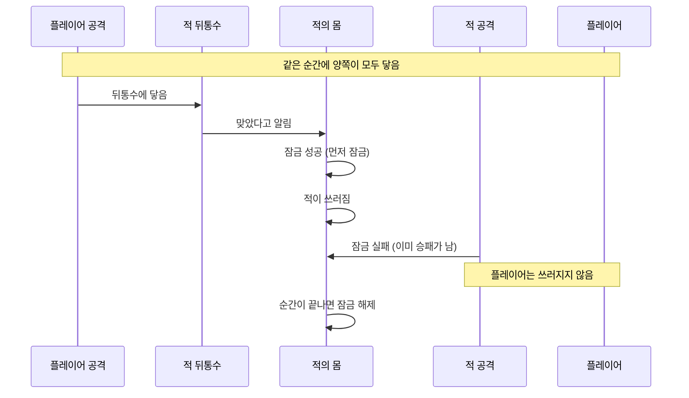

뒤통수를 맞았을 때는 잠금 말고도 몇 가지를 차례로 확인합니다. <!-- 출처: 코드 -->

| 뒤통수를 맞았을 때 확인하는 것 | 없으면 플레이 중에 보이는 문제 |
|---|---|
| ① 플레이어의 공격이 맞나 | 적의 뒤통수에 플레이어 몸이 스치기만 해도 적이 쓰러집니다 |
| ② 때린 플레이어가 이미 쓰러졌나 | 먼저 맞아 쓰러지는 중인 플레이어에게 적도 쓰러집니다 |
| ③ 이번 순간에 이미 승패가 났나 (잠금) | 동시에 때리면 플레이어와 적이 함께 쓰러집니다 |
<!-- ✏️ 11-26 v4: 표 칸의 음슴체를 "~습니다"로 -->

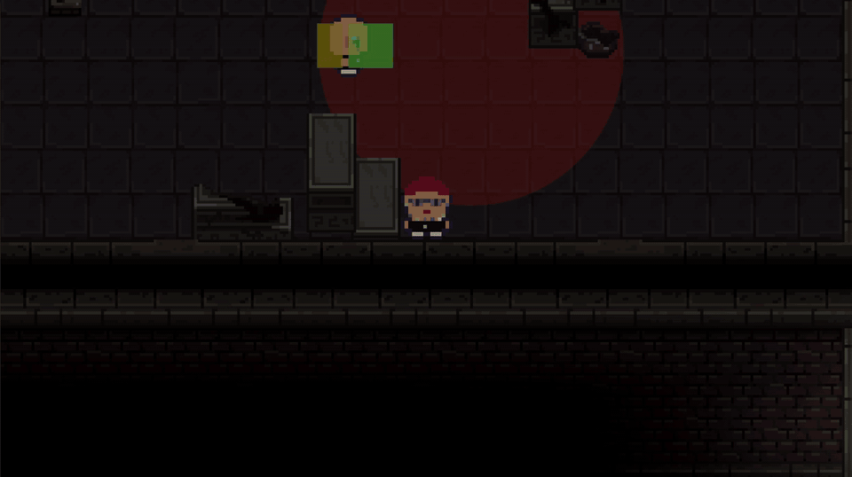
*뒤통수. 시야(빨간 원) 밖 등 뒤로 몰래 다가가 뒤통수를 치면 컷씬(SLAP!)과 함께 적이 쓰러집니다. 위 세 가지를 모두 통과한 한 번입니다.* <!-- ✏️ 11-26 v4 캡션 줄 — alt를 옮기고 「시야 밖」(GIF에 보임) · 확인 표와 잇는 문장을 더함 -->

잠금은 **적마다 따로** 있습니다. 판정을 한곳에서 하는 매니저는 그때는 몰랐고, 제가 아는 방법은 적마다 잠그는 것뿐이었습니다.
그래서 적 둘이 같은 순간에 때리면 막지 못합니다(7-3 #4). 다시 만들 때는 판정 매니저 한 곳에서 판정합니다(8-3).
<!-- ✏️ 11-25 v3: 예전 4-4 요약 표의 「동시에 때리는 것을 어떻게 막을까」 줄(다른 방법 「판정 매니저 (그때는 몰랐음)」 · 고른 것 「적마다 잠금 — 그때 제가 아는 방법은 이것뿐」 · 내준 것 「적 둘이 같은 순간에 …」)을 문장으로 옮김 -->

**이 잠금이 필요했던 이유** <!-- 출처: 본인 답변 -->
플레이어가 뒤통수를 쳤는데도, 넉다운 컷씬이 재생되는 동안 보스가 꺼지지 않고 공격해서 **플레이어도 같이 죽는** 현상이 계속 일어났습니다.
한동안 원인이 드러나지 않았고, 원인을 찾아 막은 과정은 5-4에 정리했습니다. <!-- ✏️ 11-23 Claude 고침: 이유("디버그 경험이 적고 무료 AI만 써서")는 사정 호소라 빼고 증상 → 해결로 -->

### 5-4. 문제와 해결 — 적을 쓰러뜨렸는데 플레이어도 쓰러지던 버그

<!-- ✏️ 11-25 v3: 예전 7-2 A를 원인이 있는 이 장으로 옮기고 문제 해결 양식(역할 → 발견 → 원인 → 해결 → 결과 → 🔍)으로 다시 놓음. 문제 · 원인 · 해결 · 결과 문장은 예전 표 그대로, 「발견」의 두 경위와 원인 ②는 개발 메모(11-25 받음)에서 더함 -->

#### ① 뒤통수를 쳐서 적이 넉다운 연출을 하는 중인데, 플레이어도 넉다운되어 게임 오버가 되었습니다
<!-- ✏️ 11-26 v4.1(1-10 소결정 제목): 굵은 글 한 줄 → #### 제목. 날짜 · 커밋은 아래 줄로 -->

2026-07-06 커밋 `5e6e3d2` · 2026-07-22 커밋 `c964a73`
- **역할** — 발견 · 조건 좁히기 · 해결 방향: 저(플레이 테스트) · 수정 코드: 당시 AI가 짜 준 코드를 붙임 · 확인: 저(2026-11-12 다시 테스트) <!-- ❓ 집 PC 대화 기록으로 확인 예정 (인계-11-25 1-1) → 11-27 일부 확인: 7/4 공격 소리 대화(제가 문제와 조건을 정해 요청 → AI가 IKnockDownStatus로 답함, 커밋 8b95341). 7/6 5e6e3d2 · 7/22 c964a73 코드를 AI가 짰는지는 아직 ❓ -->
- **발견** — 같은 상황에서 계속 반복해서 일어났습니다. <!-- 출처: 버그 목록 · 본인 답변 -->
  - 공격 소리를 넣은 뒤(7/4), **넉다운 컷씬이 재생되는 동안 공격 소리가 계속 나는 것**을 듣고, 쓰러지는 중인 적이 계속 공격하고 있다는 것을 알았습니다.
  - 와치만 방에서는 **감시자가 보스를 부르는 도중에 보스를 쓰러뜨리면** 넉다운이 되지 않는 경우를 따로 찾아, "와쳐들의 호출 중간에 죽으면 일어나는 현상"으로 조건을 좁혀 적어 두었습니다.
  <!-- ✏️ 11-25 출처: 개발 메모 「문제 2: 공격 사운드를 추가 하고나니, 넉다운 상태에 돌입할때 컷씬 재생동안 공격이 계속 되어 공격 사운드가 계속 재생되는 현상」 · 「버그 2 와치맨 방의 왓쳐 발견 구역 안에서 처치하게 될 경우 넉다운으로 연결되지 않음」 · 「해결할 과제 — 와쳐들의 호출 중간에 죽으면 일어나는 현상 같아 보임」. 공격 소리 커밋 8b95341 · 0abcb2f(7/4) -->
- **원인** — ① 넉다운 컷씬이 재생되는 동안 적 오브젝트가 아직 켜져 있어, 적의 공격 타격 박스가 계속 판정을 냈습니다. <!-- 출처: 업데이트 기획서 "컷씬 재생 중에는 적이 비활성화 되지 않아 공격이 가능함" -->
  ② 감시자는 플레이어를 보고 0.5초 뒤 와치만에게 출동 상태를 입히는데, 그 사이 와치만이 쓰러지면 출동 상태가 넉다운 상태를 덮어썼습니다. <!-- ✏️ 11-25 근거: Watcher.cs 74~81행(WaitForSeconds 0.5 → ChangeState(new AlertMovePatternState())), c964a73 이전 ChangeState에 넉다운 확인 없음 -->
  - 🔍 **같은 길에서 난 오류(7/1)** — 랫맨 방에서도 같은 길로 오류가 났습니다. 쓰러진 랫맨은 넉다운 연출 뒤 꺼지는데, 그 뒤 쥐가 죽으면 쥐가 랫맨에게 상태를 입히려다(`RatController.RatDie` → `ChangeState`) 꺼진 오브젝트에서 코루틴을 시작하지 못했습니다. 7/22에 넣은 `ChangeState` 가드가 이 길도 막습니다. <!-- ✏️ 11-27 근거: 사진 17(7/1 21:27 콘솔) · 같은 날 커밋 dbbc23e(22:46) — EmemyStateManager.ChangeState 84행 StartCoroutine, RatController.RatDie 99행 Ratman.ChangeState(화면은 커밋 전이라 96행), EnemyKnockDownState 28행 gameObject.SetActive(false) · 7/22 c964a73까지 RatController의 이 호출에 넉다운 확인 없음 -->

    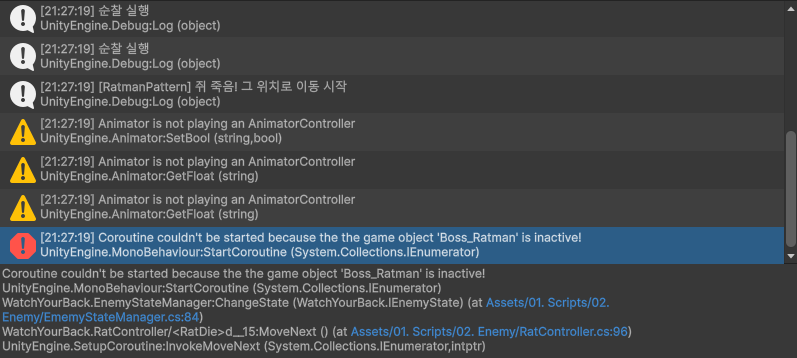
    *7/1 콘솔입니다. 쥐가 죽은 뒤 꺼진 랫맨의 상태를 바꾸려다 코루틴을 시작하지 못했습니다.* <!-- ✏️ -->

- **해결** — **"쓰러진 적은 공격 판정도, 상태 전환도 하지 않는다."** ① 7/6 — 공격 타격 박스(`EnemyAttackHitBox`)와 `OnBackHit` 앞에 `IsKnockDown` 확인을 추가했습니다 ② 7/22 — `ChangeState` 입구에도 같은 가드를 넣어, 감시자·쥐가 쓰러진 보스를 다시 움직이게 하는 길까지 막았습니다(4-3). <!-- 출처: 커밋 5e6e3d2·c964a73 · ✏️ 11-25 규칙 한 문장 -->
- **결과** — 이 문제는 주로 적을 쓰러뜨린 뒤 가만히 있을 때 적이 플레이어를 때려서 일어났습니다. 수정 뒤 다시 테스트해 보니(2026-11-12), 적을 쓰러뜨리고 가만히 있어도 적이 플레이어를 때리지 않아 더는 일어나지 않는 것으로 보입니다. <!-- 출처: 본인 답변 -->

```csharp
// EnemyAttckHitBox.OnTriggerEnter2D (20~21행 발췌) — 커밋 5e6e3d2에서 더한 줄
// 예외 처리: 이미 넉다운(다운/가짜다운) 확정된 적은 더 이상 공격 판정을 낼 수 없음
if (manager != null && manager.IsKnockDown == true) return;
```
- 🔍 **확인** — `git show 5e6e3d2`(공격 타격 박스 · `OnBackHit`에 넉다운 확인 추가), `git show c964a73`(`ChangeState` 첫 줄에 `if (IsKnockDown == true) return;` 추가)를 확인했습니다(11-25). 다시 테스트는 2026-11-12.
- 🔍 **AI 대화 기록** — 7/4에 공격 소리가 넉다운 중에도 나는 것을 찾아, "둘 다 넉다운 상태일 때는 재생하지 않는 조건"을 AI에게 요청했습니다. AI는 플레이어와 적이 함께 쓰는 넉다운 확인을 인터페이스 하나로 묶는 방법을 답했고, 같은 날 커밋 `8b95341`에서 `IKnockDownStatus`가 생겨 `AnimationSoundEffects`가 넉다운 중에는 공격 소리를 내지 않게 되었습니다. <!-- ✏️ 11-27 근거: 31번 대화 기록 · 8b95341 AnimationSoundEffects.PlayAttackSound -->

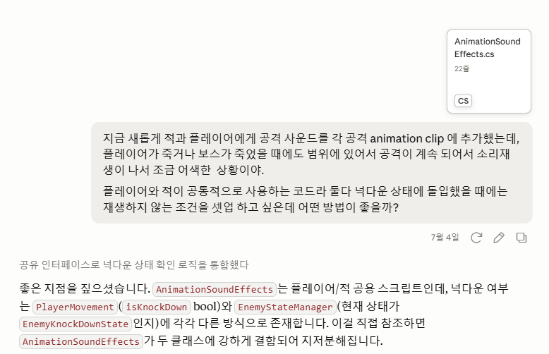
*7/4에 AI에게 보낸 요청과 받은 답의 첫 부분입니다.* <!-- ✏️ -->

### 5-5. 고민과 선택 — 박스 회전: 즉시 회전 vs 보간 회전

<!-- ✏️ 11-24 장 재구성: 예전 5장 요약 표에서 박스 · 판정 줄 둘을 가져오고, 예전 5-1을 이어 붙임
     ✏️ 11-25 v3: 결정 표 v2 양식으로 바꿈. 동시 피격 줄은 5-3 끝 문장으로 옮김. [A] 칸은 그때 비교하지 않은 안이라 문서를 정리하며 채움 -->
<!-- 출처: 초안 PDF -->

> **결정 대상** 공격·피격 판정 박스와 시야 박스를 같은 방식으로 돌릴지, 역할마다 다르게 돌릴지.

| | [A] 모든 박스를 같은 방식으로 | **[B] 역할마다 다르게 ✓** |
|---|---|---|
| 방식 | 모든 박스를 한 번에 돌리거나, 모두 부드럽게 돌림 | 공격·피격 판정 박스는 **즉시 회전**, 시야 박스(`SightBox`)는 **보간 회전**(`Mathf.LerpAngle`) |
| 플레이어가 겪는 것 | 모두 즉시면 적이 고개를 휙 돌리고, 모두 부드러우면 판정이 방향을 늦게 따라옵니다 | 적이 방향을 틀면 초록 공격 박스는 한 번에 뒤집히고, 빨간 시야는 고개를 돌리듯 천천히 따라 돕니다 |
| 장점 | 박스를 돌리는 코드가 한 갈래입니다 | 공격 판정은 정확도와 즉각적인 반응을 지키고, 시야는 적이 "고개를 부드럽게 돌리는 연출"을 살립니다 |
| 단점 | 판정의 정확도와 시야 연출 중 하나를 내줍니다 | 정작 시야를 화면에 안 보이게 해서 그 연출이 전달되지 않았습니다 |
| 정한 사람 | 그때는 비교하지 않음 · 문서를 정리하며 비교 · 기준: 저(플레이하며 시야가 뚝뚝 끊겨 보이는 것) · 보간 회전 요청: 저 · 코드: AI | |
<!-- ✏️ 11-26 v4 「정한 사람」 행 — 근거: 건우 님 11-26 답("내가 정했어. 플레이하면서 뚝뚝 끊기는게 보기 좋지 않아서 AI에게 요청했어"). 참고: 「개발 학습 이력 분석」(노트북 대화 454개 요약, 11-06)에도 6~7월 시야 박스 회전 방식을 여러 번 바꾼 기록(Slerp · 즉시 반전 · scale)이 있음 -->
<!-- ✏️ 11-25 [A] 칸 · 「플레이어가 겪는 것」 [A] 칸은 Claude가 채움 — 본인 말로 확인. [B] 칸은 예전 회전 방식 표 · 요약 표 그대로 -->

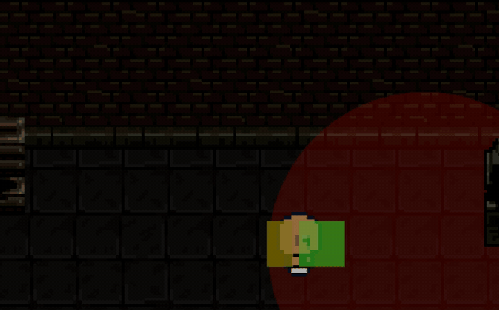
*즉시 회전과 보간 회전(0.5배속). 적이 방향을 틀면 초록 공격 박스는 한 번에 뒤집히고, 빨간 시야는 고개를 돌리듯 천천히 따라 돕니다. 판정은 바로 바뀌고, 시야는 끊겨 보이지 않게 하려고 나눴습니다.* <!-- ✏️ 11-26 v4 캡션 줄 — alt를 옮기고 의도 문장(건우 님 11-26 답 「뚝뚝 끊기는게 보기 좋지 않아서」)을 더함 -->

**[B]를 골랐습니다.** 같은 "방향에 맞춰 도는 박스"라도 역할에 따라 **의도적으로 다르게** 처리했습니다.
플레이해 보니 시야가 방향을 틀 때마다 뚝뚝 끊겨 보기 좋지 않아, 시야만 부드럽게 돌려 달라고 AI에게 요청했습니다. <!-- ✏️ 11-26 건우 님 답을 문장으로 -->
다만 과제 제출 당시에는 **시야 박스를 화면에 보이지 않게** 만들어, 시야를 부드럽게 돌리는 연출을 넣었지만 정작 그 시야가 플레이어에게 보이지 않았습니다(→ 8-3). <!-- 출처: 본인 답변 -->
**지금 고른다면** — [B]로 두고, 시야를 화면에 보여 줍니다. 이유: 부드럽게 도는 시야를 만들고도 플레이어가 그 시야를 볼 수 없었기 때문입니다. <!-- ✏️ 11-26 건우 님 답(「[B] + 시야를 보이게」를 고름). 이유 문장은 바로 위 문장에서 — 본인 말로 확인 -->
<!-- 11-26 v4 지움: 기울임꼴 줄 "그때는 비교하지 않았고, 문서를 정리하며 비교했습니다." — 표의 「정한 사람」 행에 같은 사실이 있어 두 번 쓰지 않음 -->

---

## 6. 그 밖에 만든 것
<!-- ✏️ 11-25 v3: 예전 5장 전투 BGM을 장 → 절로 내리고, 예전 7-1 배운 점의 연출 · 소리 문단을 6-2로 옮김 -->

### 6-1. 전투 BGM — 몇 명이 나를 쫓고 있나 세기

<!-- 출처: 코드 `SoundManager.cs`·`EnemyChaseState.cs` -->

1-2의 「음악은 한 번만 바뀌어야 함」 문제를 푸는 절입니다. 한 스테이지의 흐름에서 **적에게 들킨** 순간입니다. <!-- ✏️ 11-25 v3 다리 문장 -->

**음악을 바꾼 이유** — 처음 기획에서는 플레이어가 보스의 시야 박스를 볼 수 없게 했습니다. 그러자 언제 들켰는지 알 수 없어
"왜 들킨 거지?" 하는 불합리한 경험이 생겼습니다. 이를 보완하려고, 들키는 순간 음악을 바꿔 플레이어가 **"내가 들켰구나"**를 알 수 있게 했습니다. <!-- 출처: 본인 답변 -->

추격·공격 상태의 `Enter`에서 `NotifyCombatStarted()`, `Exit`에서 `NotifyCombatEnded()`를 부릅니다.
`SoundManager`는 지금 전투 중인 적의 수(`engagedEnemyCount`)를 세어, **0 → 1이 되는 순간** 전투 BGM으로, **1 → 0이 되는 순간** 평상시 BGM으로 크로스페이드합니다.
그래서 적 여러 명이 동시에 쫓아와도 음악이 한 번만 바뀝니다.

*소리는 그림으로 보여 줄 수 없어 시연 영상으로 대신합니다 — [플레이 시연 영상 0:53 「들켰을 때」](https://youtu.be/MgwuP_ErnK4?t=53)에서 들키는 순간 음악이 바뀝니다.* <!-- ✏️ 11-26 v4(1-8 소리가 핵심인 장면은 영상 시간 링크) — 시간은 _intake/영상자막.md 「YouTube 챕터」 0:53 들켰을 때(첫 판이라 바뀌는 구간, 원본 G 0:53–1:04) -->

```csharp
// SoundManager.NotifyCombatStarted · NotifyCombatEnded (24~49행 발췌, if 블록을 한 줄로 줄임)
public void NotifyCombatStarted()
{
    if (bgmSource == null) return;
    engagedEnemyCount++;
    if (engagedEnemyCount == 1) SwitchBgm(combatBgmClip);   // 0 -> 1, 첫 적이 전투를 시작한 순간
}

public void NotifyCombatEnded()
{
    if (bgmSource == null) return;
    engagedEnemyCount = Mathf.Max(0, engagedEnemyCount - 1);
    if (engagedEnemyCount == 0) SwitchBgm(normalBgmClip);   // 마지막 적까지 전투에서 벗어난 순간
}
```

**아직 풀지 못한 것 — 추격 음악이 처음 한 번만 나옵니다** <!-- ✏️ 11-25 v3: 예전 7-2 B를 원인이 있는 이 절로 옮기고 「찾아 둔 곳 + 다음 확인」으로 끝맺음. 문장은 예전 표 그대로 -->
- **문제** — 처음 추격 상태가 되었을 때는 추격 BGM이 나오지만, 재시도한 뒤에는 나오지 않았습니다. <!-- 출처: 버그 목록 -->
- **찾아 둔 곳 (추정)** — `SoundManager`는 씬이 바뀌어도 남는 싱글톤(`DontDestroyOnLoad`)입니다. 추격 중에 플레이어가 죽고 씬을 다시 불러오면, 적의 `Exit`가 불리지 않아 `engagedEnemyCount`가 0으로 돌아가지 않습니다. 다음 판에서 첫 추격이 와도 카운트가 1이 아니라 2가 되어 BGM이 바뀌지 않습니다.
- **시도** — 씬이 시작될 때 `GameSceneInitializer`가 `SoundManager.ResetCombatMusicState()`로 카운트를 0으로 되돌리게 했습니다(2026-07-06 커밋 `4ce1f3d`). <!-- 출처: 코드 · ✏️ 11-25 커밋 확인 -->
- **다음 확인** — 아직 해결되지 않았습니다. 카운트를 되돌린 뒤에도 남은 문제라 다른 원인이 더 있을 수 있고, 다시 만들 때 확인할 예정입니다(8-3). <!-- 출처: 본인 답변 --> <!-- ✏️ 11-23 Claude 고침: "과제 제출 당시에는 해결하지 못했습니다" → 미해결 사실 + 다음 계획 -->

### 6-2. 연출과 소리

<!-- ✏️ 11-25 v3: 예전 7-1 「배운 점」의 세 문단을 만든 것으로 옮김(문장 그대로, 「당시 무료 AI와」만 고침) -->

**게임 연출의 중요성** — 메인 루프인 뒤통수 때리기와 회피는 단순합니다. <!-- ✏️ 11-26 v4 강조 부사 「아주」 뺌 -->
그래서 뒤통수를 때리는 순간과 뺨을 맞는 순간을 **컷씬**으로 보여 주어 플레이에 생동감을 더했습니다. <!-- 출처: 본인 정리 -->

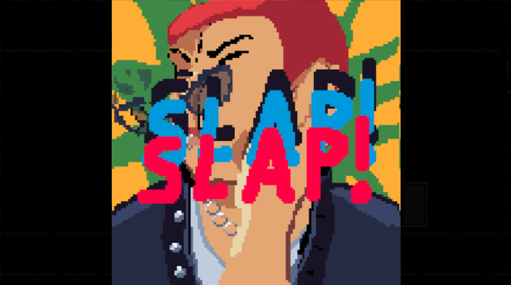
*뺨 맞는 컷씬. 플레이어가 적에게 맞으면 이 장면 뒤에 게임 오버 화면이 나옵니다.* <!-- ✏️ 11-26 v4 캡션 줄 — alt 「들켰을 때」는 정확히는 「맞았을 때」라 본문(2-1 흐름 그림 「뺨 맞는 컷씬 · 게임 오버」)에 맞춤 -->

**사운드의 중요성** — SFX(발걸음·타격음)를 넣기 전에는 테스트해도 큰 재미를 느끼지 못했습니다.
SFX를 넣자 플레이어와 적의 타격이 재미있어졌습니다. <!-- 출처: 본인 정리 --> <!-- ✏️ 11-26 v4 관문(강조 부사 · 소감, 건우 님 확인): "훨씬 재미있어졌고, SFX와 BGM의 중요성을 다시 한번 깨달았습니다" → 위 문장 -->

**같은 소리를 여러 소리처럼** — 감시자가 플레이어를 발견할 때 내는 "Hey" 소리는, 처음 넣었을 때 매번 똑같이 들려 발견되는 순간이 조금 밋밋했습니다.
다른 소리를 더 찾아야 하나 고민하다가, 당시 AI와 스크립트를 짜며 **같은 소리의 음높이만 매번 무작위로 바꾸는 방법**을 배워 적용했습니다(`pitch = Random.Range(0.9f, 1.1f)`). <!-- 출처: 본인 답변 · 코드 `Watcher.cs` · ✏️ 11-25 「당시 무료 AI와」 → 「당시 AI와」(4-4 카드) -->

---

## 7. AI 협업

<!-- ✏️ 11-26 v4(1-8 AI 장 네 칸 · 1-10 장 요약 표는 맨 앞): ④ 가리키기 표 → 7-1, ① 일하는 방식 + ② 실제 지시문 → 7-2, ③ AI가 틀린 곳과 막은 방법 → 7-3. 예전 7-1 · 7-2는 7-2 · 7-3이 됨(본문 번호 참조도 맞춤) -->

### 7-1. 장마다 AI가 한 것과 제가 한 것

이 표는 문서 곳곳에 있는 AI 이야기를 한곳에 모은 것입니다. 「한눈에」 칸에 그 절의 핵심 근거를 적어, 그 절로 찾아가지 않아도 확인할 수 있게 했습니다. 「제가 한 것」은 결정 표의 「정한 사람」 행, 문제 해결의 「역할」 줄과 같은 말로 썼습니다. <!-- ✏️ 11-26 v4 · 「한눈에」 칸은 건우 님 11-26 의견(가리키기 표를 읽고 다시 찾으러 가는 것이 불편함) -->

| 자리 | AI가 한 것 | 제가 한 것 | 한눈에 |
|---|---|---|---|
| 1-3 만든 방식 | 스크립트 대부분을 짜 주었습니다 | 기획 · 레벨 배치 · 애니메이션 연결 · 효과음 · 판정 박스 설정, 그리고 AI에게 줄 기능과 조건을 글로 정리했습니다 | 기능 · 조건 정리 → AI 코드 → 읽고 붙여 고침 → 플레이로 확인 |
| 4-6 보스 4명의 구조 | 두 안을 냈습니다 — 한 클래스 코드(수업용 LLM), 인터페이스 상태 초안 | 기준(보스의 기본 공격이 모두 같음)을 세우고 몸 + 상태 구조를 골랐습니다 | 6/24 한 클래스(377줄) → 6/25 AI 인터페이스 초안 → 6/26 몸 + 상태 7종 |
| 4-5 · 5-4 문제 해결 | 수정 코드를 짜 주었습니다 | 플레이 테스트로 찾고 조건을 좁혔습니다(진짜 다커만에서만 · 감시자가 부르는 도중). 고칠 자리를 메모로 남기고, 다시 테스트로 확인했습니다 | 엔딩은 넉다운 연출 뒤에만 · 쓰러진 적은 공격도 상태 전환도 안 함 — 커밋 `4ce1f3d` · `5e6e3d2` · `c964a73` |
| 5-5 박스 회전 | 시야 박스의 보간 회전 코드를 짜 주었습니다 | 시야가 뚝뚝 끊겨 보이는 것을 보고, 시야만 부드럽게 돌려 달라고 요청했습니다 | 판정 박스는 즉시, 시야는 `Mathf.LerpAngle`로 보간 |
| 6-2 소리 | 같은 소리의 음높이만 무작위로 바꾸는 방법을 알려 주었습니다 | "Hey" 소리가 매번 같아 밋밋한 것을 듣고 그 방법을 적용했습니다 | `pitch = Random.Range(0.9f, 1.1f)` |
| 7-2 일하는 방식 | 조건에 맞춰 코드를 짜 주었습니다 | 기능 · 조건 · 값을 글로 정해 요청하고, 받은 코드를 읽고 고쳐 붙였습니다 | 스크립트 전체에 `!` 조건 0곳 · 장막 값 177 · 177 · 213이 요청문 그대로 |
| 7-3 코드 리뷰 | Claude가 문제 9건을 짚었습니다 | 2건은 디버그 로그로, 3건은 코드로 확인했고, 1건(#3)은 의도한 동작이라 걸렀습니다 | -60°는 한 번도 안 찍힘 · 대기 278번 모두 약 1초 |
<!-- ✏️ 11-26 v4 근거(「한눈에」 칸도 각 절의 사실 그대로 — 377줄은 4-6 근거 주석의 커밋 e0ada5f): 각 줄의 절 본문 · 결정 표 「정한 사람」 행 · 문제 해결 「역할」 줄, 5-5는 건우 님 11-26 답, 7-2는 건우 님 11-26 답("AI에게 물어본 후 읽어보고 복사붙이기 해서 수정할 부분 수정") -->

### 7-2. 일하는 방식 — 기능과 조건은 제가 정하고, 코드는 AI에게 받았다

<!-- ✏️ 11-25 신설 — 출처: 건우 님 11-25 답, 기획서 「[조건]」 · 「에네미 상태」 요청문, 개발 메모의 「맵 커튼 오브젝트」 · 「엔딩 씬 EndingDlalogue」 요청문. 조건이 지켜졌는지는 저장소 main 29e03b1 전체 스크립트에서 확인 -->

이 게임의 스크립트는 대부분 AI가 짜 준 코드를 붙여 만들었습니다. 저는 **만들 기능과 지켜야 할 조건을 글로 정리해** AI에게 주고, 받은 코드를 읽어 본 뒤 게임에 붙이고, 맞지 않는 곳을 고쳐 플레이로 확인했습니다. <!-- ✏️ 11-26 「읽어 본 뒤 … 고쳐」는 건우 님 11-26 답 -->

**실제 지시문 ① — 다음 구역 장막 (2-4)** — 바로 만들게 하지 않고, 제가 생각한 기능을 먼저 분석해 맞는지 확인한 뒤에 만들게 했습니다. 어느 스크립트에 붙일지, 어떤 보스가 꺼지면 어느 장막이 몇으로 바뀌는지까지 적었습니다.

> 맵 커튼 오브젝트의 스크립트를 제작할건데 내가 생각한 기능들을 분석 한 후에 알맞는지 확인 한 후에 생성해보자
> 이미 DoorManager.cs 에 게임오브젝트(boss) 들이 연결되어서 여기서 같이 사용하면 좋을 거 같음
> 기능: 보스가 처치할때마다 다음 구역의 어둠 장막의 SprriteRenderer의 알파값을 255 -> 177 으로 낮춘다.
> (…)
> 게임 오브젝트 -> 게임 오브젝트 대신 SpriteRenderer 로 지정하는게 알파값 조정에 더 좋을거 같은데
> (…)
> MapCurtain_Watchman : Alleyman 이 비활성화 되면 알파값 변경(177)
> MapCurtain_Ratman : Watchman 이 비활성화 되면 알파값 변경(177)
> MapCurtain Darkerman: Ratman 이 비활성화되면 알파값 변경(213)

지금 코드도 이 요청 그대로입니다. 장막은 `DoorManager`에 붙었고, 장막 칸은 `SpriteRenderer`로 받으며, 값은 177 · 177 · 213입니다.
<!-- ✏️ 11-26 v4 ② 실제 지시문 — 원문: 구글 문서 「게임 개발 중 생긴 문제점 및 해결 방안」(7/3~7/7, 건우 님 11-26 허락으로 읽음) 맵 커튼 요청문. 맞춤법은 원문 그대로, (…)는 줄인 곳(첫 장막 · 오브젝트 이름 목록). 코드 대조: DoorManager.cs 13~14행(StandardCurtainAlpha 177 · DarkerCurtainAlpha 213) · 30~33행(SpriteRenderer firstCurtain ~ fourthCurtain) · 59~61행 (main 29e03b1 ✅) -->

**실제 지시문 ② — 적 AI 조건** — 코드를 바로 받지 않고, 조건을 붙여 "생성할 프롬프트"부터 만들어 달라고 했습니다.

> 초보자 기준으로 현재 파일 스크립트를 기반하여 아래 조건들로 적 AI 스크립트를 생성할 거야.
> 생성 할 프롬프트를 생성해줘
> [조건]
> If 조건문에 bool 값에 ! 연산자는 사용하지 않는다.
> While 문 사용시에 while(true) 가 기본 틀이며, 다른 상태로 전환되는 때가 break 조건으로 설정한다.
> 같은 표현식이 반복된다면 함수로 만들어 가독성을 늘린다.
<!-- ✏️ 11-26 v4 ② 실제 지시문 — 원문: 구글 문서 「뒤통수를 조심해 게임기획서 (통합본)」(6/13~6/26) 끝부분 요청문, 원문 그대로. 이 뒤에 적 컴포넌트 · 애니메이션 · 상태 다섯 가지의 조건이 이어짐(대기 2초 · 반격 공격 등 — 만든 게임과 다른 곳은 2-5) -->

세 조건이 지금 코드에 어떻게 남았는지는 아래와 같습니다.

| 조건 | 이유 | 지금 코드 |
|---|---|---|
| `if` 조건에 `!` 연산자를 쓰지 않는다 | `== true` · `== false`로 적어 조건을 소리 내어 읽듯이 볼 수 있게 | 저장소 스크립트 전체에 `!` 조건 0곳 |
| `while(true)`를 기본으로 하고, 다른 상태로 바뀔 때 빠져나온다 | 상태 하나가 끝나는 곳을 한 군데로 모으려고 | 대기 · 순찰 · 추격 · 출동 상태가 모두 `while (true)` 안에서 `ChangeState` 뒤 `yield break` |
| 같은 식이 되풀이되면 함수로 만든다 | 가독성을 늘리려고 (원문) | 이동(`MoveWithAvoidance`) · 보기(`CheckPlayerInSight`) · 정지(`Stop`)를 몸의 함수로 두고 상태들이 같이 부릅니다 |
<!-- ✏️ 11-25 「이유」 칸 첫 두 줄은 Claude가 채움 — 기획서에는 조건만 있고 이유가 없음. 본인 말로 확인. 셋째 줄 이유는 11-26 원문("가독성을 늘린다")으로 바꿈. 「지금 코드」 근거: grep `if ?\(!` · `&& ?!` 0건, EnemyIdleState · EnemyPatrolState · EnemyChaseState · AlertMovePatternState의 while (true) (main 29e03b1 ✅) -->

### 7-3. AI 코드 리뷰 — AI의 지적은 로그와 코드로 확인했다

<!-- ✏️ 11-26 v4: 제목 「AI 코드 리뷰로 다시 본 내 코드」 → AI 장 ③(AI가 틀린 곳과 막은 방법)에 맞춰 바꿈 -->
<!--
 면접 대비: "이 식이 왜 -60°를 안 보나요?" → i=3일 때 정수 나눗셈 3/4 = 0이라 i=1과 같은 -30이 나옴. 로그 그림 ai-review-debug-log.png 참고.
-->

게임을 완성한 뒤, **원인이 드러나지 않던 버그와 구조 문제**를 AI(Claude) 코드 리뷰로 다시 점검했습니다. <!-- ✏️ 11-23 Claude 고침: "첫 게임을 끝낸 뒤, 혼자서는 어디가 문제인지 짚기 어려웠던 부분을" → 목적 중심으로 -->
8-3에서 다룬 "부자연스러움"·"벽 끼임"·"역할 몰림"이 **코드의 어느 줄에서 나오는지** 찾는 것이 목표였습니다.

AI에게 코드 리뷰를 맡기는 것은 생각해 본 적이 없었는데, 해 보니 **오랫동안 찾지 못했던 원인을 짧은 시간에 찾을 수 있었습니다.** <!-- 출처: 본인 답변 -->

AI가 짚은 9건은 하나씩 직접 확인했습니다. 회피 각도(#1)와 대기 시간(#2)은 코드에 디버그 로그를 넣고 플레이한 뒤, 남은 로그를 Claude와 함께 분석했습니다.

**AI가 짚은 문제와 내가 확인한 결과** <!-- AI 지적 칸 출처: 코드 — Claude 분석 -->

<!-- 2026-11-21 강사님 피드백("여기 파트 잘 안 읽힘, 정리 필요")으로 5칸 표를 3칸으로 줄임. 코드 위치·긴 설명은 git 기록(11-21 이전)에 있음. ✏️ 줄인 문장 확인 필요 -->

| # | AI가 짚은 문제 | 내가 확인한 결과 |
|---|---|---|
| 1 | 벽을 피할 때 살피는 각도 식이 틀려 -30°를 두 번 보고 **-60°는 보지 않습니다** | 디버그 로그로 확인했습니다 — -60°는 한 번도 나오지 않았습니다. **벽 끼임**의 원인입니다 |
| 2 | 대기 시간에 3초 대신 **1초** 값을 씁니다 | 디버그 로그로 확인했습니다 — 278번 모두 약 1초였고, 적이 둘러보지 않고 바로 순찰로 넘어갑니다 |
| 3 | 와치만이 플레이어가 아니라 감시자가 지키는 곳으로 갑니다 | 의도한 동작입니다 (2-4) |
| 4 | 동시 피격 잠금이 **적마다 따로** 있습니다 | 코드로 확인했습니다 — 적 둘이 같은 순간에 때리면 막지 못합니다 (재현은 아직) |
| 5 | 추격 음악 카운터가 다시 하기 뒤에도 남습니다 | 미해결 — 다시 만들 때 확인합니다 (6-1 · 8-3) <!-- ✏️ 11-23 Claude 고침 --> |
| 6 | `EnemyStateManager` 한 클래스가 다섯 가지 일을 맡습니다 (약 400줄) | 다시 만들 때 나눌 계획입니다 (8-3) |
| 7 | 보스가 쓰러졌는지 매 프레임 확인합니다 | 코드로 확인했습니다 (`DoorManager.Update`) |
| 8 | 메뉴 3종 코드가 거의 같습니다 | 버그 목록에 이미 적어 두었습니다 |
| 9 | null 확인 누락 · 파일 이름 오타 | 코드로 확인했습니다 (추격·공격 상태의 `Exit` 두 곳) |
<!-- ✏️ 11-26 v4: 표 칸의 음슴체를 "~습니다"로. #6 「직접 느낀 아쉬움과 같습니다」(1-6 「아쉬」) → 「다시 만들 때 나눌 계획입니다」 -->

**#1을 조금 더** — 와치만·랫만·다커만은 0, -30, 30, -30, 60 순서로만 찍혔고, 두 번째 -30은 이미 막힌 방향을 다시 볼 뿐이었습니다.
앨리만이 가구 앞에서 4초 동안 제자리걸음을 하는 모습도 녹화에 찍혔습니다.

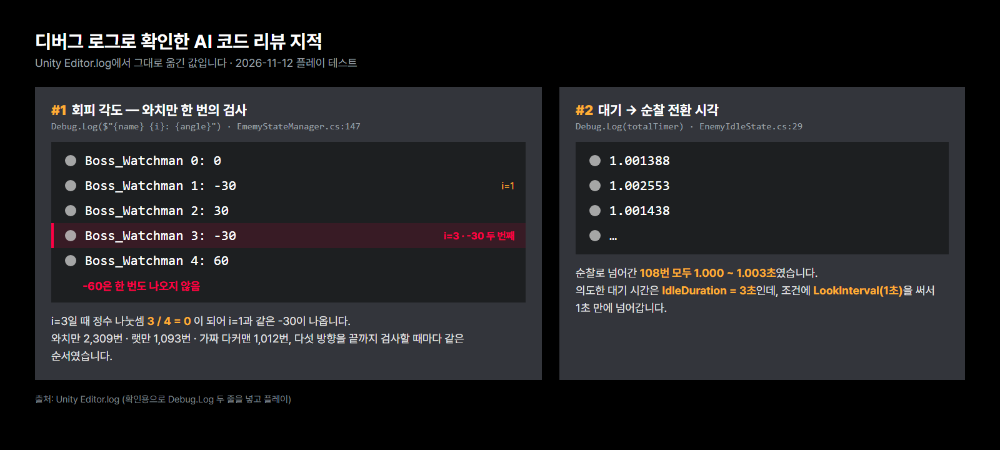
*디버그 로그(Unity Editor.log 발췌). #1 회피 각도는 -60이 한 번도 찍히지 않았고, #2 대기 시간은 매번 약 1초였습니다.* <!-- ✏️ 11-26 v4 캡션 줄 — alt를 옮기고 위 표의 확인 결과를 한 문장으로 -->

**AI가 틀린 곳과 막은 방법**

- **AI가 짜 준 코드의 오류 (#1)** — 회피 각도 식은 당시 AI가 짜 준 코드입니다. 식 위의 주석에는 「0, 30, -30... 순서로 각도 계산」이라고 적혀 있었지만, 값을 찍어 보니 두 번째가 30이 아니라 -30이었고, -30을 두 번 보고 -60은 보지 않았습니다. 주석이 아니라 찍힌 값으로 확인했습니다.
- **AI 리뷰가 틀린 곳 (#3)** — 와치만이 감시자가 지키는 곳으로 가는 것을 문제로 짚었지만, 기획(2-4)에서 정한 동작이라 고치지 않았습니다.
- **막은 방법** — AI가 짚은 9건을 그대로 고치지 않고, 회피 각도(#1)와 대기 시간(#2)은 디버그 로그로, 피격 잠금(#4) · 문 확인(#7) · null 확인(#9)은 코드로 하나씩 확인했습니다. AI의 지적은 가설로 두고, 로그나 코드로 확인한 것만 고칠 거리로 삼았습니다.
<!-- ✏️ 11-26 v4 AI 장 ③: 예전 「가장 크게 배운 것」 · 「하나 더 배운 것」 두 단락(Asana B6 성격의 「배운 것」 틀)을 사실만 남겨 ③으로 다시 놓음. #1을 AI가 짰다는 것은 건우 님 11-26 답("AI가 짜준 코드야"). 주석 원문은 `// 예) 0, 30, -30... 순서로 각도 계산`(EmemyStateManager.cs 144행, main 29e03b1 ✅).
     11-26 지운 문장: "AI의 지적은 가설이고, 확인은 제 몫이라는 기준을 이때 세웠습니다." · "그래서 주석을 믿기보다 값을 직접 찍어 확인하는 습관이 필요하다고 배웠습니다." — 「배운 것」 틀이라 사실 문장(위 셋째 · 첫째 글머리표)으로 바꿈 -->

---

## 8. 결과와 개선 계획

### 8-1. 결과

<!-- 2026-11-12 Claude 정리: 1-2의 "그래서 풀어야 했던 문제"와 짝을 맞춘 결과 표. 내용은 4 · 5 · 6장 · 7-2에서 옮김 — 확인 필요 -->

**목표한 경험은 어떻게 됐나** — 2-1에서 바란 경험은 두 가지였습니다. 뒤통수를 쳐서 하는 **통쾌한 복수**와, 한 대 맞으면 끝나는 **긴장감**입니다.
- **통쾌한 복수는 전해졌습니다.** 뒤통수를 치는 순간을 컷씬(SLAP!)과 타격음으로 보여 주어, 단순한 한 번의 공격에 통쾌함을 더했습니다(6-2).
  플레이해 본 동기도 장점으로 "연출이 화려하다", "사운드를 적절하게 썼다"를 꼽았습니다. *(출처: 동기 피드백)* <!-- ✏️ 11-26 v4(1-6 과정 · 학원 이름): 「학원 동기」 → 「동기」 (두 곳) -->
- **긴장감은 절반만 전해졌습니다.** 한 대에 끝나는 규칙이 긴장감을 만들기는 했습니다. 하지만 적의 시야가 화면에 보이지 않아 언제 들키는지 알 수 없었고,
  그래서 긴장감과 함께 "왜 들켰지?" 하는 불합리함도 느껴졌습니다(5-5, 8-3).
  한 동기는 첫 플레이에서 플레이어를 배려하지 않는 판정이 많다고 느꼈지만, 그 때문에 승부욕이 생겨 오히려 게임을 더 하게 되었다고 했습니다. *(출처: 동기 피드백)*
- **목표와 다르게 나온 점** — 몰래 다가가 복수하는 잠입 게임을 바랐지만, 시야를 보고 피할 수 없으니 실제 플레이는 잠입 게임보다 **피지컬 게임**에 더 가까워졌습니다.
  시야를 보여 주는 계획은 8-3에 적었습니다.

**구현 결과** — 1-2에서 정한 문제가 어디까지 풀렸는지 정리했습니다. 표의 「남은 것」 칸은 8-2 · 8-3과 7장에서 다룹니다. <!-- ✏️ 11-23 Claude 고침: "다 풀지는 못했고" 뺌 -->
<!-- ✏️ 11-25 v3: 첫 칸을 1-2 표의 첫 칸과 같은 문장 · 같은 순서로 바꿈(예전 첫 칸: 보스 4명 · 벽 피하기 · 동시에 때리기 · 쓰러진 적의 공격 · 전투 음악) -->

| 1-2의 문제 | 결과 | 남은 것 |
|---|---|---|
| 보스 4명은 기본 행동이 같고 특유 패턴만 다릅니다 | 몸 하나로 보스 4명을 만들었고, 와치만·랫만 패턴은 상태 하나로 만들었습니다 | 몸 스크립트에 일이 몰렸습니다 (7-3 #6) |
| 적이 플레이어 쪽으로만 가면 벽에 막힙니다 | 몇 갈래로 앞을 살펴 빈 방향으로 움직입니다 | 각도 계산이 틀려 한쪽을 살피지 못해 벽에 끼입니다 (7-3 #1) |
| 플레이어와 적이 동시에 때리면 둘 다 이기거나 둘 다 집니다 | 적 한 명과 동시에 때리면 한쪽만 이깁니다 | 적 둘이 같은 순간에 때리면 막지 못합니다 (7-3 #4) |
| 쓰러진 적이 쓰러지는 연출 중에도 공격하거나 다시 움직입니다 | 막는 곳을 세 군데 넣은 뒤, 다시 테스트(11-12)에서는 일어나지 않았습니다 | 오래 플레이하며 더 확인해야 합니다 (5-4) |
| 적 여러 명이 쫓아와도 음악은 한 번만 바뀌어야 합니다 | 첫 판에서는 의도대로 바뀝니다 | 다시 하기 뒤에는 바뀌지 않고, 아직 풀지 못했습니다 (6-1) |

### 8-2. 문제 해결 요약

<!-- ✏️ 11-25 v3 신설 — 문서 전체의 버그와 그 자리를 한 표로. 근거는 각 절 -->

| 증상 | 다룬 절 | 발견 | 원인 · 수정 | 확인 |
|---|---|---|---|---|
| 진짜 다커만을 쓰러뜨리면 컷씬 없이 바로 엔딩으로 넘어갑니다 | 4-5 | 저 (플레이 테스트, 진짜 다커만에서만) | 맞는 순간 엔딩을 불렀습니다 → 연출 뒤로 옮겼습니다 · 수정 코드는 AI가 짜 준 것입니다 | 커밋 `4ce1f3d` 전 → 후 |
| 적을 쓰러뜨렸는데 플레이어도 쓰러집니다 | 5-4 | 저 (컷씬 중 공격 소리 · 감시자가 부르는 도중) | 넉다운 중에도 공격 판정 · 상태 전환이 일어났습니다 → 세 곳에서 막았습니다 · 수정 코드는 AI가 짜 준 것입니다 | 커밋 `5e6e3d2` · `c964a73`, 11-12 다시 테스트 |
| 다시 하기 뒤 추격 음악이 나오지 않습니다 | 6-1 | 저 (다시 하기 뒤에만) | 카운터가 남는 것으로 추정합니다 → 씬 시작 때 0으로 되돌렸지만 아직 풀지 못했습니다 | — |
| 랫만이 장애물에 걸려 한 방향으로 계속 갑니다 (벽 끼임) | 4-4 · 7-3 #1 | 저 (플레이) · 원인: Claude 리뷰 | 회피 각도 식이 -60°를 보지 않습니다 · 아직 고치지 않았습니다 | 디버그 로그 (커밋 `29e03b1`) |
| 적이 둘러보지 않고 바로 순찰로 넘어갑니다 | 4-2 · 7-3 #2 | Claude 리뷰 | 3초 대신 1초 값을 씁니다 · 아직 고치지 않았습니다 | 디버그 로그 278번 |

### 8-3. 개선 계획 — AI와 처음부터 다시 만들어 출시

<!-- ✏️ 11-23 Claude 고침: 건우 님 계획(AI와 처음부터 다시 만들어 완성된 게임으로 출시)에 맞춰, 리팩토링 계획을 「다시 만들 때 처음부터 정할 것」으로 바꿈. 표 내용은 예전 7-4 표 · 리팩토링 순서 4번 · 7-2 B · 7-3에서 옮김(새 사실 없음) -->
<!-- 11-23 지움: 「리팩토링 순서」 목록(지금 코드를 고치는 순서라 계획과 맞지 않음 — 내용은 표로 옮김), 「지금 다시 만든다면」 문단의 "AI를 활용하는 방법을 잘 몰라서 … 생각도 하지 못했습니다"(낮추는 말)와 "완전히 다른 품질의 게임이 나올 것이라고 확신합니다"(지금 게임을 낮추는 말) — 「설계 → 검토 → 구현」은 첫 문장으로 옮김 -->
<!-- ✏️ 11-25 v3: 예전 7-3 「아쉬운 점 · 개선 계획」과 7-4 「다음 계획」을 합침. 7-3의 역할 몰림 · 보이지 않는 시야 · 박스 시작 각도 · 적 FSM 버그 항목은 아래 표와 8-1 · 8-2에 같은 사실이 있어 뺌(예전 문장: 「역할별로 클래스를 나누는 것까지는 생각하지 못했습니다」 · 「적이 부자연스럽게 움직이는 장면이 생겼습니다」 · 「Trigger Collider로 플레이어를 발견하고 추적하는 시야는 만들었지만 … 불합리하게 느껴지는 문제」 · 「각도 값이 보스마다 복잡하게 나뉘었습니다」). 손작업 항목과 플레이 테스트 피드백은 표 아래에 그대로 둠 -->
이 게임을 AI(Claude)와 **설계 → 검토 → 구현** 순서로 처음부터 다시 만들어, 완성된 게임으로 출시할 계획입니다.
7-3 리뷰와 8-2 · 6-1에서 확인한 문제를, 다시 만들 때 **처음부터 정하고 시작할 것**으로 정리했습니다.
<!-- 출처: 레포 「게임 업데이트 기획서」 2.3·「UpdateAndBugList.md」 + 6-1 · 11-23 본인 답변(다시 만들어 출시) -->

| 이번에 확인한 것 | 이번 게임 | 다시 만들 때 |
|---|---|---|
| 적이 플레이어를 보는지 알 수 없음 | 시야 박스에 닿는 순간 추격하고, 시야는 화면에 보이지 않습니다. 시야 안에 있어도 벽에 가리면 들키지 않는 판정(5-2)까지 겹쳐, 언제 들키는지 짐작하기 더 어려웠습니다 | Darkwood식 시야 — 적의 시야를 화면에 보여 주고, 적 시야에 들어가면 **발견 게이지**가 차오르다 가득 찰 때 추격. 바로 들키지 않고, 적이 나를 보고 있다는 것을 미리 알 수 있게 합니다 |
| 장애물 우회·벽 끼임 | BoxCast 부채꼴 우회 (각도 식 오류 포함, 7-3 #1) | 타일맵 격자 기반 **A\* 길찾기**로 벽을 돌아 찾아오게 합니다 |
| 동시 피격·넉다운 중 판정 | 적마다 잠금 (7-3 #4) | **히트 판정 매니저** 한 곳에서 판정 — 게임의 핵심 규칙 "원 히트 원 킬"이 여기 달려 있습니다 |
| `EnemyStateManager` 역할 몰림 | 한 클래스에 다섯 가지 역할 (7-3 #6) | 이동·감지·박스 회전·넉다운 연출을 처음부터 나누고, 매니저는 상태 전환만 맡깁니다. 이동이 따로 있으면 A\*도 그 클래스에만 넣으면 됩니다 |
| 보스마다 다른 박스 시작 각도 | 히트·시야·허트 박스의 시작 각도를 하나로 맞추지 않고, 애니메이션에서 보스마다 각도를 따로 조정했습니다 | 박스의 기준 각도를 먼저 하나로 정하고 시작합니다 |
| 다시 하기 뒤 전투 음악 | 카운터가 남아 음악이 바뀌지 않고, 아직 풀지 못했습니다 (6-1) | 다시 하기 뒤에도 카운터가 0에서 시작하는지 처음부터 확인합니다 |
| 보스 확인 · 메뉴 코드 | 문이 보스가 쓰러졌는지 매 프레임 확인하고 (7-3 #7), 메뉴 3종 코드가 거의 같습니다 (#8) | 문은 이벤트로 알림을 받고, 메뉴 3종은 공통 부모로 묶습니다 |
<!-- ✏️ 11-26 v4: 표 칸의 음슴체 · 명사 끝을 "~습니다"로. 「더 똑똑한 적」 → 「벽을 돌아 찾아오게 합니다」(같은 줄 첫 칸 「벽 끼임」에 맞춤) -->
<!-- ✏️ 11-25 v3: 첫 줄 「이번 게임」 칸에 예전 7-3 「보이지 않는 적 시야」의 벽 가림 문장, 「보스마다 다른 박스 시작 각도」 줄에 예전 7-3 문장을 합침 -->

특히 두 가지를 먼저 정하고 시작하겠습니다(왜인지는 8-1 「목표한 경험은 어떻게 됐나」).
- **적의 길찾기(A\*)** — 직접 구현해 보면서 길찾기의 원리도 이해하고 싶습니다.
- **보이는 시야** — 플레이어가 적의 시야를 눈으로 확인하며 피해 다닐 수 있어야 **잠입 게임의 정체성**이 살아납니다.

<!-- 출처: 본인 답변 -->

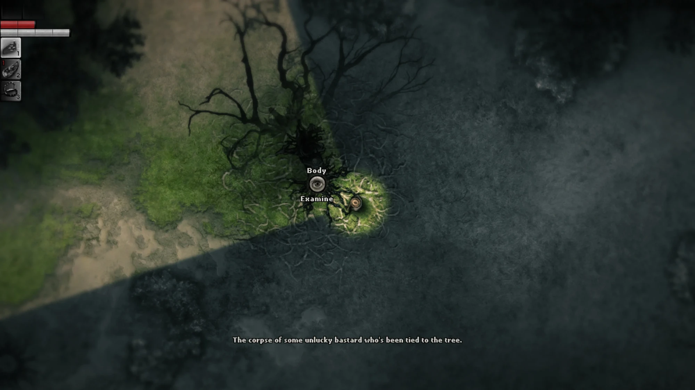
*참고 그림 — Darkwood(Acid Wizard Studio)의 시야 표현입니다. 보이는 범위만 밝고 나머지는 어둡게 가려집니다. 이 게임의 화면이 아닙니다.*

**하나하나 손으로 한 작업** — 아트는 아내가 직접 픽셀아트로 그려 주었기 때문에, 애니메이션은 제가 직접 연결해서 만들어야 했습니다.
발걸음·공격 같은 SFX도 모든 캐릭터의 애니메이션 동작마다 일일이 붙였고, 적과 플레이어의 히트 박스도 하나씩 손으로 설정했습니다.
같은 작업이 캐릭터 수만큼 되풀이되었습니다. <!-- ✏️ 11-26 v4 관문(강조 부사 · 자기 평가): "지금 돌아보면 굉장히 비효율적인 작업이 많았습니다." → 위 문장(앞 두 문장의 사실) --> <!-- 출처: 본인 답변 -->
<!-- 11-23 지움: 「버그를 찾지 못한 채 제출」 항목(디버그 습관이 없었고 무료 AI를 쓰던 때라 원인을 못 찾고 제출) — 강사님 B6 · 사정 호소. 남은 버그는 8-2 · 8-3 표에 사실로 있음 -->

**플레이 테스트 피드백** <!-- 출처: 레포 「게임 업데이트 기획서」 1.4 -->
- 와치만과 랫만의 패턴이 비슷하다 — 쥐가 죽을 때 보스가 얻는 이점(예: 속도 증가)이 있으면 좋겠다.
- 적의 시야각을 화면에 표시하고, 상태가 바뀔 때 머리 위에 `!`·`?`를 띄우면 더 직관적이겠다.

---

## 부록 A. 적 AI 세부 — 본문에서 옮긴 표와 코드

<!-- ✏️ 11-26 v4 분량(통합본 1-8): 4장의 표 2개 · 코드 2개를 내용 그대로 옮김(건우 님 11-26 확인). 본문 자리에는 가리키는 한 줄을 남김 -->

### A-1. `IEnemyState` 인터페이스 (4-1)

```csharp
// IEnemyState.cs (8~18행 발췌, 주석은 문서용 — 원본은 같은 뜻의 주석이 각 줄 위에 있음)
public interface IEnemyState
{
    void Enter(EnemyStateManager stateManager);          // 상태에 진입할 때 한 번
    IEnumerator Execute(EnemyStateManager stateManager); // 상태의 실제 행동 루프 — 코루틴으로 실행
    void Exit(EnemyStateManager stateManager);           // 상태에서 빠져나올 때 한 번
}
```

### A-2. 상태의 행동을 무엇으로 돌릴까 — 다른 방식과 비교 (4-1)

**다른 방식과 비교** *(비교: Claude 정리)*

| 방식 | 장점 | 단점 |
|---|---|---|
| 코루틴 (지금 방식) | "2초 기다렸다가 복귀"를 한 줄로, 위에서 아래로 읽히게 쓸 수 있습니다 | 상태를 바꿀 때 `StopCoroutine`을 챙겨야 하고, 지금 어디까지 실행됐는지 디버깅하기 어렵습니다 |
| `Update`에서 `Tick()` 호출 | 매 프레임 한 번씩 불려 실행 흐름이 단순하고, 디버깅과 테스트가 쉽습니다 | 기다리는 시간을 타이머 변수로 직접 세야 해서 코드가 길어집니다 |
| `async`/`await` | 코루틴처럼 읽히면서, 값을 돌려받거나 예외를 잡을 수 있습니다 | 오브젝트가 꺼져도 저절로 멈추지 않아, 취소를 직접 챙겨야 합니다 |

### A-3. 상태 일곱 가지 — 진입 조건과 전환 (4-2)

| 상태 클래스 | 역할 | 진입 조건 | 종료 후 전환 |
|---|---|---|---|
| `EnemyIdleState` (대기) | 제자리에서 랜덤 방향 둘러보기 | 시작 시 / 추격 실패 후 복귀 | 1초 후 Patrol, 시야 감지 시 Chase |
| `EnemyPatrolState` (순찰) | 지정 지점 왕복 이동 | Idle 종료 | 도착 시 Idle, 플레이어 감지 시 Chase |
| `EnemyChaseState` (추격) | 시야·마지막 목격 위치 추적 | 시야 내 플레이어 감지 | 사거리 진입 시 Attack, 놓치면 마지막으로 본 자리까지 가서 2초 멈춘 뒤 Idle |
| `EnemyAttackState` (공격) | 공격 애니메이션 재생 + 쿨타임 | 공격 사거리 진입 | 쿨타임 종료 후 Chase |
| `AlertMovePatternState` (보스 패턴 1) | 알림 위치(감시자가 지키는 구역 / 쥐가 죽은 곳)로 이동 후 4방향 탐색 | 감시자 / 쥐(보스 하수인) 오브젝트의 외부 이벤트 | 도착 + 탐색 완료 시 Patrol, 가는 중이나 탐색 중에 플레이어를 보면 Chase |
| `EnemyKnockDownState` / `FakeKnockdownState` (넉다운) | 넉다운 연출 재생 | 뒤통수 피격 (`OnBackHit`) | (마지막 상태) 오브젝트 비활성화, 진짜 다커만이면 엔딩 씬 로드 |
<!-- ✏️ 11-25 코드 대조: 추격 → 대기는 "2초 탐색"이 아니라 Stop 뒤 WaitForSeconds(2) (EnemyChaseState.cs 47~61행, 둘러보기 호출 없음). 출동 → 추격 전환 더함 (AlertMovePatternState.cs 35~38 · 77~81행) (main 29e03b1 대조 ✅) -->

### A-4. 감시자 · 쥐가 보스를 부르는 두 줄 (4-2)

```csharp
// RatController.RatDie (98~99행 발췌, 주석은 문서용) — 쥐가 죽는 연출(1초)이 끝난 뒤
Ratman.LastPlayerPosition = transform.position;      // 쥐가 죽은 자리
Ratman.ChangeState(new AlertMovePatternState());

// Watcher.FindAlrert (80~81행 발췌) — 감시자가 플레이어를 본 뒤 0.5초 후
Watchman.LastPlayerPosition = SightBox.transform.position;
Watchman.ChangeState(new AlertMovePatternState());
```


<!--
 📸 시연 영상 촬영 목록: _intake/촬영목록.md (git 제외 — 작업인계.md에도 요약)
-->
