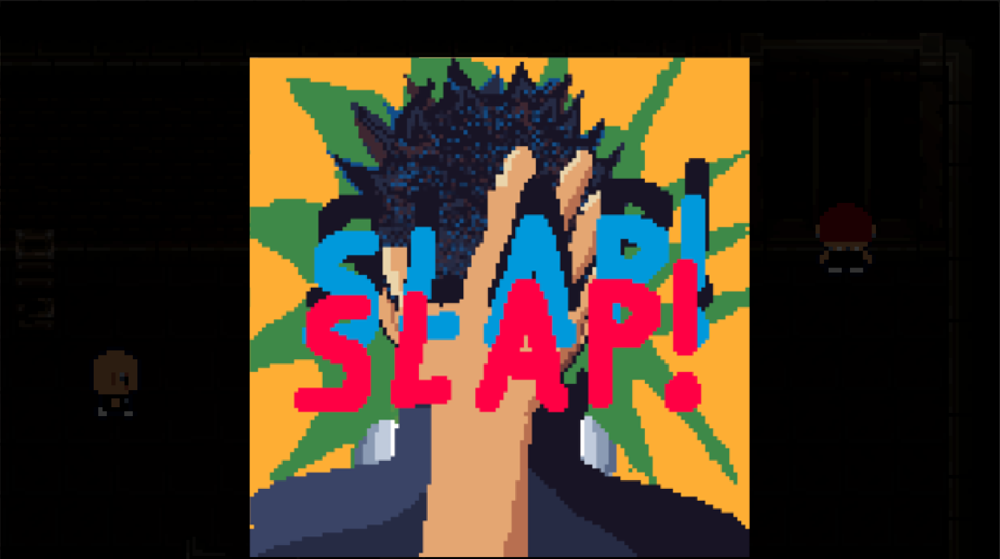
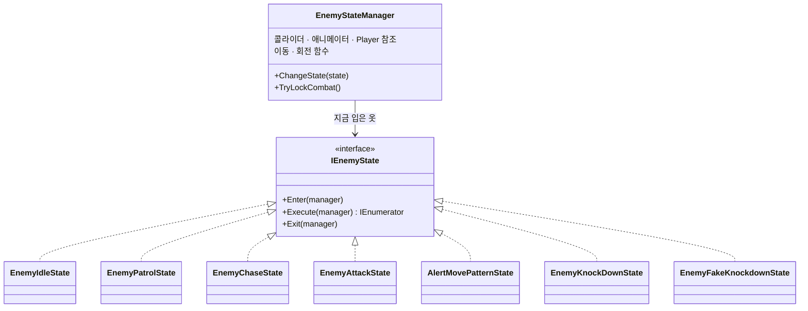
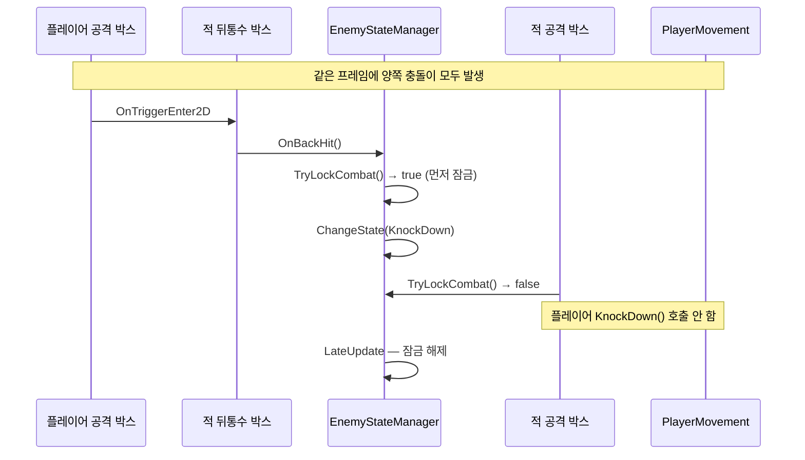
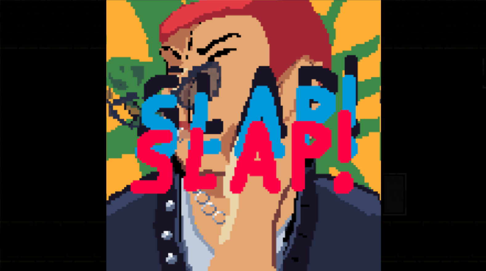

# 뒤통수를 조심해 (Watch Your Back) — 첫 개인 프로젝트 기술 문서

<!--
====================================================================
 ✍ 작성 안내 (이 상자는 다 쓰면 지우세요)
====================================================================
 이 파일은 format/02-tech-document.md 의 「A형 · 단일 기능」 틀입니다(개인 프로젝트). 주제는 적 AI 시스템입니다.
 건우 님이 직접 쓴 두 자료의 글을 옮겨 채웠습니다.
   · 「프로젝트 포트폴리오용 정리 내용.docx」 → "(출처: 본인 정리)"
   · 「뒤통수를 조심해 기술문서 초안 작업 중.pdf」 → "(출처: 초안 PDF)"
 PDF의 코드는 그림이라 글자로 옮길 수 없었습니다.
 (2026-11-09) 레포 3rd-2D-Project-pinkshield의 코드·커밋·「UpdateAndBugList.md」·「게임 업데이트 기획서」를 읽고
 코드·다이어그램·2-4·3-3·3-4·5-2 초안·5-3 개선 계획을 채웠습니다. 핵심 .cs는 code/ 폴더에 복사했습니다.
 "Claude 정리"·"Claude 추정" 표시가 붙은 문장은 직접 읽고 맞는지 확인해 주세요.
 (2026-11-09) 건우 님 답변(1-3·1-4·1-5·2-1·3-2·4-1·4-2·5-2 B·5-4·5-5)을 본문으로 옮기고 답한 표시를 지웠습니다.
 남은 ❓·💬 표시는 아직 답이 필요한 곳입니다.

   ❓ 답해 주세요   — 사실 확인
   💬 내 의견       — 건우 님의 판단·생각이 들어가야 하는 곳

 · 표시(> ❓ … 등)는 답을 채운 뒤 지웁니다. 남아 있으면 포트폴리오에도 그대로 보입니다.
 · 코드는 레포를 받으면 /portfolio-intake <레포 주소> 로 가져오거나, .cs 파일을 code/ 폴더에 넣어 주세요.
 · 다 쓴 뒤 /portfolio-check 1-watch-your-back 으로 점검하세요.
====================================================================
-->

## 1. 개요

### 1-1. 무엇을 만들었나 (What)

「뒤통수를 조심해」는 배신당한 플레이어가 자신을 버린 동료들과 마주하여 복수를 하며 진실을 알아가는 **2D 탑다운 잠입·전투 액션 게임**입니다.
플레이어는 오로지 **적의 뒤통수를 때려야만 승리**하고, 플레이어의 몸이 적에게 **타격받는 순간 게임 오버**가 되는 불공평한 싸움입니다.
간단한 조작이지만, 뒤통수를 때리는 **컷씬 연출**로 플레이어의 몰입감을 끌어올리는 것이 게임 개발의 핵심이었습니다. *(출처: 초안 PDF)*



### 1-2. 왜 만들었나 (Why) — 기획 의도

**게임을 만든 계기** *(출처: 초안 PDF)*
살다 보면 누구나 한 번쯤은 통쾌한 복수를 하고 싶다는 생각이 듭니다. 특히 나의 뒤통수를 먼저 친 사람이라면, 물리적으로나 정신적으로나
그에 대한 복수를 하고 싶은 마음이 생기기 마련입니다. 그러나 실제로는 리스크가 너무 커서 그 행동을 하기 어렵습니다.
그런 마음을 풀어내는 것은 현실에서는 어렵지만, 게임에서는 가능합니다. 게임 아이디어를 생각하다가 문득 그 생각이 났고, 아이디어는 한 줄로 정리되었습니다 — **"뒤통수를 조심해"**.

**단순한 핵심 메커니즘** — 디벨로켓 프로그래머 과정에서 게임 개발을 처음 배우고 처음 만드는 게임이었고, 코드를 스스로 구현하는 능력이 부족했기 때문에
핵심 메커니즘을 단순하게 만들고자 했습니다. **적의 뒤통수를 친 플레이어가 승리, 플레이어가 맞으면 패배.** 그 외의 다른 승패 조건은 없습니다.
플레이어·적 모두 원 히트 원 킬이라, 단순하지만 긴장감을 줄 수 있도록 했습니다. *(출처: 초안 PDF · 본인 정리)*

**기획에 영감을 받은 게임** — 「장미와 동백 (Rose and Camellia)」 *(출처: 본인 정리)*
장미와 동백이라는 게임은 NIGORO가 제작한 병맛 막장 드라마풍의 뺨 때리기(싸대기) 격투 게임입니다.  게임 시스템 자체에 영감을 받은 것은 아니었습니다. 다만 **뺨 때리기**라는 단순하지만 강력한 행동이 주는 시각적 감성에 영감을 얻어,
**뒤통수를 때리는 것**으로 게임의 핵심 포인트를 잡게 되었습니다.

### 1-3. 개발 환경 · 링크

| 항목 | 내용 |
|---|---|
| 장르 | 탑다운 액션 잠입 게임 (2D) |
| 플랫폼 | Windows PC |
| 엔진·도구 | Unity 6000.3.15f1, Visual Studio 2026, C# |
| 기간 | 2026-06-10 ~ 2026-07-07 (기획·게임 에셋 마련 06-10 ~ 06-16 · 개발 06-17 ~ 07-07) |
| 인원 | 1명 (개인 개발) |
| 영상 | 추가 예정 |
| GitHub | https://github.com/KooHoo-Dev/3rd-2D-Project-pinkshield |

<!-- ✍ GitHub 레포는 아직 비공개입니다(추후 공개 예정). 제출 전에 공개로 바꾸고 링크가 열리는지 확인하세요. -->

### 1-4. 레벨과 적 — 캐릭터와 레벨 디자인은 함께 간다

맵 레벨과 적의 능력을 묶어서 디자인했습니다. *(출처: 본인 정리)*

| 보스              | 구역 | 능력 |
|-----------------|---|---|
| 앨리만 (Alleyman) | 튜토리얼 | 플레이어를 감지하면 추격한다 (모든 보스의 공통 요소) |
| 와치만 (Watchman)  | 감옥 | 속박된 감시자가 플레이어를 감지하면, 구역 보스인 와치만이 감시자가 지키는 구역으로 이동 |
| 랫만 (Ratman)     | 시궁창 | 쥐를 밟으면 랫만이 쥐가 죽은 장소로 이동하여 순찰 |
| 다커만 (Darkerman) | 어두운 방 | 분신 둘과 본체 하나. 본체를 처치해야만 게임 클리어 |


보스 4명은 모두 같은 `EnemyStateManager`를 쓰고, 보스마다 다른 점은 **곁에 붙은 작은 스크립트**로만 만들었습니다. *(출처: 코드 — Claude 정리, 확인해 주세요)*

| 보스 | 추가 스크립트 | 하는 일 |
|---|---|---|
| 와치만 | `Watcher` (감시자) | 감시자의 시야 박스에 플레이어가 들어오면 말풍선·"Hey" 효과음 후 0.5초 뒤 와치만에게 `AlertMovePatternState`를 입힘 |
| 랫만 | `RatController` (쥐) | 좌우 왕복(`Mathf.PingPong`)하다 플레이어에게 밟히면 죽는 연출 1초 후, 랫만에게 쥐 위치를 넘기고 `AlertMovePatternState`를 입힘 |
| 다커만 | `DarkermanIdentity` · `DarkermanInvisibleEffect` · `DarkermanBossManager` | 인스펙터 체크 하나로 진짜/가짜 구분. 진짜만 40초마다 0.3초간 반투명해지고, 진짜가 쓰러지면 엔딩 씬 로드 |

### 1-5. 이 문서에서 다루는 것

**적 AI 시스템** — 인터페이스로 상태를 나눈 상태 머신, 이동 방향에 맞춰 도는 시야·공격 박스, 동시 공격 판정.
2장 구조 → 3장 상태 전환·동시 공격 처리·장애물 회피·전투 BGM → 4장 박스 회전 방식과 보스 공통 구조를 정한 이유 → 5장 배운 점·트러블슈팅·아쉬운 점.

프로그래밍을 배우고 만든 첫 게임이라 부족한 점이 많았습니다. 이 문서는 잘한 점만큼 **부족했던 점을 인정하고, AI 코드 리뷰로 그 원인을 코드에서 찾아 확인한 과정**(5-4)과 **개선 계획**(5-5)에 무게를 두었습니다.

---

## 2. 시스템 구조

### 2-1. 인터페이스를 활용한 적 AI — 몸은 하나, 옷만 갈아입는다

*(출처: 초안 PDF)*

적 AI 시스템을 비유하자면, `EnemyStateManager`는 **몸**이고, 각 `IEnemyState`는 그 몸이 잠깐 입는 **옷**입니다.
몸(콜라이더, 애니메이터, 이동·회전 함수, Player 참조)은 하나뿐이고, 지금 어떤 행동을 하는지는 지금 입고 있는 옷(상태 클래스)이 결정합니다.
옷을 갈아입어도(`ChangeState`) 몸의 위치와 컴포넌트 참조는 그대로 유지됩니다.

보스 4명은 외형만 다르고, 공통적으로 같은 공격·같은 이동을 사용하도록 구현했습니다. 몸(이동·회전·전투 판정처럼 "누가 해도 똑같은 기능")과
옷(지금 "무엇을 하는가"라는, 보스마다 다를 수 있는 부분)을 분리해, **몸은 공유하고 옷만 갈아입는 구조**를 만들었습니다.



`IEnemyState`는 세 메서드만 정합니다. *(출처: 코드 `IEnemyState.cs`)*

```csharp
public interface IEnemyState
{
    void Enter(EnemyStateManager stateManager);          // 상태에 진입할 때 한 번
    IEnumerator Execute(EnemyStateManager stateManager); // 상태의 실제 행동 루프 — 코루틴으로 실행
    void Exit(EnemyStateManager stateManager);           // 상태에서 빠져나올 때 한 번
}
```

상태 클래스는 `MonoBehaviour`가 아닌 **일반 C# 클래스**라서 `new EnemyChaseState()`처럼 만들어 바로 입힙니다.
매 프레임 `Update`를 돌리는 대신 `Execute`를 **코루틴**으로 두어, "2초 기다렸다가 복귀"(`WaitForSeconds`) 같은 시간 흐름을 상태 안에 그대로 적을 수 있게 했습니다. *(출처: 코드 — Claude 정리, 확인해 주세요)*

코루틴을 고른 이유는, 당시 수업에서 코루틴을 처음 배웠고 **배운 것을 직접 활용해 보고 싶은 마음**이 컸기 때문입니다. 그 당시에는 큰 문제가 없다고 느꼈습니다. *(출처: 본인 답변)*

> 💬 **내 의견** (선택) — 코루틴 말고 다른 방식(`Update`에서 `Tick()` 호출, `async`/`await` 등)과 비교해 본 뒤 생각이 생기면 한 줄 더해 주세요.

### 2-2. 상태 전환

*(출처: 초안 PDF)*


| 상태 클래스 | 역할 | 진입 조건 | 종료 후 전환 |
|---|---|---|---|
| `EnemyIdleState` (대기) | 제자리에서 랜덤 방향 둘러보기 | 시작 시 / 추격 실패 후 복귀 | 1초 후 Patrol, 시야 감지 시 Chase |
| `EnemyPatrolState` (순찰) | 지정 지점 왕복 이동 | Idle 종료 | 도착 시 Idle, 플레이어 감지 시 Chase |
| `EnemyChaseState` (추격) | 시야·마지막 목격 위치 추적 | 시야 내 플레이어 감지 | 사거리 진입 시 Attack, 놓치고 2초 탐색 후 Idle |
| `EnemyAttackState` (공격) | 공격 애니메이션 재생 + 쿨타임 | 공격 사거리 진입 | 쿨타임 종료 후 Chase |
| `AlertMovePatternState` (보스 패턴 1) | 알림 위치(감시자가 지키는 구역 / 쥐가 죽은 곳)로 이동 후 4방향 탐색 | 감시자 / 쥐(보스 하수인) 오브젝트의 외부 이벤트 | 도착 + 탐색 완료 시 Patrol |
| `EnemyKnockDownState` / `FakeKnockdownState` (넉다운) | 넉다운 연출 재생 | 뒤통수 피격 (`OnBackHit`) | (마지막 상태) 오브젝트 비활성화, 진짜 다커맨이면 엔딩 트리거 |

각 상태는 `EnemyStateManager`가 **적의 상태 판단 조건이 만족되었을 때** 전환합니다. 판단 조건은 시야 박스, 공격 범위 박스, 공격 히트 박스 등으로 판정하며,
이 조건을 `EnemyStateManager`가 지니고 직접 상태 전환을 작동시킵니다.

`AlertMovePatternState`가 1-4의 와치만(감시자가 발견하면 감시자가 지키는 구역으로 이동)과 랫만(쥐가 죽은 곳으로 이동)의 패턴입니다.

외부 스크립트(감시자·쥐)는 보스의 내부를 몰라도 **목표 위치 하나만 넘기고 `ChangeState`를 부르면** 됩니다. *(출처: 코드 `Watcher.cs`·`RatController.cs`)*

```csharp
// RatController.cs — 쥐가 죽는 연출(1초)이 끝난 뒤
Ratman.LastPlayerPosition = transform.position;      // 쥐가 죽은 자리
Ratman.ChangeState(new AlertMovePatternState());

// Watcher.cs — 감시자가 플레이어를 본 뒤 0.5초 후
Watchman.LastPlayerPosition = SightBox.transform.position;
Watchman.ChangeState(new AlertMovePatternState());
```


### 2-3. 시야·공격 박스 회전

*(출처: 초안 PDF)*

적의 이동 방향에 맞춰 공격·피격 범위를 정하는 박스들이 아래 표처럼 회전합니다.

| 이동 방향 (MoveX, MoveY) | 공격 타격 박스 / 공격 범위 박스 / 적 피격 박스 각도 | 시야 박스 목표 각도 |
|---|---|---|
| 오른쪽 (X > 0) | 90° | 0° (보간 회전) |
| 왼쪽 (X < 0) | 270° | 180° |
| 위 (Y > 0) | 180° | 90° |
| 아래 (Y < 0) | 0° | 270° |

-노란색(허트박스)-초록색(히트박스).png>)

회전 각도는 애니메이터의 `MoveX`·`MoveY` 값 중 **절댓값이 큰 축**으로 4방향을 정합니다. 멈춰 있을 때(두 값이 0.01 미만)는 마지막 각도를 유지합니다. *(출처: 코드 `UpdateBoxRotations`)*

```csharp
if (absX > absY)
{
    if (moveX > 0) SetTargetAngles(90f, 90f, 0f);    // 오른쪽
    else SetTargetAngles(270f, 270f, 180f);          // 왼쪽
}
else
{
    if (moveY > 0) SetTargetAngles(180f, 180f, 90f); // 위
    else SetTargetAngles(0f, 0f, 270f);              // 아래
}
```

### 2-4. 박스와 매니저의 연결 — 박스는 알리기만, 판단은 매니저가

*(출처: 코드 — Claude 정리, 확인해 주세요)*

각 박스(자식 오브젝트)에는 아주 작은 스크립트만 붙어 있고, 충돌이 나면 **부모의 `EnemyStateManager`에 알리기만** 합니다.

| 박스 | 스크립트 | 충돌 시 하는 일 |
|---|---|---|
| 시야 박스 | `EnemyBoxTrigger` (`EnemyBoxType.Sight`) | 들어오면 `Player` 참조 저장, 나가면 `null` |
| 공격 범위 박스 | (매니저가 `IsTouching`으로 직접 확인) | Chase 상태가 매 프레임 사거리 진입을 확인 |
| 공격 타격 박스 | `EnemyAttackHitBox` | 플레이어에 닿으면 `TryLockCombat` 후 `player.KnockDown()` |
| 뒤통수 피격 박스 | `EnemyBackHurtBox` | `PlayerAttack` 태그가 닿으면 `manager.OnBackHit()` |

시야 박스 안에 들어와도 바로 추격하지는 않습니다. `CheckPlayerInSight()`가 적에서 플레이어까지 **레이캐스트를 쏴서 벽(`ObstacleLayer`)에 가리지 않았을 때만** "보인다"로 판정합니다.

---

## 3. 핵심 기능

### 3-1. 상태 전환 (`ChangeState`) — 정리와 가드를 함께

*(출처: 초안 PDF)*

상태를 전환할 때는 밖에서 내부 동작 과정을 복잡하게 알 필요 없이 `ChangeState`만 단순하게 호출하도록 설계했습니다.
상태 전환 시 생길 수 있는 부작용을 막기 위해 정리·가드 로직을 넣었습니다.

- **넉다운 가드** — 이미 쓰러진 상태에서 다른 상태로 잘못 전환되는 문제를 막습니다.
- **순서 보장** — `Exit`과 `StopCoroutine`을 먼저 호출해 이전 상태의 이동·사운드 로직을 확실히 정리한 뒤, 새 상태의 코루틴을 시작합니다.

```csharp
public void ChangeState(IEnemyState newState)
{
    if (IsKnockDown == true) return;                        // ① 넉다운 가드 — 쓰러진 적은 다시 움직이지 않음

    if (currentState != null) currentState.Exit(this);      // ② 이전 상태 정리 (정지·전투 BGM 해제)
    if (stateCoroutine != null) StopCoroutine(stateCoroutine); // ③ 이전 상태 루프 중단

    currentState = newState;
    currentState.Enter(this);                               // ④ 새 상태 진입
    stateCoroutine = StartCoroutine(currentState.Execute(this)); // ⑤ 새 상태 루프 시작
}

public bool IsKnockDown => currentState is EnemyKnockDownState || currentState is EnemyFakeKnockdownState;
```

*(출처: 코드 `EnemyStateManager.cs`)*
넉다운 여부를 따로 `bool`로 들고 있지 않고 **지금 입은 옷(상태)의 종류**로 판단하기 때문에, 값을 깜빡하고 안 바꾸는 실수가 생기지 않습니다.
이 가드는 7월 22일 커밋("넉다운 상태일때 다른 상태 전환을 하지 않도록 예외처리 추가")에서 들어갔습니다. 감시자·쥐·테스트 키처럼 **밖에서** `ChangeState`를 부르는 곳이 여럿이라, 입구 한 곳에서 막는 것이 가장 확실했습니다. *(뒤 문장은 Claude 정리, 확인해 주세요)*

### 3-2. 같은 프레임 동시 피격 방지 (`TryLockCombat`)

*(출처: 초안 PDF)*

플레이어와 적이 **동시에 공격**할 때 생기는 판정 모순(둘 다 이기거나 둘 다 지는 경우)을 해결하기 위해, 프레임 단위 잠금(Lock) 방식을 적용했습니다.
같은 프레임에 **먼저 `TryLockCombat()`을 호출한 쪽만** 전투 판정을 얻도록 해, 승패가 한쪽으로 분명히 갈리도록 했습니다.

```csharp
// EnemyStateManager.cs
private bool combatResolved = false;

public bool TryLockCombat()
{
    if (combatResolved == true) return false; // 이번 프레임에 이미 승패가 났음
    combatResolved = true;
    return true;
}

private void LateUpdate()
{
    combatResolved = false; // 프레임이 끝나면 잠금 해제 → 다음 프레임부터 다시 판정
}
```

잠금은 양쪽 입구에서 똑같이 확인합니다. *(출처: 코드 `EnemyAttckHitBox.cs`·`EnemyStateManager.OnBackHit`)*



`OnBackHit`은 잠금 외에도 ① `PlayerAttack` 태그인지 ② 이미 쓰러진 적인지 ③ **때린 플레이어가 이미 쓰러졌는지**(`IKnockDownStatus`)를 차례로 걸러 냅니다.
플레이어와 적이 같은 인터페이스 `IKnockDownStatus`를 구현해서, 서로의 클래스를 몰라도 "쓰러졌나?"만 물어볼 수 있습니다. *(출처: 코드 — Claude 정리, 확인해 주세요)*

**이 잠금이 필요했던 이유** *(출처: 본인 답변)*
가장 큰 문제는 플레이어가 뒤통수를 쳤는데도, 넉다운 연출 컷씬이 재생되는 동안 보스가 비활성화되지 않고 공격을 해서 **플레이어도 같이 죽는 판정**을 받는 현상이 계속 일어난 것이었습니다.
당시에는 코딩 지식이 부족했고, 무료 AI로는 정확한 원인을 진단하기 어려웠습니다. (→ 5-2 A)

### 3-3. 장애물 회피 이동 (`MoveWithAvoidance`)

*(출처: 코드 `EnemyStateManager.cs` — Claude 정리, 확인해 주세요)*

순찰·추격·출동 상태는 모두 같은 이동 함수를 씁니다. 가려는 방향으로 바로 가지 않고, **부채꼴로 `BoxCast`를 여러 번 쏴서 처음으로 비어 있는 방향**으로 움직입니다.
선(Raycast) 대신 상자(BoxCast)를 쓴 것은 적의 **몸 크기만큼** 지나갈 수 있는지 보려는 것입니다.

```csharp
for (int i = 0; i < RayCount; i++)            // RayCount = 5
{
    float angle = AvoidanceAngle * (i % 2 == 0 ? i / 2 : -(i / 4 + 1)); // AvoidanceAngle = 30
    Vector2 checkDir = Quaternion.Euler(0, 0, angle) * targetDirection;

    RaycastHit2D hit = Physics2D.BoxCast(Rb.position, BoxSize, 0f, checkDir, DetectionDistance, ObstacleLayer);
    if (hit.collider == null) { finalDirection = checkDir; break; }
}
Rb.linearVelocity = finalDirection * Speed;
```

이 식에는 주석의 의도와 다른 문제가 있어 5-4에서 다시 다룹니다(AI 리뷰 #1).

### 3-4. 전투 BGM — 몇 명이 나를 쫓고 있나 세기

*(출처: 코드 `SoundManager.cs`·`EnemyChaseState.cs`)*

추격·공격 상태의 `Enter`에서 `NotifyCombatStarted()`, `Exit`에서 `NotifyCombatEnded()`를 부릅니다.
`SoundManager`는 지금 전투 중인 적의 수(`engagedEnemyCount`)를 세어, **0 → 1이 되는 순간** 전투 BGM으로, **1 → 0이 되는 순간** 평상시 BGM으로 크로스페이드합니다.
그래서 적 여러 명이 동시에 쫓아와도 음악이 한 번만 바뀝니다.

```csharp
public void NotifyCombatStarted()
{
    engagedEnemyCount++;
    if (engagedEnemyCount == 1) SwitchBgm(combatBgmClip);   // 첫 적이 전투를 시작한 순간
}

public void NotifyCombatEnded()
{
    engagedEnemyCount = Mathf.Max(0, engagedEnemyCount - 1);
    if (engagedEnemyCount == 0) SwitchBgm(normalBgmClip);   // 마지막 적까지 전투에서 벗어난 순간
}
```

---

## 4. 고민과 선택

> 가이드: **대안 2개 이상 비교 + 상황을 근거로 한 선택 이유**.

### 4-1. 박스 회전 — 즉시 회전 vs 보간 회전

*(출처: 초안 PDF)*

| 박스 | 회전 방식 | 이유 |
|---|---|---|
| 공격·피격 판정 박스 | **즉시 회전** | 정확도와 즉각적인 반응이 중요하므로 `LerpAngle` 없이 바로 돌림 |
| 시야 박스 (`SightBox`) | **보간 회전** (`Mathf.LerpAngle`) | 적이 "고개를 부드럽게 돌리는 연출"을 살리기 위해 |

같은 "방향에 맞춰 도는 박스"라도 역할에 따라 **의도적으로 다르게** 처리했습니다.

다만 과제 제출 당시 마지막 빌드에서는 **시야 박스를 화면에 보이지 않게** 만들어, 플레이어가 적에게 발견되는 순간을 쉽게 알아채지 못했습니다.
시야를 부드럽게 돌리는 연출을 넣었지만 정작 그 시야가 보이지 않았던 것입니다. 플레이해 본 학원 동기들의 피드백을 보고, 시야 박스를 보여 주는 것이
더 합리적인 시스템이었을 수도 있다고 생각하게 되었습니다(→ 5-3). *(출처: 본인 답변)*

### 4-2. 보스 4명 — 공통 몸 + 상태(옷) vs 보스마다 따로

| 방법 | 장점 | 단점 |
|---|---|---|
| 보스마다 클래스를 따로 | ❓ | ❓ |
| **공통 몸(`EnemyStateManager`) + 상태 클래스 (선택)** | 이동·회전·전투 판정을 한 번만 구현. 보스마다 다른 행동은 상태(옷)로 추가 (예: `AlertMovePatternState`, `FakeKnockdownState`) | ❓ |

보스의 기본 공격은 모두 같기 때문에, 보스 특유의 패턴은 **보스마다 패턴 상태(state)로 추가**하는 것이 좋다고 생각했습니다.
실제로 만들어 보니 그 패턴은 해당 보스만 쓰기 때문에 문제가 없다고 판단했습니다. *(출처: 본인 답변)*

> ❓ **채워 주세요** — 표의 ❓ 칸(보스마다 따로 만들 때의 장단점, 선택한 방법의 단점)을 본인 생각으로 채워 주세요.

---

## 5. 결과 및 배운 점

### 5-1. 배운 점

**게임 연출의 중요성** — 게임 내 메인 루프인 뒤통수 때리기 공격과 회피는 굉장히 단순한 구조이지만,
플레이어와 적의 **컷씬 연출**을 활용하여 게임 플레이 경험에 생동감을 주었습니다. *(출처: 본인 정리)*



**사운드의 중요성** — 게임을 만들면서 SFX(발걸음·타격음)를 넣기 전까지는 테스트하면서 큰 재미를 느끼지 못했습니다.
SFX를 넣은 뒤 플레이어와 적의 타격 액션에 재미가 더해지는 것을 느꼈고, SFX와 배경음 등 게임 내 사운드의 중요성을 다시 한번 깨달았습니다. *(출처: 본인 정리)*

### 5-2. 트러블슈팅

> 💬 **확인해 주세요** — 아래 두 건은 레포의 「UpdateAndBugList.md」 버그 목록과 커밋 기록·코드를 맞춰 **Claude가 초안으로 쓴 것**입니다.
> 실제 겪은 순서·느낀 점과 다르면 고쳐 주시고, 하나만 남긴다면 **A**를 권합니다(게임의 핵심 규칙 "원 히트 원 킬"과 직접 이어짐).

**A. 적을 쓰러뜨렸는데 플레이어도 쓰러지는 문제**

| 단계 | 내용 |
|---|---|
| 문제 | 뒤통수를 쳐서 적이 넉다운 연출을 하는 중인데, 플레이어도 넉다운되어 게임 오버가 됨. 계속 반복해서 일어났고, 당시 지식과 무료 AI로는 원인을 정확히 진단하기 어려웠음 *(출처: 버그 목록 · 본인 답변)* |
| 원인 | 넉다운 컷씬이 재생되는 동안 적 오브젝트가 아직 켜져 있어, 적의 공격 타격 박스가 계속 판정을 냄 *(출처: 업데이트 기획서 "컷씬 재생 중에는 적이 비활성화 되지 않아 공격이 가능함")* |
| 해결 | ① 7/6 — 공격 타격 박스(`EnemyAttackHitBox`)와 `OnBackHit` 앞에 `IsKnockDown` 확인 추가 ② 7/22 — `ChangeState` 입구에도 같은 가드를 넣어, 감시자·쥐가 쓰러진 보스를 다시 움직이게 하는 길까지 막음 *(출처: 커밋 5e6e3d2·c964a73)* |
| 결과 | ❓ 테스트로 확인한 결과를 한 줄 적어 주세요 |

**B. 두 번째 판부터 추격 음악이 안 나오는 문제**

| 단계 | 내용                                                                                                                                                                                       |
|---|------------------------------------------------------------------------------------------------------------------------------------------------------------------------------------------|
| 문제 | 첫 게임에서는 추격 BGM이 나오지만, 재시도 이후에는 나오지 않음 *(출처: 버그 목록)*                                                                                                                                      |
| 원인 (Claude 추정) | `SoundManager`는 씬이 바뀌어도 남는 싱글톤(`DontDestroyOnLoad`)입니다. 추격 중에 플레이어가 죽고 씬을 다시 불러오면, 적의 `Exit`가 불리지 않아 `engagedEnemyCount`가 0으로 돌아가지 않습니다. 다음 판에서 첫 추격이 와도 카운트가 1이 아니라 2가 되어 BGM이 바뀌지 않습니다 |
| 시도 | 씬 시작 시 `GameSceneInitializer`가 `SoundManager.ResetCombatMusicState()`로 카운트를 0으로 되돌림 *(출처: 코드)* |
| 결과 | 과제 제출 당시에는 해결하지 못했습니다. 카운트를 되돌린 뒤에도 남은 문제라 다른 원인이 더 있을 수 있고, 추후 리팩토링 때 다시 확인할 예정입니다. *(출처: 본인 답변)* |

### 5-3. 아쉬운 점 · 개선 계획

- **`EnemyStateManager`에 역할이 몰림** — 상태 전환 판단 조건을 `EnemyStateManager`가 지니고 있어, 캐릭터 이동, 애니메이션 호출, 전환 조건 판단과 전환까지
  너무 많은 역할을 맡는 클래스가 되었습니다. 구조적 분리를 고려하지 못했습니다. *(출처: 초안 PDF)*
- **적 FSM의 미흡함** — FSM을 구현하는 중 버그(플레이어 감지 기능, 벽끼임 현상 등)로 인해 플레이 경험이 부자연스러운 상황이 연출되었습니다. *(출처: 본인 정리)*
- **적 시야 시스템의 미흡함** — Trigger Collider를 활용해 플레이어를 발견하고 추적할 수 있는 시야 시스템의 기반을 설계했으나,
  적이 플레이어를 감지하는 것을 플레이어가 **눈으로 확인할 수 없어서** 불합리한 경험을 하는 문제가 있었습니다. *(출처: 본인 정리)*

**플레이 테스트 피드백** *(출처: 레포 「게임 업데이트 기획서」 1.4)*
- 와치만과 랫만의 패턴이 비슷하다 — 쥐가 죽을 때 보스가 얻는 이점(예: 속도 증가)이 있으면 좋겠다.
- 적의 시야각을 화면에 표시하고, 상태가 바뀔 때 머리 위에 `!`·`?`를 띄우면 더 직관적이겠다.

### 5-4. AI 코드 리뷰로 다시 본 내 코드

<!--
 ✍ 이 절의 뼈대는 Claude가 코드를 분석한 결과(2026-11-09)로 만들었습니다.
 이 절이 면접에서 힘을 가지려면 "AI가 찾아 줬다"가 아니라 "AI 지적을 내가 직접 확인하고, 원인을 내 말로 설명할 수 있다"가 보여야 합니다.
 → 표의 ❓ 칸(내가 확인한 결과)을 직접 실행·디버깅해 보고 채워 주세요. 확인하지 못한 줄은 지우는 편이 안전합니다.
 → 면접에서 "이 식이 왜 -60°를 안 보나요?"라고 물으면 직접 계산해서 답할 수 있어야 합니다.
-->

첫 게임을 끝낸 뒤 **스스로는 어디가 문제인지 정확히 짚기 어려웠던 부분**을, AI(Claude)에게 코드 리뷰를 맡겨 다시 살펴보았습니다.
5-3에서 제가 느낀 "부자연스러움"·"벽 끼임"·"책임 몰림"이 **코드의 어느 줄에서 나오는지** 찾는 것이 목표였습니다.

AI에게 코드 리뷰를 맡겨 본다는 것은 그동안 생각해 본 적이 없었는데, 직접 해 보니 **오랫동안 원인을 찾지 못했던 것을 빠른 시간 안에 찾을 수 있었습니다.** *(출처: 본인 답변)*

**AI가 짚은 문제와 내가 확인한 결과** *(AI 지적 칸 출처: 코드 — Claude 분석)*

| # | AI가 짚은 문제 | 코드 위치 | 내가 확인한 결과 | 이어지는 아쉬움 |
|---|---|---|---|---|
| 1 | 회피 각도 식이 0°, -30°, 30°, **-30°**, 60° 순서로 나와 -30°를 두 번 보고 **-60°는 검사하지 않음** (주석의 의도는 0, 30, -30, 60, -60) | `EnemyStateManager.MoveWithAvoidance` | ❓ | 벽 끼임 |
| 2 | 대기 시간에 `IdleDuration`(3초) 대신 `LookInterval`(1초)을 써서, 둘러보기는 1번만 하고 바로 순찰로 넘어감 | `EnemyIdleState.Execute` | ❓ | 적 AI 부자연스러움 |
| 3 | 와치만이 가는 곳이 플레이어 위치가 아니라 **감시자 시야 박스의 위치** | `Watcher.FindAlrert` | 의도한 동작 — 와치만은 감시자가 지키는 구역으로 출동하도록 설계함 | 와치만·랫만 패턴이 비슷함 |
| 4 | 동시 피격 잠금(`combatResolved`)이 **적 한 마리마다** 따로 있어, 적 둘이 같은 프레임에 판정하면 막지 못함. "먼저 호출한 쪽"은 물리 콜백 순서로 정해짐 | `EnemyStateManager.TryLockCombat` | ❓ | 판정 문제 |
| 5 | 추격 BGM 카운터가 씬을 다시 불러와도 남아 있어, 두 번째 판부터 음악이 안 바뀜 | `SoundManager` (싱글톤) | 제출 당시 해결하지 못함 (5-2 B) | 추격 음악 1회성 |
| 6 | 한 클래스가 이동·감지·박스 회전·넉다운 연출·진행도 기록까지 맡음 (약 400줄) | `EnemyStateManager` | 5-3에서 스스로 느낀 점과 같음 | 책임 몰림 |
| 7 | 보스가 쓰러졌는지 매 프레임 `Update`에서 확인함 | `DoorManager.Update` | ❓ | 책임 몰림 |
| 8 | 메뉴 3종의 입력·강조·효과음 코드가 거의 같음 | `GameMenu`·`GameOverUIController`·`GameClearMenuController` | 버그 목록에 이미 적어 둠 | 중복 코드 |
| 9 | `Exit`에서 `SoundManager.Instance`의 null 확인이 빠짐 (`Enter`에서는 확인함). 파일 이름과 클래스 이름이 다름 (`EmemyStateManager.cs`, `EnemyAttckHitBox.cs`) | 여러 곳 | ❓ | 기본기 |

> ❓ **채워 주세요** — "내가 확인한 결과" 칸에 직접 확인한 내용을 적어 주세요.
> 예: "디버그 로그로 각도를 찍어 보니 -30이 두 번 나옴", "적 둘을 붙여 놓고 테스트하니 실제로 동시 판정 발생". 재현이 안 되면 "재현 안 됨"이라고 써도 됩니다.

> 💬 **내 의견** — 이 리뷰에서 **가장 크게 배운 것 한 가지**를 적어 주세요.
> 예: 주석과 실제 동작이 다를 수 있다 → 값을 직접 찍어 확인하는 습관 / 버그는 증상(벽 끼임)과 원인(각도 식)이 멀리 떨어져 있을 수 있다.

### 5-5. 개선 계획 (아직 하지 않음)

이미 세워 둔 업데이트 기획서의 계획에, 5-4의 리뷰 결과로 **리팩토링 순서**를 더했습니다. 리팩토링은 아직 하지 않았고 다음 작업으로 남겨 두었습니다.
*(출처: 레포 「게임 업데이트 기획서」 2.3·「UpdateAndBugList.md」 + 5-4)*

| 아쉬운 점 | As-Is (지금) | To-Be (계획) |
|---|---|---|
| 적이 플레이어를 보는지 알 수 없음 | 시야 박스에 닿는 순간 추격, 시야는 화면에 안 보임 | Darkwood식 시야 제한 — 플레이어 시야각만 밝게, 적 시야에 닿으면 **발견 수치**가 차오르다 최대일 때 추격 |
| 장애물 우회·벽 끼임 | BoxCast 부채꼴 우회 (각도 식 오류 포함, 5-4 #1) | 각도 식부터 고친 뒤 **A\* 길찾기**로 교체 |
| 동시 피격·넉다운 중 판정 | 적마다 잠금 (5-4 #4) | **히트 판정 매니저** 한 곳에서 판정 |
| `EnemyStateManager` 책임 몰림 | 한 클래스에 다섯 가지 역할 (5-4 #6) | 이동·감지·박스 회전·넉다운 연출로 나누고, 매니저는 상태 전환만 |

**리팩토링 순서** *(Claude 제안 — 확인해 주세요)*
1. 작은 버그와 이름 (5-4 #1·#2·#9) — 위험이 적고 결과가 바로 보임
2. 히트 판정 매니저 (#4) — 게임의 핵심 규칙 "원 히트 원 킬"이 여기 달려 있음
3. `EnemyStateManager` 나누기 (#6) — 나눈 뒤에는 이동 클래스만 A\*로 바꾸면 됨
4. `DoorManager`를 이벤트 방식으로 (#7), 메뉴 3종을 공통 부모로 묶기 (#8)

**다음 프로젝트에서 바꾼 것** — 다음 프로젝트였던 We got one에서는, 이 게임의 적 FSM과 비슷한 `FishStateManager`는 **상태 전환만** 관리하고
`FishMovement`는 **움직임만** 맡도록 나눠서 설계해 보았습니다. *(출처: 본인 답변)*

<!--
 📸 권장 촬영 목록 (images/ 에 넣고 위 각 절에 붙이세요)
 1. 구역별 화면 (감옥·시궁창·어두운 방) — 1-4
 2. 적이 플레이어를 감지·추격하는 GIF — 2-2
 3. 플레이 영상 링크 — 1-3 표의 "영상"
-->
