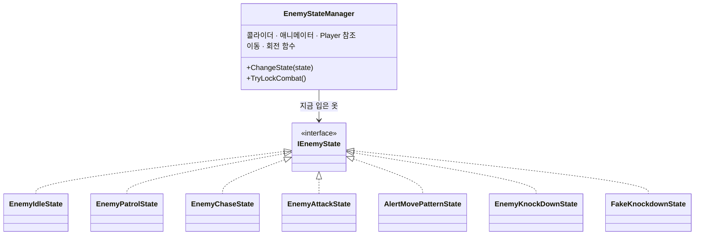

# 뒤통수를 조심해 (Watch Your Back) — 첫 개인 프로젝트 기술 문서

<!--
====================================================================
 ✍ 작성 안내 (이 상자는 다 쓰면 지우세요)
====================================================================
 이 파일은 format/02-tech-document.md 의 「A형 · 단일 기능」 틀입니다(개인 프로젝트). 주제는 적 AI 시스템입니다.
 건우 님이 직접 쓴 두 자료의 글을 옮겨 채웠습니다.
   · 「프로젝트 포트폴리오용 정리 내용.docx」 → "(출처: 본인 정리)"
   · 「뒤통수를 조심해 기술문서 초안 작업 중.pdf」 → "(출처: 초안 PDF)"
 PDF의 코드는 그림이라 글자로 옮길 수 없었습니다. 3장의 코드 자리는 비워 두었습니다.

   ❓ 답해 주세요   — 사실 확인
   💬 내 의견       — 건우 님의 판단·생각이 들어가야 하는 곳

 · 표시(> ❓ … 등)는 답을 채운 뒤 지웁니다. 남아 있으면 포트폴리오에도 그대로 보입니다.
 · 코드는 레포를 받으면 /portfolio-intake <레포 주소> 로 가져오거나, .cs 파일을 code/ 폴더에 넣어 주세요.
 · 다 쓴 뒤 /portfolio-check 1-watch-your-back 으로 점검하세요.
====================================================================
-->

## 1. 개요

### 1-1. 무엇을 만들었나 (What)

「뒤통수를 조심해」는 배신당한 플레이어가 자신을 버린 동료들과 마주하여 복수를 하며 진실을 알아가는 **2D 탑다운 잠입·전투 액션 게임**입니다.
플레이어는 오로지 **적의 뒤통수를 때려야만 승리**하고, 플레이어의 몸이 적에게 **타격받는 순간 게임 오버**가 되는 불공평한 싸움입니다.
간단한 조작이지만, 뒤통수를 때리는 **컷씬 연출**로 플레이어의 몰입감을 끌어올리는 것이 게임 개발의 핵심이었습니다. *(출처: 초안 PDF)*

### 1-2. 왜 만들었나 (Why) — 기획 의도

**게임을 만든 계기** *(출처: 초안 PDF)*
살다 보면 누구나 한 번쯤은 누군가의 뒤통수를 때리고 싶다는 생각이 듭니다. 특히 나의 뒤통수를 먼저 친 사람이라면, 물리적으로나 정신적으로나
그에 대한 복수를 하고 싶은 마음이 생기기 마련입니다. 그러나 실제로는 리스크가 너무 커서 그 행동을 하기 어렵습니다.
그런 마음을 풀어내는 것은 현실에서는 어렵지만, 게임에서는 가능합니다. 게임 아이디어를 생각하다가 문득 그 생각이 났고, 아이디어는 한 줄로 정리되었습니다 — **"뒤통수를 조심해"**.

**단순한 핵심 메커니즘** — 디벨로켓 프로그래머 과정에서 게임 개발을 처음 배우고 처음 만드는 게임이었고, 코드를 스스로 구현하는 능력이 부족했기 때문에
핵심 메커니즘을 단순하게 만들고자 했습니다. **적의 뒤통수를 친 플레이어가 승리, 플레이어가 맞으면 패배.** 그 외의 다른 승패 조건은 없습니다.
플레이어·적 모두 원 히트 원 킬이라, 단순하지만 긴장감을 줄 수 있도록 했습니다. *(출처: 초안 PDF · 본인 정리)*

**기획에 영감을 받은 게임** — 「장미와 동백 (Rose and Camellia)」 *(출처: 본인 정리)*
게임 시스템 자체에 영감을 받은 것은 아니었습니다. 다만 **뺨 때리기**라는 단순하지만 강력한 행동이 주는 시각적 감성에 영감을 얻어,
**뒤통수를 때리는 것**으로 게임의 핵심 포인트를 잡게 되었습니다.

### 1-3. 개발 환경 · 링크

| 항목 | 내용 |
|---|---|
| 장르 | 탑다운 액션 잠입 게임 (2D) |
| 플랫폼 | Windows PC |
| 엔진·도구 | Unity 6000.3.15f1, Visual Studio 2026, C# |
| 기간 | 2026-06-10 ~ 2026-07-07 (기획·게임 에셋 마련 06-10 ~ 06-16 · 개발 06-17 ~ 07-07) |
| 인원 | 1명 (개인 개발) |
| 영상 | 추가 예정 |
| GitHub | 추가 예정 |

### 1-4. 레벨과 적 — 캐릭터와 레벨 디자인은 함께 간다

맵 레벨과 적의 능력을 묶어서 디자인했습니다. *(출처: 본인 정리)*

| 보스 | 구역 | 능력 |
|---|---|---|
| 내로우만 (Narrowman) | 튜토리얼 | 플레이어를 감지하면 추격한다 (모든 보스의 공통 요소) |
| 와치만 (Watchman) | 감옥 | 속박된 감시자가 플레이어를 감지하면, 구역 보스인 와치만이 플레이어가 발견된 곳으로 이동 |
| 랫만 (Ratman) | 시궁창 | 쥐를 밟으면 랫만이 쥐가 죽은 장소로 이동하여 순찰 |
| 다커만 (Darkerman) | 어두운 방 | 분신 둘과 본체 하나. 본체를 처치해야만 게임 클리어 |

### 1-5. 이 문서에서 다루는 것

**적 AI 시스템** — 인터페이스로 상태를 나눈 상태 머신, 이동 방향에 맞춰 도는 시야·공격 박스, 동시 공격 판정.
2장 구조 → 3장 상태 전환과 동시 공격 처리 → 4장 박스 회전 방식과 보스 공통 구조를 정한 이유 → 5장 배운 점과 아쉬운 점.

---

## 2. 시스템 구조

### 2-1. 인터페이스를 활용한 적 AI — 몸은 하나, 옷만 갈아입는다

*(출처: 초안 PDF)*

적 AI 시스템을 비유하자면, `EnemyStateManager`는 **몸**이고, 각 `IEnemyState`는 그 몸이 잠깐 입는 **옷**입니다.
몸(콜라이더, 애니메이터, 이동·회전 함수, Player 참조)은 하나뿐이고, 지금 어떤 행동을 하는지는 지금 입고 있는 옷(상태 클래스)이 결정합니다.
옷을 갈아입어도(`ChangeState`) 몸의 위치와 컴포넌트 참조는 그대로 유지됩니다.

보스 4명은 외형만 다르고, 공통적으로 같은 공격·같은 이동을 사용하도록 구현했습니다. 몸(이동·회전·전투 판정처럼 "누가 해도 똑같은 기능")과
옷(지금 "무엇을 하는가"라는, 보스마다 다를 수 있는 부분)을 분리해, **몸은 공유하고 옷만 갈아입는 구조**를 만들었습니다.

> ❓ **답해 주세요** — `IEnemyState`에 있는 메서드 이름(예: `Enter`·`Exit`·`Tick`)을 알려 주시면 다이어그램에 넣겠습니다.
> 초안 PDF에는 `Exit`만 나옵니다.

### 2-2. 상태 전환

*(출처: 초안 PDF)*

| 상태 클래스 | 역할 | 진입 조건 | 종료 후 전환 |
|---|---|---|---|
| `EnemyIdleState` (대기) | 제자리에서 랜덤 방향 둘러보기 | 시작 시 / 추격 실패 후 복귀 | 1초 후 Patrol, 시야 감지 시 Chase |
| `EnemyPatrolState` (순찰) | 지정 지점 왕복 이동 | Idle 종료 | 도착 시 Idle, 플레이어 감지 시 Chase |
| `EnemyChaseState` (추격) | 시야·마지막 목격 위치 추적 | 시야 내 플레이어 감지 | 사거리 진입 시 Attack, 놓치고 2초 탐색 후 Idle |
| `EnemyAttackState` (공격) | 공격 애니메이션 재생 + 쿨타임 | 공격 사거리 진입 | 쿨타임 종료 후 Chase |
| `AlertMovePatternState` (보스 패턴 1) | 플레이어 목격 지점으로 이동 후 4방향 탐색 | 감시자 / 쥐(보스 하수인) 오브젝트의 외부 이벤트 | 도착 + 탐색 완료 시 Patrol |
| `EnemyKnockDownState` / `FakeKnockdownState` (넉다운) | 넉다운 연출 재생 | 뒤통수 피격 (`OnBackHit`) | (마지막 상태) 오브젝트 비활성화, 진짜 다커맨이면 엔딩 트리거 |

각 상태는 `EnemyStateManager`가 **적의 상태 판단 조건이 만족되었을 때** 전환합니다. 판단 조건은 시야 박스, 공격 범위 박스, 공격 히트 박스 등으로 판정하며,
이 조건을 `EnemyStateManager`가 지니고 직접 상태 전환을 작동시킵니다.

`AlertMovePatternState`가 1-4의 와치만(감시자가 발견하면 그곳으로 이동)과 랫만(쥐가 죽은 곳으로 이동)의 패턴입니다.

### 2-3. 시야·공격 박스 회전

*(출처: 초안 PDF)*

적의 이동 방향에 맞춰 공격·피격 범위를 정하는 박스들이 아래 표처럼 회전합니다.

| 이동 방향 (MoveX, MoveY) | 공격 타격 박스 / 공격 범위 박스 / 적 피격 박스 각도 | 시야 박스 목표 각도 |
|---|---|---|
| 오른쪽 (X > 0) | 90° | 0° (보간 회전) |
| 왼쪽 (X < 0) | 270° | 180° |
| 위 (Y > 0) | 180° | 90° |
| 아래 (Y < 0) | 0° | 270° |

> ❓ **그림을 넣어 주세요** — 초안 PDF의 **"적의 시야 박스 예시"**(빨강: 시야 박스, 노랑: 머리 위 피격 박스, 초록: 공격 범위 감지·타격 박스) 그림을
> `images/`에 넣고 이 자리에 붙여 주세요. 이 절을 가장 잘 설명하는 그림입니다(PDF에서 그림을 꺼낼 도구가 없어 제가 옮기지 못했습니다).

---

## 3. 핵심 기능

### 3-1. 상태 전환 (`ChangeState`) — 정리와 가드를 함께

*(출처: 초안 PDF)*

상태를 전환할 때는 밖에서 내부 동작 과정을 복잡하게 알 필요 없이 `ChangeState`만 단순하게 호출하도록 설계했습니다.
상태 전환 시 생길 수 있는 부작용을 막기 위해 정리·가드 로직을 넣었습니다.

- **넉다운 가드** — 이미 쓰러진 상태에서 다른 상태로 잘못 전환되는 문제를 막습니다.
- **순서 보장** — `Exit`과 `StopCoroutine`을 먼저 호출해 이전 상태의 이동·사운드 로직을 확실히 정리한 뒤, 새 상태의 코루틴을 시작합니다.

> ❓ **코드를 넣어 주세요** — 초안 PDF에 있던 `ChangeState` 코드를 글자로 붙여 주세요(10~20줄). 레포를 받으면 제가 옮겨도 됩니다.

### 3-2. 같은 프레임 동시 피격 방지 (`TryLockCombat`)

*(출처: 초안 PDF)*

플레이어와 적이 **동시에 공격**할 때 생기는 판정 모순(둘 다 이기거나 둘 다 지는 경우)을 해결하기 위해, 프레임 단위 잠금(Lock) 방식을 적용했습니다.
같은 프레임에 **먼저 `TryLockCombat()`을 호출한 쪽만** 전투 판정을 얻도록 해, 승패가 한쪽으로 분명히 갈리도록 했습니다.

> ❓ **코드를 넣어 주세요** — 초안 PDF에 있던 `TryLockCombat` 코드를 붙여 주세요.
> 💬 원 히트 원 킬 게임이라 이 문제가 특히 중요했을 것 같습니다. 이 문제를 **어떻게 발견했는지**(예: 테스트 중 둘 다 쓰러짐) 한 줄 있으면 5-2 트러블슈팅으로도 쓸 수 있습니다.

---

## 4. 고민과 선택

> 가이드: **대안 2개 이상 비교 + 상황을 근거로 한 선택 이유**.

### 4-1. 박스 회전 — 즉시 회전 vs 보간 회전

*(출처: 초안 PDF)*

| 박스 | 회전 방식 | 이유 |
|---|---|---|
| 공격·피격 판정 박스 | **즉시 회전** | 정확도와 즉각적인 반응이 중요하므로 `LerpAngle` 없이 바로 돌림 |
| 시야 박스 (`SightBox`) | **보간 회전** (`Mathf.LerpAngle`) | 적이 "고개를 부드럽게 돌리는 연출"을 살리기 위해 |

같은 "방향에 맞춰 도는 박스"라도 역할에 따라 **의도적으로 다르게** 처리했습니다.

> 💬 **내 의견** (선택) — 보간 회전 때문에 시야가 늦게 따라와서, 플레이어가 그 틈에 뒤로 돌아갈 수 있었나요? 그렇다면 잠입 게임의 재미와 이어지는 좋은 근거입니다.
> 반대로 5-3의 "감지를 눈으로 확인할 수 없음" 문제와 관련이 있다면 함께 적어 주세요.

### 4-2. 보스 4명 — 공통 몸 + 상태(옷) vs 보스마다 따로

| 방법 | 장점 | 단점 |
|---|---|---|
| 보스마다 클래스를 따로 | ❓ | ❓ |
| **공통 몸(`EnemyStateManager`) + 상태 클래스 (선택)** | 이동·회전·전투 판정을 한 번만 구현. 보스마다 다른 행동은 상태(옷)로 추가 (예: `AlertMovePatternState`, `FakeKnockdownState`) | ❓ |

> 💬 **확인해 주세요** — 선택한 쪽의 장점은 초안 PDF의 "몸은 공유하고 옷만 갈아입는다"를 Claude가 표로 줄인 것입니다. 맞는지 확인해 주세요.
> "보스마다 따로" 방법을 실제로 생각해 봤는지, 그리고 두 방법의 장단점 칸을 본인 생각으로 채워 주세요. 생각해 보지 않았다면 표를 지우고 2-1 설명만 남겨도 됩니다.

---

## 5. 결과 및 배운 점

### 5-1. 배운 점

**게임 연출의 중요성** — 게임 내 메인 루프인 뒤통수 때리기 공격과 회피는 굉장히 단순한 구조이지만,
플레이어와 적의 **컷씬 연출**을 활용하여 게임 플레이 경험에 생동감을 주었습니다. *(출처: 본인 정리)*

**사운드의 중요성** — 게임을 만들면서 SFX(발걸음·타격음)를 넣기 전까지는 테스트하면서 큰 재미를 느끼지 못했습니다.
SFX를 넣은 뒤 플레이어와 적의 타격 액션에 재미가 더해지는 것을 느꼈고, SFX와 배경음 등 게임 내 사운드의 중요성을 다시 한번 깨달았습니다. *(출처: 본인 정리)*

### 5-2. 트러블슈팅

> ❓ **답해 주세요** — 고친 문제 하나를 문제 → 원인 → 해결 → 결과로 적어 주세요.
> 후보: 3-2의 **동시 공격 판정 모순**(`TryLockCombat`으로 해결), 3-1의 **쓰러진 적이 다른 상태로 바뀌던 문제**(넉다운 가드로 해결). 실제로 겪은 것만 골라 주세요.

### 5-3. 아쉬운 점 · 개선 계획

- **`EnemyStateManager`에 역할이 몰림** — 상태 전환 판단 조건을 `EnemyStateManager`가 지니고 있어, 캐릭터 이동, 애니메이션 호출, 전환 조건 판단과 전환까지
  너무 많은 역할을 맡는 클래스가 되었습니다. 구조적 분리를 고려하지 못했습니다. *(출처: 초안 PDF)*
- **적 FSM의 미흡함** — FSM을 구현하는 중 버그(플레이어 감지 기능, 벽끼임 현상 등)로 인해 플레이 경험이 부자연스러운 상황이 연출되었습니다. *(출처: 본인 정리)*
- **적 시야 시스템의 미흡함** — Trigger Collider를 활용해 플레이어를 발견하고 추적할 수 있는 시야 시스템의 기반을 설계했으나,
  적이 플레이어를 감지하는 것을 플레이어가 **눈으로 확인할 수 없어서** 불합리한 경험을 하는 문제가 있었습니다. *(출처: 본인 정리)*

> 💬 **내 의견** — 각 아쉬움에 **개선 계획** 한 줄씩. 가이드는 아쉬운 점과 개선 계획을 짝으로 봅니다.
> - 첫 번째(역할 몰림)는 다음 프로젝트 We got one에서 `FishStateManager`는 **상태 전환만**, `FishMovement`는 **움직임만** 맡게 나눈 것(그 문서 2-1)과 이어 보입니다.
>   그 분리가 이 아쉬움에서 나온 것이라면 "다음 프로젝트에서 이렇게 바꿨다"로 쓰면 가장 좋은 개선 계획이 됩니다. 관계가 없다면 다른 계획을 적어 주세요.
> - 세 번째(시야)는 예: 시야 범위를 화면에 표시한다.

<!--
 📸 권장 촬영 목록 (images/ 에 넣고 위 각 절에 붙이세요)
 1. 게임 대표 장면 1장 (잠입 중인 탑다운 화면) — 1-1
 2. 구역별 화면 (감옥·시궁창·어두운 방) — 1-4
 3. 적의 시야 박스 예시 (초안 PDF의 색깔 표시 그림) — 2-3
 4. 적이 플레이어를 감지·추격하는 GIF — 2-2
-->
