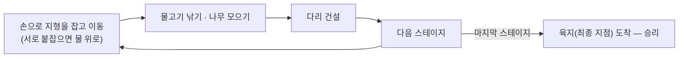
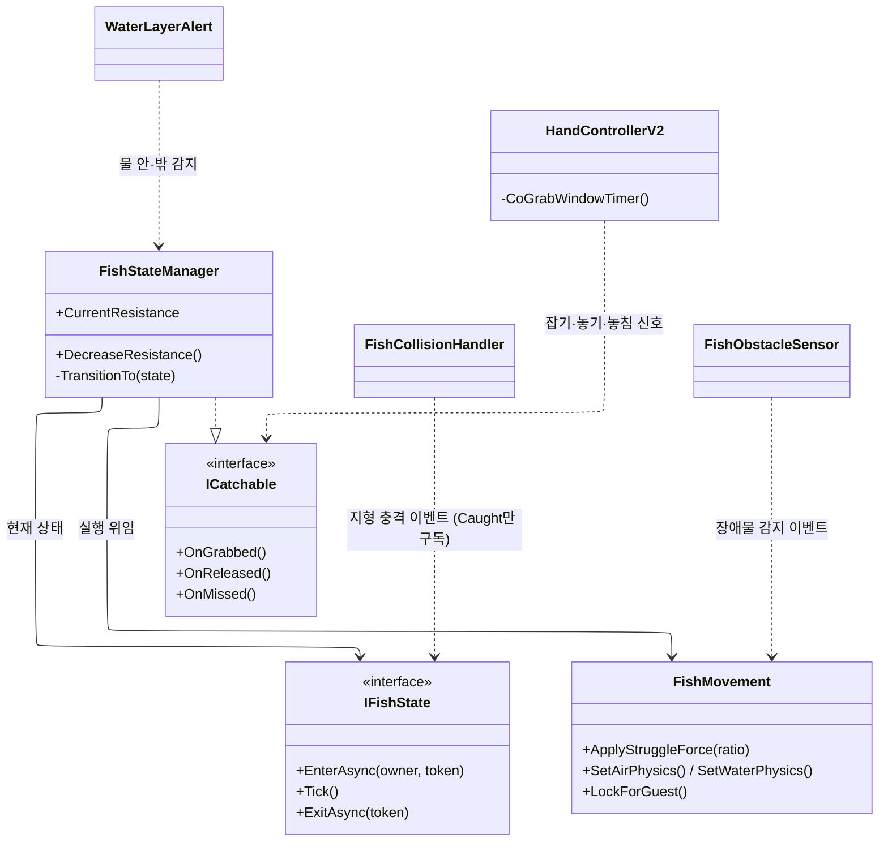
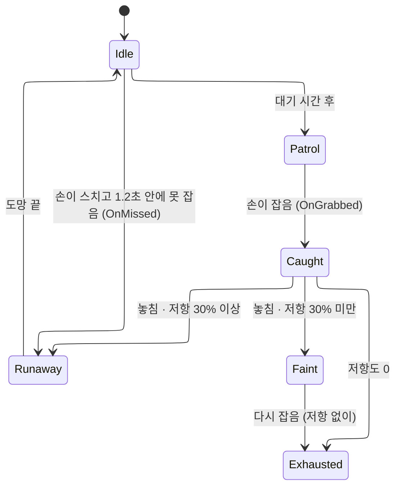
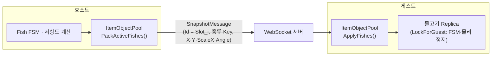
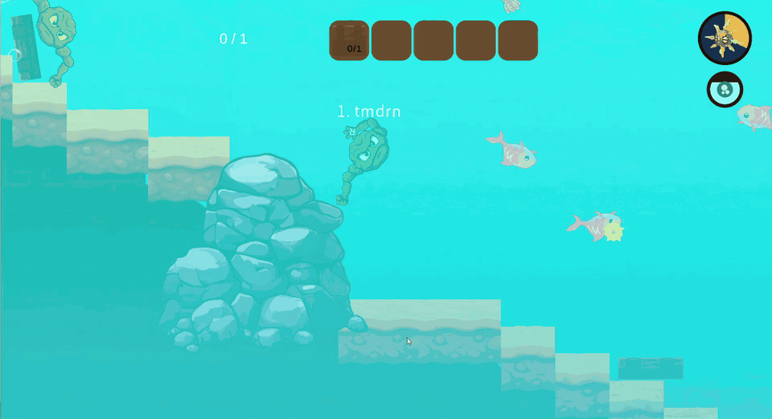
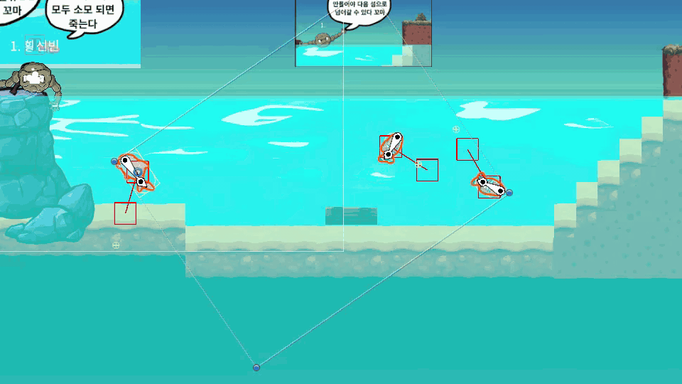
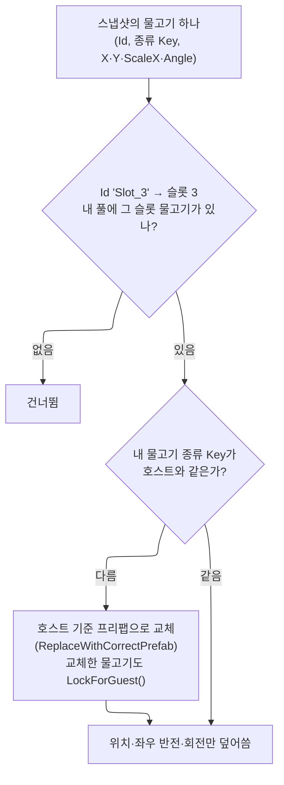
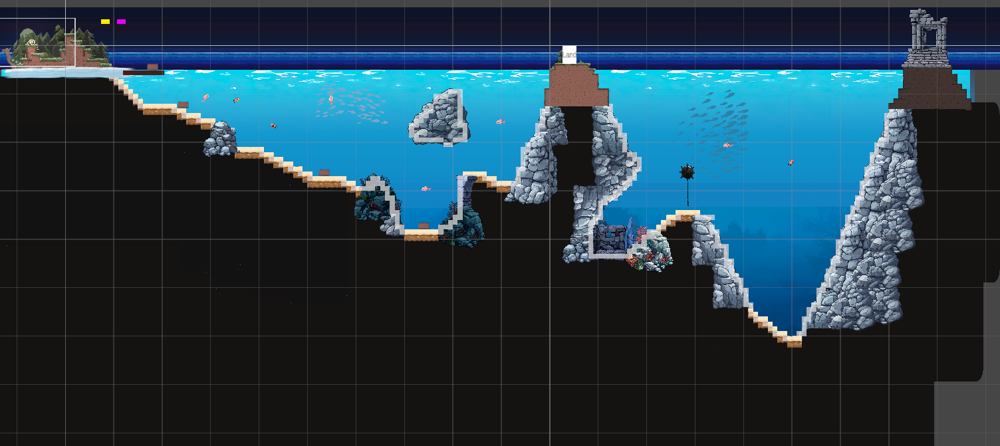
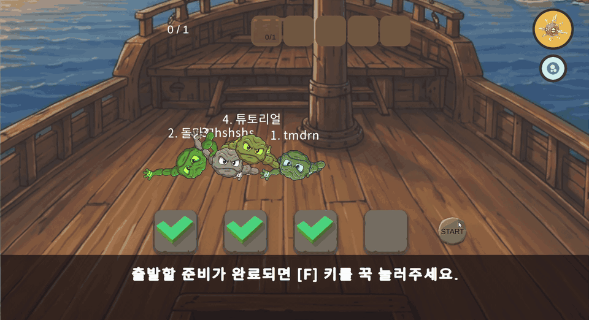

# WeGotOne (Team 산) — 물고기 AI · 레벨 디자인 담당

<!-- TODO 그림: 1-1 대표 장면 · 5-3 물고기 상태 GIF · 5-4 BoxCast 기즈모 · 5-5 호스트·게스트 화면 비교 · 6-4 두 번째 스테이지 (촬영목록.md 참고) -->

## 1. 개요

### 1-1. 무엇을 만들었나

**WeGotOne**은 폭풍우로 조난당한 플레이어들이 섬에서 **물고기를 낚고 나무를 모아 다리를 지으며 육지(최종 지점)까지 가는** 2D 물리 기반 **협동 멀티플레이 게임**입니다(최대 4인). 플레이어는 양팔을 직접 움직여 물건을 잡고 던지며, 서로의 몸을 붙잡으면 물 위로 떠오를 수 있습니다.

제가 맡은 핵심 파트는 **물고기 AI(상태 머신 + 저항도)** 와 **맵·레벨 디자인**이며, **물고기의 호스트-게스트 동기화**는 팀장 홍산 님과 함께 구현했습니다(3-2). 코드는 AI가 생성했고, 저는 전체 클래스 구조를 나누고 동작 규칙을 설계했습니다(7-1).

### 1-2. 왜 만들었나 — 제 파트가 풀어야 했던 문제

- **물고기 AI**: 현실 낚시에서 입질 뒤 물고기와 씨름하는 손맛을 살리기 위해, 플레이어가 손으로 직접 잡은 물고기가 **저항하고 상황에 따라 탈진·기절·도망하도록** 설계했습니다. 또한 레벨 구조를 활용해 **벽에 물고기를 부딪치면 저항도를 낮출 수 있게** 만들었습니다.
- **멀티플레이 동기화**: 호스트와 게스트가 각자 물고기 AI를 연산하면 화면마다 물고기 위치와 상태가 어긋납니다. 이를 막기 위해 **호스트만 AI·저항을 계산하고 게스트는 결과(위치·회전)만 표현하는** 구조가 필요했습니다. 실제로 1차 빌드 테스트(08-29)에서는 호스트와 게스트의 물고기가 다르게 보이고, 게스트 화면에서 **나무가 물고기로 출력되는** 문제가 발생했습니다(8-2 ①).
- **맵(레벨) 디자인**: 초기 섬·바다 스테이지는 튜토리얼 없이 너무 어렵게 설계되었습니다. 이후 튜토리얼 맵을 추가하고 발표 직전까지 난이도를 낮췄으나, 발표 날 동기들은 **두 번째 스테이지(살짝 깊은 바다)부터** 수중 목재 수급에 막혔고 피드백 15건 중 8건이 **조작이 어렵거나 무겁다**는 의견이었습니다. 플레이어가 끝까지 도달할 수 있도록 **난이도를 단계적으로 올리는 레벨 디자인**이 핵심 과제였습니다(6-4·8-3).
- **기술 목표**: 프로젝트 직전에 학습한 **비동기(`async`)를 물고기 상태 머신에 실전 적용**하는 것이었습니다(6-2).

### 1-3. 개발 환경 · 링크

| 항목 | 내용 |
|---|---|
| 엔진 | Unity 6000.3.15f1 (URP, 2D) |
| 언어 · 도구 | C#, JetBrains Rider, DOTween, Unity Input System, WebSocket(`ClientWebSocket`), Git · GitHub, Asana |
| AI 도구 | 강의 자료 기반 Google 노트북(LLM), Claude 무료 버전 |
| 장르 | 물리 기반 팀 협동 게임 (최대 4인) |
| 기간 | 2026-08-15 ~ 2026-09-10 (기획 08-15 ~ 08-22 · 개발 08-20 ~ 09-10) |
| 팀 구성 | 4명 — 홍산(팀장), 김승구, 신성건, 윤건우 |
| 영상 | [소개 쇼츠 (56초)](https://youtube.com/shorts/T9h6JuvG1K4) · [플레이 시연 영상 (4분 21초)](https://youtu.be/ApLFcrms6j4) · [튜토리얼](https://youtu.be/8Kuv8hg5q3Y) |
| GitHub | `KooHoo-Dev/3rd-TeamProject-HS` [사실 보강 예정: 현재 저장소 공개 전환 여부 확인 및 링크 상태 업데이트] |
| 개발 일정 | 기획 1주 → 스프린트 3회 · 빌드 테스트 3회 (8-6) |

---

## 2. 게임 디자인

### 2-1. 플레이 방식과 조작

> 귀여운 꼬마돌이 배를 타고 항해하던 도중 폭풍우를 만나 외딴 섬에 떨어졌다. 꼬마돌들은 힘을 합쳐 물고기를 잡고, 다리를 지어 육지로 향해야 한다.

- **조작**: 플레이어는 꼬마돌의 **오른손·왼손으로 지형을 잡아** 이동합니다. 물리 기반으로 움직이는 불편한 조작감에 점점 익숙해지면서 팀원 간 협동을 이끌어 내도록 설계되었습니다.

### 2-2. 코어 루프 — 잡고, 모으고, 다리를 짓는다



### 2-3. 기획 과정과 레퍼런스

- **기획 과정**: 팀원들과 **멀티 협동 게임**을 핵심 주제로 정한 뒤 「Heave Ho」·「Heave Ho 2」 등을 함께 플레이하며 각자 아이디어를 제안했습니다. **다수결 투표**로 팀원의 기획이 선정되어 이를 모티브로 **낚시 생존 게임**을 개발했습니다.
- **레퍼런스와 차별점**: 물리 잡기 기반 협동 게임인 「Heave Ho」 시리즈를 레퍼런스로 삼되, **오브젝트를 잡아 낚아 올리는(물고기·목재 획득) 자원 수집 요소**를 결합했습니다. 캐릭터는 포켓몬스터의 '꼬마돌'에서 모티브를 얻어 AI로 리소스를 제작했으며, 상업적 목적 없이 학원 교육용 프로젝트로만 활용했습니다.

---

## 3. 팀 협업

### 3-1. 팀 구성과 역할

제 역할을 한 줄로 요약하면 **"게임 맵·레벨 디자인, 물고기 FSM, 튜토리얼 연출"** 입니다.

| 이름 | 담당 업무 |
|---|---|
| **윤건우 (나)** | 물고기 AI(잡기·순찰·저항도, 물 밖 중력), 물고기 잡기용 플레이어 손·팔 수정, 물고기·자원·시간 게스트 동기화(홍산 님 협업), 인게임 튜토리얼, 낮·밤 주기, 해양 지뢰, 맵·레벨 디자인, 게임 결과 폴리싱 |
| **홍산 (팀장)** | 기획서·발표·스프린트 계획(PM), 서버 중계와 플레이어·게임 종료·중간 입장·나무 동기화, 게스트 보간, 오브젝트 풀링·아이템 DB·인벤토리 리팩토링(SO → TSV), 물고기 스폰, 승패 판정, 다리 건설 조건, 카메라 이동, 지뢰 물고기 |
| **김승구** | 팀 자원 저장·다리 건설·스테이지 진행, 물고기 풀, **물고기 코드 리팩토링**·피드백 효과, 물고기 확장(유령·대왕 오징어·갯가재·전기 가오리·해마) |
| **신성건** | 플레이어(관절 조작·잡기·던지기·배고픔·스태미나), 플레이어 물리 동기화, 물고기 코드 리팩토링 참여, 상어, 게임 흐름 씬, UI 폴리싱 |

> **커밋 계정 안내**: 팀 저장소에서 `Minseong` 계정으로 올라간 커밋(08-25 ~ 08-26)도 제 작업입니다. 학원 내 공용 PC 자리를 바꿔 앉았을 때 이전 사용자의 Git 계정을 변경하지 않아 해당 이름으로 기록되었습니다.

### 3-2. 담당 상세 내역

**핵심 담당**
1. **물고기 AI**: 잡히면 저항하고, 지치면 탈진하며, 놓치면 기절하거나 도망가는 상태 머신 구현. 벽 충돌 시 저항 감소, 장애물 회피 순찰, 물 밖 중력 적용
2. **물고기 호스트-게스트 동기화** (홍산 님 협업): 4인 플레이어 화면에 동일한 위치·종류·상태의 물고기가 동기화되도록 구현

**서브 담당**
- **인게임 튜토리얼**: 전원 준비 → 폭풍우·조난 연출 → 섬 낙하 및 착지 시 이동 제한 해제
- **낮·밤 주기**: 시간 흐름에 따른 주기 전환과 UI 표시, 게임 시간 게스트 동기화
- **해양 지뢰**: 플레이어 접촉 시 폭발 및 넉백 적용
- **맵 디자인**: 섬(튜토리얼)·살짝 깊은 바다·아주 깊은 바다 3개 스테이지 레벨 디자인 및 밸런싱(6-4)
- **게임 결과 화면 폴리싱**

> **최종 코드와의 차이 안내**: 물고기 시스템의 초기 설계와 핵심 구현은 제가 진행했으나, 이후 물고기 코드 리팩토링(S14-0) 기간에 건강 사유로 결석하면서 팀원들이 후속 리팩토링을 진행했습니다. 따라서 본 문서에 수록된 코드는 제가 커밋한 시점을 기준으로 하며 최종 빌드 코드와 일부 다를 수 있습니다.

---

## 4. 시스템 구조

### 4-1. 물고기 모듈 구조 — "언제 바뀌나"와 "어떻게 움직이나"의 분리



| 클래스 / 인터페이스 | 역할 |
|---|---|
| `FishStateManager` | 상태 전이 전담(**"언제 바뀌는가"**). 저항도를 보유하며 전용 메서드로만 값 변경 허용 |
| `IFishState` 구현 6종 | Idle · Patrol · Caught · Exhausted · Faint · Runaway — 상태별 진입·프레임·퇴장 로직 |
| `FishMovement` | 실제 이동 · DOTween · `Rigidbody2D` 제어(**"어떻게 움직이는가"**) |
| `FishObstacleSensor` | 진행 방향 `BoxCast`로 벽·다른 물고기 감지 후 이벤트 발행 |
| `FishCollisionHandler` | 지형 충돌 세기(`relativeVelocity`)가 임계치를 넘으면 이벤트 발행 |
| `WaterLayerAlert` | 물 영역 안·밖 감지 (물 밖 이탈 시 중력 적용) |

**책임 분리 배경**
- `FishMovement`에 순찰, 장애물 회피, 물리 제어가 누적되면서 **428줄**까지 비대해졌습니다. 순수 이동 책임만 남기기 위해 `BoxCast` 감지 로직을 `FishObstacleSensor`로 분리하여 **352줄**로 줄이고(`5850bda`, 08-27) 감지 결과를 이벤트로 전달하게 했습니다.
- `FishStateManager`는 상태 관리만 수행하도록 `Rigidbody2D` 직접 제어를 제거하고 `FishMovement.SetAirPhysics()`로 위임했습니다.
- 센서류(`WaterLayerAlert`, `FishCollisionHandler`)는 **감지 사실만 이벤트로 알리고**, 실제 상태 전환이나 물리 반응은 물고기 본체가 스스로 결정하도록 결합도를 낮췄습니다.

### 4-2. 상태 전이도

잡혔다 놓친 물고기는 **남은 저항도(30% 기준)** 에 따라 기절(`Faint`)과 도망(`Runaway`)으로 분기됩니다.



| 상태 | 플레이어 관점의 동작 |
|---|---|
| **Idle / Patrol** | 정해진 범위를 대각선 방향으로 왕복하며 유영 |
| **Caught (힘겨루기)** | 손에 잡혀 버둥거림. 저항도가 매 프레임 감소하며, 남은 저항이 클수록 강하게 저항 |
| **Exhausted (탈진)** | 저항도가 0이 되어 손에 힘없이 늘어짐 |
| **Faint (기절)** | 지친 상태에서 놓치면 물 위에 떠올라 잠시 무방비 상태 유지 |
| **Runaway (도망)** | 저항이 남은 상태에서 놓치거나 1.2초 내 잡기에 실패하면 반대 방향으로 빠르게 도주 |

### 4-3. 동기화 구조 — 호스트 연산, 게스트 표현

팀장 홍산 님과 협업하여 설계한 구조입니다.



| 동기화 규칙 | 구현 내용 |
|---|---|
| **게스트 AI·물리 정지** | `LockForGuest()` 호출 — 트윈 정지, `Rigidbody2D` Kinematic 전환, 컴포넌트 비활성화 |
| **화면 표현만 수신** | 스냅샷의 `X`, `Y`, `ScaleX`(좌우 반전), `Angle` 값만 적용 |
| **물고기 ID = 스폰 슬롯 번호** | 스폰 위치 인덱스를 `"Slot_i"` 문자열로 매핑 (`PackActiveItems`) |
| **스냅샷 전송 주기** | 호스트가 30ms 간격으로 전송 (`98642aa`) |

**슬롯 번호를 ID로 사용한 이유**: 호스트와 게스트는 동일한 씬을 로드하므로 스폰 위치 목록의 순서가 일치하며, 각 스폰 슬롯당 물고기 1마리가 대응됩니다. 따라서 슬롯 번호만으로 동일 개체를 식별할 수 있어 별도의 생성(Spawn) 패킷이 필요 없었습니다. 다만 풀 반환 후 같은 슬롯에 **다른 종류의 물고기**가 재스폰될 수 있으므로 종류 `Key`를 함께 전송해 불일치 시 프리팹을 교체하는 보정 로직을 두었습니다(8-2 ①).

> **후속 구조 변경**: 위 구조는 제가 작업한 08-28~08-31 시점 기준입니다. 이후 09-01~02 팀장 홍산 님이 오브젝트 풀을 재설계하면서(`d9ea737`·`41df738`), 최종 코드에서는 개체별 고유 `WorldItemId`와 호스트가 지정한 `ItemId`대로 게스트가 풀에서 꺼내는 `WorldItemSnapshotSynchronizer` 방식으로 발전했습니다. "호스트 연산·게스트 표현" 원칙과 `LockForGuest()`는 그대로 유지되었습니다.

---

## 5. 핵심 기능

이 장은 코드 전체를 나열하는 대신 **동작 흐름과 제가 정한 설계 규칙**을 중심으로 설명합니다. 코드는 AI로 생성했고(7-1), 제가 직접 의도한 제어 구조가 명확히 드러나는 세 곳(비동기 전환 취소, 저항도 분기, BoxCast 감지)만 코드로 수록했습니다.

### 5-1. 손은 신호 세 개만 보낸다 — `ICatchable` 인터페이스

손(플레이어 제어 코드)은 잡는 대상이 물고기인지 알 필요 없이 `ICatchable` 인터페이스의 신호 세 개만 호출합니다.

| 신호 메서드 | 호출 시점 (손 기준) | 물고기의 반응 |
|---|---|---|
| `OnGrabbed()` | 잡기 성공 | 힘겨루기(`Caught`) 진입. 기절 상태였다면 즉시 탈진(`Exhausted`) 전환 |
| `OnReleased()` | 잡고 있다가 놓음 | 남은 저항 비율(30% 기준)에 따라 기절 또는 도망 분기 (5-3) |
| `OnMissed()` | 손이 닿은 뒤 1.2초 안에 잡지 못함 | 도망(`Runaway`) 진입 |

**설계 규칙**
- 잡을 수 있는 모든 대상은 `ICatchable`만 구현하며, 대상이 추가되어도 손 코드는 수정하지 않는다.
- 외부 클래스는 물고기 상태를 직접 변경하지 않고 신호만 전달하며, 상태 전이 판단은 `FishStateManager`가 전담한다.
- 저항도 역시 외부 직접 대입을 막고 `DecreaseResistance()`·`ResetResistance()` 메서드로만 변경한다.

손이 알아야 할 접점을 메서드 3개로 축소한 것은 **물고기 외의 상호작용 오브젝트도 동일한 규약으로 잡을 수 있도록 확장**하기 위함이었습니다(`af9b561`). 다만 최종 빌드에서는 `FishStateManager`만 `ICatchable`을 구현하여 타 오브젝트 확장은 설계 기반만 마련된 상태로 남았습니다.

### 5-2. 도망치다 다시 잡혀도 바로 버둥거린다 — 비동기 상태 전환

```csharp
private async void TransitionTo(IFishState newState)
{
    if (newState == null) return;

    // 이전 전환이 아직 진행 중이면 취소하고 새 토큰을 만든다
    stateCts?.Cancel();
    stateCts?.Dispose();
    stateCts = new CancellationTokenSource();
    CancellationToken token = stateCts.Token;

    try
    {
        if (currentState != null)
        {
            await currentState.ExitAsync(token);
            if (this == null) return;        // 기다리는 사이 오브젝트가 파괴됐으면 중단
        }
        currentState = newState;
        await currentState.EnterAsync(this, token);
    }
    catch (OperationCanceledException)
    {
        Debug.Log("상태 전환 취소");
    }
}
```

- **상태 진입·퇴장을 `async`로 설계한 이유**: 도망(`Runaway`) 연출이 완전히 끝난 뒤 대기(`Idle`) 상태로 복귀해야 했기 때문에(`004174d`), 연출 종료 시점까지 비동기로 대기한 후 다음 상태를 실행하도록 구성했습니다.
- **`CancellationToken`을 도입한 이유**: 도망 중인 물고기를 플레이어가 다시 잡으면 진행 중이던 도망 퇴장 처리를 즉시 중단해야 합니다. 토큰이 없으면 이전 비동기 대기가 끝나는 순간 후속 코드가 실행되어, 잡힌 물고기가 갑자기 `Idle`로 덮어씌워지는 버그가 발생합니다.
- **파괴 및 비활성화 방어**: `await` 대기 중 씬 전환 등으로 오브젝트가 파괴될 수 있으므로 `if (this == null) return;`으로 방어했습니다. 또한 잡힌 물고기가 보관함에 들어가 비활성화될 때도 `async` 작업은 자동 중단되지 않으므로, `OnDisable`에서 토큰을 취소해 보관함 내부에서 상태 전환이 돌지 않도록 막았습니다.

### 5-3. 잡히면 버둥거리다 지친다 — 저항도 기반 행동 분기

```csharp
// FishCaughtState — 잡혀 있는 동안 매 프레임 실행
public void Tick()
{
    owner.DecreaseResistance(Time.deltaTime);                 // 초당 1씩 감소 (기본 최대 20)
    float ratio = owner.CurrentResistance / owner.MaxResistance;
    owner.FishMovement.ApplyStruggleForce(ratio);             // 저항이 클수록 세게 버둥거림 → 플레이어 이동 방해
    if (owner.CurrentResistance <= 0f)
        owner.ChangeState(new FishExhaustedState());
}

// 지형에 부딪치면 (Caught 상태일 때만 구독)
private void HandleTerrainSmashed(float impactStrength)
{
    owner.DecreaseResistance(impactStrength * collisionRatio); // 충격이 셀수록 크게 감소 (계수 0.2)
}

// FishStateManager — 놓았을 때 남은 저항 비율로 분기
public void OnReleased()
{
    float resistanceRatio = CurrentResistance / maxResistance;
    if (resistanceRatio < 0.3f) TransitionTo(new FishFaintState());   // 지친 채 놓침 → 물 위에서 기절
    else                        TransitionTo(new FishRunawayState()); // 아직 싱싱 → 도망
}
```

| 파라미터 | 기본값 | 설명 |
|---|---|---|
| `maxResistance` | 20 | 기본 탈진 소요 시간(초). 이후 물고기 크기·종류별로 프리팹에서 차등 조정 |
| `collisionRatio` | 0.2 | 지형 충돌 세기 × 0.2 만큼 저항도 즉시 차감 |
| `grabWindowTime` | 1.2초 | 손 접촉 후 잡기 성공을 인정하는 제한 시간 |
| 기절 임계 비율 | 30% 미만 | 놓쳤을 때 남은 저항이 30% 미만이면 도망 대신 기절 |



- **지형 충돌 이벤트의 선택적 구독**: 벽에 부딪혀 저항도를 깎는 로직은 잡혀 있을 때(`Caught`)만 유효합니다. 다른 상태에서 의도치 않게 저항도가 깎이는 버그를 원천 차단하기 위해 `Caught` 진입 시 구독하고 퇴장 시 해제했습니다(`05903c9`).
- **저항도 변경 창구 단일화**: 저항도는 시간 경과와 지형 충돌 두 경로로 감소합니다. 외부 직접 수정을 허용하면 0 미만 방어 로직이 분산되고 디버깅이 어려워지므로 `DecreaseResistance()`와 `ResetResistance()` 두 메서드로만 상태를 갱신하게 했습니다.
- **물고기 종별 최대 저항도 밸런싱**: 플레이 테스트 결과 기본 20초는 힘겨루기가 지나치게 길어 지루하다는 피드백이 나왔습니다. 이에 **큰 어종일수록 오래 버티도록** 프리팹별 최대 저항도를 재조정했습니다(`7650e8f`, 09-04).

  | 어종 | 변경 전 | 변경 후 |
  |---|---|---|
  | 상어 · 오징어 | 20 | 15 |
  | 가오리 | 5 | 13 |
  | 지뢰 물고기 · 문어 · 갯가재 | 20 | 12 |
  | 해마 | 20 | 10 |

- **버둥거림 연출 개선 (트윈 → 물리 힘)**: 초기에는 DOTween 흔들림으로 버둥거림을 구현했으나(`f1d0a24`), 손맛과 물리적 반발력을 살리기 위해 `Rigidbody2D.AddForce` 방식으로 전환했습니다(`4060b92`, 08-26).
- **게임적 허용 (회전 연출)**: 물리 힘을 주면서 물고기가 빠르게 빙글빙글 도는 현상이 나타났는데, 테스트 중 팀원들이 이를 유쾌한 재미 요소로 평가해 수정하지 않고 게임적 허용으로 채택했습니다.
- **설계 변경 (회색 구간 단순화)**: 초기 설계 문서(`FishSystemDesignPlan.md`)에서는 놓쳤을 때 저항도 30~60% 구간을 '짧게 멈칫한 뒤 도주'로 세분화할 계획이었습니다. 그러나 실제 구현 시 60% 이상 구간과 시각적 차이가 크지 않다고 판단해 두 구간을 동일한 즉시 도주로 통합했습니다(`f1d0a24`, 08-25). 이후 팀원이 양손 잡기를 수정하면서(`1596e1f`, 09-09) 중복 분기 코드도 2갈래로 정리되었습니다.

### 5-4. 벽에 박지 않고 대각선으로 헤엄친다 — 풀링 대응 순찰과 장애물 회피

- 초기에는 씬에 배치된 `spawnPoint`·`patrolPoint` Transform을 왕복했으나(`542e7d2`), 오브젝트 풀링 재사용을 위해 **스폰 좌표 + 프리팹의 `patrolRange`** 기반 동적 경로 계산으로 변경했습니다.
- 왕복할 때마다 방향과 Y 오프셋(X 범위의 20~50% 제한)을 새로 추첨해 자연스러운 대각선 유영을 구현했습니다.
- 부피가 있는 물고기가 선(Raycast) 판정으로 인해 벽 모서리에 끼이는 문제를 방지하고자, 처음부터 **물고기 크기만큼의 상자를 투사하는 `BoxCast`** 를 채택했습니다.



```csharp
// 순찰 중일 때만 목표 방향으로 물고기 크기의 상자를 투사
RaycastHit2D hit = Physics2D.BoxCast(
    transform.position, obstacleCheckSize, 0f,
    moveDirection, obstacleCheckDistance, obstacleLayer);   // Wall(지형), fish(다른 물고기)

if (hit.collider != null)
    OnObstacleDetected?.Invoke();   // 트윈 취소 → 반대 방향으로 돌아가 경로 재탐색
```

### 5-5. 모든 플레이어에게 같은 물고기가 보인다 — 게스트 잠금과 종류 보정

홍산 님과 협업한 동기화 구조 중 게스트 물고기 잠금(`LockForGuest`·`isGuestLocked`)과 종류 보정 로직을 담당했습니다.

**게스트 스냅샷 수신 처리 흐름 (`ApplyFishes`)**



**게스트 물고기 잠금 (`LockForGuest`) 다중 방어**

| 차단 대상 | 적용 방식 |
|---|---|
| 기존 진행 중인 이동 트윈 | `StopMove()` 호출로 트윈 즉시 정지 |
| 물리 충돌에 의한 밀림 | `Rigidbody2D.bodyType = RigidbodyType2D.Kinematic` 전환 |
| `Update` 등 유니티 라이프사이클 자동 호출 | 컴포넌트 비활성화 (`enabled = false`) |
| 타 클래스의 `public` 메서드 직접 호출 | 트윈·이동 진입점 최상단에 `if (isGuestLocked) return;` 가드 삽입 |

**핵심 구현 배경**
- **"좀비 물고기" 해결 (`isGuestLocked` 가드)**: 게스트 측 물고기 컴포넌트를 `enabled = false`로 껐음에도 물고기가 계속 움직이는 버그가 발생했습니다. 원인은 `enabled = false`가 유니티 라이프사이클 콜백만 막을 뿐 외부 스크립트의 직접 메서드 호출은 차단하지 못했기 때문입니다. 이에 이동을 시작하는 모든 진입점에 `isGuestLocked` 플래그 검사를 추가해 해결했습니다(`8fba446`).
- **종류 불일치 보정**: 게스트가 로컬에서 랜덤 어종을 스폰하는 기존 구조를 유지한 채, 스냅샷의 종류 `Key`와 다르면 호스트 프리팹으로 교체하는 방식으로 패킷 프로토콜(`Protocol.cs`) 변경 없이 버그를 수정했습니다(`e363b73`, 8-2 ①).

---

## 6. 고민과 선택

### 6-1. 손과 물고기의 결합 방식 — 이벤트 구독 vs 전체 비동기화 vs 인터페이스 직접 호출

개발 과정에서 두 차례 설계를 전환한 기록이 커밋에 남아 있습니다.

| 접근 방식 | 장점 | 단점 | 진행 결과 |
|---|---|---|---|
| **A. 물고기가 모든 손을 찾아 이벤트 구독** (`HandRegistry`) | 손 코드 수정 최소화 | 물고기마다 씬의 모든 손을 구독·해제해야 해 관리 복잡도 증가 | `bf51259` 시도 (구독 해제 미완) |
| **B. 플레이어 컨트롤러 전체 비동기 인터페이스화** | 물고기 FSM과 아키텍처 통일 | 손·팔 등 플레이어 담당 스크립트 전반 수정 필요 | `004174d` 시도 → 작업 범위 과다로 중단 |
| **C. 손이 `ICatchable` 직접 호출 + 타이머 소유 (최종 선택)** | 손은 대상 타입을 몰라도 됨. 물고기는 신호 3개에만 반응 | 손 코드(`HandControllerV2`) 일부 수정 필요 | `af9b561` 채택 |

- **선택 이유 (C안)**: 물고기가 매 프레임 손을 감시하며 타이머를 재던 수동적 구조를 역전시켜, 손이 접촉 시점부터 1.2초 타이머를 관리하고 결과 신호만 보내도록 변경했습니다. 이로써 `FishStateManager`에서 손 구독·해제 코드가 완전히 제거되었고, 플레이어 코드는 `HandControllerV2` 한 곳만 수정했습니다.
- **플레이어 담당자와의 협업 및 의존성 제거**: 초기에는 상태 전환 시 손 컨트롤러 참조를 매개변수로 넘기려 했으나, 플레이어 담당 신성건 님이 "이미 손이 잡기 판정 결과를 신호로 알려 주므로 물고기가 손을 알 필요가 없다"고 짚어 주었습니다. 함께 리팩토링하며 불필요한 `PlayerHand` 의존성을 완전히 제거했습니다(`03c079f`, 08-26).

> **2차 스프린트 회고(08-29) 기록**: *"성건님과 내가 수정한 스크립트를 리팩토링 하면서 불필요한 변수들을 정리하는 과정중에 객체들간의 의존성 설정의 여부를 결정하는것이 중요하다는 것을 다시 한번 느꼈다."*

### 6-2. 비동기 상태 머신(`IFishState`) 설계

**최종 선택**: 상태별 개별 클래스와 비동기 진입·퇴장(`EnterAsync` / `ExitAsync`) + `CancellationToken` 구조를 채택했습니다.

| 얻은 이점 | 감수한 비용 |
|---|---|
| 상태별 정리(이벤트 해제 등)를 `ExitAsync`에 캡슐화 가능. 연출 완료까지 `await`로 직관적 대기 | 상태 개수만큼 클래스 파일 증가. `async void` 전환 메서드의 예외 처리 주의 필요 |

- **확장성 검증**: 새 어종을 추가할 때 기존 코드를 건드리지 않고 상태 클래스 하나만 추가하면 되는 구조 덕분에, 팀원들이 납치(`AbductionState`)·문어(`FishOctopusState`)·상어(`Shark`)·미끼(`FishBaitState`) 등을 수월하게 확장했습니다. 팀의 「물고기 제작 규칙 정리」(09-02) 역시 이 아키텍처 위에 수립되었습니다.

### 6-3. 호스트 권한 멀티플레이 구조 적용

팀 합의에 따라 로직 연산은 호스트에 집중하고 게스트는 표현만 담당하는 구조를 물고기 시스템에 적용했습니다.

| 직면한 문제 | 적용한 해결책 |
|---|---|
| 게스트 물고기의 자율 행동 차단 | `LockForGuest()`로 물리·컴포넌트 비활성화 및 메서드 진입점 플래그 방어 (5-5) |
| 네트워크 상의 물고기 개체 매칭 | 스폰 슬롯 인덱스를 ID(`Slot_i`)로 활용 (4-3) |
| 동일 슬롯 내 어종 불일치 | 스냅샷 종류 `Key` 비교 후 불일치 시 프리팹 즉시 교체 (8-2 ①) |

- **예상치 못한 문제 — 게스트 화면 끊김**: 게스트 물고기가 스냅샷 패킷 수신 시점마다 좌표를 즉시 덮어쓰면서 움직임이 뚝뚝 끊기는 현상이 발생했습니다. 초기 설계 시 미처 예측하지 못한 부분이었으며, 테스트 플레이 중 발견되어 홍산 님이 게스트 보간 처리를 추가해 해결했습니다(`75d2ae0`, 08-31).

### 6-4. 맵·튜토리얼 — 난이도 곡선 실패와 회고



스테이지는 **1단계 튜토리얼(섬) → 2단계 살짝 깊은 바다 → 3단계 아주 깊은 바다**로 구성했습니다.

| 단계 | 진행 내용 | 결과 및 문제점 |
|---|---|---|
| **① 초기 맵 설계** (08-20~29) | 시작 섬과 바다 2개 구간 디자인 | 튜토리얼 부재로 난이도가 매우 높았으나, 반복 테스트로 조작에 익숙해진 팀원들은 이를 인지하지 못함(8-3) |
| **② 튜토리얼 추가** (08-31~09-08) | 배 위 전원 준비 → 폭풍우·조난 연출 → 섬 낙하. 섬 지형에 **가이드 이미지·텍스트 직접 배치** | 게임 목적·기본 조작·협동 부양 조작 안내 |
| **③ 스테이지 재구성** (09-03) | 튜토리얼 · 살짝 깊은 바다 · 아주 깊은 바다 3단계 레벨 반영 | — |
| **④ 난이도 하향 조정** (09-04~10) | 다리 건설 요구량 축소, 설치 범위 확장, 3단계에 **안전 구역**과 플랫폼 추가, 물고기 증원 | 3단계만 안전 구역을 배치하고 2단계는 깊지 않다고 판단해 안전 구역을 생략함 |
| **⑤ 발표 날 시연** | 학원 동기 대상 플레이 테스트 | **2단계(살짝 깊은 바다)부터** 수중 목재 수급에 대거 막힘 |



- **튜토리얼 구현 방식의 타협**: 초기에는 단계별 인터랙티브 튜토리얼을 기획했으나, 폭풍우·조난 도입 연출에 시간을 많이 소모했습니다(AI가 생성한 연출 코드는 구조를 설명할 수 없어 폐기하고 직접 제어 가능한 단순 연출로 재작성). 남은 일정상 팀원들과 협의해 맵 배경에 안내 이미지와 텍스트를 배치하는 방식으로 선회했습니다(S13-3, 08-31 시작 → 09-09 완료).
- **발표 날 피드백과 레벨 디자인의 교훈**:
  - 동기 피드백 15건 중 8건이 "조작이 어렵거나 무겁다", 4건이 "조작을 익힐 연습 구간이나 안내가 부족하다"는 의견이었습니다.
  - 개발진은 반복 테스트로 조작에 숙달되어 2단계에 안전 구역이 없어도 무난히 통과했으나, **초심자의 조작 숙련도를 고려하지 못한 설계 착오**였습니다.
  - 또한 플레이어들은 양손으로 지형을 잡고 이동하는 데 집중하느라 **배경에 배치된 튜토리얼 이미지를 거의 읽지 못했습니다.** 튜토리얼은 정보 노출이 아니라 **특정 행동을 수행해야만 다음으로 넘어갈 수 있는 행동 제약 기반의 연습 구간**으로 설계해야 함을 배웠습니다.

---

## 7. AI 협업

### 7-1. AI와 나눈 일 — AI는 코드 생성, 저는 구조 설계

강의 자료 기반 Google 노트북(LLM)과 Claude 무료 버전을 활용해 코드를 생성했습니다. AI가 한 클래스에 여러 책임을 몰아넣어 작성하면, 저는 단일 책임 원칙에 맞춰 클래스를 분리하고 상호작용 규칙을 정의했습니다(예: 센서는 감지 알림만, 판단과 상태 전환은 물고기 본체가 수행). 서버 패킷 규약인 `Protocol.cs`는 팀 전체에 영향을 주므로 수정 전 반드시 팀장에게 확인을 거쳤습니다.

**코드 출처 및 역할 구분**

| 구분 | 대상 모듈 |
|---|---|
| **설계(클래스 분리·규칙): 본인 / 구현: AI** | 물고기 FSM · 저항도 · 순찰 및 `BoxCast` · 게스트 물고기 잠금 · 슬롯 번호 매핑 |
| **팀원 코드 기반 수정 (본인)** | `HandControllerV2` · `ArmControllerV2` (원본: 신성건 님의 `HandController`, 6-1) |
| **팀 공용 (팀장 승인 후 수정)** | 네트워크 패킷 정의 `Protocol.cs` |
| **팀원 작성 · 리팩토링** | 게스트 보간(홍산 님, `75d2ae0`) · 물고기 코드 리팩토링(S14-0, 팀원 일동) · 양손 잡기 수정(`1596e1f`) |

**잘 된 점과 확인 방식**
[사실 보강 예정: AI가 생성한 코드의 동작을 에디터(기즈모·로그 등)로 어떻게 검증했는지, 그리고 AI 협업 과정에서 특히 잘 작동했던 프롬프트나 역할 분담 사례 1~2가지 보강]

**아쉬웠던 점 (한계)**
- 튜토리얼 도입 연출 코드는 AI가 작성해 주었으나 내부 흐름을 명확히 설명할 수 없어 폐기하고, 제가 직접 이해하고 수정할 수 있는 구조로 다시 작성했습니다(6-4).
- 무료 버전 AI의 사용량 제한으로 인해 작업 속도가 지연되고 큰 단위의 컨텍스트를 맡기기 어려웠습니다. 이후 프로젝트부터는 **설계안을 먼저 요청해 검토하고 수정 지점을 확정한 뒤 구현을 맡기는 방식**을 원칙으로 삼았습니다.

---

## 8. 결과 및 배운 점

### 8-1. 프로젝트 성과

- 설계한 `IFishState` 아키텍처 위에 팀원들이 상어·문어·대왕 오징어·갯가재·전기 가오리·지뢰 물고기·해마 등 **다양한 특수 어종을 신속히 확장**했습니다.
- 최종 빌드에서 4인 멀티플레이 시 **호스트와 게스트 화면의 물고기 위치·종류·상태가 일관되게 동기화**되었습니다.
- **빌드 테스트를 거치며 물고기 버그가 대폭 감소**했습니다 — 2차 테스트(09-04~05)에서 전체 버그 21건 중 16건이었던 물고기 관련 이슈가 3차 테스트(09-08)에서는 11건 중 1건으로 줄었습니다. 저는 공통 물고기 프리팹의 기절 이펙트 누락 버그를 수정했습니다.
- 발표 날 동기 피드백 15건 중 6건에서 게임의 핵심 재미에 대한 긍정적 평가("순수 재미는 제일 재밌다", "열받지만 오기로 계속하게 된다")를 얻었습니다.

### 8-2. 트러블슈팅

*(게스트 물고기가 비활성화 상태에서도 움직이던 "좀비 물고기" 이슈는 5-5와 8-4에서 상세히 다룹니다.)*

#### ① 게스트 화면에서 나무가 물고기로 출력됨 (`e363b73`, 08-30)
- **문제**: 1차 빌드 테스트(08-29)에서 게스트 화면에 **나무가 물고기로 렌더링**되고, 동일 위치에 호스트와 다른 물고기가 나타났습니다.
- **원인**: 스냅샷의 종류 필드(`FishTypeIndex`)에 세부 어종이 아닌 **대분류(`ItemType`: 나무/로프/물고기)** 를 넣고 있었고, 게스트가 스폰 시 **로컬에서 랜덤으로 어종을 추첨**하고 있었습니다.
- **해결**: 종류 식별값을 개별 프리팹 `Key`로 통일하고, 게스트의 어종이 호스트와 다르면 올바른 프리팹으로 즉시 교체(`ReplaceWithCorrectPrefab`)한 뒤 `LockForGuest()`를 재적용했습니다. 기존 패킷 구조(`Protocol.cs`)를 바꾸지 않고 데이터 매핑만 바로잡았습니다.
- **결과**: 익일(08-31) 신성건 님이 동일한 `Key` 보정 방식을 나무 스냅샷에도 적용해 문제를 완전히 해결했습니다(`9c1b1b8`). 이후 홍산 님의 풀 리팩토링(`d9ea737`·`41df738`)에서는 호스트가 보낸 `ItemId`대로 게스트가 풀에서 꺼내는 구조로 개선되었습니다.

#### ② 물고기가 수면 밖으로 이탈해 복귀하지 못함 (`5850bda` · `04e03c2`, 08-27~28)
- **문제**: 수면 근처에서 스폰된 물고기가 수면 위로 올라간 뒤 물속으로 돌아오지 못하는 현상이 발생했습니다.
- **원인**: 순찰·도주 목적지를 스폰 위치 기준 랜덤 오프셋으로만 계산해 수면 높이를 초과할 수 있었고, 물 밖에서 낙하시키는 중력 처리가 없었습니다.
- **해결 과정**:
  1. 물 영역 이탈을 감지하는 `WaterLayerAlert` 센서를 추가해 물 밖에서는 중력을 적용하도록 수정했습니다(`5850bda`). 다만 당시 순찰 상태에는 센서 연동이 누락되어 있었습니다.
  2. 수면 경계에서 재진입 직후 다시 이탈로 오판정되는 현상을 막기 위해 **물 진입 후 1초간 이탈 판정을 무시하는 쿨타임**을 추가했습니다(`04e03c2`).
- **결과 및 한계**: 2차 빌드 테스트(09-04)에서 순찰 중인 물고기가 물 밖에 머무르는 이슈가 재발했고, 같은 날 홍산 님이 물 밖이면 `gravityScale = 1`, 물 안이면 `0`으로 일괄 제어하도록 이동 코드를 정리해 완결했습니다(`97b901c`·`cab5060`·`fa11548`). 이를 통해 **특정 조건이 모든 상태(FSM)에서 일관되게 보장되는지 검증해야 한다**는 교훈을 얻었습니다.

#### ③ 해양 지뢰 접촉 시 플레이어 넉백 미작동 (`34a3559` → `5655008`, 09-02)
- **문제**: 해양 지뢰를 구현했으나 플레이어가 닿아도 넉백이 거의 발생하지 않았습니다.
- **원인**: 물리 관성이 적용된 플레이어에게 `AddForce`로 순간 힘을 더하는 방식으로는 기존 이동 속도를 상쇄하고 튕겨 내기에 힘이 부족했습니다.
- **해결**: `AddForce` 대신 지뢰 반대 방향으로 **`linearVelocity`를 직접 덮어쓰는 방식**으로 변경해 즉각적이고 확실한 넉백을 구현했습니다(`5655008`). 동시에 충돌 감지를 `OnCollisionEnter2D`로 전환하고 호스트 권한 검사를 추가해 호스트만 넉백을 연산하도록 정리했습니다.
- **결과**: [사실 보강 예정: 지뢰 폭발 및 넉백 작동이 실제 빌드/영상에서 정상 확인된 장면이나 테스트 기록 보강]

### 8-3. 아쉬운 점 (기술 부채) · 개선 계획

- **최우선 개선 과제 — 레벨(맵) 디자인 난이도 곡선**: 개발진이 반복 테스트로 조작에 익숙해진 탓에 초심자의 체감 난이도를 과소평가했습니다. 시간이 더 주어진다면 튜토리얼에서 협동 잡기를 강제하는 행동 제약형 연습 구간을 만들고, 2단계 스테이지에 안전 구역과 도우미 기믹(해마 등)을 배치해 난이도 곡선을 완만하게 재설계하겠습니다.

| 남은 기술 부채 | 개선 계획 (TO-BE) |
|---|---|
| 저항도 밸런스 상수(최대 20 · 충돌 계수 0.2 · 기절 30%)가 코드와 프리팹에 분산됨 | 팀이 구축한 TSV 데이터 테이블(`ScriptableObject → TSV`)로 통합 관리 |
| 게스트 물고기가 스냅샷 좌표를 즉시 덮어써 끊김 발생 (팀원이 보간 추가, 6-3) | 초기 동기화 설계 단계부터 네트워크 보간(Interpolation)을 포함한 Replica 구조 적용 |
| 아사나 「S6-4. 플레이어 충돌 피드백 구체화」 미완료 | 충돌 세기에 비례한 이펙트·사운드 피드백 연동 |

### 8-4. 배운 점

- **클래스 책임 분리와 전 상태 검증**: 초기에 `FishMovement` 하나에 이동·상태·감지를 모두 넣어 비대해졌던 경험을 통해 단일 책임 분리의 중요성을 체감했습니다. 또한 물 밖 중력 버그를 겪으며 **핵심 물리 규칙은 특정 상태가 아닌 모든 상태에서 일관되게 작동해야 한다**는 원칙을 세웠습니다.
- **"컴포넌트를 꺼도 멈추지 않는다" ("좀비 물고기" 교훈)**:

| 비활성화(`enabled = false`)로 막히지 않는 동작 | 발생 지점 | 해결 방법 |
|---|---|---|
| `OnTriggerEnter2D` / `Exit2D` 물리 콜백 호출 | `WaterLayerAlert` 센서가 계속 이벤트를 발행해 FSM을 깨움 (`593ddd8`) | 콜백 내부 최상단에 `if (!enabled) return;` 가드 추가 |
| 외부 스크립트의 `public` 메서드 직접 호출 | `FishPatrolState`가 이동 메서드를 직접 호출 (`8fba446`) | 모든 이동·트윈 진입점에 `isGuestLocked` 플래그 검사 삽입 |

- **협업 속 의존성 관리와 설계 공유**: 신성건 님과 손-물고기 연동을 리팩토링하며 불필요한 클래스 참조를 제거한 경험을 통해, **맞물리는 지점에서는 누가 누구를 호출하고 참조하는지 최소화해야 한다**는 기준을 얻었습니다. 또한 결석 중 팀원들이 물고기 시스템을 대규모 리팩토링하면서 변경 내역을 따라가기 어려웠던 경험을 바탕으로, 향후에는 **초기 설계 문서를 팀에 공유하고 리팩토링 내역을 동기화하는 프로세스**를 먼저 정착시키려 합니다.

### 8-5. 개발 일정 — 계획과 실제

아사나(Asana) 스프린트 보드 기준 주요 마일스톤과 작업 내역입니다(괄호 안은 목표일).

| 구간 | 팀 전체 주요 진행 | 본인 담당 작업 |
|---|---|---|
| **기획** (08-15 ~ 08-22) | 아이디어 구체화(08-15) → 기획서 확정(08-19) → 킥오프 발표·제목 선정(08-21) → 1차 스프린트 계획(08-22) | — |
| **1차 스프린트** (08-20 ~ 08-28) | 플레이어 관절 조작·잡기, 자원 저장, 다리 건설, 승패 등 기본 코어 구현 | 물고기 순찰 S5-1(08-23) · 잡기 S4-1 및 저항도 S6-1·S6-2·S6-4(08-25) · 지형 충돌 감속 S6-3(08-26) · 순찰 지점 변경 S5-2(08-24 → 08-28) · 물 밖 중력(08-26 → 08-28) · 첫 맵 디자인(08-20 → 08-29, 목표 08-28) |
| **1차 빌드 테스트** (08-29) | 테스트 결과 정리 및 2차 기획 방향 확정(08-29 → 08-31) | 게스트 화면 나무→물고기 오출력 버그 발견 및 분석(8-2 ①) |
| **2차 스프린트** (08-26 ~ 08-31) | 서버 동기화(S11) 집중 개발 및 완료(08-31) · 2차 스프린트 회고(08-31) | 물고기 Replica S11-4 · 자원 동기화 E11-S5(08-28 → 08-31) · 게임 시간 동기화 S11-7(08-28 → 09-03) |
| **3차 스프린트** (08-31 ~ 09-08) | 물고기 어종 확장(S14: 대왕 오징어·갯가재·상어·지뢰 물고기 등, 09-01 ~ 09-05) · 2차 빌드 테스트(09-04) · 3차 빌드 테스트(09-08) | 튜토리얼 S13-3(08-31 → 09-09, 목표 09-07) · 낮·밤 S9-3 · 해양 지뢰 S14-5(09-02 → 09-03) · 스테이지 3단계 반영 S13-5(09-03) · 맵 폴리싱(09-04 → 09-06) · 게임 결과 폴리싱(08-26 → 09-09) |

- **스프린트 지표**: 기록된 32일(08-14 ~ 09-14) 동안 팀 전체 작업 383개 중 324개 완료(목표일 준수율 91%, 총 커밋 812회). 초기 계획 34개 외 개발 중 93개의 작업이 추가되었으며, 초기 계획 34개 중 33개를 완수했습니다.
- **개인 지표**: 할당 작업 79개 중 78개 완료, 총 커밋 160회(`Minseong` 계정 커밋 별도).