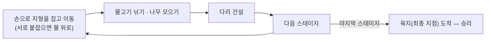
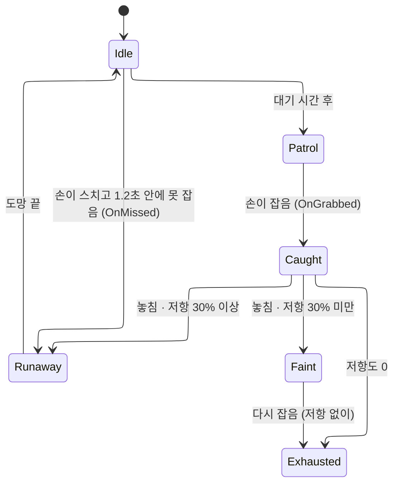
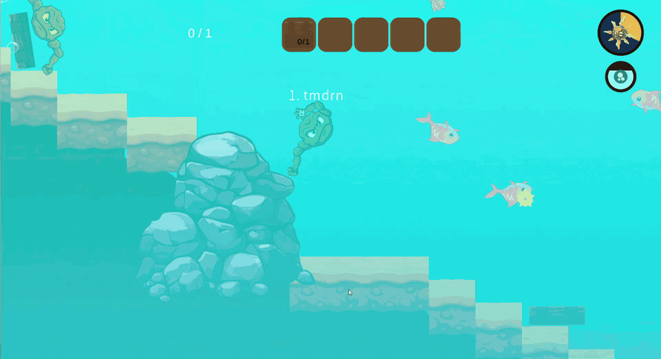
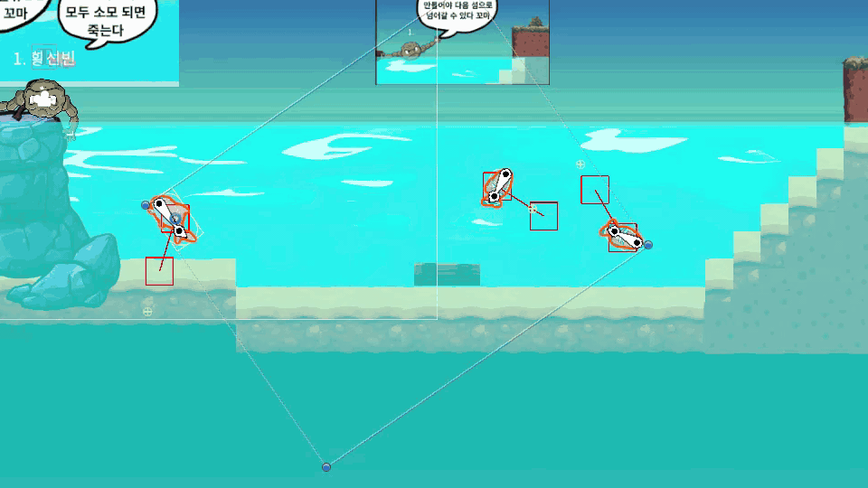
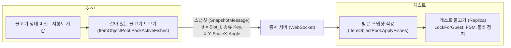
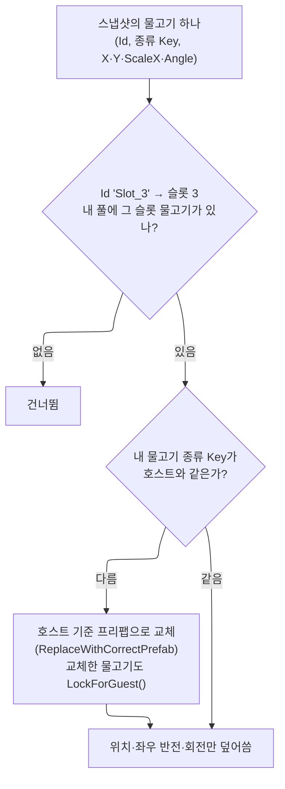
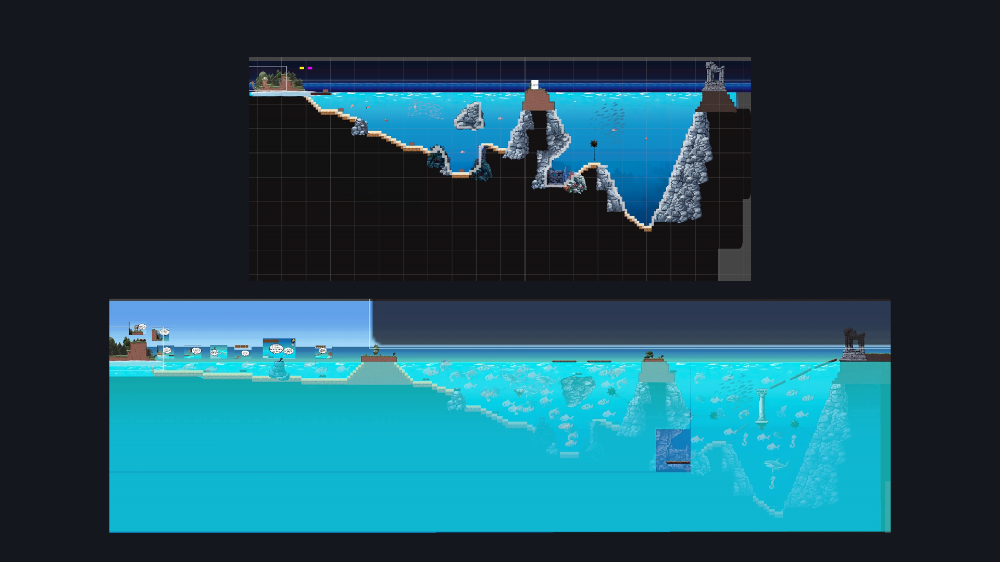
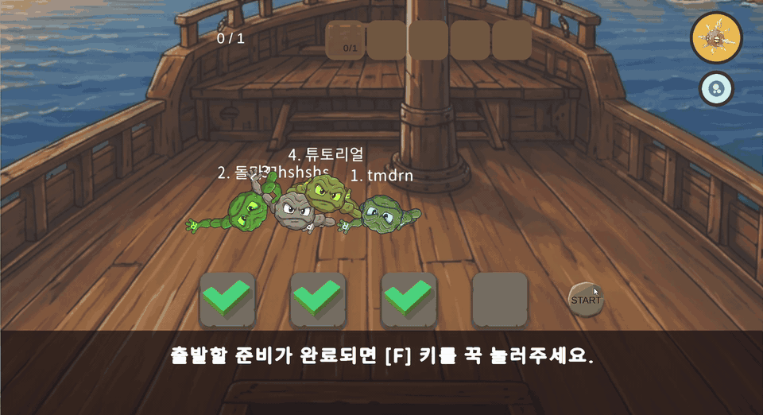

# WeGotOne (Team 산) — 물고기 AI·레벨 디자인 담당

<!-- ✏️ 11-11 퇴고: 화면에 보이던 확인 상자(✏️·🔎·🤖)를 지웠습니다. 출처·근거와 "Claude가 쓴 문장 — 본인 말로 확인할 곳" 목록은 작업인계.md에 옮겨 두었습니다.
     코드는 건우 님이 커밋한 시점의 버전이라 팀원이 리팩토링한 최종 코드와 다를 수 있습니다(3-2). 촬영 목록: _intake/촬영목록.md -->
<!-- TODO 그림: 1-1 대표 장면 · 5-3 물고기 상태 GIF · 5-4 BoxCast 기즈모 · 5-5 호스트·게스트 화면 비교 · 6-4 두 번째 스테이지 (촬영목록.md 참고) -->

## 1. 개요

### 1-1. 한눈에 보기

**WeGotOne**은 폭풍우로 조난당한 플레이어들이 섬에서 **물고기를 낚고 나무를 모아 다리를 지으며 육지(최종 지점)까지 가는**
2D 물리 기반 **협동 멀티플레이 게임**입니다(최대 4인). 플레이어는 팔을 직접 움직여 물건을 잡고 던지며,
서로의 몸을 붙잡으면 물 위로 떠오를 수 있습니다.

**경험 목표 — 힘을 맞추면 금방 지쳐 잡히고, 손이 어긋나면 달아나는 물고기로 협동과 불협화음을 함께 겪는 낚시**

혼자 잡은 물고기는 버티다 지칩니다. 여럿이 함께 끌어 벽에 부딪치게 하면 금방 지치지만, 모두 손을 놓치면 남은 힘으로 달아납니다.
<!-- ✏️ 11-23 건우 님 답("홀로 잡은 물고기가 버티고, 지치고, 잡거나 달아난다. 네 명이 함께 힘을 합치면 물고기가 금방 지치고, 쉽게 잡거나 달아난다. 협동의 경험과 불협화음의 경험을 동시에 경험한다")을 한 문장으로 다듬었습니다.
     사실 확인(최종 코드): 잡은 손이 많다고 저항도가 더 빨리 줄지는 않습니다(시간 감소는 손 수와 무관). 여럿이 빨리 지치게 하는 길은 함께 끌어 지형에 부딪치게 하는 것(지형 충돌 × 0.2, 4-4)입니다.
     "모두 손을 놓치면 달아난다" = 잡은 손이 0이 될 때만 놓침으로 판정하고 저항 30% 이상이면 도주(FishStateManager.OnReleased, 양손 잡기 수정 1596e1f 김승구 님 09-09) -->

| 핵심 기능 | 플레이어가 겪는 것 | 맡은 사람 | 장 |
|---|---|---|---|
| 물고기 AI | 잡힌 물고기가 버둥거리다 지치고, 놓치면 기절하거나 달아납니다 | 나 | 4장 |
| 물고기 동기화 | 네 명의 화면에 같은 물고기가 같은 자리에 보입니다 | 나 · 팀장 홍산 님 | 5장 |
| 레벨 · 튜토리얼 | 섬(튜토리얼) → 살짝 깊은 바다 → 아주 깊은 바다로 점점 어려워집니다 | 나 | 6장 |

<!-- ✏️ 핵심 피처 표는 Claude가 1-2 · 3-2 · 6-4에서 모은 것입니다(통합본 1-2 가이드 ③) -->

코드는 AI가 생성했고, 저는 클래스를 나누고 규칙을 정했습니다(7장).

<!-- ✏️ 11-23 재구성: 예전 1-2 「왜 만들었나 — 제 파트가 풀어야 했던 문제」의 네 줄은 4 · 5 · 6장 첫 문단과 4-5로 옮겼습니다 -->

### 1-2. 개발 환경 · 링크

| 항목 | 내용 |
|---|---|
| 엔진 | Unity 6000.3.15f1 (URP, 2D) |
| 언어·도구 | C#, JetBrains Rider, DOTween, Unity Input System, WebSocket(`ClientWebSocket`), Git·GitHub, Asana |
| AI 도구 | 강사님이 강의 자료로 만들어 주신 Google 노트북(강의 자료 기반 LLM), Claude(무료 요금제) |
| 장르 | 물리 기반 팀 협동 게임 (최대 4인) |
| 기간 | 2026-08-15 ~ 2026-09-10 (기획 08-15 ~ 08-22 · 개발 08-20 ~ 09-10) |
| 팀 | 4명 — 홍산, 김승구, 신성건, 윤건우 (레포 README) |
| 영상 | [소개 쇼츠 (56초)](https://youtube.com/shorts/T9h6JuvG1K4) · [플레이 시연 영상 (YouTube, 4분 21초)](https://youtu.be/ApLFcrms6j4) · [튜토리얼](https://youtu.be/8Kuv8hg5q3Y) |
| GitHub | `KooHoo-Dev/3rd-TeamProject-HS` (현재 비공개 · 공개 예정) |
| 일정 | 기획 1주 → 스프린트 3번 · 빌드 테스트 3번 (8-5) |

---

## 2. 게임 디자인

<!-- 2026-11-21 강사님 피드백("모든 문서에 게임 디자인 파트")으로 1-1에 있던 문단을 옮겨 만든 장. 게임 콘셉트는 팀 투표로 다른 팀원의 기획이 선정됨(2-3).
     ✏️ 2-2 그림은 Claude가 예전 1-1의 핵심 루프·조작 문장으로 그린 것 — 확인 필요 -->

### 2-1. 어떻게 플레이하나

> 귀여운 꼬마돌이 배를 타고 항해하던 도중 폭풍우를 만나 외딴 섬에 떨어졌다. 꼬마돌들은 힘을 합쳐 물고기를 잡고, 다리를 지어 육지로 향해야 한다.
<!-- 게임 소개 문구 · 출처: 본인 정리 -->

**조작**: 플레이어는 꼬마돌의 **오른손·왼손으로 지형을 잡아** 이동합니다. 물리 기반으로 움직이는 불편한 조작감에 점점 익숙해지면서
서로 협동할 수 있게 됩니다. <!-- 출처: 본인 정리 -->

### 2-2. 코어 루프 — 잡고, 모으고, 다리를 짓는다



<!-- 핵심 루프 출처: 아사나 S13-3 튜토리얼 카드의 하위 작업 -->

이 루프에서 협동과 불협화음이 가장 크게 드러나는 곳이 물고기 낚기입니다(4장). <!-- ✏️ 11-23 Claude가 경험 목표(1-1)와 잇는 한 줄로 더했습니다 -->

### 2-3. 기획 과정과 레퍼런스

**기획 과정** <!-- 출처: 본인 정리 --> — 팀원들과 함께 정한 프로젝트의 핵심 주제는 **멀티 협동 게임**이었습니다.
여러 협동 멀티 게임을 살펴보며 「Heave Ho」·「Heave Ho 2」를 함께 플레이했고, 각자 기획 아이디어를 제안했습니다.
**다수결 투표**로 다른 팀원의 기획이 선정되었고, 이를 모티브로 **낚시 생존 게임**을 만들기로 했습니다.

**레퍼런스와 다른 점** — 물리 잡기 기반 협동 게임 「Heave Ho」·「Heave Ho 2」를 레퍼런스로 삼았고, 여기에 **오브젝트를 잡아 낚아 올리는(물고기·목재 획득)** 요소를 더했습니다.
플레이어 캐릭터를 무엇으로 할지 고민하다가 우연히 발견한 포켓몬스터의 꼬마돌이 우리 게임에 잘 어울릴 것 같아, 꼬마돌들이 함께 좌충우돌 모험하는 게임이 되었습니다.
캐릭터 그림은 원작 이미지를 바탕으로 팀원이 AI를 활용해 만들었습니다. 꼬마돌은 다른 회사의 캐릭터이기 때문에, 판매나 출시 목적 없이 학원에서 공부를 위해 만든 프로젝트라는 전제 아래에서만 사용했습니다.
실제로 출시한다면 캐릭터부터 저희만의 것으로 바꿔야 하는 부분입니다.

---

## 3. 팀 협업

### 3-1. 팀 구성과 역할

제 역할을 한 줄로 줄이면 **"게임 맵·레벨 디자인, 물고기 FSM, 튜토리얼 연출"** 입니다. <!-- 출처: 본인 정리 -->

<!-- ✏️ 11-23: 아래 표의 제 칸을 3-2 표와 겹치지 않게 줄였습니다. 원래 칸: "물고기 AI(잡기·순찰·저항도, 물 밖 중력), 물고기를 잡을 수 있게 고친 플레이어 손·팔, 물고기·자원·시간 게스트 동기화(홍산 님과 함께), 인게임 튜토리얼, 낮·밤, 해양 지뢰, 맵·레벨 디자인, 게임 결과 폴리싱" -->

| 이름 | 담당 |
|---|---|
| 윤건우 (나) | 물고기 AI, 물고기 동기화(홍산 님과 함께), 맵·레벨 디자인과 튜토리얼 외 — 자세한 경계는 3-2 |
| 홍산 (팀장) | 기획서·발표·스프린트 계획(PM), 서버 중계와 플레이어·게임 종료·중간 입장·나무 동기화, 게스트 보간, 풀링·아이템 DB·인벤토리 리팩토링(SO → TSV), 물고기 스폰, 승패 판정, 다리 건설 조건 변경, 카메라 이동, 지뢰 물고기 |
| 김승구 | 팀 자원 저장·다리 건설·스테이지 진행, 물고기 풀, **물고기 코드 리팩토링**·피드백 효과, 물고기 확장(유령·대왕 오징어·갯가재·전기 가오리·해마) |
| 신성건 | 플레이어(관절 조작·잡기·던지기·배고픔·스태미나), 플레이어 물리 동기화, 물고기 코드 리팩토링 참여, 상어, 게임 흐름 씬, UI 폴리싱 |

> 팀 레포에서 `Minseong` 계정으로 올라간 커밋(08-25 ~ 08-26)도 제 작업입니다. 학원에서 팀 프로젝트를 할 때 자리를 바꿔 앉았는데, 그 PC의 Git 계정을 바꾸지 않아 다른 이름으로 남았습니다.

### 3-2. 제가 맡은 것과 팀원이 맡은 것

<!-- ✏️ 11-23: 절 제목에 "팀원이 맡은 것"을 더했습니다(기여 경계 표라서). 아사나 카드 번호는 8장 일정 표에 그대로 있습니다 -->

<!-- ✏️ 11-23 재구성: 「주로 맡은 것 / 그 밖에 맡은 것」 목록과 7-1 「코드 출처 구분」 표를 하나의 기여 경계 표로 합쳤습니다(통합본 1-3 ⑧). 팀원 몫의 커밋·날짜는 팀 레포 로그에서 확인한 것입니다 -->

| 구분 | 무엇 |
|---|---|
| **제가 설계 · 구현** (코드 생성은 AI, 7장) | 물고기 AI — 상태 머신 · 저항도 · 순찰과 장애물 감지 · 물 밖 중력(4장) · 게스트 물고기 잠금(5-2) · 맵 · 레벨 디자인과 인게임 튜토리얼(6장) |
| **팀장 홍산 님과 함께** | 물고기 호스트-게스트 동기화 — 슬롯 번호로 짝짓기 · 종류 보정(5장) |
| **팀원 코드를 바탕으로 제가 고침** | 손 · 팔(`HandControllerV2` · `ArmControllerV2`, 원본은 신성건 님의 `HandController`, 3-3) |
| **팀 공용 — 고치기 전에 팀장에게 확인** | 서버와 주고받는 형식 `Protocol.cs`(3-3) |
| **팀원이 맡거나 고침** | 게스트 보간(홍산 님, `75d2ae0`) · 물고기 코드 리팩토링(09-01, 김승구 · 신성건 님, 4-7) · 오브젝트 풀 리팩토링(09-01 ~ 02, 홍산 님) · 물 밖 중력 정리(09-04, 홍산 님) · 양손 잡기(09-09, 김승구 님 `1596e1f`) |

**그 밖에 맡은 것** (한 줄씩만)

- 낮·밤 주기 전환과 UI
- 자원·게임 시간 게스트 동기화 <!-- ✏️ 3-1 원래 칸 "물고기·자원·시간 게스트 동기화"에서 자원·시간을 여기로. 8장 일정 표의 E11-S5 · S11-7 -->
- 해양 지뢰 — 닿으면 폭발·넉백
- 게임 결과 화면 폴리싱

> **이 문서의 코드** — 물고기 코드는 제가 처음 설계했고, 09-01 팀원들이 리팩토링했습니다. 이 문서의 코드는 제가 마지막으로 커밋한 08-31 시점의 것입니다.
> 리팩토링으로 무엇이 바뀌고 무엇이 남았는지는 4-7에 정리했습니다. <!-- ✏️ "몸이 좋지 않아 결석했고"는 3-3으로 옮겼습니다 -->

### 3-3. 코드가 맞물리는 곳에서 맞춘 것

<!-- ✏️ 11-23 재구성: 예전 6-1 「플레이어 담당 팀원과의 협의」 · 7-1 `Protocol.cs` 문장 · 8-4 「협업 — 내 설계를 팀원이 고쳐 주었다」를 이 절로 모았습니다. 글은 거의 그대로입니다 -->

다수결 투표로 선정된 다른 팀원의 기획에 제 시스템을 설계해 넣는 일이었습니다. <!-- 출처: 본인 정리 -->
그래서 물고기는 플레이어의 손, 서버와 주고받는 형식, 팀원들이 바꾼 물고기 코드와 모두 맞물려 있었고, 맞물린 곳마다 아래처럼 맞췄습니다. <!-- ✏️ 원래: "…남의 기획에 콘텐츠를 더하고 시스템을 설계하는 것은 제가 직접 기획하고 설계하는 것과는 달랐습니다. 특히 물고기는 플레이어의 손, 서버와 주고받는 형식, 팀원들이 더한 새 물고기와 모두 맞물려 있었습니다." "달랐습니다"로 끝나 무엇이 달랐는지 안 보여, 이 절에서 보여 줄 것으로 이었습니다 -->

**손 — 플레이어 담당 신성건 님과**
손(`HandController`)은 성건 님의 코드였고, 물고기와 연결하기 위해 제가 V2(`HandControllerV2`·`ArmControllerV2` 등)를 만들어 고쳤습니다(`a1a8330`, 08-25).
처음에는 물고기의 상태 전환에 **손 컨트롤러를 매개변수로 넘기려** 했습니다. 하지만 잡기 판정은 이미 손이 물고기에게 알려 주는 구조였기 때문에, 물고기가 손 컨트롤러를 직접 알 필요가 없는 불필요한 매개변수였습니다.
성건 님이 이 부분을 짚어 주었고, 함께 스크립트를 리팩토링하며 이 매개변수를 없애 물고기 상태가 손 컨트롤러를 참조하지 않게 바꾸었습니다(4-3).
이때의 커밋(`03c079f`, 08-26)에도 "성건님과 Controller V2 버전 리팩토링 — FishState들의 PlayerHand 의존성을 버리고, 잡기 여부로만 판정하는 것으로 변경"이라고 남아 있습니다.

당시 2차 스프린트 회고(08-29)에 제가 남긴 글입니다.

> 성건님과 내가 수정한 스크립트를 리팩토링 하면서 불필요한 변수들을 정리하는 과정중에
> 객체들간의 의존성 설정의 여부를 결정하는것이 중요하다는 것을 다시 한번 느꼈다.
<!-- 출처: 아사나 「2차 스프린트 › 회고 및 피드백」 본인 댓글, 2026-08-29 -->

그 뒤로 다른 사람과 코드가 맞물리는 곳을 설계할 때는 **어느 클래스가 어느 클래스를 참조하는지 먼저 확인하고, 그 참조를 최대한 줄이려고** 합니다.

**`Protocol.cs` — 팀장 홍산 님과**
서버와 주고받는 내용을 정하는 `Protocol.cs`는 서버에 보낼 것을 추가할 때마다 고쳐야 하는 파일이라 **가장 조심히 다뤘고**, 고치기 전에는 항상 팀장(홍산 님)에게 먼저 물어봤습니다.
종류가 틀리는 버그를 고칠 때도 이 파일의 형식은 바꾸지 않고, 이미 있는 칸에 넣는 값만 바로잡았습니다(5-3).

**물고기 코드 리팩토링 — 결석한 날**
09-01 제가 결석한 사이, 팀원들이 물고기 코드를 리팩토링했습니다. 돌아오니 제가 설계한 물고기 시스템이 많이 달라져 있었습니다.
팀원들이 바뀐 부분을 설명해 주었지만, 바뀐 곳을 그때 모두 파악하지는 못했습니다. 문서를 정리하며 리팩토링 전후 코드를 비교해 4-7에 정리했습니다. <!-- ✏️ -->
다시 설계가 바뀌는 일이 생긴다면, **제 기존 설계안을 정리해 팀원들에게 공유하고, 팀원들이 바꾼 사항은 저에게 알려 주도록** 조정해서 바뀐 시스템을 제가 파악할 수 있게 하겠습니다.

---

## 4. 물고기 AI — 잡히면 버티고, 지치고, 달아난다

낚시는 현실에서도 입질 뒤 물고기와 씨름하는 것이 큰 재미입니다. 이 게임에서는 입질 대신 플레이어가 손으로 직접 물고기를 잡기 때문에,
잡는 경험을 더 생동감 있게 만들려고 **잡힌 물고기가 저항하고, 상황에 따라 탈진·기절·도망하도록** 했습니다.
또 게임 플레이 특성상 **벽이라는 구조를 이용해 물고기의 저항도를 낮출 수 있게** 설계했습니다.
경험 목표(1-1)의 "힘을 맞추면 금방 지쳐 잡히고, 손이 어긋나면 달아나는" 물고기가 이 장의 규칙에서 나옵니다. <!-- ✏️ 11-23 재구성: 앞 세 문장은 예전 1-2 「물고기 AI」 줄 그대로, 마지막 문장은 Claude가 경험 목표와 잇는 한 줄로 더했습니다 -->

코드는 제가 직접 고른 방식이 드러나는 세 곳 — 4-4 저항도 분기, 4-5 진행 중인 전환 취소, 4-6 BoxCast — 만 실었습니다.
코드 맨 위 주석에 파일 · 메서드와 팀 레포의 행 번호를 적었습니다(08-31 시점 `ea61f53` 기준). 로그 같은 줄은 빼고 핵심만 옮겼습니다. <!-- ✏️ 11-23: 벤치마크 ④(코드 발췌 머리줄)를 넣으며 더한 안내입니다. 행 번호는 팀 레포에서 확인했습니다 -->

> 이 장의 코드와 그림은 제가 마지막으로 커밋한 **08-31 시점**입니다. 09-01 ~ 02 팀원들의 리팩토링으로 무엇이 바뀌고 무엇이 남았는지는 4-7에 정리했습니다.

### 4-1. 맡은 클래스 — "언제 바뀌나"와 "어떻게 움직이나"를 나눈다

| 하는 일 | 클래스 |
|---|---|
| 상태를 바꾸는 판단 — **"언제 바뀌는가"**. 저항도를 갖고 있고, 저항도는 이 클래스의 메서드로만 바뀝니다 | 상태 관리자(`FishStateManager`) |
| 상태마다 들어갈 때 · 매 프레임 · 나갈 때 할 일 | 상태 6종(`IFishState` 구현 — Idle · Patrol · Caught · Exhausted · Faint · Runaway) |
| 실제 이동 — **"어떻게 움직이는가"**. DOTween · Rigidbody2D를 다룹니다 | 이동 담당(`FishMovement`) |
| 진행 방향에 상자(BoxCast)를 쏴서 벽 · 다른 물고기를 찾고 알립니다 | 장애물 센서(`FishObstacleSensor`) |
| 지형과 부딪친 세기(`relativeVelocity`)가 기준을 넘으면 알립니다 | 지형 충돌 알림(`FishCollisionHandler`) |
| 물 영역 안 · 밖을 알립니다(물 밖이면 중력) | 물 감지 센서(`WaterLayerAlert`) |
| 손이 잡을 대상에게 보내는 신호 세 개의 약속 | 잡을 수 있는 대상(`ICatchable`, 4-3) |

```mermaid
%%{init: {"layout": "elk"}}%%
classDiagram
    class ICatchable["잡을 수 있는 대상 (ICatchable)"] {
        <<interface>>
        +OnGrabbed()
        +OnReleased()
        +OnMissed()
    }
    class IFishState["상태 6종 (IFishState)"] {
        <<interface>>
        +EnterAsync(owner, token)
        +Tick()
        +ExitAsync(token)
    }
    class HandControllerV2["손 (HandControllerV2)"] {
        -CoGrabWindowTimer()
    }
    class FishStateManager["상태 관리자 (FishStateManager)"] {
        +CurrentResistance
        +DecreaseResistance()
        -TransitionTo(state)
    }
    class FishMovement["이동 담당 (FishMovement)"] {
        +ApplyStruggleForce(ratio)
        +SetAirPhysics() / SetWaterPhysics()
        +LockForGuest()
    }
    class FishObstacleSensor["장애물 센서 (FishObstacleSensor)"]
    class FishCollisionHandler["지형 충돌 알림 (FishCollisionHandler)"]
    class WaterLayerAlert["물 감지 센서 (WaterLayerAlert)"]
    HandControllerV2 ..> ICatchable : 잡기·놓기·놓침 신호
    FishStateManager ..|> ICatchable
    FishStateManager --> IFishState : 현재 상태
    FishStateManager --> FishMovement : 실행 위임
    FishObstacleSensor ..> FishMovement : 장애물 감지 이벤트
    FishCollisionHandler ..> IFishState : 지형 충격 이벤트 (Caught만 구독)
    WaterLayerAlert ..> FishStateManager : 물 안·밖 감지
```

<!-- ✏️ 11-23 재구성: 예전 4-1 「클래스 | 하는 일」 표를 「하는 일 | 클래스」로 뒤집고, 클래스 이름 앞에 역할을 붙였습니다(통합본 1-2 클래스 설명 규칙). 칸 내용은 원래 표 그대로입니다 -->

이 그림에서 볼 것은 **손은 신호만 보내고, 상태를 바꾸는 판단은 상태 관리자 한 곳에서, 실제 움직임은 이동 담당이 한다**는 세 갈래입니다. <!-- ✏️ -->



*그림에서 뺀 것: 동기화(5장)와 손 · 팔 코드. `IFishState`의 `EnterAsync(owner, token)`은 08-31 시점의 비동기 형태입니다(4-5 · 4-7).* <!-- ✏️ -->

**이렇게 나눈 이유**

- `FishMovement`는 **움직임만** 담당하도록 설계하고 싶었습니다. 그런데 기능이 붙으면서 `FishMovement`가 **428줄**까지 커졌고,
  그 안에 있던 BoxCast 감지 코드를 `FishObstacleSensor`로 따로 빼 **352줄**로 줄였습니다(`5850bda`, 08-27). 장애물 감지 결과는 이벤트로 넘깁니다.
- `FishStateManager`는 물고기의 **상태만** 관리하면 되므로 Rigidbody를 다룰 필요가 없었습니다. 그래서 물리 설정을 `FishMovement.SetAirPhysics()`로 옮겼습니다.
- 물 감지(`WaterLayerAlert`)와 지형 충돌(`FishCollisionHandler`)은 **알리기만** 하고, 어떻게 반응할지는 물고기가 스스로 판단합니다.

### 4-2. 상태 흐름

<!-- ✏️ 2026-11-18: 아래 그림 안내 한 줄은 Claude가 그림의 화살표를 읽고 쓴 것입니다. 맞는지 확인해 주세요. -->

이 그림에서 볼 것은 **잡혔다 놓친 물고기가 남은 저항(30%)에 따라 기절과 도망으로 갈린다**는 점입니다.



| 상태 | 플레이어가 보는 것 |
|---|---|
| Idle / Patrol | 정해진 범위를 대각선으로 왕복하며 헤엄칩니다 |
| Caught (힘겨루기) | 손에 잡혀 버둥거립니다. 저항도가 매 프레임 줄고, 저항이 클수록 세게 버둥거립니다 |
| Exhausted (탈진) | 저항도 0 — 손에 늘어져 저항하지 않습니다 |
| Faint (기절) | 지친 상태에서 놓치면 물 위에 떠서 잠시 무방비가 됩니다 |
| Runaway (도망) | 싱싱할 때 놓치거나 잡기를 놓치면 반대 방향으로 빠르게 달아납니다 |

<!-- ✏️ 11-23: 4장 표 칸의 문장 끝을 습니다체로 맞췄습니다(.claude/rules/writing-style.md). 내용은 그대로입니다 -->

### 4-3. 손은 신호 세 개만 보낸다 — 손이 물고기를 잡는 방법

손(플레이어 담당 코드)은 대상이 물고기인지 모르고, `ICatchable`의 신호 세 개만 보냅니다.

| 신호 | 손이 보내는 때 | 물고기의 반응 |
|---|---|---|
| `OnGrabbed()` | 잡기 성공 | 힘겨루기(Caught). 기절 중이었으면 바로 탈진(Exhausted) |
| `OnReleased()` | 잡고 있다가 놓음 | 남은 저항 비율로 기절 / 도망 (4-4) |
| `OnMissed()` | 손이 닿은 뒤 1.2초 안에 못 잡음 (타이머는 손이 가짐) | 도망(Runaway) |

**제가 정한 규칙**

- **잡을 수 있는 대상은 `ICatchable`만 구현하면 됩니다.** 손 코드는 대상마다 바뀌지 않습니다.
- **물고기의 상태는 밖에서 직접 바꾸지 않습니다.** 밖에서는 신호만 보내고, 바꾸는 판단은 `FishStateManager`가 합니다.
- **저항도도 값을 직접 넣지 않습니다.** `DecreaseResistance()`·`ResetResistance()` 메서드로만 바꿉니다(4-4). <!-- ✏️ 해라체("~된다")를 습니다체로, 규칙을 굵은 첫 문장으로 바꿨습니다(통합본 1-2 ⑤) -->

손 쪽(플레이어 담당)이 알아야 하는 것을 `ICatchable` 메서드 세 개로 좁힌 것은 **물고기가 아닌 오브젝트도 같은 신호 세 개로 잡을 수 있게** 하려는 것이었습니다
(`af9b561`: "향후 물고기 외 상호작용 오브젝트 확장 기반"). 다만 최종 코드에서 `ICatchable`을 구현한 것은 물고기(`FishStateManager`)뿐이라, 다른 오브젝트에 쓰는 것은 계획에 그쳤습니다.

**고민과 선택 — 이벤트 구독 vs 전체 비동기화 vs 인터페이스 직접 호출**

이 부분은 **실제로 두 번 방향을 바꾼 기록**이 커밋에 남아 있습니다.

> **결정 대상** 손이 물고기를 잡았다는 것을, 물고기가 손을 지켜보며 알아낼지, 손이 물고기에게 직접 알려 줄지. <!-- ✏️ -->

<!-- ✏️ 표를 결정 표 양식으로 바꿨습니다(11-23 통합본 2-3). 칸 내용은 원래 표 그대로이고 문장 끝만 습니다체로 바꿨습니다 -->
| | [A] 물고기가 모든 손을 구독 | [B] 플레이어 컨트롤러 전체를 비동기로 | **[C] 손이 `ICatchable`을 직접 호출 ✓** |
|---|---|---|---|
| 방식 | 물고기가 씬의 **모든 손을 찾아 이벤트를 구독**합니다 (`HandRegistry`) | 플레이어 컨트롤러 전체를 **비동기 인터페이스 구조로** 바꿉니다 | 손이 `ICatchable`을 직접 호출하고, 잡기 타이머도 손이 가집니다 |
| 장점 | 손 코드 수정이 적습니다 | 물고기 FSM과 방식이 통일됩니다 | 손은 대상이 물고기인지 모릅니다. 물고기는 신호 3개에만 반응합니다 |
| 단점 | 물고기마다 모든 손을 구독·해제해야 해서 해제 관리가 어렵고 무겁습니다 | 손·팔 등 **플레이어 담당의 모든 클래스**를 고쳐야 합니다 | 손 코드(`HandControllerV2`)를 고쳐야 합니다 |
| 실제 | `bf51259` 시도 ("구독해제 관련 함수 미완") | `004174d` 시도 → "일이 너무 커짐"으로 중단 | `af9b561` |

**[C]를 골랐습니다.** 물고기가 스스로 시간을 재며 손을 지켜보던 "수동적" 구조를, 손이 닿은 순간부터 타이머를 재고 결과만 알려 주는 구조로 바꿨습니다.
`FishStateManager`에서 손 구독·해제 코드가 통째로 사라졌고, 플레이어 담당의 코드는 `HandControllerV2` 한 곳만 건드렸습니다.

**감수한 단점**: 플레이어 담당(신성건 님)의 코드인 손을 제가 고쳐야 했습니다. 그래서 고친 부분은 성건 님과 함께 다시 정리했습니다(3-3).

**B를 접은 이유**: 프로젝트 당시 막 배운 비동기를 살려 보고 싶어서 B로 설계했지만, 남은 개발 시간과 플레이어 담당과의 리팩토링 조율을 생각해
**손이 `ICatchable`을 직접 호출하는 C로 조정**했습니다.


### 4-4. 잡히면 버둥거리다 지친다 — 저항도로 행동이 바뀐다

잡힌 물고기는 저항도가 남아 있는 동안 버둥거리고, 0이 되면 지쳐 늘어집니다. 놓치면 남은 저항도에 따라 기절할지 달아날지가 갈립니다. <!-- ✏️ 4-2 상태 표를 한 문단으로 줄인 것 -->

```csharp
// FishCaughtSate.cs · FishCaughtState.Tick (32~48행 발췌) — 잡혀 있는 동안 매 프레임
public void Tick()
{
    owner.DecreaseResistance(Time.deltaTime);                 // 초당 1씩 감소 (기본 최대 20)
    float ratio = owner.CurrentResistance / owner.MaxResistance;
    owner.FishMovement.ApplyStruggleForce(ratio);             // 저항이 클수록 세게 버둥거림 → 플레이어 이동 방해
    if (owner.CurrentResistance <= 0f)
        owner.ChangeState(new FishExhaustedState());
}

// FishCaughtSate.cs · HandleTerrainSmashed (50~62행 발췌, 로그 생략) — 지형에 부딪치면 (Caught 상태일 때만 구독)
private void HandleTerrainSmashed(float impactStrength)
{
    owner.DecreaseResistance(impactStrength * collisionRatio); // 충격이 셀수록 크게 감소 (계수 0.2)
}

// FishStateManager.cs · OnReleased (129~149행, 세 갈래를 두 갈래로 줄임 — 아래 결정 표) — 놓았을 때 남은 저항으로 분기
public void OnReleased()
{
    float resistanceRatio = CurrentResistance / maxResistance;
    if (resistanceRatio < 0.3f) TransitionTo(new FishFaintState());   // 지친 채 놓침 → 물 위에서 기절
    else                        TransitionTo(new FishRunawayState()); // 아직 싱싱 → 도망
}
```

| 값 | 기본 | 뜻 |
|---|---|---|
| `maxResistance` | 20 | 그냥 잡고만 있으면 20초 뒤 탈진합니다 (물고기 종류마다 프리팹에서 다르게) |
| `collisionRatio` | 0.2 | 지형 충돌 세기 × 0.2 만큼 바로 줄어듭니다 |
| `grabWindowTime` | 1.2초 | 손이 닿은 뒤 이 시간 안에 잡아야 합니다 |
| 기절 기준 | 30% 미만 | 이보다 낮으면 놓쳐도 도망가지 않고 기절합니다 |



**설명**

- **지형 충돌 이벤트를 Caught 상태에서만 구독하는 이유** — 지형 충돌로 저항도를 깎는 것은 플레이어가 물고기를 잡고 벽에 부딪쳤을 때만 필요합니다.
  그 밖의 상태에서는 이 연산이 필요 없으므로, Caught에 들어갈 때 구독하고 나갈 때 해제했습니다(`05903c9`: "다른 상태에서의 의도치 않은 저항도 연산 버그를 원천 방어").
- **저항도는 메서드로만 바꾼다** — 저항도는 잡고 있는 동안에도, 벽에 부딪칠 때도 줄어듭니다. 아무 코드에서나 값을 바꿀 수 있게 열어 두면 줄이는 곳마다 "0 밑으로 내려가지 않게"를 따로 챙겨야 하고,
  값이 틀어졌을 때 어디서 바꿨는지 찾기도 어렵습니다. 그래서 바꾸는 길을 `DecreaseResistance()`(0 아래로 안 내려감)와 `ResetResistance()` 두 개로 정해, 저항도가 0 밑으로 내려가지 않게 했습니다.
- **버둥거림 — 트윈에서 물리 힘으로** — 처음에는 당시 처음 배운 트윈(DOTween 흔들림)을 써 보려고 버둥거림을 트윈으로 만들었습니다(`f1d0a24`).
  그 뒤 물고기가 발버둥 치는 것을 더 실감 나게 하려고 Rigidbody2D에 힘을 주는 `AddForce` 방식으로 바꾸었습니다(`4060b92`, 08-26).

**플레이해 보고 바꾼 규칙** <!-- ✏️ 11-23 재구성: 예전 「설명」 목록에 있던 두 항목을 따로 모았습니다(통합본 1-2 「규칙이 플레이어 행동을 어떻게 바꿨나」) -->

- **물고기마다 버티는 시간을 다르게** — 플레이 테스트에서 물고기를 잡아 힘겨루기를 할 때, 처음 정한 20초가 생각보다 길게 느껴져 조정이 필요했습니다.
  그래서 **큰 물고기일수록 오래 버티도록** 종류별 최대 저항도를 프리팹에서 다시 정했습니다(`7650e8f`, 09-04).

  | 물고기 | 바꾸기 전 | 바꾼 뒤 |
  |---|---|---|
  | 상어 · 오징어 | 20 | 15 |
  | 가오리 | 5 | 13 |
  | 지뢰 물고기 · 문어 · 갯가재 | 20 | 12 |
  | 해마 | 20 | 10 |
- **물고기가 빙글빙글 도는 것 — 게임적 허용** — 처음에는 물고기가 실제 물고기처럼 헤엄치도록 기획했습니다.
  그런데 개발 중 플레이 테스트에서 물고기가 빠르게 빙글빙글 도는 모습을 보고, 팀원들이 이 반응을 재미있어했습니다.
  그래서 고치지 않고 그대로 살렸습니다. 사실적인 움직임보다 플레이어가 재미를 느끼는 반응을 앞에 둔 게임적 허용입니다.

**고민과 선택 — 놓쳤을 때 세 갈래로 나눌까, 두 갈래로 나눌까**

> **결정 대상** 놓쳤을 때 남은 저항도로 반응을 세 갈래(기절 / 멈칫한 뒤 도주 / 바로 도주)로 나눌지, 두 갈래(기절 / 도주)로 나눌지. <!-- ✏️ -->

<!-- ✏️ 11-23 재구성: 예전 「설계에서 바꾼 곳 — 30~60% "회색 영역"」 문단을 결정 표 양식으로 바꿨습니다. 칸 내용은 원래 문단에서 가져왔습니다 -->
| | [A] 세 갈래 (설계 문서 `FishSystemDesignPlan.md`) | **[B] 두 갈래 ✓** |
|---|---|---|
| 방식 | 30% 미만은 기절. 그 위는 남은 저항도를 도망 상태에 넘겨, 30~60%("회색 구간")면 짧게 멈칫한 뒤 도주, 60% 이상이면 바로 도주 | 30% 미만은 기절, 나머지는 모두 도주 |
| 플레이어가 겪는 것 | 회색 구간과 60% 이상이 플레이어에게 크게 다르게 보이지 않을 것 같았습니다 | 놓친 물고기는 기절하거나 달아나는 두 가지로 반응합니다 |

**[B]를 골랐습니다.** 구현하면서 보니 회색 구간(30~60%)과 60% 이상이 **플레이어에게 크게 다르게 보이지 않을 것 같아, 두 구간 모두 똑같이 도주하게** 했습니다(`f1d0a24`, 08-25).
코드에는 세 갈래가 그대로 남아 있었고, 이후 팀원이 양손 잡기를 고치면서(`1596e1f`, 09-09) 같은 내용의 두 갈래를 합쳐 최종 코드는 "30% 미만 기절 / 나머지 도주" 두 갈래입니다.
(위 코드도 핵심만 보이려고 두 갈래로 줄였습니다.)

### 4-5. 도망치다 다시 잡혀도 바로 버둥거린다 — 비동기 상태 전환

이 프로젝트의 기술 목표는 직전에 막 배운 **비동기(`async`)를 물고기 상태 머신에 직접 써 보는 것**이었습니다. <!-- ✏️ 예전 1-2 「기술 목표」 줄에서 가져왔습니다 -->

```csharp
// FishStateManager.cs · TransitionTo (168~192행)
private async void TransitionTo(IFishState newState)
{
    if (newState == null) return;

    // 이전 전환이 아직 진행 중이면 취소하고 새 토큰을 만든다
    stateCts?.Cancel();
    stateCts?.Dispose();
    stateCts = new CancellationTokenSource();
    CancellationToken token = stateCts.Token;

    try
    {
        if (currentState != null)
        {
            await currentState.ExitAsync(token);
            if (this == null) return;        // 기다리는 사이 오브젝트가 파괴됐으면 중단
        }
        currentState = newState;
        await currentState.EnterAsync(this, token);
    }
    catch (OperationCanceledException)
    {
        Debug.Log("상태 전환 취소");
    }
}
```

**설명**

- **상태 진입·퇴장을 `async`로 만든 이유** — 물고기는 도망(Runaway) 상태가 끝난 뒤 대기(Idle) 상태로 돌아갑니다(`004174d`). 그래서 도망이 끝날 때까지 기다렸다가 다음 상태로 넘어가야 했습니다.
- **`CancellationToken`이 필요한 이유** — 도망 중에 다시 잡히면 진행 중이던 상태 처리를 멈추고 새 상태로 넘어가야 합니다.
  토큰이 없으면 이전 전환이 뒤에서 계속 기다리다가, 도망이 끝나는 순간 이어서 실행되어 잡힌 물고기가 갑자기 Idle로 돌아갈 수 있습니다.
  그래서 새 전환을 시작할 때 이전 전환에 취소 신호를 보내 멈추게 했습니다.
- **`if (this == null) return;`** — 퇴장을 기다리는 사이 물고기 오브젝트가 파괴될 수 있어(씬 전환 등), 파괴된 물고기에 새 상태를 넣지 않도록 여기서 멈춥니다.
- **`OnDisable`에서 토큰을 취소하는 이유** — 잡은 물고기를 보관함에 넣으면 물고기가 꺼집니다. 코루틴과 달리 `async` 작업은 오브젝트가 꺼져도 저절로 멈추지 않으므로,
  꺼질 때 토큰을 취소해 보관함 속 물고기에서 도망 연출·상태 전환이 계속 돌지 않게 했습니다.

**고민과 선택 — 상태 머신을 어떻게 만들까**

**최종 선택**: 상태마다 클래스를 하나씩 두고 `IFishState`(비동기 진입·퇴장 + 취소 토큰)로 묶었습니다.

**선택 이유**: 이 프로젝트 직전에 막 배운 비동기를 상태 머신에 활용해 보고 싶었습니다. <!-- ✏️ 앞의 "적 FSM을 인터페이스 구조로 설계해 본 경험이 있었고,"를 지웠습니다(통합본 1-1 핵심 ② 프로젝트는 따로) -->

| 이 구조로 얻은 것 | 대신 감수한 것 |
|---|---|
| 상태별 정리(이벤트 해제 등)를 퇴장(Exit)에 모을 수 있습니다. 연출이 끝나기를 `await`로 기다릴 수 있습니다 | 상태 수만큼 클래스가 늘어납니다. `async void`라 예외 처리에 주의해야 합니다 |

**결과 — 팀원이 물고기를 늘리기 쉬웠다**: 새 물고기를 만들 때 상태 클래스 **하나만 추가하면** 되었기 때문에, 팀원들이 부담 없이 물고기 종류를 늘릴 수 있었습니다.
실제로 팀원들이 같은 `IFishState` 규약으로 납치(`AbductionState`)·문어(`FishOctopusState`)·상어(`Shark`)·미끼(`FishBaitState`) 등의 상태를 추가했고,
팀은 "공통 상태는 `501. Fish`에, 새 물고기의 상태는 그 물고기 이름 폴더에"라는 규칙(아사나 「물고기 제작 규칙 정리」, 09-02)을 이 구조 위에서 만들었습니다.

비동기 진입 · 퇴장은 09-01 리팩토링에서 동기 방식으로 바뀌었습니다. 도망이 끝나기를 `await`로 기다리던 것은, 도망 상태가 매 프레임 3초를 세는 방식이 되었습니다(4-7). <!-- ✏️ 최종 코드 FishRunawayState에서 확인 -->

### 4-6. 벽에 박지 않고 대각선으로 헤엄친다 — 풀링에 맞춘 순찰과 장애물 회피

잡히기 전의 물고기는 자기 범위 안을 대각선으로 오가며 헤엄치고, 벽이나 다른 물고기 앞에서는 방향을 돌립니다. <!-- ✏️ 11-23: 절 첫머리에 플레이어가 보는 것 한 줄을 더했습니다(통합본 1-2 리듬 ①) -->

- 처음에는 씬에 배치한 `spawnPoint`·`patrolPoint` Transform 사이를 왕복했습니다(`542e7d2`).
  오브젝트 풀링으로 물고기를 재사용하려면 씬 배치에 의존하면 안 되므로, **스폰된 순간의 좌표 + 프리팹의 `patrolRange`** 로 경로를 계산하게 바꿨습니다.
- 한 번 왕복할 때마다 방향과 Y 오프셋을 새로 뽑습니다. Y 범위는 X 범위의 20~50%로 제한해 자연스러운 대각선으로 헤엄치게 했습니다.
- 장애물 감지는 선(Raycast) 대신 **물고기 두께만큼의 상자(BoxCast)** 로 합니다.



```csharp
// FishObstacleSensor.cs · Update → CheckForObstacles (27~59행 발췌)
// 순찰 중일 때만, 목표 방향으로 물고기 크기의 상자를 쏜다
RaycastHit2D hit = Physics2D.BoxCast(
    transform.position, obstacleCheckSize, 0f,
    moveDirection, obstacleCheckDistance, obstacleLayer);   // Wall(지형), fish(다른 물고기)

if (hit.collider != null)
    OnObstacleDetected?.Invoke();   // 트윈 취소 → 반대 방향으로 돌아가 경로 재탐색
```

길찾기를 Raycast(선)로 하면 선 한 줄만 검사해서 부피가 있는 몸은 벽에 걸릴 수 있습니다. 그래서 **부피가 있는 물고기에는 처음부터 BoxCast를 선택**했습니다.

**문제 해결 — 물고기가 물 밖으로 나감** (커밋 `5850bda` 08-27 → `04e03c2` 08-28) <!-- ✏️ 11-23 재구성: 예전 8-2 ②를 이 절로 옮겼습니다 -->

- 문제: 물고기가 수면 위로 올라가 물 밖으로 나가는 경우가 있었습니다.
- 원인: 순찰·도주 목적지를 **스폰 위치 + 랜덤 거리**로만 정하고 수면 높이는 확인하지 않았습니다. 그래서 수면 가까이 스폰된 물고기는 목적지가 물 위로 잡힐 수 있었고, `DOMove`가 그 자리까지 그대로 끌고 갔습니다. 물 밖에서 다시 떨어뜨릴 중력도 없었습니다.
- 해결 1 (`5850bda`): 물 영역 출입을 감지하는 센서(`WaterLayerAlert`)를 따로 만들고, 물 밖이면 **중력을 적용**해 다시 수면 아래로 내려가게 했습니다. 잡혀 있을 때는 이 낙하가 작동하지 않게 예외를 두었습니다.
  다만 커밋 메시지에 "순찰 시에도 물 센서 적용시켜야 함"이라고 남긴 것처럼, **순찰 중인 물고기**는 아직 빠져 있었습니다.
- 해결 2 (`04e03c2`): 수면 경계에서 물에 들어온 직후 곧바로 "물 밖"으로 다시 판정되는 일이 있어, **물에 들어온 뒤 1초 동안은 물 밖 판정을 무시**하는 쿨타임을 두었습니다.
- 결과: 2차 빌드 테스트(09-04)에서 "물고기가 밖에 나가도 다시 안 들어옴" 버그가 다시 나왔고,
  같은 날 팀장 홍산 님이 물 밖이면 중력 1, 물 안이면 중력 0으로 `gravityScale`을 바꾸는 방식으로 이동 코드를 정리해 고쳤습니다(`97b901c`·`cab5060`·`fa11548`). <!-- ✏️ 앞의 "제 수정으로 완전히 막지는 못했습니다."를 지웠습니다. 다시 나온 버그와 고친 방법이 그대로 사실을 말해 줍니다(11-23 통합본 2-3) -->
- 이 일로 "어떤 조건이 **모든 상태에서** 성립하는지 확인해야 한다"는 것을 배웠습니다(8-4).

### 4-7. 팀 리팩토링 뒤 — 바뀐 것과 남은 것

<!-- ✏️ 11-23 새 절: 팀 레포(3rd-TeamProject-HS)에서 08-31 마지막 상태(ea61f53) · 리팩토링 3차 뒤(b2a84b7) · 최종(origin/main)을 비교해 Claude가 썼습니다. 커밋 · 날짜 · 숫자는 레포에서 확인한 것입니다 -->

09-01 팀원들이 물고기 코드를 리팩토링했습니다(1차 김승구 님, 2 · 3차 신성건 님 — `5bab6a5` · `3a6a298` · `b2a84b7`). 09-02에는 신성건 님이 물 감지와 장애물 대응을 이어서 바꿨습니다(`b2cffd1`).
문서를 정리하며 리팩토링 직전(08-31)과 최종 코드를 비교했습니다. <!-- ✏️ 앞의 "그때는 바뀐 곳을 모두 파악하지 못해(3-3),"를 지웠습니다. 3-3과 같은 말이 반복되어서입니다 -->

이 표에서 볼 것은 **"무엇을 할지"를 정하는 판단이 이동 담당에서 각 상태로 옮겨졌다**는 점입니다.

| | 제 설계 (08-31) | 리팩토링 뒤 · 최종 |
|---|---|---|
| 상태 전환 | `Task EnterAsync(owner, token)` · `Task ExitAsync(token)` — 퇴장을 `await`로 기다리고, 새 전환이 오면 진행 중인 전환을 취소 토큰으로 멈춥니다(4-5) | `void Enter` · `Tick` · `Exit` — 퇴장하고 바로 진입하는 동기 방식입니다 |
| 움직이는 방식 | DOTween이 위치를 옮깁니다(`rb.DOMove`) | 이동 담당은 `Move(방향, 속도)`를 받아 `FixedUpdate`에서 속도(`linearVelocity`)를 넣기만 합니다. 402줄이 97줄로 줄었습니다(3차 뒤) |
| 순찰 지점을 누가 정하나 | 이동 담당 — 스폰 위치 기준 좌우 `patrolRange`, 위아래 그 20~50%의 대각선 지점을 왕복합니다(4-6) | 순찰 상태(`FishPatrolState`) — 도착하면 지금 위치 주변 반경 5 안에서 새 지점을 고릅니다. 최종은 물 영역 안인 지점만 고릅니다(20번까지 시도) |
| 도망이 끝나는 때 | 도망 트윈이 끝나기를 `await`로 기다립니다 | 도망 상태가 매 프레임 시간을 세어 3초가 지나면 끝냅니다 |
| 버둥거림 | 방향을 바꾸는 주기(0.3초)와 힘을 이동 담당이 갖고, 몸을 그 방향으로 돌립니다 | 방향 타이머(0.5~1.5초)가 잡힘 상태(`FishCaughtState`) 안으로 옮겨지고, 이동 담당은 힘(`ApplyForce`)만 줍니다. 몸 돌리기는 빠졌습니다 |
| 장애물 앞에서 | 경로를 포기하고 반대 방향으로 되돌아갑니다 | 센서 이벤트를 받은 순찰 상태가 다른 지점을 새로 고릅니다(09-02 신성건 님 `b2cffd1`, 09-03 홍산 님 `28fce20`) |
| 물 안 · 밖 | 물 감지 센서(`WaterLayerAlert`)가 출입을 알리고, 들어온 뒤 1초는 물 밖 판정을 무시합니다 | 센서를 없애고 이동 담당이 물 영역 콜라이더로 직접 확인합니다(09-02 신성건 님 `b2cffd1`). 중력은 09-04 홍산 님이 정리했습니다(4-6) |

**그대로 남은 것**

| 제 설계 | 최종 코드에서 |
|---|---|
| 상태마다 클래스 하나 + `IFishState` | 같은 틀 위에 팀원들이 납치 · 문어 · 미끼 · 되돌아가기(`ReturnState`) 등의 상태를 더했습니다 |
| 손 → 물고기 신호 세 개(`ICatchable`, 4-3) | 그대로입니다. 양손 잡기를 위해 잡은 손 목록만 더해졌습니다(09-09 김승구 님 `1596e1f`) |
| 저항도 — 최대 20, 지형 충돌 × 0.2, 메서드로만 바꾸기(4-4) | 그대로입니다 |
| 장애물 감지 BoxCast(4-6) | 그대로입니다. 다른 물고기는 상자 겹침 검사(`OverlapBoxAll`)로 따로 봅니다(09-09 홍산 님) |
| 게스트 물고기 잠금 `LockForGuest`(5장) | 그대로입니다. 잠금 검사가 `FixedUpdate` 안으로 옮겨졌습니다 |

정리하면 리팩토링은 **"상태는 무엇을 할지 정하고, 이동 담당은 시키는 대로 움직이기만"** 으로 역할을 한 단계 더 나눈 방향이었습니다.
제가 처음 나눈 "언제 바뀌나 / 어떻게 움직이나"(4-1)에서, 순찰 지점 · 도망 시간 · 버둥거림 주기 같은 "무엇을 할지"까지 상태 쪽으로 옮긴 것입니다. <!-- ✏️ -->

---

## 5. 물고기 동기화 — 네 명에게 같은 물고기

물고기 AI를 호스트와 게스트가 각자 돌리면 플레이어마다 물고기가 다르게 움직여 보이고, 네 명이 "같은 물고기"를 함께 잡을 수 없습니다.
경험 목표(1-1)의 "힘을 맞추는" 협동도 네 명이 같은 자리의 같은 물고기를 보고 있어야 성립합니다.
그래서 팀은 이 게임을 **호스트 기반 멀티플레이**로 정했고(물고기 카드 S11-4: "물고기의 실제 게임 로직은 호스트만 수행하고, 게스트는 표현에 필요한 결과만 반영한다"), 저는 이 방향을 제 물고기에 적용했습니다.

**맡은 범위** — 동기화 구조는 팀장 홍산 님과 함께 만들었고, 게스트 물고기 잠금(5-2)과 종류 보정(5-3)은 제 계정으로 커밋한 부분입니다.
<!-- ✏️ 11-23: 장 첫머리 두 문단(6줄)을 한 문단 + 맡은 범위 한 줄로 줄였습니다. 글의 출처는 예전 1-2 「동기화」 줄 · 예전 6-3 「정해진 방향」입니다. 줄이며 뺀 문장: "실제로 1차 빌드 테스트(08-29)에서는 호스트와 게스트 화면의 물고기가 달랐고, 게스트 화면에서 나무가 물고기로 보이는 문제도 나왔습니다(5-3)." — 5-3에 같은 내용이 있습니다 -->

<!-- ✏️ 11-23 재구성: 예전 6-3 「제가 고민한 것」 표(고민 | 적용한 방법 세 줄)는 5-1 · 5-2 · 5-3과 같은 내용이라 지웠습니다. 그 표의 세 줄은 각각 5-2 잠금 · 5-1 슬롯 번호 결정 표 · 5-3 문제 해결로 이어집니다 -->

### 5-1. 동기화 구조 — 호스트가 계산하고, 게스트는 보여 주기만

이 그림에서 볼 것은 **물고기를 계산하는 것은 호스트뿐이고, 게스트는 받은 위치를 그리기만 한다**는 점입니다. <!-- ✏️ -->



| 규칙 | 내용 |
|---|---|
| 게스트는 물고기 AI·FSM을 **실행하지 않습니다** | `LockForGuest()` — 트윈 정지, Rigidbody2D를 Kinematic으로, 컴포넌트 비활성 (5-2) |
| 위치·회전 등 **화면 표현만** 받습니다 | 스냅샷의 X·Y·ScaleX(좌우 반전)·Angle 적용 |
| 물고기 ID는 **스폰 슬롯 번호**입니다 | 스폰 위치 인덱스를 `"Slot_i"`로 매핑 (`PackActiveFishes`) |
| 스냅샷 주기 | 호스트가 30ms마다 보냅니다 (`98642aa`) |

<!-- ✏️ 11-23: 규칙 칸 문장 끝을 습니다체로 맞췄습니다. 그림 상자는 역할을 앞에 두었습니다. 표의 `PackActiveItems`는 08-31 코드(ea61f53 ItemObjectPool.cs 112행)에 없는 이름이라 `PackActiveFishes`로 바로잡았습니다 -->

**고민과 선택 — 호스트와 게스트의 물고기를 무엇으로 짝지을까**

> **결정 대상** 호스트와 게스트의 "같은 물고기"를, 물고기마다 새 ID를 만들어 알려 줄지, 스폰 슬롯 번호로 짝지을지. <!-- ✏️ -->

<!-- ✏️ 11-23 재구성: 예전 「슬롯 번호를 ID로 쓴 이유」 문단을 결정 표 양식으로 바꿨습니다. [A] 장점은 최종 코드(호스트가 정한 종류로 꺼내는 방식)에서 확인한 것입니다 -->
| | [A] 물고기마다 새 ID를 만들어 알림 | **[B] 스폰 슬롯 번호를 ID로 ✓** |
|---|---|---|
| 방식 | 물고기가 나올 때마다 ID를 만들고, 생성 메시지로 게스트에게 알립니다 | 호스트와 게스트가 같은 씬의 스폰 위치 순서를 그대로 ID(`"Slot_i"`)로 씁니다 |
| 장점 | 호스트가 정한 물고기를 그대로 알려 주므로 종류가 어긋나지 않습니다 | 생성 메시지가 따로 필요 없습니다. 잡힌 물고기가 풀로 돌아가고 같은 슬롯에 새 물고기가 나와도 ID가 그대로입니다 |
| 단점 | 물고기마다 생성 메시지를 따로 주고받아야 합니다 | 같은 슬롯에 **다른 종류**가 나올 수 있습니다 |

**[B]를 골랐습니다.** 호스트와 게스트는 같은 씬을 불러오므로 스폰 위치 목록의 순서가 같고, 스폰 위치마다 각자 물고기를 하나씩 갖습니다.
그래서 슬롯 번호만 같으면 "같은 물고기"로 짝지을 수 있어, 물고기마다 새 ID를 만들어 알려 주는 생성 메시지가 따로 필요 없었습니다.
그 대가로 같은 슬롯에 다른 종류가 나오는 경우를 위해, 종류 `Key`를 함께 보내고 다르면 교체하는 보정이 필요했습니다(5-2 · 5-3).

**예상하지 못한 것 — 게스트 화면 끊김**: 게스트의 물고기는 스냅샷이 올 때마다 위치를 바로 덮어썼기 때문에 화면이 끊겨 보였습니다.
팀 테스트 플레이 중에 알게 되었고, 홍산 님이 게스트 보간을 넣어 고쳤습니다(`75d2ae0`, 08-31).

> 이 절의 구조는 제가 만든 08-28 ~ 08-31 시점의 것입니다. 09-01 ~ 02 팀장 홍산 님이 오브젝트 풀을 다시 짜면서(`d9ea737`·`41df738`), 최종 코드에서는 물고기마다 `WorldItemId`를 두고 호스트가 보낸 종류(`ItemId`)대로 게스트가 꺼내는 `WorldItemSnapshotSynchronizer`로 바뀌었습니다. "호스트는 계산, 게스트는 보여 주기만"과 `LockForGuest()`는 그대로 남았습니다.

### 5-2. 게스트 물고기는 스스로 생각하지 않는다 — 잠금과 종류 맞추기
<!-- ✏️ 11-23: 절 제목 "모든 플레이어에게 같은 물고기가 보인다 — 게스트 물고기는 생각하지 않는다"를 바꿨습니다. 앞부분이 5장 제목과 같은 말이라, 이 절이 다루는 게스트 쪽 일로 이름을 붙였습니다 -->

**게스트가 스냅샷을 받았을 때** (`ApplyFishes`, 물고기 하나마다)

이 그림에서 볼 것은 **슬롯 번호로 짝을 찾고, 종류가 다르면 먼저 바꾼 뒤에 위치를 덮어쓴다**는 순서입니다. <!-- ✏️ -->



**게스트 물고기 잠금** (`LockForGuest`) — 게스트의 물고기는 스스로 생각하지 않습니다.

| 막는 것 | 방법 |
|---|---|
| 이미 걸려 있던 움직임 | 트윈 정리 (`StopMove`) |
| 물리로 밀리기 | Rigidbody2D를 Kinematic으로 |
| `Update` 같은 유니티 자동 호출 | 컴포넌트 끄기 (`enabled = false`) |
| 다른 코드가 public 메서드를 **직접 부르는 것** (예: `FishPatrolState`) | 트윈을 거는 모든 진입점 맨 앞에 `isGuestLocked` 검사 — `enabled = false`로는 못 막습니다 |

```csharp
// FishMovment.cs · LockForGuest (124~136행 발췌)
private bool isGuestLocked;

public void LockForGuest()
{
    isGuestLocked = true;
    StopMove();                                                // 이미 걸려 있던 트윈 정리
    if (rb != null) rb.bodyType = RigidbodyType2D.Kinematic;   // 물리로 밀리지 않게
    enabled = false;                                           // Update 같은 자동 호출 차단
}

// FishMovment.cs · 트윈을 거는 진입점 다섯 곳의 맨 앞 (148 · 162 · 238 · 274 · 331행)
public void StartPatrol()
{
    if (isGuestLocked) return;   // 다른 코드가 직접 불러도 여기서 막힙니다
    // 이하 순찰 트윈 생략
}
```
<!-- ✏️ 11-23: 08-31 코드(ea61f53)에서 발췌했습니다. 다섯 곳 = PullingInit · StartPatrol · RunawayMoveAsync · StartFaintDrift · TurnAroundImmediately. 원래 코드의 주석은 줄이고 표의 설명과 맞췄습니다 -->

**제가 정한 규칙** <!-- ✏️ 11-23: 해라체를 습니다체로, 규칙을 굵은 첫 문장으로 바꿨습니다. 첫 규칙 "게스트는 물고기 AI·상태 머신·저항 계산을 실행하지 않습니다. 화면 표현(위치·회전)만 받습니다."는 5-1 규칙 표와 같아 지웠습니다 -->

- **같은 물고기인지는 슬롯 번호로, 같은 종류인지는 종류 Key로 맞춥니다.** 종류가 다르면 호스트 기준으로 바꿉니다.
- **종류가 틀리는 버그는 스냅샷 형식(`Protocol.cs`)을 바꾸지 않고 고칩니다.** 이미 있는 칸에 넣는 값만 바로잡습니다(`e363b73`, 3-3).

**잠금 플래그를 따로 둔 이유 — "좀비 물고기"**

게스트 화면에서 물고기 컴포넌트를 모두 꺼 두었는데도 물고기가 계속 움직이는 것을 직접 보았습니다. 팀원끼리는 이것을 "좀비 물고기 사태"라고 불렀습니다.
원인을 찾으며 두 가지를 확인했습니다. <!-- ✏️ 11-23 재구성: 예전 5-5 「잠금 플래그를 따로 둔 이유」와 8-4 「컴포넌트를 꺼도 멈추지 않는다」를 합쳤습니다 -->

| 꺼 두어도 막히지 않는 것 | 알게 된 곳 | 그래서 한 것 |
|---|---|---|
| `OnTriggerEnter2D`·`OnTriggerExit2D` 같은 **충돌 콜백**은 컴포넌트가 꺼져 있어도 불립니다 | 물 감지 센서(`WaterLayerAlert`)가 계속 신호를 보내 상태 머신을 깨웠습니다 (`593ddd8`, 08-30) | 콜백 안에서 컴포넌트가 켜져 있을 때만 처리합니다 |
| `enabled = false`는 `Update` 같은 **유니티 자동 호출만** 막고, 다른 코드가 public 메서드를 **직접 부르는 것**은 못 막습니다 | 순찰 상태(`FishPatrolState`)가 이동 메서드를 직접 호출했습니다 (`8fba446`, 08-30) | 움직임을 거는 모든 진입점에 잠금 플래그(`isGuestLocked`) 검사를 넣었습니다 |

이제는 "꺼 두면 멈춘다"고 믿지 않고, **누가 이 코드를 부를 수 있는지**부터 확인합니다.
같은 내용이 팀의 2차 스프린트 회고(08-31)에도 남아 있어, 팀 전체가 함께 배운 부분이기도 합니다.

### 5-3. 문제 해결 — 게스트 화면에서 나무가 물고기로 보임

<!-- ✏️ 11-23 재구성: 예전 8-2 ①을 이 절로 옮겼습니다. 글은 그대로이고, 예전 5-5 「종류가 다르면 교체하는 방식」 설명과 겹치는 문장은 여기 한 곳에만 남겼습니다 -->

(1차 빌드 테스트 08-29 → 커밋 `e363b73`, 08-30)

- 문제: 1차 빌드 테스트에서 게스트 화면에 **나무가 물고기로 보이고**, 같은 자리인데 호스트와 게스트에 다른 물고기가 보였습니다(제가 정리한 「첫 빌드 테스트 버그리스트」).
- 원인 1: 스냅샷에 담는 종류 값(`FishTypeIndex`)을 **대분류(`ItemType`: 나무/로프/물고기)** 로 채우고 있어, 물고기끼리는 물론 나무와 물고기도 제대로 구분되지 않았습니다.
- 원인 2: 게스트가 스폰할 때 **스스로 랜덤으로 물고기 종류를 뽑고** 있었습니다.
- 해결: 종류 값을 개별 식별값 `Key`로 통일하고, 게스트의 종류가 호스트와 다르면 올바른 프리팹으로 바꾸게 했습니다(교체한 물고기도 `LockForGuest()`로 잠금). 스냅샷 형식은 바꾸지 않고 이미 있는 칸의 값만 바로잡았습니다.
- 결과: 다음 날(08-31) 신성건 님이 같은 방식(종류 값 `Key`를 싣고, 다르면 교체)을 **나무 스냅샷에도** 붙여 "나무가 물고기로 보이는" 현상을 마무리했습니다(`9c1b1b8`).
- 돌아보면: 처음부터 호스트가 종류를 정해 주는 방법은 당시에는 생각하지 못했습니다. 09-01 ~ 02 홍산 님의 풀 리팩토링 뒤 최종 코드가 바로 그 방법입니다(5-1 끝). <!-- ✏️ 11-23: 결과의 둘째 줄("그 뒤 09-01~02 팀장 홍산 님이 오브젝트 풀을 다시 짜면서 … 방식으로 바뀌었습니다")은 5-1 끝 안내와 같아 이 줄로 합쳤습니다 -->

---

## 6. 레벨 · 튜토리얼 — 처음 하는 플레이어도 끝까지

섬·바다 스테이지 맵은 제가 디자인했습니다. 이 게임은 손으로 지형을 잡아 움직이고, 서로의 몸을 붙잡아야 물 위로 떠오르는 조작이라 익숙해지는 데 시간이 걸립니다.
그래서 플레이어가 끝까지 갈 수 있게 **난이도를 단계적으로 올리는 레벨 디자인**이 제 파트의 과제였습니다.
처음 맵은 너무 어렵게 설계되어 튜토리얼과 난이도 조정을 더했고, 발표 날 동기들의 플레이로 다음에 고칠 곳을 확인했습니다(6-3). <!-- ✏️ 11-23 재구성: 예전 1-2 「맵(레벨) 디자인」 줄을 장 첫머리로 옮겼습니다. 둘째 문장의 조작 설명은 2-1에서 가져왔습니다 -->

### 6-1. 스테이지 구성 — 첫 맵에서 최종 맵까지

이 그림에서 볼 것은 **첫 맵(위)이 처음부터 깊고 험한 지형이었고, 최종 맵(아래)은 왼쪽 섬의 튜토리얼 구간에서 시작해 오른쪽으로 갈수록 깊어진다**는 점입니다. <!-- ✏️ 11-23: _intake/compare-map.png를 images/map-before-after.png로 옮겨 예전 first-map-design.png 대신 넣었습니다. 그림 설명은 Claude가 그림을 보고 쓴 것이라 확인해 주세요 -->



**스테이지 구성** — 첫 번째 스테이지는 **튜토리얼**(섬), 두 번째는 **살짝 깊은 바다**, 세 번째는 **아주 깊은 바다**입니다. (아사나 카드의 "튜토리얼 / 1단계 / 2단계(최종)"과 같은 순서)

**흐름**

| 단계 | 한 일 | 결과 |
|---|---|---|
| ① 첫 맵 (08-20 ~ 08-29) | 시작 구역인 섬과 탐험 구역인 바다를 2단계까지 디자인했습니다 | 튜토리얼을 고려하지 않아 난이도가 높았습니다. 팀원끼리는 계속 테스트하며 조작에 익숙해져 있어 이것을 바로 알아채지 못했습니다(8-3) |
| ② 튜토리얼 맵 (08-31 ~ 09-08) | 배 위에서 전원 준비 → 폭풍우·조난 연출 → 섬으로 낙하(착지하면 이동 제한 해제). 섬에는 **튜토리얼 이미지와 텍스트를 맵에 직접 배치**했습니다 | 게임 목적·조작·협동 조작(서로 붙잡으면 떠오름)을 게임 안에서 설명했습니다 |
| ③ 스테이지 다시 배치 (09-03) | 튜토리얼·살짝 깊은 바다·아주 깊은 바다 세 스테이지로 나눠 레벨 디자인에 반영했습니다 | — |
| ④ 발표 직전까지 난이도 낮추기 (09-04 ~ 09-10) | 다리 짓기에 필요한 값 조정("2단계는 나무만 캐면 된다", 09-04) · 테스트 후 설치된 다리 범위 넓히기(09-06) · 세 번째 스테이지에 **안전 구역**과 플랫폼 추가 · 물고기 추가 배치 · 맵 가이드 이미지 변경(09-09) · "난이도 더 쉽게" 다리 값 조정(09-10) | 안전 구역은 가장 깊은 세 번째 스테이지만 고려했고, 두 번째 스테이지는 그렇게 깊지 않아 필요 없다고 판단했습니다 |
| ⑤ 발표 날 | 동기들이 직접 플레이했습니다 | **두 번째 스테이지부터** 힘들어했고, 대부분 물속에서 목재를 구하는 데 막혔습니다(6-3) |

<!-- ✏️ 11-23: 표 칸 문장 끝을 습니다체로 맞췄습니다. 날짜의 「~」는 앞뒤를 띄워 취소선이 생기지 않게 했습니다 -->

### 6-2. 튜토리얼 — 안내를 맵에 직접 놓다



튜토리얼 카드(S13-3)에 "한 번에 쫙이 아니라 **단계적으로** 게임 루프를 설명한다"고 정해 두었고,
설명은 **튜토리얼 이미지와 텍스트를 맵에 직접 배치하는 단순한 방식**으로 구현했습니다. 플레이어가 섬을 지나가면서 그 자리에 놓인 안내를 차례로 보게 됩니다.

**고민과 선택 — 도입 연출을 AI 스크립트로 넣을까, 직접 다시 만들까**

> **결정 대상** 천둥이 치고 섬으로 떨어지는 도입 연출을, AI가 만들어 준 스크립트로 넣을지, 제가 고칠 수 있는 간단한 연출로 다시 만들지. <!-- ✏️ -->

<!-- ✏️ 11-23 재구성: 예전 「튜토리얼을 어떻게 만들었나」의 둘째 문단과 7-1 「안 된 것」 첫 줄을 결정 표 양식으로 바꿨습니다. 칸 내용은 그 두 곳에서 가져왔습니다 -->
| | [A] AI가 만든 연출 스크립트 | **[B] 직접 고칠 수 있는 간단한 연출 ✓** |
|---|---|---|
| 방식 | AI가 만들어 준 연출 스크립트를 그대로 넣습니다 | 같은 연출을 제가 고칠 수 있는 간단한 방식으로 다시 만듭니다 |
| 장점 | 스크립트가 이미 있습니다 | 구조를 설명할 수 있고, 문제가 생기면 제가 고칠 수 있습니다 |
| 단점 | 구조를 설명할 수 없는 코드가 게임에 들어갑니다 | 다시 만드는 데 시간이 들어, 튜토리얼에 쓸 시간이 줄어듭니다 |

**[B]를 골랐습니다.** 구조를 설명할 수 없는 코드는 넣지 않기로 했기 때문입니다(7장).
그 대가로 튜토리얼에 쓸 시간이 부족해졌고, 처음 계획인 "플레이어가 **단계별로 조작을 배우게** 하는 튜토리얼" 대신 팀원들과 의논해 안내를 맵에 직접 놓는 위의 단순한 방식으로 정했습니다.
튜토리얼 카드(S13-3)는 08-31에 시작해 목표일 09-07보다 이틀 늦은 09-09에 끝났고, 팀에서 가장 오래 붙잡고 있었던 작업 중 하나였습니다(작업 중 4.43일 · 검토 6.52일).
<!-- 출처: 「스프린트 타임라인 리포트 — Team 산」 -->

### 6-3. 발표 날 플레이 테스트 — 처음 하는 플레이어가 막힌 곳

튜토리얼을 더하고 발표 직전까지 난이도를 낮췄지만, 발표 날 동기들은 여전히 진행을 어려워했습니다. 피드백 15건 중 조작이 어렵거나 무겁다는 의견이 8건,
조작을 익힐 구간이나 게임 안 안내가 더 있었으면 한다는 의견이 4건이었습니다("구간을 나눠서 특정 조작을 해야 넘어갈 수 있는 구간을 만들어 스킬을 익힐 기회를 주면 어땠을까").

| 발표 날 본 것 | 그때의 판단 | 알게 된 것 |
|---|---|---|
| **두 번째 스테이지부터** 막혔습니다. 대부분 물속에서 목재를 구하는 데서 멈췄습니다 | 두 번째 스테이지는 그렇게 깊지 않아 안전 구역이 필요 없다고 판단했습니다. 테스트를 자주 한 팀원들은 조작이 능숙해서 잘 지나갔습니다 | **처음 하는 플레이어에게는 두 번째 스테이지부터 조작을 직접 익힐 단계가 필요했습니다.** 튜토리얼로 **설명**은 했지만, 어려운 구간 앞에서 그 조작을 **직접 익히는 단계**는 아직 없었습니다 |
| 맵에 붙인 튜토리얼 그림을 거의 보지 못했습니다. 손으로 지형을 잡고 움직이느라 바빴습니다 | 안내를 맵에 두면 지나가면서 보게 될 거라고 생각했습니다 | 튜토리얼을 만들 때는 **플레이어가 튜토리얼에만 집중하도록 행동에 제약을 걸어야** 합니다 |

<!-- ✏️ 11-23 재구성: 예전 「발표 날 다시 느낀 것」 · 「맵에 붙인 안내는 읽히지 않았다」 두 문단을 「본 것 | 그때의 판단 | 알게 된 것」 표로 바꿨습니다. 칸 글은 두 문단 그대로입니다 -->

이 두 가지를 개선 계획(8-3)의 첫 표 — "처음 하는 플레이어 기준으로 레벨 다시 짜기" — 로 이었습니다. <!-- ✏️ -->

---

## 7. AI 협업

### 7-1. AI에게 맡긴 것과 제가 정한 기준 — AI가 코드를 쓰고, 저는 클래스를 나눴습니다

<!-- ✏️ 11-23 재구성: 「AI가 한 일」보다 「제가 세운 기준과 확인 방법」을 앞에 두도록 표로 다시 묶었습니다(통합본 「살릴 강점」 넷째 줄). 표의 칸은 이 문서 3 · 4 · 5 · 6장의 사실에서 가져왔습니다. 셋째 줄 「확인한 방법」의 테스트 도구는 팀 레포 커밋에서 확인했습니다(e844611 홍산 님이 만든 스냅샷 테스트 클래스를 98642aa에서 물고기 데이터로 보완) -->

주로 쓴 AI는 강사님이 강의 자료로 만들어 주신 LLM(Google 노트북)과 Claude(무료 요금제)였습니다.
코드는 AI가 생성했고, 저는 **어떤 코드를 받아들일지의 기준**과 **클래스를 어떻게 나눌지**를 정했습니다.

| AI에게 맡긴 것 | 제가 정한 기준 | 그 결과 |
|---|---|---|
| 물고기 코드 생성 | 한 클래스에 일이 몰리면 다른 클래스로 떼어 냅니다(예: "핸들러는 물 밖이라고 알리기만, 판단은 물고기가 스스로") | 이동 담당(`FishMovement`)에서 장애물 감지를 센서로 빼 428줄을 352줄로 줄였습니다(4-1) |
| 튜토리얼 도입 연출 스크립트 | **구조를 설명할 수 없는 코드는 넣지 않습니다** | 넣지 않고, 제가 고칠 수 있는 간단한 연출로 다시 만들었습니다(6-2) |
| 서버와 주고받는 형식(`Protocol.cs`)에 닿는 코드 | 여러 사람이 쓰는 파일은 고치기 전에 팀장에게 먼저 확인합니다 | 종류가 틀리는 버그도 형식은 그대로 두고 값만 바로잡았습니다(3-3 · 5-3) |

**확인한 방법** <!-- ✏️ -->
- 직접 플레이로 동작을 봤습니다. 컴포넌트를 꺼도 움직이던 "좀비 물고기"도 게스트 화면에서 직접 보고 원인을 찾았습니다(5-2).
- 저항도는 지형에 부딪칠 때마다 줄어든 값과 남은 값을 로그로 찍어 확인했습니다(4-4 `HandleTerrainSmashed`의 `[지형 충격]` 로그).
- 동기화 쪽에서는 팀장 홍산 님이 만든 스냅샷 테스트 클래스에, 물고기 데이터를 넣을 수 있게 보완했습니다(`98642aa`). <!-- ✏️ 11-23 건우 님 확인: 보완까지만 사실. "가상 스냅샷을 보내 게스트 쪽 적용을 확인했습니다"는 지웠습니다 -->

이 경험 뒤로 AI에게 요청할 때는 **항상 설계안을 먼저 받아 읽고, 고칠 곳을 정한 뒤에 구현**을 맡기려고 합니다.
<!-- ✏️ 11-23 재구성: 예전 「안 된 것」 첫 줄(튜토리얼 도입 연출)은 6-2 결정 표와 위 표 둘째 줄로 옮겼습니다 -->

---

## 8. 결과와 개선 계획

<!-- ✏️ 11-23 재구성: 장 이름 "결과 및 배운 점"을 "결과와 개선 계획"으로 바꿨습니다. 배운 점은 8-4 「정리」 한 절로 모았습니다 -->

### 8-1. 목표와 결과

이 표에서 볼 것은 **목표마다 무엇을 이뤘고, 무엇을 다음 계획으로 넘겼는지**입니다. <!-- ✏️ -->

| 목표 | 결과 | 근거 |
|---|---|---|
| 경험 목표 — 물고기 한 마리로 협동과 불협화음을 함께 겪는 낚시(1-1) | 발표 날 동기 피드백 15건 중 6건에 "재미있었다"는 말이 있었습니다("게임 자체의 순수 재미는 제일 재밌다", "조금 열받는 만큼 오기로 하게 되는 게임"). "재미와 협력을 강제하는 것이 아닌, 자연스럽게 나오는 재미와 협력"이라는 평가도 있었습니다. 다만 "4명이서 손잡고 움직이려 하는데 무거운지 잘 안 움직였다"(2건), "초반에 조작법이 어려워서 각자 노는 느낌"(1건)처럼 협동이 조작에서 먼저 막힌 경우도 있어, 레벨 개선 계획으로 이었습니다(6-3 · 8-3) | 발표 날 동기 피드백 15건 |
| 물고기 AI — 버티고, 지치고, 달아나는 물고기(4장) | 이 상태 머신 위에 팀원들이 상어 · 문어 · 대왕 오징어 · 갯가재 · 전기 가오리 · 지뢰 물고기 · 해마 등 **물고기 종류를 추가**했습니다 | 4-5 · 4-7 |
| 물고기 동기화 — 네 명에게 같은 물고기(5장) | 최종 빌드에서 4인 플레이 시 **호스트 · 게스트 화면의 물고기가 같게** 보였습니다 | 5-1 |
| 안정성 | 물고기 관련 버그가 2차 빌드 테스트(09-04 ~ 05)의 21건 중 16건에서, 3차 빌드 테스트(09-08)의 11건 중 1건으로 줄었습니다 | 빌드 테스트 버그 목록 |
| 레벨 — 처음 하는 플레이어도 끝까지(6장) | 튜토리얼과 난이도 조정을 더했지만, 동기들은 두 번째 스테이지부터 힘들어했습니다 → **개선 계획 첫 줄**(8-3) | 6-3 |
| 기술 목표 — 막 배운 비동기를 상태 머신에 써 보기(4-5) | 취소 토큰으로 진행 중인 전환을 멈추는 비동기 상태 전환을 만들었습니다. 09-01 팀원 리팩토링 뒤 최종 코드는 동기 방식입니다 | 4-5 · 4-7 |

<!-- ✏️ 11-23: 경험 목표 줄의 인용 셋은 _intake/동기-피드백.csv(18줄 중 빈 줄 3 = 15건)의 7 · 13 · 16 · 18번에서 그대로 옮겼습니다 -->
<!-- ✏️ 11-23 재구성: 예전 8-1 목록을 「목표 | 결과 | 근거」 표로 바꿨습니다(통합본 1-3 ⑫). 결과 칸 글은 예전 8-1 · 6-4 · 4-5 · 4-7 그대로이고, 「목표」 칸은 Claude가 1-1 · 각 장 제목에서 가져왔습니다 -->

물고기 버그는 대부분 팀원들이 고쳤고, 특히 각자 설계한 물고기의 버그는 그 팀원이 직접 고쳤습니다.
제가 고친 것은 공통 물고기 문제 중 **일부 물고기에 기절 이펙트가 안 나오는 문제**입니다(프리팹 설정 문제라 간단히 수정). 물 밖에서 다시 들어오지 않는 문제는 팀장 홍산 님이 고쳤습니다(4-6).

### 8-2. 그 밖의 문제 해결 — 지뢰에 닿아도 넉백이 안 됨

(커밋 `34a3559` → `5655008`, 09-02 — 그 밖에 맡은 것: 해양 지뢰, 3-2)

- 문제: 지뢰 스크립트를 처음 붙였을 때 플레이어가 닿아도 넉백이 일어나지 않았습니다(커밋 메시지: "아직 작동이 안 돼서 확인 좀 해봐야 함").
- 원인: `AddForce`로 준 넉백 힘이 **약했습니다.** 물리 기반으로 움직이는 플레이어에게 순간적으로 힘을 더하는 것만으로는 튕겨 나가는 느낌이 거의 나지 않았습니다.
- 해결: 힘을 더하는 `AddForce` 대신 **속도(`linearVelocity`)를 직접 지정**해, 지뢰에서 멀어지는 방향으로 확실히 튕겨 나가게 했습니다(같은 날 「지뢰 구현 완료」 `5655008`).
  같은 커밋에서 감지를 충돌(`OnCollisionEnter2D`)로 바꾸고, 호스트인지를 닿는 순간마다 확인하도록 함께 바꿨습니다.
- 결과: 호스트에서만 넉백을 계산하고, 게스트는 스냅샷으로 결과만 받습니다.

### 8-3. 개선 계획

<!-- ✏️ 절 제목 "아쉬운 점 (기술 부채) · 개선 계획"을 "개선 계획"으로 바꿨습니다(통합본 1-3). 절 번호는 그대로입니다 -->

**레벨 난이도 — 처음 하는 플레이어도 끝까지 가게** <!-- 출처: 본인 정리 -->

<!-- ✏️ 원래 문단을 「이번 | 다시 다듬는다면」 표로 바꿨습니다(11-23 통합본 2-3). 지운 문장: "레벨(맵) 디자인의 난이도 설계가 미흡했습니다." · "이 프로젝트에서 가장 아쉬운 점이고, 시간이 더 있었다면 가장 먼저 바꿀 곳입니다." — 능력을 깎아내리는 평가라서입니다. 셋째 줄은 6-3 표 둘째 줄에서 가져왔습니다 -->
| | 이번 프로젝트 | 이 프로젝트를 다시 다듬는다면 |
|---|---|---|
| 난이도 기준 | 첫 맵은 튜토리얼 단계 없이 설계했고, 개발 중 계속 테스트해 조작에 익숙해진 팀원 기준으로 난이도를 봤습니다. 이 문제를 파악한 뒤 튜토리얼 맵과 세 번째 스테이지 안전 구역을 더했습니다 | **처음 하는 플레이어 기준**으로 레벨을 다시 짭니다 |
| 발표 날 확인한 것 | 동기들은 두 번째 스테이지부터 힘들어했습니다. 피드백 15건 중 조작이 어렵다는 의견 8건, 조작을 익힐 구간·안내가 더 있었으면 한다는 의견 4건이었습니다(6-3) | 튜토리얼에서 팀원과 협력해 물건을 낚도록 유도하고, 처음 막히는 두 번째 스테이지에 도움닫기 지형·안전 구역·해마 같은 도우미 물고기를 배치합니다 |
| 튜토리얼 안내 | 맵에 직접 붙인 안내는, 플레이어가 지형을 잡고 움직이느라 거의 읽히지 않았습니다(6-3) | 튜토리얼 동안은 행동에 제약을 걸어, 플레이어가 안내에만 집중하게 합니다 |

**그 밖에 다시 다듬을 곳** <!-- ✏️ -->

| 지금 | 계획 |
|---|---|
| 저항도 기준값(최대 20 · 충돌 계수 0.2 · 기절 30%)이 코드와 프리팹에 흩어져 있습니다 | 팀이 TSV 데이터로 옮긴 자원·물고기 데이터(홍산 님 `ScriptableObject → tsv`)에 함께 넣어 한곳에서 조정합니다 |
| 게스트 물고기가 스냅샷 위치를 바로 덮어써 끊겼습니다 (보간은 팀원이 추가, 5-1) | 처음부터 보간을 고려해 Replica를 설계합니다 |

<!-- ✏️ 11-23 건우 님 결정으로 지운 줄: "아사나 「S6-4. 플레이어 충돌 피드백 구체화」 미완 | —" — 계획 칸이 비어 있고 읽는 사람에게 필요한 정보가 아니라서입니다 -->

### 8-4. 정리 — 코드가 맞물리는 곳에서 먼저 볼 것

<!-- ✏️ 11-23 재구성: 예전 8-4 「배운 점」 첫 덩어리와 8-5 「정리」를 이 절 하나로 합쳤습니다(통합본 1-3 ⑩ 한 프로젝트 안의 교차 패턴). 지운 문장: "`FishMovement`는 예전에 만든 적 FSM 코드를 참고해 설계했는데, 그 구조처럼" — 다른 작품을 잇는 말이라서입니다(통합본 1-1 핵심 ②) -->

이 프로젝트에서 부딪힌 일들은 대부분 **코드가 서로 맞물리는 곳**에서 생겼습니다.

| 일 | 맞물린 곳 | 거기서 정한 것 |
|---|---|---|
| 이동 담당이 너무 커졌습니다(4-1) | 움직임 · 상태 · 감지가 한 클래스에 | 움직임 · 상태 · 감지 세 클래스로 나눴습니다 |
| 손과 물고기 연결(4-3) | 플레이어 담당의 손 ↔ 제 물고기 | 손이 알아야 하는 것을 신호 세 개로 좁혀 참조를 줄였습니다 |
| 꺼 두어도 움직인 게스트 물고기(5-2) | 순찰 상태가 이동 메서드를 직접 호출 | 꺼 두면 멈춘다고 믿지 않고, 누가 부를 수 있는지부터 봤습니다 |
| 물 밖으로 나간 물고기(4-6) | 잡힌 물고기 · 순찰 중인 물고기 | 조건이 **모든 상태에서** 성립하는지 점검했습니다 |
| 결석한 날의 리팩토링(3-3 · 4-7) | 팀원들이 바꾼 코드 ↔ 제 설계 | 다음에 설계가 바뀔 때는 설계안을 공유하고, 바뀐 점을 알려 받도록 하겠습니다 |

두 가지 기준으로 모입니다. **설계할 때는 누가 이 코드를 부를 수 있는지, 어느 클래스가 어느 클래스를 참조하는지부터 확인하고, 그 참조를 최대한 줄입니다.**
멀티플레이 기반 협동 게임이었기 때문에 다른 사람의 코드를 바꾸는 일에는 특히 조심했습니다.

### 8-5. 일정 — 계획과 실제

팀은 아사나에 작업을 카드로 올려 스프린트 단위로 진행했습니다. 아래 날짜는 카드가 시작된 날과 완료된 날입니다(괄호 안은 목표일).

| 구간 | 팀 전체 | 제 작업 |
|---|---|---|
| 기획 (08-15 ~ 08-22) | 기획 아이디어 구체화(08-15) → 기획서 최종본(08-19) → 킥오프 발표 슬라이드·게임 제목 정하기(08-21) → 1차 스프린트 계획 구체화(08-22) | — |
| 1차 스프린트 (08-20 ~ 08-28) | 플레이어 관절 조작·잡기, 자원 저장, 다리 건설, 승패 등 기본 기능. 기능 카드 대부분의 목표일이 08-28 | 물고기 순찰 S5-1(08-23) · 물고기 잡기 S4-1과 저항도 S6-1·S6-2·S6-4(08-25) · 지형 충돌 감속 S6-3(08-26) · 순찰 지점 변경 S5-2(08-24 → 08-28) · 물 밖 중력(08-26 → 08-28) · 첫 맵 디자인(08-20 → 08-29, 목표 08-28) |
| 1차 빌드 테스트 (08-29) | 테스트 결과 정리·2차 기획 방향 확정(08-29 → 08-31) | 게스트 화면에서 나무가 물고기로 보이는 문제 발견(5-3) |
| 2차 스프린트 (08-26 ~ 08-31) | 서버 동기화(S11) 카드가 08-28에 한꺼번에 시작해 대부분 08-31에 완료 · 2차 스프린트 회고(08-31) | 물고기 Replica S11-4·자원 동기화 E11-S5(08-28 → 08-31) · 게임 시간 동기화 S11-7(08-28 → 09-03, 목표 09-03) |
| 3차 스프린트 (08-31 ~ 09-08) | 물고기 확장(S14) — 대왕 오징어·갯가재·상어·지뢰 물고기 등(09-01 ~ 09-05) · 2차 빌드 테스트(09-04) · 3차 빌드 테스트(09-08) | 튜토리얼 S13-3(08-31 → 09-09, 목표 09-07) · 낮·밤 S9-3·해양 지뢰 S14-5(09-02 → 09-03) · 스테이지 세 단계 반영 S13-5(09-03) · 맵 폴리싱(09-04 → 09-06, 목표 09-07) · 게임 결과 폴리싱(08-26 → 09-09, 목표 09-08) |

- 기록이 남은 32일(08-14 ~ 09-14) 동안 팀은 작업 383개 중 324개를 끝냈고, 끝낸 일의 91%를 목표일 안에 마쳤습니다. 코드 저장은 812번입니다.
- 처음 계획한 일은 34개였는데, 만들면서 새로 생긴 일이 93개(처음의 274%)였습니다. 처음 계획한 34개 중 33개는 계획대로 끝냈습니다.
- 제 몫은 작업 79개 중 78개 완료, 코드 저장 160번입니다(`Minseong` 계정 커밋은 따로 집계됨, 3-1).

<!-- 출처: 「스프린트 타임라인 리포트 — Team 산」, 2026-09-14 생성 -->
