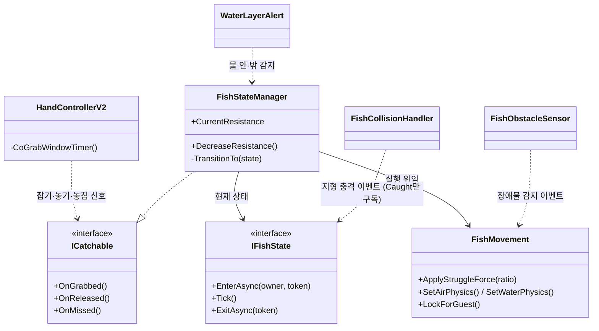
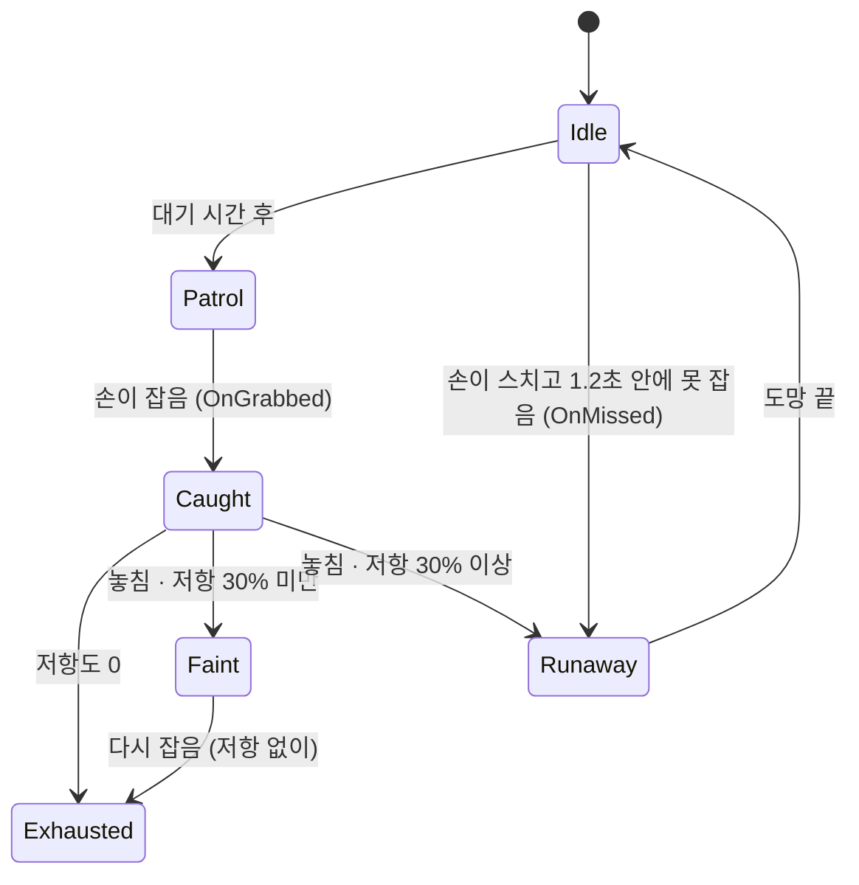
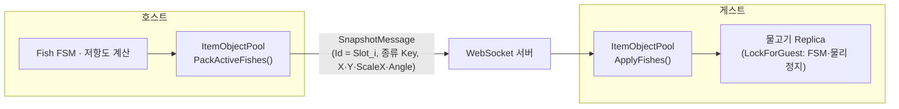
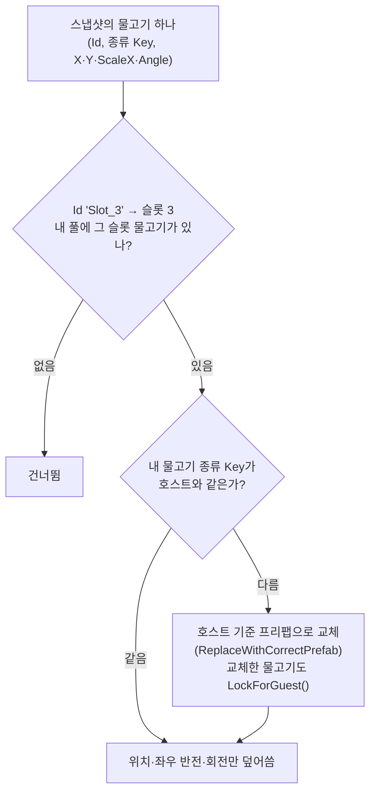
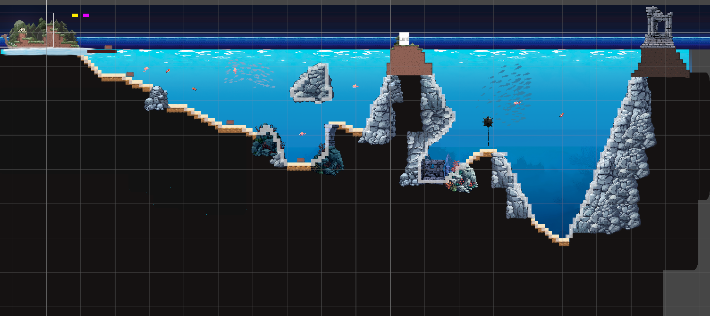

# WeGotOne (Team 산) — 물고기 AI·레벨 디자인 담당 기술 문서

<!-- ✏️ 11-11 퇴고: 화면에 보이던 확인 상자(✏️·🔎·🤖)를 지웠습니다. 출처·근거와 "Claude가 쓴 문장 — 본인 말로 확인할 곳" 목록은 작업인계.md에 옮겨 두었습니다.
     코드는 건우 님이 커밋한 시점의 버전이라 팀원이 리팩토링한 최종 코드와 다를 수 있습니다(1-5). 촬영 목록: _intake/촬영목록.md -->
<!-- TODO 그림: 1-1 대표 장면 · 3-3 물고기 상태 GIF · 3-4 BoxCast 기즈모 · 3-5 호스트·게스트 화면 비교 · 4-4 두 번째 스테이지 (촬영목록.md 참고) -->

## 1. 개요

### 1-1. 무엇을 만들었나 (What)

**WeGotOne**은 폭풍우로 조난당한 플레이어들이 섬에서 **물고기를 낚고 나무를 모아 다리를 지으며 육지(최종 지점)까지 가는**
2D 물리 기반 **협동 멀티플레이 게임**입니다(최대 4인). 플레이어는 팔을 직접 움직여 물건을 잡고 던지며,
서로의 몸을 붙잡으면 물 위로 떠오를 수 있습니다.

- **핵심 루프**: 물고기 낚기·나무 수집 → 다리 건설 → 다음 스테이지 → 최종 지점 도달(승리)
  *(출처: 아사나 S13-3 튜토리얼 카드의 하위 작업)*
- **조작**: 플레이어는 꼬마돌의 **오른손·왼손으로 지형을 잡아** 이동합니다. 물리 기반으로 움직이는 불편한 조작감에 점점 익숙해지면서
  서로 협동할 수 있게 됩니다. *(출처: 본인 정리)*

> 귀여운 꼬마돌이 배를 타고 항해하던 도중 폭풍우를 만나 외딴 섬에 떨어졌다. 꼬마돌들은 힘을 합쳐 물고기를 잡고, 다리를 지어 육지로 향해야 한다.
> *(게임 소개 문구 · 출처: 본인 정리)*

이 문서는 그중 제가 맡은 **물고기 AI(상태 머신 + 저항도)** 를 중심으로, **맵·레벨 디자인**에서 내린 결정을 함께 다룹니다.
**물고기의 호스트-게스트 동기화**는 팀장 홍산 님의 도움을 받아 함께 만든 부분입니다.

**코드를 만든 방식 — AI가 코드를 쓰고, 저는 클래스를 나눴습니다.**
주로 쓴 AI는 강사님이 강의 자료로 만들어 주신 LLM(Google 노트북)과 Claude 무료 버전이었습니다.
코드는 AI가 생성했습니다. AI가 낸 코드가 한 클래스에 너무 많은 일을 몰아넣으면, 저는 그 일을 다른 클래스로 떼어 냈습니다
(예: "핸들러는 물 밖이라고 알리기만, 판단은 물고기가 스스로").
서버와 주고받는 내용을 정하는 `Protocol.cs`는 서버에 보낼 것을 추가할 때마다 고쳐야 하는 파일이라 **가장 조심히 다뤘고**, 고치기 전에는 항상 팀장(홍산 님)에게 먼저 물어봤습니다.
그래서 이 문서는 코드 한 줄 한 줄보다 **클래스를 어떻게 나눴고, 어떤 방식을 골랐고, 무엇을 직접 확인했는지**를 중심으로 씁니다.
코드는 제가 직접 고른 방식이 드러나는 세 곳(3-2·3-3·3-4)만 실었습니다.

**레퍼런스와 다른 점** — 물리 잡기 기반 협동 게임 「Heave Ho」·「Heave Ho 2」를 레퍼런스로 삼았고, 여기에 **오브젝트를 잡아 낚아 올리는(물고기·목재 획득)** 요소를 더했습니다.
플레이어 캐릭터를 무엇으로 할지 고민하다가 우연히 발견한 포켓몬스터의 꼬마돌이 우리 게임에 잘 어울릴 것 같아, 꼬마돌들이 함께 좌충우돌 모험하는 게임이 되었습니다.

**기획 과정** *(출처: 본인 정리)* — 팀원들과 함께 정한 프로젝트의 핵심 주제는 **멀티 협동 게임**이었습니다.
여러 협동 멀티 게임을 살펴보며 「Heave Ho」·「Heave Ho 2」를 함께 플레이했고, 각자 기획 아이디어를 제안했습니다.
**다수결 투표**로 다른 팀원의 기획이 선정되었고, 이를 모티브로 **낚시 생존 게임**을 만들기로 했습니다.

### 1-2. 왜 만들었나 (Why) — 제 파트가 풀어야 했던 문제

- **물고기 AI**: 낚시는 현실에서도 입질 뒤 물고기와 씨름하는 것이 큰 재미입니다. 이 게임에서는 입질 대신 플레이어가 손으로 직접 물고기를 잡기 때문에,
  잡는 경험을 더 생동감 있게 만들려고 **잡힌 물고기가 저항하고, 상황에 따라 탈진·기절·도망하도록** 했습니다.
  또 게임 플레이 특성상 **벽이라는 구조를 이용해 물고기의 저항도를 낮출 수 있게** 설계했습니다.
- **동기화**: 멀티플레이 게임에서 물고기 AI를 호스트와 게스트가 각자 돌리면 플레이어마다 물고기가 다르게 움직여 보입니다.
  그래서 **호스트만 물고기 AI·저항 계산을 하고, 게스트는 결과(위치·회전)만 보여 주는** 구조가 필요했습니다(아사나 S11-4).
  실제로 1차 빌드 테스트(08-29)에서는 호스트와 게스트 화면의 물고기가 달랐고, 게스트 화면에서 **나무가 물고기로 보이는** 문제도 나왔습니다(5-2 ①).
- **맵(레벨) 디자인**: 섬·바다 스테이지 맵을 제가 디자인했는데, 처음에는 너무 어렵게 설계되었습니다.
  튜토리얼 맵을 추가하고 발표 직전까지 난이도를 낮췄지만, 발표 날 학원 동기들은 튜토리얼 다음 **두 번째 스테이지(살짝 깊은 바다)부터** 힘들어했고,
  대부분 물속에서 목재를 구하는 데 막혔습니다. 동기 피드백 15건 중 8건이 **조작이 어렵거나 무겁다**는 의견이었습니다.
  플레이어가 끝까지 갈 수 있게 **난이도를 단계적으로 올리는 레벨 디자인**이 제 파트의 과제였습니다(4-4·5-3).

### 1-3. 개발 환경 · 링크

| 항목 | 내용 |
|---|---|
| 엔진 | Unity 6000.3.15f1 (URP, 2D) |
| 언어·도구 | C#, JetBrains Rider, DOTween, Unity Input System, WebSocket(`ClientWebSocket`), Git·GitHub, Asana |
| AI 도구 | 강사님이 강의 자료로 만들어 주신 Google 노트북(강의 자료 기반 LLM), Claude 무료 버전 |
| 장르 | 물리 기반 팀 협동 게임 (최대 4인) |
| 기간 | 2026-08-21 ~ 2026-09-10 |
| 팀 | 4명 — 홍산, 김승구, 신성건, 윤건우 (레포 README) |
| 영상 | [소개 쇼츠 (56초)](https://youtube.com/shorts/T9h6JuvG1K4) · [플레이 시연 영상 (YouTube, 4분 21초)](https://youtu.be/ApLFcrms6j4) · [튜토리얼](https://youtu.be/8Kuv8hg5q3Y) |
| GitHub | `KooHoo-Dev/3rd-TeamProject-HS` (현재 비공개 · 공개 예정) |

### 1-4. 팀 구성과 역할

제 역할을 한 줄로 줄이면 **"게임 맵·레벨 디자인, 물고기 FSM, 튜토리얼 연출"** 입니다. *(출처: 본인 정리)*

| 이름 | 담당 |
|---|---|
| 윤건우 (나) | 물고기 AI(잡기·순찰·저항도 S4-1·S5·S6, 물 밖 중력), 물고기 연동용 플레이어 손·팔 V2(`HandControllerV2` 등), 물고기·자원·시간 게스트 동기화(S11-4·E11-S5·S11-7, 홍산 님과 함께), 인게임 튜토리얼(S13-3), 낮·밤(S9-3), 해양 지뢰(S14-5), 맵·레벨 디자인(S13-5·맵 폴리싱), 게임 결과 폴리싱 |
| 홍산 (팀장) | 기획서·발표·스프린트 계획(PM), 서버 중계와 플레이어·게임 종료·중간 입장·나무 동기화, 게스트 보간, 풀링·아이템 DB·인벤토리 리팩토링(SO → TSV), 물고기 스폰, 승패 판정, 다리 건설 조건 변경, 카메라 이동, 지뢰 물고기 |
| 김승구 | 팀 자원 저장·다리 건설·스테이지 진행, 물고기 풀, **물고기 코드 리팩토링(S14-0)**·피드백 효과, 물고기 확장(유령·대왕 오징어·갯가재·전기 가오리·해마) |
| 신성건 | 플레이어(관절 조작·잡기·던지기·배고픔·스태미나), 플레이어 물리 동기화(S11-2), 물고기 코드 리팩토링 참여, 상어, 게임 흐름 씬, UI 폴리싱 |

> 팀 레포에서 `Minseong` 계정으로 올라간 커밋(08-25 ~ 08-26)도 제 작업입니다. 학원에서 팀 프로젝트를 할 때 자리를 바꿔 앉았는데, 그 PC의 Git 계정을 바꾸지 않아 다른 이름으로 남았습니다.

### 1-5. 제가 맡은 것

**이 문서에서 자세히 다루는 것**

1. **물고기 AI** — 비동기 상태 머신(FSM), 동적 저항도, 손-물고기 잡기 규약(`ICatchable`), 지형 충돌 감속, BoxCast 장애물 회피, 물 밖 중력
   *(아사나 S4-1, S5-1, S5-2, S6-1~S6-4, "물고기가 물 밖으로 벗어나면 중력을 받는다")*
2. **물고기의 호스트-게스트 동기화** (팀장 홍산 님과 함께) — 게스트 물고기 Replica, 슬롯 ID 매핑, 프리팹 불일치 보정
   *(아사나 S11-4, E11-S5, S11-7)*

**그 밖에 맡은 것** (한 줄씩만)

- 인게임 튜토리얼 — 준비 체크(전원 준비 → 폭풍우·조난 연출 → 섬 낙하), 착지 트리거로 이동 제한 해제 (S13-3)
- 낮·밤 주기 전환과 UI (S9-3), 게임 시간 게스트 동기화 (S11-7)
- 해양 지뢰 — 닿으면 폭발·넉백 (S14-5)
- 맵 디자인 — 섬(튜토리얼)·살짝 깊은 바다·아주 깊은 바다 세 스테이지의 레벨 디자인과 밸런스 (S13-5, 맵 폴리싱, 4-4)
- 게임 결과 화면 폴리싱

> **최종 코드와의 관계** — 물고기 코드의 초기 설계는 제가 진행했습니다. 이후 물고기 코드 리팩토링(S14-0) 때는 제가 몸이 좋지 않아 결석했고,
> 그동안 팀원들이 함께 리팩토링을 진행했습니다. 그래서 이 문서의 코드(제가 커밋한 시점)는 최종 빌드의 코드와 다를 수 있습니다.

### 1-6. 이 문서에서 다루는 것

| 장 | 내용 |
|---|---|
| 2장 구조 | 물고기 모듈을 어떻게 나눴나 · 상태 전이도 · 동기화 구조 |
| 3장 핵심 기능 | 물고기가 잡히고 저항하는 방식 · 게스트 화면에 보이는 방식 |
| 4장 고민과 선택 | 손-물고기 연결 방식 비교 · 상태 머신 구조를 고른 이유 · 팀이 정한 호스트 구조를 물고기에 적용한 방법 · 너무 어려웠던 맵에 튜토리얼을 더한 과정 |
| 5장 결과 | 빌드 테스트 결과 · 트러블슈팅 3건 · 가장 아쉬운 레벨 디자인 · 배운 점 |

---

## 2. 시스템 구조

### 2-1. 물고기 모듈 구조 — "언제 바뀌나"와 "어떻게 움직이나"를 나눈다



| 클래스 | 하는 일 |
|---|---|
| `FishStateManager` | 상태 전이만 담당 — **"언제 바뀌는가"**. 저항도를 갖고 있고, 저항도는 이 클래스의 메서드로만 바뀜 |
| `IFishState` 구현 6종 | Idle·Patrol·Caught·Exhausted·Faint·Runaway — 상태마다 진입·매 프레임·퇴장 동작 |
| `FishMovement` | 실제 이동·DOTween·Rigidbody2D 조작 — **"어떻게 움직이는가"** |
| `FishObstacleSensor` | 진행 방향 BoxCast로 벽·다른 물고기 감지 → 이벤트로 알림 |
| `FishCollisionHandler` | 지형과 부딪친 세기(`relativeVelocity`)가 임계치를 넘으면 이벤트로 알림 |
| `WaterLayerAlert` | 물 영역 안·밖 감지 (물 밖이면 중력) |

**이렇게 나눈 이유**

- `FishMovement`는 **움직임만** 담당하도록 설계하고 싶었습니다. 그런데 기능이 붙으면서 `FishMovement`가 **428줄**까지 커졌고,
  그 안에 있던 BoxCast 감지 코드를 `FishObstacleSensor`로 따로 빼 **352줄**로 줄였습니다(`5850bda`, 08-27). 장애물 감지 결과는 이벤트로 넘깁니다.
- `FishStateManager`는 물고기의 **상태만** 관리하면 되므로 Rigidbody를 다룰 필요가 없었습니다. 그래서 물리 설정을 `FishMovement.SetAirPhysics()`로 옮겼습니다.
- 물 감지(`WaterLayerAlert`)와 지형 충돌(`FishCollisionHandler`)은 **알리기만** 하고, 어떻게 반응할지는 물고기가 스스로 판단합니다.

### 2-2. 상태 전이도



| 상태 | 플레이어가 보는 것 |
|---|---|
| Idle / Patrol | 정해진 범위를 대각선으로 왕복하며 헤엄침 |
| Caught (힘겨루기) | 손에 잡혀 버둥거림. 저항도가 매 프레임 줄고, 저항이 클수록 세게 버둥거림 |
| Exhausted (탈진) | 저항도 0 — 손에 늘어져 저항하지 않음 |
| Faint (기절) | 지친 상태에서 놓치면 물 위에 떠서 잠시 무방비 |
| Runaway (도망) | 싱싱할 때 놓치거나 잡기를 놓치면 반대 방향으로 빠르게 달아남 |

### 2-3. 동기화 구조 — 호스트가 계산하고, 게스트는 보여 주기만

이 구조는 팀장 홍산 님과 함께 만들었습니다.



| 규칙 | 내용 |
|---|---|
| 게스트는 물고기 AI·FSM을 **실행하지 않는다** | `LockForGuest()` — 트윈 정지, Rigidbody2D를 Kinematic으로, 컴포넌트 비활성 |
| 위치·회전 등 **화면 표현만** 받는다 | 스냅샷의 X·Y·ScaleX(좌우 반전)·Angle 적용 |
| 물고기 ID = **스폰 슬롯 번호** | 스폰 위치 인덱스를 `"Slot_i"`로 매핑 (`PackActiveItems`) |
| 스냅샷 주기 | 호스트가 30ms마다 전송 (`98642aa`) |

**슬롯 번호를 ID로 쓴 이유** — 호스트와 게스트는 같은 씬을 불러오므로 스폰 위치 목록의 순서가 같고, 스폰 위치마다 각자 물고기를 하나씩 갖습니다.
그래서 슬롯 번호만 같으면 "같은 물고기"로 짝지을 수 있어, 물고기마다 새 ID를 만들어 알려 주는 생성 메시지가 따로 필요 없었습니다.
잡힌 물고기가 풀로 돌아가고 같은 슬롯에 새 물고기가 나와도 ID는 그대로입니다. 대신 같은 슬롯에 **다른 종류**가 나올 수 있어,
종류 `Key`를 함께 보내고 다르면 교체하는 보정이 필요했습니다(5-2 ①).

> 이 절의 구조는 제가 만든 08-28~08-31 시점의 것입니다. 09-01~02 팀장 홍산 님이 오브젝트 풀을 다시 짜면서(`d9ea737`·`41df738`), 최종 코드에서는 물고기마다 `WorldItemId`를 두고 호스트가 보낸 종류(`ItemId`)대로 게스트가 꺼내는 `WorldItemSnapshotSynchronizer`로 바뀌었습니다. "호스트는 계산, 게스트는 보여 주기만"과 `LockForGuest()`는 그대로 남았습니다.

---

## 3. 핵심 기능

이 장은 코드 대신 **동작 흐름과 제가 정한 규칙**으로 설명합니다. 코드는 AI가 생성했고(1-1), 제가 직접 고른 방식이 드러나는
세 곳 — 3-2 진행 중인 전환 취소, 3-3 저항도 분기, 3-4 BoxCast — 만 코드를 실었습니다.

### 3-1. 물고기 — 사용법

손(플레이어 담당 코드)은 대상이 물고기인지 모르고, `ICatchable`의 신호 세 개만 보냅니다.

| 신호 | 손이 보내는 때 | 물고기의 반응 |
|---|---|---|
| `OnGrabbed()` | 잡기 성공 | 힘겨루기(Caught). 기절 중이었으면 바로 탈진(Exhausted) |
| `OnReleased()` | 잡고 있다가 놓음 | 남은 저항 비율로 기절 / 도망 (3-3) |
| `OnMissed()` | 손이 닿은 뒤 1.2초 안에 못 잡음 (타이머는 손이 가짐) | 도망(Runaway) |

**제가 정한 규칙**

- 잡을 수 있는 대상은 `ICatchable`만 구현하면 된다 — 손 코드는 대상마다 바뀌지 않는다.
- 물고기의 상태는 밖에서 직접 바꾸지 않는다 — 밖에서는 신호만 보내고, 바꾸는 판단은 `FishStateManager`가 한다.
- 저항도도 값을 직접 넣지 않고 `DecreaseResistance()`·`ResetResistance()` 메서드로만 바꾼다.

손 쪽(플레이어 담당)이 알아야 하는 것을 `ICatchable` 메서드 세 개로 좁힌 것은 **물고기가 아닌 오브젝트도 같은 신호 세 개로 잡을 수 있게** 하려는 것이었습니다
(`af9b561`: "향후 물고기 외 상호작용 오브젝트 확장 기반"). 다만 최종 코드에서 `ICatchable`을 구현한 것은 물고기(`FishStateManager`)뿐이라, 다른 오브젝트에 쓰는 것은 계획에 그쳤습니다.

### 3-2. 물고기 — 비동기 상태 전환 (진행 중인 전환은 취소한다)

```csharp
private async void TransitionTo(IFishState newState)
{
    if (newState == null) return;

    // 이전 전환이 아직 진행 중이면 취소하고 새 토큰을 만든다
    stateCts?.Cancel();
    stateCts?.Dispose();
    stateCts = new CancellationTokenSource();
    CancellationToken token = stateCts.Token;

    try
    {
        if (currentState != null)
        {
            await currentState.ExitAsync(token);
            if (this == null) return;        // 기다리는 사이 오브젝트가 파괴됐으면 중단
        }
        currentState = newState;
        await currentState.EnterAsync(this, token);
    }
    catch (OperationCanceledException)
    {
        Debug.Log("상태 전환 취소");
    }
}
```

**설명**

- **상태 진입·퇴장을 `async`로 만든 이유** — 물고기는 도망(Runaway) 상태가 끝난 뒤 대기(Idle) 상태로 돌아갑니다(`004174d`). 그래서 도망이 끝날 때까지 기다렸다가 다음 상태로 넘어가야 했습니다.
- **`CancellationToken`이 필요한 이유** — 도망 중에 다시 잡히면 진행 중이던 상태 처리를 멈추고 새 상태로 넘어가야 합니다.
  토큰이 없으면 이전 전환이 뒤에서 계속 기다리다가, 도망이 끝나는 순간 이어서 실행되어 잡힌 물고기가 갑자기 Idle로 돌아갈 수 있습니다.
  그래서 새 전환을 시작할 때 이전 전환에 취소 신호를 보내 멈추게 했습니다.
- **`if (this == null) return;`** — 퇴장을 기다리는 사이 물고기 오브젝트가 파괴될 수 있어(씬 전환 등), 파괴된 물고기에 새 상태를 넣지 않도록 여기서 멈춥니다.
- **`OnDisable`에서 토큰을 취소하는 이유** — 잡은 물고기를 보관함에 넣으면 물고기가 꺼집니다. 코루틴과 달리 `async` 작업은 오브젝트가 꺼져도 저절로 멈추지 않으므로,
  꺼질 때 토큰을 취소해 보관함 속 물고기에서 도망 연출·상태 전환이 계속 돌지 않게 했습니다.

### 3-3. 물고기 — 저항도로 행동이 바뀐다

```csharp
// FishCaughtState — 잡혀 있는 동안 매 프레임
public void Tick()
{
    owner.DecreaseResistance(Time.deltaTime);                 // 초당 1씩 감소 (기본 최대 20)
    float ratio = owner.CurrentResistance / owner.MaxResistance;
    owner.FishMovement.ApplyStruggleForce(ratio);             // 저항이 클수록 세게 버둥거림 → 플레이어 이동 방해
    if (owner.CurrentResistance <= 0f)
        owner.ChangeState(new FishExhaustedState());
}

// 지형에 부딪치면 (Caught 상태일 때만 구독)
private void HandleTerrainSmashed(float impactStrength)
{
    owner.DecreaseResistance(impactStrength * collisionRatio); // 충격이 셀수록 크게 감소 (계수 0.2)
}

// FishStateManager — 놓았을 때 남은 저항으로 분기
public void OnReleased()
{
    float resistanceRatio = CurrentResistance / maxResistance;
    if (resistanceRatio < 0.3f) TransitionTo(new FishFaintState());   // 지친 채 놓침 → 물 위에서 기절
    else                        TransitionTo(new FishRunawayState()); // 아직 싱싱 → 도망
}
```

| 값 | 기본 | 뜻 |
|---|---|---|
| `maxResistance` | 20 | 그냥 잡고만 있으면 20초 뒤 탈진 (물고기 종류마다 프리팹에서 다르게) |
| `collisionRatio` | 0.2 | 지형 충돌 세기 × 0.2 만큼 즉시 감소 |
| `grabWindowTime` | 1.2초 | 손이 닿은 뒤 이 시간 안에 잡아야 함 |
| 기절 기준 | 30% 미만 | 이보다 낮으면 놓쳐도 도망가지 않고 기절 |

**설명**

- **지형 충돌 이벤트를 Caught 상태에서만 구독하는 이유** — 지형 충돌로 저항도를 깎는 것은 플레이어가 물고기를 잡고 벽에 부딪쳤을 때만 필요합니다.
  그 밖의 상태에서는 이 연산이 필요 없으므로, Caught에 들어갈 때 구독하고 나갈 때 해제했습니다(`05903c9`: "다른 상태에서의 의도치 않은 저항도 연산 버그를 원천 방어").
- **저항도는 메서드로만 바꾼다** — 저항도는 잡고 있는 동안에도, 벽에 부딪칠 때도 줄어듭니다. 아무 코드에서나 값을 바꿀 수 있게 열어 두면 줄이는 곳마다 "0 밑으로 내려가지 않게"를 따로 챙겨야 하고,
  값이 틀어졌을 때 어디서 바꿨는지 찾기도 어렵습니다. 그래서 바꾸는 길을 `DecreaseResistance()`(0 아래로 안 내려감)와 `ResetResistance()` 두 개로 정해, 저항도가 0 밑으로 내려가지 않게 했습니다.
- **물고기마다 버티는 시간을 다르게** — 플레이 테스트에서 물고기를 잡아 힘겨루기를 할 때, 처음 정한 20초가 생각보다 길게 느껴져 조정이 필요했습니다.
  그래서 **큰 물고기일수록 오래 버티도록** 종류별 최대 저항도를 프리팹에서 다시 정했습니다(`7650e8f`, 09-04).

  | 물고기 | 바꾸기 전 | 바꾼 뒤 |
  |---|---|---|
  | 상어 · 오징어 | 20 | 15 |
  | 가오리 | 5 | 13 |
  | 지뢰 물고기 · 문어 · 갯가재 | 20 | 12 |
  | 해마 | 20 | 10 |

- **버둥거림 — 트윈에서 물리 힘으로** — 처음에는 당시 처음 배운 트윈(DOTween 흔들림)을 써 보려고 버둥거림을 트윈으로 만들었습니다(`f1d0a24`).
  그 뒤 물고기가 발버둥 치는 것을 더 실감 나게 하려고 Rigidbody2D에 힘을 주는 `AddForce` 방식으로 바꾸었습니다(`4060b92`, 08-26).
- **물고기가 빙글빙글 도는 것 — 게임적 허용** — 처음에는 물고기가 실제 물고기처럼 헤엄치도록 기획했습니다.
  그런데 개발 중 플레이 테스트에서 물고기가 빠르게 빙글빙글 도는 모습을 보고, 팀원들이 이 반응을 재미있어했습니다.
  그래서 고치지 않고 그대로 살렸습니다. 사실적인 움직임보다 플레이어가 재미를 느끼는 반응을 앞에 둔 게임적 허용입니다.

**설계에서 바꾼 곳 — 30~60% "회색 영역"**
설계 문서(`FishSystemDesignPlan.md`)에서는 놓쳤을 때 남은 저항도를 도망 상태에 넘겨, **저항도가 높으면 바로 도주, 낮으면 짧게 멈칫한 뒤 도주**하도록 나눌 계획이었습니다.
구현하면서 보니 회색 구간(30~60%)과 60% 이상이 **플레이어에게 크게 다르게 보이지 않을 것 같아, 두 구간 모두 똑같이 도주하게** 했습니다(`f1d0a24`, 08-25).
코드에는 세 갈래가 그대로 남아 있었고, 이후 팀원이 양손 잡기를 고치면서(`1596e1f`, 09-09) 같은 내용의 두 갈래를 합쳐 최종 코드는 "30% 미만 기절 / 나머지 도주" 두 갈래입니다.
(위 코드도 핵심만 보이려고 두 갈래로 줄였습니다.)

### 3-4. 물고기 — 풀링에 맞춘 순찰과 장애물 회피

- 처음에는 씬에 배치한 `spawnPoint`·`patrolPoint` Transform 사이를 왕복했습니다(`542e7d2`).
  오브젝트 풀링으로 물고기를 재사용하려면 씬 배치에 의존하면 안 되므로, **스폰된 순간의 좌표 + 프리팹의 `patrolRange`** 로 경로를 계산하게 바꿨습니다.
- 한 번 왕복할 때마다 방향과 Y 오프셋을 새로 뽑습니다. Y 범위는 X 범위의 20~50%로 제한해 자연스러운 대각선으로 헤엄치게 했습니다.
- 장애물 감지는 선(Raycast) 대신 **물고기 두께만큼의 상자(BoxCast)** 로 합니다.

```csharp
// 순찰 중일 때만, 목표 방향으로 물고기 크기의 상자를 쏜다
RaycastHit2D hit = Physics2D.BoxCast(
    transform.position, obstacleCheckSize, 0f,
    moveDirection, obstacleCheckDistance, obstacleLayer);   // Wall(지형), fish(다른 물고기)

if (hit.collider != null)
    OnObstacleDetected?.Invoke();   // 트윈 취소 → 반대 방향으로 돌아가 경로 재탐색
```

첫 2D 프로젝트인 「뒤통수를 조심해」에서는 플레이어를 감지하는 시야를 Trigger Collider로, **적의 길찾기를 Raycast(선)로** 만들었습니다.
그때 길찾기에서 Raycast(선)의 한계를 겪었기 때문에, **부피가 있는 물고기에는 처음부터 BoxCast를 선택**했습니다.

### 3-5. 동기화 — 게스트 물고기는 생각하지 않는다

이 절의 동기화는 팀장 홍산 님과 함께 만들었습니다. 그중 게스트 물고기 잠금(`LockForGuest`·`isGuestLocked`)과 종류 보정은 제 계정으로 커밋한 부분입니다.

**게스트가 스냅샷을 받았을 때** (`ApplyFishes`, 물고기 하나마다)



**게스트 물고기 잠금** (`LockForGuest`) — 게스트의 물고기는 스스로 생각하지 않습니다.

| 막는 것 | 방법 |
|---|---|
| 이미 걸려 있던 움직임 | 트윈 정리 (`StopMove`) |
| 물리로 밀리기 | Rigidbody2D를 Kinematic으로 |
| `Update` 같은 유니티 자동 호출 | 컴포넌트 끄기 (`enabled = false`) |
| 다른 코드가 public 메서드를 **직접 부르는 것** (예: `FishPatrolState`) | 트윈을 거는 모든 진입점 맨 앞에 `isGuestLocked` 검사 — `enabled = false`로는 못 막음 |

**제가 정한 규칙**

- 게스트는 물고기 AI·상태 머신·저항 계산을 **실행하지 않는다.** 화면 표현(위치·회전)만 받는다.
- 같은 물고기인지는 **슬롯 번호**로, 같은 종류인지는 **종류 Key**로 맞춘다. 종류가 다르면 호스트 기준으로 바꾼다.
- 종류가 틀리는 버그는 스냅샷 형식(`Protocol.cs`)을 바꾸지 않고, 이미 있는 칸에 넣는 값만 바로잡아 고친다(`e363b73`).

**설명**

- **잠금 플래그를 따로 둔 이유 — "좀비 물고기"** — 게스트 화면에서 물고기 컴포넌트를 꺼 두었는데도 물고기가 움직이는 것을 직접 보았습니다. 팀원끼리는 이것을 "좀비 물고기 사태"라고 불렀습니다.
  `enabled = false`로는 다른 코드가 메서드를 직접 부르는 것을 막지 못해서, 움직임을 거는 모든 진입점에 `isGuestLocked` 검사를 넣었습니다(`8fba446`, 원인은 5-4).
- **종류가 다르면 교체하는 방식** — 게스트가 스폰할 때 스스로 랜덤 종류를 뽑는 구조는 그대로 두고, 호스트와 종류가 다르면 바꾸는 방식으로 고쳤습니다(`e363b73`, 5-2 ①).
  처음부터 호스트가 종류를 정해 주는 방법은 당시에는 미처 생각하지 못했습니다. 이 교체 보정은 09-01~02 팀장 홍산 님의 풀 리팩토링에서 "호스트가 정한 종류로 꺼내는" 방식으로 바뀌었습니다(2-3).
- **게스트 화면 끊김** — 제 Replica는 스냅샷 위치를 바로 덮어썼기 때문에 게스트 화면이 끊겨 보였습니다. 이 끊김은 팀장 홍산 님이 게스트 보간을 넣어 고쳤습니다(`75d2ae0`, 08-31).

---

## 4. 고민과 선택

### 4-1. 손과 물고기를 어떻게 연결할까 — 이벤트 구독 vs 전체 비동기화 vs 인터페이스 직접 호출

이 부분은 **실제로 두 번 방향을 바꾼 기록**이 커밋에 남아 있습니다.

| 방법 | 장점 | 단점 | 실제 |
|---|---|---|---|
| A. 물고기가 씬의 **모든 손을 찾아 이벤트 구독** (`HandRegistry`) | 손 코드 수정이 적음 | 물고기마다 모든 손을 구독·해제 → 구독 해제 관리가 어렵고 무거움 | `bf51259` 시도 ("구독해제 관련 함수 미완") |
| B. 플레이어 컨트롤러 전체를 **비동기 인터페이스 구조로** 바꾸기 | 물고기 FSM과 방식이 통일됨 | 손·팔 등 **플레이어 담당의 모든 클래스**를 고쳐야 함 | `004174d` 시도 → "일이 너무 커짐"으로 중단 |
| **C. 손이 `ICatchable`을 직접 호출, 잡기 타이머도 손이 소유 (선택)** | 손은 대상이 물고기인지 모름. 물고기는 신호 3개에만 반응 | 손 코드(`HandControllerV2`)를 수정해야 함 | `af9b561` |

**선택 이유**: 물고기가 스스로 시간을 재며 손을 지켜보던 "수동적" 구조를, 손이 닿은 순간부터 타이머를 재고 결과만 알려 주는 구조로 바꿨습니다.
`FishStateManager`에서 손 구독·해제 코드가 통째로 사라졌고, 플레이어 담당의 코드는 `HandControllerV2` 한 곳만 건드렸습니다.

**B를 접은 이유**: 프로젝트 당시 막 배운 비동기를 살려 보고 싶어서 B로 설계했지만, 남은 개발 시간과 플레이어 담당과의 리팩토링 조율을 생각해
**손이 `ICatchable`을 직접 호출하는 C로 조정**했습니다.

**플레이어 담당 팀원과의 협의** — 손(`HandController`)은 플레이어 담당 신성건 님의 코드였고, 물고기와 연결하기 위해 제가 V2(`HandControllerV2`·`ArmControllerV2` 등)를 만들어 고쳤습니다(`a1a8330`, 08-25).
물고기의 상태 전환에는 손의 잡기 판정이 중요하다고 생각해서, 처음에는 상태 전환에 **손 컨트롤러를 매개변수로 넘기려** 했습니다.
하지만 잡기 판정은 이미 손이 물고기에게 알려 주는 구조였기 때문에, 물고기가 손 컨트롤러를 직접 알 필요가 없는 불필요한 매개변수였습니다.
성건 님이 이 부분을 짚어 주었고, 함께 스크립트를 리팩토링하며 이 매개변수를 없애 물고기 상태가 손 컨트롤러를 참조하지 않는 C 방향으로 바꾸었습니다(5-4).
이때의 커밋(`03c079f`, 08-26)에도 "성건님과 Controller V2 버전 리팩토링 — FishState들의 PlayerHand 의존성을 버리고, 잡기 여부로만 판정하는 것으로 변경"이라고 남아 있습니다.

당시 2차 스프린트 회고(08-29)에 제가 남긴 글입니다.

> 성건님과 내가 수정한 스크립트를 리팩토링 하면서 불필요한 변수들을 정리하는 과정중에
> 객체들간의 의존성 설정의 여부를 결정하는것이 중요하다는 것을 다시 한번 느꼈다.
> *(출처: 아사나 「2차 스프린트 › 회고 및 피드백」 본인 댓글, 2026-08-29)*

### 4-2. 상태 머신을 어떻게 만들까

**선택한 구조**: 상태마다 클래스를 하나씩 두고 `IFishState`(비동기 진입·퇴장 + 취소 토큰)로 묶었습니다.

**선택 이유**: 첫 프로젝트 「뒤통수를 조심해」에서 적 FSM을 인터페이스 구조로 설계해 본 경험이 있었고,
여기에 이 프로젝트 직전에 막 배운 비동기를 더해 활용해 보고 싶었습니다.

| 이 구조로 얻은 것 | 대신 감수한 것 |
|---|---|
| 상태별 정리(이벤트 해제 등)를 퇴장(Exit)에 모을 수 있음. 연출이 끝나기를 `await`로 기다릴 수 있음 | 상태 수만큼 클래스가 늘어남. `async void`라 예외 처리에 주의해야 함 |

**결과 — 팀원이 물고기를 늘리기 쉬웠다**: 새 물고기를 만들 때 상태 클래스 **하나만 추가하면** 되었기 때문에, 팀원들이 부담 없이 물고기 종류를 늘릴 수 있었습니다.
실제로 팀원들이 같은 `IFishState` 규약으로 납치(`AbductionState`)·문어(`FishOctopusState`)·상어(`Shark`)·미끼(`FishBaitState`) 등의 상태를 추가했고,
팀은 "공통 상태는 `501. Fish`에, 새 물고기의 상태는 그 물고기 이름 폴더에"라는 규칙(아사나 「물고기 제작 규칙 정리」, 09-02)을 이 구조 위에서 만들었습니다.

### 4-3. 팀이 정한 호스트 기반 구조를 내 물고기에 어떻게 적용할까

**정해진 방향**: 팀이 합의해 이 게임을 **호스트 기반 멀티플레이**로 정했습니다. 물고기 카드(S11-4)에도 "물고기의 실제 게임 로직은 호스트만 수행하고, 게스트는 표현에 필요한 결과만 반영한다"고 적혀 있었습니다.
4인 협동 게임이라, 플레이어마다 물고기 상태가 제각각이면 "같은 물고기"를 함께 잡을 수 없기 때문입니다.

**제가 고민한 것**: 정해진 방향을 제가 설계한 물고기에 어떻게 적용할지였습니다.

| 고민 | 적용한 방법 |
|---|---|
| 게스트의 물고기가 스스로 움직이지 않게 하려면? | `LockForGuest()` — 물리·자동 호출을 끄고, 모든 진입점에 잠금 검사 (3-5) |
| 호스트와 게스트의 물고기를 어떻게 짝지을까? | 스폰 슬롯 번호를 ID로 사용 (2-3) |
| 같은 슬롯에 다른 종류가 나오면? | 스냅샷의 종류 Key와 비교해 다르면 교체 (5-2 ①) |

**예상하지 못한 것 — 게스트 화면 끊김**: 게스트의 물고기는 스냅샷이 올 때마다 위치를 바로 덮어썼기 때문에 화면이 끊겨 보였습니다.
저는 이 문제를 미리 예상하지 못했고, 팀 테스트 플레이 중에 알게 되었습니다. 끊김은 홍산 님이 게스트 보간을 넣어 고쳤습니다(`75d2ae0`, 08-31).

### 4-4. 맵·튜토리얼 — 너무 어려운 맵에 무엇을 더할까



**스테이지 구성** — 첫 번째 스테이지는 **튜토리얼**(섬), 두 번째는 **살짝 깊은 바다**, 세 번째는 **아주 깊은 바다**입니다. (아사나 카드의 "튜토리얼 / 1단계 / 2단계(최종)"과 같은 순서)

**흐름**

| 단계 | 한 일 | 결과 |
|---|---|---|
| ① 첫 맵 (08-20~08-29) | 시작 구역인 섬과 탐험 구역인 바다를 2단계까지 디자인 | 튜토리얼을 고려하지 않아 난이도가 높았음. 팀원끼리는 계속 테스트하며 조작에 익숙해져 있어서 이것을 알아채지 못함(5-3) |
| ② 튜토리얼 맵 (08-31~09-08) | 배 위에서 전원 준비 → 폭풍우·조난 연출 → 섬으로 낙하(착지하면 이동 제한 해제). 섬에는 **튜토리얼 이미지와 텍스트를 맵에 직접 배치** | 게임 목적·조작·협동 조작(서로 붙잡으면 떠오름)을 게임 안에서 설명 |
| ③ 스테이지 다시 배치 (09-03) | 튜토리얼·살짝 깊은 바다·아주 깊은 바다 세 스테이지로 나눠 레벨 디자인 반영 | — |
| ④ 발표 직전까지 난이도 낮추기 (09-04~09-10) | 다리 짓기에 필요한 값 조정("2단계는 나무만 캐면 된다", 09-04) · 테스트 후 설치된 다리 범위 넓히기(09-06) · 세 번째 스테이지에 **안전 구역**과 플랫폼 추가 · 물고기 추가 배치 · 맵 가이드 이미지 변경(09-09) · "난이도 더 쉽게" 다리 값 조정(09-10) | 안전 구역은 가장 깊은 세 번째 스테이지만 고려했고, 두 번째 스테이지는 그렇게 깊지 않아 필요 없다고 판단함 |
| ⑤ 발표 날 | 동기들이 직접 플레이 | **두 번째 스테이지부터** 힘들어함 — 대부분 물속에서 목재를 구하는 데 막힘 |

**튜토리얼을 어떻게 만들었나**
튜토리얼 카드(S13-3)에 "한 번에 쫙이 아니라 **단계적으로** 게임 루프를 설명한다"고 정해 두었고,
설명은 **튜토리얼 이미지와 텍스트를 맵에 직접 배치하는 단순한 방식**으로 구현했습니다. 플레이어가 섬을 지나가면서 그 자리에 놓인 안내를 차례로 보게 됩니다.

**발표 날 다시 느낀 것**
튜토리얼을 더하고 발표 직전까지 난이도를 낮췄지만, 발표 날 동기들은 여전히 진행을 어려워했습니다. 피드백 15건 중 조작이 어렵거나 무겁다는 의견이 8건,
조작을 익힐 구간이나 게임 안 안내가 더 있었으면 한다는 의견이 4건이었습니다("구간을 나눠서 특정 조작을 해야 넘어갈 수 있는 구간을 만들어 스킬을 익힐 기회를 주면 어땠을까").
두 번째 스테이지는 그렇게 깊지 않아 안전 구역이 필요 없다고 생각했습니다. 테스트를 자주 한 저희는 조작이 능숙해서 잘 지나갔지만,
**처음 하는 동기들을 고려하지 못한 제 착오**였습니다. 튜토리얼로 **설명**은 했지만, 어려운 구간 앞에서 그 조작을 **직접 익힐 단계**까지는 만들지 못했습니다.
이 일로 레벨 디자인의 중요성을 다시 느꼈습니다(1-2·5-3).

**시간이 더 있었다면**

| 바꾸고 싶은 곳 | 방법 |
|---|---|
| 튜토리얼 | 이미지·텍스트로 설명만 하지 않고, 플레이어가 **팀원과 협력해 물건을 낚도록 유도하는** 레벨 디자인 |
| 두 번째 스테이지(처음 막히는 곳) | **도움닫기**할 수 있는 지형이나 안전 구역을 두거나, 해마 같은 **도우미 물고기**를 배치 |

---

## 5. 결과 및 배운 점

### 5-1. 결과

- 이 FSM 위에 팀원들이 상어·문어·대왕 오징어·갯가재·전기 가오리·지뢰 물고기·해마 등 **물고기 종류를 추가**했습니다.
- 최종 빌드에서 4인 플레이 시 **호스트·게스트 화면의 물고기가 같게** 보였습니다.
- **물고기 버그가 빌드 테스트마다 줄었습니다** — 2차 빌드 테스트(09-04~05)에서는 버그 21건 중 물고기 관련이 16건이었고, 3차 빌드 테스트(09-08)에서는 11건 중 1건이었습니다.
  대부분은 팀원들이 고쳤고, 특히 각자 설계한 물고기의 버그는 그 팀원이 직접 고쳤습니다.
  제가 고친 것은 공통 물고기 문제 중 **일부 물고기에 기절 이펙트가 안 나오는 문제**입니다(프리팹 설정 문제라 간단히 수정). 물 밖에서 떨어지지 않는 문제는 팀장 홍산 님이 고쳤습니다(5-2 ②).
- 발표 날 받은 동기 피드백 15건 중 6건에 "재미있었다"는 말이 있었습니다("게임 자체의 순수 재미는 제일 재밌다", "조금 열받는 만큼 오기로 하게 되는 게임").

### 5-2. 트러블슈팅

꺼 둔 물고기가 계속 움직이던 "좀비 물고기"는 3-5와 5-4 배운 점에서 다룹니다.

**① 게스트 화면에서 나무가 물고기로 보임** (1차 빌드 테스트 08-29 → 커밋 `e363b73`, 08-30)
- 문제: 1차 빌드 테스트에서 게스트 화면에 **나무가 물고기로 보이고**, 같은 자리인데 호스트와 게스트에 다른 물고기가 보였습니다(제가 정리한 「첫 빌드 테스트 버그리스트」).
- 원인 1: 스냅샷에 담는 종류 값(`FishTypeIndex`)을 **대분류(`ItemType`: 나무/로프/물고기)** 로 채우고 있어, 물고기끼리는 물론 나무와 물고기도 제대로 구분되지 않았습니다.
- 원인 2: 게스트가 스폰할 때 **스스로 랜덤으로 물고기 종류를 뽑고** 있었습니다.
- 해결: 종류 값을 개별 식별값 `Key`로 통일하고, 게스트의 종류가 호스트와 다르면 올바른 프리팹으로 바꾸게 했습니다(교체한 물고기도 `LockForGuest()`로 잠금). 스냅샷 형식은 바꾸지 않고 이미 있는 칸의 값만 바로잡았습니다.
- 결과: 다음 날(08-31) 신성건 님이 같은 방식(종류 값 `Key`를 싣고, 다르면 교체)을 **나무 스냅샷에도** 붙여 "나무가 물고기로 보이는" 현상을 마무리했습니다(`9c1b1b8`).
  그 뒤 09-01~02 팀장 홍산 님이 오브젝트 풀을 다시 짜면서(`d9ea737`·`41df738`) 슬롯 번호 ID와 교체 보정은 없어지고, **호스트가 보낸 종류(`ItemId`)대로 게스트가 풀에서 꺼내는** 방식으로 바뀌었습니다.
- 돌아보면: 처음부터 호스트가 종류를 정해 주는 방법은 당시에는 생각하지 못했습니다(3-5). 최종 코드가 바로 그 방법입니다.

**② 물고기가 물 밖으로 나감** (커밋 `5850bda` 08-27 → `04e03c2` 08-28)
- 문제: 물고기가 수면 위로 올라가 물 밖으로 나가는 경우가 있었습니다.
- 원인: 순찰·도주 목적지를 **스폰 위치 + 랜덤 거리**로만 정하고 수면 높이는 확인하지 않았습니다. 그래서 수면 가까이 스폰된 물고기는 목적지가 물 위로 잡힐 수 있었고, `DOMove`가 그 자리까지 그대로 끌고 갔습니다. 물 밖에서 다시 떨어뜨릴 중력도 없었습니다.
- 해결 1 (`5850bda`): 물 영역 출입을 감지하는 센서(`WaterLayerAlert`)를 따로 만들고, 물 밖이면 **중력을 적용**해 다시 수면 아래로 내려가게 했습니다. 잡혀 있을 때는 이 낙하가 작동하지 않게 예외를 두었습니다.
  다만 커밋 메시지에 "순찰 시에도 물 센서 적용시켜야 함"이라고 남긴 것처럼, **순찰 중인 물고기**는 아직 빠져 있었습니다.
- 해결 2 (`04e03c2`): 수면 경계에서 물에 들어온 직후 곧바로 "물 밖"으로 다시 판정되는 일이 있어, **물에 들어온 뒤 1초 동안은 물 밖 판정을 무시**하는 쿨타임을 두었습니다.
- 결과: 제 수정으로 완전히 막지는 못했습니다. 2차 빌드 테스트(09-04)에서 "물고기가 밖에 나가도 다시 안 들어옴" 버그가 다시 나왔고,
  같은 날 팀장 홍산 님이 물 밖이면 중력 1, 물 안이면 중력 0으로 `gravityScale`을 바꾸는 방식으로 이동 코드를 정리해 고쳤습니다(`97b901c`·`cab5060`·`fa11548`).
- 이 일로 "어떤 조건이 **모든 상태에서** 성립하는지 확인해야 한다"는 것을 배웠습니다(5-4).

**③ 지뢰에 닿아도 넉백이 안 됨** (커밋 `34a3559` → `5655008`, 09-02 — 그 밖에 맡은 것: 해양 지뢰)
- 문제: 지뢰 스크립트를 처음 붙였을 때 플레이어가 닿아도 넉백이 일어나지 않았습니다(커밋 메시지: "아직 작동이 안 돼서 확인 좀 해봐야 함").
- 원인: `AddForce`로 준 넉백 힘이 **약했습니다.** 물리 기반으로 움직이는 플레이어에게 순간적으로 힘을 더하는 것만으로는 튕겨 나가는 느낌이 거의 나지 않았습니다.
- 해결: 힘을 더하는 `AddForce` 대신 **속도(`linearVelocity`)를 직접 지정**해, 지뢰에서 멀어지는 방향으로 확실히 튕겨 나가게 했습니다(같은 날 「지뢰 구현 완료」 `5655008`).
  같은 커밋에서 감지를 충돌(`OnCollisionEnter2D`)로 바꾸고, 호스트인지를 닿는 순간마다 확인하도록 함께 바꿨습니다.
- 결과: 호스트에서만 넉백을 계산하고, 게스트는 스냅샷으로 결과만 받습니다.

### 5-3. 아쉬운 점 (기술 부채) · 개선 계획

**레벨(맵) 디자인의 난이도 설계가 미흡했습니다.** *(출처: 본인 정리)*
처음 맵을 디자인할 때는 튜토리얼 단계를 전혀 고려하지 않고 설계해서 게임 난이도가 높았습니다.
개발 중에 팀원들과 테스트를 계속해 왔기 때문에 저희가 게임 조작에 익숙해져 있었고, 이것이 레벨 디자인 당시 생각하지 못한 맹점이었습니다.
이 레벨 난이도 문제를 파악하고 나서 **튜토리얼 맵 디자인**을 시작했지만, 발표 날 동기들은 여전히 두 번째 스테이지부터 힘들어했습니다(4-4).
이 프로젝트에서 **가장 아쉬운 점**이고, 시간이 더 있었다면 **가장 먼저 바꿀 곳**입니다.
→ TO-BE: **처음 하는 플레이어도 끝까지 갈 수 있게** 레벨을 다시 짜겠습니다. 튜토리얼에서 팀원과 협력해 물건을 낚도록 유도하고,
처음 막히는 두 번째 스테이지에 도움닫기 지형이나 안전 구역, 해마 같은 도우미 물고기를 배치하겠습니다(4-4).

**그 밖에 남은 기술 부채**

| 아쉬운 점 | 개선 계획 |
|---|---|
| 저항도 기준값(최대 20 · 충돌 계수 0.2 · 기절 30%)이 코드와 프리팹에 흩어져 있음 | 팀이 TSV 데이터로 옮긴 자원·물고기 데이터(홍산 님 `ScriptableObject → tsv`)에 함께 넣어 한곳에서 조정 |
| 게스트 물고기가 스냅샷 위치를 바로 덮어써 끊김 (보간은 팀원이 추가, 4-3) | 처음부터 보간을 고려해 Replica 설계 |
| 아사나 「S6-4. 플레이어 충돌 피드백 구체화」 미완 | — |

### 5-4. 배운 점

**기술 — 클래스 나누기: 첫 프로젝트의 구조가 그대로 따라왔다**

`FishMovement`는 첫 프로젝트 「뒤통수를 조심해」의 적 FSM 코드를 참고해 설계했습니다.
그래서 `FishMovement`가 428줄까지 커졌을 때 첫 프로젝트의 적 FSM 코드가 떠올랐고, 이 문제가 그 구조를 참고했기 때문에 생긴 일이라는 것을 알았습니다.
그 뒤 움직임(`FishMovement`)·상태(`FishStateManager`)·감지(`FishObstacleSensor`) 세 클래스로 나누었고, `FishMovement`는 352줄로 줄었습니다(2-1).

같은 생각을 다른 곳에도 썼습니다 — 판정은 호스트 한 곳에서만 하고 게스트는 보여 주기만 하는 동기화(3-5),
새 상태로 넘어갈 때 진행 중이던 전환을 취소하는 비동기 상태 전환(3-2), 그리고 어떤 조건이 **모든 상태에서** 성립하는지 점검하는 것(5-2 ②)입니다.

멀티플레이 기반 협동 게임이었기 때문에 다른 사람의 코드를 바꾸는 일에는 특히 조심했습니다.
또 무료 AI로 작업했기 때문에 한계도 있었습니다. 사용 한도가 낮아 작업이 굉장히 늦어졌고, 맡길 수 있는 작업의 범위도 좁아 적극적으로 활용하기 어려웠습니다.
당시에는 학원의 지원을 받기 전이라 Claude Opus를 쓸 수 없었고, 처음 Opus를 사용한 다음 프로젝트 「HIVE PURGE」와의 완성도 차이가 여기서 나왔다고 생각합니다.

이 경험 뒤로 AI에게 요청할 때는 **항상 설계안을 먼저 받아 읽고, 고칠 곳을 정한 뒤에 구현**을 맡기려고 합니다.

**기술 — 컴포넌트를 꺼도 멈추지 않는다 ("좀비 물고기")**

게스트 물고기를 멈추려고 물고기 컴포넌트를 모두 꺼 두었는데도 물고기가 계속 움직였습니다(3-5). 원인을 찾으며 두 가지를 배웠습니다.

| 꺼 두어도 막히지 않는 것 | 알게 된 곳 | 그래서 한 것 |
|---|---|---|
| `OnTriggerEnter2D`·`OnTriggerExit2D` 같은 **충돌 콜백**은 컴포넌트가 꺼져 있어도 불린다 | 물 감지 센서(`WaterLayerAlert`)가 계속 신호를 보내 상태 머신을 깨움 (`593ddd8`, 08-30) | 콜백 안에서 컴포넌트가 켜져 있을 때만 처리 |
| `enabled = false`는 `Update` 같은 **유니티 자동 호출만** 막고, 다른 코드가 public 메서드를 **직접 부르는 것**은 못 막는다 | 순찰 상태(`FishPatrolState`)가 이동 메서드를 직접 호출 (`8fba446`, 08-30) | 움직임을 거는 모든 진입점에 잠금 플래그(`isGuestLocked`) 검사 |

이제는 "꺼 두면 멈춘다"고 믿지 않고, **누가 이 코드를 부를 수 있는지**부터 확인합니다.
같은 내용이 팀의 2차 스프린트 회고(08-31)에도 남아 있어, 팀 전체가 함께 배운 부분이기도 합니다.

**협업 — 내 설계를 팀원이 고쳐 주었다**

다수결 투표로 다른 팀원의 기획이 선정되어, 남의 기획에 콘텐츠를 더하고 시스템을 설계하는 것은 제가 직접 기획하고 설계하는 것과는 달랐습니다. *(출처: 본인 정리)*

물고기를 설계할 때 플레이어 담당 팀원과 협의해야 했던 부분이 손(`HandController`)이었습니다.
처음 제 설계는 물고기 상태 전환에 손 컨트롤러를 매개변수로 넘기는 구조였습니다. 팀원이 이 매개변수가 필요 없다는 것을 짚어 주었고, 함께 물고기가 잡기 여부만 받도록 바꾸었습니다(4-1).
한없이 작아지는 순간이었습니다.
그 뒤로 다른 사람과 코드가 맞물리는 곳을 설계할 때는 **어느 클래스가 어느 클래스를 참조하는지 먼저 확인하고, 그 참조를 최대한 줄이려고** 합니다.
서버와 공유하는 `Protocol.cs`처럼 여러 사람의 작업이 걸린 파일은 가장 조심히 다뤘고, 고치기 전에는 항상 팀장에게 먼저 물어보고 작업했습니다(1-1).

감기 몸살로 하루 결석하고 돌아오니, 제가 설계한 물고기 시스템은 아주 많이 달라져 있었습니다.
달라진 것을 전부 파악하기에는 당시의 저에게는 역부족이었습니다.
다시 설계가 바뀌는 일이 생긴다면, **제 기존 설계안을 정리해 팀원들에게 공유하고, 팀원들이 바꾼 사항은 저에게 알려 주도록** 조정해서 바뀐 시스템을 제가 파악할 수 있게 하겠습니다.
