# Escape for Freedom — 3D 맵(레벨) 디자인 문서

## 1. 개요

### 1-1. 무엇을 만들었나

**집 안 진열장에 보관된 홀인원 골프공을 집 밖으로 탈출시키는** 3D 물리 기반 미니 골프 탈출 게임입니다. 수업의 **맵(레벨) 디자인 과제**로 제작했습니다.

### 1-2. 과제와 목표

**과제 조건**

- 새 장애물을 **최소 3종** 만듭니다.
- 그 장애물을 **소개 → 응용 → 심화** 세 코스에 나눠 배치해, 플레이어가 배우고 익히고 시험받게 합니다.
- 총 플레이 시간은 **3분 이상**이고, 마감은 10월 8일입니다.

**플레이어에게 주고 싶었던 경험** — 홀인원 공은 진열장에 보관되어 갇혀 있는 공입니다. 공이 바닥에 떨어지면 이전 위치에서 다시 치게 해 도전 욕구를 끌어올리고, 마침내 집 밖으로 탈출시켜 **도전에 성공한 뿌듯함과 탈출의 자유**를 주고 싶었습니다.

### 1-3. 개발 환경 · 링크

| 항목 | 내용 |
|---|---|
| 장르 | 물리 기반 미니 골프 스타일 탈출 게임 (3D) |
| 엔진·도구 | Unity 6000.3.15f1, JetBrains Rider, C# |
| 기간 | 2026-10-01 ~ 2026-10-06 |
| 성격 | 맵(레벨) 디자인 개인 과제 (1인) |
| 사용 에셋 | 집 인테리어: [Low Poly Cartoon House Interiors](https://assetstore.unity.com/packages/package/167425) · 고양이: [Low-poly cat](https://prildarill.itch.io/meow) |
| 직접 한 일 | 레벨 디자인(동선·장애물·함정 배치), 캣 타워(Unity 기본 3D 도형 제작). 함정 3종의 동작 스크립트는 레벨 디자인에 집중하기 위해 AI로 구현 |
| 영상 | [소개 쇼츠 (53초)](https://youtube.com/shorts/EK8t_fhMLXM) · [플레이 시연 영상 (YouTube, 3분 31초)](https://youtu.be/yulQDb7e_fU) |
| GitHub | 강사님 추후 공개 예정 `[사실 보강 예정: 현재 저장소 공개 전환 여부 및 링크 확인]` |

---

## 2. 게임 디자인

### 2-1. 어떻게 플레이하나

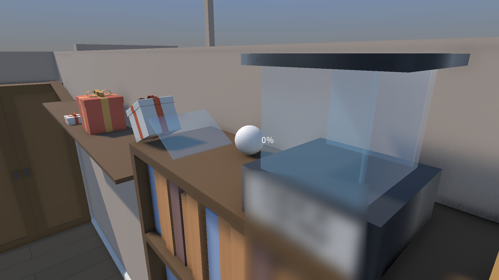

골프공 옆의 **"0%"** 는 치는 힘 게이지입니다.

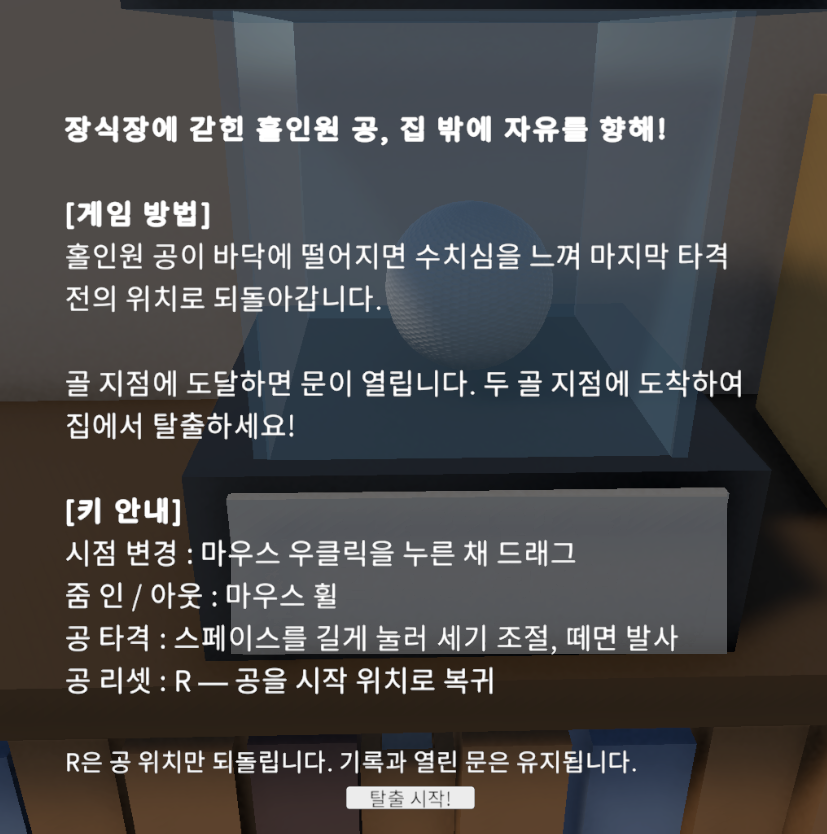

| 조작 | 키 |
|---|---|
| 공 치기 | 스페이스를 길게 눌러 세기를 조절하고, 떼면 발사 |
| 시점 바꾸기 | 마우스 오른쪽 버튼을 누른 채 끌기 |
| 줌 인 / 아웃 | 마우스 휠 |
| 공 되돌리기 | R — 공만 시작 위치로 돌아가고, 기록과 열린 문은 그대로 유지 |

공이 바닥에 떨어지면 마지막으로 치기 전 위치로 돌아갑니다.

### 2-2. 코어 루프 — 치고, 떨어지면 다시 치고, 문을 연다

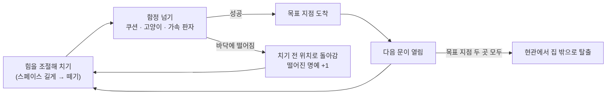

이 반복이 1-2에서 의도한 경험을 만듭니다. 바닥에 떨어져도 처음으로 돌아가지 않고 **치기 전 위치에서 바로 다시 칠 수 있어** 도전 욕구가 이어지고, 목표 지점에 도착할 때마다 문이 열려 **한 구간씩 집 밖에 가까워지는 과정**이 보입니다. 끝까지 가면 탈출의 자유를 느끼게 됩니다. `[사실 보강 예정: 코어 루프 설명 문단의 본인 말투 및 의도 일치 여부 최종 확인]`

- **주제를 바꾼 이유** — 에셋을 찾아보다가 우연히 집 인테리어 에셋을 발견했습니다. 이때 미니 골프처럼 홀을 하나씩 깨는 스테이지 방식이 아니라, **집에서 빠져나가는 탈출 방식**으로 방향을 바꿔야겠다고 생각했습니다.
- **"떨어진 명예"라는 콘셉트** — 홀인원이라는 큰 영광을 가진 공이 바닥에 떨어지면, 수치심을 느껴 치기 전 위치로 되돌아간다는 콘셉트입니다. 결과 화면의 "떨어진 명예(낙하 횟수)"와 "비록 명예는 바닥에 떨어졌을지라도…" 문구도 여기서 나왔습니다.

### 2-3. 레벨 구조 — 전체 동선

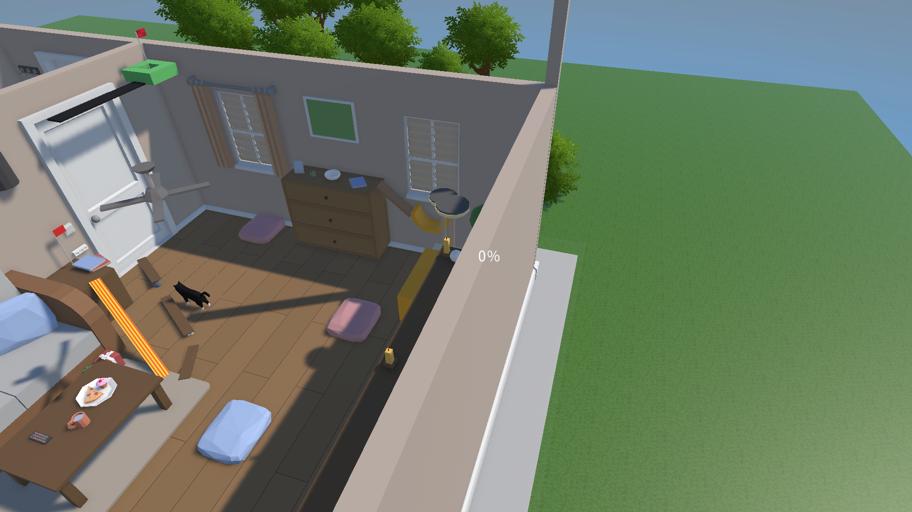

맵은 **진열장 → 창고방 → 거실 → 현관** 네 구간으로 이어집니다. 진열장에서 어느 길로 갈지 정해지고, 창고방을 지나 **윗길과 아랫길**로 나뉩니다. 거실의 목표 지점 **두 곳**에 모두 도착하면 현관에서 집 밖으로 탈출할 수 있습니다.

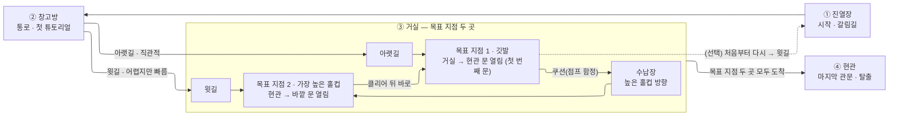

| 구간 | 역할 |
|---|---|
| ① 진열장 | 골프공이 처음 시작하는 곳입니다. 어려운 길과 쉬운 길 중 어디로 갈지 정해지는 **갈림길**입니다 |
| ② 창고방 | 윗길·아랫길로 이어지는 통로이자 첫 튜토리얼 구간입니다 |
| ③ 거실 | 목표 지점 두 곳이 있습니다. 목표 지점 1(깃발)에 도착하면 거실 → 현관 문이, 목표 지점 2(가장 높은 홀컵)에 도착하면 현관 → 바깥 문이 열립니다 |
| ④ 현관 | 목표 지점 두 곳에 모두 도착한 뒤 집 밖으로 탈출하는 마지막 관문입니다 |

**두 갈래 길**

| 루트 | 특징 |
|---|---|
| 윗길 | 가장 높은 홀컵(**목표 지점 2**)으로 가는 길입니다. 초반 난이도가 높지만, 높은 홀컵에 도착하면 **바로 깃발(목표 지점 1)로** 이어져 빠르게 클리어할 수 있습니다 |
| 아랫길 | 직관적인 길로, **목표 지점 1**에 먼저 도착합니다. 대신 첫 번째 문을 연 뒤에는 **쿠션(점프 함정)** 을 밟고 높은 홀컵 쪽 수납장으로 올라가야 합니다 |

---

## 3. 구역별 설계 의도

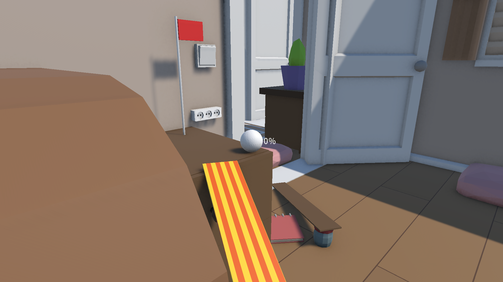

### 3-1. 튕기고, 밀치고, 가속하는 함정 세 가지

과제 조건(새 장애물 최소 3종)에 맞춰 성격이 다른 함정 세 가지를 배치했습니다.

| 함정 | 종류 | 동작 |
|---|---|---|
| 쿠션 | 점프 함정 | 공을 튀어 오르게 합니다. 아랫길에서는 높은 홀컵 쪽 수납장으로 가는 **발판**으로도 쓰입니다 |
| 고양이 | 이동형 함정 | 돌아다니다가 공을 발견하면 쫓아가 밀쳐냅니다 |
| 가속 이동 판자 | 가속 플랫폼 | 밟으면 공이 진행하던 방향으로 가속이 붙습니다 |

**쿠션 — 운과 재도전**  
아랫길에서 수납장으로 가는 쿠션은 공이 닿은 메쉬 콜라이더의 각도에 따라 여러 방향으로 튀어 나갑니다. 방향이 맞으면 안전하게 수납장으로 올라가고, 어긋나면 바닥에 떨어져 다시 쳐야 합니다. 복불복의 긴장감을 주면서도 **다시 시도해 보고 싶게 만드는 경험**을 의도했습니다. 현관에서는 집 밖으로 나가는 마지막 발판으로도 활용됩니다. `[사실 보강 예정: 쿠션 스크립트(탄성·반발 힘) 실제 코드 수치 및 동작 방식 확인]`

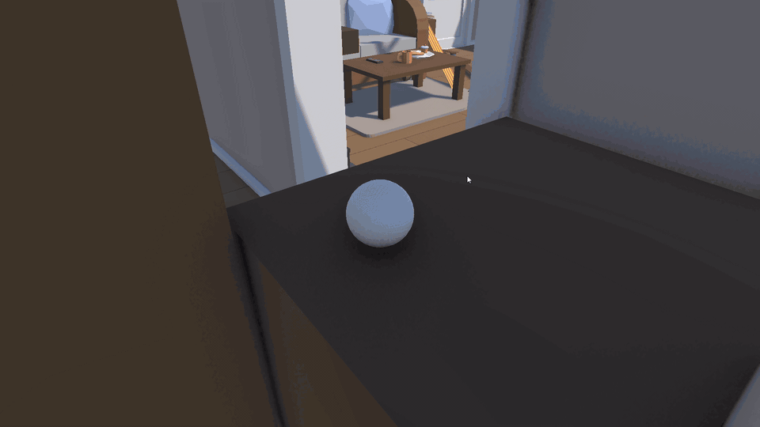

**고양이 — 살아 있는 방해꾼**  
거실에서 아랫길로 이어지는 소파 밑, TV 테이블 밑, 거실 바닥 주변을 순찰합니다. NavMesh로 돌아다니다가 골프공을 발견하면 공을 향해 다가가 밀쳐냅니다. 코드상 생성 위치 반경 $4\text{ m}$ 안을 순찰하다가, $3\text{ m}$ 안에 공이 들어오면 추적하고 $5\text{ m}$ 밖으로 멀어지면 복귀합니다.

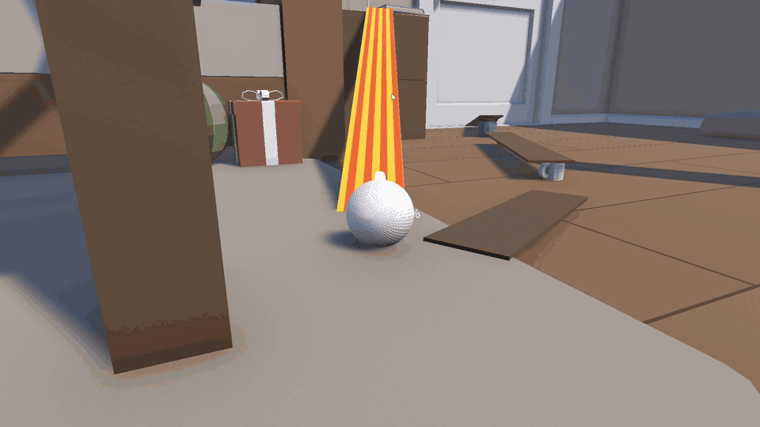

**가속 판자 — 돕기도, 떨어뜨리기도**  
공이 진입하는 방향에 따라 플레이어의 이동을 돕기도 하고, 각도가 어긋나면 바닥으로 떨어뜨려 재도전을 유도합니다. `[사실 보강 예정: 가속 판자 스크립트(AddForce/속도 배율 등) 실제 코드 동작 확인]`

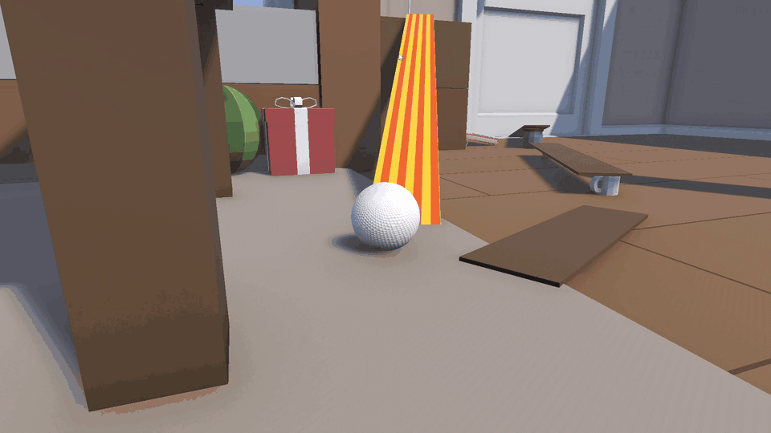

### 3-2. 배우고, 익히고, 시험받는 네 구간 — 구간별 의도

과제의 **소개 → 응용 → 심화** 세 코스를 한 맵에 이어 붙였습니다. 창고방이 **소개**, 거실과 현관이 **응용·심화** 코스입니다.

| 구간 | 코스 | 이 구간에서 일어나는 일 |
|---|---|---|
| ① 진열장 | 시작 | 윗길과 아랫길 중 어디로 갈지 정해지는 갈림길(2-3 참고) |
| ② 창고방 | 소개 | 기본 조작과 반발을 익히는 첫 튜토리얼 구간 |
| ③ 거실 | 응용·심화 | 점프 쿠션, 가속 판자, 여러 가구 배치를 플레이어가 직접 겪으며 길을 만들어 갑니다 |
| ④ 현관 | 응용·심화 | 현관의 점프 쿠션으로 집 밖으로 탈출합니다. 문밖의 잔디를 밟으면 클리어입니다 |

모든 구간에서 힘 조절, 조준, 타이밍, 길 선택이 요구됩니다. 실패하면 공이 바닥에 떨어지고, 떨어지기 전 위치에서 다시 쳐야 합니다.

---

## 4. 고민과 선택

### 4-1. 길을 한 갈래로 할까, 두 갈래로 할까

**상황** — 집 구조는 에셋 배치를 그대로 활용했습니다. 진열장과 창고방에 장애물과 경로를 배치하면서 동선을 두 갈래로 나누는 구조를 구상했습니다.

| 선택지 | 장점 | 단점 |
|---|---|---|
| 한 갈래 길 | 동선이 단순해 플레이어가 게임 규칙에 익숙해지도록 단계별 튜토리얼 설계가 쉬움. 별도 안내 없이도 진행 가능 | 도전 욕구가 강한 플레이어에게는 초반 구간이 밋밋할 수 있음 |
| **두 갈래 길 (선택)** | 플레이어에게 경로 선택의 자유를 주어 다양한 시도를 유도함. 어려운 윗길(목표 2 → 목표 1)과 직관적인 아랫길(목표 1 → 쿠션 → 목표 2)로 보상 차등화 가능 | 안내가 부족하면 방향을 잃기 쉬움. 분기 이후의 경로를 각각 설계해야 함 |

- **선택 이유** — 어려운 도전을 해낸 플레이어에게는 첫 도전을 마친 뒤 다음 구간이 순조롭게 풀리는 보상을 주고 싶었습니다. 그래서 어려운 윗길로 가장 높은 홀컵에 도착하면 바로 깃발로 이어져 빠르게 클리어할 수 있게 설계했습니다. 쉬운 아랫길 역시 보이는 길을 따라가다 중간에 갈림길이 나타나므로 단순하지만은 않습니다.
- **감수한 단점 및 결과** — 안내 정보가 없으면 방향을 잡기 어렵다는 단점은 친구 플레이 테스트에서 그대로 드러났습니다(5-2 ①). 첫 플레이어는 주로 이어져 보이는 아랫길을 선택할 것이라 예상했고 실제 테스트에서도 대부분 그렇게 진행했습니다.
- **결과 화면과의 연결** — 험난한 경로를 거쳐 탈출을 마쳤을 때 타격 횟수와 낙하 횟수를 보며 *"내가 이렇게 많이 쳤어? 이렇게 많이 떨어졌어?"*라는 성취감을 느끼도록 의도했습니다.

### 4-2. 어떤 에셋으로 맵을 만들까

**상황** — 처음 영감을 받은 에셋은 학원 지원 에셋인 *Low Poly Cartoon House Interiors*였으나, 초기에는 자료 위치를 찾지 못해 대체 에셋인 *Mobile Modern Interiors*로 작업을 시작했습니다.

| 선택지 | 장점 | 단점 |
|---|---|---|
| 대체 에셋 (*Mobile Modern Interiors*) | 즉시 프로젝트에 적용 가능 | 가구 종류가 적어 가구를 밟고 올라가는 탈출 동선을 구성하기 어려움 |
| **원래 에셋 (*Low Poly Cartoon House Interiors*, 선택)** | 가구 종류가 다양해 입체적인 탈출 경로를 만들기 유리함 | 자료 위치를 찾는 데 시간이 걸렸고, 맵을 처음부터 다시 디자인해야 함 |

**선택** — 원래 의도했던 에셋의 위치를 찾은 뒤 맵을 전면 재디자인했습니다(10-01 커밋: `"에셋 변경 후 레벨 디자인 다시 해야한다"`). 에셋에 없는 캣 타워는 Unity 기본 3D 도형으로 직접 제작해 배치했습니다.

### 4-3. 복불복 쿠션을 남길까

과제 작업지시서에는 *"운만으로 결정되는 구간은 난이도가 아니라 벌"*이라는 기준이 있습니다. 튀는 방향이 매번 달라지는 쿠션은 이 기준에 저촉될 여지가 있었습니다.

그럼에도 쿠션을 유지한 이유는 두 가지입니다.
- 떨어져도 바로 직전 위치에서 다시 칠 수 있어 **실패에 따른 페널티(벌)가 작다**고 판단했습니다.
- 여러 차례 시도하며 다양한 각도로 튀어 보는 과정에서 **새로운 경로를 발견하는 재미**를 줄 수 있다고 보았습니다.

### 4-4. 첫 번째 문을 연 뒤의 흐름

아랫길로 첫 번째 문을 연 뒤 진열장에서 다시 시작하게 만드는 강제 귀환 흐름은 **구현하지 않았습니다.** 다시 시작하지 않아도 점프 쿠션을 이용해 두 번째 목표 지점으로 올라갈 수 있기 때문입니다. 처음부터 다시 윗길로 도전하는 편이 더 빠를 수도 있어 선택지로만 남겨 두었으며, 시작 위치 복귀(`R` 키)는 기록과 열린 문을 유지한 채 위치만 되돌리는 보조 기능으로 두었습니다.

### 4-5. 홀컵 앞 지름길을 막을까 — 홀컵에 들어와야 열리는 벽

**상황** — 가장 높은 홀컵(목표 지점 2) 근처에는 깃발(목표 지점 1)로 이어지는 검은 길이 있습니다. 그런데 이 검은 길의 틈으로 떨어진 공이 쿠션을 타고 다시 튀어 올라, 정해진 코스를 거치지 않고 홀컵으로 바로 들어가는 지름길이 생겼습니다.

**선택** — 이 지름길을 **벽 콜라이더로 막았습니다.** 대신 공이 홀컵 플랫폼의 **Trigger**에 닿으면 벽 콜라이더를 비활성화해, 그때부터 검은 길을 따라 깃발 쪽으로 이동할 수 있게 처리했습니다.

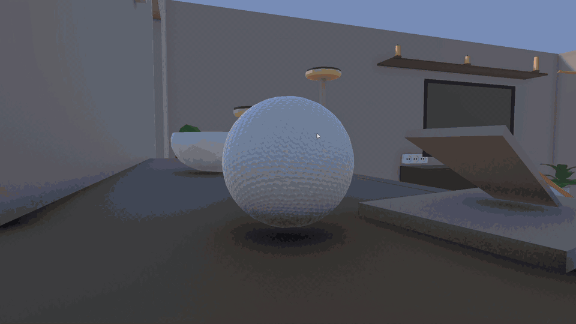

**플레이어가 겪는 흐름** — 윗길로 정상 도달해 홀컵에 들어오면 벽이 사라지고 검은 길을 따라 깃발까지 한 번에 이어집니다. 4-1에서 의도한 *"어려운 도전을 해낸 플레이어에게 주어지는 순조로운 후속 진행"*을 지름길 꼼수 없이 **홀컵 도착 이후에만** 제공하기 위한 장치입니다. 시연 영상 [0:42](https://youtu.be/yulQDb7e_fU?t=42)에서 확인할 수 있습니다.

---

## AI 협업 — 함정 스크립트는 AI에게, 수치는 플레이로

함정 3종의 동작 스크립트는 레벨 디자인에 집중하기 위해 AI에게 맡겼습니다. AI에게 각 장애물의 역할을 설명하고 동작 코드를 설계·구현하도록 요청했습니다. `[사실 보강 예정: 사용한 AI 도구명(ChatGPT/Claude 등) 및 프롬프트·코드 검증 방식 확인]`

| 함정 | 받은 코드 활용 방식 | 플레이하며 직접 조정한 수치 |
|---|---|---|
| 가속 판자 | 받은 코드 그대로 적용 | — `[사실 보강 예정: Inspector 노출 변수 및 실제 설정값 확인]` |
| 쿠션 | 수치 조정 후 적용 | 공을 튀어 오르게 하는 반발력(힘) `[사실 보강 예정: 구체적인 변경 전/후 수치 확인]` |
| 고양이 | 수치 조정 후 적용 | 바닥에 닿는 고양이의 높이($y$) 위치 값 `[사실 보강 예정: 구체적인 변경 전/후 수치 확인]` |

코드는 AI가 작성했지만, 함정이 실제 플레이에서 주는 체감 난이도와 손맛은 직접 공을 쳐 보며 수치를 조율해 완성했습니다.

- **잘 된 것** — 레벨 디자인은 직접 주도하고 함정 코드 구현은 AI에게 맡겨 작업 시간을 단축하고 맵 완성도를 높이는 데 집중할 수 있었습니다. `[사실 보강 예정: AI가 짠 코드의 정상 작동 여부를 플레이 테스트 외에 어떻게 확인했는지(Inspector 수치 확인, 테스트 장면 등) 구체화]`
- **안 된 것** — 초기 요청 시 함정의 세부 조건을 구체적으로 설명하지 않아, 반환된 코드의 예외 동작을 수정하는 데 추가 시간이 걸렸습니다. `[사실 보강 예정: 구체적으로 어떤 코드 문제가 발생했고 어떻게 수정했는지 1가지 사례 보강]`

---

## 5. 결과 및 배운 점

**목표한 경험은 어떻게 됐나** — 1-2에서 의도한 경험은 진열장에 갇힌 홀인원 공을 집 밖으로 탈출시켜 **자유를 주는 경험**이었습니다.
- **탈출한 순간의 안도감은 전해졌습니다.** 처음 도전한 플레이어는 14분 동안 고생하다가 우연히 튕겨 나간 방향으로 클리어한 뒤 *"살짝 허무하면서도 해냈다"*는 안도감을 느꼈다고 피드백했습니다.
- **하지만 과정은 길을 찾아 헤매는 경험에 가까웠습니다.** 의도한 것은 스스로 길을 열어 탈출하는 자유였으나, 가이드 부족으로 어디로 가야 할지 모른 채 헤매다가(5-2 ①) 우연으로 클리어하는 경험이 섞였습니다.

### 5-1. 결과

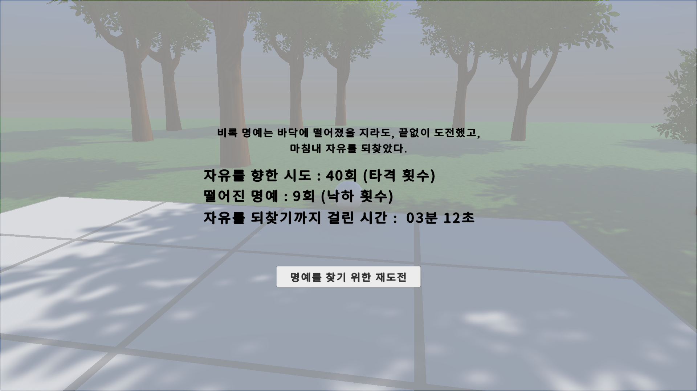

결과 화면에는 **자유를 향한 시도(타격 횟수)**, **떨어진 명예(낙하 횟수)**, **자유를 되찾기까지 걸린 시간**이 표시되며, *"명예를 찾기 위한 재도전"* 버튼으로 다시 도전할 수 있습니다.

**친구 플레이 테스트** — 친구에게 빌드를 전달해 플레이 테스트를 진행했고, 수집한 피드백을 바탕으로 맵 콜라이더를 수정했습니다(10-06 커밋: `"QA 피드백 후 수정 완료"`).

| 플레이어 | 타격 | 낙하 | 걸린 시간 | 비고 |
|---|---|---|---|---|
| 나 (제작자) | 40회 | 9회 | 3분 12초 | 어려운 길(윗길) 루트 클리어 기록 |
| 처음 도전한 플레이어 | 197회 | 97회 | 14분 11초 | 초회 플레이 클리어 기록 |
| 피드백을 준 친구 | 352회 | 171회 | 24분 29초 | 피드백을 위해 여러 경로를 탐색하며 시도한 기록 |

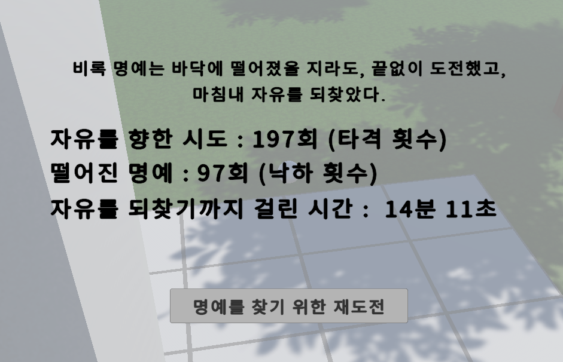

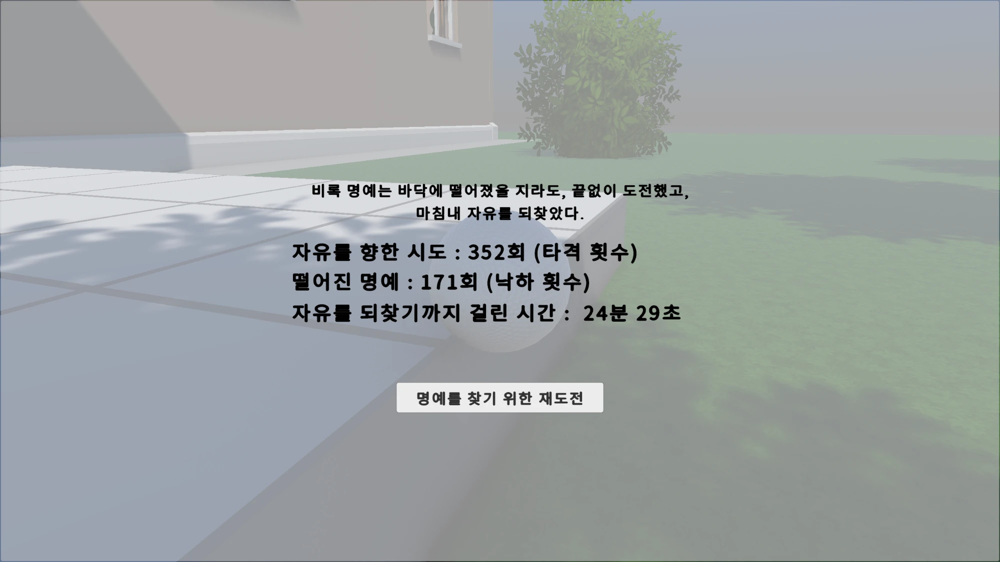

맵 구조를 아는 제작자가 윗길로 진행해도 3분 12초가 걸렸고, 초회 플레이어는 14분 11초가 걸려 과제 조건(총 플레이 시간 3분 이상)을 충족했습니다.

**친구가 준 피드백과 고친 것**

| 피드백 | 원인 | 해결 방법 |
|---|---|---|
| 어려운 길로 목표 지점에 도착했지만, 그다음 어디로 가야 할지 몰랐습니다 | 후속 동선을 알려 주는 시각적 가이드가 없었습니다 | 이번 빌드에서는 미반영 (→ 5-2 아쉬운 점·개선 계획으로 정리) |
| 점프 쿠션으로 튀어 오른 공이 커튼에 끼었습니다 | 커튼봉의 메쉬 콜라이더 굴곡에 공이 걸렸습니다 | 커튼봉 메쉬 콜라이더 겉을 감싸는 박스 콜라이더를 추가해 끼임을 방지했습니다 |
| 창문을 뚫고 집 밖으로 나갈 수 있었습니다 (클리어 판정은 안 됨) | 창문에 유리 콜라이더가 없어 공이 통과할 수 있었습니다(외부 경계 리셋 지점으로 추락) | 창문에 커튼 오브젝트와 콜라이더를 배치해 자연스럽게 이탈 경로를 막았습니다 |

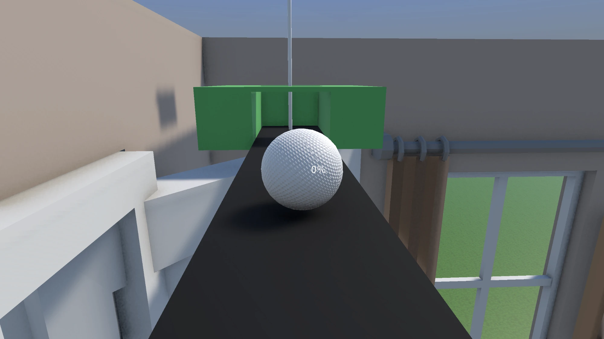

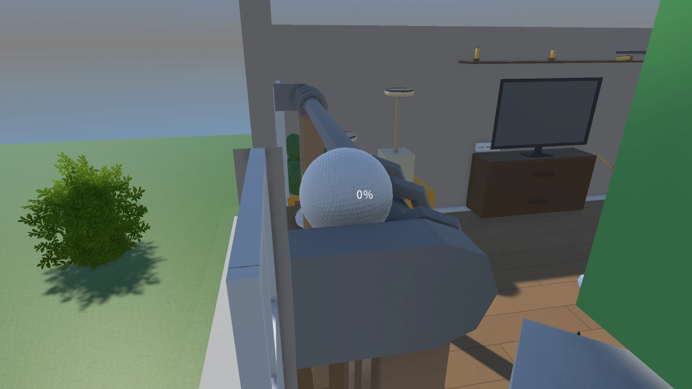

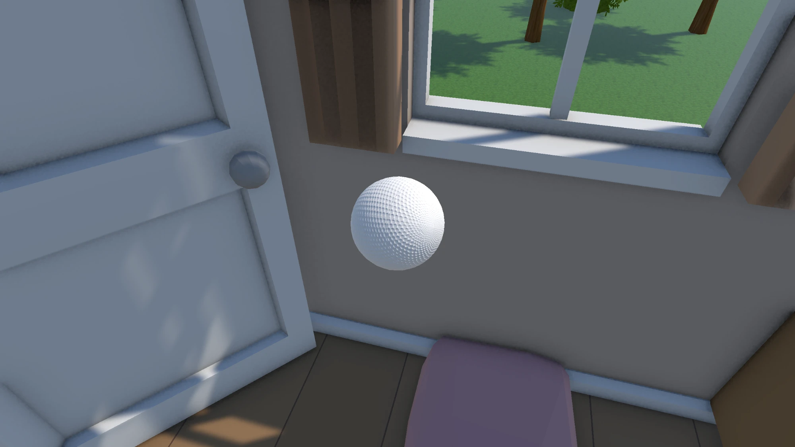

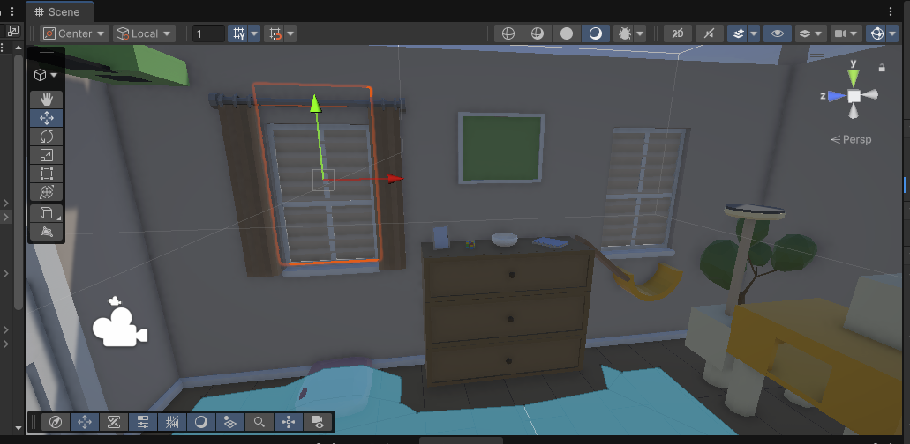

### 5-2. 아쉬운 점 · 개선 계획

**아쉬운 점 ① 어디로 가야 할지 모름**  
초기 기획에서는 *Getting Over It*처럼 **도전 욕구를 자극하는 게임**을 목표로 했습니다. 그래서 인게임 안내는 조작 키와 *"바닥에 떨어지면 이전 자리에서 다시 친다"*는 규칙뿐이었고, 진행 방향은 일부러 알려 주지 않았습니다. 시작 시 목표 지점 두 곳을 3초씩 카메라로 비춰 주는 연출을 넣었지만, 실제 플레이어들은 **어디로 가야 할지, 목표 지점이 어디인지 파악하지 못했습니다.** 두 갈래 길의 단점(정보 부족 시 방향 상실)이 그대로 드러난 부분입니다.

**아쉬운 점 ② 거실에서 처음 나오는 함정**  
창고방을 튜토리얼(소개 코스)로 배치했지만, 거실 구간에서 사전 안내 없이 새로 등장하는 함정이 있었습니다. 이는 과제 작업지시서의 *"응용·심화 코스에는 소개 코스에서 보여 주지 않은 새 장애물을 처음 등장시키지 않는다"*는 규칙과 어긋나는 부분입니다. `[사실 보강 예정: 창고방에 배치한 함정과 거실에서 처음 등장한 함정이 각각 무엇인지 정확히 명시]`

**개선 계획** — 집 안 인테리어 분위기를 해치지 않기 위해 인위적인 안내 표지판은 배제했습니다. 대신 다음 장치들을 추가한다면 몰입을 유지하면서 방향을 안내할 수 있을 것입니다.

- 바람 부는 사운드와 파티클 효과로 진행 방향 암시하기
- 거실 진입 시 목표 지점 두 곳의 위치를 카메라로 한 번 더 비춰 주기
- 처음 마주치는 장애물 등장 시 짧은 1줄 설명 UI 노출하기

### 5-3. 배운 점

탈출 경로를 스스로 찾아 헤매는 과정 자체가 재미일 것이라 예상했지만, 가이드 없는 탐색은 플레이어에게 막막함이 될 수 있음을 깨달았습니다. 게임을 설계할 때는 *"무엇이 재미있을까"*만큼이나 **플레이어에게 어떤 경험을 줄 것인지**, 그리고 **"플레이어가 어디서 헤매게 될까"**를 먼저 고민해야 한다는 점을 배웠습니다. 바람 효과나 카메라 연출 같은 환경적 단서로 목표 지점을 자연스럽게 인지시키는 레벨 디자인의 중요성을 확인한 프로젝트였습니다.