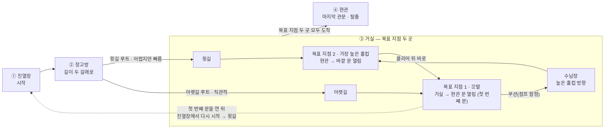

# Escape for Freedom — 3D 맵(레벨) 디자인 문서

<!--
====================================================================
 ✍ 작성 안내 (이 상자는 다 쓰면 지우세요)
====================================================================
 맵 디자인 과제로 진행한 프로젝트라, 코드 대신 **맵 디자인**에 초점을 둔 틀입니다.
 장 순서는 가이드의 5단 구조(개요 → 구조 → 핵심 → 고민과 선택 → 결과)를 맵 디자인에 맞춰 바꾼 것입니다.
   2장 레벨 구조   = 맵 전체 동선(시스템 구조 자리)
   3장 구역별 설계 = 구역마다 무엇을 노렸나(핵심 기능 자리)
   4장 고민과 선택 = 배치·난이도를 정할 때 비교한 방법
 「프로젝트 포트폴리오용 정리 내용.docx」에는 개요 한 줄과 스크린샷 4장만 있어서, 대부분 비워 두었습니다.
 스크린샷에서 보이는 것만 "(화면에서 보임)"으로 적었고, 그 밖의 사실은 지어내지 않았습니다.

   ❓ 답해 주세요   — 사실 확인
   💬 내 의견       — 건우 님의 판단·생각이 들어가야 하는 곳

 · 표시(> ❓ … 등)는 답을 채운 뒤 지웁니다. 남아 있으면 포트폴리오에도 그대로 보입니다.
 · 맵 디자인 문서는 **그림이 설명의 중심**입니다. 씬 뷰 전경·동선 표시 그림이 있으면 가장 좋습니다(맨 아래 촬영 목록).
 · 다 쓴 뒤 /portfolio-check 2-escape-for-freedom 으로 점검하세요.
====================================================================
-->

## 1. 개요

### 1-1. 무엇을 만들었나 (What)

**집 안에 보관된 홀인원 골프공을 집 밖으로 탈출시키는** 3D 물리 기반 미니 골프 탈출 게임입니다. *(출처: 본인 정리)*
**맵 디자인 과제**로 진행했습니다.

> ❓ **답해 주세요** — 화면에서 보이는 것을 바탕으로 여쭙니다.
> - 골프공 옆의 **"0%"** 는 무엇인가요? (치는 힘 게이지?)
> - 공을 어떻게 치나요? 카메라는 공을 따라가나요?

### 1-2. 과제와 목표 (Why)

> 💬 **내 의견** — 맵 디자인 과제의 **조건**(주어진 주제·기간·필수 요소 등)과, 이 맵으로 **플레이어가 어떤 경험을 하길 바랐는지** 적어 주세요.
> 왜 "집 안에서 골프공 탈출"이라는 주제를 골랐는지도 좋습니다.
> 결과 화면 문구("비록 명예는 바닥에 떨어졌을지라도, 끝없이 도전했고, 마침내 자유를 되찾았다")에 담은 의도가 있다면 그것도 좋습니다.

### 1-3. 개발 환경 · 링크

| 항목 | 내용 |
|---|---|
| 장르 | 물리 기반 미니 골프 스타일 탈출 게임 (3D) |
| 엔진·도구 | Unity, JetBrains Rider, C# |
| 기간 | 2026-10-01 ~ 2026-10-06 |
| 성격 | 맵 디자인 과제 |
| 인원 | ❓ |
| 영상 | ❓ |

> ❓ **답해 주세요** — ① 연도는 docx에 없어서 2026년으로 적었습니다. 맞나요? ② 개인 과제인가요? ③ 사용한 에셋(가구·소품 팩 등)이 있다면 이름
> ④ 플레이 영상 주소

---

## 2. 레벨 구조 — 전체 동선

맵은 **진열장 → 창고방 → 거실 → 현관** 네 구간으로 이어집니다. 창고방에서 길이 **두 갈래**로 나뉘고,
거실의 목표 지점(깃발 홀컵) **두 곳**에 모두 도착해야 현관문이 열리고 탈출할 수 있습니다.

| 구간 | 역할 |
|---|---|
| ① 진열장 | 골프공이 처음 시작하는 구간 |
| ② 창고방 | 골프공이 처음 들어가는 곳. **두 갈래 길** 중 하나를 고름 |
| ③ 거실 | 목표 지점 두 곳. 목표 지점 1(깃발)에 도착하면 거실 → 현관 문이, 목표 지점 2(가장 높은 홀컵)에 도착하면 현관 → 바깥 문이 열림 |
| ④ 현관 | 목표 지점 두 곳에 모두 도착하면 문이 열려 탈출하는 마지막 관문 |

**두 갈래 길**

| 루트 | 특징 |
|---|---|
| 윗길 (거실 윗길) | 가장 높은 홀컵(**목표 지점 2**)으로 가는 길. 처음에는 어려운 편이지만, 높은 홀컵에 도착하면 **바로 깃발(목표 지점 1)로** 이어져 빨리 끝낼 수 있음 |
| 아랫길 (거실 아랫길) | 직관적인 길로, **목표 지점 1**에 먼저 도착함. 대신 첫 번째 문(거실 → 현관)을 연 뒤에는 **진열장에서 다시 시작해 윗길로** 가거나, **쿠션(점프 함정)** 을 밟고 높은 홀컵 쪽 수납장으로 가야 함 |

> 💬 (선택) 위 그림(레벨 전경)에서 창고방·거실·현관이 각각 어디인지 표시한 그림이 있으면 함께 넣으면 좋습니다.

---

## 3. 구역별 설계 의도

### 3-1. 함정

맵 곳곳에 성격이 다른 함정 세 가지를 두었습니다.

| 함정 | 종류 | 동작 |
|---|---|---|
| 쿠션 | 점프 함정 | 공을 튀어 오르게 함. 아랫길에서는 높은 홀컵 쪽 수납장으로 가는 **길**로도 쓰임 |
| 고양이 | 이동형 함정 | 돌아다니며 길을 막음 |
| 가속 이동 판자 | 가속 플랫폼 | 밟으면 공의 이동 방향으로 가속이 붙음 |

> 💬 **내 의견** — 함정마다 **왜 그 자리에 두었는지** 한 줄씩 보태 주세요. 맵 디자인 문서에서 가장 중요한 부분입니다.
> - 쿠션이 함정이면서 지름길(수납장으로 가는 길)도 되는 것은 의도한 것인가요? 그렇다면 "함정을 길로도 쓰게 했다"는 좋은 설계 이야기가 됩니다.
> - 고양이는 어느 구간에서, 어떤 패턴으로 움직이나요?
> - 가속 판자는 플레이어를 돕는 장치인가요, 방해하는 장치인가요? (예: 높은 곳으로 올려 주기 / 가속 때문에 떨어지기 쉬움)

### 3-2. 구간별 의도

> 💬 **내 의견** — 구간마다 **플레이어에게 무엇을 요구하는지**(힘 조절, 각도, 루트 선택 등)와, 실패하면 어떻게 되는지 한두 줄씩 적어 주세요.
>
> | 구간 | 플레이어에게 요구하는 것 | 실패하면 |
> |---|---|---|
> | ① 진열장 | | |
> | ② 창고방 | 두 루트 중 선택 | |
> | ③ 거실 | | |
> | ④ 현관 | | |

---

## 4. 고민과 선택

> 가이드: **대안 2개 이상 비교 + 상황을 근거로 한 선택 이유**.

### 4-1. 길을 한 갈래로 할까, 두 갈래로 할까

| 방법 | 장점 | 단점 |
|---|---|---|
| 한 갈래 길 | ❓ | ❓ |
| **두 갈래 길 (선택)** — 윗길은 어렵지만 빠르고, 아랫길은 직관적이지만 돌아가야 함 | ❓ | ❓ |

> 💬 **내 의견 (필수)** — 길을 두 갈래로 나누고, **어려운 길에 빠른 보상을 준** 이유를 본인 말로 적어 주세요. 이 장의 핵심입니다.
> 장단점 칸도 본인 생각으로 채워 주세요. (생각해 볼 것: 처음 하는 사람은 어느 길로 가나요? 두 번째 플레이부터는 어떤가요? 결과 화면의 기록(시간·타격 횟수)과 어떻게 이어지나요?)

### 4-2. 그 밖의 고민 (선택)

> 💬 실제로 고민한 것이 있으면 적어 주세요. 예시입니다.
> - 아랫길에서 첫 번째 문을 연 뒤 **진열장에서 다시 시작**하게 한 이유 (다른 방법: 그 자리에서 이어 하기)
> - 난이도 곡선: 처음부터 어렵게 vs 쉬운 구간으로 시작해 점점 어렵게
>
> 💬 **내 의견** — We got one(8~9월)에서 "팀원끼리 조작에 익숙해져 난이도를 놓쳤고, 그 뒤 튜토리얼 맵을 만들었다"는 경험이 있습니다.
> 이번 맵에 그 경험을 반영한 것이 있다면(예: 첫 구간을 연습 구간으로, 다른 사람에게 미리 플레이시킴) 이 장의 가장 좋은 이야기가 됩니다.

---

## 5. 결과 및 배운 점

### 5-1. 결과

결과 화면에는 **자유를 향한 시도(타격 횟수)**, **떨어진 명예(낙하 횟수)**, **자유를 되찾기까지 걸린 시간**이 나옵니다.
"명예를 찾기 위한 재도전" 버튼으로 다시 도전할 수 있습니다. *(화면에서 보임)*

> ❓ **답해 주세요** — 다른 사람이 플레이해 본 결과(평균 시간·타격 수, 많이 떨어진 구간 등)가 있으면 적어 주세요.
> 기록 화면에 나오는 숫자라 맵 난이도를 보여 주는 근거로 쓰기 좋습니다.

### 5-2. 아쉬운 점 · 개선 계획

> 💬 **내 의견** — 아쉬운 구간 1~2곳과, 시간이 더 있었다면 어떻게 바꿀지.

### 5-3. 배운 점

> 💬 **내 의견** — 맵 디자인에서 배운 것 하나를 본인 말로.

<!--
 📸 권장 촬영 목록 (images/ 에 넣고 위 각 절에 붙이세요)
 1. 씬 뷰에서 위에서 내려다본 맵 전체 + 동선 화살표 — 2장
 2. 구역별 화면 1장씩 — 3장
 3. 공을 치는 순간·떨어지는 순간 GIF — 3장 / 5-1
-->
