# Escape for Freedom — 3D 맵(레벨) 디자인 문서

## 1. 개요

### 1-1. 무엇을 만들었나 (What)

**집 안 진열장에 보관된 홀인원 골프공을 집 밖으로 탈출시키는** 3D 물리 기반 미니 골프 탈출 게임입니다. 수업의 **맵(레벨) 디자인 과제**로 만들었습니다. *(출처: 본인 정리)*

이 문서는 맵의 전체 동선(2장), 함정과 구간마다 노린 것(3장), 길과 에셋을 정할 때 비교한 방법(4장), 친구 플레이 테스트로 드러난 문제와 배운 점(5장)을 차례로 다룹니다.

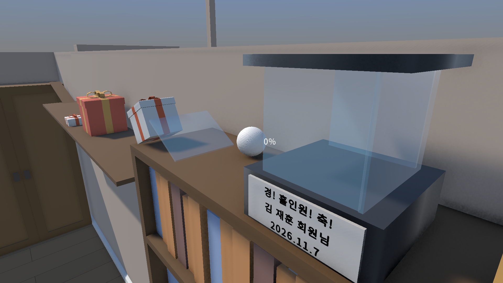

골프공 옆의 **"0%"** 는 치는 힘 게이지입니다. *(출처: 본인 답변)*

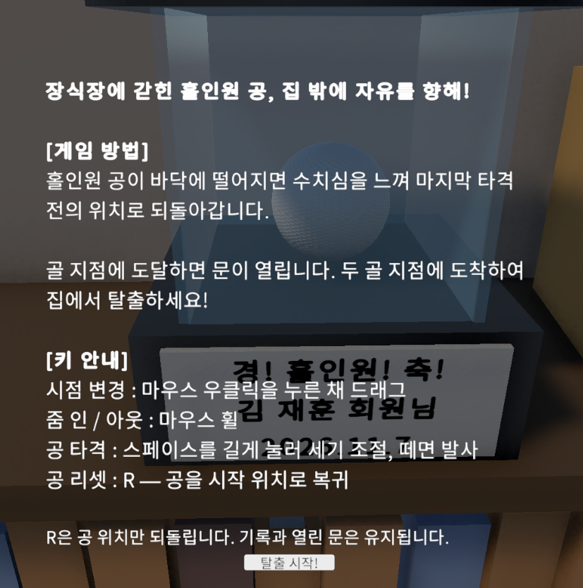

| 조작 | 키 |
|---|---|
| 공 치기 | 스페이스를 길게 눌러 세기를 조절하고, 떼면 발사 |
| 시점 바꾸기 | 마우스 오른쪽 버튼을 누른 채 끌기 |
| 줌 인 / 아웃 | 마우스 휠 |
| 공 되돌리기 | R — 공만 시작 위치로 돌아가고, 기록과 열린 문은 그대로 |

공이 바닥에 떨어지면 마지막으로 치기 전의 위치로 돌아갑니다. *(출처: 시작 안내 화면)*

### 1-2. 과제와 목표 (Why)

**과제 조건** *(출처: 과제 작업지시서)*

- 새 장애물을 **최소 3종** 만듭니다.
- 그 장애물을 **소개 → 응용 → 심화** 세 코스에 나눠 배치해, 플레이어가 배우고 익히고 시험받게 합니다.
- 총 플레이 시간은 **3분 이상**이고, 마감은 10월 8일입니다.

**주제를 바꾼 이유** — 에셋을 찾아보다가 우연히 집 인테리어 에셋을 발견했습니다. 그때 미니 골프처럼 홀을 하나씩 깨는 스테이지 방식이 아니라,
**집에서 빠져나가는 탈출 방식**으로 방향을 바꿔야겠다고 생각했습니다. *(출처: 본인 답변)*

**플레이어에게 주고 싶었던 경험** — 홀인원 공은 진열장에 보관되어 갇혀 있는 공입니다. 그 공을 집 밖으로 탈출시켜 **자유를 주는 경험**을 주고 싶었습니다. *(출처: 본인 답변)*

**"떨어진 명예"라는 콘셉트** — 홀인원이라는 큰 영광을 가진 공이 바닥에 떨어지면, 수치심을 느껴 치기 전 위치로 되돌아간다는 콘셉트입니다. *(출처: 본인 답변)*
결과 화면의 "떨어진 명예(낙하 횟수)"와 "비록 명예는 바닥에 떨어졌을지라도…" 문구도 여기서 나왔습니다. *(출처: 본인 답변·결과 화면)*

### 1-3. 개발 환경 · 링크

| 항목 | 내용 |
|---|---|
| 장르 | 물리 기반 미니 골프 스타일 탈출 게임 (3D) |
| 엔진·도구 | Unity 6000.3.15f1, JetBrains Rider, C# |
| 기간 | 2026-10-01 ~ 2026-10-06 |
| 성격 | 맵 디자인 과제 |
| 인원 | 개인 과제 (1인) |
| 사용 에셋 | 집 인테리어: [Low Poly Cartoon House Interiors](https://assetstore.unity.com/packages/package/167425) · 고양이: [Low-poly cat](https://prildarill.itch.io/meow) |
| 직접 한 일 | 레벨 디자인(동선·장애물·함정 배치), 캣 타워(Unity 기본 3D 도형). 함정 3종의 동작 스크립트는 레벨 디자인에 집중하려고 AI로 만들었습니다 |
| 영상 | [소개 쇼츠 (53초)](https://youtube.com/shorts/EK8t_fhMLXM) · [플레이 시연 영상 (YouTube, 3분 31초)](https://youtu.be/yulQDb7e_fU) |

---

## 2. 레벨 구조 — 전체 동선

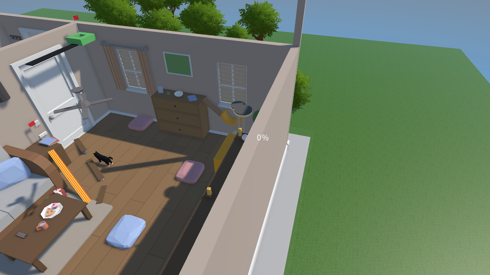

맵은 **진열장 → 창고방 → 거실 → 현관** 네 구간으로 이어집니다. 진열장에서 어느 길로 갈지 정해지고, 창고방을 지나 **윗길과 아랫길**로 나뉩니다.
거실의 목표 지점 **두 곳**에 모두 도착하면 현관에서 집 밖으로 탈출할 수 있습니다.

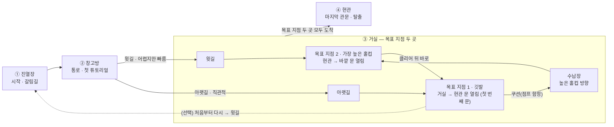

| 구간 | 역할 |
|---|---|
| ① 진열장 | 골프공이 처음 시작하는 곳입니다. 어려운 길과 쉬운 길 중 어디로 갈지 정해지는 **갈림길**입니다 |
| ② 창고방 | 윗길·아랫길로 이어지는 통로이자 첫 튜토리얼 구간입니다 |
| ③ 거실 | 목표 지점 두 곳이 있습니다. 목표 지점 1(깃발)에 도착하면 거실 → 현관 문이, 목표 지점 2(가장 높은 홀컵)에 도착하면 현관 → 바깥 문이 열립니다 |
| ④ 현관 | 목표 지점 두 곳에 모두 도착한 뒤 집 밖으로 탈출하는 마지막 관문입니다 |

**두 갈래 길**

| 루트 | 특징 |
|---|---|
| 윗길 | 가장 높은 홀컵(**목표 지점 2**)으로 가는 길입니다. 처음에는 어렵지만, 높은 홀컵에 도착하면 **바로 깃발(목표 지점 1)로** 이어져 빨리 끝낼 수 있습니다 |
| 아랫길 | 직관적인 길로, **목표 지점 1**에 먼저 도착합니다. 대신 첫 번째 문을 연 뒤에는 **쿠션(점프 함정)** 을 밟고 높은 홀컵 쪽 수납장으로 가야 합니다. 처음부터 다시 윗길로 가는 편이 빠를 수도 있습니다(선택) |

---

## 3. 구역별 설계 의도

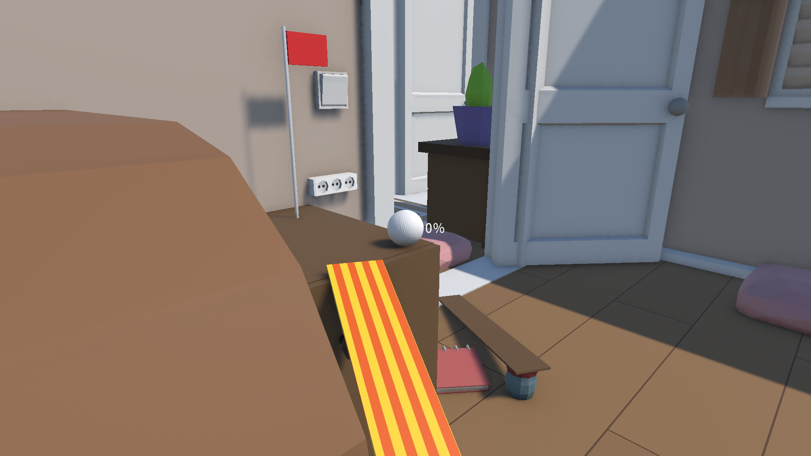

### 3-1. 튕기고, 밀치고, 가속하는 함정 세 가지

과제 조건(새 장애물 최소 3종)에 맞춰, 성격이 다른 함정 세 가지를 두었습니다.

| 함정 | 종류 | 동작 |
|---|---|---|
| 쿠션 | 점프 함정 | 공을 튀어 오르게 합니다. 아랫길에서는 높은 홀컵 쪽 수납장으로 가는 **길**로도 쓰입니다 |
| 고양이 | 이동형 함정 | 돌아다니다가 공을 발견하면 쫓아가 밀쳐냅니다 |
| 가속 이동 판자 | 가속 플랫폼 | 밟으면 공이 움직이는 방향으로 가속이 붙습니다 |

**쿠션 — 운과 재도전** · 아랫길에서 수납장으로 가는 쿠션은, 공이 떨어진 메쉬 콜라이더의 각도에 따라 여러 방향으로 튀어 나갑니다.
방향이 좋으면 안전하게 수납장으로 가고, 나쁘면 바닥에 떨어져 다시 쳐야 합니다.
복불복의 느낌을 주면서도 **다시 해 보고 싶게 만드는 경험**을 주고 싶었습니다. 현관에서는 집 밖으로 나가는 마지막 발판으로도 씁니다. *(출처: 본인 답변)*

**고양이 — 살아 있는 방해꾼** · 거실에서 아랫길로 가는 소파 밑, TV 테이블 밑 주변과 거실 바닥 주변을 돌아다닙니다.
NavMesh로 돌아다니다가 골프공을 발견하면 공을 향해 가서 밀쳐냅니다. *(출처: 본인 답변)*
코드에서는 생성 위치 반경 4m 안을 돌아다니다가, 3m 안에 공이 들어오면 쫓아가고 5m 밖으로 멀어지면 다시 돌아다닙니다. *(출처: 코드 `CatController.cs`)*

**가속 판자 — 돕기도, 떨어뜨리기도** · 공이 움직이는 방향에 따라 플레이어를 돕기도 하고, 잘못 들어가면 바닥으로 떨어져 다시 쳐야 합니다. *(출처: 본인 답변)*

### 3-2. 배우고, 익히고, 시험받는 네 구간 — 구간별 의도

과제의 **소개 → 응용 → 심화** 세 코스를 한 맵에 이어 붙였습니다. 창고방이 **소개**, 거실과 현관이 **응용·심화** 코스입니다. *(출처: 본인 답변)*

| 구간 | 코스 | 이 구간에서 일어나는 일 |
|---|---|---|
| ① 진열장 | 시작 | 골프공이 처음 케이스에서 탈출하는 순간입니다. 어려운 길과 쉬운 길 중 어디로 갈지 정해집니다 |
| ② 창고방 | 소개 | 첫 튜토리얼 구간입니다. 고른 길에 따라 위(어려운 길)나 아래(쉬운 길)로 이어집니다 |
| ③ 거실 | 응용·심화 | 점프 쿠션, 가속 판자, 여러 가구 배치를 플레이어가 직접 겪으며 길을 만들어 갑니다 |
| ④ 현관 | 응용·심화 | 현관의 점프 쿠션으로 집 밖으로 탈출합니다. 문밖의 잔디를 밟으면 클리어입니다 |

모든 구간에서 힘 조절, 조준, 타이밍, 길 선택이 필요합니다. 실패하면 공이 바닥에 떨어지고, 떨어지기 전 위치에서 다시 쳐야 합니다. *(출처: 본인 답변)*

---

## 4. 고민과 선택

### 4-1. 길을 한 갈래로 할까, 두 갈래로 할까

**상황** — 집 배치는 에셋에 있는 것을 그대로 가져왔습니다. 진열장과 창고방에 장애물과 길을 놓으면서 길을 두 갈래로 나누는 구조를 생각했습니다. *(출처: 본인 답변)*

| 방법 | 장점 | 단점 |
|---|---|---|
| 한 갈래 길 | 길이 하나라 단순해서, 플레이어가 처음 게임에 익숙해지도록 설계할 수 있습니다. 한 길로 보내면서 튜토리얼처럼 단계를 줄 수 있습니다. 따로 정보를 주지 않아도 한 방향이라 진행할 수 있습니다 | 도전 욕구가 강한 플레이어에게는 밋밋한 시작이 될 수 있습니다 |
| **두 갈래 길 (선택)** — 윗길은 처음 구간이 어렵지만 목표 지점 2까지 곧장 가고, 목표 지점 2에 도착한 뒤에는 목표 지점 1까지 쉽게 감. 아랫길은 직관적이지만, 목표 지점 1에 도착한 뒤에 목표 지점 2에 도전해야 함 | 플레이어에게 길을 고를 자유를 주어, 여러 시도와 다양한 경험을 할 수 있게 합니다 | 정보를 주지 않으면 어디로 가야 할지 방향을 잡지 못할 수 있습니다. 맵을 만들 때 갈라진 뒤의 경로를 더 설계해야 합니다 |

**선택 이유** — 어려운 도전을 해낸 사람에게는, 첫 도전을 마치면 다음 도전이 순조롭게 풀리는 경험을 주고 싶었습니다.
그래서 어려운 윗길로 가장 높은 홀컵에 도착하면 바로 깃발로 이어져 빨리 끝낼 수 있게 했습니다.
쉬운 아랫길도 보이는 길을 따라 쭉 가다가 중간에 갈림길이 나오는 구조라, 그곳을 넘어가는 것이 쉽지만은 않습니다. *(출처: 본인 답변)*

**감수한 단점** — 정보를 주지 않으면 어디로 가야 할지 방향을 잡기 어렵다는 점입니다. 이 단점은 친구 플레이 테스트에서 그대로 드러났습니다(5-2 ①).

**예상과 실제** — 처음 하는 사람은 이어져 있는 쉬운 길로 갈 것이라고 예상했고, 대부분 첫 플레이는 예상대로 흘러갔습니다. *(출처: 본인 답변)*

**결과 화면과의 연결** — 모든 길을 지나 험난한 도전을 마쳤을 때, 공을 친 횟수와 떨어진 횟수를 보며
"내가 이렇게 많이 쳤어? 이렇게 많이 떨어졌어?"라는 생각이 들게 하고 싶었습니다. *(출처: 본인 답변)*

### 4-2. 어떤 에셋으로 맵을 만들까

**상황** — 처음 보고 영감을 받은 에셋은 학원 지원 에셋인 Low Poly Cartoon House Interiors였습니다. 하지만 처음에는 자료 위치를 찾지 못해,
대체 에셋인 Mobile Modern Interiors로 시작했습니다. *(출처: 본인 답변)*

| 방법 | 장점 | 단점 |
|---|---|---|
| 대체 에셋 (Mobile Modern Interiors) | 바로 쓸 수 있었습니다 | 인테리어 가구 종류가 적어, 가구를 밟고 지나가는 탈출 경로를 만들기 어려웠습니다 |
| **원래 에셋 (Low Poly Cartoon House Interiors, 선택)** | 가구가 다양해 탈출 경로를 만들 수 있었습니다 | 자료 위치를 찾느라 시간이 들었고, 맵을 다시 디자인해야 했습니다 |

**선택** — 다행히 원래 쓰려던 에셋의 위치를 찾아, 그 에셋으로 맵을 다시 디자인했습니다(10-01 커밋 "에셋 변경 후 레벨 디자인 다시 해야한다").
에셋에 없는 캣 타워는 Unity 기본 3D 도형으로 직접 만들었습니다. *(출처: 본인 답변·커밋 기록)*

### 4-3. 복불복 쿠션을 남길까

과제 작업지시서에는 "운만으로 결정되는 구간은 난이도가 아니라 벌"이라는 기준이 있습니다. 튀는 방향이 매번 달라지는 쿠션은 이 기준에 걸릴 수 있습니다. *(출처: 과제 작업지시서)*

그래도 쿠션을 남긴 이유는 두 가지입니다. *(출처: 본인 답변)*

- 떨어져도 바로 그 전 위치에서 다시 칠 수 있어 **벌이 작다**고 판단했습니다.
- 계속 도전하면서 여러 방향으로 튀다 보면 **새로운 경로를 찾는 경험**을 줄 수 있다고 생각했습니다.

### 4-4. 첫 번째 문을 연 뒤의 흐름

아랫길로 첫 번째 문을 연 뒤 진열장에서 다시 시작하게 만드는 흐름은 **구현하지 않았습니다.** 다시 시작하지 않아도 점프 쿠션을 써서 두 번째 목표 지점으로 가는 길로 갈 수 있기 때문입니다.
다만 처음부터 다시 윗길로 가는 편이 더 빠를 수도 있어서, 하나의 선택지로 제안했습니다. 다시 시작하는 기능은 디버그 키로만 있어서, 실제로는 플레이어가 목표 지점 2로 가는 길을 스스로 생각하고 시도해야 합니다. *(출처: 본인 답변)*

### 4-5. 홀컵 앞 지름길을 막을까 — 홀컵에 들어와야 열리는 벽

**상황** — 가장 높은 홀컵(목표 지점 2) 근처에는 깃발(목표 지점 1)로 이어지는 검은 길이 있습니다.
그런데 이 검은 길의 틈으로 떨어진 공이 쿠션을 타고 다시 올라와, 정해 둔 길을 거치지 않고 홀컵에 들어갈 수 있었습니다. *(출처: 본인 답변)*

**선택** — 이 지름길을 **벽 콜라이더로 막았습니다.** 그리고 공이 홀컵 플랫폼의 **Trigger**에 닿으면 벽 콜라이더를 꺼서, 그때부터 검은 길을 따라 깃발 쪽으로 갈 수 있게 했습니다. *(출처: 본인 답변)*

**플레이어가 겪는 흐름** — 윗길로 홀컵에 들어오면 벽이 사라지고, 검은 길을 따라 깃발까지 한 번에 이어집니다.
4-1에서 정한 "어려운 도전을 해낸 사람에게는 다음 도전이 순조롭게 풀리는 경험"을, 지름길로 건너뛰지 않고 **홀컵에 도착한 뒤에만** 받게 하는 장치입니다.
시연 영상에서는 [0:42](https://youtu.be/yulQDb7e_fU?t=42) 「목표 지점 2 → 깃발까지 한 번에」 장면에서 볼 수 있습니다.

---

## 5. 결과 및 배운 점

### 5-1. 결과

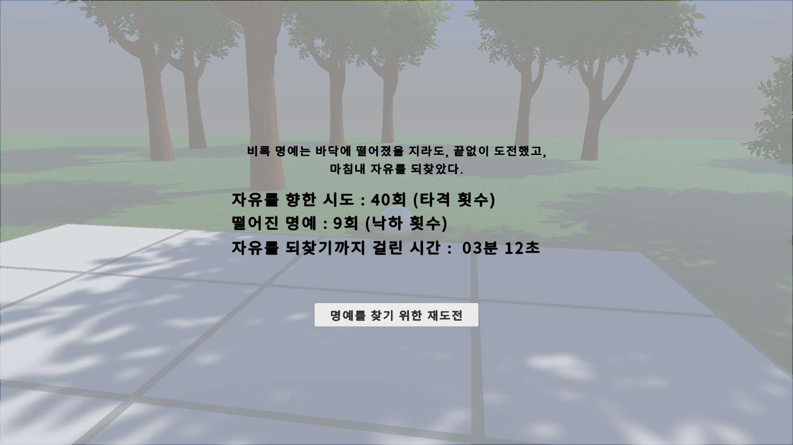

결과 화면에는 **자유를 향한 시도(타격 횟수)**, **떨어진 명예(낙하 횟수)**, **자유를 되찾기까지 걸린 시간**이 나옵니다.
"명예를 찾기 위한 재도전" 버튼으로 다시 도전할 수 있습니다. *(화면에서 보임)*

**친구 플레이 테스트** — 친구에게 빌드를 보내 플레이 테스트를 부탁했고, 받은 피드백으로 맵을 고쳤습니다(10-06 커밋 "QA 피드백 후 수정 완료"). *(출처: 본인 답변·커밋 기록)*

| 누가 | 타격 | 낙하 | 걸린 시간 | 이렇게 나온 이유 |
|---|---|---|---|---|
| 나 (만든 사람) | 40회 | 9회 | 3분 12초 | 어려운 길(윗길)로 가서 클리어한 기록입니다 |
| 처음 도전한 플레이어 | 197회 | 97회 | 14분 11초 | 처음 도전해서 클리어한 기록입니다 |
| 피드백을 준 친구 | 352회 | 171회 | 24분 29초 | 피드백을 주려고 여러 경로를 탐색하고 시도했습니다 |

*(출처: 결과 화면·본인 답변)*

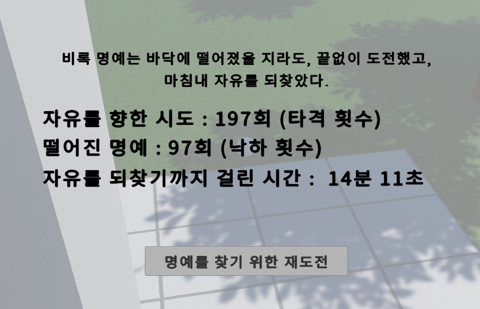

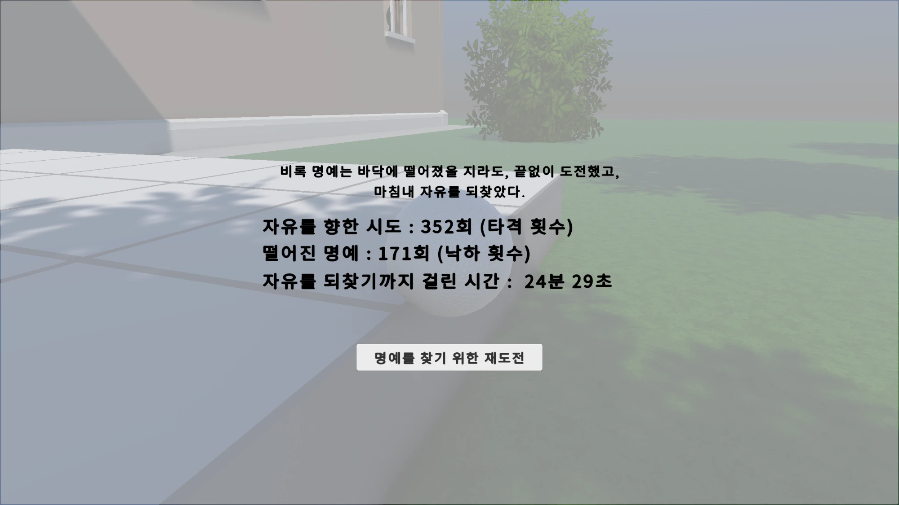

길을 아는 내가 어려운 길로 가도 3분 12초가 걸렸고, 처음 도전한 사람은 14분이 걸려 과제 조건(총 플레이 시간 3분 이상)을 넘었습니다.

**친구가 준 피드백과 고친 것**

| 피드백 | 원인 | 고친 것 |
|---|---|---|
| 어려운 길로 목표 지점에 도착했지만, 그다음 어디로 가야 하는지 몰랐습니다 | 따로 가이드가 없었습니다 | 이번에는 고치지 못했습니다 (→ 5-2 아쉬운 점·개선 계획) |
| 점프 쿠션으로 튀어 오른 공이 커튼에 끼었습니다 | 커튼봉 모양에 공이 걸렸습니다 | 끼이는 커튼봉에 박스 콜라이더를 더해 끼이지 않게 했습니다 |
| 창문을 뚫고 집 밖으로 나갈 수 있었습니다 (클리어는 안 됨) | 창문 밖에 콜라이더가 없었습니다. 집 주변 경계는 리셋 지점이라 클리어로 이어지지는 않았습니다 | 커튼 오브젝트를 더해, 그 콜라이더로 자연스럽게 탈출 경로를 막았습니다 |

*(출처: 본인 답변)*

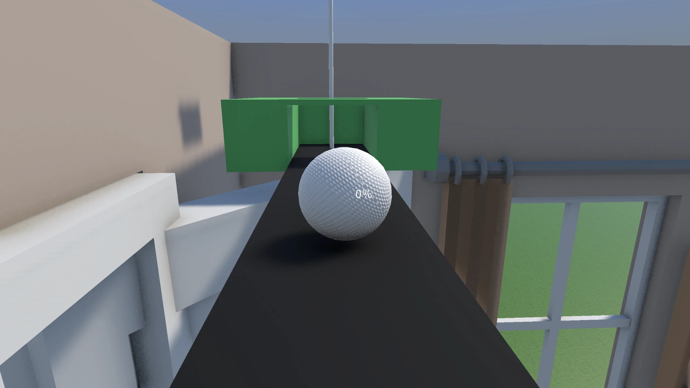

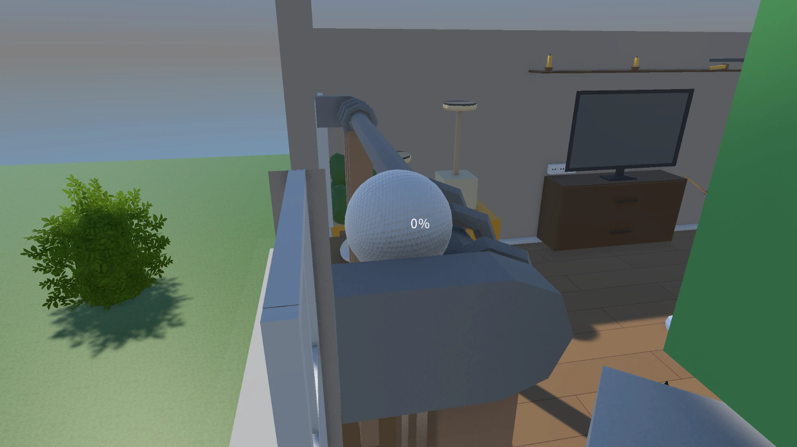

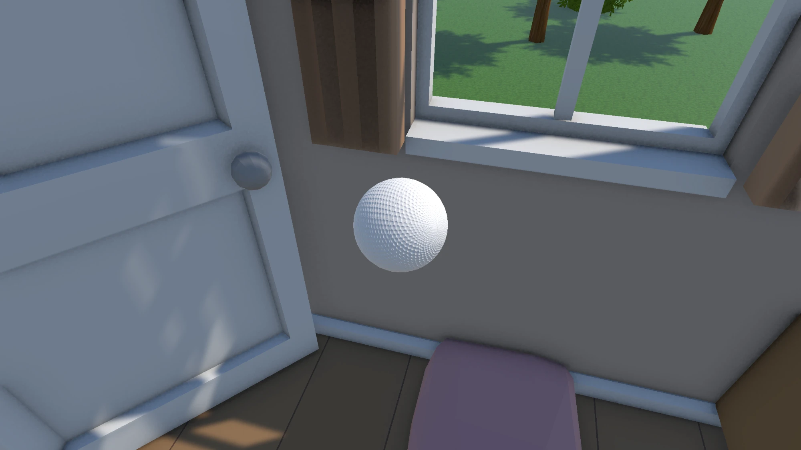

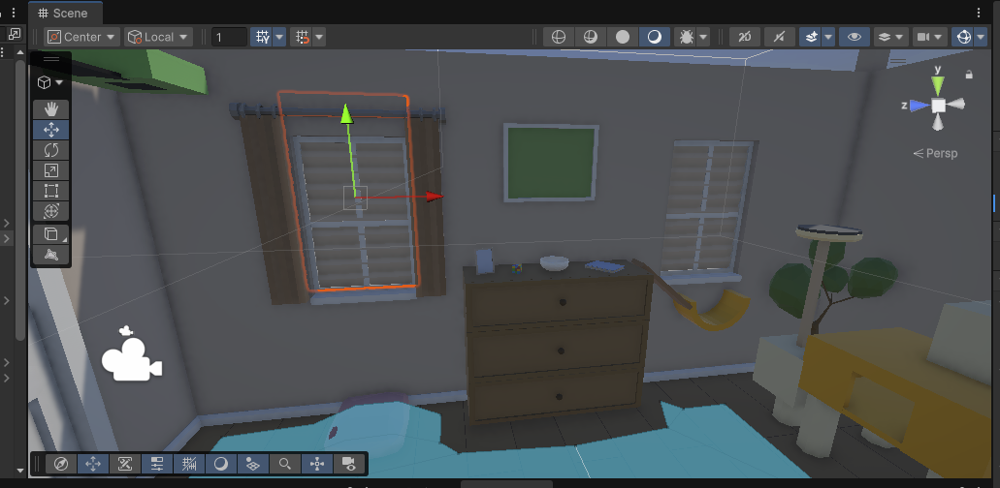

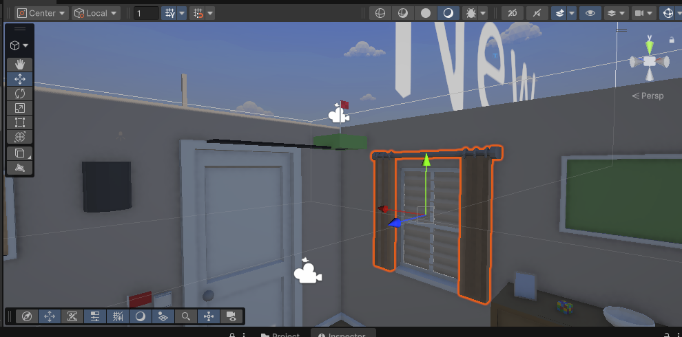

### 5-2. 아쉬운 점 · 개선 계획

**아쉬운 점 ① 어디로 가야 할지 모름**

처음 기획할 때는 Getting Over It처럼 **도전 욕구를 채우는 게임**을 만들고 싶었습니다.
그래서 게임 안의 안내는 키 안내와 "바닥에 떨어지면 이전 자리에서 다시 친다"는 것뿐이었고, 어디로 가야 하는지는 일부러 알려 주지 않았습니다.
하지만 막상 다른 사람이 플레이해 보니, 안내가 없어 **어디로 가야 할지, 목표 지점이 어디 있는지 몰랐습니다.**
게임을 시작할 때 목표 지점 두 곳을 3초씩 보여 주는 연출을 넣었지만, 그것만으로는 부족했습니다. *(출처: 본인 답변)*
두 갈래 길의 단점(정보가 없으면 방향을 잡기 어려움)이 그대로 드러난 부분입니다.

**아쉬운 점 ② 거실에서 처음 나오는 함정**

창고방을 튜토리얼(소개 코스)로 두었지만, 거실에 새로 등장하는 함정이 있었습니다. 이 부분을 놓쳤습니다. *(출처: 본인 답변)*
과제 작업지시서의 "응용·심화 코스에는 소개 코스에서 보여 주지 않은 새 장애물을 처음 등장시키지 않는다"는 규칙과 어긋나는 부분입니다. *(출처: 과제 작업지시서)*

**개선 계획** — 집 안 분위기를 깨지 않으려고 안내 표지판은 피했습니다. 대신 다음 방법이었다면 플레이어가 방향을 잡을 수 있었을 것이라고 생각합니다. *(출처: 본인 답변)*

- 바람 부는 소리와 시각 효과로 가야 할 방향을 알려 주기
- 거실에 들어왔을 때 목표 지점 두 곳을 카메라로 잠시 보여 주기
- 처음 보는 장애물이 나왔을 때 짧은 설명 UI를 보여 주기

### 5-3. 배운 점

탈출하는 길을 찾으며 여러 경로를 찾는 것이 이 게임의 재미라고 생각했지만, 그것이 재미가 아닐 수도 있다는 것을 배웠습니다.
게임을 만들 때는 "무엇이 재미있을까"보다 **플레이어에게 어떤 경험을 줄 것인지**를 더 생각해야 합니다.
"플레이어가 알아서 찾겠지"가 아니라 **"플레이어가 어디서 헤매게 될까"** 를 먼저 생각하고,
가이드 UI나 바람 효과 같은 게임 시스템으로 어디로 가야 하는지 목표를 정해 주는 것도 중요하다는 것을 배웠습니다. *(출처: 본인 답변)*

<!--
 📸 촬영 목록 (게임 녹화하면서 찍기 — images/ 에 넣고 각 절에 붙이세요)
 1. 레벨 전경에 진열장·창고방·거실·현관을 표시한 그림 — 2장
 2. 구역별 화면 1장씩 (진열장 / 창고방 / 거실 / 현관) — 3-2
 3. 함정 3종이 움직이는 짧은 GIF (쿠션 튕김 / 고양이가 공을 밀침 / 가속 판자) — 3-1
 4. 공을 치는 순간·떨어지는 순간 GIF — 5-1
 5. 플레이 영상 주소 — 1-3 "영상" 칸
-->
