# Escape for Freedom — 3D 맵(레벨) 디자인 문서

> 진열장에 갇힌 홀인원 골프공을 쳐서 집 밖으로 탈출시키는 3D 물리 미니 골프 게임입니다. 수업의 맵(레벨) 디자인 과제로 혼자 만들었습니다.
> 레벨 디자인(동선 · 장애물 · 함정 배치)은 제가 직접 했고, 함정 3종의 동작 스크립트는 AI로 만들었습니다.
<!-- ✏️ 11-26 v3 머리 두 줄 신설 — 근거: 1-1 소개 · 1-3 「만든 방식」(옛 1-3 「직접 한 일」 칸) -->

<!-- 확인 목록 (11-26 v3 코드 대조 · 재배치 · v4): 과제 저장소 3rd-minigolf_level_design-pinkshield main 18e4078 대조.
     작업 사본의 씬(01. MiniGolf Design.unity)에 커밋하지 않은 변경이 있어 git show 18e4078:로 읽었습니다. 인스펙터 값은 그 씬 · 프리팹 파일에서 읽은 값입니다.
     코드 근거: ✅ 저장소 대조(3-2 · 3-3 표, 4-1 값, 6-2 R 키, 6-3 벽, 8-2 수치) · 📄 0 · ❓ 4
       ❓① 함정 3종 밖의 스크립트(공 · 치기 · 시작 연출 · 안내 창 · 결과 화면 · 일시정지)를 누가 짰나 — 공 · 치기 · 카메라는 첫 커밋(b4ea32f)에 있음
       ❓② 함정 코드를 받은 AI 도구 이름과 지시문 원문 — 없으면 8장 ②칸(실제 지시문)은 비워 둠
       ❓③ 낙하 횟수 버그(8243d89)를 누가 찾고 누가 고쳤나 — 답을 받으면 9-2 표에 줄을 넣음(아래 9-2 숨김 주석에 초안)
       ❓④ 4-2 [A] 「쿠션을 뺀다」의 장단점 — 지금 칸은 문서 사실에서 이끌어 낸 것(✏️), 건우 님 답으로 바꿈
     11-26 코드대로 고친 곳(건우 님 "추천대로"): 6-2 "다시 시작하는 기능은 디버그 키로만" → R 키는 모든 플레이어가 쓰는 키(GolfBallTester.cs 58~63행, 10-05 1645b96부터 · 시작 안내 창 GolfHowToPlay.cs 41행) · 6-3 "벽 콜라이더를 꺼서" → 벽 오브젝트를 끄고 같은 순간 바깥 문을 엶(DoorTrigger.cs 41~46행).
     11-26 관문: 7-1 "학원 지원 에셋" → "수업 자료로 받은 에셋" · "다행히" 뺌 · 9장 머리 "한참 고생하다가" → 숫자 · 9-2 반말 캡션 · feedback-hard-goal alt 음슴체.
     11-26 v3 재배치(건우 님 목차 안 A 확인): 예전 → 새 번호 — 1-2 → 1-2(+문제 표) · 1-3 → 1-4(「직접 한 일」 칸 → 1-3) · 2-1 → 2-2 · 2-2 코어 루프 → 2-1, 주제 · 콘셉트 → 2-3 · 2-3 → 3-1 · 3-1 → 4-1 · 3-5 → 4-2 · 3-2 → 5-1 · 4-2 ② → 5-2 · 3-3 → 6-1 · 3-6 → 6-2 · 3-7 → 6-3 · 4-2 머리와 ① → 6-4 · 3-4 → 7-1 · AI 협업 → 8장 · 4장 → 9장(4-1 → 9-1 · 친구 피드백 표 → 9-2 · 4-2 개선안과 4-3 배운 점 → 9-3).
     「지금 고른다면」 자리(건우 님 답을 기다림): 4-2 쿠션 · 6-1 두 갈래 길 · 7-1 에셋. -->

## 1. 개요

### 1-1. 무엇을 만들었나

**집 안 진열장에 보관된 홀인원 골프공을 집 밖으로 탈출시키는** 3D 물리 기반 미니 골프 탈출 게임입니다. 수업의 맵(레벨) 디자인 과제로 만들었습니다. <!-- 출처: 본인 정리 -->

| 항목 | 내용 |
|---|---|
| 코스 한 바퀴 | 진열장 → 창고방 → 거실(목표 지점 두 곳) → 현관 → 집 밖 |
| 규모 | 구간 4곳 · 목표 지점 2곳 · 함정 3종(쿠션 4개 · 가속 판자 3개 · 고양이 1마리) |
| 기록 | 만든 사람 3분 12초 · 처음 도전한 플레이어 14분 11초 (9-1) |
<!-- ✏️ 11-26 v3 사양 표 신설 — 근거: 3-1 구간 표 · 씬 18e4078(Trampoline 4곳: Pillow_01 ×3 · Final Trampoline / Accel pad 프리팹 ×3 / cat ×1) · 9-1 기록 표 -->

### 1-2. 풀어야 했던 문제

**과제 조건** <!-- 출처: 과제 작업지시서 -->

- 새 장애물을 **최소 3종** 만듭니다.
- 그 장애물을 **소개 → 응용 → 심화** 세 코스에 나눠 배치해, 플레이어가 배우고 익히고 시험받게 합니다.
- 총 플레이 시간은 **3분 이상**이고, 마감은 10월 8일입니다.

**플레이어에게 주고 싶었던 경험** — 홀인원 공은 진열장에 보관되어 갇혀 있는 공입니다. 공이 바닥에 떨어지면 이전 위치에서 치는 것을 통해 도전 욕구를 끌어올리고 그 공을 집 밖으로 탈출시켜 도전에 성공한 뿌듯함과 탈출한 자유의 경험을 주고 싶었습니다.

| 풀어야 했던 문제 | 다룬 장 | 결과 한 줄 |
|---|---|---|
| 성격이 다른 새 장애물 3종 | 4. 함정 | 튕기는 쿠션 · 밀치는 고양이 · 가속하는 판자를 만들었습니다 |
| 소개 → 응용 → 심화 세 코스 | 5. 구간 | 창고방을 소개, 거실 · 현관을 응용 · 심화로 한 맵에 이었습니다. 거실에서 처음 나오는 함정이 남았습니다 |
| 스스로 길을 골라 집 밖으로 탈출 | 6. 동선 | 두 갈래 길과 홀컵 벽을 두었습니다. 처음 하는 사람은 어디로 갈지 헤맸습니다 |
<!-- ✏️ 11-26 v3 문제 표 신설 — 줄 = 기능 장 4 · 5 · 6. 총 플레이 시간(3분 이상)과 마감은 9-1 결과 표에서 받습니다. 결과 한 줄 근거: 4-1 · 5-1 · 5-2 · 6-1 · 6-3 · 6-4 -->

### 1-3. 만든 방식

| 맡은 것 | 제가 한 것 | AI가 한 것 |
|---|---|---|
| 레벨 디자인 (동선 · 장애물 · 함정 배치) | 모두 직접 했습니다 | — |
| 캣 타워 | Unity 기본 3D 도형으로 직접 만들었습니다 | — |
| 함정 3종의 동작 스크립트 | 어떤 장애물인지 설명하고, 플레이하며 수치를 고쳤습니다(8-2) | 코드를 설계하고 짰습니다 |

함정 3종의 동작 스크립트는 레벨 디자인에 집중하려고 AI로 만들었습니다.
<!-- ✏️ 11-26 v3 신설 — 옛 1-3 표의 「직접 한 일」 칸("레벨 디자인(동선·장애물·함정 배치), 캣 타워(Unity 기본 3D 도형). 함정 3종의 동작 스크립트는 레벨 디자인에 집중하려고 AI로 만들었습니다")을 표로 옮김.
     ❓ 그 밖의 스크립트(공 · 치기 · 시작 연출 · 안내 창 · 결과 화면 · 일시정지)는 누가 짰는지 확인하지 못해 줄을 두지 않았습니다(확인 목록 ❓①) -->

### 1-4. 개발 환경 · 링크

| 항목 | 내용 |
|---|---|
| 장르 | 물리 기반 미니 골프 스타일 탈출 게임 (3D) |
| 엔진·도구 | Unity 6000.3.15f1, JetBrains Rider, C# |
| 기간 | 2026-10-01 ~ 2026-10-06 |
| 성격 | 맵 디자인 과제 |
| 인원 | 개인 과제 (1인) |
| 사용 에셋 | 집 인테리어: [Low Poly Cartoon House Interiors](https://assetstore.unity.com/packages/package/167425) · 고양이: [Low-poly cat](https://prildarill.itch.io/meow) |
| 영상 | [소개 쇼츠 (53초)](https://youtube.com/shorts/EK8t_fhMLXM) · [플레이 시연 영상 (YouTube, 3분 31초)](https://youtu.be/yulQDb7e_fU) |
| GitHub | https://github.com/KooHoo-Dev/3rd-minigolf_level_design-pinkshield |
<!-- 11-25 공개 전환. 이전: 강사님이 추후 공개 예정 -->
<!-- 11-26 「직접 한 일」 줄은 1-3 「만든 방식」 표로 옮겼습니다. 기간 근거: 커밋 b4ea32f(10-01) ~ 18e4078(10-06) -->

---

## 2. 게임 디자인

<!-- 2026-11-21 강사님 피드백("모든 문서에 게임 디자인 파트, 기획 내용은 거기서")으로 만든 장.
     2-1은 1-1에 있던 플레이 방법, 2-2의 기획 이야기는 1-2에 있던 문단을 옮긴 것입니다.
     ✏️ 2-2의 코어 루프 그림과 그 아래 "이 반복이 …" 문단은 Claude가 1-2·1-1·3-1의 사실로 이어 쓴 것 — 본인 말로 확인 필요 -->
<!-- 11-26 v3 재배치: 옛 2-2 코어 루프 → 2-1 코스 한 바퀴의 흐름, 옛 2-1 → 2-2 조작, 옛 2-2의 「주제를 바꾼 이유」 · 「떨어진 명예」 → 2-3. 위 주석의 번호는 옛 번호입니다 -->

### 2-1. 코스 한 바퀴의 흐름 — 치고, 떨어지면 다시 치고, 문을 연다

**경험 목표 — 떨어져도 그 자리에서 다시 도전해, 공을 집 밖으로 탈출시킨 자유를 느끼게 합니다.** <!-- ✏️ 11-26 v3 — 1-2 「플레이어에게 주고 싶었던 경험」을 한 문장으로 줄임 -->

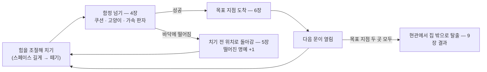

함정은 4장, 떨어지면 다시 치는 구간 설계는 5장, 길과 목표 지점은 6장에서 다룹니다. <!-- ✏️ 11-26 v3 다리 문장 -->
<!-- 🎞 GIF 자리: 떨어지면 친 자리로 돌아옴 — GIF 촬영 목록 5절 2번 (✂ 어려운길 + 쉬운길.mkv) · 5장 머리에 둠 -->

이 반복이 1-2에서 바란 경험을 만듭니다. 바닥에 떨어져도 처음으로 돌아가지 않고 치기 전 위치에서 바로 다시 칠 수 있어 도전 욕구가 이어지고,
목표 지점에 도착할 때마다 문이 열려 한 구간씩 집 밖에 가까워지는 것이 보입니다. 끝까지 가면 탈출한 자유를 느끼게 됩니다.

### 2-2. 조작

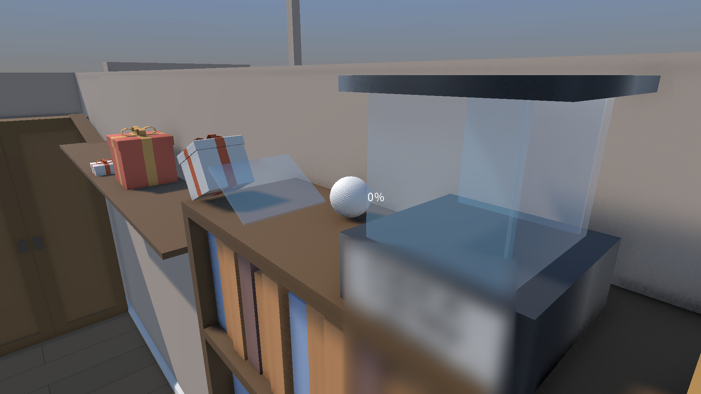
*① 진열장의 시작 장면입니다. 골프공 옆의 "0%"는 치는 힘 게이지입니다.* <!-- 출처: 본인 답변 -->

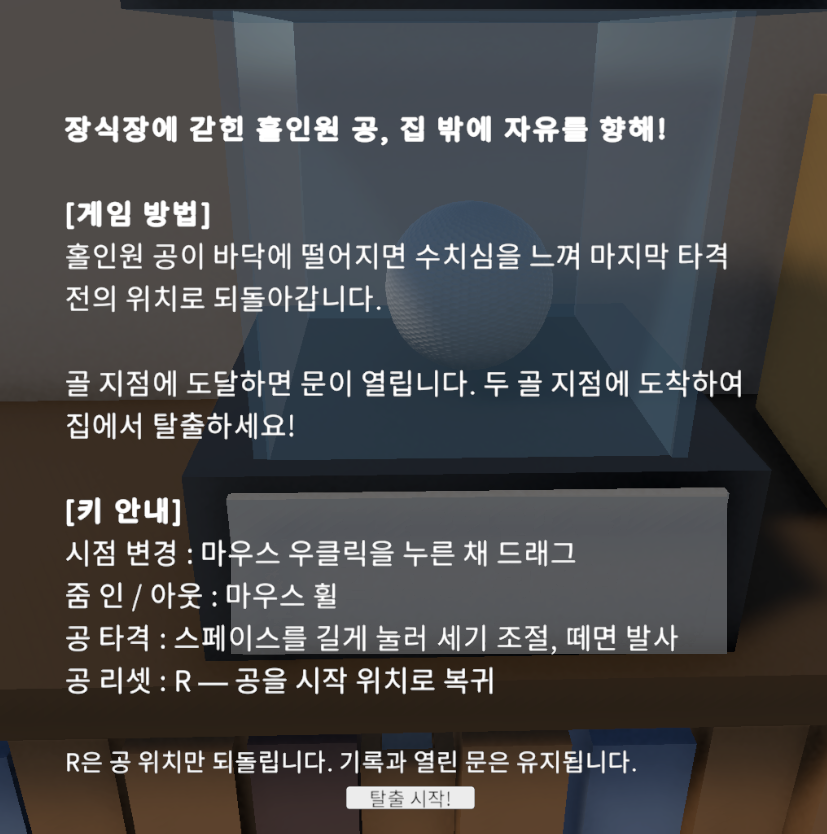
*목표 지점 두 곳을 3초씩 보여 주는 시작 연출이 끝나면 나오는 안내 창입니다. 게임 방법과 키를 알려 줍니다.* <!-- ✏️ 근거: GolfOpening.cs 72~79행(3초씩 → howToPlay.ShowAfterOpening) · GolfHowToPlay.cs 33~42행 -->
<!-- 🎞 GIF 자리: 첫 타 — 힘 게이지가 차고 공이 진열장 밖으로 — GIF 촬영 목록 5절 3번 (✂ 쉬운길 루트.mkv) -->

| 조작 | 키 |
|---|---|
| 공 치기 | 스페이스를 길게 눌러 세기를 조절하고, 떼면 발사 |
| 시점 바꾸기 | 마우스 오른쪽 버튼을 누른 채 끌기 |
| 줌 인 / 아웃 | 마우스 휠 |
| 공 되돌리기 | R — 공만 시작 위치로 돌아가고, 기록과 열린 문은 그대로 |

공이 바닥에 떨어지면 마지막으로 치기 전의 위치로 돌아갑니다. <!-- 출처: 시작 안내 화면 -->
<!-- 근거: GolfPlayer.cs 83~99행(스페이스 누르는 동안 힘이 1초 주기로 오르내림 · 떼면 Shoot) · GolfBallTester.cs 58~63행(R) · GolfBall.cs 53~58행(치기 직전 위치를 기억) (18e4078, 11-26 대조 ✅) -->

### 2-3. 주제와 콘셉트

**주제를 바꾼 이유** — 에셋을 찾아보다가 우연히 집 인테리어 에셋을 발견했습니다. 그때 미니 골프처럼 홀을 하나씩 깨는 스테이지 방식이 아니라,
집에서 빠져나가는 탈출 방식으로 방향을 바꿔야겠다고 생각했습니다. <!-- 출처: 본인 답변 -->

**"떨어진 명예"라는 콘셉트** — 홀인원이라는 큰 영광을 가진 공이 바닥에 떨어지면, 수치심을 느껴 치기 전 위치로 되돌아간다는 콘셉트입니다. <!-- 출처: 본인 답변 -->
결과 화면의 "떨어진 명예(낙하 횟수)"와 "비록 명예는 바닥에 떨어졌을지라도…" 문구도 여기서 나왔습니다. <!-- 출처: 본인 답변·결과 화면 -->

---

## 3. 전체 구조 — 레벨 지도

<!-- 11-26 v3 신설 장. 레벨 문서라 지도는 맵 자체입니다(통합본 부록 D 4-0). 3-1은 옛 2-3을 그대로 옮겼고, 3-2 · 3-3은 과제 저장소 18e4078에서 확인해 새로 썼습니다(✏️) -->

### 3-1. 레벨 지도 — 네 구간과 두 갈래 길

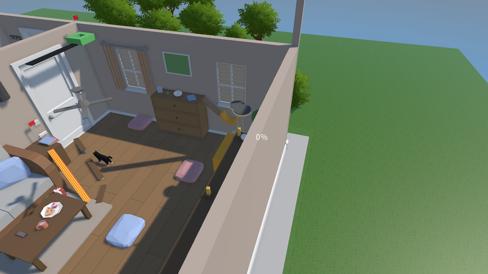
*집 안 코스 전경입니다. 진열장 → 창고방 → 거실 → 현관 순서로 이어집니다.*

맵은 진열장 → 창고방 → 거실 → 현관 네 구간으로 이어집니다. 진열장에서 어느 길로 갈지 정해지고, 창고방을 지나 윗길과 아랫길로 나뉩니다.
거실의 목표 지점 두 곳에 모두 도착하면 현관에서 집 밖으로 탈출할 수 있습니다.

이 그림에서 볼 것은 창고방에서 갈라진 두 길이 거실의 목표 지점 두 곳에서 다시 만나는 모양입니다. 실선은 공이 가는 길이고, 점선은 R 키로 처음부터 다시 가는 선택입니다. <!-- ✏️ 11-26 v3 -->

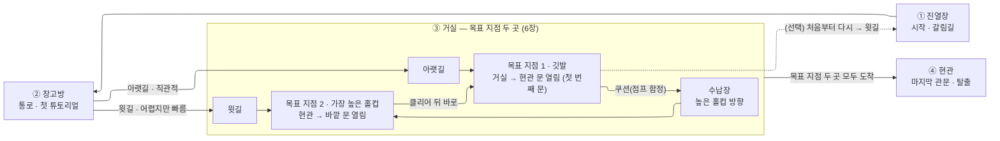

그래서 어느 길로 가도 목표 지점 두 곳을 모두 거쳐야 현관 → 바깥 문까지 열립니다. <!-- ✏️ 11-26 v3 — 근거: 아래 구간 표 ③ · DoorTrigger 두 곳(깃발 First Goal · 높은 홀컵 Cup Trigger → Final Door Controller) -->

| 구간 | 역할 |
|---|---|
| ① 진열장 | 골프공이 처음 시작하는 곳입니다. 어려운 길과 쉬운 길 중 어디로 갈지 정해지는 **갈림길**입니다 |
| ② 창고방 | 윗길·아랫길로 이어지는 통로이자 첫 튜토리얼 구간입니다 |
| ③ 거실 | 목표 지점 두 곳이 있습니다. 목표 지점 1(깃발)에 도착하면 거실 → 현관 문이, 목표 지점 2(가장 높은 홀컵)에 도착하면 현관 → 바깥 문이 열립니다 |
| ④ 현관 | 목표 지점 두 곳에 모두 도착한 뒤 집 밖으로 탈출하는 마지막 관문입니다 |

**두 갈래 길**

| 루트 | 특징 |
|---|---|
| 윗길 | 가장 높은 홀컵(**목표 지점 2**)으로 가는 길입니다. 처음에는 어렵지만, 높은 홀컵에 도착하면 **바로 깃발(목표 지점 1)로** 이어져 빨리 끝낼 수 있습니다 |
| 아랫길 | 직관적인 길로, **목표 지점 1**에 먼저 도착합니다. 대신 첫 번째 문을 연 뒤에는 **쿠션(점프 함정)** 을 밟고 높은 홀컵 쪽 수납장으로 가야 합니다. 처음부터 다시 윗길로 가는 편이 빠를 수도 있습니다(선택) |

### 3-2. 맵에 놓은 장치

맵 위의 장치는 모두 스크립트 하나씩으로 움직입니다. 값은 씬에 놓인 인스펙터 값입니다. <!-- ✏️ 11-26 v3 -->

| 역할 (이름) | 하는 일 | 하지 않는 일 | 놓인 곳 · 값 | 다룬 장 |
|---|---|---|---|---|
| 공 치기 (GolfPlayer) | 스페이스를 누르는 동안 힘이 0~100%를 오르내리고, 떼면 카메라가 보는 방향으로 공을 칩니다 | 공을 직접 움직이지 않습니다 — 공(GolfBall)이 힘을 받아 움직입니다. 공이 멈추기 전에는 치지 않습니다 | 최대 힘 10 · 한 번 오르는 데 1초 | 2-2 |
| 공 (GolfBall) | 받은 방향과 힘으로 움직이고, 치기 직전 위치를 기억합니다 | 떨어졌는지 판단하지 않습니다 — 바닥 리셋이 알려 주면 기억한 위치로 돌아갑니다 | 0.3초 동안 느리면 멈춘 것으로 봅니다 | 2-1 · 5-1 |
| 바닥 리셋 (ResetPlaforms) | 공이 닿으면 낙하 횟수를 하나 올리고 공을 치기 전 위치로 돌려보냅니다 | 위치를 기억하지 않습니다 — 공이 기억합니다 | 집 바닥 ResetFloor 1곳 | 5-1 |
| 쿠션 (Trampoline) | 공이 닿으면 내려오던 속도를 없애고 위로 튕겨 올립니다 | 옆 방향은 정하지 않습니다 — 쿠션 모양과 부딪힌 각도로 정해집니다 | 거실 쿠션 3개 힘 10 · 현관 쿠션 1개 힘 15 | 4-1 |
| 가속 판자 (AccelerationPad) | 판자 위에 있는 동안 공이 움직이는 방향으로 가속을 더합니다 | 멈춘 공은 밀지 않습니다 | 3개 · 가속 10 | 4-1 |
| 고양이 (CatController) | 생성 위치 반경 4m를 돌아다니다 3m 안의 공을 쫓고, 5m 밖으로 멀어지면 다시 돌아다닙니다 | 공을 미는 코드는 없습니다 — 고양이 몸이 부딪혀 밉니다. 높이 차가 1m를 넘거나 생성 위치에서 8m 밖의 공은 쫓지 않습니다 | 1마리 · 거실 | 4-1 |
| 문 열기 (DoorTrigger) | 목표 지점에 공이 들어오면 문을 열고, 연결한 벽 오브젝트를 끕니다 | 한 번 연 문을 다시 닫지 않습니다 | 깃발(목표 지점 1) · 높은 홀컵(목표 지점 2) | 6-3 |
| 공 되돌리기 (GolfBallTester) | R 키로 공을 시작 위치에 놓습니다 | 문과 기록은 되돌리지 않습니다 | 진열장 시작 위치 | 6-2 |
| 시작 연출 (GolfOpening) | 목표 지점 두 곳을 카메라로 3초씩 보여 준 뒤 안내 창을 엽니다 | 가는 길은 보여 주지 않습니다 — 목표 지점만 비춥니다 | 3초씩 | 6-4 |
| 결과 화면 (GolfEnding) | 공이 집 밖 엔딩 구역에 들어오면 타격 · 낙하 횟수와 걸린 시간을 보여 줍니다 | 횟수를 직접 세지 않습니다 — 공 치기와 바닥 리셋이 알려 줍니다 | 현관 밖 EndingZone | 9-1 |
<!-- ✏️ 11-26 v3 신설. 근거(18e4078, 11-26 대조 ✅): GolfPlayer.cs 75~99행 · 씬 minPower 0 · maxPower 10 · cycleTime 1 / GolfBall.cs 27 · 46~58 · 78~82행 · 씬 stopSpeed 0.1 · stopDelay 0.3 / ResetPlaforms.cs 12~23행 · 씬 ResetFloor / Trampoline.cs 19~26행 · 씬 Pillow_01 ×3 bounceForce 10 · Final Trampoline 15(코드 기본 15) / AccelerationPad.cs 12~40행 · 프리팹 Accel pad acceleration 10 · 씬 3개(값 덮어쓰기 없음) / CatController.cs 94~112 · 130~166행 · 씬 값 = 코드 기본(4 · 3 · 5 · 높이 1 · 8m) · CapsuleCollider + Kinematic Rigidbody / DoorTrigger.cs 21~46행 · 씬 Cup Trigger(Lab Green_Final) → Final Door Controller · clearbox = Trigger Box, Flag 프리팹 First Goal / GolfBallTester.cs 58~63행 / GolfOpening.cs 16 · 69~80행 / GolfEnding.cs 70~88행 · 씬 EndingZone.
     「엔딩 구역이 현관 밖」은 5-1 ④ 「문밖의 잔디를 밟으면 클리어」(본인 답변)와 씬 이름 EndingZone에서. 정확한 위치는 씬 좌표로 확인하지 않았습니다 -->

### 3-3. 약속 — 장치가 공을 알아보는 법

| 약속 | 보내는 쪽 | 받는 쪽 | 무엇이 일어나나 |
|---|---|---|---|
| `Ball` 태그 | 공 | 바닥 리셋 · 문 열기 | 태그가 `Ball`인 물체가 들어올 때만 되돌리거나 문을 엽니다 |
| 공의 Rigidbody | 공 | 결과 화면 | 인스펙터에 연결한 그 공이 들어올 때만 게임이 끝납니다 |
| `RecordMove()` · `RecordFall()` | 공 치기 · 바닥 리셋 | 결과 화면 | 타격 · 낙하 횟수를 하나씩 셉니다 |
| `NotifyBallReset()` | 공 | 고양이 | 공이 순간이동하면 고양이가 쫓기를 멈추고, 공이 0.3m 움직일 때까지 다시 쫓지 않습니다 |
| 애니메이터 `Open` | 문 열기 | 문 | 문이 열립니다 |

그래서 쿠션과 가속 판자는 다른 스크립트를 참조하지 않고 부딪힌 물체의 Rigidbody만 보므로, 복제해 놓기만 하면 맵에 더할 수 있습니다(거실 쿠션 3개 · 가속 판자 3개). <!-- ✏️ 11-26 v3 -->
<!-- 근거(18e4078 ✅): ResetPlaforms.cs 14행 · DoorTrigger.cs 12 · 36행("Ball") · GolfEnding.cs 72행(attachedRigidbody != ballBody) · GolfPlayer.cs 97행 · ResetPlaforms.cs 19행 · GolfBall.cs 81 · 91행 → CatController.cs 252~264 · 86~92행(ballMoveToRearm 0.3) · DoorTrigger.cs 18 · 41행 · Trampoline.cs · AccelerationPad.cs에는 다른 스크립트 참조가 없음 -->

---

## 4. 함정 — 튕기고, 밀치고, 가속한다

1-2의 첫 문제(새 장애물 3종)를 푸는 장입니다. 코스 한 바퀴에서는 「함정 넘기」 단계이고, 3장 지도의 거실 · 현관에 놓였습니다. <!-- ✏️ 11-26 v3 다리 문장 -->

<!-- ✏️ 11-24 장 재구성(통합본 「장 재구성 판단」 — Escape: 4장 결정을 3장 뒤로): 옛 「3. 구역별 설계 의도」와 「4. 고민과 선택」을 한 장으로 합쳤습니다.
     옛 4-1 ~ 4-5 → 3-3 ~ 3-7, 옛 5장 → 4장. 절 안의 글은 그대로이고, 3-3 · 3-4 표만 결정 표 양식으로 바꿨습니다 -->
<!-- 11-26 v3 재배치: 위 11-24의 3장을 4 함정 · 5 구간 · 6 동선 · 7-1 에셋으로 나눴습니다. 옛 3장 머리 문장 "함정과 구간을 어떻게 놓았는지(3-1 · 3-2) 본 뒤, 그 배치를 정하며 고른 것(3-3 ~ 3-7)을 이어서 적었습니다. ✏️"는 장이 나뉘어 뺐습니다. 옛 3장 머리 그림 play-ramp.png는 6장 머리로 옮겼습니다 -->

### 4-1. 튕기고, 밀치고, 가속하는 함정 세 가지

과제 조건(새 장애물 최소 3종)에 맞춰, 성격이 다른 함정 세 가지를 두었습니다.

| 함정 | 종류 | 동작 | 값 (인스펙터) |
|---|---|---|---|
| 쿠션 | 점프 함정 | 공을 튀어 오르게 합니다. 아랫길에서는 높은 홀컵 쪽 수납장으로 가는 **길**로도 쓰입니다 | 튀어 오르는 힘 — 거실 3개 10 · 현관 1개 15 |
| 고양이 | 이동형 함정 | 돌아다니다가 공을 발견하면 쫓아가 밀쳐냅니다 | 돌아다니는 반경 4m · 발견 3m · 놓침 5m |
| 가속 이동 판자 | 가속 플랫폼 | 밟으면 공이 움직이는 방향으로 가속이 붙습니다 | 가속 10 (3개) |
<!-- ✏️ 11-26 v4 값 칸 신설 — 씬 · 프리팹 18e4078에서 읽은 값(3-2 근거 주석). 📷 자리: 함정 스크립트 인스펙터 — GIF 촬영 목록 5절 4번(trap-inspector.png, 건우 님) -->

**쿠션 — 운과 재도전** · 아랫길에서 수납장으로 가는 쿠션은, 공이 떨어진 메쉬 콜라이더의 각도에 따라 여러 방향으로 튀어 나갑니다.
방향이 좋으면 안전하게 수납장으로 가고, 나쁘면 바닥에 떨어져 다시 쳐야 합니다.
복불복의 느낌을 주면서도 다시 해 보고 싶게 만드는 경험을 주고 싶었습니다. 현관에서는 집 밖으로 나가는 마지막 발판으로도 씁니다. <!-- 출처: 본인 답변 -->
<!-- 근거: Trampoline.cs 19~26행 — 스크립트는 내려오던 y 속도만 0으로 하고 위(Vector3.up)로만 충격을 줍니다. 옆 방향은 쿠션 메쉬와의 물리 충돌에서 정해지므로 위 문장과 맞습니다(11-26 대조 ✅) -->

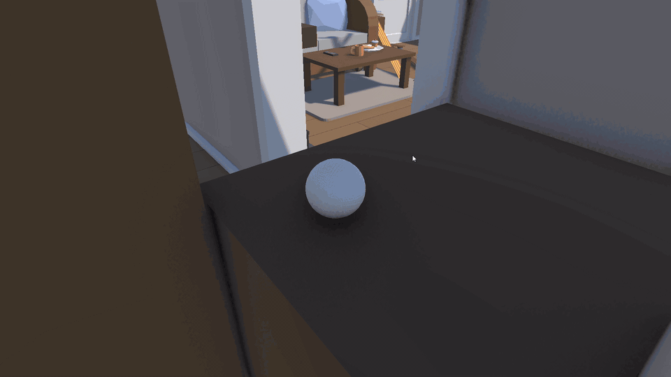
*쿠션에 올린 공이 높이 튀어 올라 거실 쪽으로 날아갑니다. 쿠션은 위로만 튕기고, 옆 방향은 쿠션 모양과 부딪힌 각도로 정해집니다.* <!-- ✏️ 뒤 문장 — Trampoline.cs 19~26행 -->

**고양이 — 살아 있는 방해꾼** · 거실에서 아랫길로 가는 소파 밑, TV 테이블 밑 주변과 거실 바닥 주변을 돌아다닙니다.
NavMesh로 돌아다니다가 골프공을 발견하면 공을 향해 가서 밀쳐냅니다. <!-- 출처: 본인 답변 -->
코드에서는 생성 위치 반경 4m 안을 돌아다니다가, 3m 안에 공이 들어오면 쫓아가고 5m 밖으로 멀어지면 다시 돌아다닙니다. <!-- 출처: 코드 `CatController.cs` -->

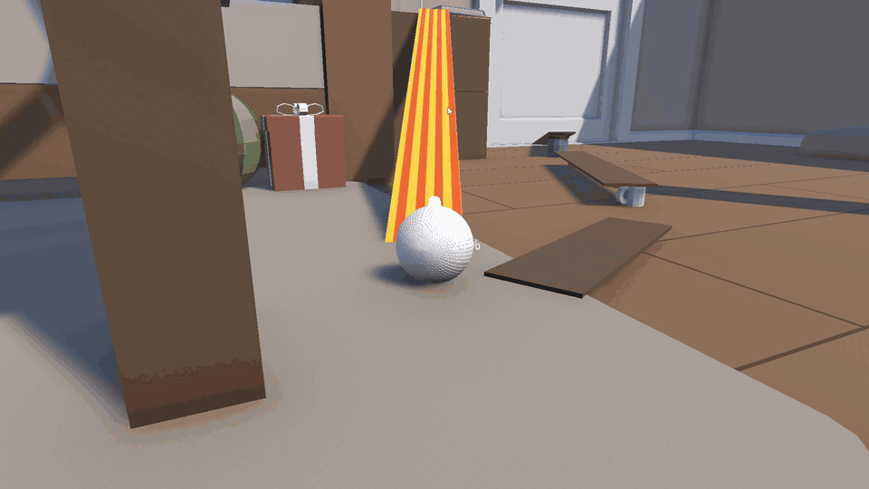
*고양이가 주변을 돌아다니다가 3m 안에 들어온 공 쪽으로 다가옵니다.* <!-- ✏️ 3m — CatController.cs 21 · 100행 -->

**가속 판자 — 돕기도, 떨어뜨리기도** · 공이 움직이는 방향에 따라 플레이어를 돕기도 하고, 잘못 들어가면 바닥으로 떨어져 다시 쳐야 합니다. <!-- 출처: 본인 답변 -->

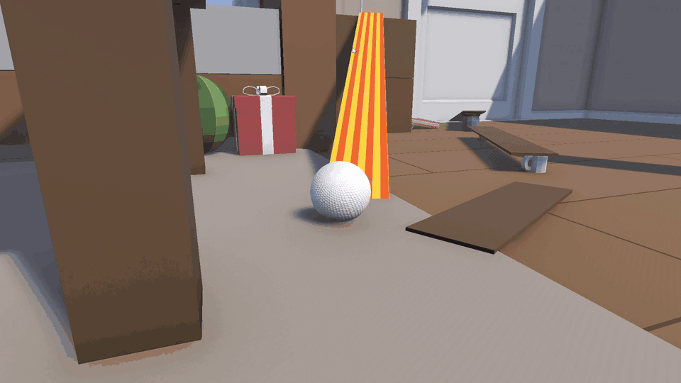
*가속 판자에 올라간 공이 진행하던 방향으로 가속을 받습니다. 판자는 공이 움직이는 방향 그대로 밀기 때문에, 들어간 방향에 따라 돕기도 하고 떨어뜨리기도 합니다.* <!-- ✏️ 뒤 문장 — AccelerationPad.cs 36~40행 · 위 본문 -->

### 4-2. 복불복 쿠션을 남길까

과제 작업지시서에는 "운만으로 결정되는 구간은 난이도가 아니라 벌"이라는 기준이 있습니다. 튀는 방향이 매번 달라지는 쿠션은 이 기준에 걸릴 수 있습니다. <!-- 출처: 과제 작업지시서 -->

> **결정 대상** 튀는 방향이 매번 달라지는 쿠션을 맵에서 뺄지, 남길지. <!-- ✏️ -->
> **기준** 과제 작업지시서 — "운만으로 결정되는 구간은 난이도가 아니라 벌"입니다. <!-- ✏️ -->

| | [A] 쿠션을 뺀다 | **[B] 쿠션을 남긴다 ✓** |
|---|---|---|
| 장점 | 과제 기준에 걸리지 않습니다 | 떨어져도 바로 그 전 위치에서 다시 칠 수 있어 **벌이 작습니다**. 여러 방향으로 튀다 보면 **새로운 경로를 찾는 경험**을 줄 수 있습니다 |
| 단점 | 아랫길에서 수납장으로 가는 길과 현관의 마지막 발판이 없어집니다 | 튀는 방향이 매번 달라 과제 기준에 걸릴 수 있습니다 |
| 정한 사람 | 기준: 과제 작업지시서 · 고름: 저 | |
<!-- ✏️ 11-26 v4 결정 표 신설. [B] 칸은 아래 옛 3-5 목록 두 줄을 옮긴 것입니다. [A] 장점 · 단점은 문서 사실(위 첫 문단 · 4-1 쿠션 표 「길로도 쓰입니다」 · 「현관의 마지막 발판」)에서 이끌어 낸 것이라 건우 님 답으로 바꿉니다(확인 목록 ❓④) -->

**[B]를 골랐습니다.** 그래도 쿠션을 남긴 이유는 두 가지입니다. <!-- 출처: 본인 답변 -->

- 떨어져도 바로 그 전 위치에서 다시 칠 수 있어 벌이 작다고 판단했습니다.
- 계속 도전하면서 여러 방향으로 튀다 보면 새로운 경로를 찾는 경험을 줄 수 있다고 생각했습니다.

---

## 5. 구간 — 배우고, 익히고, 시험받는다

1-2의 두 번째 문제(소개 → 응용 → 심화 세 코스)를 푸는 장입니다. 코스 한 바퀴의 「떨어지면 다시 치기」가 모든 구간에 걸려 있고, 3장 지도의 네 구간 순서를 따릅니다. <!-- ✏️ 11-26 v3 다리 문장 -->
<!-- 🎞 GIF 자리: 떨어지면 친 자리로 돌아옴 — GIF 촬영 목록 5절 2번 (✂ 어려운길 + 쉬운길.mkv) -->

### 5-1. 배우고, 익히고, 시험받는 네 구간

과제의 소개 → 응용 → 심화 세 코스를 한 맵에 이어 붙였습니다. 창고방이 소개, 거실과 현관이 응용·심화 코스입니다. <!-- 출처: 본인 답변 -->
<!-- 11-26 절 제목의 부제 「— 구간별 의도」는 뺐습니다(통합본 v4 1-8 절 제목 25자) -->

| 구간 | 코스 | 이 구간에서 일어나는 일 |
|---|---|---|
| ① 진열장 | 시작 | 어느 길로 갈지 정해지는 갈림길(3-1) |
| ② 창고방 | 소개 | 첫 튜토리얼 구간(3-1) |
| ③ 거실 | 응용·심화 | 점프 쿠션, 가속 판자, 여러 가구 배치를 플레이어가 직접 겪으며 길을 만들어 갑니다 |
| ④ 현관 | 응용·심화 | 현관의 점프 쿠션으로 집 밖으로 탈출합니다. 문밖의 잔디를 밟으면 클리어입니다 |

모든 구간에서 힘 조절, 조준, 타이밍, 길 선택이 필요합니다. 실패하면 공이 바닥에 떨어지고, 떨어지기 전 위치에서 다시 쳐야 합니다. <!-- 출처: 본인 답변 -->
<!-- 근거: 창고방 튜토리얼 — 커밋 1b03659 「맵 업데이트 (튜토리얼 방 생성)」 · 떨어지면 다시 — ResetPlaforms.cs 12~23행 → GolfBall.ReturnToLasShotPosition (18e4078 ✅) -->

### 5-2. 남은 문제 — 거실에서 처음 나오는 함정

창고방을 튜토리얼(소개 코스)로 두었지만, 거실에서 처음 나오는 함정이 있었습니다. 과제 작업지시서의 "응용·심화 코스에는 소개 코스에서 보여 주지 않은 새 장애물을 처음 등장시키지 않는다"는 규칙과 어긋납니다.
이번에는 고치지 못했고, 다시 다듬는다면 처음 보는 장애물이 나왔을 때 짧은 설명 UI를 보여 줍니다(9-3).
<!-- ✏️ 11-26 v3 — 옛 4-2 표 ② 줄(발견한 문제 · 원인 · 개선안)을 원인이 있는 구간 장으로 옮기며 문장으로 이었습니다. 출처: 본인 답변 · 과제 작업지시서.
     ❓ 거실에서 처음 나온 함정이 무엇인지(쿠션 · 가속 판자 · 고양이 중) 문서에 없습니다. 씬 좌표로 창고방 · 거실 경계를 확인하지 않았습니다 -->

---

## 6. 동선 — 두 갈래 길에서 고른다

1-2의 세 번째 문제(스스로 길을 골라 탈출)를 푸는 장입니다. 코스 한 바퀴에서는 「목표 지점 도착 → 문이 열림」 단계이고, 3장 지도의 거실 목표 지점 두 곳입니다. <!-- ✏️ 11-26 v3 다리 문장 -->
<!-- 🎞 GIF 자리: 갈림길 — 창고방을 지나 윗길 · 아랫길이 한 화면에 — GIF 촬영 목록 5절 1번 (✂ 어려운길 + 쉬운길.mkv) -->

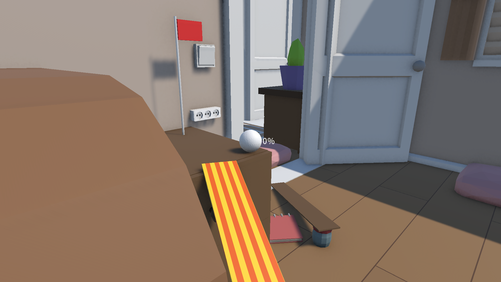
*③ 거실의 책장 위 경사로와 깃발(목표 지점 1)입니다. 윗길은 이 경사로를 올라 가장 높은 홀컵으로 갑니다.* <!-- ✏️ 뒤 문장 — _intake/촬영목록.md 5번 「윗길 — 책장 위 경사로를 올라 가장 높은 홀컵」 -->

### 6-1. 길을 한 갈래로 할까, 두 갈래로 할까

**상황** — 집 배치는 에셋에 있는 것을 그대로 가져왔습니다. 진열장과 창고방에 장애물과 길을 놓으면서 길을 두 갈래로 나누는 구조를 생각했습니다. <!-- 출처: 본인 답변 -->

> **결정 대상** 진열장에서 시작하는 길을 한 갈래로 이을지, 윗길과 아랫길 두 갈래로 나눌지. <!-- ✏️ -->

<!-- ✏️ 표를 결정 표 양식으로 바꿨습니다(11-24 장 재구성). 칸 내용은 원래 표 그대로이고, 옛 「두 갈래 길 (선택)」 칸 뒤의 설명을 「방식」 줄로 옮기며 문장 끝만 습니다체로 바꿨습니다("감" → "갑니다", "해야 함" → "해야 합니다"). [A] 방식은 [A] 장점 칸의 "한 길로 보내면서"에서 가져왔습니다 -->
| | [A] 한 갈래 길 | **[B] 두 갈래 길 ✓** |
|---|---|---|
| 방식 | 한 길로 보냅니다 | 윗길은 처음 구간이 어렵지만 목표 지점 2까지 곧장 가고, 목표 지점 2에 도착한 뒤에는 목표 지점 1까지 쉽게 갑니다. 아랫길은 직관적이지만, 목표 지점 1에 도착한 뒤에 목표 지점 2에 도전해야 합니다 |
| 장점 | 길이 하나라 단순해서, 플레이어가 처음 게임에 익숙해지도록 설계할 수 있습니다. 한 길로 보내면서 튜토리얼처럼 단계를 줄 수 있습니다. 따로 정보를 주지 않아도 한 방향이라 진행할 수 있습니다 | 플레이어에게 길을 고를 자유를 주어, 여러 시도와 다양한 경험을 할 수 있게 합니다 |
| 단점 | 도전 욕구가 강한 플레이어에게는 밋밋한 시작이 될 수 있습니다 | 정보를 주지 않으면 어디로 가야 할지 방향을 잡지 못할 수 있습니다. 맵을 만들 때 갈라진 뒤의 경로를 더 설계해야 합니다 |
| 정한 사람 | 기준 · 고름: 저 | |
<!-- ✏️ 11-26 v4 「정한 사람」 행 — 근거: 위 「상황」(두 갈래 구조를 생각함, 본인 답변). AI가 안을 냈다는 기록은 없습니다 -->

<!-- ✏️ 옛 머리 「**선택 이유** —」를 결정 표 양식의 "[B]를 골랐습니다."로 바꿨습니다. 뒤의 글은 그대로입니다 -->
**[B]를 골랐습니다.** 어려운 도전을 해낸 사람에게는, 첫 도전을 마치면 다음 도전이 순조롭게 풀리는 경험을 주고 싶었습니다.
그래서 어려운 윗길로 가장 높은 홀컵에 도착하면 바로 깃발로 이어져 빨리 끝낼 수 있게 했습니다.
쉬운 아랫길도 보이는 길을 따라 쭉 가다가 중간에 갈림길이 나오는 구조라, 그곳을 넘어가는 것이 쉽지만은 않습니다. <!-- 출처: 본인 답변 -->

**감수한 단점** — 정보를 주지 않으면 어디로 가야 할지 방향을 잡기 어렵다는 점입니다. 이 단점은 친구 플레이 테스트에서 그대로 드러났습니다(6-4).

**예상과 실제** — 처음 하는 사람은 이어져 있는 쉬운 길로 갈 것이라고 예상했고, 대부분 첫 플레이는 예상대로 흘러갔습니다. <!-- 출처: 본인 답변 -->

**결과 화면과의 연결** — 모든 길을 지나 험난한 도전을 마쳤을 때, 공을 친 횟수와 떨어진 횟수를 보며
"내가 이렇게 많이 쳤어? 이렇게 많이 떨어졌어?"라는 생각이 들게 하고 싶었습니다. <!-- 출처: 본인 답변 -->

### 6-2. 첫 번째 문을 연 뒤의 흐름

아랫길로 첫 번째 문을 연 뒤 진열장에서 다시 시작하게 만드는 흐름은 구현하지 않았습니다. 다시 시작하지 않아도 점프 쿠션을 써서 두 번째 목표 지점으로 가는 길로 갈 수 있기 때문입니다.
다만 처음부터 다시 윗길로 가는 편이 더 빠를 수도 있어서, 하나의 선택지로 제안했습니다. 다시 시작하려면 R 키를 누르면 되고(공만 시작 위치로, 열린 문과 기록은 그대로), 시작 안내 창에 적어 두었습니다. 어느 쪽으로 갈지는 플레이어가 목표 지점 2로 가는 길을 스스로 생각하고 시도해야 합니다. <!-- 출처: 본인 답변 -->
<!-- ✏️ 11-26 코드 대조로 고침(건우 님 "추천대로"). 옛 문장: "다시 시작하는 기능은 디버그 키로만 있어서, 실제로는 플레이어가 목표 지점 2로 가는 길을 스스로 생각하고 시도해야 합니다."
     코드: GolfBallTester.cs 58~63행 — R 키는 "테스트 모드와 관계없이" ball.PlaceAt(startPosition). 10-05 커밋 1645b96에서 테스트 모드의 2번 키가 R로 바뀜 · GolfHowToPlay.cs 41~42행 안내 창 "공 리셋 : R — 공을 시작 위치로 복귀 / R은 공 위치만 되돌립니다. 기록과 열린 문은 유지됩니다." (18e4078 ✅) -->

### 6-3. 홀컵 앞 지름길을 막을까

**상황** — 가장 높은 홀컵(목표 지점 2) 근처에는 깃발(목표 지점 1)로 이어지는 검은 길이 있습니다.
그런데 이 검은 길의 틈으로 떨어진 공이 쿠션을 타고 다시 올라와, 정해 둔 길을 거치지 않고 홀컵에 들어갈 수 있었습니다. <!-- 출처: 본인 답변 -->

**선택** — 이 지름길을 벽으로 막았습니다. 그리고 공이 홀컵 플랫폼의 Trigger에 닿으면 벽 오브젝트를 끄고 같은 순간 현관 → 바깥 문을 열어, 그때부터 검은 길을 따라 깃발 쪽으로 갈 수 있게 했습니다. <!-- 출처: 본인 답변 -->
<!-- ✏️ 11-26 코드 대조로 고침(건우 님 "추천대로"). 옛 문장: "이 지름길을 **벽 콜라이더로 막았습니다.** 그리고 공이 홀컵 플랫폼의 **Trigger**에 닿으면 벽 콜라이더를 꺼서, 그때부터 …"
     코드: DoorTrigger.cs 41~46행 — doorAnimator.SetTrigger("Open") 뒤 clearbox.SetActive(false). 씬의 Cup Trigger(Lab Green_Final 아래)가 clearbox = Trigger Box(트리거가 아닌 BoxCollider + MeshRenderer)를 끄고, doorAnimator는 Final Door Controller(현관 → 바깥 문)입니다 (18e4078 ✅).
     11-26 절 제목의 부제 「— 홀컵에 들어와야 열리는 벽」은 뺐습니다(통합본 v4 1-8 절 제목 25자) -->

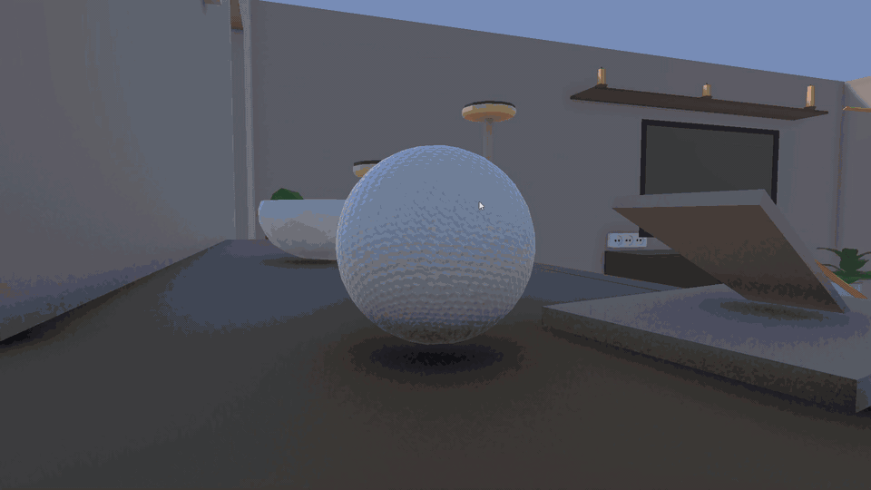
*쿠션을 타고 올라온 공이 홀컵에 들어가면 지름길을 막던 벽이 사라집니다. 정해 둔 길을 거치지 않고 홀컵에 들어가는 것을 막으려고 벽을 두었습니다.* <!-- ✏️ 뒤 문장 — 위 「상황」 · 「선택」 -->

**플레이어가 겪는 흐름** — 윗길로 홀컵에 들어오면 벽이 사라지고, 검은 길을 따라 깃발까지 한 번에 이어집니다.
6-1에서 정한 "어려운 도전을 해낸 사람에게는 다음 도전이 순조롭게 풀리는 경험"을, 지름길로 건너뛰지 않고 홀컵에 도착한 뒤에만 받게 하는 장치입니다.
시연 영상에서는 [0:42](https://youtu.be/yulQDb7e_fU?t=42) 「목표 지점 2 → 깃발까지 한 번에」 장면에서 볼 수 있습니다.

### 6-4. 남은 문제 — 어디로 가야 할지 모른다

처음 기획할 때는 Getting Over It처럼 도전 욕구를 채우는 게임을 만들고 싶었습니다.
그래서 게임 안의 안내는 키 안내와 "바닥에 떨어지면 이전 자리에서 다시 친다"는 것뿐이었고, 어디로 가야 하는지는 일부러 알려 주지 않았습니다. <!-- 출처: 본인 답변 -->

다른 사람이 플레이해 보니 어디로 가야 할지, 목표 지점이 어디 있는지 몰랐습니다. 어려운 길로 목표 지점에 도착한 친구도 그다음 어디로 가야 하는지 몰랐습니다(9-2).
안내는 키 안내와 다시 치기 규칙뿐이었고, 게임을 시작할 때 목표 지점 두 곳을 3초씩 보여 주는 연출이 전부였습니다. 두 갈래 길의 단점(정보가 없으면 방향을 잡기 어려움, 6-1)이 그대로 드러났습니다.
이번에는 고치지 못했고, 다시 다듬는다면 바람 부는 소리와 시각 효과로 방향을 알려 주고, 거실에 들어왔을 때 목표 지점 두 곳을 카메라로 잠시 보여 줍니다(9-3).
<!-- ✏️ 11-26 v3 — 옛 4-2 머리 두 문장(Getting Over It)과 표 ① 줄을 원인이 있는 동선 장으로 옮기며 문장으로 이었습니다. 출처: 본인 답변. 「3초씩」 — GolfOpening.cs 16행 secondsPerGoal 3 · 씬 값 3 (18e4078 ✅).
     옛 4-2 머리 셋째 문장 "다른 사람의 플레이와 과제 작업지시서에 대 보며 찾은 문제는 두 가지입니다. ✏️"는 두 문제가 6-4 · 5-2로 나뉘어 뺐습니다 -->

---

## 7. 그 밖에 만든 것

### 7-1. 어떤 에셋으로 맵을 만들까

**상황** — 처음 보고 영감을 받은 에셋은 수업 자료로 받은 에셋인 Low Poly Cartoon House Interiors였습니다. 하지만 처음에는 자료 위치를 찾지 못해,
대체 에셋인 Mobile Modern Interiors로 시작했습니다. <!-- 출처: 본인 답변 -->
<!-- ✏️ 11-26 관문(통합본 v4 1-6 「과정 · 학원 이름」): "학원 지원 에셋인" → "수업 자료로 받은 에셋인" -->

> **결정 대상** 이미 시작한 대체 에셋으로 계속 만들지, 원래 쓰려던 에셋으로 맵을 다시 디자인할지. <!-- ✏️ -->

<!-- ✏️ 표를 결정 표 양식으로 바꿨습니다(11-24 장 재구성). 칸 내용은 원래 표 그대로입니다 -->
| | [A] 대체 에셋 (Mobile Modern Interiors) | **[B] 원래 에셋 (Low Poly Cartoon House Interiors) ✓** |
|---|---|---|
| 장점 | 바로 쓸 수 있었습니다 | 가구가 다양해 탈출 경로를 만들 수 있었습니다 |
| 단점 | 인테리어 가구 종류가 적어, 가구를 밟고 지나가는 탈출 경로를 만들기 어려웠습니다 | 자료 위치를 찾느라 시간이 들었고, 맵을 다시 디자인해야 했습니다 |
| 정한 사람 | 고름: 저 | |
<!-- ✏️ 11-26 v4 「정한 사람」 행 — 근거: 아래 문단(본인 답변 · 커밋 a44746e) -->

<!-- ✏️ 옛 머리 「**선택** —」를 결정 표 양식의 "[B]를 골랐습니다."로 바꿨습니다. 뒤의 글은 그대로입니다 -->
**[B]를 골랐습니다.** 원래 쓰려던 에셋의 위치를 찾아, 그 에셋으로 맵을 다시 디자인했습니다(10-01 커밋 "에셋 변경 후 레벨 디자인 다시 해야한다").
에셋에 없는 캣 타워는 Unity 기본 3D 도형으로 직접 만들었습니다. <!-- 출처: 본인 답변·커밋 기록 -->
<!-- ✏️ 11-26 관문: "다행히 원래 쓰려던 …"에서 "다행히"를 뺐습니다. 커밋 a44746e(10-01) 메시지 대조 ✅ -->

---

## 8. AI 협업 — 함정 스크립트는 AI에게, 수치는 플레이로

<!-- 11-26 v3 재배치: 번호 없던 장에 8을 매겼습니다. v4 네 칸 — ④ 가리키기 표를 장 맨 앞(8-1, 통합본 v4.1 1-10), ① 일을 맡긴 방식과 ③ 고친 곳을 8-2에 둡니다.
     ② 실제 지시문은 원문(대화 기록 · 설계서)이 없어 두지 않았습니다(확인 목록 ❓②) -->

### 8-1. 장마다 AI가 한 것과 제가 한 것

| 장 | AI가 한 것 | 제가 한 것 |
|---|---|---|
| 3 레벨 지도 · 6 동선 | — | 구간 순서 · 두 갈래 길 · 홀컵 벽 배치 (3-1 · 6-1 · 6-3) |
| 4 함정 | 함정 3종의 동작 스크립트를 설계하고 짰습니다 | 어떤 장애물인지 설명 · 플레이하며 수치 고치기 · 맵에 배치 (4-1 · 8-2) |
| 4-2 · 6-1 · 7-1 결정 | — | 기준 · 고름 |
| 7 에셋 | — | 에셋 고르기 · 캣 타워 (7-1) |
| 9 플레이 테스트 | — | 친구에게 부탁 · 피드백으로 맵 고치기 (9-2) |
<!-- ✏️ 11-26 v4 신설 — 근거: 1-3 「만든 방식」 · 8-2 표 · 각 결정 표의 「정한 사람」 행 · 9-1 「친구 플레이 테스트」 문단 -->

### 8-2. 일을 맡긴 방식과 플레이로 고친 수치

함정 3종의 동작 스크립트는 레벨 디자인에 집중하려고 AI에게 맡겼습니다(1-3). AI에게 어떤 장애물인지 설명하고, 그 장애물의 코드를 설계해 달라고 요청했습니다.

| 함정 | 받은 코드 | 플레이하며 직접 고친 것 |
|---|---|---|
| 가속 판자 | 그대로 썼습니다 | — (가속 10은 코드 기본값 그대로) |
| 쿠션 | 수치를 고쳐 썼습니다 | 공을 튀어 오르게 하는 힘 (코드 기본 15 → 거실 쿠션 10) |
| 고양이 | 수치를 고쳐 썼습니다 | 걸을 때 바닥에 닿는 고양이의 높이 위치 값 (NavMeshAgent Base Offset −0.06) |
<!-- ✏️ 11-26 괄호 안의 값을 더했습니다 — 씬 · 프리팹 18e4078(3-2 근거 주석). Base Offset 기본값은 0입니다 -->

코드는 AI가 짰지만, 함정이 플레이에서 어떻게 느껴지는지는 직접 쳐 보며 정했습니다. <!-- 출처: 본인 답변 -->

- **잘 된 것** — 레벨 디자인은 제가 직접 하고 함정 코드 구현은 AI에게 맡겨, 작업 시간을 줄이고 생산성을 높일 수 있었습니다. <!-- 출처: 본인 답변 -->
- **안 된 것** — 함정을 자세하게 설명하지 않고 요청해서, 받은 코드에 문제가 생겨 고치는 데 시간이 들었습니다. <!-- 출처: 본인 답변 -->
<!-- ❓ 「안 된 것」의 구체적인 문제(어떤 동작이 어긋났고 어떻게 막았나)는 문서 · 커밋에 없습니다. 답을 받으면 v4 ③칸 「AI가 틀린 곳과 막은 방법」으로 씁니다 -->

---

## 9. 결과와 개선 계획

**목표한 경험은 어떻게 됐나** — 1-2에서 바란 경험은 진열장에 갇힌 홀인원 공을 집 밖으로 탈출시켜 자유를 주는 경험이었습니다.
- **탈출한 순간의 안도감은 전해졌습니다.** 처음 도전한 플레이어는 14분 11초 동안 97번 떨어진 끝에, 우연히 튕겨 나간 방향으로 클리어했습니다.
  그 플레이어는 "살짝 허무하면서도 해냈다"는 안도감을 느꼈다고 했습니다. *(출처: 플레이어 피드백)*
- **하지만 그 과정은 길을 찾아 헤매는 경험에 가까웠습니다.** 바란 것은 스스로 길을 열어 탈출하는 자유였는데,
  어디로 가야 할지 모른 채 헤매다가(6-4) 우연으로 끝나는 경험이 섞였습니다.
<!-- ✏️ 11-26 관문(통합본 v4 1-6 강조 부사): "14분 동안 한참 고생하다가" → "14분 11초 동안 97번 떨어진 끝에" — 9-1 기록 표의 사실 -->

### 9-1. 결과

| 풀어야 했던 문제 (1-2) | 한 것 | 과제 기준 → 실제 |
|---|---|---|
| 성격이 다른 새 장애물 3종 | 쿠션 · 고양이 · 가속 판자 (4-1) | 최소 3종 → 3종 |
| 소개 → 응용 → 심화 세 코스 | 한 맵의 네 구간 (5-1) | 세 코스 → 창고방이 소개, 거실 · 현관이 응용 · 심화. 거실에서 처음 나오는 함정이 남았습니다 (5-2) |
| 스스로 길을 골라 집 밖으로 탈출 | 두 갈래 길 · 홀컵 벽 (6-1 · 6-3) | 과제 기준이 아니라 경험 목표 → 처음 하는 사람은 어디로 갈지 헤맸습니다 (6-4) |
| 총 플레이 시간 | 맵 전체 | 3분 이상 → 만든 사람 3분 12초 · 처음 도전한 플레이어 14분 11초 |
| 마감 | — | 10월 8일 → 10월 6일 마지막 커밋 |
<!-- ✏️ 11-26 v4 결과 표 신설(「과제 기준 → 실제」 칸 — 통합본 v4 4-6, 같은 과제의 동기 문서에서는 양식만). 줄 순서 = 1-2 표, 아래 두 줄은 1-2 과제 조건의 나머지. 근거: 아래 기록 표 · 커밋 18e4078(10-06) -->

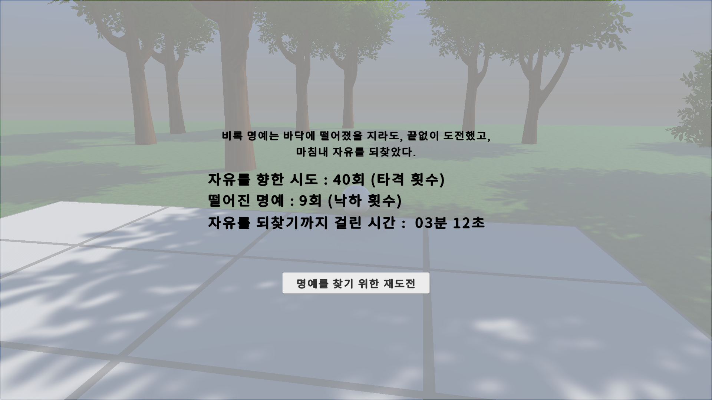
*제가 어려운 길(윗길)로 클리어한 결과 화면입니다 — 40타 · 9회 낙하 · 3분 12초.*

결과 화면에는 「자유를 향한 시도(타격 횟수)」, 「떨어진 명예(낙하 횟수)」, 「자유를 되찾기까지 걸린 시간」이 나옵니다.
"명예를 찾기 위한 재도전" 버튼으로 다시 도전할 수 있습니다.
<!-- 11-26 「*(화면에서 보임)*」 표시는 위 캡션 줄로 대신했습니다. 근거: GolfEnding.cs 79~88행 문구 · 115~131행 재도전(씬 다시 불러오기) (18e4078 ✅) -->

**친구 플레이 테스트** — 친구에게 빌드를 보내 플레이 테스트를 부탁했고, 받은 피드백으로 맵을 고쳤습니다(10-06 커밋 "QA 피드백 후 수정 완료"). <!-- 출처: 본인 답변·커밋 기록 -->

| 누가 | 타격 | 낙하 | 걸린 시간 | 이렇게 나온 이유 |
|---|---|---|---|---|
| 나 (만든 사람) | 40회 | 9회 | 3분 12초 | 어려운 길(윗길)로 가서 클리어한 기록입니다 |
| 처음 도전한 플레이어 | 197회 | 97회 | 14분 11초 | 처음 도전해서 클리어한 기록입니다 |
| 피드백을 준 친구 | 352회 | 171회 | 24분 29초 | 피드백을 주려고 여러 경로를 탐색하고 시도했습니다 |

<!-- 출처: 결과 화면·본인 답변 -->

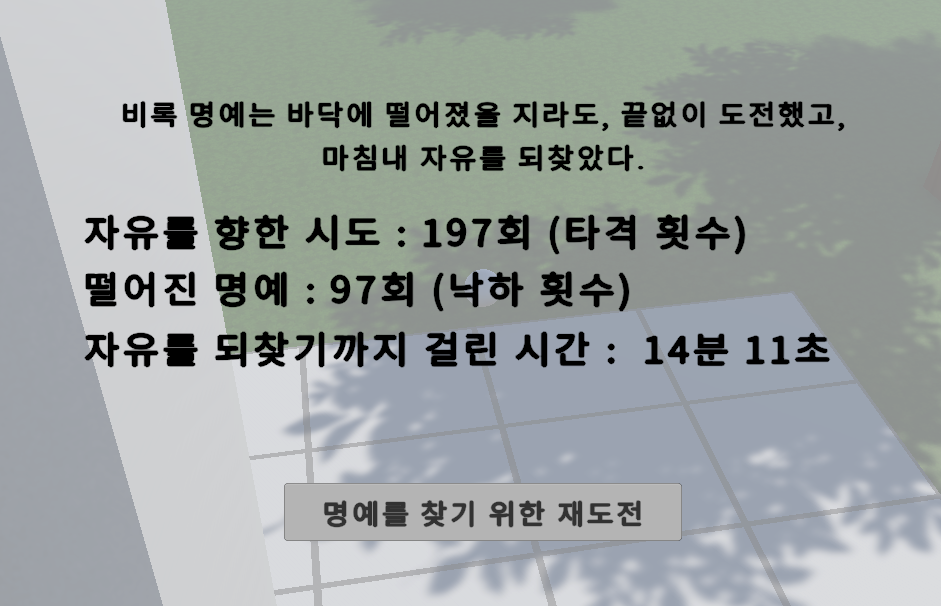
*처음 도전한 플레이어의 결과 화면입니다 — 197타 · 97회 낙하 · 14분 11초.*

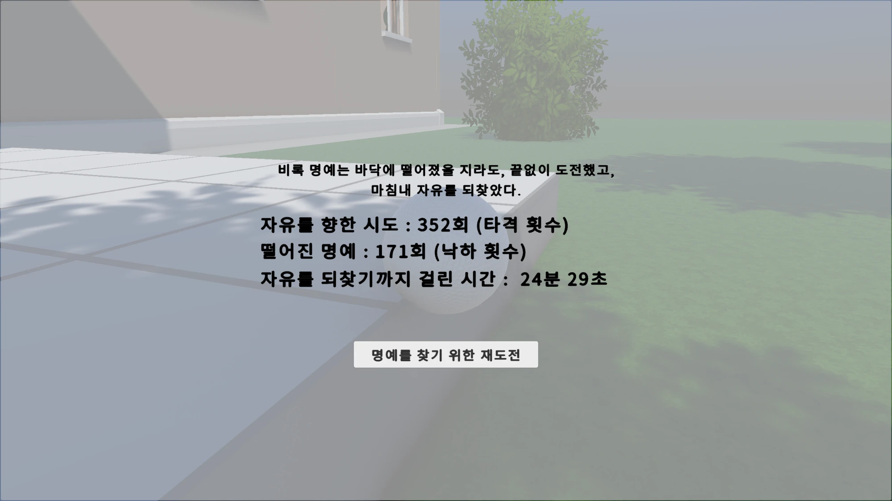
*피드백을 준 친구의 결과 화면입니다. 여러 경로를 시도해 352타 · 171회 낙하 · 24분 29초가 나왔습니다.*

길을 아는 제가 어려운 길로 가도 3분 12초가 걸렸고, 처음 도전한 사람은 14분이 걸려 과제 조건(총 플레이 시간 3분 이상)을 넘었습니다.

### 9-2. 문제 해결

친구가 플레이 테스트로 찾아 준 것을 제가 맵에서 고쳤습니다(10-06 커밋 18e4078). 어디로 가야 할지 모르는 문제는 원인이 동선에 있어 6-4에서, 거실에서 처음 나오는 함정은 5-2에서 다룹니다. <!-- ✏️ 11-26 v4 머리 단락 — 근거: 9-1 「친구 플레이 테스트」 문단(본인 답변 · 커밋) -->

| 피드백 | 원인 | 고친 것 |
|---|---|---|
| 어려운 길로 목표 지점에 도착했지만, 그다음 어디로 가야 하는지 몰랐습니다 | 따로 가이드가 없었습니다 | 이번에는 고치지 못했습니다 (→ 6-4) |
| 점프 쿠션으로 튀어 오른 공이 커튼에 끼었습니다 | 커튼봉 모양에 공이 걸렸습니다 | 끼이는 커튼봉 메쉬 콜라이더 겉을 박스 콜라이더를 더해 끼이지 않게 했습니다 |
| 창문을 뚫고 집 밖으로 나갈 수 있었습니다 (클리어는 되지 않았습니다) | 창문에는 유리가 없어 공을 막을 콜라이더가 없었습니다. 집 주변 경계는 리셋 지점이라 클리어로 이어지지는 않았습니다 | 커튼 오브젝트를 더해, 그 콜라이더로 자연스럽게 탈출 경로를 막았습니다 |

<!-- 출처: 본인 답변 -->
<!-- 근거: 커밋 18e4078 씬 변경에 Curtains_10 (1) · Curtains_15 (2) 추가 (11-26 대조 ✅) -->
<!-- ❓ 줄 초안(확인 목록 ❓③ — 누가 찾고 누가 고쳤는지 답을 받으면 표에 넣음):
     | 공이 떨어져도 낙하 횟수가 오르지 않고 타격 횟수가 올랐습니다 | 바닥 리셋(ResetPlaforms)이 낙하가 아니라 타격을 세는 RecordMove()를 불렀습니다 | RecordFall()로 바꾸고, 공을 되돌리기 전에 세게 했습니다 (10-06 커밋 8243d89) | -->

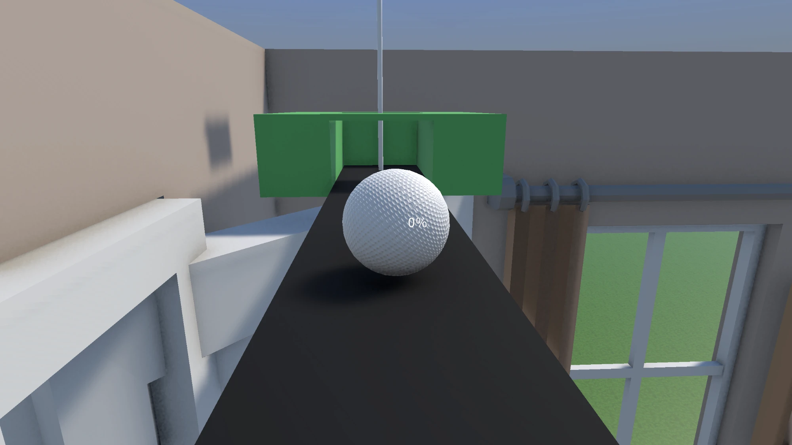
*어려운 길 루트로 목표 지점인 높은 홀컵에 도착한 골프공입니다. 다음 갈 곳을 알려 주는 것이 없습니다(6-4).*
<!-- 11-26 옛 그림 아래 글 「<어려운 길 루트로 목표지점: 높은 홀컵 에 도착한 골프공>」을 캡션 줄로 바꿨습니다. alt 끝 "없음"(음슴체) → "없습니다" -->

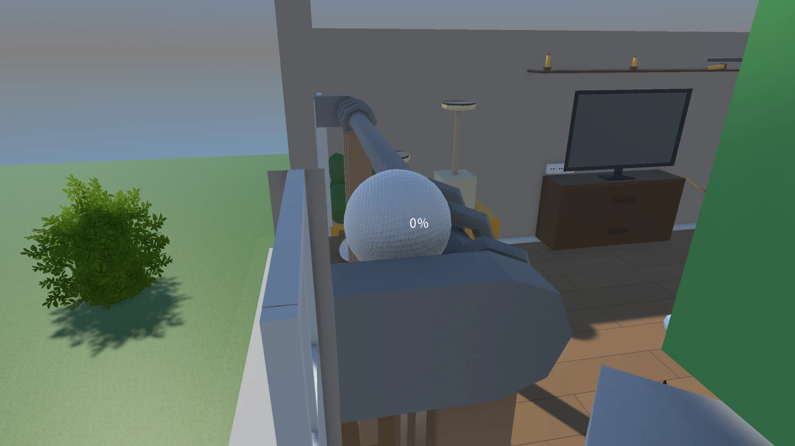
*커튼봉에 끼인 골프공입니다(친구 플레이 테스트).*
<!-- 11-26 옛 그림 아래 글 「<커튼봉에 끼인 골프공>」을 캡션 줄로 바꿨습니다 -->

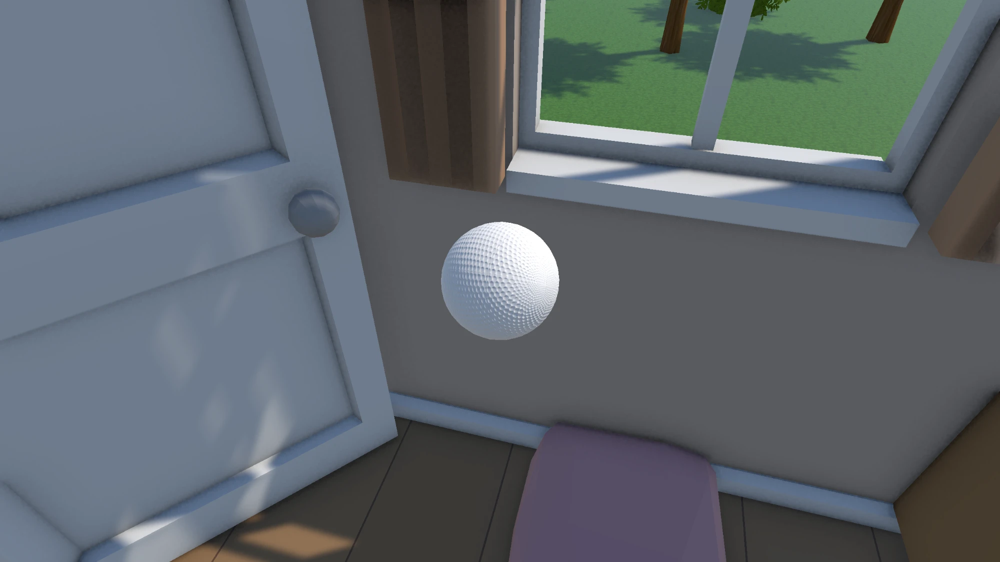
*창문으로 탈출 중인 골프공입니다(친구가 보낸 사진).*
<!-- 11-26 옛 그림 아래 글 「<창문으로 탈출 중인 골프공 - 친구 피드백 사진 >」을 캡션 줄로 바꿨습니다 -->

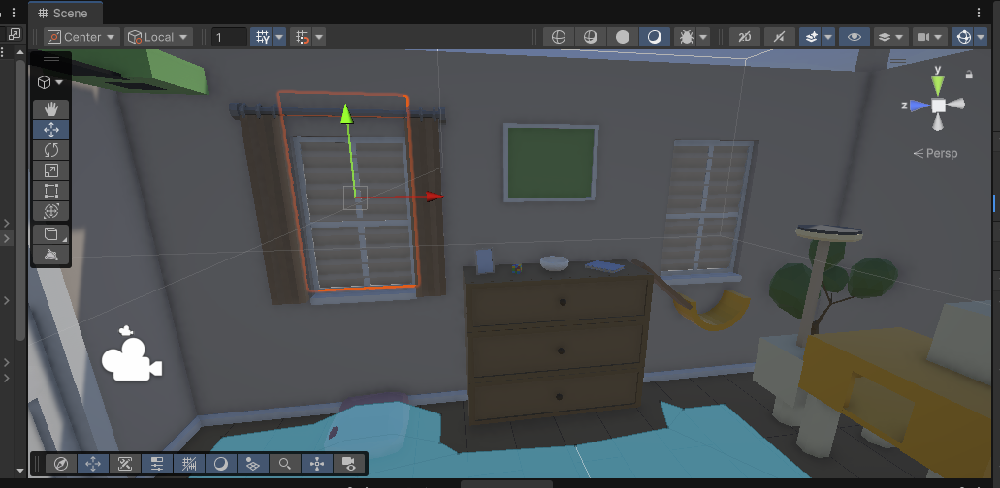
*씬 뷰 — 창문에 커튼을 붙여 창문으로 나가는 길을 막았습니다.*
<!-- 11-26 옛 그림 아래 글 「<창문에 붙인 커튼으로 탈출이 불가해졌다>」(반말)를 "~막았습니다"체 캡션 줄로 바꿨습니다 -->

### 9-3. 개선 계획

<!-- ✏️ 11-24 통합본 2-5: 옛 「5-2. 아쉬운 점 · 개선 계획」(아쉬운 점 ① · ② 문단 + 개선 계획 목록)을 「발견한 문제 → 원인 → 개선안」 표로 바꿨습니다.
     사실은 모두 원래 문단에서 가져왔고, 개선안 세 가지는 원래 목록을 문제별로 나눠 붙였습니다(①에 바람 · 카메라, ②에 설명 UI).
     옛 문장 중 평가로 읽히던 "그것만으로는 부족했습니다", "이 부분을 놓쳤습니다"는 일어난 일만 남기고 뺐습니다.
     옛 문단 원문:
     **아쉬운 점 ① 어디로 가야 할지 모름** / 처음 기획할 때는 Getting Over It처럼 도전 욕구를 채우는 게임을 만들고 싶었습니다. 그래서 게임 안의 안내는 키 안내와 "바닥에 떨어지면 이전 자리에서 다시 친다"는 것뿐이었고, 어디로 가야 하는지는 일부러 알려 주지 않았습니다. 하지만 막상 다른 사람이 플레이해 보니, 안내가 없어 어디로 가야 할지, 목표 지점이 어디 있는지 몰랐습니다. 게임을 시작할 때 목표 지점 두 곳을 3초씩 보여 주는 연출을 넣었지만, 그것만으로는 부족했습니다. 두 갈래 길의 단점(정보가 없으면 방향을 잡기 어려움)이 그대로 드러난 부분입니다.
     **아쉬운 점 ② 거실에서 처음 나오는 함정** / 창고방을 튜토리얼(소개 코스)로 두었지만, 거실에 새로 등장하는 함정이 있었습니다. 이 부분을 놓쳤습니다. 과제 작업지시서의 "응용·심화 코스에는 소개 코스에서 보여 주지 않은 새 장애물을 처음 등장시키지 않는다"는 규칙과 어긋나는 부분입니다.
     **개선 계획** — 집 안 분위기를 깨지 않으려고 안내 표지판은 피했습니다. 대신 다음 방법이었다면 플레이어가 방향을 잡을 수 있었을 것이라고 생각합니다. (바람 부는 소리와 시각 효과로 가야 할 방향을 알려 주기 / 거실에 들어왔을 때 목표 지점 두 곳을 카메라로 잠시 보여 주기 / 처음 보는 장애물이 나왔을 때 짧은 설명 UI를 보여 주기) -->
<!-- 11-26 v3 재배치: 위 11-24 표의 「발견한 문제 · 원인」은 원인이 있는 장(① → 6-4, ② → 5-2)으로 옮기고, 「개선안」 열을 아래 개선 계획 표로 옮겼습니다.
     11-24 표 원문: | ① 다른 사람이 플레이해 보니 **어디로 가야 할지, 목표 지점이 어디 있는지 몰랐습니다** | 안내는 키 안내와 다시 치기 규칙뿐이었고, 게임을 시작할 때 목표 지점 두 곳을 3초씩 보여 주는 연출이 전부였습니다. 두 갈래 길의 단점(정보가 없으면 방향을 잡기 어려움, 3-3)이 그대로 드러났습니다 | 바람 부는 소리와 시각 효과로 가야 할 방향을 알려 줍니다. 거실에 들어왔을 때 목표 지점 두 곳을 카메라로 잠시 보여 줍니다 |
     | ② **거실에 새로 등장하는 함정**이 있었습니다 | 창고방을 튜토리얼(소개 코스)로 두었지만, 거실에서 처음 나오는 함정이 있었습니다. 과제 작업지시서의 "…" 규칙과 어긋납니다 | 처음 보는 장애물이 나왔을 때 짧은 설명 UI를 보여 줍니다 | -->

| 지금 | 이유 · 영향 | 이 프로젝트를 다시 다듬는다면 |
|---|---|---|
| 가는 길을 알려 주는 것은 시작할 때 목표 지점 두 곳을 3초씩 보여 주는 연출뿐입니다 (6-4) | 처음 하는 사람이 어디로 가야 할지 몰랐습니다 | 바람 부는 소리와 시각 효과로 가야 할 방향을 알려 줍니다. 거실에 들어왔을 때 목표 지점 두 곳을 카메라로 잠시 보여 줍니다 |
| 거실에서 처음 나오는 함정이 있습니다 (5-2) | 과제 작업지시서의 소개 코스 규칙과 어긋납니다 | 처음 보는 장애물이 나왔을 때 짧은 설명 UI를 보여 줍니다 |
<!-- ✏️ 11-26 v3 — 「지금」 · 「이유 · 영향」 칸은 6-4 · 5-2의 사실을 줄여 옮겼고, 「다시 다듬는다면」 칸은 11-24 표의 개선안 그대로입니다 -->

개선안은 집 안 분위기를 깨지 않으려고 안내 표지판 대신 소리 · 카메라 · 짧은 설명 UI로 골랐습니다. <!-- ✏️ 원래 "집 안 분위기를 깨지 않으려고 안내 표지판은 피했습니다"(본인 답변)를 줄여 옮김 -->
다시 다듬는다면 "플레이어가 알아서 찾겠지"가 아니라 "플레이어가 어디서 헤매게 될까"를 먼저 보고, 가이드 UI나 바람 효과 같은 게임 시스템으로 어디로 가야 하는지 목표를 정해 주겠습니다. <!-- 출처: 본인 답변 -->
<!-- ✏️ 11-26 v3 — 옛 「4-3. 배운 점」을 개선 계획 한 줄로 흡수했습니다(통합본 부록 D 「배운 점」 정리 기준). 옛 절 원문:
     탈출하는 길을 찾으며 여러 경로를 찾는 것이 이 게임의 재미라고 생각했지만, 그것이 재미가 아닐 수도 있다는 것을 배웠습니다.
     게임을 만들 때는 "무엇이 재미있을까"보다 **플레이어에게 어떤 경험을 줄 것인지**를 더 생각해야 합니다.
     "플레이어가 알아서 찾겠지"가 아니라 **"플레이어가 어디서 헤매게 될까"** 를 먼저 생각하고,
     가이드 UI나 바람 효과 같은 게임 시스템으로 어디로 가야 하는지 목표를 정해 주는 것도 중요하다는 것을 배웠습니다. -->

<!--
 📸 촬영 목록 (게임 녹화하면서 찍기 — images/ 에 넣고 각 절에 붙이세요)
 1. 레벨 전경에 진열장·창고방·거실·현관을 표시한 그림 — 2장
 2. 구역별 화면 1장씩 (진열장 / 창고방 / 거실 / 현관) — 3-2
 3. 함정 3종이 움직이는 짧은 GIF (쿠션 튕김 / 고양이가 공을 밀침 / 가속 판자) — 3-1
 4. 공을 치는 순간·떨어지는 순간 GIF — 4-1
 5. 플레이 영상 주소 — 1-3 "영상" 칸
 11-26: 위 목록은 옛 번호입니다. 3번 · 5번은 끝났고, 지금 할 일은 「GIF 촬영 목록.md」 5절(My-Develop-notebook)과 본문의 🎞 · 📷 주석입니다.
-->
