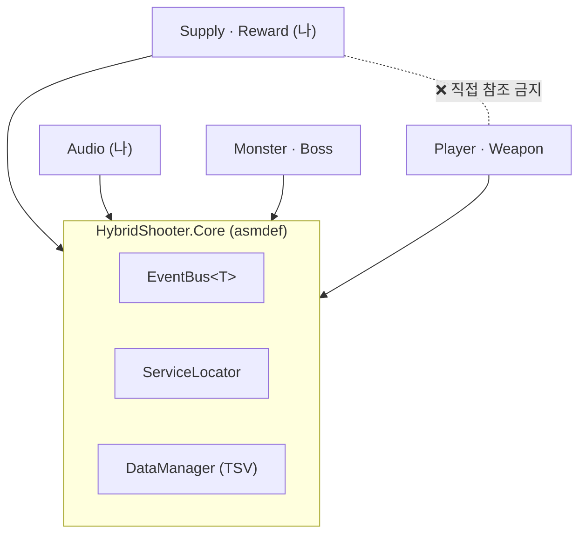
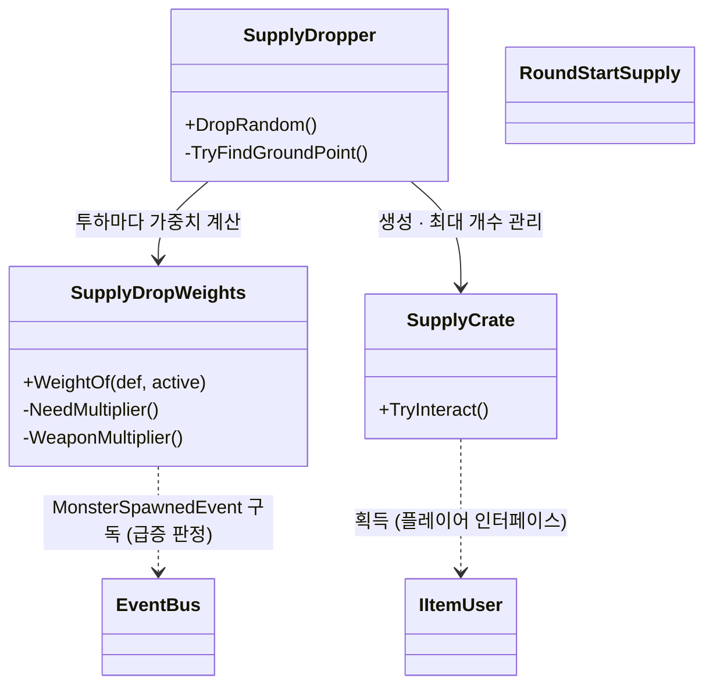
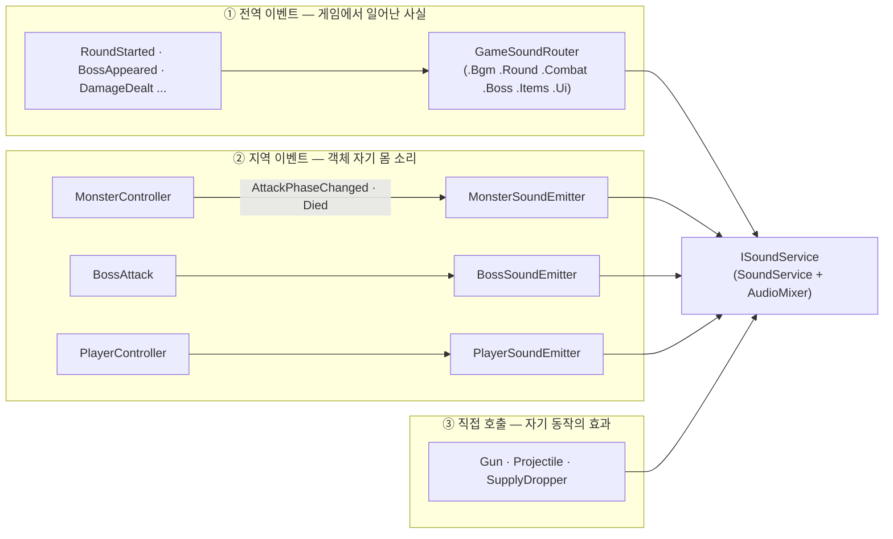
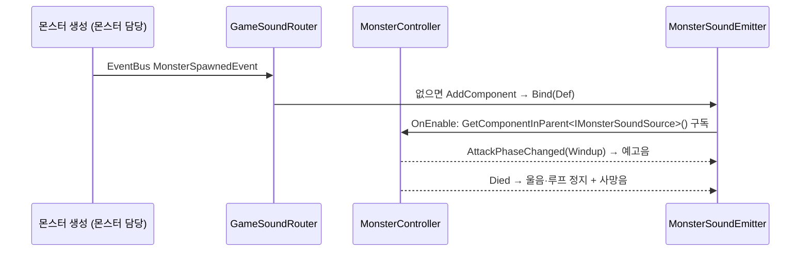

# 3D 하이브리드 슈터 (Team Even) — 보급·사운드 담당 기술 문서

<!--
====================================================================
 ✍ 작성 안내 (이 상자는 다 쓰면 지우세요)
====================================================================
 이 파일은 format/02-tech-document.md 의 「C형 · 팀 프로젝트」 틀입니다.
 답변을 본문으로 옮겼고, 아직 답이 없는 곳에만 표시를 남겼습니다.

   ❓ 답해 주세요   — 사실 확인
   💬 내 의견       — 건우 님의 판단·생각이 들어가야 하는 곳

 · 화면에 보이는 표시(> ❓ · > 💬)는 답을 채운 뒤 지웁니다. 남아 있으면 포트폴리오에도 그대로 보입니다.
 · <!- - ✏️ … - -> 주석은 화면에 보이지 않습니다. Claude가 쓴 설명이 있는 곳이니, 본인 말로 다시 쓴 뒤 지우세요.
 · 다 쓴 뒤 /portfolio-check 3-team-even 으로 점검하세요.
====================================================================
-->

## 1. 개요

### 1-1. 무엇을 만들었나 (What)

1인칭으로 몰려오는 군중을 쓸어내고, 3인칭으로 거대한 보스와 맞서는 **하이브리드 슈터**입니다.
수없이 몰려오는 적들을 다양한 총으로 처치하고, 보스의 패턴을 상대하며 공략하는 재미를 목표로 했습니다.
한 라운드는 **군중전(약 3분) → 보스 등장·시점 전환 → 보스전 → 강화 선택 → 다음 라운드**로 이어집니다.

이 문서는 그중 제가 맡은 **보급 시스템**과 **사운드 시스템**을 다룹니다.

**이 프로젝트가 이전과 달랐던 점 — 팀원 모두가 AI와 함께 만들었습니다.**
기본 시스템 설계는 강의 내용([강의 사이트](https://krkoohoo.github.io/))과 Claude Opus로 잡았고, 구현도 대부분 AI의 도움을 받았습니다.

AI에 월 결제 없이 하던 이전 작업은 한 단계씩 밟아 가며 게임을 만들어 나가는 과정이 대부분이었습니다.
Opus를 쓴 뒤로는 그런 과정 없이, 제 생각과 기획안의 내용을 설명하고 설계와 구현을 하자고 하면 결과물이 나왔습니다.
코드 내부는 제대로 확인하지 않았지만, 눈에 보이는 게임으로는 훌륭한 결과물이었습니다. (이 점이 5-3의 가장 큰 아쉬움으로 이어집니다.)

그래서 이 문서는 "코드를 직접 짰다"보다 **무엇을 만들지 정하고, AI가 낸 안 중에서 고르고, 직접 플레이해 문제를 찾은 과정**에 초점을 둡니다(1-4).

### 1-2. 왜 만들었나 (Why) — 제 파트가 풀어야 했던 문제

<!-- ✏️ 초안 · 출처: 직접 한 플레이 테스트(10-31), Docs/Playtest/PlaytestFeedback_2026-11-01.md, Docs/Design/Supply_2ndFeedback_Proposal.md §0, 사운드 버그 수정(11-01) -->

- **보급**: 직접 플레이 테스트를 해 보니 일부 구간(보스 스테이지 시작 이후) 보급이 아예 나오지 않았고, 고친 뒤 팀 2차 피드백에서는 보급이 **지형 위·높은 건물 위·맵 밖**에 떨어져
  주울 수 없는 경우가 나왔습니다(F2·F3·F6). 테스트 중 **10개 중 2~3개 정도**를 줍지 못했습니다.
  - **사운드**: 4명이 각자 몬스터·보스·무기를 만드는 동안 소리를 붙여야 했습니다. 다른 사람 코드를 고치지 않고 소리를 붙일 방법이 필요했고,
  플레이 중 **플레이어 소리가 전혀 나지 않는** 버그를 발견했습니다(11-01).

군중전에서 보급은 대량의 비행체 몬스터와 정예 몬스터를 처리하는 데 중요한 시스템이었습니다.
적당한 위치에 떨어지지 않아 주울 수 없거나 너무 멀리 떨어지면, 플레이어는 답답함과 좌절감을 느끼고 게임을 계속할 동기를 잃을 수 있습니다.

> 💬 **내 의견** (선택) — 사운드 쪽도 **왜 중요한 문제였는지** 한 줄. (예: 플레이어 소리가 안 나면 플레이어가 무엇을 놓치는지) FPS 에서 게임 내 음향효과 및 소리는 게임 플레이에 더욱 더 생동감을 주는 중요한 요소입니다. 플레이어가 피격을 당하거나 몬스터의 위치 플레이어가 적의 위치를 알아낼 수 있는 등 게임에 경험을 몰입 하는 데 큰 역할이 됩니다.   

### 1-3. 개발 환경 · 링크

| 항목 | 내용 |
|---|---|
| 엔진 | Unity 6000.3 (URP) |
| 언어·도구 | C#, Git(Git flow, Git LFS), Asana |
| AI 도구 | Claude Opus (저는 Claude Code로 사용). ChatGPT를 함께 쓴 팀원도 있었습니다 |
| 기간 | 2026-10-15 ~ 2026-11-03 (약 3주) |
| 팀 | 4명 — 팀장 이찬영, 팀원 김민성·윤건우·홍산 |
| 영상 | 추후 업로드 예정 |
| GitHub | 비공개 |

### 1-4. 팀 구성과 역할

| 이름 | 담당 |
|---|---|
| 윤건우 (나) | 보급·보상, 사운드 (+ 아래 "그 밖에 맡은 것") |
| 이찬영 (팀장) | 코어(데이터·이벤트·서비스) | 보스 |
| 홍산 | 몬스터·보스 | 몬스터의 이동 시스템 (군중 이동)|
| 김민성 | 플레이어·무기, 인트로·엔딩 |

**팀 전체가 일한 방식**

- 팀원 모두 AI를 쓰고(주로 Claude Opus), 각자 맡은 파트를 AI와 함께 설계·구현했습니다.
- 파트 사이 약속(2-1의 "파트끼리 서로 모른다" 규칙, 이벤트·서비스·데이터 형식)은 **강의 내용과 Opus로 먼저 잡은 기본 설계**를 따랐습니다.
- 팀 차원에서 따로 정한 AI 사용 규칙은 없었습니다. 팀장이 만든 기준 문서 「이벤트 버스와 외부 데이터 적용 기준」이 사실상 가장 큰 규칙이었고,
  저는 각자의 AI가 이 약속을 지키도록 이 문서를 작업마다 붙였습니다.

**제 파트를 만든 방식 — AI(Claude Code)와 역할 나누기**

| 누가 | 무엇을 |
|---|---|
| 나 | 무엇을 만들지(요구사항)와 수치 정하기 · 설계안의 질문에 답하며 **선택** · 직접 플레이하고 문제 찾기 · 팀 공유(피드백 문서·PR·디스코드) |
| 나 (직접 작업) | 맵 배치·콜라이더, 사운드·BGM 선정, 튜토리얼 음성(TTS) 제작, 에디터에서 값 조정 |
| Claude Code | 설계안·보완점 정리, 코드 구현, 커밋·PR 문서 |

작업마다 순서를 고정했습니다: **설계 → 보완점 정리 → 내 확인 → 구현.** 설계는 「이벤트 버스와 외부 데이터 적용 기준」 v0.1을 매번 붙여 따르게 했습니다.

### 1-5. 제가 맡은 것

**이 문서에서 자세히 다루는 것**

1. **보급 시스템** — 공중 투하, 낙하 지점 찾기, 상황에 따라 바뀌는 보급 확률, 근접 획득
2. **사운드 시스템** — 이벤트 → 소리 연결(GameSoundRouter), 객체별 이미터, BGM, AudioMixer

**그 밖에 맡은 것** (한 줄씩만)

- 라운드 종료 강화 상점 (등급 카드 3장 + 리롤, 강화 8종)
- 인게임 맵(Sci-Fi Base 기반)·튜토리얼 맵, 맵 빌더 에디터 도구
- 메인 메뉴(디오라마 배경·호버 연출·옵션 팝업), 튜토리얼 6단계
- 플레이 테스트 분석기(PlaytestAnalyzer), 바이너리 에셋 자동 복구 도구

### 1-6. 이 문서에서 다루는 것

2장 구조 → 3장 보급·사운드가 동작하는 방식 → 4장 제가 내린 결정 여섯 가지
(높은 곳 사격 금지 원칙, 근접 획득, 상황별 보급 확률, Hurt 소리 빼기, BGM 키 위치, 담당 범위) → 5장 직접 찾은 문제와 아쉬운 점.

---

## 2. 시스템 구조

### 2-1. 팀 공통 규칙 — 파트끼리 서로 모른다

<!-- ✏️ 초안 · 출처: Docs/Architecture/02-SystemInterfaces.md §1~4 -->

이 규칙은 강의 내용과 Claude Opus로 잡은 **팀 기본 설계**(코어 담당 파트)입니다. 저는 이 규칙 위에서 작업했습니다.



파트는 `HybridShooter.Core`에만 의존하고, 서로 통신할 때는 세 가지 중 하나를 씁니다.

| 상황 | 방법 |
|---|---|
| 대상을 이미 들고 있음 (충돌·레이캐스트) | 인터페이스 (`IItemUser`, `ISupplyWeaponUser`) |
| 씬 전역 기능 요청 | `ServiceLocator.Get<T>()` (`ISoundService`, `ISpawnZoneProvider`) |
| 일어난 일 알리기 | `EventBus<T>` (`MonsterSpawnedEvent`, `SupplyCollectedEvent`) |

이 규칙 위에서 각자 AI로 구현하니 작업 시간이 크게 줄었습니다.
하지만 AI로 구현하더라도 내가 구현한 것을 확인하지 않으면 팀원들과 작업 이야기를 나눌 수 없었습니다.
이번 작업에서 저의 부족함을 가장 크게 느낀 순간입니다. 눈으로 보기에는 원하는 대로 구현됐으니 크게 신경 쓰지 않았지만, 오히려 코드를 한 줄 한 줄 읽고 분석했어야 했습니다.

### 2-2. 보급 모듈 구조

<!-- ✏️ 초안 · 출처: Assets/Scripts/Supply/*.cs -->



| 클래스 | 책임 |
|---|---|
| `SupplyDropper` | 언제·어디에 떨어뜨릴지. 낙하 지점 찾기, 필드 상자 수 제한 |
| `SupplyDropWeights` | 무엇을 떨어뜨릴지. 테이블 기본 가중치 × 지금 상황 배율 |
| `SupplyCrate` | 낙하 연출, 획득 영역, 플레이어에게 아이템 주기 |
| `RoundStartSupply` | 다음 라운드 시작 지급 |

확률 계산(`SupplyDropWeights`)은 2차 피드백 때 추가했습니다. 플레이 테스트를 하면서 필요한 아이템이 잘 나오지 않는다고 느껴 제가 제안한 기능입니다.
클래스를 따로 뺀 것은 AI의 설계입니다.

> 💬 **내 의견 (필수)** — AI가 나눈 구조를 받아들인 **이유를 본인이 이해한 대로** 한 줄. 가이드 필수 항목입니다.
> (예: "언제·어디에(Dropper)"와 "무엇을(Weights)"이 나뉘어 있어, 확률을 바꿀 때 낙하 지점 코드를 건드리지 않아도 된다) 내 답변: 보급 시스템에서 중요한 부분은 언제 떨어지는 가와 얼마나 떨어지는 가, 그리고 무엇이 떨어지는 가 입니다. SupplyCrate(보급상자) 를 떨어뜨리는 지점과 시간을 맞는  SupplyDropper 와 외부의 테이블로 어떤 보급을 떨어뜨릴지 확률을 정하는 SupplyDropWeights, 마지막으로 라운드의 정보를 받아 다음 라운드 보급을 정하는 RoundStartSupply 로 나뉘었습니다. 지금 돌아보니 SupplyDropper 와 RounStartSupply 는 굳이 클래스를 나누지 않고 합쳐도 되지 않았을까 하는 생각이 듭니다. 

### 2-3. 사운드 모듈 구조 — 소리 하나에 경로 하나

<!-- ✏️ 초안 · 출처: Assets/Scripts/Audio/GameSoundRouter.cs 머리 주석, Docs/Design/SoundSystemRefactor_v3.md §4 -->



| 경로 | 언제 | 예 |
|---|---|---|
| ① 전역 이벤트 → Router | 여러 파트가 함께 알아야 하는 **사실** | 라운드 시작 → 군중 BGM + "FIGHT" |
| ② 지역 이벤트 → 이미터 | 그 객체 **자기 몸**의 소리 | 몬스터 공격 예고음, 사망음 |
| ③ 직접 호출 | 발행하는 쪽 **자기 동작**의 효과 | 총 발사음, 폭발음 |

이 세 갈래 구분은 AI가 설계 문서(`SoundSystemRefactor_v3.md §4`)에서 정리한 것입니다.
제가 직접 고른 것은 플레이어 소리가 나지 않던 버그(11-01) 때, 몬스터처럼 **플레이어에도 라우터가 이미터를 자동으로 붙이는** 방식입니다(3-5 ③).

---

## 3. 핵심 기능

### 3-1. 보급 — 사용법

<!-- ✏️ 초안 · 출처: SupplyDropper.cs public 메서드, RoundSequencer.cs -->

```csharp
// 자동 투하: 라운드 담당(RoundSequencer)이 RoundTable 의 간격으로 시작·정지
dropper.StartAutoDropCycle(roundDef.SupplyInterval);
dropper.StopAutoDropCycle();
// 한 번 투하: 가중치로 고르기 / 종류 지정 / 종류 + 위치 지정 (튜토리얼 — 낙하 지점 검사 없이 그 위치 아래 지면에)
SupplyCrate a = dropper.DropRandom();
SupplyCrate b = dropper.Drop(supplyDef);
SupplyCrate c = dropper.Drop(supplyDef, position);
// 획득 알림을 듣고 싶으면 (HUD·사운드)
EventBus<SupplyCollectedEvent>.Subscribe(OnCollected);
```

라운드 담당은 `StartAutoDropCycle`만 부르면 됩니다. 보급의 역할은 결국 상자를 떨어뜨리는 것이고, `RoundSequencer`는 라운드를 담당하므로
**언제** 떨어뜨릴지는 `RoundSequencer`가, **어디에·무엇을**은 보급이 정하면 된다고 판단했습니다.

### 3-2. 보급 — 낙하 지점 찾기 (값싼 검사부터, 길 찾기는 마지막)

<!-- ✏️ 초안 · 출처: SupplyDropper.TryFindGroundPoint (원본 약 75줄 → 핵심만) -->

```csharp
for (int i = 0; i < MaxPositionTries; i++)
{
    // 후보 XZ (플레이어 기준 20~60m 링) → 위에서 아래로 레이캐스트
    if (Physics.Raycast(origin, Vector3.down, out var hit, ...) == false) { missed++; continue; }

    // ① 처음 맞은 것이 Ground 레이어가 아니면 (지붕·바위·나무 위) 버림
    if ((allowedLayers & (1 << hit.collider.gameObject.layer)) == 0) { wrongLayer++; continue; }
    // ② 플레이어 발 높이 + 5m 보다 높으면 버림
    if (hit.point.y > maxHeight) { tooHigh++; continue; }
    // ③ 경사 25° 초과 → 상자가 지형에 묻힘
    if (hit.normal.y < minNormalY) { tooSteep++; continue; }

    if (useNavMesh)
    {
        // ④ NavMesh 밖 (맵 밖·고립된 지붕)
        if (!NavMesh.SamplePosition(hit.point, out var dropNav, 1f, NavMesh.AllAreas)) { offNavMesh++; continue; }
        // ⑤ 플레이어에서 걸어서 갈 길이 없음 (구덩이·절벽 위)
        if (!NavMesh.CalculatePath(playerNav.position, dropNav.position, NavMesh.AllAreas, path)
            || path.status != NavMeshPathStatus.PathComplete) { unreachable++; continue; }
    }
    groundPoint = hit.point;   // 착지는 보이는 지면(레이캐스트 지점)에
    return true;
}
Debug.LogWarning($"낙하 지점 실패: 지면 없음 {missed} / 레이어 {wrongLayer} / 높음 {tooHigh} / 경사 {tooSteep} / NavMesh 밖 {offNavMesh} / 길 없음 {unreachable}");
```

<!-- ✏️ 아래 첫 번째·세 번째 항목은 Claude가 설명한 내용입니다. 이해한 뒤 본인 말로 다시 쓰세요. -->

- **길 찾기를 맨 마지막에 둔 이유**: `CalculatePath`는 실제로 길을 계산하므로 다섯 검사 중 가장 비쌉니다. 레이어·높이·경사는 숫자 비교 한 번이면 됩니다.
  값싼 검사로 먼저 거르면 비싼 길 찾기는 살아남은 후보 몇 개만 받습니다. 효율적으로 빠르게 검사하여 보급 지급이 더디지 않게 하기 위한 구조라고 생각합니다. 
- **실패 사유를 종류별로 세는 이유**: 플레이 테스트 중에는 어떤 상자가 문제를 일으켰는지 확인하기 어렵기 때문에, 어떤 사유로 실패했는지 분석하려고 남겼습니다.
- **④⑤를 건너뛰는 경우**: 플레이어가 NavMesh 위에 없으면 "걸어서 갈 수 있는지"를 따질 수 없어서 NavMesh 검사를 통째로 건너뜁니다.
  NavMesh를 굽지 않은 테스트 씬에서 이 검사를 하면 모든 후보가 탈락해 보급이 하나도 떨어지지 않기 때문입니다.

### 3-3. 보급 — 상황에 따라 바뀌는 확률

<!-- ✏️ 초안 · 출처: SupplyDropWeights.cs, Supply_2ndFeedback_Proposal.md §7 -->

최종 가중치 = **테이블 기본 Weight × 상황 배율**

| 상자 | 배율 |
|---|---|
| 수류탄·회복 팩 | 보유량이 0개면 ×2.0, 가득이면 ×0.25 (사이는 선형) |
| 무기 상자 | 몬스터 급증(최근 10초 12마리 이상 소환) ×2.5, 보급 무기 소진 ×2.5, 상한 ×4. 이미 들고 있으면 나오지 않음 |

```csharp
private static float NeedMultiplier(SupplyType type)
{
    int current = type == SupplyType.Grenade ? items.Grenades : items.HealPacks;
    int max     = type == SupplyType.Grenade ? items.MaxGrenades : items.MaxHealPacks;
    float fill  = max > 0 ? Mathf.Clamp01((float)current / max) : 1f;
    float full  = Config.GetFloat(GameConfig.SupplyNeedWeightMin, 0.25f);  // 가득일 때
    float empty = Config.GetFloat(GameConfig.SupplyNeedWeightMax, 2f);     // 0개일 때
    return Mathf.Lerp(empty, full, fill);
}
```

| 상황 (기본 40/40/10/10, 설계 문서의 계산값) | 수류탄 | 회복 | 로켓 | 유탄 |
|---|---|---|---|---|
| 평소 (둘 다 절반 보유) | 41% | 41% | 9% | 9% |
| 수류탄 0 · 회복 가득 | 73% | 9% | 9% | 9% |
| 급증 + 무기 소진 | 26% | 26% | 24% | 24% |

배율 숫자(가득일 때 0.25 등)와 ConfigTable에 둔 구조는 AI가 정한 초기값입니다.
저는 투하 확률 로그(`[SupplyDropper] 투하 확률: …`)로 수류탄이 0개일 때 수류탄 상자가 자주 나오는 것을 확인했습니다.

### 3-4. 사운드 — 사용법

```csharp
// 어디서든 2D/3D 소리 (SoundTable.tsv 의 키)
var sound = ServiceLocator.Get<ISoundService>();
sound.PlaySfx("sfx_hit_flesh", hitPoint);            // 위치를 주면 3D, 생략하면 2D
SoundHandle h = sound.PlayLoop("key", transform);    // 따라다니는 루프 → sound.StopLoop(h)
sound.PlayBgm("bgm_boss");
sound.Duck(SoundCategory.Monster, bossDuckLevel, bossDuckTime);  // 보스 경고 동안 몬스터 소리 줄이기 (GameSoundRouter.Boss)
// 몬스터 소리를 붙이려면: 코드 수정 없이 MonsterTable 의 사운드 키 열만 채움
//   → MonsterSpawnedEvent 를 받은 Router 가 MonsterSoundEmitter 를 자동 부착
```

### 3-5. 사운드 — 다른 파트 코드를 고치지 않고 소리 붙이기

<!-- ✏️ 초안 · 출처: GameSoundRouter.Combat.cs, GameSoundRouter.cs, MonsterSoundEmitter.cs, Core/Contracts/MonsterContracts.cs -->

몬스터 프리팹은 홍산 님 담당이라, 프리팹에 사운드 컴포넌트를 미리 붙여 두지 않았습니다. 몬스터가 생기면 Router가 이미터를 붙이고,
이미터는 몬스터가 Core 계약(`IMonsterSoundSource`)으로 알려 주는 **지역 이벤트**만 듣습니다.



**① Router — 몬스터가 생기면 이미터를 붙인다** (`GameSoundRouter.Combat.cs`)

```csharp
private void OnMonsterSpawned(MonsterSpawnedEvent e)
{
    // 보스는 구조가 달라 BossSoundEmitter 담당
    if (e.Instance == null || (e.Def != null && e.Def.IsBoss)) return;
    EnsureEmitter(e.Instance).Bind(e.Def);
}

/// 씬에 직접 둔 몬스터(MonsterSpawnedEvent 없음)에도 붙인다. Start 에서 1번
private void AttachEmittersInScene()
{
    foreach (var b in FindObjectsByType<MonoBehaviour>(FindObjectsInactive.Exclude, FindObjectsSortMode.None))
        if (b is IMonsterSoundSource) EnsureEmitter(b.gameObject);
}

private MonsterSoundEmitter EnsureEmitter(GameObject monster)
{
    var emitter = monster.GetComponentInChildren<MonsterSoundEmitter>(true);   // 프리팹에 이미 있으면 그대로
    if (emitter == null) emitter = monster.AddComponent<MonsterSoundEmitter>();
    emitter.SetNearIdle(monsterNearDistance, monsterNearIdleInterval);          // 15m 안이면 더 자주 울음
    return emitter;
}
```

**② 이미터 — 몬스터의 지역 이벤트만 듣는다** (`MonsterSoundEmitter.cs`)

```csharp
private void OnEnable()   // 풀에서 다시 꺼낼 때도 불린다
{
    silenced = false;
    source ??= GetComponentInParent<IMonsterSoundSource>();   // Core 계약만 안다 (MonsterController 를 모름)
    if (source != null)
    {
        source.AttackPhaseChanged += OnAttackPhaseChanged;
        source.Died += OnDied;
        // Stunned · AttackLanded · AttackContacted 도 같은 방식
    }
}

private void OnAttackPhaseChanged(MonsterAttackDef attack, SkillPhase phase)
{
    if (phase != SkillPhase.Windup || silenced) return;   // 맞을 때가 아니라 '예고' 순간에
    Play(attack?.Sfx, Point.position);
}

private void OnDied()
{
    if (silenced) return;
    Silence();                              // 울음·루프 정지
    Play(Def?.DeathSfx, Point.position);    // 위치 재생 → 시체가 풀로 돌아가도 끝까지 들림
}
```

> 💬 **내 의견 (필수)** — ①② 코드에 **왜 이렇게 했는지**를 본인 말로 붙여 주세요. 설명하기 어려우면 ①② 코드 블록을 빼고 ③만 남겨도 됩니다.
> - `MonsterSpawnedEvent`만으로는 왜 부족해서 `AttachEmittersInScene()`이 따로 필요했나요? (힌트: 스포너가 만든 몬스터만 이벤트를 보냄. 각자 만든 `Test_` 씬에 직접 놓은 몬스터는?)
> - 이미터가 `MonsterController`가 아니라 **`IMonsterSoundSource`를 찾는** 이유는? (힌트: 2-1의 "파트끼리 서로 모른다")
> - 공격음을 명중이 아니라 **예고(Windup) 순간**에 내는 이유는? 군중전에서 플레이어에게 무엇을 알려 주나요?
> - 구독을 `Awake`가 아니라 `OnEnable`에서 하는 이유는? (힌트: 오브젝트 풀에서 꺼낼 때는 `Awake`가 다시 불리지 않음)

> 몬스터를 생성시키는 Spawner가  테스트 중에 미리 배치해둔 몬스터들이 있었기 때문에 `MonsterSpawnedEvent` 로는 사운드 테스트를 할수 없는 사소한 오류가 생겼습니다. (클로드한테 질문) 파트 끼리 서로 모른다는 것은 무슨 뜻이야? 몬스터 컨트롤러와 `IMonsterSoundSource` 는 서로의 존재를 모른다는 건가? 그렇다면 답변: 몬스터컨트롤러는 몬스터의 이동, ImonsterSoundSource 는 몬스터 각각의 소리를 담은 테이블을 관리하기 때문에 이미터는 소리에 관련된 IMonsterSoundSource를 찾아야 했습니다. 공격을 명중하는 순간이 아닌 예고에 소리를 내었던 것은 플레이어에게 공격을 한다는 정보를 미리 주기 위한 장치입니다. 몬스터는 또한 오브젝트 시스템을 사용하기 때문에 Awake에서 다시 불리지 않아 OnEnabled에서 사용했습니다. (요청! 몬스터 스포너의 시스템 구조를 내가 알 수 있게 간략하게 설명해줘)


**③ 같은 방식을 플레이어에도 — 직접 고른 A안** (11-01)

플레이 중 플레이어 소리(발소리·피격 등)가 전혀 나지 않았습니다. 원인은 `PlayerSoundEmitter`가 플레이어 프리팹에 없었던 것입니다(`SoundFix_Handoff.md §1`).

| 방법 | 내 판단 |
|---|---|
| B안. 플레이어 프리팹에 이미터를 직접 붙이기 | 플레이어 프리팹은 김민성 님 담당이라, 담당자의 작업물을 바꾸고 싶지 않았음 |
| **A안. 라우터가 실행 중에 자동으로 붙이기 (선택)** | 프리팹은 그대로 둠 |

```csharp
private void AttachPlayerEmitters()   // Start 에서 1번
{
    foreach (var player in FindObjectsByType<PlayerController>(FindObjectsInactive.Include, FindObjectsSortMode.None))
        if (player.GetComponent<PlayerSoundEmitter>() == null) player.gameObject.AddComponent<PlayerSoundEmitter>();
}
```

게임 개발을 하면서 쉽게 놓칠 수 있는 버그였습니다. 자동으로 붙이는 방식도 팀원의 작업물에 영향을 줄 수 있어서 처음에는 피했습니다.
작업이 어느 정도 마무리되어 플레이어에 더 이상 시스템이 추가되지 않을 것으로 보이는 시점에 자동 부착을 적용했습니다.

몬스터 담당이 고친 것은 `MonsterController`가 `IMonsterSoundSource`를 구현하고, 정해진 순간에 이벤트를 발행하는 줄을 넣은 것뿐입니다
(사망은 `MonsterDiedEvent` 바로 앞에 `Died?.Invoke()` 한 줄. 출처: `SoundSystemRefactor_v3.md §5 S1`).
어떤 소리를 낼지는 `MonsterTable`·`MonsterAttackTable`의 사운드 키 열이 정합니다.

**효과**: 몬스터의 공격 패턴과 디자인은 대부분 기획 단계에서 정해져 있었습니다. 나중에 추가된 돌진형 몬스터, 파르다트록스 등은
사운드 코드를 고치지 않고 **사운드 파일을 추가해 테이블의 사운드 키에 넣는 것만으로** 소리를 붙였습니다.

---

## 4. 고민과 선택

<!-- ✏️ 이 장은 건우 님이 직접 내린 결정만 골랐습니다. 출처는 작업할 때 Claude Code에 입력한 메시지(날짜 표시)와 설계 문서입니다.
     「따옴표」는 건우 님이 실제로 쓴 문장입니다. 비교 표의 다른 안은 AI가 정리한 것이 많습니다.
     재료 전체: _intake/내-역할과-고민.md -->

AI가 대안을 정리하면, 저는 기준을 주고 골랐습니다. 이 장의 「따옴표」는 작업할 때 제가 실제로 쓴 문장입니다.

### 4-1. "높은 곳에서 쏘는 이점은 주지 않는다" — 맵·NavMesh·보급을 한 원칙으로

<!-- ✏️ 초안 · 출처: 맵 작업 10-30·10-31, 보급 개편 10-31, SupplyUpgradeRework_Proposal.md §5 Q2 -->

맵을 만들면서 세운 원칙입니다.

> 「플레이어가 몬스터들이 오지 못하는 곳에서 사격해서 얻는 이점을 얻지 않는 것이 맵의 핵심 설계」 (10-30)

군중전은 몰려오는 몬스터를 정리하는 재미입니다. 플레이어가 지붕에 올라가면 몬스터가 닿지 못해 그 재미가 사라집니다.
이 원칙을 세 곳에 똑같이 적용했습니다.

| 시스템 | 적용 |
|---|---|
| 맵 | 계단·2층 구조 금지, "높고 얇은 벽 + 지붕" 건물 금지. 엄폐물은 지역마다 2~5개 (보스 마그마·돌진 패턴을 피할 정도) |
| NavMesh | 걸을 수 있는 곳은 Ground(Terrain)만, 나머지 소품은 Obstacle (10-31, 몬스터가 지붕 위에 스폰되는 문제를 보고) |
| 보급 낙하 | Ground 레이어·플레이어보다 5m 이하인 곳에만 투하 → 2차 피드백 뒤 **NavMesh로 걸어서 갈 수 있는 곳**에만 (3-2) |

플레이 테스트를 하다가 건물 위에 올라간 보급을 본 순간 "저걸 어떻게 먹어?" 하는 불쾌감이 들었습니다. 그래서 맵의 원칙을 보급에도 적용했습니다.
게임은 만들기만 하면 끝이 아니라, 직접 플레이어로서 플레이해 봐야 경험이 완성된다고 생각합니다.

**보급 낙하 판정에서 비교한 방법** (10-31)

| 방법 | 누가 냄 | 장단점 |
|---|---|---|
| A. 소품을 Obstacle 레이어로 지정하고, Obstacle이 **아닌** 곳에 투하 | **나** | 직관적. 하지만 레이어를 빠뜨린 소품이나 새로 추가한 오브젝트 위에는 떨어짐 |
| **B. 레이캐스트가 처음 맞은 것이 Ground일 때만 투하 (선택)** | AI 권장 | 비용은 A와 같음(레이캐스트 1회 + 레이어 비교). 맵 소품 레이어를 바꾸지 않아도 되고, 빠뜨린 소품 위에도 안 떨어짐 |
| C. Ground만 마스크로 레이캐스트 | AI 비교안 | 지붕을 뚫고 건물 **안**에 떨어짐 |

> 「Probs 를 Obstacle 로 지정해서 obstacle 이 아닌 곳에서만 허용 되게 변경 하는 안 고려 / 권장 방식이 더 최적화에 좋다면 권장방식으로 진행」 (10-31)

**선택 이유**: 제가 낸 A안과 비교해 달라고 했고, **성능은 같지만 B가 실수에 강하다**(허용 목록 방식)는 점을 보고 B를 골랐습니다.
그래도 절벽 위·구덩이처럼 Ground인데 못 가는 곳이 2차 피드백에서 남았고, 그때 NavMesh 경로 검사를 더했습니다(3-2).

**이 원칙의 대가**: 1차 플레이 테스트에서 직접 쓴 피드백입니다 — 「엄폐물이 많아 지니 보스가 멀리서 쏘기만 하면되서 쉬워짐」.
엄폐물을 늘린 결정이 보스전 긴장감을 떨어뜨렸습니다(5-3).

### 4-2. 보급 줍기 — 조준해서 줍기 vs 가까이 가서 줍기

<!-- ✏️ 초안 · 출처: 보급 3차 개선 11-01, Supply_2ndFeedback_Proposal.md §8-1 -->

처음에는 상자를 **조준**해야 F키로 주울 수 있었습니다. 직접 플레이해 보고 바꿨습니다.

> 「현재 플레이어의 마우스 raycast가 보급상자를 바라보고 있어야 획득이 가능한 것은 3인칭이나 긴박한 상황에서 불편함을 경험시켜준다. → 플레이어가 보급 상자 근처에 있으면(trigger collider 적용) F키를 눌러 획득 하는 방식」 (11-01)

| 방법 | 장점 | 단점 |
|---|---|---|
| 조준만 (전에) | 상자가 여러 개일 때 골라 집을 수 있음 | 3인칭·몬스터에 쫓길 때 정확히 겨누기 어려움 |
| 근접만 | 편함 | 상자가 붙어 있으면 무엇을 집을지 고를 수 없음 |
| **둘 다: 조준한 상자 먼저, 없으면 반경 2m 안 가장 가까운 상자 (선택)** | 두 장점을 다 가짐 | 플레이어 담당의 `PlayerInteractor`를 고쳐야 함 → 변경 내용을 디스코드로 공유 |

획득 반경 **2m**, 조준 정보 카드는 **30m 안**에서만, 상자 투하는 **60m 안** — 숫자는 직접 플레이하면서 정했습니다.

같은 이유("긴박한 상황")로 **보여 주지 않을 것**도 정했습니다.
- 「사격 중에는 보급 상자 정보 UI 는 안나오게」
- 「1회용 탄 1 예비 4 이런 정보는 빼두자, 유저들에게는 꼭 명시할 필요는 없는 정보야」
- 무기 설명은 짧게: 「로켓 런처 : 재장전 시간이 느리지만 파괴력이 강력한 무기입니다」 (직접 쓴 문구)

### 4-3. 보급 확률 — 고정 확률 vs 상황에 따라 바뀌는 확률

<!-- ✏️ 초안 · 출처: 보급 2차 11-01, Supply_2ndFeedback_Proposal.md §7 -->

시작은 불만 하나였습니다.

> 「무기 상자 확률이 지금 몇퍼센트야 조금 낮아보여서」 (11-01)

기본 확률을 올리는 대신, **언제 무엇이 필요한지**에 따라 확률이 바뀌게 하자고 제안했습니다.

> 「보급 상자가 떨어지는 비율 조건은 플레이어의 수류탄/ 힐팩 현재 보유 갯수에 따라 드랍이 조정됨
> 무기상자는 웨이브의 몬스터수가 확 늘어 날때, 플레이어가 보급 무기를 다 사용 했을 때 확률을 높임」 (11-01)

| 방법 | 장점 | 단점 |
|---|---|---|
| 무기 상자 기본 확률만 올리기 | 숫자 하나 | 수류탄이 가득해도 수류탄 상자가 같은 확률로 나옴 |
| **기본 확률 × 상황 배율 (선택)** | 필요한 것이 필요할 때 더 잘 나옴 | 판정 조건과 배율 숫자가 늘어남 → 전부 ConfigTable에 두고 투하 로그로 확인 |

이어서 정한 것:
- 수류탄·회복 팩이 **둘 다 가득**이면 무기 상자 확률이 크게 오르는 부작용 → 「그대로 허용」 (Q-C).
  무기 상자로 강력한 무기를 경험하면 전투 경험이 다양해집니다. 다른 보급이 이미 가득 찬 상황에서는 무기를 주는 것이 좋다고 판단했습니다.
- 보급 무기를 **들고 있으면** 무기 상자는 아예 나오지 않게 (3차 개선) — 들고 있는 무기가 새 무기로 버려지는 것을 막음

### 4-4. 몬스터 피격(Hurt) 소리 — 만들 수 있지만 만들지 않은 소리

<!-- ✏️ 초안 · 출처: 사운드 설계 체크 10-25, SoundSystemRefactor_v3.md §5 S9, GameSoundRouter.Combat.cs -->

> 「Hurt 사운드는 게임 특성상 일반 몬스터는 금방 죽고, 중간체 몬스터 또한 많지 않기 때문에 총기 피격음 구현 외에는 크게 중요하지 않을 거 같아」 (10-25)

| 방법 | 장점 | 단점 |
|---|---|---|
| 몬스터마다 Hurt 소리 | 몬스터마다 다른 반응 | 금방 죽는 군중 수십 마리가 동시에 비명 → 소음. 몬스터마다 에셋 필요 |
| **총알 타격음 하나 + 히트마커 (선택)** | 군중전에서도 깔끔. 에셋 1개 | 몬스터 종류별 차이는 없음 → 대신 사망음·공격 예고음이 몬스터를 구분 |

결과: 타격감은 총알 타격음(3D, 맞은 위치)과 히트마커(2D)로 주고, 약점을 맞히면 같은 타격음의 **음높이만 올립니다**(제 아이디어).
`MonsterTable`의 `HurtSfxKey` 열은 쓰는 곳이 없어져 삭제했습니다.

플레이해 보니 타격음이 더 다양했으면 좋았겠다는 생각은 들었습니다. 몬스터 피부의 종류에 따라 타격음을 다르게 하면 더 생동감이 있었을 것입니다(5-3).

### 4-5. BGM 곡 키 — Inspector 배열 vs RoundTable

<!-- ✏️ 초안 · 출처: BGM 개편 11-03, GameSoundRouter.cs, GameSoundRouter.Bgm.cs -->

라운드·보스전·강화 화면마다 다른 곡을 틀기로 하면서, 곡 이름을 어디에 둘지 비교를 요청했습니다.

> 「inspector 배열에 두는 장단점 이랑 라운드 곡 키를 roundtable 두는 장단점 설명, 추천하는 방법 이유 설명」 (11-03)

| 방법 | 장점 | 단점 |
|---|---|---|
| Router Inspector 배열 | 사운드 파트 안에서 끝남 | 라운드 순서와 배열 순서를 따로 맞춰야 함. 라운드가 바뀌면 두 곳을 고침 |
| **RoundTable에 `CrowdBgm`·`BossBgm` 열 (선택)** | 라운드마다 다른 값이 라운드 데이터와 한 줄에. 기준값이 한 곳 | 라운드 담당의 테이블·코드를 고쳐야 함 |

**선택 이유**: Inspector로 하면 수작업 실수가 생길 수 있어서 RoundTable을 골랐습니다. 수작업을 하다 보면 깜빡하고 넣지 않거나 생각하지 못한 것을 놓치는 일이 흔하기 때문입니다.

Inspector에는 **열이 비었을 때 쓰는 기본 곡**과 강화 화면 곡만 남겼습니다.
그 밖에 직접 정한 규칙: 튜토리얼에서는 강화 화면 곡을 틀지 않음 · 보스 처치 직후에는 강화 곡을 **3.5초 늦게** 시작(클리어 효과음·승리 아나운서와 겹치지 않게) · 장면별 선곡.

### 4-6. 협업 — 내 담당 범위와 다른 파트 코드

<!-- ✏️ 초안 · 출처: 강화 시스템 11-02, 보급 10-31·11-01 -->

4명이 동시에 작업해서, **어디까지 내가 고칠지**를 매번 정해야 했습니다.

| 상황 | 내 결정 |
|---|---|
| 팀 피드백에 라운드 포맷 변경(섬멸전 등)이 섞여 옴 | 「라운드 포맷은 담당자가 있어서, 나는 업그레이드 시스템만 담당」 → 요청 사항만 문서에 남김 |
| 강화(스태미나·최대 체력)가 플레이어 코드를 건드림 | 「스테미나와 최대체력은 플레이어 담당에게 큰 문제를 일으키나?」 먼저 확인 → 「직접 고치고 PR에서 담당자 리뷰 요청」 |
| 근접 획득이 `PlayerInteractor`(플레이어 담당)를 바꿈 | 바꾼 내용을 정리해 디스코드로 공유 |
| 보급 정보 UI | 처음에는 「ui 구현은 플레이어 담당이 구현 예정」으로 보급은 정보만 주려 했지만, **UI까지 직접 만듦** |
| 커밋 직전 | 「다른 팀원들에게 영향이 안갈 경우에 커밋」 — 영향이 있으면 버림(discard) |

| 방법 | 장점 | 단점 |
|---|---|---|
| 담당자에게 요청하고 기다림 | 소유권이 분명 | 약 3주 일정에서 내 작업이 멈춤 |
| **작게 직접 고치고 PR에서 담당자 리뷰 (선택)** | 기다리지 않음, 담당자가 확인함 | 리뷰 부담을 담당자에게 줌 |
| 내 쪽에서 우회 | 남의 코드를 안 건드림 | 같은 기능이 두 곳에 생김 |

강화 시스템은 라운드가 끝난 뒤에 따라오는 시스템이어서 담당자 리뷰에서 고쳐 달라는 피드백은 없었습니다.
보급 정보 UI를 직접 만든 것은, AI로 작업하고 있었기 때문에 제가 기획하고 직접 구현해 원하는 방향으로 만드는 편이 더 빠르다고 판단했기 때문입니다.

---

## 5. 결과 및 배운 점

### 5-1. 결과

- **보급**: 2차 개선 뒤 플레이 테스트에서 **못 줍는 보급은 더 이상 나오지 않았습니다.** (개선 전: 10개 중 2~3개를 줍지 못함)
- **보급 확률**: 투하 확률 로그로 수류탄이 0개일 때 수류탄 상자가 자주 나오는 것을 확인했습니다.
- **사운드**: 나중에 추가된 몬스터(돌진형, 파르다트록스 등)는 사운드 코드 수정 없이 테이블만 채워 소리를 붙였습니다(3-5).

> ❓ **답해 주세요** (선택) — 연결한 소리 수가 맞는지: 티라노포드 25종, 튜토리얼 음성 41줄, BGM 9곡 (커밋 기준). 맞으면 위 사운드 줄에 넣습니다. 맞습니다. (몬스터 소리와 보급은 제가 직접 에셋들에서 찾아 정한 것들입니다)

### 5-2. 트러블슈팅

**① 플레이어 소리가 전혀 나지 않음** (11-01)
- 문제: 플레이 중 플레이어의 발소리·피격음 등이 전혀 나지 않음
- 원인: `PlayerSoundEmitter`가 플레이어 프리팹에 붙어 있지 않았음 (`SoundFix_Handoff.md §1`)
- 해결: 플레이어 프리팹(김민성 님 담당)을 직접 고치지 않고, 라우터가 실행 중에 이미터를 자동으로 붙이는 A안 (3-5 ③)

> ❓ **답해 주세요** — 결과: 고친 뒤 플레이어 소리가 나는 것을 어떻게 확인했나요? (직접 플레이 등) 답변: 플레이 테스트는 AI 구현 이후에 항상 동반되는 루틴이었습니다. AI 가 구현해도 테스트를 하고 확인하지 않으면 절대로 구현되었다고 할수 없기 때문입니다.

**② GAME START가 인트로·튜토리얼을 건너뜀** (11-03)
- 문제: 「게임 스타트를 누르면 인트로- 튜토리얼- 인게임 씬으로 전환이 안됨, 게임스타트 누를시 바로 인게임 씬으로 전환됨」
- 발견: 처음 플레이하는 사람 기준으로 처음부터 확인하는 도구를 만들어 달라고 한 뒤 찾음
- 원인: GAME START가 바로 인게임 전투 씬으로 연결되어 있었음
- 해결: 커밋 `Fix: 메인 메뉴 GAME START 가 인트로를 건너뛰고 게임 씬으로 가던 문제`

**③ AI가 건드린 줄 알았던 무기 제한 — 원인은 플레이 기록** (10-30)
- 문제: 첫 라운드부터 모든 무기가 열려 있음
- 처음 의심: 「왜 무기 제한이 첫라운드부터 다 풀려있지? 뭐 건드렸어?」 — 보급 작업 중이던 AI가 내 범위 밖을 바꿨다고 생각함
- 원인: 바뀐 코드는 없었고, 플레이어의 플레이 기록 때문에 무기 제한이 풀린 상태였음

> 💬 **내 의견** — 이 경험에서 배운 것 한 줄. (예: 원인을 단정하기 전에 저장 데이터·플레이 기록부터 확인하기) 답변: AI 를 쓰다보면 내가 설계한 것이 아닌데 왜 작동되지 하는 순간이 생기면 AI 가 무슨일을 만들었나 하고 의심하게 됩니다. 
> ❓ **답해 주세요** — 같은 시기 「혹시 플레이어 쪽도 건드린거같은데」라고 했던 **씬 오류**의 실제 원인은 무엇이었나요? 모르면 이 줄은 지웁니다. 답변: 플레이어에 세이브 정보 여부 존재를 몰랐기 때문이었습니다. 그래서 플레이어를 건드렸나 의심했습니다. 

<details>
<summary>원인을 채우면 쓸 수 있는 후보</summary>

- **플레이 테스트에서 직접 찾은 보급 문제 3개** (10-31): 「'Monster Player Intergration' 씬에서 테스트 중인데 보급이 배급이 안됨 / UI 가 너무 커서 화면에 다 못담음 / 플레이어가 리스폰 되었을때 무기 탄창이 리셋이 안되서 탄창이 부족한 상태로 부활함」 — 세 가지의 원인이 필요합니다. 이 피드백을 정리해 팀에 공유한 문서: `Docs/Playtest/PlaytestFeedback_2026-11-01.md`
- **강화 화면에서 BGM이 먹먹하게 들림 — 「강화 스냅샷 문제는 해결하자, 설계 미스였어」** (11-03): 효과음을 먹먹하게 만드는 AudioMixer 스냅샷이 BGM 그룹에도 걸려 있었음 — 어떻게 고쳤는지가 필요합니다.

AI가 원인을 찾고 고친 문제 (쓰려면 원인을 직접 설명할 수 있어야 합니다)
- EventBus 핸들러 안에서 같은 이벤트를 재발행하면 순회가 깨짐 (커밋 `97c54a37`) — 코어 파일
- `.gitattributes` 줄바꿈 변환으로 바이너리 에셋이 깨져 Missing Prefab (커밋 `4f9ccea4`)
- 사운드 키 열이 머지 때마다 사라짐 (`SoundSystemRefactor.md §0 M1·M2·M6·M7`)
- 보스 루트 Collider가 없어 스폰이 멈춤 → 보스 사운드·BGM 누락 (커밋 `632f750d`)
- "보급을 받았더니 탄창이 3개로 줄었다" → 실제 원인은 라운드 정리 규칙 (`Supply_2ndFeedback_Proposal.md §1 F1`)

</details>

### 5-3. 아쉬운 점 (기술 부채) · 개선 계획

**가장 아쉬운 점 — AI가 구현한 코드를 직접 확인하지 않은 것.**
Unity에서 실제로 동작하는지만 확인하고 코드는 점검하지 않아서, 시스템을 제대로 파악하지 못했습니다.

> 💬 **내 의견 (권장)** — 다음 프로젝트에서는 어떻게 할지 **개선 계획** 한 줄. 가이드는 아쉬운 점과 개선 계획을 짝으로 봅니다.
> (예: AI가 바꾼 파일을 커밋 전에 직접 읽고, 설명할 수 없는 코드는 커밋하지 않기)

그 밖의 아쉬운 점:
- **엄폐물과 보스 난이도**: "높은 곳 금지"를 지키면서 피할 곳을 주려고 엄폐물을 지역마다 2~5개 두었는데, 보스 1이 멀리서 쏘기만 하면 되는 구도가 됐습니다(4-1).
  이후 보스가 엄폐물을 부술 수 있게 하고, 패턴을 투사체 + 바닥 피해 방식으로 바꿔 엄폐물에 숨어서만 잡는 방식을 줄였습니다.
- **타격음**: 총알 타격음 하나로 정리했지만(4-4), 몬스터 피부 종류에 따라 타격음을 다르게 하면 더 생동감이 있었을 것입니다.
- **몬스터 급증 판정**: 소환 수만 보고 처치 속도는 보지 않습니다. 단순함을 우선해 남겼습니다 → TO-BE: 필드에 살아 있는 몬스터 수 기준

> ❓ **답해 주세요** — 보스가 엄폐물을 부수고 패턴을 바꾼 것은 **누구의 제안**이었나요? (보스는 홍산 님 담당) 제가 요청했다면 "보스 담당에게 요청해" 한 마디를 넣습니다. 답변: 팀장인 이찬영님의 제안이었습니다. 

### 5-4. 배운 점

AI와 함께 작업할 때는 항상 **설계 → 보완점 파악 → 내 확인 → 구현** 순서로 진행했습니다. AI와 함께 설계를 짜며 제가 놓칠 수 있는 부분을 AI에게 확인했고,
그 뒤에 구현하다 보니 나중에 발견될 수 있는 오류나 버그를 줄일 수 있었습니다.

또한 팀이 정한 설계 기준 문서를 적용해, 각자의 AI가 다른 팀원의 작업물을 제멋대로 건드려 생기는 오류를 줄여 나갈 수 있었습니다.
