# HIVE PURGE — 3D 하이브리드 슈터 (Team Even) · 보급·사운드 외 담당 파트 기술 문서

## 1. 개요

### 1-1. 무엇을 만들었나 (What)

**HIVE PURGE**는 1인칭으로 몰려오는 군중을 쓸어내고, 3인칭으로 거대한 보스와 맞서는 **하이브리드 슈터**입니다.
수없이 몰려오는 적들을 다양한 총으로 처치하고, 보스의 패턴을 상대하며 공략하는 재미를 목표로 했습니다.
한 라운드는 **군중전(약 3분) → 보스 등장·시점 전환 → 보스전 → 강화 선택 → 다음 라운드**로 이어집니다.

<!-- ✏️ 11-10에 붙인 그림(1-1 두 장, 3-1, 4-7 눈높이·탑뷰·튜토리얼, 4-8 메인 메뉴·통합 후, 4-9 상점, 11-11 4-2 supply-pickup.gif)의 그림 설명(alt)은 Claude가 쓴 것입니다 — 본인 말투인지 확인해 주세요. -->

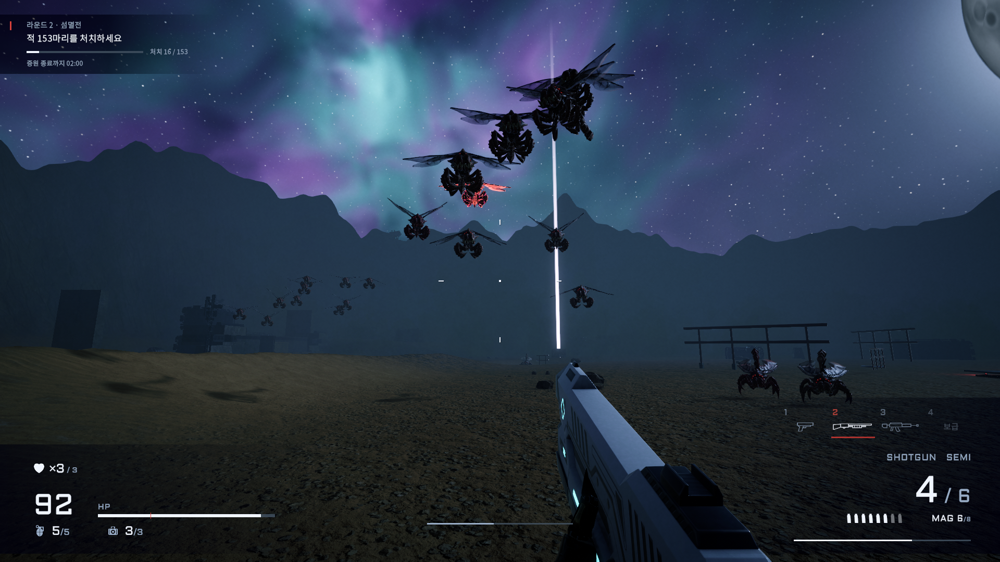

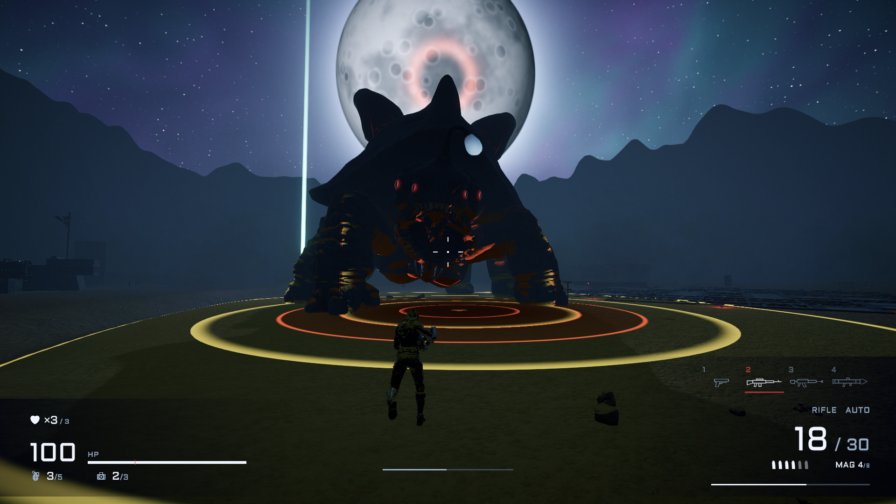

이 문서는 그중 제가 맡은 **보급 시스템**과 **사운드 시스템**을 주력으로 구조·동작까지 다루고(2·3장),
그 밖에 맡은 **라운드 종료 강화·맵·튜토리얼·UI 통합**은 제가 내린 결정 위주로 다룹니다(4장).

**이 프로젝트가 이전과 달랐던 점 — 팀원 모두가 AI와 함께 만들었습니다.**
기본 시스템 설계는 강의 내용([강의 사이트](https://krkoohoo.github.io/))과 Claude Opus로 잡았고, 구현도 대부분 AI의 도움을 받았습니다.

이전 작업은 한 단계씩 직접 밟아 가며 게임을 만드는 과정이 대부분이었습니다.
학원의 지원으로 Claude Opus를 쓰게 된 뒤로는, 제 생각과 기획안을 설명하고 설계와 구현을 요청하면 결과물이 나왔습니다.
눈에 보이는 게임으로는 훌륭한 결과물이었지만, 코드 내부까지 확인하지는 못했습니다(5-3의 가장 큰 아쉬움).

그래서 이 문서는 "코드를 직접 짰다"보다 **무엇을 만들지 정하고, AI가 낸 안 중에서 고르고, 직접 플레이해 문제를 찾은 과정**에 초점을 둡니다(1-4).

### 1-2. 왜 만들었나 (Why) — 제 파트가 풀어야 했던 문제

**주력 파트**

- **보급**: 직접 플레이 테스트를 해 보니 새 맵에서는 보급이 아예 떨어지지 않았고(5-2 ④), 보스전에 들어가면 투하가 멈췄습니다.
  고친 뒤 팀 2차 피드백에서는 보급이 **지형 위·높은 건물 위·맵 밖**에 떨어져 주울 수 없는 경우가 나왔습니다(F2·F3·F6). 테스트 중 **10개 중 2~3개 정도**를 줍지 못했습니다.
  군중전에서 보급은 대량의 비행체 몬스터와 정예 몬스터를 처리하는 데 중요한 시스템입니다.
  주울 수 없는 곳이나 너무 먼 곳에 떨어지면 플레이어는 답답함과 좌절감을 느끼고, 게임을 계속할 동기를 잃을 수 있습니다.
- **사운드**: 4명이 각자 몬스터·보스·무기를 만드는 동안 소리를 붙여야 했습니다. 다른 사람의 코드를 고치지 않고 소리를 붙일 방법이 필요했고,
  플레이 중 **플레이어 소리가 전혀 나지 않는** 버그도 발견했습니다(11-01).
  FPS에서 효과음은 게임에 생동감을 주고, 피격을 알아차리거나 적의 위치를 알아내게 해 주어 몰입에 큰 역할을 합니다.

**그 밖에 맡은 파트**

- **맵**: 처음 직접 디자인한 맵은 1차 빌드 테스트(10-28)에서 너무 크고, 오래된 에셋이라 텍스처가 좋지 않다는 피드백을 받았습니다.
  맵이 크다 보니 플레이어가 계속 몬스터를 **피해 도망 다니게** 되었고, 보급이 너무 멀리 떨어져 **보급을 주우러 가는 길이 오히려 스트레스**가 되었습니다.
  그래서 **맵 면적을 1/4로 줄이고, 고저차가 큰 언덕을 없애고, 엄폐물을 더 배치하는** 작업을 맡았습니다(아사나 BL-059).
  줄인 뒤 새 에셋으로 Claude와 함께 맵을 다시 만들었는데, 생성된 맵에 **계단과 2층 구조**가 생겨 고쳐야 했습니다.
  "몬스터가 오지 못하는 높은 곳에서 쏘는 이점은 주지 않는다"는 원칙(4-1)을 지키기 위해 AI와 실랑이도 많이 벌였습니다(4-7).
- **라운드 종료 강화**: 처음 만든 강화(10-23)는 재장전·탄창·수류탄 파우치 3종뿐이었습니다. 직접 테스트해 보니 라운드를 클리어했을 때 **받는 보상이 작게** 느껴졌습니다.
  팀원들과 상의하며 2차 빌드 피드백과 팀장 의견을 거쳐, 체력·스태미나·수류탄·회복 팩까지 **8종**과 하급·일반·에픽 **등급 카드 3장 + 리롤** 상점으로 바꿨습니다(4-9).
- **튜토리얼**: 처음 만든 튜토리얼은 플레이어가 자유롭게 이동하고 사격할 수 있었습니다. 팀장의 피드백으로, 튜토리얼 동안에는 **일부 행동을 제한**해
  플레이어가 지금 배우는 것에 집중하도록 설계를 바꿨습니다(11-03, 단계마다 지시한 행동만 허용).

### 1-3. 개발 환경 · 링크

| 항목 | 내용 |
|---|---|
| 엔진 | Unity 6000.3 (URP) |
| 언어·도구 | C#, Git(Git flow, Git LFS), Asana |
| AI 도구 | Claude Opus (저는 Claude Code로 사용). ChatGPT를 함께 쓴 팀원도 있었습니다 |
| 기간 | 2026-10-15 ~ 2026-11-04 (약 3주 — 기획 1주 · 개발 2주) · 최종 빌드 11-04 새벽 · 같은 날 발표 |
| 팀 | 4명 — 팀장 이찬영, 팀원 김민성·윤건우·홍산 |
| 영상 | [플레이 시연 영상 (YouTube, 4분 23초)](https://youtu.be/H4MNlsQbh80) · [한 판 몰아보기 쇼츠 (1분 13초)](https://youtube.com/shorts/6vDZDAhEoyc) |
| GitHub | 비공개 |

### 1-4. 팀 구성과 역할

| 이름 | 담당 |
|---|---|
| 윤건우 (나) | 보급·보상(라운드 종료 강화), 사운드, 맵·튜토리얼, 메인 메뉴·UI 통합 |
| 이찬영 (팀장) | 코어(데이터·이벤트·서비스), 보스 |
| 홍산 | 몬스터·보스, 몬스터의 이동 시스템 (군중 이동) |
| 김민성 | 플레이어·무기, 인트로·엔딩 |

**팀 전체가 일한 방식**

- 팀원 모두 AI(주로 Claude Opus)와 함께 각자 맡은 파트를 설계·구현했습니다. 다른 팀원들은 프로그래밍 전공자였고, 비전공자인 저는 **AI를 가장 적극적으로 활용한 팀원**이었습니다.
  코드를 처음부터 직접 짜는 대신 **무엇을 만들지 정하고, AI의 설계안을 검토해 고르고, 직접 플레이해 검증하는 역할**에 집중했고,
  그 덕분에 보급·사운드 외에도 맵·튜토리얼·강화·UI 통합까지 맡을 수 있었습니다.
- 파트 사이 약속(2-1의 "파트끼리 서로 모른다" 규칙, 이벤트·서비스·데이터 형식)은 **강의 내용과 Opus로 먼저 잡은 기본 설계**를 따랐습니다.
- 팀 차원에서 따로 정한 AI 사용 규칙은 없었습니다. 팀장이 만든 기준 문서 「이벤트 버스와 외부 데이터 적용 기준」이 사실상 가장 큰 규칙이었고,
  저는 각자의 AI가 이 약속을 지키도록 이 문서를 작업마다 붙였습니다.

**제 파트를 만든 방식 — AI(Claude Code)와 역할 나누기**

| 누가 | 무엇을 |
|---|---|
| 나 | 무엇을 만들지(요구사항)와 수치 정하기 · 설계안의 질문에 답하며 **선택** · 직접 플레이하고 문제 찾기 · 팀 공유(피드백 문서·PR·디스코드) |
| 나 (직접 작업) | 맵 배치·콜라이더, 사운드·BGM 선정, 튜토리얼 음성(TTS) 제작, 에디터에서 값 조정 |
| Claude Code | 설계안·보완점 정리, 코드 구현, 커밋·PR 문서 |

작업마다 순서를 고정했습니다: **설계 → 보완점 정리 → 내 확인 → 구현.** 설계는 「이벤트 버스와 외부 데이터 적용 기준」 v0.1을 매번 붙여 따르게 했습니다.

### 1-5. 제가 맡은 것

**이 문서에서 자세히 다루는 것**

1. **보급 시스템** — 공중 투하, 낙하 지점 찾기, 상황에 따라 바뀌는 보급 확률, 근접 획득
2. **사운드 시스템** — 이벤트 → 소리 연결(GameSoundRouter), 객체별 이미터, BGM, AudioMixer

**그 밖에 맡은 것** (한 줄씩만)

- 라운드 종료 강화 상점 (등급 카드 3장 + 리롤, 강화 8종)
- 인게임 맵(Sci-Fi Base 기반)·튜토리얼 맵, 맵 빌더 에디터 도구
- 메인 메뉴(디오라마 배경·호버 연출·옵션 팝업), 튜토리얼 6단계
- 게임 전체 UI 통합 (메인 메뉴 스타일 기준, `UiTheme`)
- 플레이 테스트 분석기(PlaytestAnalyzer), 바이너리 에셋 자동 복구 도구

### 1-6. 이 문서에서 다루는 것

2장 구조 → 3장 보급·사운드가 동작하는 방식 → 4장 제가 내린 결정 아홉 가지
(높은 곳 사격 금지 원칙, 근접 획득, 상황별 보급 확률, Hurt 소리 빼기, BGM 키 위치, 담당 범위, 맵·튜토리얼을 AI와 함께 만든 방식, UI 통합, 라운드 종료 강화 개편) → 5장 직접 찾은 문제와 아쉬운 점.

---

## 2. 시스템 구조

### 2-1. 팀 공통 규칙 — 파트끼리 서로 모른다

이 규칙은 강의 내용과 Claude Opus로 잡은 **팀 기본 설계**(코어 담당 파트)입니다. 저는 이 규칙 위에서 작업했습니다.

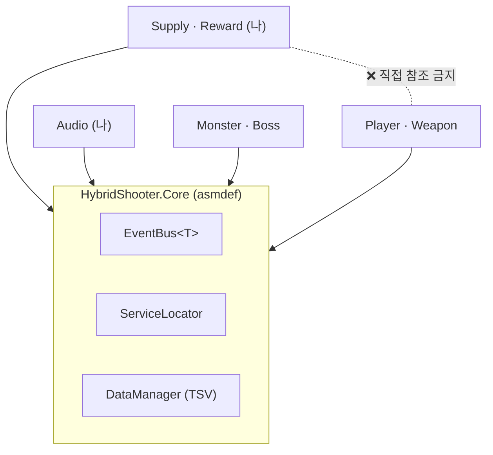

파트는 `HybridShooter.Core`에만 의존하고, 서로 통신할 때는 세 가지 중 하나를 씁니다.

| 상황 | 방법 |
|---|---|
| 대상을 이미 들고 있음 (충돌·레이캐스트) | 인터페이스 (`IItemUser`, `ISupplyWeaponUser`) |
| 씬 전역 기능 요청 | `ServiceLocator.Get<T>()` (`ISoundService`, `ISpawnZoneProvider`) |
| 일어난 일 알리기 | `EventBus<T>` (`MonsterSpawnedEvent`, `SupplyCollectedEvent`) |

이 규칙 위에서 각자 AI로 구현하니 작업 시간이 크게 줄었습니다.
다만 AI가 구현한 것이라도 제가 직접 확인하지 않으면 팀원들과 작업 이야기를 나누기 어려웠고, 이 경험이 5-3의 개선 계획으로 이어졌습니다.

### 2-2. 보급 모듈 구조

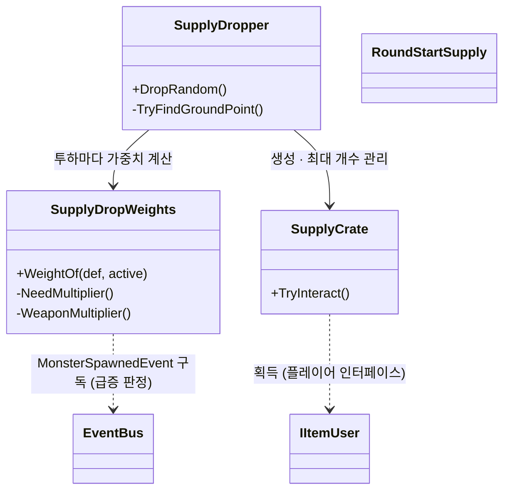

| 클래스 | 책임 |
|---|---|
| `SupplyDropper` | 언제·어디에 떨어뜨릴지. 낙하 지점 찾기, 필드 상자 수 제한 |
| `SupplyDropWeights` | 무엇을 떨어뜨릴지. 테이블 기본 가중치 × 지금 상황 배율 |
| `SupplyCrate` | 낙하 연출, 획득 영역, 플레이어에게 아이템 주기 |
| `RoundStartSupply` | 다음 라운드 시작 지급 |

보급 시스템에서 중요한 것은 **언제 떨어지는가, 얼마나 떨어지는가, 무엇이 떨어지는가**입니다.
그래서 떨어뜨릴 지점과 시간을 맡는 `SupplyDropper`, 외부 테이블로 무엇을 떨어뜨릴지 확률을 정하는 `SupplyDropWeights`,
라운드 정보를 받아 다음 라운드 보급을 정하는 `RoundStartSupply`로 나뉘었습니다.

클래스를 이렇게 나눈 것은 AI의 설계이고, 확률 계산(`SupplyDropWeights`)은 플레이 테스트에서 필요한 아이템이 잘 나오지 않는다고 느껴 2차 피드백 때 제가 제안한 기능입니다.
지금 돌아보면 `SupplyDropper`와 `RoundStartSupply`는 굳이 나누지 않고 합쳐도 되었을 것 같습니다.

### 2-3. 사운드 모듈 구조 — 소리 하나에 경로 하나

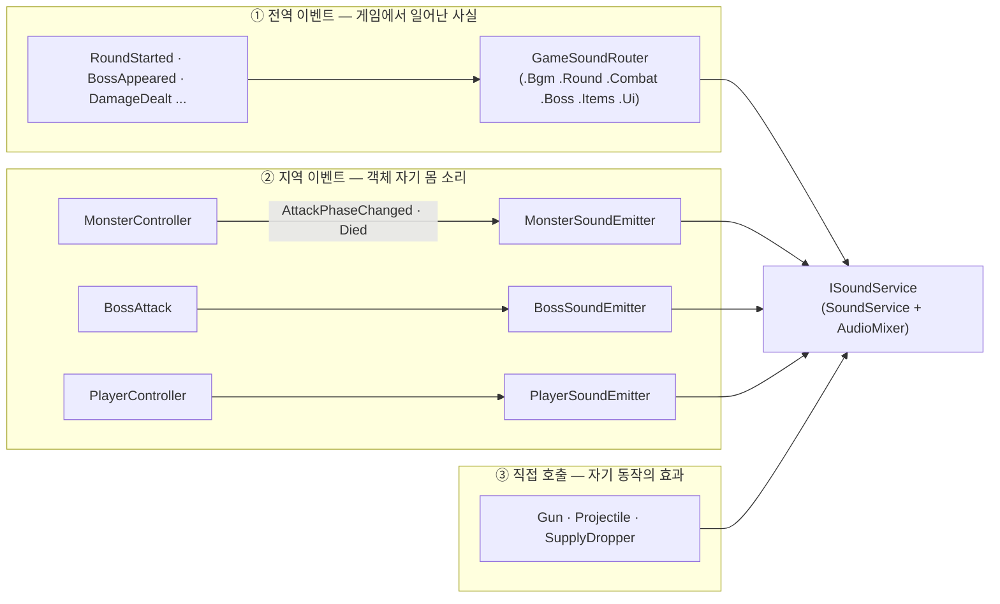

| 경로 | 언제 | 예 |
|---|---|---|
| ① 전역 이벤트 → Router | 여러 파트가 함께 알아야 하는 **사실** | 라운드 시작 → 군중 BGM + "FIGHT" |
| ② 지역 이벤트 → 이미터 | 그 객체 **자기 몸**의 소리 | 몬스터 공격 예고음, 사망음 |
| ③ 직접 호출 | 발행하는 쪽 **자기 동작**의 효과 | 총 발사음, 폭발음 |

이 세 갈래 구분은 AI가 설계 문서(`SoundSystemRefactor_v3.md §4`)에서 정리한 것입니다.
제가 직접 고른 것은 플레이어 소리가 나지 않던 버그(11-01) 때, 몬스터처럼 **플레이어에도 라우터가 이미터를 자동으로 붙이는** 방식입니다(3-5 ③).

---

## 3. 핵심 기능

이 장은 코드 대신 **동작 흐름과 제가 정한 규칙**으로 설명합니다(코드는 제가 직접 고른 방식인 3-5 ③ 한 곳만 보입니다). 구현은 AI(Claude Code)가 했고, 코드는 팀 레포에 있습니다(1-3, 비공개).
제 역할은 무엇을 막아야 하는지 정하고, AI가 낸 안 중에서 고르고, 직접 플레이해 확인하는 것이었습니다.

### 3-1. 보급 — 사용법

| 누가 | 무엇을 하면 | 결과 |
|---|---|---|
| 라운드 담당(`RoundSequencer`) | 자동 투하 시작·정지 (`StartAutoDropCycle` / `StopAutoDropCycle`) | 라운드 표(`RoundTable`)의 간격마다 상자가 떨어짐 |
| 튜토리얼 | 종류와 위치를 정해 한 번 투하 (`Drop`) | 낙하 지점 검사 없이 그 위치 아래 지면에 떨어짐 |
| HUD·사운드 | 획득 이벤트(`SupplyCollectedEvent`) 구독 | 보급을 주웠을 때 알림·소리 |

라운드 담당은 `StartAutoDropCycle`만 부르면 됩니다. 라운드 흐름은 `RoundSequencer`의 몫이므로,
**언제** 떨어뜨릴지는 `RoundSequencer`가, **어디에·무엇을**은 보급이 정하도록 나눴습니다.

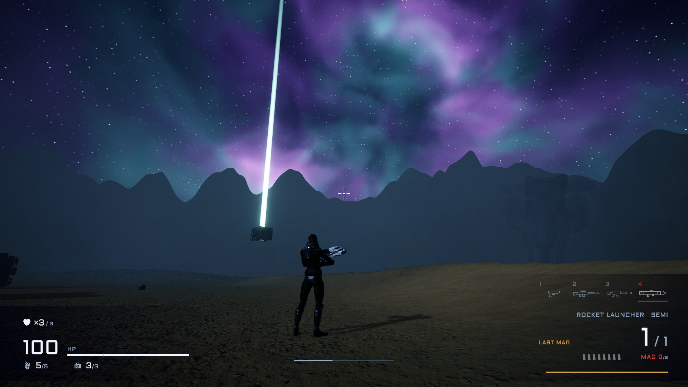

### 3-2. 보급 — 낙하 지점 찾기 (값싼 검사부터, 길 찾기는 마지막)

플레이어 기준 20~60m 둘레에서 후보 지점을 뽑고, 위에서 아래로 광선을 쏴 맞은 지면을 아래 다섯 검사에 통과시킵니다. 하나라도 걸리면 그 후보는 버리고 다시 뽑습니다(최대 30번).

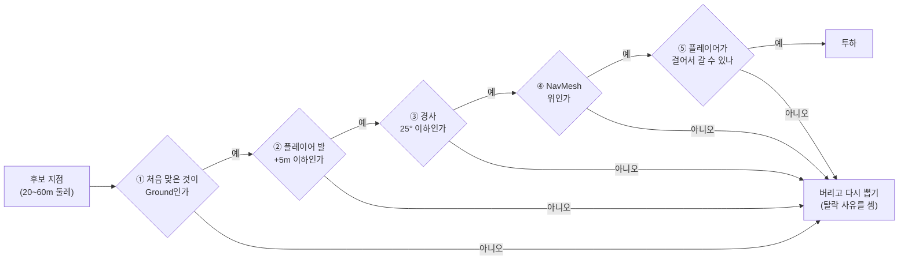

| 검사 | 막는 문제 | 어디서 나왔나 |
|---|---|---|
| ① 처음 맞은 것이 Ground | 지붕·바위·나무 위 | 제가 낸 A안과 비교해 고른 B안 (4-1) |
| ② 플레이어 발 +5m 이하 | 높은 건물·언덕 위 | 플레이 피드백으로 기준을 지형 높이 → 플레이어 발 높이로 바꿈 |
| ③ 경사 25° 이하 | 상자가 비탈에 묻힘 | — |
| ④ NavMesh 위 | 맵 밖·고립된 지붕 | 2차 피드백 뒤 추가 (4-1) |
| ⑤ 걸어서 갈 수 있음 | 구덩이 속·절벽 위 | 2차 피드백 뒤 추가 (4-1) |

- **길 찾기를 맨 마지막에 둔 이유**: `CalculatePath`는 실제로 길을 계산하므로 다섯 검사 중 가장 비쌉니다. 레이어·높이·경사는 숫자 비교 한 번이면 됩니다.
  값싼 검사로 먼저 거르면 비싼 길 찾기는 살아남은 후보 몇 개만 받으므로, 보급이 늦어지지 않습니다.
- **실패 사유를 종류별로 세는 이유**: 플레이 테스트 중에는 어떤 상자가 왜 실패했는지 눈으로 확인하기 어려워, 사유별 횟수를 경고로 남겼습니다(5-2 ④).
- **④⑤를 건너뛰는 경우**: 플레이어가 NavMesh 위에 없으면 "걸어서 갈 수 있는지"를 따질 수 없어서 NavMesh 검사를 통째로 건너뜁니다.
  NavMesh를 굽지 않은 테스트 씬에서 이 검사를 하면 모든 후보가 탈락해 보급이 하나도 떨어지지 않기 때문입니다.

### 3-3. 보급 — 상황에 따라 바뀌는 확률

최종 가중치 = **테이블 기본 Weight × 상황 배율**

| 상자 | 배율 |
|---|---|
| 수류탄·회복 팩 | 보유량이 0개면 ×2.0, 가득이면 ×0.25 (사이는 선형) |
| 무기 상자 | 몬스터 급증(최근 10초 12마리 이상 소환) ×2.5, 보급 무기 소진 ×2.5, 상한 ×4. 이미 들고 있으면 나오지 않음 |

| 상황 (기본 40/40/10/10, 설계 문서의 계산값) | 수류탄 | 회복 | 로켓 | 유탄 |
|---|---|---|---|---|
| 평소 (둘 다 절반 보유) | 41% | 41% | 9% | 9% |
| 수류탄 0 · 회복 가득 | 73% | 9% | 9% | 9% |
| 급증 + 무기 소진 | 26% | 26% | 24% | 24% |

배율 숫자(가득일 때 0.25 등)와 ConfigTable에 둔 구조는 AI가 정한 초기값입니다.
저는 투하 확률 로그(`[SupplyDropper] 투하 확률: …`)로 수류탄이 0개일 때 수류탄 상자가 자주 나오는 것을 확인했습니다.

### 3-4. 사운드 — 사용법

다른 파트는 소리 서비스(`ISoundService`)에 **사운드 표(`SoundTable.tsv`)의 키**만 넘기면 됩니다.

| 하고 싶은 것 | 방법 |
|---|---|
| 효과음 한 번 | 키로 재생. 위치를 주면 3D, 안 주면 2D |
| 따라다니는 반복음 | 키와 따라갈 대상을 주고 재생, 끝나면 정지 |
| 배경음 바꾸기 | 곡 키로 재생 |
| 잠깐 다른 소리 줄이기 | 종류별로 음량을 낮춤 (예: 보스 경고 동안 몬스터 소리) |
| 새 몬스터에 소리 붙이기 | **코드 수정 없이** 몬스터 표(`MonsterTable`)의 사운드 키 열만 채움 (3-5) |

### 3-5. 사운드 — 다른 파트 코드를 고치지 않고 소리 붙이기

몬스터 프리팹은 홍산 님 담당이라, 프리팹에 사운드 컴포넌트를 미리 붙여 두지 않았습니다. 몬스터가 생기면 Router가 이미터를 붙이고,
이미터는 몬스터가 Core 계약(`IMonsterSoundSource`)으로 알려 주는 **지역 이벤트**만 듣습니다.

**몬스터는 어디서 생기나 — 몬스터 파트의 소환 구조** (홍산 님 담당 코드)

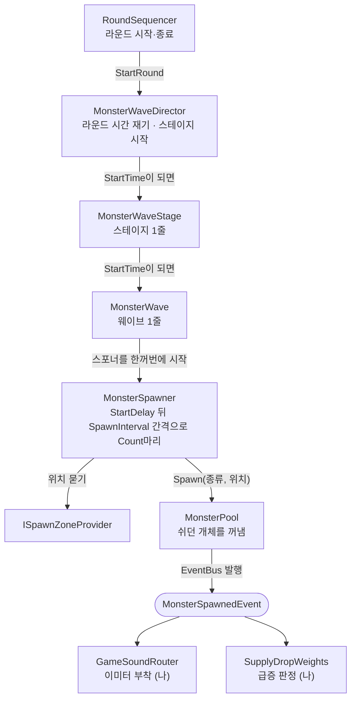

- 데이터 표(스테이지 → 웨이브 → 스포너)의 한 줄이 클래스 하나의 실행 1회입니다. 위층이 아래층을 만들고, 매 프레임 `Tick`으로 시간을 넘겨 줍니다.
- 스포너는 스스로 시간을 재지 않고 `Time.deltaTime`을 받기만 해서, 강화 화면(`timeScale` 0)에서는 소환이 저절로 멈춥니다.
- `MonsterSpawnedEvent`는 스포너가 아니라 **풀(`MonsterPool`)이 몬스터를 꺼낼 때** 발행합니다.
  제 사운드·보급 코드는 이 소환 구조의 어느 클래스도 모르고, 이 이벤트 하나만 듣습니다 — 2-1의 "파트끼리 서로 모른다"가 실제로 이렇게 동작합니다.

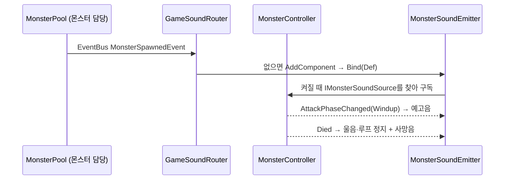

| 누가 | 하는 일 |
|---|---|
| ① `GameSoundRouter` | 몬스터가 생기면(`MonsterSpawnedEvent`) 그 몬스터에 이미터를 붙임. 보스는 구조가 달라 따로 처리 |
| ② `MonsterSoundEmitter` | 몬스터가 알려 주는 순간(공격 예고·기절·착지·명중·사망)에 그 몬스터 위치에서 소리를 냄. 15m 안에 있으면 울음을 더 자주 냄 |

**왜 이렇게 했나**
- **씬에 직접 놓은 몬스터에도 붙이기** — 테스트 중에는 풀(`MonsterPool`)을 거치지 않고 씬에 켜진 채 미리 배치해 둔 몬스터들이 있었습니다.
  `MonsterSpawnedEvent`는 풀이 몬스터를 꺼낼 때만 발행되므로 이 몬스터들에는 소리가 붙지 않았고, 그래서 씬에 있는 몬스터에도 이미터를 붙이는 `AttachEmittersInScene()`을 따로 두었습니다.
- **명중이 아니라 예고(Windup) 순간에 공격음** — 플레이어에게 공격이 온다는 정보를 미리 주기 위한 장치입니다.
- **`Awake`가 아니라 `OnEnable`에서 구독** — 몬스터는 오브젝트 풀을 쓰기 때문에, 풀에서 다시 꺼낼 때 `Awake`가 다시 불리지 않습니다.
- **`MonsterController`가 아니라 `IMonsterSoundSource`를 찾기** — 이미터는 `MonsterController`가 무엇을 하는지 알 필요가 없습니다.
  인터페이스(`IMonsterSoundSource`)를 통해 몬스터의 종류와 공격 순간만 전달받고, `MonsterTable`의 사운드 키로 소리를 연결하는 역할입니다.

**③ 같은 방식을 플레이어에도 — 직접 고른 A안** (11-01)

플레이 중 플레이어 소리(발소리·피격 등)가 전혀 나지 않았습니다. 원인은 `PlayerSoundEmitter`가 플레이어 프리팹에 없었던 것입니다(`SoundFix_Handoff.md §1`).

| 방법 | 내 판단 |
|---|---|
| B안. 플레이어 프리팹에 이미터를 직접 붙이기 | 플레이어 프리팹은 김민성 님 담당이라, 담당자의 작업물을 바꾸고 싶지 않았음 |
| **A안. 라우터가 실행 중에 자동으로 붙이기 (선택)** | 프리팹은 그대로 둠 |

```csharp
private void AttachPlayerEmitters()   // Start 에서 1번
{
    foreach (var player in FindObjectsByType<PlayerController>(FindObjectsInactive.Include, FindObjectsSortMode.None))
        if (player.GetComponent<PlayerSoundEmitter>() == null) player.gameObject.AddComponent<PlayerSoundEmitter>();
}
```

쉽게 놓칠 수 있는 버그였습니다. 자동으로 붙이는 방식도 팀원의 작업물에 영향을 줄 수 있어 처음에는 피했고,
플레이어 작업이 거의 마무리되어 더 이상 시스템이 추가되지 않을 시점에 적용했습니다.

몬스터 담당이 고친 것은 `MonsterController`가 `IMonsterSoundSource`를 구현하고, 정해진 순간에 이벤트를 발행하는 줄을 넣은 것뿐입니다
(사망은 `MonsterDiedEvent` 바로 앞에 `Died?.Invoke()` 한 줄. 출처: `SoundSystemRefactor_v3.md §5 S1`).
어떤 소리를 낼지는 `MonsterTable`·`MonsterAttackTable`의 사운드 키 열이 정합니다.

**효과**: 나중에 추가된 돌진형 몬스터, 파르다트록스 등은 사운드 코드를 고치지 않고 **사운드 파일을 추가해 테이블의 사운드 키에 넣는 것만으로** 소리를 붙였습니다.

---

## 4. 고민과 선택

AI가 대안을 정리하면, 저는 기준을 주고 골랐습니다. 이 장의 「따옴표」는 작업할 때 제가 실제로 쓴 문장입니다.

### 4-1. "높은 곳에서 쏘는 이점은 주지 않는다" — 맵·NavMesh·보급을 한 원칙으로

맵을 만들면서 세운 원칙입니다.

> 「플레이어가 몬스터들이 오지 못하는 곳에서 사격해서 얻는 이점을 얻지 않는 것이 맵의 핵심 설계」 (10-30)

군중전은 몰려오는 몬스터를 정리하는 재미입니다. 플레이어가 지붕에 올라가면 몬스터가 닿지 못해 그 재미가 사라집니다.
이 원칙을 세 곳에 똑같이 적용했습니다.

| 시스템 | 적용 |
|---|---|
| 맵 | 계단·2층 구조 금지, "높고 얇은 벽 + 지붕" 건물 금지. 엄폐물은 지역마다 2~5개 (보스 마그마·돌진 패턴을 피할 정도) |
| NavMesh | 걸을 수 있는 곳은 Ground(Terrain)만, 나머지 소품은 Obstacle (10-31, 몬스터가 지붕 위에 스폰되는 문제를 보고) |
| 보급 낙하 | Ground 레이어·플레이어보다 5m 이하인 곳에만 투하 → 2차 피드백 뒤 **NavMesh로 걸어서 갈 수 있는 곳**에만 (3-2) |

플레이 테스트를 하다가 건물 위에 올라간 보급을 본 순간 "저걸 어떻게 먹어?" 하는 불쾌감이 들었습니다. 그래서 맵의 원칙을 보급에도 적용했습니다.
게임은 만들기만 하면 끝이 아니라, 직접 플레이어로서 플레이해 봐야 경험이 완성된다고 생각합니다.

**보급 낙하 판정에서 비교한 방법** (10-31)

| 방법 | 누가 냄 | 장단점 |
|---|---|---|
| A. 소품을 Obstacle 레이어로 지정하고, Obstacle이 **아닌** 곳에 투하 | **나** | 직관적. 하지만 레이어를 빠뜨린 소품이나 새로 추가한 오브젝트 위에는 떨어짐 |
| **B. 레이캐스트가 처음 맞은 것이 Ground일 때만 투하 (선택)** | AI 권장 | 비용은 A와 같음(레이캐스트 1회 + 레이어 비교). 맵 소품 레이어를 바꾸지 않아도 되고, 빠뜨린 소품 위에도 안 떨어짐 |
| C. Ground만 마스크로 레이캐스트 | AI 비교안 | 지붕을 뚫고 건물 **안**에 떨어짐 |

> 「Probs 를 Obstacle 로 지정해서 obstacle 이 아닌 곳에서만 허용 되게 변경 하는 안 고려 / 권장 방식이 더 최적화에 좋다면 권장방식으로 진행」 (10-31)

**선택 이유**: 제가 낸 A안과 비교해 달라고 했고, **성능은 같지만 B가 실수에 강하다**(허용 목록 방식)는 점을 보고 B를 골랐습니다.
그래도 절벽 위·구덩이처럼 Ground인데 못 가는 곳이 2차 피드백에서 남았고, 그때 NavMesh 경로 검사를 더했습니다(3-2).

**이 원칙의 대가**: 1차 플레이 테스트에서 직접 쓴 피드백입니다 — 「엄폐물이 많아 지니 보스가 멀리서 쏘기만 하면되서 쉬워짐」.
엄폐물을 늘린 결정이 보스전 긴장감을 떨어뜨렸습니다(5-3).

### 4-2. 보급 줍기 — 조준해서 줍기 vs 가까이 가서 줍기

처음에는 상자를 **조준**해야 F키로 주울 수 있었습니다. 직접 플레이해 보고 바꿨습니다.

> 「현재 플레이어의 마우스 raycast가 보급상자를 바라보고 있어야 획득이 가능한 것은 3인칭이나 긴박한 상황에서 불편함을 경험시켜준다. → 플레이어가 보급 상자 근처에 있으면(trigger collider 적용) F키를 눌러 획득 하는 방식」 (11-01)

| 방법 | 장점 | 단점 |
|---|---|---|
| 조준만 (전에) | 상자가 여러 개일 때 골라 집을 수 있음 | 3인칭·몬스터에 쫓길 때 정확히 겨누기 어려움 |
| 근접만 | 편함 | 상자가 붙어 있으면 무엇을 집을지 고를 수 없음 |
| **둘 다: 조준한 상자 먼저, 없으면 반경 2m 안 가장 가까운 상자 (선택)** | 두 장점을 다 가짐 | 플레이어 담당의 `PlayerInteractor`를 고쳐야 함 → 변경 내용을 디스코드로 공유 |

획득 반경 **2m**, 조준 정보 카드는 **30m 안**에서만, 상자 투하는 **60m 안** — 숫자는 직접 플레이하면서 정했습니다.

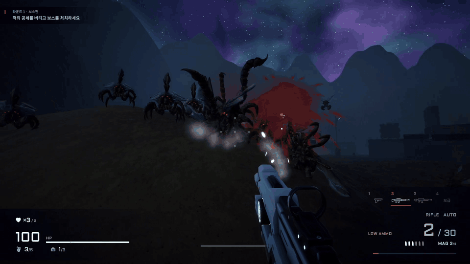

같은 이유("긴박한 상황")로 **보여 주지 않을 것**도 정했습니다.
- 「사격 중에는 보급 상자 정보 UI 는 안나오게」
- 「1회용 탄 1 예비 4 이런 정보는 빼두자, 유저들에게는 꼭 명시할 필요는 없는 정보야」
- 무기 설명은 짧게: 「로켓 런처 : 재장전 시간이 느리지만 파괴력이 강력한 무기입니다」 (직접 쓴 문구)

### 4-3. 보급 확률 — 고정 확률 vs 상황에 따라 바뀌는 확률

시작은 불만 하나였습니다.

> 「무기 상자 확률이 지금 몇퍼센트야 조금 낮아보여서」 (11-01)

기본 확률을 올리는 대신, **언제 무엇이 필요한지**에 따라 확률이 바뀌게 하자고 제안했습니다.

> 「보급 상자가 떨어지는 비율 조건은 플레이어의 수류탄/ 힐팩 현재 보유 갯수에 따라 드랍이 조정됨
> 무기상자는 웨이브의 몬스터수가 확 늘어 날때, 플레이어가 보급 무기를 다 사용 했을 때 확률을 높임」 (11-01)

| 방법 | 장점 | 단점 |
|---|---|---|
| 무기 상자 기본 확률만 올리기 | 숫자 하나 | 수류탄이 가득해도 수류탄 상자가 같은 확률로 나옴 |
| **기본 확률 × 상황 배율 (선택)** | 필요한 것이 필요할 때 더 잘 나옴 | 판정 조건과 배율 숫자가 늘어남 → 전부 ConfigTable에 두고 투하 로그로 확인 |

이어서 정한 것:
- 수류탄·회복 팩이 **둘 다 가득**이면 무기 상자 확률이 크게 오르는 부작용 → 「그대로 허용」 (Q-C).
  무기 상자로 강력한 무기를 경험하면 전투 경험이 다양해집니다. 다른 보급이 이미 가득 찬 상황에서는 무기를 주는 것이 좋다고 판단했습니다.
- 보급 무기를 **들고 있으면** 무기 상자는 아예 나오지 않게 (3차 개선) — 들고 있는 무기가 새 무기로 버려지는 것을 막음

### 4-4. 몬스터 피격(Hurt) 소리 — 만들 수 있지만 만들지 않은 소리

> 「Hurt 사운드는 게임 특성상 일반 몬스터는 금방 죽고, 중간체 몬스터 또한 많지 않기 때문에 총기 피격음 구현 외에는 크게 중요하지 않을 거 같아」 (10-25)

| 방법 | 장점 | 단점 |
|---|---|---|
| 몬스터마다 Hurt 소리 | 몬스터마다 다른 반응 | 금방 죽는 군중 수십 마리가 동시에 비명 → 소음. 몬스터마다 에셋 필요 |
| **총알 타격음 하나 + 히트마커 (선택)** | 군중전에서도 깔끔. 에셋 1개 | 몬스터 종류별 차이는 없음 → 대신 사망음·공격 예고음이 몬스터를 구분 |

결과: 타격감은 총알 타격음(3D, 맞은 위치)과 히트마커(2D)로 주고, 약점을 맞히면 같은 타격음의 **음높이만 올립니다**(제 아이디어).
`MonsterTable`의 `HurtSfxKey` 열은 쓰는 곳이 없어져 삭제했습니다.

플레이해 보니 타격음이 더 다양했으면 좋았겠다는 생각은 들었습니다. 몬스터 피부의 종류에 따라 타격음을 다르게 하면 더 생동감이 있었을 것입니다(5-3).

### 4-5. BGM 곡 키 — Inspector 배열 vs RoundTable

라운드·보스전·강화 화면마다 다른 곡을 틀기로 하면서, 곡 이름을 어디에 둘지 비교를 요청했습니다.

> 「inspector 배열에 두는 장단점 이랑 라운드 곡 키를 roundtable 두는 장단점 설명, 추천하는 방법 이유 설명」 (11-03)

| 방법 | 장점 | 단점 |
|---|---|---|
| Router Inspector 배열 | 사운드 파트 안에서 끝남 | 라운드 순서와 배열 순서를 따로 맞춰야 함. 라운드가 바뀌면 두 곳을 고침 |
| **RoundTable에 `CrowdBgm`·`BossBgm` 열 (선택)** | 라운드마다 다른 값이 라운드 데이터와 한 줄에. 기준값이 한 곳 | 라운드 담당의 테이블·코드를 고쳐야 함 |

**선택 이유**: Inspector로 하면 수작업 실수가 생길 수 있어서 RoundTable을 골랐습니다. 수작업을 하다 보면 깜빡하고 넣지 않거나 생각하지 못한 것을 놓치는 일이 흔하기 때문입니다.

Inspector에는 **열이 비었을 때 쓰는 기본 곡**과 강화 화면 곡만 남겼습니다.
그 밖에 직접 정한 규칙: 튜토리얼에서는 강화 화면 곡을 틀지 않음 · 보스 처치 직후에는 강화 곡을 **3.5초 늦게** 시작(클리어 효과음·승리 아나운서와 겹치지 않게) · 장면별 선곡.

### 4-6. 협업 — 내 담당 범위와 다른 파트 코드

4명이 동시에 작업해서, **어디까지 내가 고칠지**를 매번 정해야 했습니다.

| 상황 | 내 결정 |
|---|---|
| 팀 피드백에 라운드 포맷 변경(섬멸전 등)이 섞여 옴 | 「라운드 포맷은 담당자가 있어서, 나는 업그레이드 시스템만 담당」 → 요청 사항만 문서에 남김 |
| 강화(스태미나·최대 체력)가 플레이어 코드를 건드림 | 「스테미나와 최대체력은 플레이어 담당에게 큰 문제를 일으키나?」 먼저 확인 → 「직접 고치고 PR에서 담당자 리뷰 요청」 |
| 근접 획득이 `PlayerInteractor`(플레이어 담당)를 바꿈 | 바꾼 내용을 정리해 디스코드로 공유 |
| 보급 정보 UI | 처음에는 「ui 구현은 플레이어 담당이 구현 예정」으로 보급은 정보만 주려 했지만, **UI까지 직접 만듦** |
| 커밋 직전 | 「다른 팀원들에게 영향이 안갈 경우에 커밋」 — 영향이 있으면 버림(discard) |

| 방법 | 장점 | 단점 |
|---|---|---|
| 담당자에게 요청하고 기다림 | 소유권이 분명 | 약 3주 일정에서 내 작업이 멈춤 |
| **작게 직접 고치고 PR에서 담당자 리뷰 (선택)** | 기다리지 않음, 담당자가 확인함 | 리뷰 부담을 담당자에게 줌 |
| 내 쪽에서 우회 | 남의 코드를 안 건드림 | 같은 기능이 두 곳에 생김 |

강화 시스템은 라운드가 끝난 뒤에 따라오는 시스템이어서 담당자 리뷰에서 고쳐 달라는 피드백은 없었습니다.
보급 정보 UI를 직접 만든 것은, AI로 작업하고 있었기 때문에 제가 기획하고 직접 구현해 원하는 방향으로 만드는 편이 더 빠르다고 판단했기 때문입니다.

### 4-7. 맵·튜토리얼 — 남은 일주일, AI가 만들고 제가 고쳤다

**인게임 맵**

처음에는 제가 맵을 직접 디자인하고 배치했습니다(10-20 「맵 기초 디자인 설계」 → 10-22 「맵 디자인 완료」).

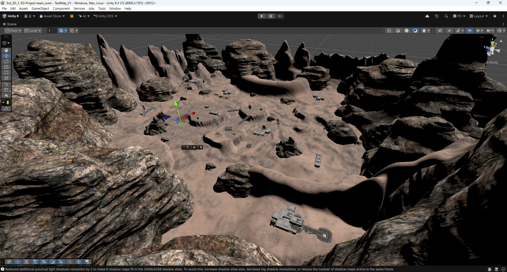

그런데 1차 빌드 테스트(10-28) 때 **맵이 너무 크고, 오래된 에셋이라 텍스처가 좋지 않다**는 피드백을 받았습니다(설계 문서에는 "너무 심심하다"는 평가로도 기록되어 있습니다).

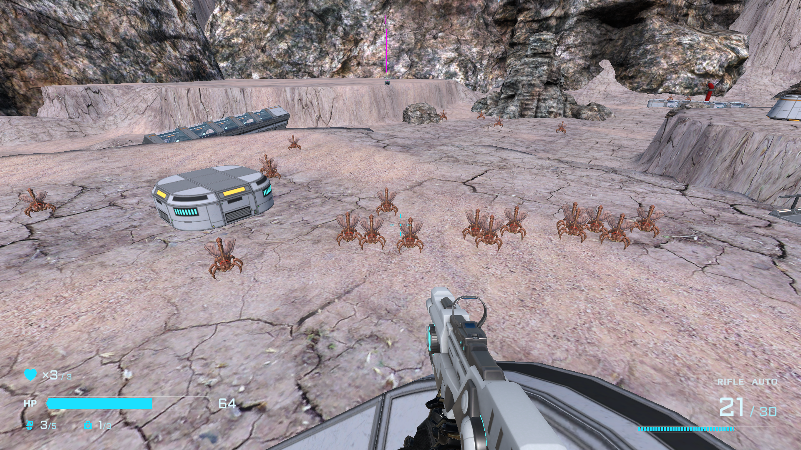

맵을 줄인 버전을 먼저 만들었지만(10-29), 마감인 발표일(11-04)까지 남은 기간이 **일주일 정도**뿐이었습니다(최종 빌드는 발표 당일 새벽에 마무리).

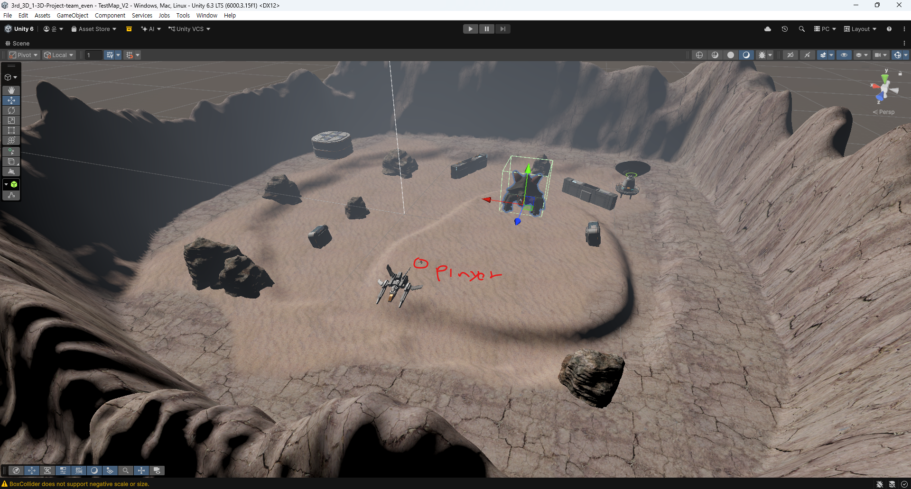

| 방법 | 장점 | 단점 |
|---|---|---|
| 지금까지처럼 전부 손으로 다시 배치 | 원하는 대로 정확히 놓을 수 있음 | 일주일 안에 새 에셋으로 맵 전체를 다시 만들기 어려움 |
| **Claude와 함께 생성 + 확인하며 수정 + 디테일은 수작업 (선택)** | 큰 배치를 빠르게 만들고, 디테일한 부분은 수작업 | AI가 놓은 배치를 하나하나 확인해야 함 |

그래서 Sci-Fi Base 에셋으로 맵을 새로 만들면서, 맵 제작을 Claude와 함께 진행했습니다.
Claude가 생성·배치한 결과를 확인해 가며 고칠 부분은 고쳤고, 디테일한 배치는 직접 손으로 했습니다.

| 순서 | 누가 | 내용 |
|---|---|---|
| ① 설계 | 나 + Claude | 세계관(불시착한 행성의 전초기지 잔해)·지점 배치를 문서로 먼저 정함. 1차 안(구역 4개를 게이트로 연결)은 폐기하고, 팀장 요청대로 **튜토리얼과 인게임을 분리 · 인게임은 한 지역**으로 확정 |
| ② 생성 | Claude | 맵 빌더 에디터 도구(`Tools/Map/Build Sci-Fi Map`): 지형에 분화구·순환로를 파고, 지점 6곳 소품과 엄폐물 2~5개를 배치 |
| ③ 확인·수정 | 나 | 생성된 배치를 여러 시점에서 확인(`Capture Map Review Shots`)하고 고칠 곳을 고침 |
| ④ 수작업 | 나 | 씬에서 손으로 옮기기·지우기·추가. `Save Sci-Fi Map Edits`가 이 수정을 기록해 두어 **다시 생성해도 손으로 고친 배치가 남게** 함 |
| ⑤ 규칙으로 | 나 + Claude | 손으로 고친 배치를 다시 빌더 규칙에 넣음 (예: 납작한 태양광 패널이 4배로 커지는 문제 → 크기 배율이 0.8~1.3배를 넘으면 크기를 바꾸지 않음) |

AI에게 맵 생성 설계와 구현을 맡겼을 때 가장 큰 문제는 **맵의 디테일**이었습니다. 건물에 전혀 어울리지 않는 오브젝트를 배치하거나,
요청하지도 않은 계단을 만들어 플레이어가 계단으로 높은 곳에 올라가 쉽게 플레이할 수 있게 되는 식이었습니다.
플레이어가 고지대를 활용해 우위를 갖지 못하게 하는 것이 이 맵 디자인의 핵심이었기 때문에, 이런 부분은 그냥 넘어갈 수 없었습니다.
그래서 4-1의 "높은 곳에서 쏘는 이점은 주지 않는다" 원칙을 빌더 규칙으로 넣어,
계단·사다리·발판이 달린 프리팹은 배치하지 않고, 장애물 윗면 높이도 정해진 단계(0.35m 이하 · 1.6~1.8m · 3.1m 이상, 점프 높이 1.2m)만 쓰게 했습니다.
또한 쓰지 않는 에셋을 정리해 Sci-Fi Base 에셋을 **3.25GB → 1.65GB**로 줄였습니다(10-31).

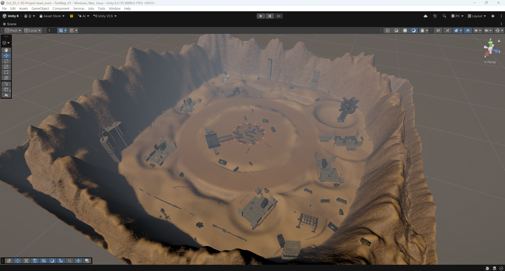


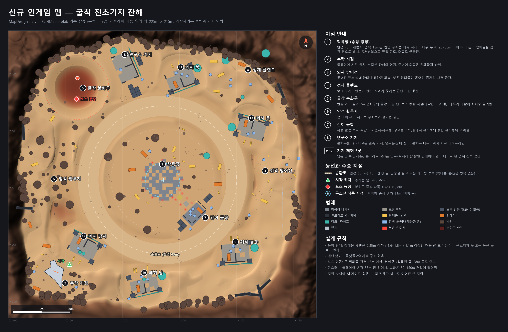

**튜토리얼**

튜토리얼도 AI와 함께 구현했습니다. 맵은 인게임 맵과 같은 빌더로 만든 **약 60m × 200m 선형 협곡**(10-30)이고, 기획은 세 번 바뀌었습니다(11-02).

| 기획안 | 내용 | 결과 |
|---|---|---|
| v1 | 강하 전 모함 격납고에서 출격 준비 | 폐기 |
| v2 | 출격 전 훈련장 — 이미 만든 튜토리얼 맵에 스토리를 맞춤 | 팀장 피드백으로 수정 |
| **v3** | **불시착한 행성에서 기본 전투 테스트 → 통과하면 전장 입장** (시놉시스와 연결). 흐름은 메인 메뉴 → 인트로 → 튜토리얼 → 게임 | **채택** |

구현한 것 (11-02 ~ 11-03):
- **6단계**: 이동·질주·구르기 → 사격·처치 보상 → 수류탄 → 보급 → 강화 체험 → 전초기지 게이트
- **오퍼레이터 음성 41줄**: 대사를 직접 TTS로 만들고, 녹음 한 파일을 대사별로 나눠 사운드 테이블에 연결
- **행동 제한**: 단계마다 지시한 행동만 할 수 있게 하고, 끝나거나 건너뛰면 풀어 줌

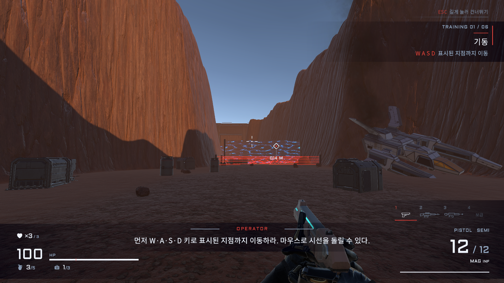

### 4-8. UI 통합 — 메인 메뉴 스타일을 게임 전체로, 다른 사람 작업과 부딪히지 않게

개발하는 동안 각자 만든 UI는 색·글꼴·모양이 제각각이었습니다. 저는 먼저 **메인 메뉴**를 만들면서(10-28 ~ 10-30)
어두운 외계 행성의 밤 분위기에 맞춘 UI 틀("Moonlit Night" — 달빛 흰색·청회색·붉은 포인트, 상자 대신 선과 띠)을 잡았고,
마감 직전(11-03)에 이 틀을 기준으로 **게임 전체 UI를 하나로 통합**했습니다.

메인 메뉴를 기준으로 삼은 이유는, 메인 메뉴의 UI가 **게임의 첫인상**이기 때문입니다.
이 UI를 게임 안의 모든 UI로 통합하면 일관성이 유지되어, 플레이어의 몰입도도 유지할 수 있다고 생각했습니다.

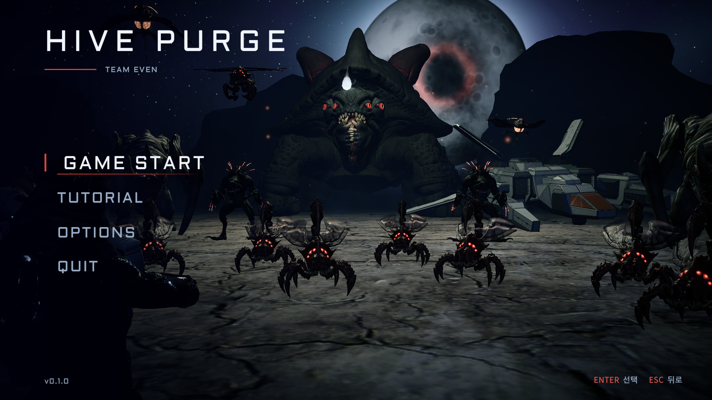

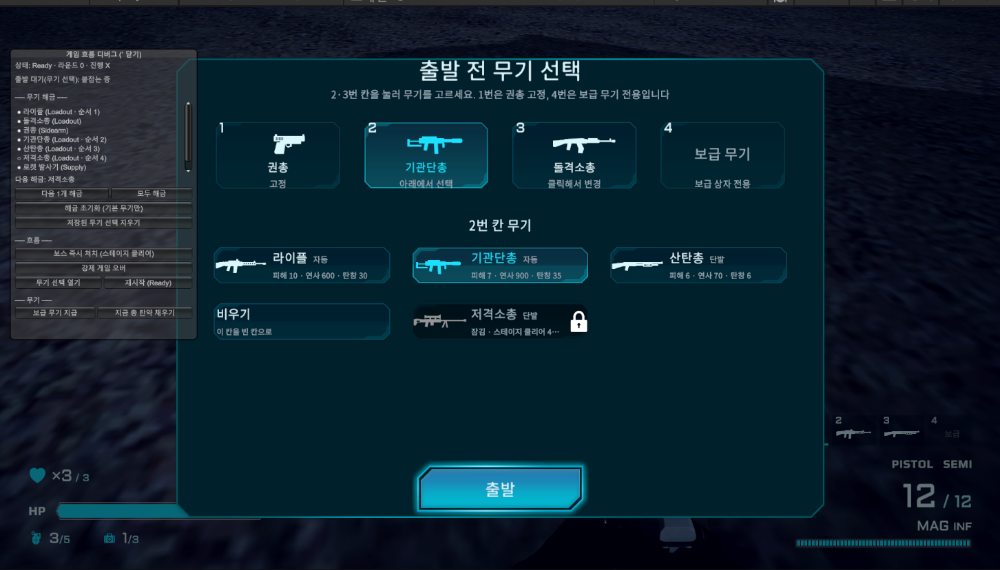

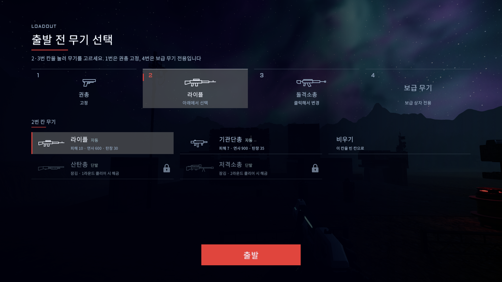

> 이 작업의 커밋 작성자는 팀장 이찬영 님(`chan`)으로 남아 있습니다. 제 Claude 사용량을 거의 다 써서, 팀장님의 강의실 컴퓨터에 있는 Claude로 작업했기 때문입니다.

**가장 신경 쓴 것 — 다른 사람이 작업 중인 파일과 부딪히지 않기**

마감 직전이라 팀원 모두가 UI 파일을 동시에 고치고 있었습니다. 그래서 작업 전에 **파일마다 누가 어떤 브랜치에서 고치고 있는지** 위험 지도를 먼저 만들고, 원칙을 정했습니다.

| 원칙 | 이유 |
|---|---|
| 색·글꼴·크기는 **새 파일**(`UiTheme`, 공통 부품 `UiThemeKit`)에 모은다 | 새 파일은 누구와도 충돌하지 않음 |
| 기존 파일은 **그리는 코드만** 바꾼다. 동작 로직·public 이름·`[SerializeField]` 이름은 그대로 | 다른 사람의 기능과 프리팹·씬 참조가 깨지지 않음 |
| 씬·프리팹은 손으로 고치지 않고, 빌더 코드만 고친 뒤 **담당자와 시간을 맞춰 재생성** | 씬 파일은 합치기(merge)가 거의 불가능함 |
| 공용 파일(`GameEvents.cs`, 데이터 테이블)은 건드리지 않는다 | 모든 파트가 쓰는 곳이라 충돌하면 피해가 큼 |

작업은 작은 PR 9개로 나눴습니다(테마·아이콘 → 전투 HUD → 알림·카드 → 보상·강화·게임 오버 → 무기 선택·라운드 목표 → 옵션 → 보스·부활 → 인트로·엔딩 → 정리).
진행 중인 다른 브랜치와 미리 시험 병합해 보며 충돌 없이 하루 안에 develop에 합쳤고(PR #112),
이후 develop 머지 과정에서 엔딩 화면의 스타일이 되돌아간 것은 제가 다시 적용했습니다(`37cf13c6`).

### 4-9. 라운드 종료 강화 — 작게 느껴진 보상을 어떻게 키울까

처음 만든 강화(10-23)는 **재장전·탄창·수류탄 파우치 3종**이었고, 각 3레벨까지, 라운드마다 **한 번만** 살 수 있었습니다.
직접 플레이해 보니 라운드를 클리어하고 받는 보상이 작게 느껴졌고(1-2), 팀원들과 상의하며 여러 번 고쳤습니다.

| 버전 | 바뀐 것 | 바뀐 이유 |
|---|---|---|
| 첫 구현 (10-23) | 3종 · 최대 3레벨 · 라운드당 1회 구매 | — |
| 1차 개선 (11-01) | 라운드당 1회 구매 제한 삭제 → 재화가 있으면 여러 번 구매 | 1차 플레이 피드백 |
| 기획안 v1 (11-02) | 9~12종 · 전체 나열 상점 · 최대 3레벨 | 첫 제안 |
| 기획안 v2 | **무작위 카드 3장 + 리롤** · 최대 2레벨 · 비용 60 / 100 | 한 스테이지 재화가 많아야 약 300이라 v1 비용(전부 사면 4,940)이 너무 비쌈 |
| v3 | 일반 강화 10종 · 6등급 | 2차 빌드 팀원 피드백 |
| **v3.2 (구현)** | **8종 · 하급·일반·에픽 3등급 · 에픽 25%** | 팀장 의견 — 회피 기동·연사력은 밸런스·효용성 문제로 삭제 |

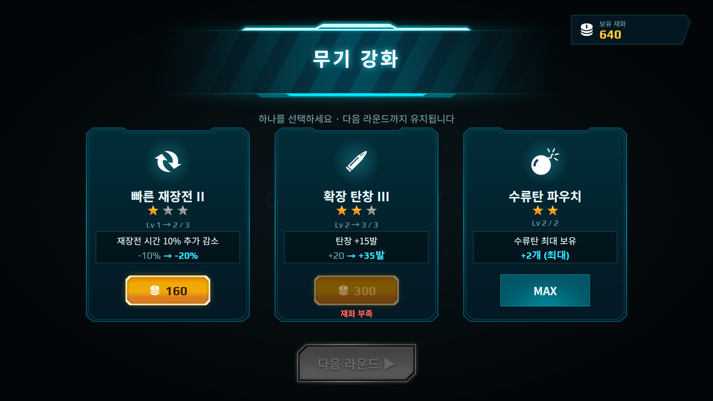

**상점 방식 — 전체 나열 vs 무작위 3장**

| 방법 | 장점 | 단점 |
|---|---|---|
| 전체 나열 | 원하는 강화를 바로 골라 살 수 있음 | 한 판 재화로는 몇 개 사지 못하고, 매번 같은 화면이라 고르는 재미가 적음 |
| **무작위 카드 3장 + 리롤 (선택)** | 상점마다 선택지가 달라지고, 리롤로 원하는 카드를 찾는 재미가 생김 | 원하는 강화가 바로 안 나올 수 있음 → 리롤 비용을 낮게(5) 고정 |

제가 정한 조건은 네 가지였습니다: 한 스테이지 재화는 **많아야 약 300**, 리롤은 **5부터**(20은 비쌈), 게임은 **3스테이지로 마무리**해 상점은 **2번**, 상점은 전체 나열이 아니라 **무작위 3장**으로 선택을 제한.
라운드 흐름·구매 처리·재시작 초기화 같은 기존 시스템은 크게 바꾸지 않는 것도 조건이었습니다.

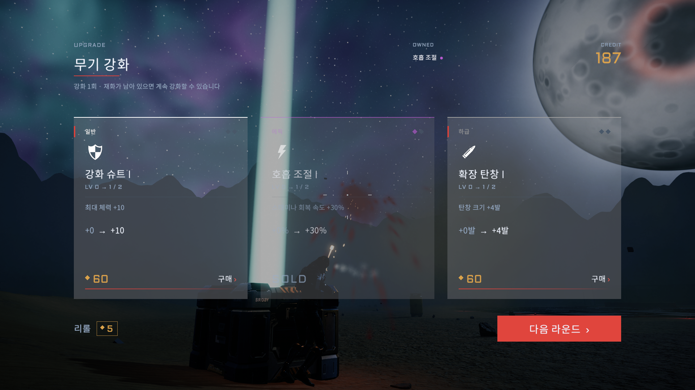

**등급 — 강해지는 체감을 크게**

카드마다 하급(40%)·일반(35%)·에픽(25%) 등급이 붙고, 에픽은 증가량이 일반의 약 2~2.5배입니다.
3장 중 에픽이 1장 이상 나올 확률이 약 58%라, 상점을 열 때마다 절반 이상은 에픽을 보게 됩니다.
처음 v3에서는 6등급이었지만, 팀장 의견으로 3등급으로 줄이고 에픽 확률을 25%로 높였습니다.

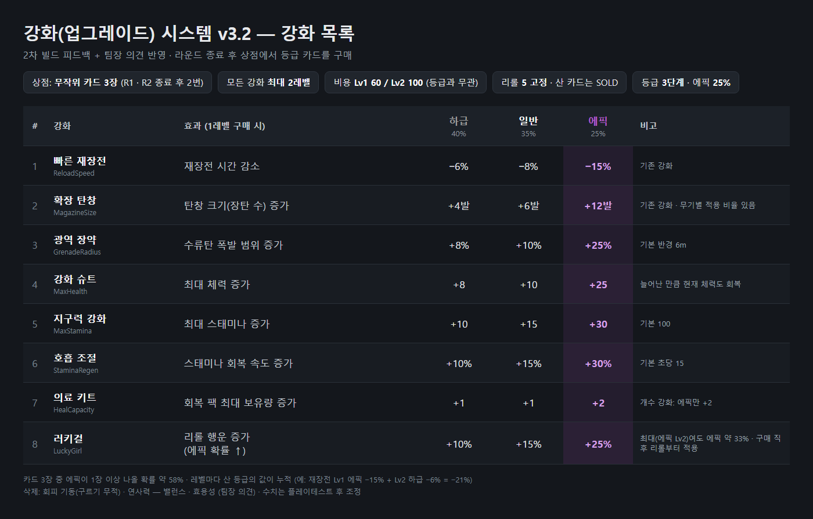

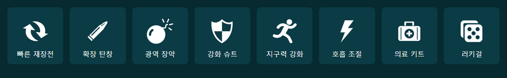

강화 범위는 강화 시스템까지만 맡았고, 라운드 구성(섬멸전 등)은 라운드 담당에게 요청 사항으로만 남겼습니다(4-6).

---

## 5. 결과 및 배운 점

### 5-1. 결과

- **보급**: 2차 개선 뒤 플레이 테스트에서 **못 줍는 보급은 더 이상 나오지 않았습니다.** (개선 전: 10개 중 2~3개를 줍지 못함)
- **보급 확률**: 투하 확률 로그로 수류탄이 0개일 때 수류탄 상자가 자주 나오는 것을 확인했습니다.
- **사운드**: 티라노포드의 사운드 **25종을 에셋에서 직접 골라** 연결했고, 튜토리얼 음성 41줄, BGM 9곡도 연결했습니다. 몬스터 소리와 보급에 쓴 에셋도 제가 직접 찾아 골랐습니다.
  나중에 추가된 몬스터(돌진형, 파르다트록스 등)는 사운드 코드 수정 없이 테이블만 채워 소리를 붙였습니다(3-5).
- **맵**: 맵 면적을 **1/4**로 줄인 뒤(아사나 BL-059) 적을 상대하는 경험과 보급을 획득하는 경험이 훨씬 나아졌고, 플레이에 더 몰입할 수 있게 되었습니다.
- **라운드 종료 강화**: 강화를 **3종 → 8종**으로 늘리고 등급 카드를 넣은 개편 뒤(4-9), 라운드를 마치고 보상을 얻어 **플레이어가 강해지는 경험**을 더 크게 체감할 수 있었습니다.
- **튜토리얼**: 행동 제한을 넣은 뒤 플레이어가 튜토리얼에 더 집중할 수 있게 되었습니다.

### 5-2. 트러블슈팅

**① 플레이어 소리가 전혀 나지 않음** (11-01)
- 문제: 플레이 중 플레이어의 발소리·피격음 등이 전혀 나지 않음
- 원인: `PlayerSoundEmitter`가 플레이어 프리팹에 붙어 있지 않았음 (`SoundFix_Handoff.md §1`)
- 해결: 플레이어 프리팹(김민성 님 담당)을 직접 고치지 않고, 라우터가 실행 중에 이미터를 자동으로 붙이는 A안 (3-5 ③)
- 결과: 고친 뒤 직접 플레이해 플레이어 소리가 나는 것을 확인했습니다.
  AI가 구현했어도 직접 테스트해 확인하기 전에는 구현되었다고 할 수 없기 때문에, AI 구현 뒤 플레이 테스트는 항상 하는 루틴이었습니다.

**② GAME START가 인트로·튜토리얼을 건너뜀** (11-03)
- 문제: 「게임 스타트를 누르면 인트로- 튜토리얼- 인게임 씬으로 전환이 안됨, 게임스타트 누를시 바로 인게임 씬으로 전환됨」
- 발견: 처음 플레이하는 사람 기준으로 처음부터 확인하는 도구를 만들어 달라고 한 뒤 찾음
- 원인: 메인 메뉴 씬에 저장된 "다음 씬 이름" 값이 테스트용 전투 씬(`Monster Player Integration`)으로 덮어써져 있어서, GAME START가 인트로를 건너뛰고 바로 전투 씬으로 갔음
- 해결: 그 값을 인트로 씬 이름(기본값 `IntroCrawl`)을 쓰는 새 필드로 바꿔, 씬에 남은 잘못된 값을 무시하게 함 (커밋 `36900ce4`)
- 결과: 최종 빌드 전(11-03 밤)에 고쳐, GAME START → 인트로 → 튜토리얼 → 게임 순서로 다시 이어지게 되었습니다.

**③ AI가 건드린 줄 알았던 무기 제한 — 원인은 플레이 기록** (10-30)
- 문제: 첫 라운드부터 모든 무기가 열려 있음
- 처음 의심: 「왜 무기 제한이 첫라운드부터 다 풀려있지? 뭐 건드렸어?」 — 보급 작업 중이던 AI가 내 범위 밖을 바꿨다고 생각함
- 원인: 바뀐 코드는 없었고, 플레이어의 플레이 기록 때문에 무기 제한이 풀린 상태였음
- 비슷한 일: 같은 시기 「혹시 플레이어 쪽도 건드린거같은데」라고 의심했던 씬 오류도, 플레이어에 세이브 정보가 있다는 것을 몰랐기 때문이었습니다.
- 느낀 점: AI를 쓰다 보면 내가 설계하지 않은 것이 작동할 때 "AI가 무슨 일을 했나" 하고 먼저 의심하게 됩니다.
- 배운 점: 앞으로는 원인을 단정하기 전에, 그 문제가 일어난 **상황을 먼저 파악하는 것**을 우선으로 하려 합니다.

**④ 새 맵에서 보급이 하나도 떨어지지 않음** (10-31 발견 → 11-01 수정)

- 문제: 「'Monster Player Intergration' 씬에서 테스트 중인데 보급이 배급이 안됨」 — 직접 플레이 테스트를 하다 보급이 전혀 떨어지지 않는 것을 발견했습니다.
  팀에 공유한 플레이 테스트 피드백도 보급을 하나도 받지 못한 상태로 진행해야 했습니다.
- 원인: 새 맵(SciFiMap)의 지형 원점이 y = -20이라, 실제 전장 지면이 **지형 기준 높이 약 18m**로 계산되었습니다.
  그래서 "지형 기준 높이 5m 이하에만 투하" 조건에 거의 모든 지점이 탈락했습니다. 맵을 새로 만들면서(4-7) 기준점이 바뀐 것이 원인이었습니다.
- 해결: 높이 기준을 **플레이어 발 높이 + 5m**로 바꿔, 맵 원점이나 보스 아레나 높이와 상관없이 같은 규칙이 되게 했습니다(3-2 표의 ②).
  또 다음에 같은 일이 생기면 바로 원인을 알 수 있도록, 투하에 실패하면 **탈락 사유별 횟수**(지면 없음·레이어·높이 등)를 경고로 남기게 했습니다.
- 결과: 같은 씬에서 보급이 다시 떨어지는 것을 확인했고, 이후 2차 피드백에서는 "어디에 떨어지는가"(지붕·절벽 위) 문제로 넘어갔습니다(4-1).

### 5-3. 아쉬운 점 (기술 부채) · 개선 계획

**가장 아쉬운 점 — AI가 구현한 코드를 직접 확인하지 않은 것.**
Unity에서 실제로 동작하는지만 확인하고 코드는 점검하지 않아서, 시스템을 제대로 파악하지 못했습니다.

→ **개선 계획**: 다음 프로젝트에서는 AI가 생성한 코드를 파악하고, 이해하지 못하는 부분은 AI에게 직접 물어 구조를 완전히 이해한 상태로 게임을 개발하려 합니다.

그 밖의 아쉬운 점:
- **엄폐물과 보스 난이도**: "높은 곳 금지"를 지키면서 피할 곳을 주려고 엄폐물을 지역마다 2~5개 두었는데, 보스 1이 멀리서 쏘기만 하면 되는 구도가 됐습니다(4-1).
  이후 팀장 이찬영 님의 제안으로 보스가 엄폐물을 부술 수 있게 하고, 패턴을 투사체 + 바닥 피해 방식으로 바꿔 엄폐물에 숨어서만 잡는 방식을 줄였습니다.
- **타격음**: 총알 타격음 하나로 정리했지만(4-4), 몬스터 피부 종류에 따라 타격음을 다르게 하면 더 생동감이 있었을 것입니다.
- **몬스터 급증 판정**: 소환 수만 보고 처치 속도는 보지 않습니다. 단순함을 우선해 남겼습니다 → TO-BE: 필드에 살아 있는 몬스터 수 기준

### 5-4. 배운 점

AI와 함께 작업할 때는 항상 **설계 → 보완점 파악 → 내 확인 → 구현** 순서로 진행했습니다.
설계 단계에서 제가 놓칠 수 있는 부분을 AI에게 먼저 확인한 뒤 구현하니, 나중에야 발견될 오류나 버그를 줄일 수 있었습니다.

또한 팀이 정한 설계 기준 문서를 작업마다 적용해, 각자의 AI가 다른 팀원의 작업물을 마음대로 건드려 생기는 오류를 줄였습니다.

무엇보다 **게임은 직접 플레이해 봐야 완성된다**는 것을 배웠습니다. 이 문서의 결정 대부분은 플레이어로서 직접 플레이하며 느낀 불편함에서 시작했습니다(4-1·4-2·4-9·5-2).
