# HIVE PURGE — 3D 하이브리드 슈터 (Team Even) · 보급·사운드 외 담당 파트

> 1인칭 군중전과 3인칭 보스전을 오가는 4인 팀 하이브리드 슈터에서 보급 · 사운드 · 라운드 종료 강화 · 맵을 맡았습니다.
> 팀 전체가 아니라 제가 맡은 파트를 다룹니다. 팀원 파트는 3장 구조 그림에 회색으로만 보입니다. <!-- ✏️ 11-24 v3 머리 두 줄(한 줄 요약 · 문서 범위)을 새로 썼습니다 -->

## 1. 개요

### 1-1. 무엇을 만들었나

HIVE PURGE는 1인칭으로 몰려오는 군중을 쓸어내고, 3인칭으로 거대한 보스와 맞서는 하이브리드 슈터입니다.
몰려오는 수많은 적을 여러 총으로 처치하고, 보스의 공격 패턴을 공략하는 재미를 목표로 했습니다.
한 라운드는 군중전(약 3분) → 보스 등장·시점 전환 → 보스전 → 강화 선택 → 다음 라운드로 이어집니다(1라운드 기준, 2-1). <!-- ✏️ "(1라운드 기준, 2-1)"을 더했습니다(11-24 코드 대조). 근거: RoundTable.tsv R1 CrowdToBoss 보스 165~195초 · R2 Annihilation · R3 AnnihilationToBoss (develop db706ef5) -->

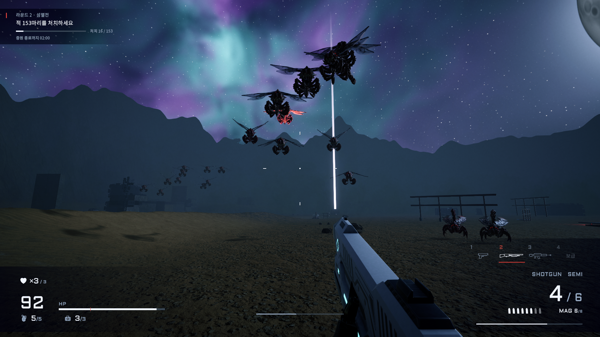
*1인칭 군중전(라운드 2 · 섬멸전) — 하늘을 덮고 몰려오는 몬스터 무리와, 메인 메뉴 스타일로 통합한 전투 HUD(8-2)입니다.* <!-- ✏️ 11-25 v4 캡션 줄: alt를 옮기고 "(8-2)"를 이었습니다 -->

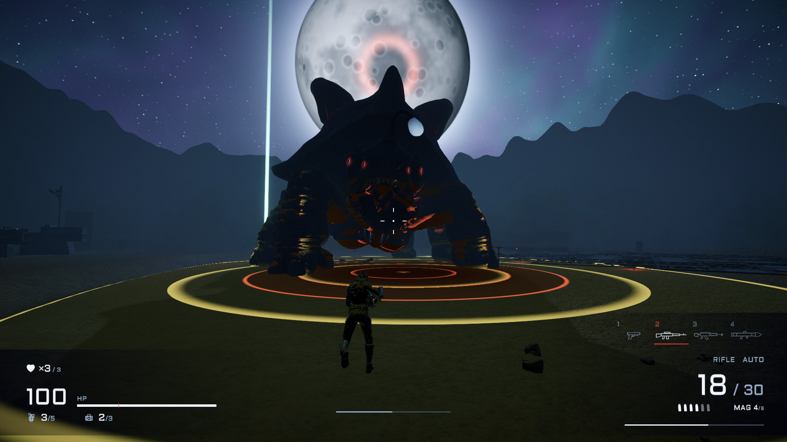
*3인칭 보스전 — 시점이 3인칭으로 바뀌고, 바닥의 붉은 원이 보스의 공격 범위를 알립니다.*

제가 맡은 것은 **보급·사운드 시스템**과 라운드 종료 강화·맵·튜토리얼·메인 메뉴·UI 통합입니다(1-3 · 9-3).

### 1-2. 왜 만들었나 — 제 파트가 풀어야 했던 문제

| 파트 | 풀어야 했던 문제 | 다룬 곳 |
|---|---|---|
| **보급** | 새 맵에서 보급이 떨어지지 않거나, 지형·높은 건물 위·맵 밖에 떨어져 10개 중 2~3개를 줍지 못했습니다. 주울 수 없으면 플레이어는 답답함을 느낍니다 | 4장 |
| **사운드** | 4명이 각자 만드는 몬스터·보스·무기에 다른 사람 코드의 동작을 고치지 않고 소리를 붙여야 했습니다. 플레이어 소리가 나지 않는 버그도 있었습니다 | 5장 |
| **라운드 종료 강화** | 초기 3종 구성으로는 라운드 클리어 보상이 작게 느껴졌습니다 → 8종 개편, 등급 카드 3장 + 리롤 도입 | 6장 |
| **맵** | 1차 빌드 테스트(10-28)에서 "맵이 너무 크다"는 피드백으로 도망만 다니고 보급 동선이 길어졌습니다 → 면적 1/4 축소, 언덕 제거, 엄폐물 추가 | 2-3 · 7장 |
<!-- ✏️ 11-24 v3 목차 재배치: 표를 기능 장 네 개(보급 · 사운드 · 강화 · 맵) 순서로 맞췄습니다. 튜토리얼 줄은 8장 첫머리로 옮겼습니다 — 옛 줄: | **튜토리얼** | 이동 자유도가 높아 학습 집중도가 떨어졌습니다 → 과목별 지시 행동 제한 적용 | 6-2 | -->

### 1-3. 만든 방식

| 누가 | 무엇을 |
|---|---|
| 제가 | 무엇을 만들지와 수치 정하기 · AI 설계안에서 고르기 · 직접 플레이하며 문제 찾기와 확인 · 맵 배치 · 사운드와 BGM 고르기 · 튜토리얼 음성(TTS) |
| AI(Claude Code)가 | 설계안과 빠진 부분 정리 · 코드 구현(제 파트의 코드와 버그 수정 포함) · 커밋 · PR 문서 |
| 팀원이 | 코어 첫 구조 · 라운드 진행 · 일반 몬스터 · 보스 · 플레이어와 무기 (9-1) |

<!-- ✏️ 11-24 v3 1-3 「만든 방식」을 새로 만들었습니다. 내용은 옛 7-1 「누가 | 무엇을」 표(지금 10-1)와 옛 3-1 역할 표(지금 9-1)에서 가져왔습니다. "버그 수정 포함"은 통합본 v3 1-5 「책임 분리」를 따른 것입니다 -->

### 1-4. 개발 환경 · 링크

| 항목 | 내용 |
|---|---|
| 엔진 | Unity 6000.3 (URP) |
| 언어·도구 | C#, Git(Git flow, Git LFS), Asana |
| AI 도구 | Claude Opus (저는 Claude Code로 사용). ChatGPT를 함께 쓴 팀원도 있었습니다 |
| 기간 | 2026-10-15 ~ 2026-11-04 (약 3주 — 기획 1주 · 개발 2주) · 최종 빌드 11-04 새벽 · 같은 날 발표 |
| 팀 | 4명 — 팀장 1명, 팀원 3명(저 포함). 담당은 9-1 <!-- ✏️ 11-25 통합본 v4: 팀원 이름을 뺐습니다(건우 님 결정). 옛: "4명 — 팀장 이찬영, 팀원 김민성·윤건우·홍산" --> |
| 영상 | [플레이 시연 영상 (YouTube, 4분 23초)](https://youtu.be/H4MNlsQbh80) · [한 판 몰아보기 쇼츠 (1분 13초)](https://youtube.com/shorts/6vDZDAhEoyc) |
| GitHub | https://github.com/KooHoo-Dev/3rd_3D_1-3D-Project-team_even |
<!-- 11-25 공개 전환. 이전: 비공개 -->

---

## 2. 게임 디자인

### 2-1. 한 라운드의 흐름 — 쓸어내고, 맞서고, 강해진다

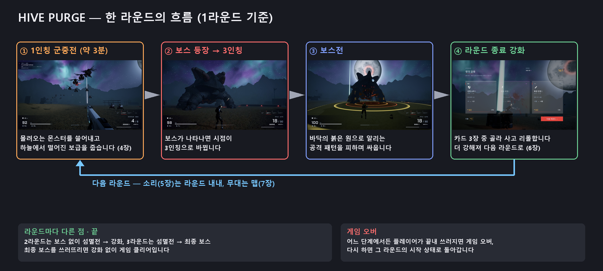
*한 라운드의 흐름입니다(1라운드 기준). 1인칭 군중전 → 보스 등장과 3인칭 전환 → 보스전 → 라운드 종료 강화를 거쳐 다음 라운드로 갑니다. 최종 보스를 쓰러뜨리면 게임 클리어이고, 플레이어가 끝내 쓰러지면 그 라운드의 시작 상태에서 다시 합니다.* <!-- ✏️ -->
<!-- ✏️ 11-27 강사님 피드백(Asana "하루 흐름이 이상함" — 시퀀스 다이어그램 또는 이미지, 건우 님이 모든 문서의 흐름 그림에 적용하기로 함)으로 흐름도를 화면 그림으로 바꿈.
     화면: gameplay-crowd.png(라운드 2 섬멸전 장면 — 무리가 가장 잘 보여 건우 님이 그대로 두기로 함) · _intake/Hive-Purge-Game-play.mkv 6:32 · boss-third-person.png · upgrade-shop.png
     예전 그림에 더한 것 (팀 레포 develop db706ef5, 11-27 대조 ✅): 게임 오버 — PlayerFinalDeathEvent → RunDirector GameOver → RestartRun(그 라운드 시작 체크포인트) · 라운드마다 다른 점 — RoundTable.tsv R2 Annihilation · R3 AnnihilationToBoss, 최종 보스 처치 → 게임 클리어
     예전 흐름도(지운 것):
     flowchart LR
         A["1인칭 군중전 (약 3분)<br/>몰려오는 몬스터 처치 · 보급 줍기<br/>→ 4 · 5 · 7장"] → B["보스 등장<br/>3인칭으로 시점 전환"]
         B → C["보스전<br/>공격 패턴 공략"]
         C → D["라운드 종료 강화<br/>등급 카드 3장 + 리롤<br/>→ 6장"]
         D →|"다음 라운드"| A -->

군중전에서는 하늘에서 떨어지는 보급으로 몰려오는 적을 버티고(4장), 라운드가 끝나면 강화를 골라 다음 라운드를 더 강한 상태로 시작합니다(6장). 소리는 라운드 전체에 걸쳐 있고(5장), 이 모든 일이 일어나는 무대가 맵입니다(7장). 보스와 플레이어는 팀원 파트라 3장 그림에서만 다룹니다. <!-- ✏️ 11-24 v3: 단계마다 다룬 장을 이었습니다 -->

위 그림은 1라운드의 흐름입니다. 2라운드는 보스 없이 섬멸전을 치른 뒤 강화를 고르고, 3라운드는 섬멸전 → 최종 보스로 이어져 강화 없이 게임 클리어로 끝납니다. <!-- ✏️ 11-24 코드 대조로 더했습니다. 근거: RoundTable.tsv(R1 CrowdToBoss · R2 Annihilation · R3 AnnihilationToBoss) · RoundSequencer.cs 334~339행 BossFinaleStarted (develop db706ef5) -->

### 2-2. 누가 무엇을 기획했나

| 기획 | 정한 사람 |
|---|---|
| 게임 콘셉트 (1인칭 군중전 + 3인칭 보스전) | 팀장 |
| 몬스터와 몬스터 패턴 | 팀장과 회의하며 AI와 함께 정했습니다 |
| 보급 시스템 | 제가 AI와 함께 기획했습니다 (4장) |
| 업그레이드(라운드 종료 강화) 시스템 | 팀원들이 AI와 함께 기획했습니다 (6장) |
| 대부분 기능의 기획 초기 틀 | 제가 잡았습니다 |
<!-- ✏️ 11-25 v4 Pass 1: 표 칸의 음슴체("정함", "기획", "잡음")를 습니다체로 바꿨습니다 -->

<!-- ✏️ 지웠습니다(11-24 장 재구성): "맵·보급·NavMesh를 한 원칙(\"높은 곳에서 쏘는 이점은 주지 않는다\")으로 묶은 기획은 6-1에서 다룹니다." — 그 내용을 바로 아래 2-3으로 옮겼습니다 -->

### 2-3. "높은 곳에서 쏘는 이점은 주지 않는다" — 맵·NavMesh·보급을 한 원칙으로

맵을 만들면서 세운 원칙입니다.

> 「플레이어가 몬스터들이 오지 못하는 곳에서 사격해서 얻는 이점을 얻지 않는 것이 맵의 핵심 설계」 (10-30)

군중전은 몰려오는 몬스터를 정리하는 재미입니다. 플레이어가 지붕에 올라가면 몬스터가 닿지 못해 그 재미가 사라집니다.
이 원칙을 세 곳에 똑같이 적용했습니다.

| 시스템 | 적용 |
|---|---|
| 맵 | 계단·2층 구조 금지, "높고 얇은 벽 + 지붕" 건물 금지. 엄폐물은 지역마다 2~5개 (보스 마그마·돌진 패턴을 피할 정도) |
| NavMesh | 걸을 수 있는 곳은 지형과 밟는 바닥판(착륙장·도로판)만, 나머지 소품은 걸을 수 없는 영역(Not Walkable) (10-31, 몬스터가 지붕 위에 스폰되는 문제를 보고) <!-- ✏️ 11-24 코드 대조로 고쳤습니다(옛: "Ground(Terrain)만, 나머지 소품은 Obstacle"). 근거: SciFiMapBuilder.cs 1823~1836행 ApplyWalkableRule · 커밋 58e3f29e(10-31) --> |
| 보급 낙하 | Ground 레이어·플레이어보다 5m 이하인 곳에만 투하 → 2차 피드백 뒤 **NavMesh로 걸어서 갈 수 있는 곳**에만 (4-3) |

플레이 테스트를 하다가 건물 위에 올라간 보급을 본 순간 "저걸 어떻게 먹어?" 하는 불쾌감이 들었습니다. 그래서 맵의 원칙을 보급에도 적용했습니다.
게임은 만들기만 하면 끝이 아니라, 직접 플레이어로서 플레이해 봐야 경험이 완성된다고 생각합니다.

이 원칙의 대가: 1차 플레이 테스트에서 직접 쓴 피드백입니다 — 「엄폐물이 많아 지니 보스가 멀리서 쏘기만 하면되서 쉬워짐」.
엄폐물을 늘린 결정이 보스전 긴장감을 떨어뜨렸습니다(11-3).

---

## 3. 전체 구조 — 한 라운드를 코드에서 다시 그리면

2-1의 한 라운드(쓸어내기 · 맞서기 · 강해지기)를 코드 쪽에서 다시 그린 지도입니다. 강조한 상자가 제 파트, 회색 상자가 팀원 파트이고, 4~7장은 제 상자 하나씩을 확대해 들어갑니다. <!-- ✏️ 11-24 v3 3장 신설 -->

### 3-1. 구조 그림

아래 두 그림은 한 라운드를 일어나는 순서대로 위에서 아래로 그린 것입니다. 볼 것은 **라운드 진행이 단계를 넘기고, 제 파트는 대부분 이벤트를 듣고 스스로 움직인다**는 점입니다. 실선 화살표는 직접 호출(인터페이스 포함), 점선 화살표는 이벤트 구독입니다. 주황 상자가 제 파트이고, 보급은 4장, 소리는 5장, 처치 재화와 강화 상점은 6장에서 다룹니다. <!-- ✏️ 11-27 구조도 → 시퀀스 두 장 -->
<!-- 11-27 전 문장(✏️): 이 그림에서 볼 것은 **라운드 진행이 단계를 넘기고, 제 파트는 대부분 이벤트를 듣고 스스로 움직인다**는 점입니다. 실선은 직접 호출(인터페이스 포함), 점선은 이벤트 구독입니다. -->

**① 한 라운드 — 군중전** <!-- ✏️ -->

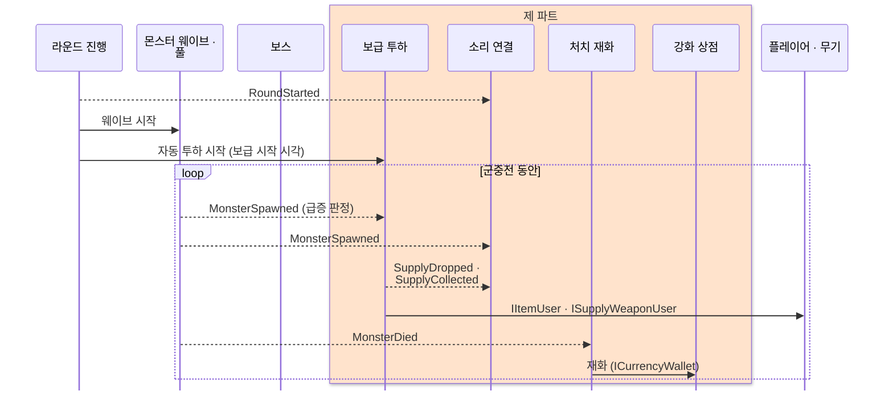
*군중전 동안 몬스터가 나오고 죽을 때마다 보급 · 소리 · 처치 재화가 이벤트를 듣고 움직입니다.* <!-- ✏️ -->

**② 보스전 · 보상** <!-- ✏️ -->

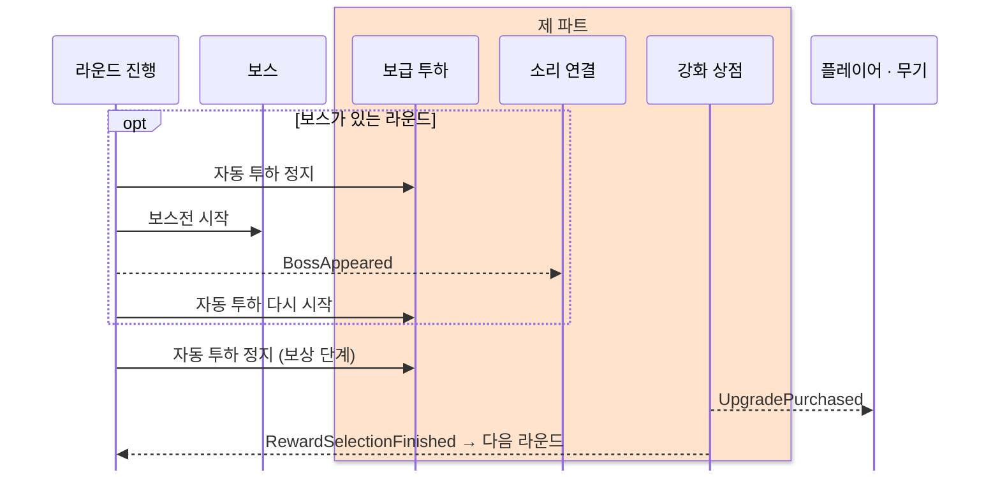
*보스가 있는 라운드에서는 보스가 등장하는 동안 자동 투하를 멈췄다가 보스전에서 다시 켜고, 보상 단계에서 끕니다. 강화 선택이 끝나면 다음 라운드로 넘어갑니다.* <!-- ✏️ -->
<!-- 11-27 시퀀스로 바꾸기 전 구조도(flowchart TB, 11-24 v3) 원문 — 주석이 닫히지 않게 실선 화살표의 꺾쇠 앞에만 역슬래시를 넣어 적었습니다:
flowchart TB
    RS["라운드 진행 (RunDirector · RoundSequencer)"]
    subgraph S1["쓸어내기 — 군중전 · 4 · 5 · 7장"]
        MW["몬스터 웨이브 · 풀 (MonsterWaveDirector · MonsterPool)"]
        SD["보급 투하 (SupplyDropper)"]
        GR["소리 연결 (GameSoundRouter)"]
        MB["맵 빌더 (SciFiMapBuilder, 에디터 도구)"]
    end
    subgraph S2["맞서기 — 보스전"]
        BC["보스 (BossController · TyranopodeController)"]
    end
    subgraph S3["강해지기 — 강화 · 6장"]
        KR["처치 재화 (KillRewardCollector)"]
        UM["강화 상점 (UpgradeManager)"]
    end
    PC["플레이어 · 무기 (PlayerController · GunSlot)"]

    RS --\>|"웨이브 시작"| MW
    RS --\>|"자동 투하 시작 · 정지"| SD
    RS --\>|"보스전 시작"| BC
    RS -.->|"RoundStarted · BossAppeared"| GR
    MW -.->|"MonsterSpawned"| GR
    MW -.->|"MonsterSpawned (급증 판정)"| SD
    MW -.->|"MonsterDied"| KR
    SD -.->|"SupplyDropped · SupplyCollected"| GR
    SD --\>|"IItemUser · ISupplyWeaponUser"| PC
    KR --\>|"재화 (ICurrencyWallet)"| UM
    UM -.->|"UpgradePurchased"| PC
    UM -.->|"RewardSelectionFinished"| RS

    classDef mine fill:#ffe3cc,stroke:#d9480f,color:#222
    classDef other fill:#eee,stroke:#bbb,color:#666
    class SD,GR,MB,KR,UM mine
    class RS,MW,BC,PC other
-->
<!-- ✏️ 11-24 v3 구조 그림 — 화살표 근거(팀 레포 develop db706ef5, 11-24 대조 ✅):
     RS→MW: RoundSequencer.cs 127행 monsterWaveDirector.StartRound · RS→SD: RoundSequencer.cs 30행 SupplyDropper 필드, 367행 StartAutoDropCycle, 104 · 153 · 294 · 311 · 338행 StopAutoDropCycle · RS→BC: RoundBossEncounter
     RS⇢GR: RunDirector.cs 99행 RoundStartedEvent · RoundBossEncounter.cs 110행 BossAppearedEvent → GameSoundRouter.cs 96~114행 구독
     MW⇢GR · SD: MonsterPool.cs 203행 → GameSoundRouter.cs 102행 · SupplyDropWeights.cs 38행 · MW⇢KR: MonsterController.cs 658행 MonsterDiedEvent → KillRewardCollector.cs 69행
     SD⇢GR: SupplyDropper.cs 192행 · SupplyCrate.cs 230 · 248행 → GameSoundRouter.cs 111~112행 · SD→PC: SupplyCrate.cs 204~263행 GetComponentInParent<IItemUser · ISupplyWeaponUser>
     KR→UM: KillRewardCollector.cs 153행 wallet.Add · UM⇢PC: UpgradeLedger(DefaultServices.cs 384행) → PlayerController.Upgrade.cs 22~23행 · UM⇢RS: UpgradeManager.cs 272행 → RoundSequencer.cs 79행
     내 파트(강조) = 파일을 만든 사람과 커밋 기준: Supply/ · Audio/ · Reward/ · Assets/Scenes/GU/Map/Editor/SciFiMapBuilder.cs 모두 건우 계정(코드는 AI 구현, 1-3). 팀원 파트(회색): Round(팀장) · Monster(몬스터 담당) · Boss(팀장 · 플레이어 담당) · Player · Weapon(플레이어 담당)
     → 11-27 시퀀스 순서 근거(같은 develop db706ef5): RunDirector.cs 99행 RoundStartedEvent 발행 → 103행 roundSequencer.StartRound · RoundSequencer.cs 127행 monsterWaveDirector.StartRound → 128행 UpdateSupplyStart(359~367행 보급 시작 시각이 되면 StartAutoDropCycle) · 294행 BeginBossIntro에서 StopAutoDropCycle → 177행 bossEncounter.Begin → RoundBossEncounter.cs 110행 BossAppearedEvent · 305행 BeginBossBattle에서 StartAutoDropCycle · 311행 BeginReward에서 StopAutoDropCycle · UpgradeManager.cs 278행 Reward 상태에서 Open → 272행 RewardSelectionFinishedEvent → RoundSequencer.cs 79 · 355행 -->

그래서 몬스터 종류가 늘어도 보급 확률과 소리는 `MonsterSpawnedEvent` 하나만 듣고 따라오고(4-4 · 5-5), 라운드 담당은 보급에 "떨어뜨려라" 한 줄만 부릅니다(4-2). <!-- ✏️ -->
맵 빌더(7장)는 게임이 실행될 때는 돌지 않는 에디터 도구라 위 두 그림에 없습니다. 맵과 NavMesh를 미리 만들어 두면, 보급 낙하 검사(4-3)와 몬스터 이동이 그 위에서 동작합니다. <!-- ✏️ 11-27 「화살표가 없습니다」 → 「위 두 그림에 없습니다」 · 근거: Assets/Scenes/GU/Map/Editor/SciFiMapBuilder.cs(Editor 폴더), Tools/Map 메뉴 251 · 1849행 -->

### 3-2. 핵심 클래스

| 역할 (이름) | 하는 일 | 하지 않는 일 | 다룬 장 |
|---|---|---|---|
| 라운드 진행 (RunDirector · RoundSequencer) — 팀원 | 라운드 반복 · 재시작, 군중전 → 보스전 → 강화 단계 전환, 보급 자동 투하 시작 · 정지 | 보급을 어디에, 무엇을 떨어뜨릴지 정하지 않습니다 — 보급 투하(SupplyDropper)가 정합니다 | 2-1 · 4-2 |
| 몬스터 웨이브 · 풀 (MonsterWaveDirector · MonsterPool) — 팀원 | 표대로 몬스터를 소환하고 `MonsterSpawnedEvent`를 보냅니다 | 몬스터에 소리를 붙이지 않습니다 — 소리 연결(GameSoundRouter)이 붙입니다 | 5-5 |
| 보스 (BossController · TyranopodeController) — 팀원 | 보스 패턴 · 등장 · 처치 연출 | 보스 BGM · 경고음을 내지 않습니다 — 소리 연결이 냅니다 | — |
| 플레이어 · 무기 (PlayerController · GunSlot) — 팀원 | 이동 · 시점 · 체력, 총 · 수류탄, 강화 효과 적용 | 보급 상자를 모릅니다 — 보급 상자가 인터페이스로 아이템을 넣습니다 | 4-5 |
| 보급 투하 (SupplyDropper) | 정해진 간격마다 낙하 지점 찾기 · 상자 종류 고르기 · 상자 생성 · 필드 상자 수 제한 | 소리 · 알림을 직접 내지 않습니다 — `SupplyDroppedEvent`를 보내고 소리 연결 · HUD가 듣습니다 | 4장 |
| 소리 연결 (GameSoundRouter) | 전역 이벤트를 소리 · BGM으로 바꾸고, 몬스터 · 플레이어에 이미터를 붙입니다 | 몬스터 사망음 · 총소리를 내지 않습니다 — 몬스터 이미터(MonsterSoundEmitter)와 총(Gun)이 냅니다 | 5장 |
| 처치 재화 (KillRewardCollector) | 몬스터 · 보스 처치 이벤트를 듣고 그 자리에서 지갑에 재화를 더합니다 | 강화를 팔지 않습니다 — 강화 상점이 합니다 | 6-3 |
| 강화 상점 (UpgradeManager) | 카드 3장 뽑기 · 등급 · 리롤 · 구매를 맡고, 끝나면 다음 라운드로 넘어가라고 알립니다 | 강화 효과를 플레이어에 적용하지 않습니다 — 강화 기록이 `UpgradePurchasedEvent`를 보내고 플레이어 · 무기가 적용합니다 | 6장 |
| 맵 빌더 (SciFiMapBuilder) | 지형 · 지점 · 엄폐물 배치, 걷는 면 규칙, NavMesh 굽기 | 게임 실행 중에는 돌지 않습니다 — 에디터 메뉴(`Tools/Map`)로 씬을 만듭니다 | 7장 |
<!-- ✏️ 11-24 v3 핵심 클래스 표 — 「하지 않는 일」 근거(develop db706ef5, 11-24 대조 ✅. ① 그 클래스에 없음 ② 대신 하는 클래스에 있음):
     라운드 진행: 위치 · 종류 코드 없음 / SupplyDropper.cs 208~284행(낙하 지점), 122행 SupplyDef.Pick + SupplyDropWeights
     몬스터 풀: MonsterPool.cs에 sound 0회 / GameSoundRouter.Combat.cs 39~45행 AddComponent<MonsterSoundEmitter>
     보스: 보스 BGM · 경고 · 처치 연출 소리는 GameSoundRouter.Boss.cs(9~12행 주석) — 보스 몸 소리는 BossSoundEmitter · TyranopodeSoundEmitter(5-3)
     플레이어 · 무기: Player/ · Weapon/에 SupplyCrate · SupplyDropper 참조 0회 / SupplyCrate.cs 204~263행
     보급 투하: AudioSource · UI 코드 없음 / SupplyDropper.cs 192행 발행 → GameSoundRouter.cs 111행 · SupplyHud.cs 58행
     소리 연결: MonsterDiedEvent 구독 없음(GameSoundRouter.cs 96~114행), 총소리 없음(16~17행 주석) / MonsterSoundEmitter.cs 199행 · Gun.cs 713행
     처치 재화: UpgradeManager 참조 0회(KillRewardCollector.cs 11 · 69~72 · 153행)
     강화 상점: using은 HybridShooter.Core뿐(UpgradeManager.cs 3~8행) / DefaultServices.cs 384행 UpgradeLedger → PlayerController.Upgrade.cs 22~23행
     맵 빌더: Editor 폴더 · MenuItem("Tools/Map/…") SciFiMapBuilder.cs 251행 -->

### 3-3. 약속 — 파트끼리 서로 모른다
<!-- ✏️ 11-24 v3 목차 재배치: 옛 3-5 「팀 공통 규칙 — 파트끼리 서로 모른다」를 3장 약속 절로 올렸습니다. 아래 그림과 표는 그대로이고, 맨 아래 「실제로 오가는 약속」 표를 새로 더했습니다 -->

이 규칙은 강의 내용과 Claude Opus로 정한 **팀 공통 규칙**입니다. 코어(`HybridShooter.Core`)의 첫 구조는 10-19에 플레이어 담당 팀원이 만들었고, 그 뒤로 네 명이 각자 필요한 이벤트·데이터를 더했습니다. 저는 이 규칙에 맞춰 작업했습니다. <!-- ✏️ 11-24 코드 대조로 고쳤습니다(옛: "코어는 팀장 담당입니다"). 근거: 커밋 63f95cc9(10-19) "Contract와 ServiceLocator, EventBus 패턴들을 차용" · Core 커밋 네 명 모두 (develop db706ef5) -->

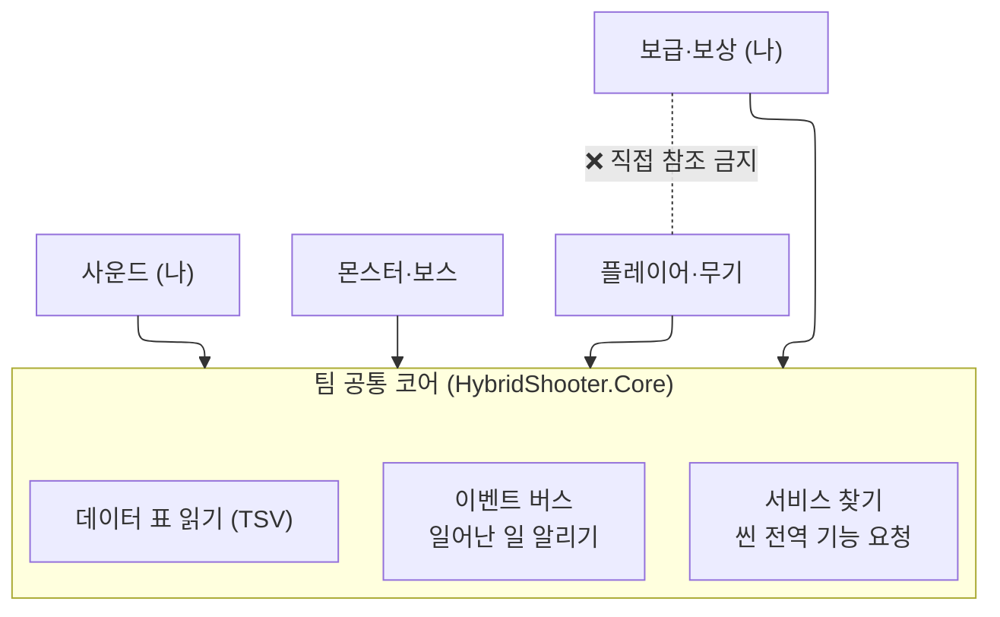

규칙은 파트가 `HybridShooter.Core`에만 의존하고, 서로 통신할 때는 세 가지 중 하나를 쓰는 것입니다.
다만 이 규칙을 컴파일러가 막아 주지는 않았습니다(어셈블리 정의는 코어와 몬스터 쪽에만 있음). 그래서 실제 코드에서는 라운드 담당이 보급(`SupplyDropper`)을 직접 부르고, 제 사운드 코드도 보스·플레이어 클래스를 직접 참조하는 곳이 있습니다. 코어 밖 파트를 하나도 참조하지 않는 것은 보급과 강화입니다. <!-- ✏️ 11-24 코드 대조로 더했습니다. 근거: asmdef는 Core · Monster.Behaviour · Monster.Movement 3개 · RoundSequencer.cs 9행 using HybridShooter.Supply, 30행 SupplyDropper 필드 · BossSoundEmitter.cs 2~3행 · PlayerSoundEmitter.cs 4~5행 · GameSoundRouter.Boss.cs 1행 (develop db706ef5) -->

| 상황 | 방법 |
|---|---|
| 대상을 이미 들고 있음 (충돌·레이캐스트) | 인터페이스 (`IItemUser`, `ISupplyWeaponUser`) |
| 씬 전역 기능 요청 | `ServiceLocator.Get<T>()` (`ISoundService`, `ISpawnZoneProvider`) |
| 일어난 일 알리기 | `EventBus<T>` (`MonsterSpawnedEvent`, `SupplyCollectedEvent`) |

이 규칙 위에서 네 명이 각자 AI로 구현했고, 기록이 남은 26일 동안 팀 작업 97개 중 94개를 끝냈습니다(11-4). <!-- ✏️ 11-25 v4 관문(강조 부사): 옛 "이 규칙 위에서 각자 AI로 구현하니 작업 시간이 크게 줄었습니다." — 숫자가 없는 정도 표현이라 11-4의 숫자로 바꿨습니다. 11-26 건우 님이 이 안(A안)으로 정했습니다 -->
<!-- ✏️ 지웠습니다(11-23 통합본 2-2): "다만 AI가 구현한 것이라도 제가 직접 확인하지 않으면 팀원들과 작업 이야기를 나누기 어려웠고, 이 경험이 8-3의 개선 계획으로 이어졌습니다." — 8-3 「검증 범위 넓히기」와 같은 이야기라 8-3 하나로 모았습니다 -->

**실제로 오가는 약속** — 위 세 방법이 코드에서 어떤 이름으로 쓰이는지입니다. <!-- ✏️ -->

| 약속 | 보내는 쪽 | 받는 쪽 | 무엇이 일어나나 |
|---|---|---|---|
| 이벤트 `MonsterSpawnedEvent` | 몬스터 풀 (`MonsterPool`) | 소리 연결 · 보급 확률 · 웨이브 감독 · 플레이 분석기 | 소환된 몬스터에 소리 이미터를 붙이고, 몬스터 급증을 판정합니다(4-4 · 5-5) |
| 이벤트 `MonsterDiedEvent` | 몬스터 (`MonsterController`) | 처치 재화 · 라운드 진행 | 재화를 더하고 라운드 목표를 셉니다 |
| 이벤트 `SupplyDroppedEvent` · `SupplyCollectedEvent` | 보급 투하 · 보급 상자 | 소리 연결 · 보급 HUD · 정보 카드 · 튜토리얼 보급 과목 | 낙하음 · 획득음과 알림을 냅니다(4-2) |
| 이벤트 `UpgradePurchasedEvent` | 강화 기록 (`UpgradeLedger`, 코어) | 플레이어 · 아이템 · 총 | 산 강화의 효과를 플레이어 쪽이 적용합니다(6장) |
| 이벤트 `RewardSelectionFinishedEvent` | 강화 상점 (`UpgradeManager`) | 라운드 진행 · 무기 선택 화면 | 다음 라운드로 넘어갑니다 |
| 이벤트 `RoundCleanupEvent` | 라운드 진행 (`RunDirector`) | 모든 파트(18곳) | 재시작할 때 각자 자기 것을 치웁니다 |
| 서비스 `ISoundService` | 소리 서비스 (`SoundService`)가 등록 | 총 · 투사체 · 이미터 등 | 사운드 표의 키로 소리를 냅니다(5-4) |
| 인터페이스 `IItemUser` · `ISupplyWeaponUser` | 보급 상자가 부름 | 플레이어 아이템 · 총 슬롯이 구현 | 보급이 플레이어 코드를 모른 채 아이템 · 보급 무기를 넣습니다 |
<!-- ✏️ 11-24 v3 약속 표 — 근거(팀 레포 develop db706ef5, 11-24 대조 ✅): EventBus<T> Subscribe · Publish(Core/Events/EventBus.cs 19~34행) · MonsterPool.cs 203행 발행 → GameSoundRouter.cs 102행 · SupplyDropWeights.cs 38행 · MonsterWaveDirector.cs 50행 · PlaytestAnalyzer.cs 93~110행 · MonsterController.cs 658행 → KillRewardCollector.cs 69행 · RoundSequencer.cs 81행 · SupplyDropper.cs 192행 · SupplyCrate.cs 230 · 248행 → GameSoundRouter.cs 112행 · SupplyHud.cs 59행 · SupplyInfoCardHud.cs 94행 · SupplyStep.cs 32행 · DefaultServices.cs 384행 UpgradeLedger → PlayerController.Upgrade.cs 22~23행 · PlayerItems.cs 264~265행 · Gun.cs 242~243행 · UpgradeManager.cs 272행 → RoundSequencer.cs 79행 · LoadoutPanel.cs 107행 · SoundService.cs 181행 Register · PlayerItems.cs 28행 · GunSlot.cs 88행 -->

---

## 4. 보급 — 주울 수 있는 곳에, 지금 필요한 것이 떨어진다

1-2의 보급 문제를 푸는 장입니다. 한 라운드의 흐름에서 군중전, 3장 그림의 「쓸어내기」 묶음에 있는 보급 투하(SupplyDropper)를 확대합니다. <!-- ✏️ 11-24 v3 다리 한 줄 -->
<!-- ✏️ 장 제목과 아래 두 문단은 11-24 장 재구성 때 새로 썼습니다. 첫 문단은 옛 4-2 「언제·얼마나·무엇이」와 옛 5-3 「생사를 가르는 시스템」 문장에서, 둘째 문단은 옛 5장 · 6장 첫머리를 합쳐서 썼습니다 -->

군중전에서 보급 상자는 플레이어의 생사를 가르는 시스템입니다. 이 장은 상자 하나가 떨어져 플레이어 손에 들어가기까지의 흐름을 따라갑니다. <!-- ✏️ -->

이 그림에서 볼 것은 **어디에 떨어질지(4-3)와 무엇이 떨어질지(4-4)를 보급이 혼자 정한다**는 점입니다. 라운드 담당은 "떨어뜨려라"만 부르고, HUD·사운드는 "주웠다"는 이벤트만 듣습니다. <!-- ✏️ -->

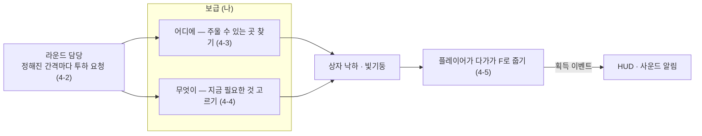
<!-- ✏️ 흐름도는 11-24 장 재구성 때 4-2 사용법 표 · 4-3 · 4-4 · 4-5 내용으로 새로 그렸습니다(통합본 「참고할 방법」의 "상자가 떨어지기까지의 흐름도") -->

4장과 5장은 코드 대신 **동작 흐름과 제가 정한 규칙**으로 설명합니다(코드는 제가 직접 고른 방식인 5장 한 곳만 보입니다). 구현은 AI(Claude Code)가 했고, 코드는 팀 레포에 있습니다(1-4).
제 역할은 무엇을 막아야 하는지 정하고, AI가 낸 안 중에서 고르고, 직접 플레이해 확인하는 것이었습니다. 「따옴표」는 작업할 때 제가 실제로 쓴 문장입니다. <!-- ✏️ -->

### 4-1. 보급 모듈 구조 — 맡은 클래스

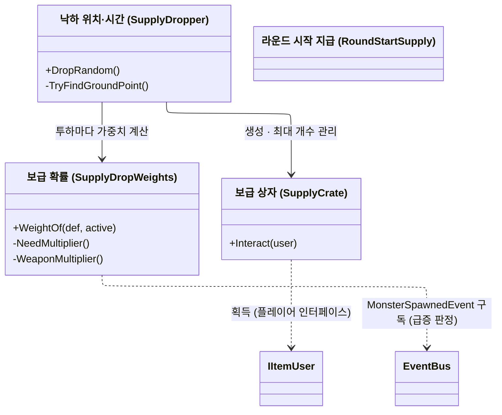

<!-- ✏️ 표와 그림의 클래스 표기를 "역할 (이름)" 순서로 바꿨습니다(11-24 장 재구성). 하는 일 칸은 원래 내용 그대로입니다 -->
| 역할 (클래스) | 하는 일 |
|---|---|
| 낙하 위치·시간 (`SupplyDropper`) | 언제·어디에 떨어뜨릴지. 낙하 지점 찾기, 필드 상자 수 제한 |
| 보급 확률 (`SupplyDropWeights`) | 무엇을 떨어뜨릴지. 테이블 기본 가중치 × 지금 상황 배율 |
| 보급 상자 (`SupplyCrate`) | 낙하 연출, 획득 영역, 플레이어에게 아이템 주기 |
| 라운드 시작 지급 (`RoundStartSupply`) | 다음 라운드 시작 지급 |

보급 시스템에서 중요한 것은 **언제 떨어지는가, 얼마나 떨어지는가, 무엇이 떨어지는가**입니다.
그래서 떨어뜨릴 지점과 시간을 맡는 `SupplyDropper`, 외부 테이블로 무엇을 떨어뜨릴지 확률을 정하는 `SupplyDropWeights`,
라운드 정보를 받아 다음 라운드 보급을 정하는 `RoundStartSupply`로 나뉘었습니다.

클래스를 이렇게 나눈 것은 AI의 설계이고, 확률 계산(`SupplyDropWeights`)은 플레이 테스트에서 필요한 아이템이 잘 나오지 않는다고 느껴 2차 피드백 때 제가 제안한 기능입니다.
`RoundStartSupply`는 라운드 시작 이벤트를 듣고, 2라운드부터 수류탄·회복 팩·예비 탄창을 상자 없이 인벤토리에 바로 넣습니다. 언제 줄지는 라운드 담당이 보내는 이벤트가 정하고, 상자를 떨어뜨리는 `SupplyDropper`와는 하는 일이 겹치지 않습니다. <!-- ✏️ 11-24 코드 대조로 바꿨습니다. 근거: RoundStartSupply.cs 26행 RoundStartedEvent 구독 · 36 · 46행 Round 2 이상 지급 · 50행 RoundSupplyGrantedEvent 발행, SupplyDropper.cs 79행은 붙이기만 함 (develop db706ef5) -->
<!-- 지웠습니다(11-24 코드 대조): "지금 돌아보면 SupplyDropper와 RoundStartSupply는 굳이 나누지 않고 합쳐도 되었을 것 같습니다. RoundStartSupply가 하는 일(라운드 시작 때 보급 주기)도 결국 언제 보급을 줄지 정하는 일이라, 언제·어디에를 맡은 SupplyDropper와 역할이 겹치기 때문입니다." — 코드에서 RoundStartSupply는 시점을 정하지 않아 근거가 맞지 않습니다 -->

### 4-2. 라운드 중 정해진 간격으로 보급이 떨어진다 — 보급 사용법

| 누가 | 무엇을 하면 | 결과 |
|---|---|---|
| 라운드 담당(`RoundSequencer`) | 자동 투하 시작·정지 (`StartAutoDropCycle` / `StopAutoDropCycle`) | 라운드 표(`RoundTable`)의 간격마다 상자가 떨어짐 |
| 튜토리얼 | 종류와 위치를 정해 한 번 투하 (`Drop`) | 낙하 지점 검사 없이 그 위치 아래 지면에 떨어집니다 |
| HUD·사운드 | 획득 이벤트(`SupplyCollectedEvent`) 구독 | 보급을 주웠을 때 알림·소리 |

라운드 담당은 `StartAutoDropCycle`만 부르면 됩니다. 라운드 흐름은 `RoundSequencer`의 몫이므로,
언제 떨어뜨릴지는 `RoundSequencer`가, 어디에·무엇을은 보급이 정하도록 나눴습니다.

### 4-3. 주울 수 있는 곳에만 보급이 떨어진다 — 낙하 지점 찾기 (값싼 검사부터, 길 찾기는 마지막)

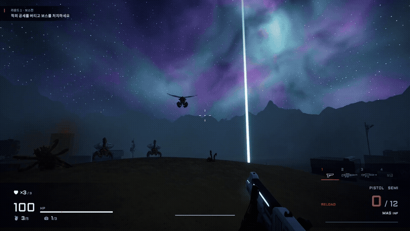
*1라운드 군중전(1배속) — 멀리 평지에 선 빛기둥을 보고 보급 상자로 다가가는 장면입니다. 떨어지는 위치를 멀리서도 알 수 있게 상자에 빛기둥을 세웠고, 상자는 아래 다섯 검사를 통과한 평지에만 떨어집니다.* <!-- ✏️ 11-25 v4: 그림을 supply-drop.png → GIF로 바꿨습니다(GIF 촬영 목록 3절 1번, 원본 Hive-Purge-Game-play.mkv 244.3~250초). 녹화본에 상자가 하늘에서 떨어지는 순간이 없어, 빛기둥을 보고 찾아가는 장면으로 대신했습니다. 옛 그림: 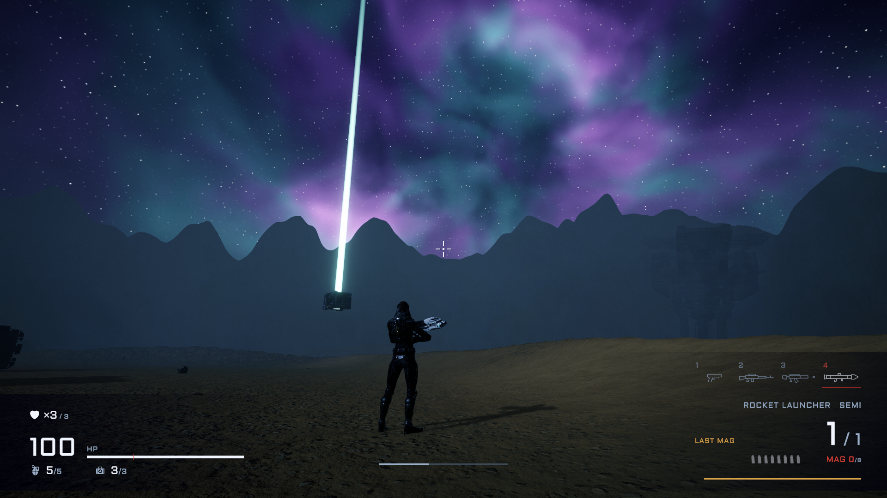 -->

플레이어 기준 20~60m 둘레에서 후보 지점을 뽑고, 위에서 아래로 광선을 쏴 맞은 지면을 아래 다섯 검사에 통과시킵니다. 하나라도 걸리면 그 후보는 버리고 다시 뽑습니다(최대 30번).

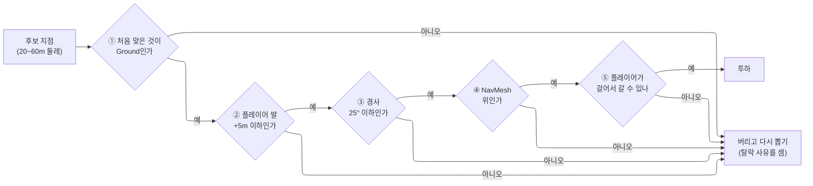

| 검사 | 막는 문제 | 어디서 나왔나 |
|---|---|---|
| ① 처음 맞은 것이 Ground | 지붕·바위·나무 위 | 제가 낸 A안과 비교해 고른 B안 (아래 결정 표) |
| ② 플레이어 발 +5m 이하 | 높은 건물·언덕 위 | 플레이 피드백으로 기준을 지형 높이 → 플레이어 발 높이로 바꿈 |
| ③ 경사 25° 이하 | 상자가 비탈에 묻힘 | 2차 피드백 뒤 추가 <!-- ✏️ 11-24 코드 대조: 커밋 e7737f1b(11-01) --> |
| ④ NavMesh 위 | 맵 밖·고립된 지붕 | 2차 피드백 뒤 추가 (2-3) |
| ⑤ 걸어서 갈 수 있음 | 구덩이 속·절벽 위 | 2차 피드백 뒤 추가 (2-3) |

- **길 찾기를 맨 마지막에 둔 이유**: `CalculatePath`는 실제로 길을 계산하므로 다섯 검사 중 가장 비쌉니다. 레이어·높이·경사는 숫자 비교 한 번이면 됩니다.
  값싼 검사로 먼저 거르면 비싼 길 찾기는 살아남은 후보 몇 개만 받으므로, 보급이 늦어지지 않습니다.
- **실패 사유를 종류별로 세는 이유**: 플레이 테스트 중에는 어떤 상자가 왜 실패했는지 눈으로 확인하기 어려워, 사유별 횟수를 경고로 남겼습니다(4-6).
- **④⑤를 건너뛰는 경우**: 플레이어가 NavMesh 위에 없으면 "걸어서 갈 수 있는지"를 따질 수 없어서 NavMesh 검사를 통째로 건너뜁니다.
  NavMesh를 굽지 않은 테스트 씬에서 이 검사를 하면 모든 후보가 탈락해 보급이 하나도 떨어지지 않기 때문입니다.

**보급 낙하 판정에서 비교한 방법** (10-31)

> **결정 대상** 보급을 떨어뜨려도 되는 곳을 "소품이 아닌 곳"으로 정할지, "땅(Ground)인 곳"으로 정할지. <!-- ✏️ -->

<!-- ✏️ 표를 결정 표 양식으로 바꿨습니다(11-23 통합본 2-2). 칸 내용은 원래 표 그대로이고 문장 끝만 습니다체로 바꿨습니다. [B] 단점은 아래 "절벽 위·구덩이" 문장에서 가져왔습니다 -->
| | [A] 소품이 아닌 곳에 투하 | **[B] 처음 맞은 것이 Ground일 때만 투하 ✓** | [C] Ground만 맞히는 레이캐스트 |
|---|---|---|---|
| 방식 | 소품을 Obstacle 레이어로 지정하고, Obstacle이 아닌 곳에 투하합니다 | 레이캐스트(광선 검사)가 처음 맞은 것이 Ground일 때만 투하합니다 | Ground 레이어만 맞도록 걸러서 레이캐스트합니다 |
| 정한 사람 | 세 안: [A] 저 · [B] 권장 · [C] 비교 AI · 기준: 저(최적화) · 고름: 저(권장안, 10-3 ①) | | |
<!-- ✏️ 11-25 v4 「정한 사람」 행: 옛 "누가 냈나" 행(나 · AI 권장 · AI 비교안)을 바꿨습니다. 근거: 팀 레포 Docs/Design/SupplyUpgradeRework_Proposal.md Q2 권장안 · 대화 기록 666bde03(2026-10-31T15:28Z) 「Q2: … 권장 방식이 더 최적화에 좋다면 권장방식으로 진행」 -->
| 장점 | 직관적입니다 | 비용은 A와 같습니다(레이캐스트 1회 + 레이어 비교). 맵 소품 레이어를 바꾸지 않아도 되고, 레이어를 빠뜨린 소품 위에도 떨어지지 않습니다 | — |
| 단점 | 레이어를 빠뜨린 소품이나 새로 추가한 오브젝트 위에는 떨어집니다 | 절벽 위·구덩이처럼 Ground인데 걸어서 못 가는 곳은 거르지 못합니다 | 지붕을 뚫고 건물 안에 떨어집니다 |

> 「Props [원문: Probs] 를 Obstacle 로 지정해서 obstacle 이 아닌 곳에서만 허용 되게 변경 하는 안 고려 / 권장 방식이 더 최적화에 좋다면 권장방식으로 진행」 (10-31)

**[B]를 골랐습니다.** 성능은 두 안이 같습니다. 하지만 제가 낸 A안처럼 소품마다 레이어를 직접 지정하면, 맵을 만들다 보면 **레이어를 빠뜨리는 실수**가 생깁니다.
B안은 Ground만 허용하므로 소품 레이어를 빠뜨려도 틀리지 않습니다. 이 실수를 막을 수 있어 B안을 골랐습니다. <!-- ✏️ -->
그래도 절벽 위·구덩이처럼 Ground인데 못 가는 곳이 2차 피드백에서 남았고, 그때 NavMesh 경로 검사를 더했습니다(위 표의 ④⑤).

### 4-4. 지금 필요한 보급이 더 잘 나온다 — 상황에 따라 바뀌는 확률

<!-- ✏️ 옛 6-3 「보급 확률 — 고정 확률 vs 상황에 따라 바뀌는 확률」을 이 절로 합쳤습니다(11-24 장 재구성). 문장은 그대로이고, 문제 → 결정 → 배율 → 확인 → 이어서 정한 것 순서로 놓았습니다 -->
<!-- ✏️ 지웠습니다(11-24 흐름 정리): "플레이어는 수많은 적과 보스를 상대해야 해서, 보급 상자는 플레이어의 생사를 가르는 중요한 시스템입니다." — 4장 첫머리로 옮겼습니다. "이를 개선하려고 플레이어가 가진 아이템 상황에 따라 확률이 바뀌도록 바꿨습니다." — 아래 제안 · 결정 표와 같은 이야기라 하나로 이었습니다 -->
확률을 바꾸기 전에는 정해진 확률대로 무작위로 떨어뜨렸고, 플레이 테스트 중 정작 필요한 순간에 필요한 보급을 받지 못하는 상황을 겪었습니다.
시작은 불만 하나였습니다.

> 「무기 상자 확률이 지금 몇퍼센트야 조금 낮아보여서」 (11-01)

기본 확률을 올리는 대신, 언제 무엇이 필요한지에 따라 확률이 바뀌게 하자고 제안했습니다.

> 「보급 상자가 떨어지는 비율 조건은 플레이어의 수류탄/ 힐팩 현재 보유 갯수에 따라 드랍이 조정됨
> 무기상자는 웨이브의 몬스터수가 확 늘어 날때, 플레이어가 보급 무기를 다 사용 했을 때 확률을 높임」 (11-01)

> **결정 대상** 무기 상자가 적게 나오는 문제를 기본 확률을 올려 풀지, 상황에 따라 확률이 바뀌게 해서 풀지. <!-- ✏️ -->

<!-- ✏️ 표를 결정 표 양식으로 바꿨습니다(11-23 통합본 2-2). [B] 방식은 5-3 배율 표에서 가져왔습니다 -->
| | [A] 기본 확률만 올리기 | **[B] 기본 확률 × 상황 배율 ✓** |
|---|---|---|
| 방식 | 무기 상자의 기본 확률 숫자 하나를 올립니다 | 수류탄·회복 팩 보유량, 몬스터 급증, 보급 무기 소진에 따라 기본 확률에 배율을 곱합니다(아래 배율 표) |
| 장점 | 숫자 하나만 바꾸면 됩니다 | 필요한 것이 필요할 때 더 잘 나옵니다 |
| 단점 | 수류탄이 가득해도 수류탄 상자가 같은 확률로 나옵니다 | 판정 조건과 배율 숫자가 늘어납니다 |
| 정한 사람 | [B] 제안 · 고름: 저(11-01, 위 인용) · 배율 숫자와 ConfigTable 구조: AI 초기값 · 확인: 저(투하 확률 로그) | |
<!-- ✏️ 11-25 v4 「정한 사람」 행. 근거: 이 절의 11-01 인용 · 아래 "배율 숫자 … AI가 정한 초기값" 문장 · 대화 기록 666bde03(2026-11-01T07:40Z) -->

**[B]를 골랐습니다.** 기본 확률만 올리면 지금 필요한지와 상관없이 늘 같은 확률로 나오기 때문입니다.
그 대가로 늘어난 판정 조건과 배율 숫자는 전부 ConfigTable(설정 값 표)에 모아 두고, 투하 로그로 의도대로 나오는지 확인했습니다. <!-- ✏️ -->

최종 가중치 = **테이블 기본 Weight × 상황 배율**

| 상자 | 배율 |
|---|---|
| 수류탄·회복 팩 | 보유량이 0개면 ×2.0, 가득이면 ×0.25 (사이는 선형) |
| 무기 상자 | 몬스터 급증(최근 10초 12마리 이상 소환) ×2.5, 보급 무기 소진 ×2.5, 상한 ×4. 이미 들고 있으면 나오지 않습니다 <!-- ✏️ 11-25 v4 Pass 1: "나오지 않음" → 습니다체 --> |

| 상황 (기본 40/40/15/15, 최종 보급 표 값으로 계산) | 수류탄 | 회복 | 로켓 | 유탄 |
|---|---|---|---|---|
| 평소 (둘 다 절반 보유) | 37.5% | 37.5% | 12.5% | 12.5% |
| 수류탄 0 · 회복 가득 | 66.7% | 8.3% | 12.5% | 12.5% |
| 급증 + 무기 소진 | 21.4% | 21.4% | 28.6% | 28.6% |
<!-- ✏️ 11-24 코드 대조로 다시 계산했습니다. 옛 표는 설계 문서(Supply_2ndFeedback_Proposal.md 191~200행)의 로켓 · 유탄 10 기준(41/41/9/9 · 73/9/9/9 · 26/26/24/24)이었고, 같은 날 커밋 dfd3b03e(11-01)에서 SupplyTable.tsv 4101 · 4102 Weight를 15로 올렸습니다.
     계산: 절반 보유 배율 1.125(0개 ×2.0 ~ 가득 ×0.25 선형), 무기 배율 2.5 × 2.5 = 6.25 → 상한 ×4. 근거: SupplyDropWeights.cs 51 · 90~113행, ConfigTable.tsv 19~27행 (develop db706ef5) -->

배율 숫자(가득일 때 0.25 등)와 ConfigTable에 둔 구조는 AI가 정한 초기값입니다.
저는 투하 확률 로그(`[SupplyDropper] 투하 확률: …`)로 수류탄이 0개일 때 수류탄 상자가 자주 나오는 것을 확인했습니다.

이어서 정한 것:
- 수류탄·회복 팩이 둘 다 가득이면 무기 상자 확률이 크게 오르는 부작용 → 「그대로 허용」 (Q-C).
  무기 상자로 강력한 무기를 경험하면 전투 경험이 다양해집니다. 다른 보급이 이미 가득 찬 상황에서는 무기를 주는 것이 좋다고 판단했습니다.
- 보급 무기를 들고 있으면 무기 상자는 나오지 않게 했습니다(3차 개선). 들고 있는 무기가 새 무기로 버려지는 것을 막기 위해서입니다. <!-- ✏️ 11-25 v4 Pass 1: 음슴체 "막음"과 "아예"를 고쳤습니다 -->

### 4-5. 보급 줍기 — 조준해서 줍기 vs 가까이 가서 줍기

처음에는 플레이어가 보급 상자에 닿기만 하면 바로 획득했습니다. 하지만 플레이 테스트 중 보급과 주고받는 것이 없어 아쉽다는 팀원의 피드백을 받았습니다.
그래서 **F키로 직접 줍게** 바꿔, 보급을 내 손으로 얻는 느낌을 더했습니다.
또 빛기둥 색으로만 구분하던 보급을 보급 정보 UI로도 보여 주어, 어떤 보급인지 줍기 전에 확인할 수 있게 했습니다.

이때는 상자를 조준해야 F키로 주울 수 있었습니다. 직접 플레이 테스트 해 보고 바꿨습니다

> 「현재 플레이어의 마우스 raycast가 보급상자를 바라보고 있어야 획득이 가능한 것은 3인칭이나 긴박한 상황에서 불편함을 경험시켜준다. → 플레이어가 보급 상자 근처에 있으면(trigger collider 적용) F키를 눌러 획득 하는 방식」 (11-01)

> **결정 대상** 보급 상자를 조준해야 줍게 할지, 가까이 가기만 하면 줍게 할지. <!-- ✏️ -->

<!-- ✏️ 표를 결정 표 양식으로 바꿨습니다(11-23 통합본 2-2). 칸 내용은 원래 표 그대로이고 문장 끝만 습니다체로 바꿨습니다 -->
| | [A] 조준만 (처음 방식) | [B] 근접만 | **[C] 둘 다 ✓** |
|---|---|---|---|
| 방식 | 상자를 겨눠야 F키로 줍습니다 | 상자 근처에 있으면 F키로 줍습니다 | 조준한 상자를 먼저 줍고, 없으면 반경 2m 안에서 가장 가까운 상자를 줍습니다 |
| 장점 | 상자가 여러 개일 때 골라 집을 수 있습니다 | 편합니다 | 두 방식의 장점을 다 가집니다 |
| 단점 | 3인칭이거나 몬스터에 쫓길 때 정확히 겨누기 어렵습니다 | 상자가 붙어 있으면 무엇을 집을지 고를 수 없습니다 | 플레이어 담당의 `PlayerInteractor`를 고쳐야 합니다 |
| 정한 사람 | [A] 처음 방식 · [B] 제안: 저(11-01, 위 인용) · [C] 제안: AI · 고름: 저 | | |
<!-- ✏️ 11-25 v4 「정한 사람」 행. [C](둘 다)를 누가 냈는지는 문서 · 설계 문서 · 이 PC의 대화 기록에서 찾지 못했습니다 → 11-26 건우 님 답: AI가 냈습니다 -->

**[C]를 골랐습니다.** 긴박한 상황에서도 편하게 줍되, 상자가 붙어 있을 때 골라 집는 것도 남기기 위해서입니다.
그 대가로 다른 사람이 맡은 `PlayerInteractor`를 고쳐야 했고, 변경 내용은 디스코드로 공유했습니다. <!-- ✏️ -->

획득 반경 2m, 조준 정보 카드는 30m 안에서만, 상자 투하는 60m 안 — 숫자는 직접 플레이하면서 정했습니다.

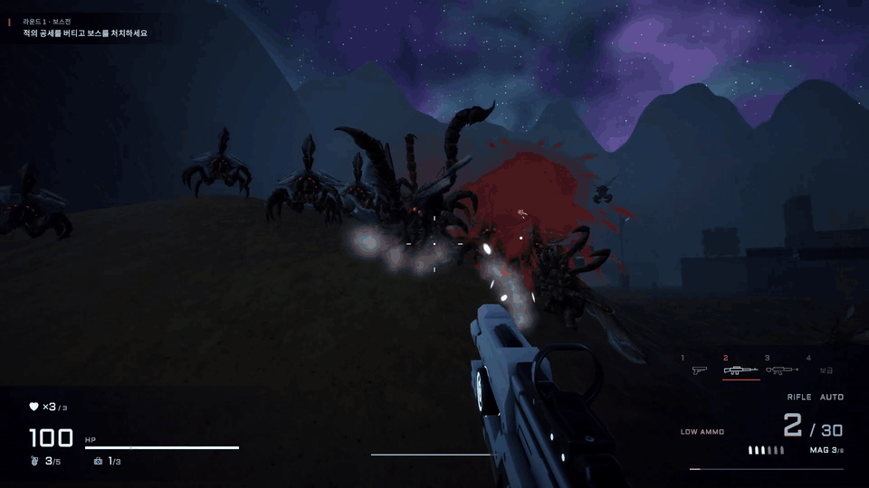
*빛기둥 아래 상자로 다가가면 정보 카드(회복 팩 보급 상자)가 뜨고, 가까이에서 F로 획득합니다. 몬스터에 쫓기는 중에도 줍게 하려고, 겨누지 않아도 반경 2m 안이면 주울 수 있게 했습니다(위 결정 표 [C]).* <!-- ✏️ 11-25 v4 캡션 줄: alt를 옮기고 의도는 위 결정 표에서 가져왔습니다 -->

같은 이유("긴박한 상황")로 **보여 주지 않을 것**도 정했습니다.
- 「사격 중에는 보급 상자 정보 UI 는 안나오게」
- 「1회용 탄 1 예비 4 이런 정보는 빼두자, 유저들에게는 꼭 명시할 필요는 없는 정보야」
- 무기 설명은 짧게: 「로켓 런처 : 재장전 시간이 느리지만 파괴력이 강력한 무기입니다」 (직접 쓴 문구)

### 4-6. 문제 해결 — 새 맵에서 보급이 하나도 떨어지지 않음 (10-31 발견 → 11-01 수정)

- 역할: 발견 — 저(플레이 테스트, 새 맵 씬에서만) · 원인 · 수정 — AI(Claude Code, 커밋 `b0c5a684` 11-01) · 확인 — 저(같은 씬에서 다시 플레이) <!-- ✏️ 11-24 통합본 v3 「책임 분리」로 더했습니다 -->
- 문제: 「'Monster Player Integration' [원문: Intergration] 씬에서 테스트 중인데 보급이 배급이 안됨」 — 직접 플레이 테스트를 하다 보급이 전혀 떨어지지 않는 것을 발견했습니다.
  팀에 공유한 플레이 테스트 피드백도 보급을 하나도 받지 못한 상태로 진행해야 했습니다.
- 원인: 새 맵(SciFiMap)의 지형 원점이 y = -20이라, 실제 전장 지면이 지형 기준 높이 약 18m로 계산되었습니다.
  그래서 "지형 기준 높이 15m 이상이면 투하 금지" 조건에 거의 모든 지점이 탈락했습니다. <!-- ✏️ 11-24 코드 대조로 고쳤습니다(옛: "지형 기준 높이 5m 이하에만 투하"). 5m는 설계 문서의 중간 단계이고, 고치기 전 커밋된 값은 ConfigTable 15였습니다(커밋 b0c5a684 diff의 GetTerrainHeight) --> 맵을 새로 만들면서(7장) 기준점이 바뀐 것이 원인이었습니다.
- 해결: 높이 기준을 **플레이어 발 높이 + 5m**로 바꿔, 맵 원점이나 보스 아레나 높이와 상관없이 같은 규칙이 되게 했습니다(4-3 표의 ②).
  또 다음에 같은 일이 생기면 바로 원인을 알 수 있도록, 투하에 실패하면 탈락 사유별 횟수(지면 없음·레이어·높이 등)를 경고로 남기게 했습니다.
- 결과: 같은 씬에서 보급이 다시 떨어지는 것을 확인했고, 이후 2차 피드백에서는 "어디에 떨어지는가"(지붕·절벽 위) 문제로 넘어갔습니다(4-3).

---

## 5. 사운드 — 군중전에서 몇 마리의 소리를 낼까
<!-- ✏️ 11-24 인계 노트 1번: 장 제목과 첫머리를 새로 썼습니다. 옛 제목은 「사운드 — 네 명이 만든 것에 소리 붙이기」, 옛 첫 문단은 아래 숨김 주석에 남겼습니다. 진짜 고민이 「몇 마리의 소리를 들려줄지」였다는 것은 건우 님 지적(11-24)입니다 -->

군중전에서 몬스터 소리를 전부 재생하면 플레이어에게는 기괴하게 들립니다. 소리를 내는 구조는 정해진 대로 굴러갔고, 이 장의 진짜 고민은 **몇 마리의 소리를 들려줄지**였습니다(5-1). 같은 고민이 몬스터가 맞을 때의 소리에도 이어졌습니다(5-2). <!-- ✏️ -->
그다음 소리가 나는 방법을 봅니다. 4명이 각자 만드는 몬스터·보스·무기에 다른 사람 코드의 동작을 고치지 않고 소리를 붙여야 했습니다(1-2). 게임에서 일어난 일이 소리가 되기까지의 길(5-3), 다른 파트가 소리를 쓰는 법(5-4), 몬스터(5-5)와 플레이어(5-6)에 소리를 붙인 방법, 곡 이름을 둔 곳(5-7)을 차례로 봅니다. <!-- ✏️ -->
<!-- ✏️ 옛 첫머리(11-24 v3): "1-2의 사운드 문제를 푸는 장입니다. 한 라운드 전체에 걸쳐 있고, 3장 그림의 소리 연결(GameSoundRouter)을 확대합니다." / "4명이 각자 만드는 몬스터·보스·무기에 다른 사람 코드의 동작을 고치지 않고 소리를 붙여야 했습니다(1-2). 이 장은 게임에서 일어난 일이 소리가 되기까지의 길(5-1)과 다른 파트가 소리를 쓰는 법(5-2)을 보고, 몬스터(5-3)와 플레이어(5-4)에 소리를 붙인 방법, 만들지 않은 소리(5-5)와 곡 이름을 둔 곳(5-6)을 차례로 봅니다." — 절 번호는 11-24에 5-1 군중 절을 앞에 넣으며 옛 5-1~5-4 → 5-3~5-6, 옛 5-5 → 5-2, 옛 5-6 → 5-7로 바뀌었습니다 -->
<!-- ✏️ 지웠습니다(11-24 장 재구성): 옛 6-4 첫머리 "사운드 시스템을 만들며 내린 작은 결정 두 가지입니다. 하나는 만들 수 있었지만 만들지 않은 소리이고, 하나는 곡 이름을 어디에 둘지입니다." -->

### 5-1. 군중전에서 몇 마리의 소리를 낼까 — 소리 수 제한
<!-- ✏️ 11-24 새로 쓴 절. 근거: 대화 기록 2ab2841a(10-24 14:38 질문과 AI 답변) · 팀 레포 develop db706ef5 — MonsterSoundEmitter.cs(15~16행 주석 · 35행 idleInterval) · GameSoundRouter.Combat.cs(66 · 68행) · SoundService.cs(32 · 34행) · SoundTable.tsv(monster 울음·루프 줄) -->

- 역할: 구조 추천 — AI · 방식 고르기 — 저 · 수치 설정과 구현 — AI(Claude Code) · 확인 — 저(10-24 "지금은 테스터로 검증하자"로 정한 사운드 테스터 씬) <!-- ✏️ 확인 칸은 그 답변으로 적었습니다. 군중전에서 직접 들어 보고 정한 것이 따로 있으면 알려 주세요 -->
- 문제: 군중전에서 몬스터 소리를 전부 내면 수십 마리가 한꺼번에 울어 기괴하게 들립니다.

사운드 구조를 처음 물었을 때 이렇게 물었습니다.

> 「이 게임에 몬스터 사운드나, 타격음 등을 추가하려고 하는데, 사운드 매니저는 어떤 구조가 제일 좋을까?」 (10-24)

AI는 이미 정해 둔 소리 서비스(`ISoundService`)를 구현하라고 했고, 군중에 대해서는 이렇게 추천했습니다. 몬스터마다 상시 루프 소리 재생기를 달지 말고, **「플레이어와 가까운 N마리만 가끔 울음소리를 낸다」** 같은 전역 제한을 두는 편이 훨씬 가볍다는 것입니다.

> **결정 대상** 군중전에서 몬스터 소리를 전부 낼지, 소리를 내는 수에 제한을 둘지. <!-- ✏️ -->

<!-- ✏️ 결정 표 양식. [A]는 AI가 "달지 마세요"라고 한 방식(마리마다 소리 재생기), [B]는 구현한 방식입니다. 장단점 칸은 AI 답변 · 건우 님 지적(11-24)에 있는 것만 적었습니다 -->
| | [A] 몬스터마다 자기 소리를 전부 내기 | **[B] 요청을 거르고 가까운 몇 마리만 들려주기 ✓** |
|---|---|---|
| 방식 | 몬스터마다 울음·반복음 재생기를 달고 각자 냅니다 | 소리를 낼 때마다 거리·간격·동시 수로 거르고, 반복음은 가까운 몇 마리만 냅니다 |
| 장점 | 모든 몬스터의 소리가 빠짐없이 들립니다 <!-- ✏️ 11-26 건우 님 요청으로 한 줄 넣었습니다([B] 단점의 반대) --> | 군중이 많아도 소리가 터지지 않습니다. 몬스터마다 재생기를 다는 것보다 가볍습니다 |
| 단점 | 군중 소리가 겹쳐 기괴하게 들립니다. 몬스터 수만큼 재생기가 듭니다 | 멀리 있거나 제한을 넘은 몬스터의 소리는 들리지 않습니다 |
| 정한 사람 | 두 안 · 추천: AI(10-24 답변) · 고름: 저 | |
<!-- ✏️ 11-25 v4 「정한 사람」 행 — 위 「역할」 줄과 같은 사실입니다(5장의 사실은 고치지 않음) -->

**[B]를 골랐습니다.** 모든 몬스터의 소리를 내면 플레이어가 겹친 소리에 불편함을 겪기 때문입니다. <!-- ✏️ 11-24 건우 님이 직접 고친 문장입니다(퇴고: "플레이어에게" → "플레이어가", "사운드" → "소리"). 코드 대조: 거리 · 간격 · 동시 수 제한에 걸리면 재생하지 않습니다(SoundService.cs 267~272행) -->
그 대가로 제한을 넘은 몬스터의 소리는 재생하지 않게 되었습니다. <!-- ✏️ -->

고른 제한은 사운드 표(`SoundTable.tsv`)의 열과 소리 서비스의 설정으로 정했습니다.

| 제한 | 값 | 효과 |
|---|---|---|
| 같은 울음 동시 재생 수 | 2 | 같은 종류가 수십 마리여도 울음은 2개까지만 들립니다 |
| 같은 울음 최소 간격 | 0.6초 (큰 몬스터 1초) | 짧은 시간에 같은 울음이 연달아 나지 않습니다 |
| 반복음(날갯짓·걷기) | 가까운 3마리 | 0.25초마다 플레이어와의 거리로 다시 골라, 가까운 3마리만 소리를 냅니다 |
| 울음 간격 | 평소 4~10초 · 15m 안 1.5~3.5초 | 가까이 온 몬스터는 더 자주 웁니다 |
| 들리는 거리 | 30~45m | 이보다 멀면 재생하지 않습니다 |
| 전체 재생기 | 40개 | 모자라면 덜 중요한 소리를 끊고 씁니다 |
<!-- ✏️ 값 근거(develop db706ef5): 동시 수 2 · 간격 0.6 · 1 · 거리 30~45 = SoundTable.tsv mon_*_idle 줄, 반복음 3 = mon_*_loop 줄의 MaxInstances와 SoundService.cs 34행 loopRefreshInterval 0.25, 울음 간격 = MonsterSoundEmitter.cs 35행 idleInterval (4, 10) · GameSoundRouter.Combat.cs 66행 monsterNearDistance 15 · 68행 monsterNearIdleInterval (1.5, 3.5), 전체 40 = SoundService.cs 32행 voiceCount -->

무리가 한꺼번에 생겨도 첫 울음을 흩뜨려, 모두가 같은 순간에 울지 않게 했습니다(`MonsterSoundEmitter` 208행 주석). <!-- ✏️ -->

*▶ 소리로 듣기 — [플레이 시연 영상 1:13](https://youtu.be/H4MNlsQbh80?t=73): 1라운드 군중전에서 몬스터가 공격 직전에 예고음을 내고, 구르기로 피하는 장면입니다.* <!-- ✏️ 11-25 v4 소리 장면 시간 링크(통합본 1-8). 시간 근거: _intake/video/make-video.ps1 장면 10(원본 276~286초, 자막 「공격 직전, 소리로 먼저 알립니다」)이 시연 영상(262.7초 = 4분 23초)의 73초에서 시작 -->

### 5-2. 몬스터 피격 소리 — 만들 수 있지만 만들지 않은 소리

5-1과 같은 고민이 몬스터가 총에 맞을 때의 소리에도 있었습니다. 맞을 때마다 소리를 내면 군중전에서는 소리가 너무 많아집니다. <!-- ✏️ 11-24 5-1과 이어 붙이는 다리 문장 -->

> 「Hurt 사운드는 게임 특성상 일반 몬스터는 금방 죽고, 중간체 몬스터 또한 많지 않기 때문에 총기 피격음 구현 외에는 크게 중요하지 않을 거 같아」 (10-25)

> **결정 대상** 몬스터가 총에 맞을 때 몬스터마다 피격 소리를 낼지, 총알 타격음 하나로 맞은 느낌을 줄지. <!-- ✏️ -->

<!-- ✏️ 표를 결정 표 양식으로 바꿨습니다(11-23 통합본 2-2). [B] 방식은 아래 "결과" 문장에서 가져왔습니다 -->
| | [A] 몬스터마다 Hurt 소리 | **[B] 총알 타격음 하나 + 히트마커 ✓** |
|---|---|---|
| 방식 | 맞은 몬스터가 종류마다 다른 피격 소리를 냅니다 | 맞은 위치에서 총알 타격음을 내고, 화면에 히트마커(맞혔다는 표시)를 띄웁니다 |
| 장점 | 몬스터마다 다른 반응을 줍니다 | 군중전에서도 소리가 깔끔합니다. 에셋이 1개면 됩니다 |
| 단점 | 금방 죽는 군중 수십 마리가 동시에 비명을 질러 소음이 됩니다. 몬스터마다 에셋이 필요합니다 | 몬스터 종류별 차이가 없습니다 |
| 정한 사람 | [B] 먼저 꺼냄: AI(10-25 점검 — 몬스터별 피격음 에셋이 없음) · 게임 특성을 근거로 제안: 저(10-25, 위 인용) · 고름: 저 | |
<!-- ✏️ 11-25 v4 「정한 사람」 행. 두 안을 누가 냈는지는 찾지 못했습니다 → 11-26 대화 기록 2ab2841a로 확인: 10-25 13:07 AI 점검 5번 "몬스터별 피격음이 없습니다 … 공용 타격음과 히트마커로 처리하는 것이 맞습니다", 13:39 건우 님 「고려할 사항 1」(위 인용), 13:53 AI "Hurt 제안 재점검 — 제안이 맞습니다". 커밋 메시지에는 누가 냈는지 남아 있지 않습니다 -->

**[B]를 골랐습니다.** 일반 몬스터는 금방 죽고 중간체도 많지 않아, 몬스터마다 피격 소리를 내면 소음이 되기 때문입니다.
그 대가로 몬스터 종류별 타격음 차이는 내줬고, 몬스터 구분은 사망음·공격 예고음이 맡게 했습니다. <!-- ✏️ -->

결과: 타격감은 총알 타격음(3D, 맞은 위치)과 히트마커(2D)로 주고, 약점을 맞히면 같은 타격음의 **음높이만 올립니다**(제 아이디어).
같은 효과음의 음높이만 바꿔 여러 소리처럼 들리게 하는 방법을 써서, 새 사운드를 찾지 않고 재생 값만 바꿔 여러 가지 소리를 낼 수 있었습니다.
`MonsterTable`의 `HurtSfxKey` 열은 쓰는 곳이 없어져 삭제했습니다.

플레이해 보니 몬스터 피부 종류에 따라 타격음을 다르게 하면 더 생동감이 있겠다고 느껴, 개선 계획에 남겼습니다(11-3). <!-- ✏️ -->


### 5-3. 사운드 모듈 구조 — 소리 하나에 경로 하나

이 그림에서 볼 것은 **소리가 나는 길이 세 갈래뿐이고, 모두 소리 서비스(`ISoundService`) 하나로 모인다**는 점입니다. <!-- ✏️ -->

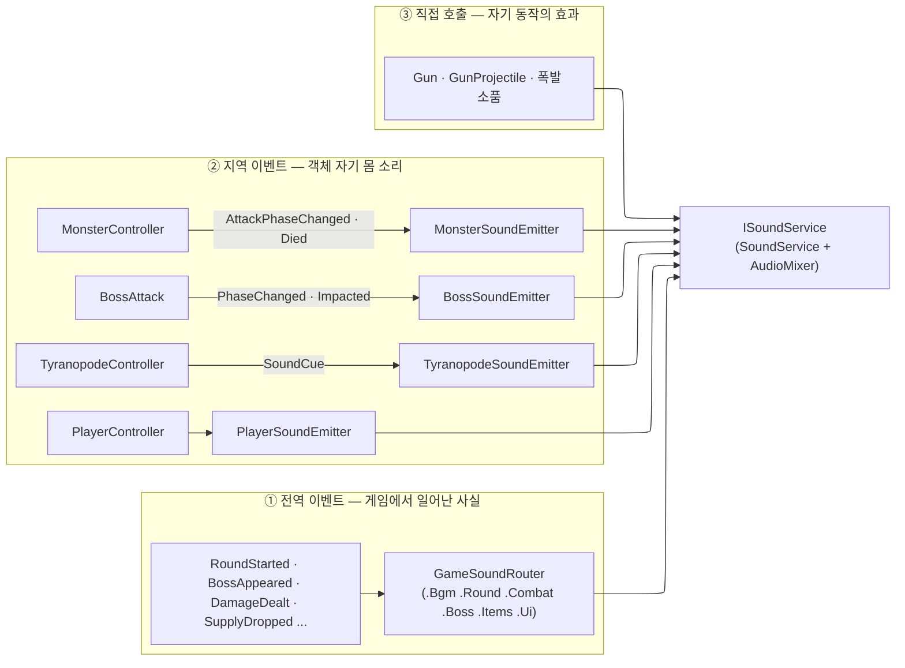
<!-- ✏️ 11-24 코드 대조로 그림을 고쳤습니다: ③의 SupplyDropper → ①의 SupplyDropped(10-29 커밋 4ee97d06부터 이벤트 발행, 소리는 GameSoundRouter.Items.cs 14~19행) · 보스 이미터 연결 이름(BossSoundEmitter.cs 81~91행) · 티라노포드 이미터 추가(GameSoundRouter.Boss.cs 21~39행, TyranopodeSoundEmitter.cs 107~111행) · ③ 예(Gun.cs 713행 · GunProjectile.cs 63행 · ExplosiveProp.cs 169행).
     그림에 넣지 않은 것: PlayerSoundEmitter는 지역 이벤트와 함께 전역 PlayerDamaged · PlayerStamina도 듣습니다(PlayerSoundEmitter.cs 80~88행). 라우터는 ISoundService가 아니라 같은 오브젝트의 SoundService를 직접 씁니다(GameSoundRouter.cs 22 · 77행, 약점 음높이 재생이 인터페이스 밖) -->

| 경로 | 언제 | 예 |
|---|---|---|
| ① 전역 이벤트 → Router | 여러 파트가 함께 알아야 하는 사실 | 라운드 시작 → 군중 BGM + 전투 시작 아나운서("Fight") <!-- ✏️ 11-24 코드 대조(옛: "적 출현 알림"): GameSoundRouter.Round.cs 17~22행 Announce(ann_fight) --> |
| ② 지역 이벤트 → 이미터 | 그 객체 자기 몸의 소리 | 몬스터 공격 예고음, 사망음 |
| ③ 직접 호출 | 발행하는 쪽 자기 동작의 효과 | 총 발사음, 폭발음 |

이 세 갈래 구분은 AI가 설계 문서(`SoundSystemRefactor_v3.md §4`)에서 정리한 것입니다.
제가 직접 고른 것은 플레이어 소리가 나지 않던 버그(11-02) 때, 몬스터처럼 플레이어에도 라우터가 이미터를 자동으로 붙이는 방식입니다(5-6).


### 5-4. 사운드 표의 키만 넘기면 소리가 난다 — 사운드 사용법

다른 파트는 소리 서비스(`ISoundService`)에 **사운드 표(`SoundTable.tsv`)의 키**만 넘기면 됩니다.

| 하고 싶은 것 | 방법 |
|---|---|
| 효과음 한 번 | 키로 재생. 사운드 표에서 3D(`Spatial`)로 정한 소리에 위치를 주면 3D, 아니면 2D <!-- ✏️ 11-24 코드 대조: SoundService.cs 266행 sound.Spatial && position.HasValue --> |
| 따라다니는 반복음 | 키와 따라갈 대상을 주고 재생, 끝나면 정지 |
| 배경음 바꾸기 | 곡 키로 재생 |
| 잠깐 다른 소리 줄이기 | 종류별로 음량을 낮춤 (예: 보스 경고 동안 몬스터 소리) |
| 새 몬스터에 소리 붙이기 | 코드 수정 없이 몬스터 표(`MonsterTable`)의 사운드 키 열만 채움 (5-3) |


### 5-5. 새 몬스터도 표만 채우면 소리가 난다 — 다른 파트 코드의 동작을 고치지 않고 소리 붙이기

AI와 협업할 때 생기는 문제 중 하나는, AI가 작업하다가 다른 파트 담당자의 코드까지 바꿔 버리는 것입니다.
이를 막으려고 소리를 코드가 아니라 TSV 표로 관리하도록 설계했습니다.

몬스터 프리팹은 몬스터 담당 팀원의 작업물이라, <!-- ✏️ 11-25 v4: 팀원 이름을 역할로 바꿨습니다(옛: "홍산 님 담당이라") --> 프리팹에 사운드 컴포넌트를 미리 붙여 두지 않았습니다. 몬스터가 생기면 Router가 이미터를 붙이고,
이미터는 몬스터가 Core 계약(`IMonsterSoundSource`)으로 알려 주는 지역 이벤트만 듣습니다.

**몬스터는 어디서 생기나 — 몬스터 파트의 소환 구조** (몬스터 담당 팀원의 코드) <!-- ✏️ 옛: "(홍산 님 담당 코드)" -->

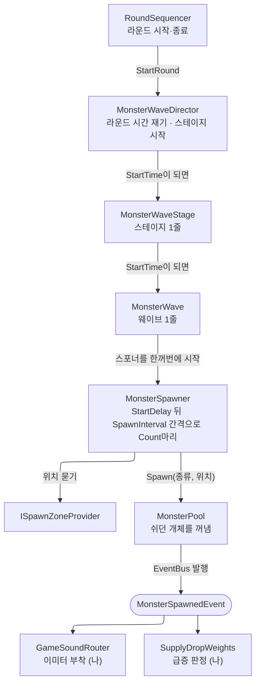

- 데이터 표(스테이지 → 웨이브 → 스포너)의 한 줄이 클래스 하나의 실행 1회입니다. 위층이 아래층을 만들고, 매 프레임 `Tick`으로 시간을 넘겨 줍니다.
- 스포너는 스스로 시간을 재지 않고 `Time.deltaTime`을 받기만 해서, 강화 화면(`timeScale` 0)에서는 소환이 저절로 멈춥니다.
- `MonsterSpawnedEvent`는 스포너가 아니라 풀(`MonsterPool`)이 몬스터를 꺼낼 때 발행합니다.
  제 사운드·보급 코드는 이 소환 구조의 어느 클래스도 모르고, 이 이벤트 하나만 듣습니다 — 3-3의 "파트끼리 서로 모른다"가 실제로 이렇게 동작합니다.

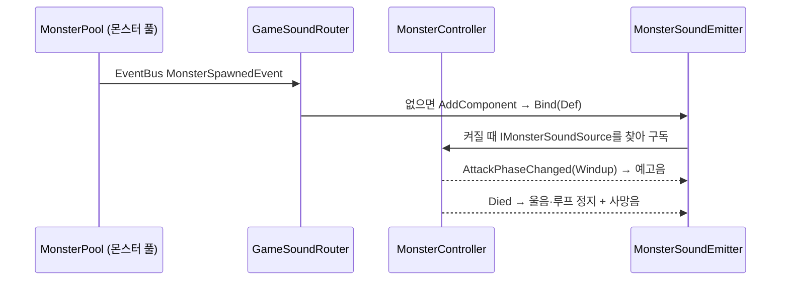

| 누가 | 하는 일 |
|---|---|
| ① `GameSoundRouter` | 몬스터가 생기면(`MonsterSpawnedEvent`) 그 몬스터에 이미터를 붙입니다. 보스는 구조가 달라 따로 처리합니다 |
| ② `MonsterSoundEmitter` | 몬스터가 알려 주는 순간(공격 예고·기절·착지·명중·사망)에 그 몬스터 위치에서 소리를 냅니다. 15m 안에 있으면 울음을 더 자주 냅니다 |

**왜 이렇게 했나**
- **씬에 직접 놓은 몬스터에도 붙이기** — 테스트 중에는 풀(`MonsterPool`)을 거치지 않고 씬에 켜진 채 미리 배치해 둔 몬스터들이 있었습니다.
  `MonsterSpawnedEvent`는 풀이 몬스터를 꺼낼 때만 발행되므로 이 몬스터들에는 소리가 붙지 않았고, 그래서 씬에 있는 몬스터에도 이미터를 붙이는 `AttachEmittersInScene()`을 따로 두었습니다.
- **명중이 아니라 예고(Windup) 순간에 공격음** — 플레이어에게 공격이 온다는 정보를 미리 주기 위한 장치입니다.
- **`Awake`가 아니라 `OnEnable`에서 구독** — 몬스터는 오브젝트 풀을 쓰기 때문에, 풀에서 다시 꺼낼 때 `Awake`가 다시 불리지 않습니다.
- **`MonsterController`가 아니라 `IMonsterSoundSource`를 찾기** — 이미터는 `MonsterController`가 무엇을 하는지 알 필요가 없습니다.
  인터페이스(`IMonsterSoundSource`)를 통해 몬스터의 종류와 공격 순간만 전달받고, `MonsterTable`의 사운드 키로 소리를 연결하는 역할입니다.

몬스터 코드에서 바뀐 것은 `MonsterController`가 `IMonsterSoundSource`를 구현하고, 정해진 순간에 이벤트를 발행하는 줄뿐입니다
(사망은 `MonsterDiedEvent` 바로 앞에 `Died?.Invoke()` 한 줄. 출처: `SoundSystemRefactor_v3.md §5 S1`). 이 줄들은 제 사운드 작업으로 넣었고, 몬스터의 동작 코드는 고치지 않았습니다. <!-- ✏️ 11-24 코드 대조로 고쳤습니다(옛: "몬스터 담당이 고친 것은 …"). 근거: MonsterController.cs git blame — 36행 IMonsterSoundSource 구현 · 119~124행 이벤트 선언 · 338 · 366 · 375 · 378행 · 657행 Died?.Invoke()가 건우 커밋 2e903c10(10-26) · ace3bd34(10-29) · 2d23398b(10-28), 658행 MonsterDiedEvent 발행만 몬스터 담당(10-22) -->
어떤 소리를 낼지는 `MonsterTable`·`MonsterAttackTable`의 사운드 키 열이 정합니다.

**효과**: 나중에 추가된 자폭형·중량형 몬스터와 정예 변종은 사운드 코드를 고치지 않고 **몬스터 표의 사운드 키 열만 채워** 소리를 붙였습니다.
공격 방식이 다른 돌진형(돌진 명중)과 파르다트록스(기습)는 이미터에 그 순간을 받는 이벤트를 더했습니다. <!-- ✏️ 11-24 코드 대조로 고쳤습니다(옛: "나중에 추가된 돌진형 몬스터, 파르다트록스 등은 사운드 코드를 고치지 않고 …"). 근거: MonsterTable.tsv 1005 · 1006 · 11xx · 21xx(몬스터 담당 10-29~30 추가) · 돌진형 2001 · 파르다트록스 2002는 10-20(0c2a8324)부터 표에 있음 · IMonsterSoundSource.AttackContacted(ace3bd34) · HiddenSfxKey와 MonsterSoundEmitter.cs 112~126행(2d23398b) -->


### 5-6. 같은 방식을 플레이어에도 — 플레이어 소리가 나지 않던 문제 (11-02)
<!-- ✏️ 11-24 코드 대조: 날짜 11-01 → 11-02. 고친 커밋 b5c192ce 11-02 01:35 「플레이어 소리 버그 수정」, develop 합침 PR #94 11-02 -->
<!-- ✏️ 11-26 마무리 퇴고: 이 장의 "전혀"(관문)와 표 칸 음슴체를 고쳤습니다 -->
<!-- ✏️ 옛 5-5 ③ 「같은 방식을 플레이어에도 — 직접 고른 A안」과 옛 8-2 ① 「플레이어 소리가 전혀 나지 않음」이 같은 일이라 한 절로 합쳤습니다(11-24 장 재구성). 문제 → 원인 → 결정 → 결과 순서로 놓았고, 옛 표의 A안 · B안은 결정 표 양식에 맞춰 [B] · [A]로 바꿔 불렀습니다 -->

- 역할: 발견 — 저(플레이 테스트) · 원인 정리 · 수정 코드 — AI(Claude Code, 커밋 `b5c192ce`) · 고치는 방식 고르기 — 저(아래 결정 표) · 확인 — 저(직접 플레이) <!-- ✏️ 11-24 통합본 v3 「책임 분리」로 더했습니다. 원인 정리는 AI가 쓴 SoundFix_Handoff.md §1 -->
- 문제: 플레이 중 플레이어의 발소리·피격음 등이 나지 않았습니다.
- 원인: `PlayerSoundEmitter`가 플레이어 프리팹에 붙어 있지 않았습니다(`SoundFix_Handoff.md §1`). <!-- ✏️ 옛 8-2 ①의 문제 · 원인 줄을 습니다체로 바꿨습니다 -->

> **결정 대상** 빠진 플레이어 소리 이미터를 프리팹에 직접 붙일지, 몬스터처럼 라우터가 실행 중에 붙이게 할지. <!-- ✏️ -->

<!-- ✏️ 옛 「방법 | 내 판단」 표를 결정 표 양식으로 바꿨습니다. [A] 단점 칸은 옛 표의 판단, [B] 단점 칸은 아래 "자동으로 붙이는 방식도 …" 문장에서 가져왔습니다 -->
| | [A] 플레이어 프리팹에 이미터를 직접 붙이기 | **[B] 라우터가 실행 중에 자동으로 붙이기 ✓** |
|---|---|---|
| 장점 | — | 플레이어 프리팹은 그대로 둡니다 |
| 단점 | 플레이어 프리팹은 플레이어 담당 팀원의 작업물이라, 담당자의 작업물을 바꿔야 합니다 <!-- ✏️ 11-25 v4: 옛 "김민성 님 담당이라" --> | 실행 중에 붙여도 팀원의 작업물에 영향을 줄 수 있습니다 |
| 정한 사람 | 두 안: AI 제안 · 고름: 저 · 적용 시점: 저(플레이어 작업이 거의 끝난 뒤) | |
<!-- ✏️ 11-25 v4 「정한 사람」 행. 고름은 위 「역할」 줄과 같은 사실입니다. 두 안을 누가 냈는지는 찾지 못했습니다(SoundFix_Handoff.md는 고른 쪽만 "A안"이라고 적음) → 11-26 건우 님 답: AI가 제안했습니다 -->

**[B]를 골랐습니다.** 담당자의 작업물을 바꾸고 싶지 않았기 때문입니다. <!-- ✏️ -->
자동으로 붙이는 방식도 팀원의 작업물에 영향을 줄 수 있어 처음에는 피했고,
플레이어 작업이 거의 마무리되어 더 이상 시스템이 추가되지 않을 시점에 적용했습니다.

```csharp
// GameSoundRouter.Combat.AttachPlayerEmitters (32~36행 발췌)
private void AttachPlayerEmitters()
{
    foreach (var player in FindObjectsByType<PlayerController>(FindObjectsInactive.Include, FindObjectsSortMode.None))
        if (player.GetComponent<PlayerSoundEmitter>() == null) player.gameObject.AddComponent<PlayerSoundEmitter>();
}
```
<!-- ✏️ 11-24 코드 대조: 머리줄을 파일 이름(GameSoundRouter.Combat.cs)과 행 번호로 고치고, 원문에 없던 주석 "// Start 에서 1번"을 뺐습니다. 이 메서드는 Start에서 한 번 불립니다(GameSoundRouter.cs 83행, 원문 요약 주석 "시작 시 1번"). develop db706ef5 -->

- 결과: 고친 뒤 직접 플레이해 플레이어 소리가 나는 것을 확인했습니다. 쉽게 놓칠 수 있는 버그였습니다.
  AI가 구현했어도 직접 테스트해 확인하기 전에는 구현되었다고 할 수 없기 때문에, AI 구현 뒤 플레이 테스트는 항상 하는 루틴이었습니다.
<!-- 옛 표 원문: "B안. 플레이어 프리팹에 이미터를 직접 붙이기 | 플레이어 프리팹은 김민성 님 담당이라, 담당자의 작업물을 바꾸고 싶지 않았음" / "A안. 라우터가 실행 중에 자동으로 붙이기 (선택) | 프리팹은 그대로 둠" -->


### 5-7. BGM 곡 키 — Inspector 배열 vs RoundTable

라운드·보스전·강화 화면마다 다른 곡을 틀기로 하면서, 곡 이름을 어디에 둘지 비교를 요청했습니다.

> 「inspector 배열에 두는 장단점 이랑 라운드 곡 키를 roundtable 두는 장단점 설명, 추천하는 방법 이유 설명」 (11-03)

> **결정 대상** 라운드마다 틀 곡 이름을 사운드 쪽 Inspector 배열에 둘지, 라운드 표(RoundTable)에 둘지. <!-- ✏️ -->

<!-- ✏️ 표를 결정 표 양식으로 바꿨습니다(11-23 통합본 2-2). 칸 내용은 원래 표 그대로이고 문장 끝만 습니다체로 바꿨습니다 -->
| | [A] 사운드 라우터 Inspector 배열 | **[B] RoundTable에 `CrowdBgm`·`BossBgm` 열 ✓** |
|---|---|---|
| 방식 | 사운드 라우터의 Inspector에 라운드 순서대로 곡 이름을 넣습니다 | 라운드 표의 각 줄에 군중전 곡·보스전 곡 칸을 더합니다 |
| 장점 | 사운드 파트 안에서 끝납니다 | 라운드마다 다른 값이 라운드 데이터와 한 줄에 있어, 기준값이 한 곳입니다 |
| 단점 | 라운드 순서와 배열 순서를 따로 맞춰야 합니다. 라운드가 바뀌면 두 곳을 고칩니다 | 라운드 담당의 테이블·코드를 고쳐야 합니다 |
| 정한 사람 | 비교 요청: 저(11-03, 위 인용) · 두 안 · 추천: AI([B]) · 고름: 저(추천안) | |
<!-- ✏️ 11-25 v4 「정한 사람」 행. 근거: 대화 기록 7d9580ff — 10:01Z AI 설계안의 「확인 부탁드릴 것」(RoundTable vs Inspector 배열) → 10:14Z 위 인용 → 10:15Z AI 「추천은 RoundTable입니다」 → 10:20Z 건우 님 답 「RoundTable (추천)」 -->

**[B]를 골랐습니다.** Inspector로 하면 수작업 실수가 생길 수 있기 때문입니다. 수작업을 하다 보면 깜빡하고 넣지 않거나 생각하지 못한 것을 놓치는 일이 흔합니다.
그 대가로 라운드 담당의 테이블·코드를 고쳐야 했습니다. <!-- ✏️ -->

Inspector에는 **열이 비었을 때 쓰는 기본 곡**과 강화 화면 곡만 남겼습니다.
그 밖에 직접 정한 규칙: 튜토리얼에서는 강화 화면 곡을 틀지 않음 · 보스 처치 직후에는 강화 곡을 3.5초 늦게 시작(클리어 효과음·승리 아나운서와 겹치지 않게) · 장면별 선곡.

*▶ 소리로 듣기 — [플레이 시연 영상 1:29](https://youtu.be/H4MNlsQbh80?t=89): 보스가 등장하면 시점이 3인칭으로 바뀌고, BGM이 보스전 곡으로 바뀝니다.* <!-- ✏️ 11-25 v4 소리 장면 시간 링크. 시간 근거: make-video.ps1 장면 14(원본 386~400초, 자막 「BGM도 보스 전용 곡으로 바뀝니다」)가 시연 영상의 89초에서 시작 -->


---

## 6. 라운드 종료 강화 — 작게 느껴진 보상을 어떻게 키울까
<!-- ✏️ 11-24 v3 목차 재배치: 옛 6-3을 기능 장으로 올렸습니다. 절 안의 굵은 소제목 셋을 6-2 · 6-3 · 6-4 절로 바꿨고, 첫머리는 6-1 절로 묶었습니다 -->

1-2의 라운드 종료 강화 문제를 푸는 장입니다. 한 라운드의 흐름에서 강화 선택, 3장 그림의 「강해지기」 묶음입니다. <!-- ✏️ 11-24 v3 다리 한 줄 -->

### 6-1. 처음 구현과 바뀐 과정
<!-- ✏️ 절 제목을 새로 붙였습니다(11-24 v3 목차 재배치) -->

처음 만든 강화(10-23)는 재장전·탄창·수류탄 파우치 3종이었고, 재장전·탄창은 3레벨, 수류탄 파우치는 2레벨까지, 라운드마다 한 번만 살 수 있었습니다. <!-- ✏️ 11-24 코드 대조(옛: "각 3레벨까지"): fbd345a2(10-23) UpgradeTable 6021 · 6022 -->
직접 플레이해 보니 라운드를 클리어하고 받는 보상이 작게 느껴졌고(1-2), 팀원들과 상의하며 여러 번 고쳤습니다.

| 버전 | 바뀐 것 | 바뀐 이유 |
|---|---|---|
| 첫 구현 (10-23) | 3종 · 최대 3레벨(수류탄 파우치 2레벨) · 라운드당 1회 구매 | — |
| 1차 개선 (11-01) | 라운드당 1회 구매 제한 삭제 → 재화가 있으면 여러 번 구매 | 1차 플레이 피드백 |
| 기획안 v1 (11-02) | 9~12종 · 전체 나열 상점 · 최대 3레벨 | 첫 제안 |
| 기획안 v2 | 무작위 카드 3장 + 리롤 · 최대 2레벨 · 비용 60 / 100 | 한 스테이지 재화가 많아야 약 300이라 v1 비용(전부 사면 4,940)이 너무 비쌌습니다 |
| v3 | 일반 강화 10종 · 6등급 | 2차 빌드 팀원 피드백 |
| **v3.2 (구현)** | 8종 · 하급·일반·에픽 3등급 · 에픽 25% | 팀장 의견 — 회피 기동·연사력은 밸런스·효용성 문제로 삭제 |

<!-- ✏️ 그림을 뺐습니다(6장 요약, 첫 구현은 위 표 첫 줄과 같습니다): 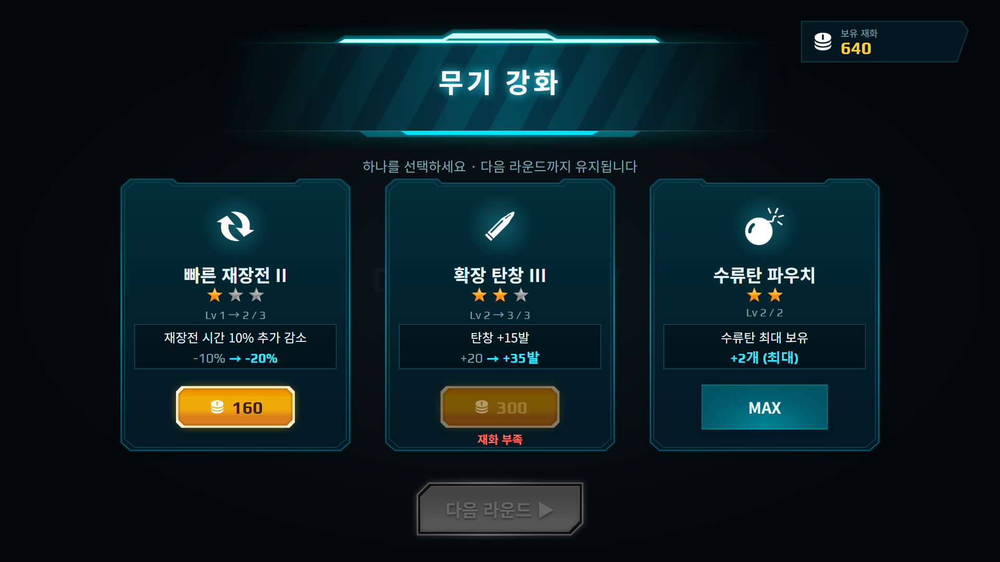 -->

### 6-2. 상점 방식 — 전체 나열 vs 무작위 3장

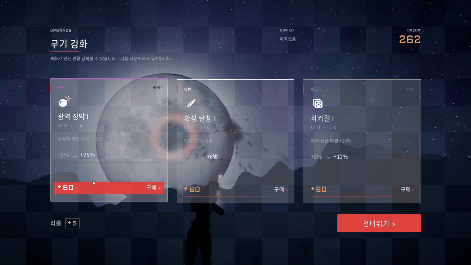
*1라운드가 끝난 뒤 강화 상점(1배속) — 카드를 사면 SOLD가 되고, 리롤(5)을 누르면 남은 카드가 새로 뽑힙니다. 재화는 262 → 202 → 197 → 137 → 132로 줄어듭니다. 원하는 카드를 찾는 재미를 주려고 전체 나열 대신 무작위 3장과 싼 리롤을 두었습니다(아래 결정 표).* <!-- ✏️ 11-25 v4 GIF(GIF 촬영 목록 3절 3번, 원본 489~495초). 재화 숫자는 GIF 화면 오른쪽 위에서 읽었습니다 -->

> **결정 대상** 강화 상점에서 강화를 전부 나열할지, 무작위 3장만 보여 줄지. <!-- ✏️ -->

<!-- ✏️ 표를 결정 표 양식으로 바꿨습니다(11-23 통합본 2-2). 칸 내용은 원래 표 그대로이고 문장 끝만 습니다체로 바꿨습니다 -->
| | [A] 전체 나열 | **[B] 무작위 카드 3장 + 리롤 ✓** |
|---|---|---|
| 장점 | 원하는 강화를 바로 골라 살 수 있습니다 | 상점마다 선택지가 달라지고, 리롤(다시 뽑기)로 원하는 카드를 찾는 재미가 생깁니다 |
| 단점 | 한 판 재화로는 몇 개 사지 못하고, 매번 같은 화면이라 고르는 재미가 적습니다 | 원하는 강화가 바로 안 나올 수 있습니다 |
| 정한 사람 | 두 안: 저 · 기준 · 고름: 저(아래 조건 네 가지) | |
<!-- ✏️ 11-25 v4 「정한 사람」 행. 기준 · 고름은 아래 "제가 정한 조건은 네 가지" 문단이 근거입니다. 두 안을 누가 냈는지는 찾지 못했습니다(기획안 v2는 git 1659dca2) → 11-26 건우 님 답: 직접 제안했습니다 -->

**[B]를 골랐습니다.** 상점을 열 때마다 선택지가 달라져 고르는 재미가 생기기 때문입니다.
원하는 강화가 바로 안 나오는 단점은 리롤 비용을 5로 낮게 고정해 줄였습니다. <!-- ✏️ -->

제가 정한 조건은 네 가지였습니다: 한 스테이지 재화는 **많아야 약 300**, 리롤은 5부터(20은 비쌈), 게임은 3스테이지로 마무리해 상점은 2번, 상점은 전체 나열이 아니라 무작위 3장으로 선택을 제한.
라운드 흐름·구매 처리·재시작 초기화 같은 기존 시스템은 크게 바꾸지 않는 것도 조건이었습니다.

### 6-3. 재화와 가격 — 전투 보상이 바로 '강해짐'으로 이어지게

몬스터를 처치하면 재화가 자동으로 쌓이고, 스테이지가 끝나면 상점이 열려 그 재화로 강화를 삽니다.
한 스테이지에서 얻는 재화는 직접 플레이해 재 보니 많아야 약 300이었습니다.
이 값을 기준으로 강화 비용을 1레벨 60, 2레벨 100으로 정해, **한 상점에서 적어도 2장 이상은 살 수 있게** 했습니다.

비용은 등급(하급·일반·에픽)과 상관없이 같고, 등급은 **오르는 수치만** 바꿉니다.
같은 값을 내고 에픽을 만나면 더 크게 강해지므로, 상점을 열 때마다 어떤 카드가 나올지 기대하게 됩니다.
<!-- ✏️ 지웠습니다(6장 요약): "리롤은 5로 낮게 두어, 남은 재화로 원하는 카드를 더 찾아볼 수 있게 했습니다." — 위 결정 표 아래 문장과 같은 이야기입니다 -->

처치(재화 획득) → 스테이지 종료(상점) → 강화 구매 → 더 강해진 상태로 다음 스테이지

<!-- ✏️ 11-25 v4: 같은 화면이 6-2 GIF에 있어 그림을 뺐습니다(같은 장면을 두 번 보이지 않음): 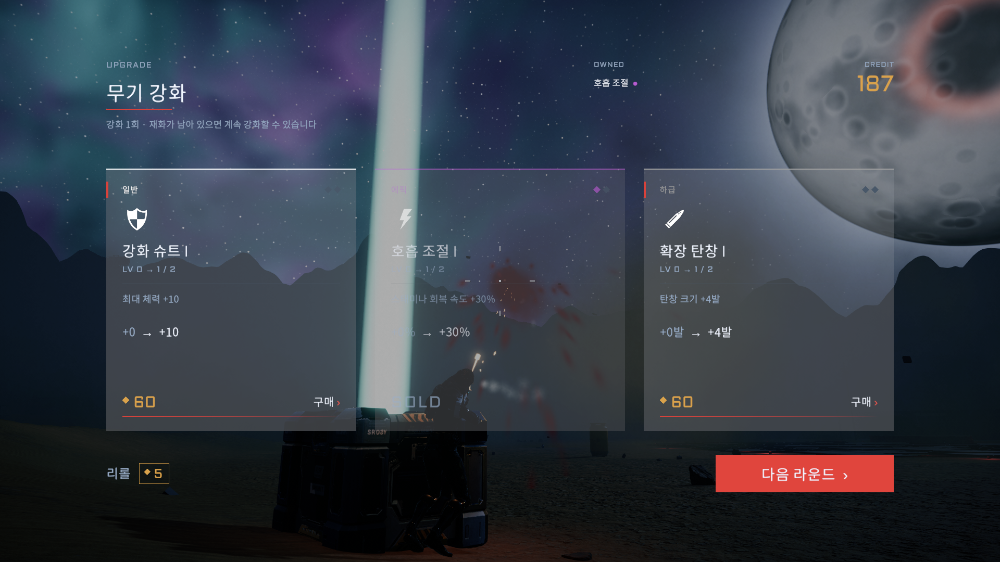 -->

### 6-4. 등급 — 강해지는 체감을 크게

카드마다 하급(40%)·일반(35%)·에픽(25%) 등급이 붙고, 에픽은 증가량이 일반의 약 1.7~2.5배입니다. <!-- ✏️ 11-24 코드 대조(옛: "약 2~2.5배"): UpgradeTable.tsv 일반 대비 에픽 — 러키걸 1.7 · 재장전 1.9 · 탄창 · 스태미나 · 회복 속도 · 의료 키트 2 · 수류탄 반경 · 체력 2.5. 등급 확률 UpgradeGradeTable.tsv, 카드마다 RollGrade(UpgradeManager.cs 347행) -->
3장 중 에픽이 1장 이상 나올 확률이 약 58%라, 상점을 열 때마다 절반 이상은 에픽을 보게 됩니다.
<!-- ✏️ 지웠습니다(6장 요약): "처음 v3에서는 6등급이었지만, 팀장 의견으로 3등급으로 줄이고 에픽 확률을 25%로 높였습니다." — 위 버전 표 v3 · v3.2 줄과 같은 이야기입니다 -->

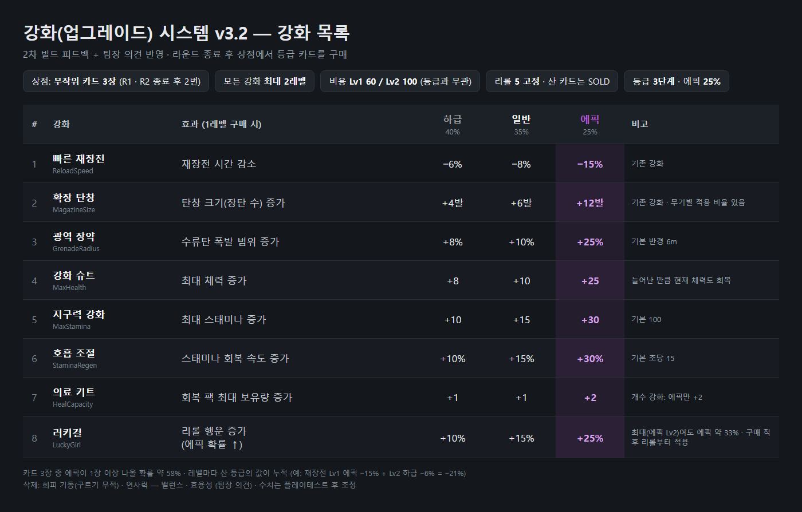
*강화 시스템 v3.2의 강화 8종과 등급별 증가량입니다. 팀원들에게 공유하려고 만든 표입니다.* <!-- ✏️ 11-25 v4 캡션 줄. 의도 근거: 대화 기록 41c34210(2026-11-02T08:12Z) 「팀원들에게 공유 할 수 있도록 간단한 표 이미지 생성」 · UpgradeSystemExpansion_Proposal.md 머리 「팀 공유 표 UpgradeList_v3.png」 -->

<!-- ✏️ 그림을 뺐습니다(6장 요약): 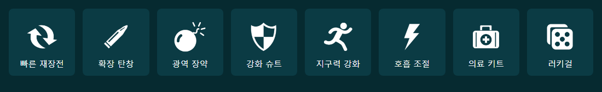 -->

강화 범위는 강화 시스템까지만 맡았고, 라운드 구성(섬멸전 등)은 라운드 담당에게 요청 사항으로만 남겼습니다(9-4).

---

## 7. 맵 — AI가 만들고, 디테일은 제가 고쳤다
<!-- ✏️ 11-24 v3 목차 재배치: 옛 6-1을 기능 장으로 올리고 두 절로 나눴습니다 -->

1-2의 맵 문제를 푸는 장입니다. 한 라운드의 무대이고, 3장 그림의 맵 빌더(SciFiMapBuilder)를 확대합니다. 맵의 원칙은 2-3에서 먼저 보았습니다. <!-- ✏️ 11-24 v3 다리 한 줄 -->

### 7-1. 처음 만든 맵과 1차 빌드 피드백
<!-- ✏️ 절 제목을 새로 붙였습니다(11-24 v3 목차 재배치) -->
<!-- ✏️ 옛 7-2 「맵·튜토리얼 — AI가 만들고, 디테일은 제가 고쳤다」를 맵(6-1)과 튜토리얼(6-2)로 나눴습니다(11-24 장 재구성). 6장은 요약이라 겹치는 그림 세 장을 뺐고, 뺀 그림은 아래 주석에 남겼습니다 -->

처음에는 제가 맵을 직접 디자인하고 배치했습니다(10-20 「맵 기초 디자인 설계」 → 10-22 「맵 디자인 완료」).

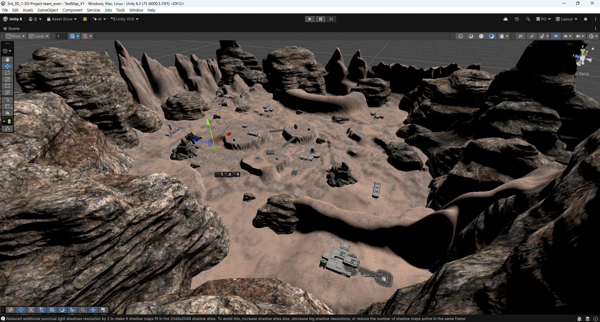
*처음 직접 디자인한 맵(TestMap_V1, 10-22 완료)입니다.* <!-- ✏️ 11-25 v4 캡션 줄: alt와 위 문장의 날짜 -->

그런데 1차 빌드 테스트(10-28) 때 **맵이 너무 크고, 오래된 에셋이라 텍스처가 좋지 않다**는 피드백을 받았습니다(설계 문서에는 "너무 심심하다"는 평가로도 기록되어 있습니다).

<!-- ✏️ 그림을 뺐습니다(요약): 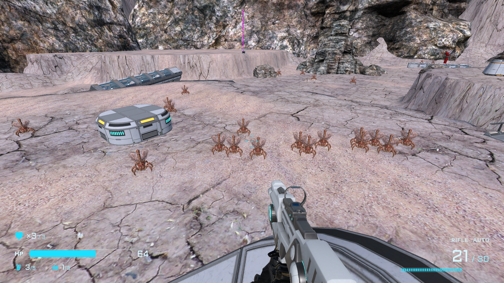 -->

맵을 줄인 버전을 먼저 만들었지만(10-29), 마감인 발표일(11-04)까지 남은 기간이 일주일 정도뿐이었습니다(최종 빌드는 발표 당일 새벽에 마무리).

<!-- ✏️ 그림을 뺐습니다(요약): 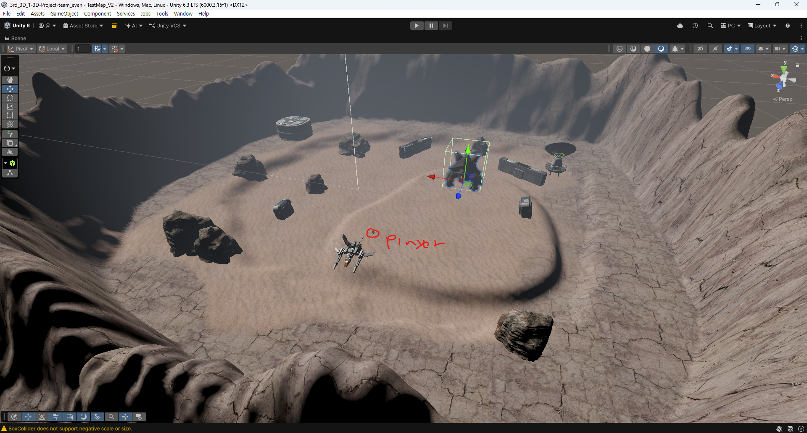 -->

### 7-2. 남은 일주일 — Claude와 함께 다시 만들기
<!-- ✏️ 절 제목을 새로 붙였습니다(11-24 v3 목차 재배치) -->

> **결정 대상** 남은 일주일 안에 새 에셋으로 맵을 다시 만들 때, 전부 손으로 배치할지, Claude와 함께 만들고 디테일만 손으로 고칠지. <!-- ✏️ -->

<!-- ✏️ 표를 결정 표 양식으로 바꿨습니다(11-24 장 재구성). 칸 내용은 원래 표 그대로이고 문장 끝만 습니다체로 바꿨습니다 -->
| | [A] 지금까지처럼 전부 손으로 다시 배치 | **[B] Claude와 함께 생성 + 확인하며 수정 + 디테일은 수작업 ✓** |
|---|---|---|
| 장점 | 원하는 대로 정확히 놓을 수 있습니다 | 큰 배치를 빠르게 만들고, 디테일한 부분은 수작업으로 합니다 |
| 단점 | 일주일 안에 새 에셋으로 맵 전체를 다시 만들기 어렵습니다 | AI가 놓은 배치를 하나하나 확인해야 합니다 |
| 정한 사람 | [A] 처음 방식: 저(직접 배치하며 팀장 피드백으로 고쳐 나갔고, 시간이 많이 들었습니다) · [B] 제안: 저 · 고름: 저 | |
<!-- ✏️ 11-25 v4 「정한 사람」 행. 고름은 아래 "맵 제작을 Claude와 함께 진행했습니다" 문단이 근거입니다. 두 안을 비교한 기록은 찾지 못했습니다 → 11-26 건우 님 답: [A]는 처음에 직접 배치하며 팀장 피드백으로 고친 방식이라 시간이 많이 들었고, [B]는 건우 님이 제안했습니다 -->

**[B]를 골랐습니다.** <!-- ✏️ -->

그래서 Sci-Fi Base 에셋으로 맵을 새로 만들면서, 맵 제작을 Claude와 함께 진행했습니다.
Claude가 생성·배치한 결과를 확인해 가며 고칠 부분은 고쳤고, 디테일한 배치는 직접 손으로 했습니다.

| 순서 | 누가 | 내용 |
|---|---|---|
| ① 설계 | 나 + Claude | 세계관(불시착한 행성의 전초기지 잔해)·지점 배치를 문서로 먼저 정했습니다. 1차 안(구역 4개를 게이트로 연결)은 폐기하고, 팀장 요청대로 튜토리얼과 인게임을 분리 · 인게임은 한 지역으로 확정했습니다 |
| ② 생성 | Claude | 맵 빌더 에디터 도구(`Tools/Map/Build Sci-Fi Map`): 지형에 분화구·순환로를 파고, 지점마다 소품과 엄폐물 2~5개를 배치합니다(지점은 첫 빌드 6곳 → 최종 13곳) <!-- ✏️ 11-24 코드 대조(옛: "지점 6곳"): 첫 빌더 66a87f14(10-30) SiteNames 6개 → 4769d412(10-31) 13개, SciFiMapBuilder.cs 37~38 · 154~156행 --> |
| ③ 확인·수정 | 나 | 생성된 배치를 여러 시점에서 확인하고(`Capture Map Review Shots`) 고칠 곳을 고쳤습니다 |
| ④ 수작업 | 나 | 씬에서 손으로 옮기고 지우고 더했습니다. `Save Sci-Fi Map Edits`가 이 수정을 기록해 두어 다시 생성해도 손으로 고친 배치가 남습니다 |
| ⑤ 규칙으로 | 나 + Claude | 손으로 고친 배치를 다시 빌더 규칙에 넣었습니다 (예: 납작한 태양광 패널이 4배로 커지는 문제 → 크기 배율이 0.8~1.3배를 넘으면 크기를 바꾸지 않습니다) |
<!-- ✏️ 11-25 v4 Pass 1: 표 칸의 음슴체("정함", "확정", "고침", "함", "넣음", "않음")를 습니다체로 바꿨습니다. 내용은 그대로입니다 -->
<!-- 📷 에디터 화면 자리: 맵 빌더 메뉴(`Tools/Map/…`)와 실행 결과 — GIF 촬영 목록 3절 6번 `map-builder-menu.png` (팀 레포 main으로 Unity에서 캡처) → 11-26 메뉴 화면을 받아 10-2 「AI에게 만들게 한 도구」에 넣었습니다(같은 그림을 두 번 두지 않음) -->

AI에게 맵 생성 설계와 구현을 맡겼을 때 가장 큰 문제는 **맵의 디테일**이었습니다. 건물과 어울리지 않는 오브젝트를 배치하거나, <!-- ✏️ 11-25 v4 관문(강조 부사): 옛 "건물에 전혀 어울리지 않는" -->
요청하지도 않은 계단을 만들어 플레이어가 계단으로 높은 곳에 올라가 쉽게 플레이할 수 있게 되는 식이었습니다.
플레이어가 고지대를 활용해 우위를 갖지 못하게 하는 것이 이 맵 디자인의 핵심이었기 때문에, 이런 부분은 그냥 넘어갈 수 없었습니다.
그래서 2-3의 "높은 곳에서 쏘는 이점은 주지 않는다" 원칙을 빌더 규칙으로 넣어,
계단·사다리·발판이 달린 프리팹은 배치하지 않고, 장애물 윗면 높이도 정해진 단계(0.35m 이하 · 1.6~1.8m · 3.1m 이상, 점프 높이 1.2m)만 쓰게 했습니다.
또한 쓰지 않는 에셋을 정리해 Sci-Fi Base 에셋을 3.25GB → 1.65GB로 줄였습니다(10-31).

<!-- ✏️ 그림을 뺐습니다(요약): 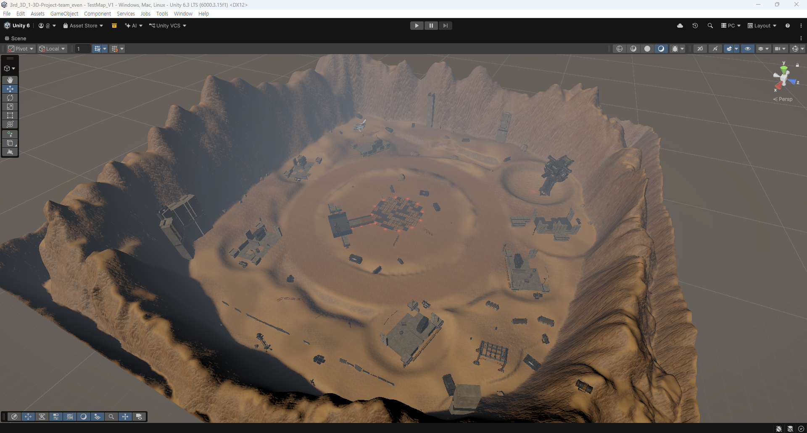 -->

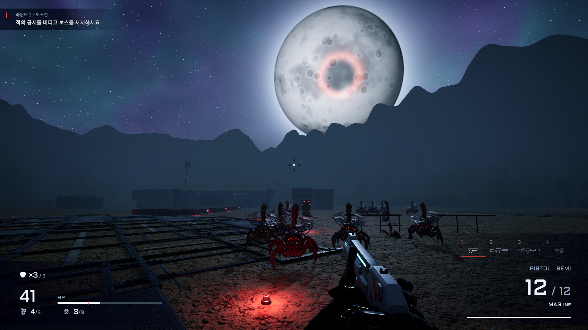
*새 인게임 맵을 플레이어 눈높이에서 본 화면 — 평지 위 전초기지 잔해와 몰려오는 몬스터입니다. 높은 곳에서 쏘는 이점을 주지 않으려고 계단 · 2층 구조 없이 평지에 엄폐물을 두었습니다(2-3).* <!-- ✏️ 11-25 v4 캡션 줄: alt를 옮기고 의도는 2-3 표 「맵」 줄에서 가져왔습니다 -->

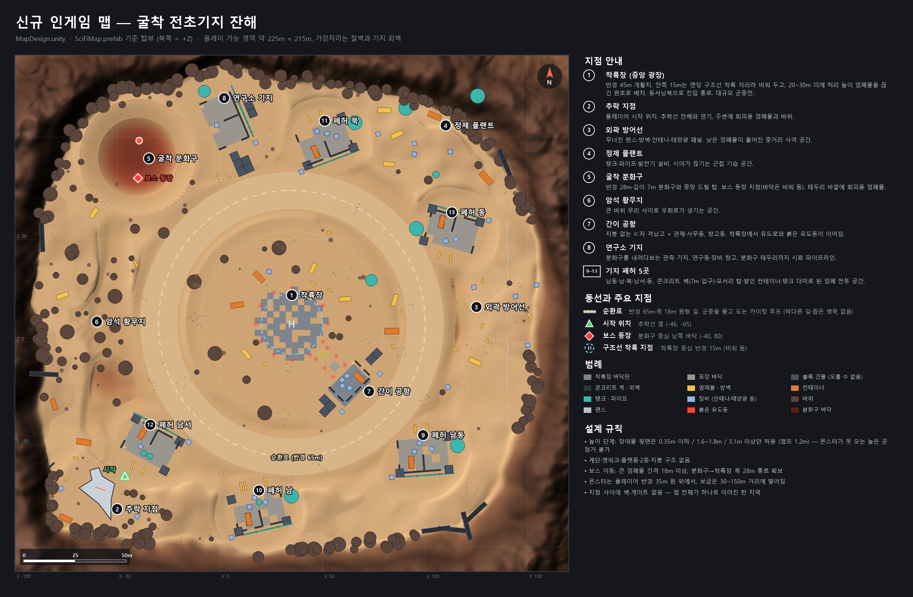
*새 인게임 맵 탑뷰 — 지점 13곳과 순환로, 시작 · 보스 등장 · 구조선 착륙 지점이 보입니다.*

---

## 8. 그 밖에 맡은 것 — 튜토리얼 · UI 통합
<!-- ✏️ 11-24 v3 목차 재배치: 옛 6장 「그 밖에 맡은 것 — 맵 · 튜토리얼 · 강화 · UI」에서 맵 · 강화를 기능 장(7 · 6장)으로 올리고 남은 두 절을 모았습니다. 첫 문단은 옛 6장 첫 문단과 옛 1-2 튜토리얼 줄에서 가져왔습니다 -->

보급 · 사운드 · 강화 · 맵 말고도 튜토리얼과 UI 통합을 맡았습니다(9-3). 튜토리얼은 이동 자유도가 높아 학습 집중도가 떨어지는 문제가 있어, 과목마다 지시한 행동만 하게 제한했습니다. 이 장은 두 가지를 표와 그림으로 짧게 봅니다. <!-- ✏️ -->

### 8-1. 튜토리얼 — 기획 세 번, 7과목과 행동 제한
<!-- ✏️ 절 제목은 아래 표와 목록에서 가져와 새로 붙였습니다(11-24 장 재구성) -->

튜토리얼도 AI와 함께 구현했습니다. 맵은 인게임 맵과 같은 빌더로 만든 약 60m × 200m 선형 협곡(10-30)이고, 기획은 세 번 바뀌었습니다(11-02).

| 기획안 | 내용 | 결과 |
|---|---|---|
| v1 | 강하 전 모함 격납고에서 출격 준비 | 폐기 |
| v2 | 출격 전 훈련장 — 이미 만든 튜토리얼 맵에 스토리를 맞춤 | 팀장 피드백으로 수정 |
| **v3** | 불시착한 행성에서 기본 전투 테스트 → 통과하면 전장 입장 (시놉시스와 연결). 흐름은 메인 메뉴 → 인트로 → 튜토리얼 → 게임 | 채택 |

구현한 것 (11-02 ~ 11-03):
- **7과목**: 이동·질주·구르기 → 사격·처치 보상 → 무기 교체 → 수류탄 → 보급 → 강화 체험 → 전초기지 게이트
- **오퍼레이터 음성 45줄**: 대사를 직접 TTS로 만들고, 녹음 한 파일을 대사별로 나눠 사운드 테이블에 연결 (처음 41줄, 11-03에 4줄 추가)
<!-- ✏️ 11-24 코드 대조로 고쳤습니다(옛: "6단계", "41줄"). 근거: TutorialDirector.cs 146~152행 MoveRoll → Aim → WeaponSwitch → Grenade → Supply → Upgrade → Exit(무기 교체는 c04bfecd 11-03) · 음성 01776b34(11-03) 41줄 → c04bfecd 4줄 추가, Tutorial_VoiceScript.tsv · SoundTable vo_tut 45행 -->
- **행동 제한**: 단계마다 지시한 행동만 할 수 있게 하고, 끝나거나 건너뛰면 풀어 줍니다 <!-- ✏️ 음슴체 "풀어 줌"을 고쳤습니다 -->

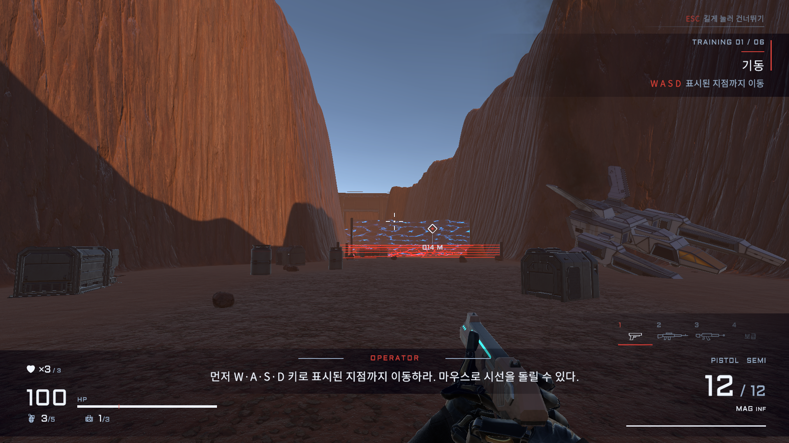
*튜토리얼 1단계 「기동」 — 오른쪽 위 목표 문구, 아래 오퍼레이터 자막, 목적지 표식과 거리, 붉은 차단막이 보입니다.*

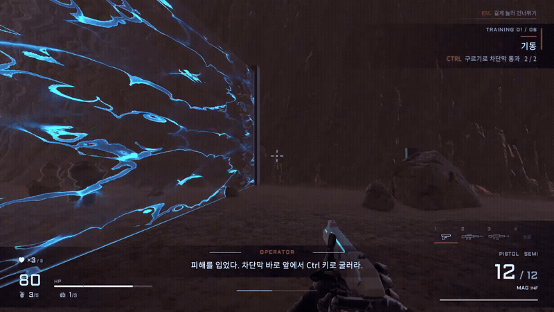
*튜토리얼 「기동」 과목(1배속) — 피해 차단막에 닿자 오퍼레이터가 "차단막 바로 앞에서 Ctrl 키로 굴러라"라고 안내하고, 구르기로 통과하면 「기동 과목 통과」 뒤 다음 과목 안내가 이어집니다. 과목마다 지시한 행동을 해야 다음으로 넘어가게 했습니다(행동 제한).* <!-- ✏️ 11-25 v4 GIF(GIF 촬영 목록 3절 4번, 원본 83.5~89초). 목록에는 "붉은 차단막이 열리는 장면"으로 적혀 있었지만, 이 구간은 구르기로 피해 차단막을 통과하는 장면이라 본 대로 썼습니다. 자막은 GIF 화면에서 읽었습니다. 피해 차단막으로 구르기를 확인하는 기획: 대화 기록 95ba74fc(2026-11-02T09:30Z) 「데미지 받는 차단막을 통해 구르기 확인 구현」 -->

### 8-2. UI 통합 — 메인 메뉴 스타일을 게임 전체로, 다른 사람 작업과 부딪히지 않게

개발하는 동안 각자 만든 UI는 색·글꼴·모양이 제각각이었습니다. 저는 먼저 메인 메뉴를 만들면서(10-28 ~ 10-30)
어두운 외계 행성의 밤 분위기에 맞춘 UI 틀("Moonlit Night" — 달빛 흰색·청회색·붉은 포인트, 상자 대신 선과 띠)을 잡았고,
마감 직전(11-03)에 이 틀을 기준으로 **게임 전체 UI를 하나로 통합**했습니다.

메인 메뉴를 기준으로 삼은 이유는, 메인 메뉴가 게임의 첫인상이기 때문입니다.
게임 안의 모든 화면을 같은 색·글꼴·모양으로 맞추면, 화면이 바뀌어도 플레이어의 몰입이 깨지지 않는다고 생각했습니다.

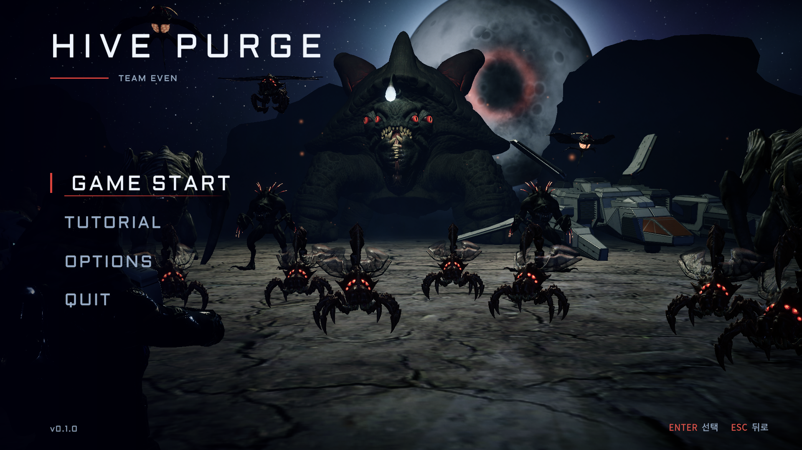
*메인 메뉴 — 보스와 몬스터 디오라마 배경 위에 글자 중심 메뉴, 선택 항목의 붉은 표식입니다. 게임의 첫인상인 이 화면을 게임 전체 UI의 기준으로 삼았습니다.* <!-- ✏️ 11-25 v4 캡션 줄: alt를 옮기고 의도는 위 문단에서 가져왔습니다 -->

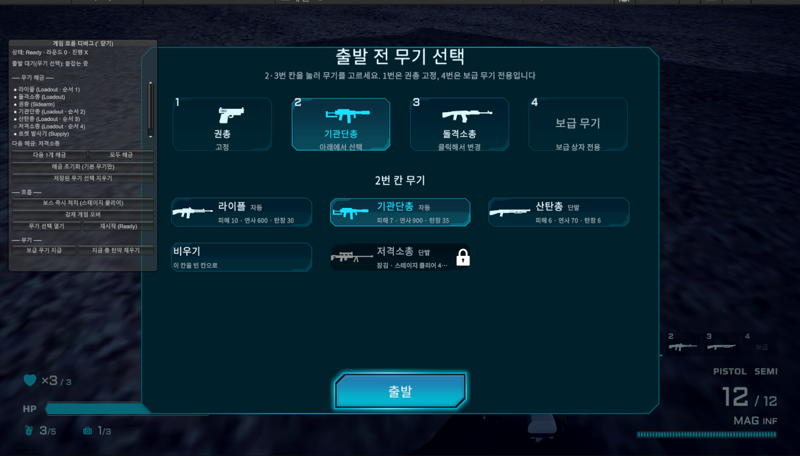
*UI 통합 전 「출발 전 무기 선택」 화면입니다(왼쪽은 개발용 디버그 창).*

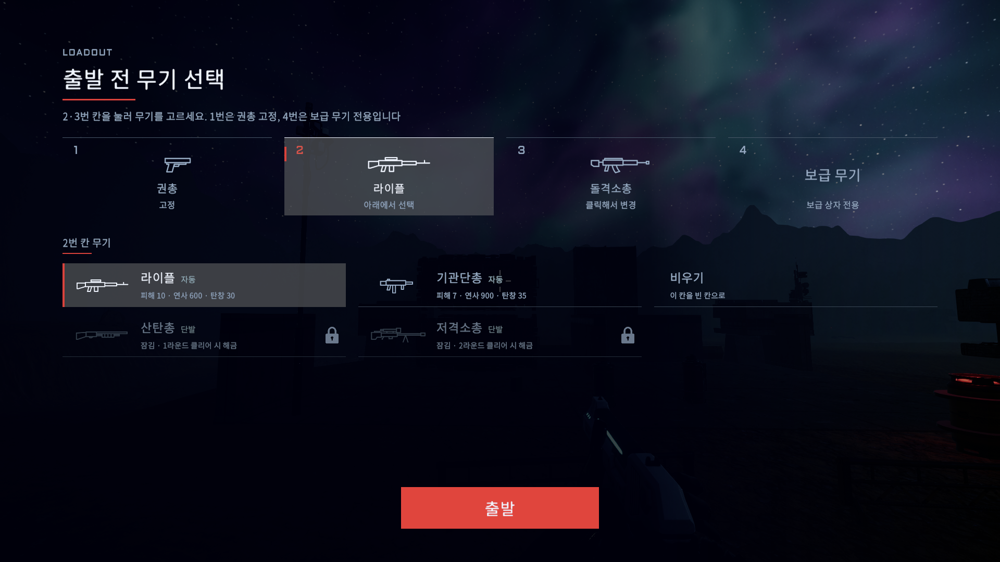
*UI 통합 후 같은 화면 — 메인 메뉴의 선 · 띠 스타일과 붉은 포인트로 맞췄습니다.*

> 이 작업의 커밋 작성자는 팀장 계정으로 남아 있습니다. 팀장님의 강의실 컴퓨터에 있는 Claude로 작업했기 때문입니다. <!-- ✏️ 11-25 v4: 커밋 작성자 이름을 뺐습니다(통합본 1-3-3). 옛: "팀장 이찬영 님(`chan`)" --> <!-- ✏️ "제 Claude 사용량을 거의 다 써서"를 지웠습니다. 사정을 들어 이해를 구하는 말이라서입니다(통합본 1-1). 커밋 작성자가 다른 이유만 남겼습니다 -->

**가장 신경 쓴 것 — 다른 사람이 작업 중인 파일과 부딪히지 않기**

마감 직전이라 팀원 모두가 UI 파일을 동시에 고치고 있었습니다. 그래서 작업 전에 파일마다 누가 어떤 브랜치에서 고치고 있는지 위험 지도를 먼저 만들고, 원칙을 정했습니다.

| 원칙 | 이유 |
|---|---|
| 색·글꼴·크기는 새 파일(`UiTheme`, 공통 부품 `UiThemeKit`)에 모은다 | 새 파일은 누구와도 충돌하지 않습니다 |
| 기존 파일은 그리는 코드만 바꾼다. 동작 로직·public 이름·`[SerializeField]` 이름은 그대로 | 다른 사람의 기능과 프리팹·씬 참조가 깨지지 않습니다 |
| 씬·프리팹은 손으로 고치지 않고, 빌더 코드만 고친 뒤 담당자와 시간을 맞춰 재생성 | 씬 파일은 합치기(merge)가 거의 불가능합니다 |
| 공용 파일(`GameEvents.cs`, 데이터 테이블)은 건드리지 않는다 | 모든 파트가 쓰는 곳이라 충돌하면 피해가 큽니다 |
<!-- ✏️ 11-25 v4 Pass 1: 「이유」 칸의 음슴체를 습니다체로 바꿨습니다. 「원칙」 칸은 규칙 문장이라 그대로 둡니다 -->

작업은 작은 단위 9개로 나눴습니다(테마·아이콘 → 전투 HUD → 알림·카드 → 보상·강화·게임 오버 → 무기 선택·라운드 목표 → 옵션 → 보스·부활 → 인트로·엔딩 → 정리).
진행 중인 다른 브랜치와 미리 시험 병합해 보며, 이 단위들을 하나의 PR(#112)로 충돌 없이 하루 안에 develop에 합쳤고, <!-- ✏️ 11-24 코드 대조(옛: "작은 PR 9개로 나눴습니다"): 9개는 UiRedesign_Plan.md §3의 작업 단위(PR1~9), GitHub PR은 #112 하나(feat/UiRedesign, 커밋 26개 11-03 10:36~12:47, 머지 0aa1984b) -->
이후 develop 머지 과정에서 엔딩 화면의 스타일이 되돌아간 것은 제가 다시 적용했습니다(`37cf13c6`).

---

## 9. 팀 협업
<!-- ✏️ 11-24 v3 목차 재배치: 옛 3장(3-1 ~ 3-4)을 기능 장 뒤로 내렸습니다. 옛 3-5는 3-3 약속으로 올렸습니다 -->

### 9-1. 팀 구성과 역할

| 역할 | 담당 |
|---|---|
| 저 | 보급(공중 투하·획득 알림)·재화 획득, 라운드 종료 강화 상점, 몬스터 사운드, 맵(전장·엄폐물·고지대), 튜토리얼, 메인 메뉴·UI 통합 |
| 팀장 | 1스테이지 보스(패턴·등장·처치 연출·지형 파괴), 라운드 진행(웨이브·보스전 시작·재시작), 1차 사전 통합·테스트 |
| 몬스터 담당 팀원 | 일반 몬스터(근접·돌진 무리·공중·침투·독안개, 공통 상태 전환), 몬스터 스폰·이동, 피격 반응(경직·약점·처치 연출), 섬멸전 라운드 기믹 |
| 플레이어 담당 팀원 | 코어 첫 구조(데이터·이벤트·서비스), 플레이어(이동·시점·피격·부활), 무기(라이플·수류탄·투사체·무기 해금)와 강화 효과 적용, 인트로·엔딩, 조명·쉐이더, 2스테이지 보스(티라노포드) |
<!-- ✏️ 11-25 v4: 팀원 이름을 역할로 바꿨습니다(건우 님 결정). 옛 「이름」 칸: 윤건우 (나) · 이찬영 (팀장) · 홍산 · 김민성 -->

*(출처: Asana 팀 보드 「Team Even」의 담당자별 완료 업무, 코어와 보스는 팀 레포 커밋 기록)*
<!-- ✏️ 11-24 코드 대조로 고쳤습니다. 옛 표는 팀장 칸에 "코어(데이터·이벤트·서비스)", 김민성 칸에 "2스테이지 보스 쓸기 패턴"이었습니다.
     근거: Core 전체(EventBus · ServiceLocator · TsvTableReader · 02-SystemInterfaces.md)가 커밋 63f95cc9(10-19, 플레이어 담당 팀원)로 생김. 이후 Core 커밋은 네 명 모두 있음.
     Boss/Tyranopode 전체 파일 생성 = 플레이어 담당 팀원(커밋 15), Clypeosaurus · BossController = 팀장 (develop db706ef5) -->

### 9-2. 팀이 일한 방식

- 파트 사이 약속(3-3의 "파트끼리 서로 모른다" 규칙, 이벤트·서비스·데이터 형식)은 **강의 내용과 Opus로 먼저 정한 팀 공통 규칙**을 따랐습니다.
- 팀 차원에서 따로 정한 AI 사용 규칙은 없었습니다. 팀장이 만든 기준 문서 「이벤트 버스와 외부 데이터 적용 기준」이 사실상 가장 큰 규칙이었고, 저는 각자의 AI가 이 약속을 지키도록 이 문서를 작업마다 붙였습니다.

### 9-3. 제가 맡은 것

**주로 맡은 것**

1. **보급 시스템** — 공중 투하, 낙하 지점 찾기, 상황에 따라 바뀌는 보급 확률, 근접 획득
2. **사운드 시스템** — 이벤트 → 소리 연결(GameSoundRouter), 객체별 이미터, BGM, AudioMixer

**그 밖에 맡은 것**

- 라운드 종료 강화 상점 (등급 카드 3장 + 리롤, 강화 8종)
- 인게임 맵(Sci-Fi Base 기반)·튜토리얼 맵
- 맵 작업용 에디터 도구 — `Build Sci-Fi Map`(자동 배치), `Save Sci-Fi Map Edits`(손으로 고친 배치를 기록해 다시 생성해도 유지), `Capture Map Review Shots`(여러 시점 확인 화면) (7장)
- 메인 메뉴(디오라마 배경·호버 연출·옵션 팝업), 튜토리얼 7과목 <!-- ✏️ 11-24 코드 대조: 6단계 → 7과목(무기 교체 포함, TutorialDirector.cs 146~152행) -->
- 게임 전체 UI 통합 (메인 메뉴 스타일 기준, `UiTheme`)

### 9-4. 협업 — 내 담당 범위와 다른 파트 코드

4명이 동시에 작업해서, **어디까지 내가 고칠지**를 매번 정해야 했습니다.

| 상황 | 내 결정 |
|---|---|
| 팀 피드백에 라운드 포맷 변경(섬멸전 등)이 섞여 왔습니다 | 「라운드 포맷은 담당자가 있어서, 나는 업그레이드 시스템만 담당」 → 요청 사항만 문서에 남겼습니다 |
| 강화(스태미나·최대 체력)가 플레이어 코드를 건드립니다 | 「스테미나와 최대체력은 플레이어 담당에게 큰 문제를 일으키나?」 먼저 확인 → 「직접 고치고 PR에서 담당자 리뷰 요청」 |
| 근접 획득이 `PlayerInteractor`(플레이어 담당)를 바꿉니다 | 바꾼 내용을 정리해 디스코드로 공유했습니다 |
| 보급 정보 UI | 처음에는 「ui 구현은 플레이어 담당이 구현 예정」으로 보급은 정보만 주려 했지만, UI까지 직접 만들었습니다 |
| 커밋 직전 | 「다른 팀원들에게 영향이 안갈 경우에 커밋」 — 영향이 있으면 버렸습니다(discard) |
<!-- ✏️ 11-25 v4 Pass 1: 표 칸의 음슴체("옴", "남김", "건드림", "바꿈", "공유", "만듦", "버림")를 습니다체로 바꿨습니다. 인용은 그대로입니다 -->

> **결정 대상** 다른 파트 코드를 고쳐야 할 때 담당자에게 맡길지, 직접 고칠지, 내 쪽에서 돌아갈지. <!-- ✏️ -->

<!-- ✏️ 표를 결정 표 양식으로 바꿨습니다(11-24 장 재구성). 칸 내용은 원래 표 그대로이고 문장 끝만 습니다체로 바꿨습니다 -->
| | [A] 담당자에게 요청하고 기다림 | **[B] 작게 직접 고치고 PR에서 담당자 리뷰 ✓** | [C] 내 쪽에서 우회 |
|---|---|---|---|
| 장점 | 소유권이 분명합니다 | 기다리지 않고, 담당자가 확인합니다 | 남의 코드를 건드리지 않습니다 |
| 단점 | 약 3주 일정에서 내 작업이 멈춥니다 | 리뷰 부담을 담당자에게 줍니다 | 같은 기능이 두 곳에 생깁니다 |
| 정한 사람 | 기준 · 고름: 저(위 표의 인용) · 세 안: 문서를 정리하며 나눈 것입니다 | | |
<!-- ✏️ 11-25 v4 「정한 사람」 행. 세 안을 그때 비교했는지, 문서를 정리하며 비교했는지 기록을 찾지 못했습니다 → 11-26 건우 님 답: 정리하며 나눴습니다 -->

**[B]를 골랐습니다.** 약 3주 일정에서 기다리지 않으면서, 바뀐 내용은 담당자가 PR에서 확인할 수 있기 때문입니다. <!-- ✏️ -->

강화 시스템은 라운드가 끝난 뒤에 따라오는 시스템이어서 담당자 리뷰에서 고쳐 달라는 피드백은 없었습니다.
보급 정보 UI를 직접 만든 것은, AI로 작업하고 있었기 때문에 제가 기획하고 직접 구현해 원하는 방향으로 만드는 편이 더 빠르다고 판단했기 때문입니다.

---

## 10. AI 협업
<!-- ✏️ 11-25 통합본 v4 1-8: 옛 10-1 한 절(36줄)을 네 칸(일을 시키는 구조 · 실제 지시문 · AI가 틀린 곳 · 다른 장 가리키기)으로 다시 묶었습니다. 옛 표 세 개는 각 절 아래 숨김 주석에 남겼습니다 -->

### 10-1. 장마다 AI가 한 것과 제가 한 것
<!-- ✏️ 11-26 통합본 v4.1 1-10: 장 전체를 모은 표를 장 맨 앞 절로 옮겼습니다(옛 10-4 「다른 장 가리키기 — AI 몫과 제 몫」). 옛 10-1~10-3은 10-2~10-4가 되었습니다 -->

문서 곳곳의 AI 몫과 제 몫을 장마다 모았습니다. 일을 시킨 구조는 10-2, 실제 지시문은 10-3, AI가 틀린 곳은 10-4에 있습니다. <!-- ✏️ -->

| 장 | AI가 한 것 | 제가 한 것 |
|---|---|---|
| 2-3 · 7장 맵 | 맵 빌더 도구와 배치 생성 | 원칙("높은 곳에서 쏘는 이점은 주지 않는다"), 생성 결과 확인, 디테일 수작업, 고친 것을 빌더 규칙으로 |
| 3-3 약속 | 기준 문서의 규칙대로 설계 · 구현 | 기준 문서를 작업마다 붙이기 |
| 4-3 낙하 지점 | [B] 권장 · [C] 비교, 다섯 검사 구현 | [A] 제시, 고르는 기준(최적화), 새 맵에서 보급이 안 떨어지는 것 발견(4-6) |
| 4-4 보급 확률 | 배율 숫자 · ConfigTable 구조(초기값), 구현 | 상황에 따라 바뀌는 확률 제안, 둘 다 가득일 때 「그대로 허용」, 투하 확률 로그로 확인 |
| 4-5 보급 줍기 | 구현 | 조준 → 근접 획득 제안, 획득 반경 2m · 정보 카드 30m · 투하 60m, 사격 중에는 정보 UI를 보이지 않기 |
| 5장 사운드 | 세 갈래 소리 구조(설계 문서), 소리 수 제한 추천, 구현 | 방식 고르기(5-1), 몬스터 피격 소리를 만들지 않기(5-2), 플레이어 이미터를 붙이는 방식 고르기(5-6), 추천안 고르기(5-7), 티라노포드 사운드 25종 · BGM 선곡 |
| 6장 강화 | 구현 | 상점 조건 네 가지(재화 약 300 · 리롤 5 · 3스테이지 · 무작위 3장) |
| 8-1 튜토리얼 | 구현 | 기획 v3(팀장 피드백 반영), 오퍼레이터 음성 45줄을 TTS로 제작 |
| 8-2 UI 통합 | 구현(PR #112) | 메인 메뉴 스타일을 기준으로 정하기, 머지 뒤 되돌아간 엔딩 스타일 다시 적용 |
| 9-4 다른 파트 코드 | — | 고칠지 말지 담당자에게 먼저 확인, 고치면 PR 리뷰 · 디스코드로 공유 |
| 11-2 문제 해결 | 원인 찾기 · 수정 | 발견 · 확인 |
<!-- ✏️ 11-25 v4 가리키기 표(11-26부터 10-1): 칸마다 그 절의 문장에서 가져왔습니다(결정 표 「정한 사람」 행과 같은 말). 8-2의 위험 지도 · 설계 문서를 누가 썼는지는 커밋(팀장 계정)으로 가릴 수 없어 「AI가 한 것」에 넣지 않았습니다.
     옛 「AI에게 건 약속과 확인 방법」 표 4행: AI가 정한 확률 배율(가득이면 ×0.25 등)을 그대로 두지 않고 투하 확률 로그로 확인 | 숫자가 의도대로 동작하는지는 플레이 중 결과로만 알 수 있음 | 수류탄이 0개일 때 수류탄 상자가 자주 나오는 것을 확인(4-4) — 4-4 줄로 옮겼습니다
     옛 「AI에게 맡기지 않은 것」 표: 게임의 원칙 | "높은 곳에서 쏘는 이점은 주지 않는다"(2-3) — AI가 만든 계단·2층 구조를 이 원칙으로 고침(7장) / 플레이로 정한 숫자 | 획득 반경 2m · 정보 카드 30m · 투하 60m(4-5), 강화 상점 조건 네 가지(6장) / 만들지 않을 것 | 몬스터 피격(Hurt) 소리(5-2), 사격 중 보급 정보 UI(4-5) / 다른 파트 코드를 고칠지 말지 | 담당자에게 먼저 확인하고, 고치면 PR 리뷰·디스코드로 공유(9-4) / 소리 고르기 | 티라노포드 사운드 25종·BGM 선곡을 에셋에서 직접 고름(11-1) — 모두 위 표 「제가 한 것」 칸으로 옮겼습니다 -->

### 10-2. AI에게 일을 시키는 구조

팀원 모두 AI(주로 Claude Opus)와 함께 각자 맡은 파트를 설계·구현했습니다. 다른 팀원들은 프로그래밍 전공자였고, 비전공자인 저는 코드를 처음부터 직접 짜는 대신 **무엇을 만들지 정하고, AI의 설계안 중에서 고르고, 직접 플레이해 문제를 찾는 역할**에 집중했습니다.
그 덕분에 보급·사운드 외에도 맵·튜토리얼·강화·UI 통합까지 맡을 수 있었습니다. 누가 무엇을 했는지는 1-3 표와 같습니다. <!-- ✏️ 11-25 v4: "비전공자인 저는 **AI를 가장 적극적으로 활용한 팀원**이었습니다"에서 확인할 수 없는 비교("가장 적극적으로")를 뺐습니다(건우 님 결정). 역할 표는 1-3과 같아 아래 숨김 주석으로 옮겼습니다 -->
<!-- 옛 10-1 역할 표: | 나 | 무엇을 만들지(요구사항)와 수치 정하기 · 설계안의 질문에 답하며 선택 · 직접 플레이하고 문제 찾기 · 팀 공유(피드백 문서·PR·디스코드) | / | 나 (직접 작업) | 맵 배치·콜라이더, 사운드·BGM 선정, 튜토리얼 음성(TTS) 제작, 에디터에서 값 조정 | / | Claude Code | 설계안과 그 설계에서 빠진 부분 정리, 코드 구현, 커밋·PR 문서 | -->

#### 고정 순서

작업마다 같은 순서로 진행했습니다. <!-- ✏️ 11-26 v4.1: 굵은 소제목을 4단계 제목으로 바꿨습니다(이 절의 네 소제목 모두) -->

| 순서 | 누가 | 하는 일 | 남는 것 |
|---|---|---|---|
| ① 설계 | AI | 「이벤트 버스와 외부 데이터 적용 기준」 v0.1을 붙여, 그 규칙대로 설계안을 씁니다 | 설계 문서(`Docs/Design/`) |
| ② 빠진 부분 정리 | AI | 설계안 끝에 「보완할 부분」과 「확인 받을 항목」(질문마다 선택지와 권장안)을 붙입니다 | 설계 문서의 질문 표 |
| ③ 내 확인 | 저 | 질문마다 답합니다 — 권장안을 고르거나, 제 안을 내거나, 범위를 줄입니다(10-3) | 대화 기록 |
| ④ 구현 | AI | 코드 · 커밋 · PR 문서를 씁니다 | 커밋 |
| ⑤ 플레이 확인 | 저 | 직접 플레이하고, 로그로 숫자를 확인합니다(4-4 · 4-6 · 5-6) | 플레이 테스트 피드백 문서 |
<!-- ✏️ 11-25 v4 고정 순서 표. ①~④는 옛 10-1 「설계 → 빠진 부분 정리 → 내 확인 → 구현」, ⑤는 5-6 "AI 구현 뒤 플레이 테스트는 항상 하는 루틴"에서 가져왔습니다.
     근거(팀 레포 develop db706ef5 · 이 PC 대화 기록, 11-25 대조 ✅): Supply_2ndFeedback_Proposal.md §5 「확인 받을 항목」 Q1~Q5 (권장) · §6 "Q1~Q5 권장안" · SupplyUpgradeRework_Proposal.md Q2 · UpgradeSystemExpansion_Proposal.md §9 「보완 질문 (2026-11-02 확정)」 · 대화 기록 7d9580ff 11-03 BGM 설계안 §5 「보완할 부분」 · Docs/Playtest/PlaytestFeedback_2026-11-01.md -->

#### 규칙으로 막은 것

AI가 다른 사람의 작업물을 건드리지 않게 건 규칙입니다. <!-- ✏️ -->

| 규칙 | 막는 것 | 결과 |
|---|---|---|
| 작업마다 기준 문서 「이벤트 버스와 외부 데이터 적용 기준」 v0.1을 붙여 그 규칙대로 설계하게 했습니다 | 각자의 AI가 다른 파트 코드를 직접 부르는 것(3-3) | 보급은 다른 파트 코드를 참조하지 않고, 사운드는 다른 파트 코드의 동작을 고치지 않고 이벤트로 소리를 붙였습니다(3-3 · 5-5) |
| 소리는 코드가 아니라 사운드 표 · 몬스터 표의 키로 붙이게 했습니다 | AI가 소리를 붙이다 몬스터 담당 코드를 바꾸는 것(5-5) | 나중에 추가된 자폭형 · 중량형 몬스터와 정예 변종은 몬스터 표의 사운드 키 열만 채워 소리를 붙였습니다(5-5) |
| 「다른 팀원들에게 영향이 안갈 경우에 커밋」 | 다른 파트에 영향이 있는 변경이 그대로 올라가는 것(9-4) | 영향이 있으면 커밋하지 않고 버렸습니다 |
| UI 통합 때 공용 파일은 건드리지 않고, 씬 · 프리팹은 손으로 고치지 않고 빌더 코드만 고치게 했습니다 | 마감 직전 여러 사람이 같은 파일을 고칠 때의 충돌(8-2) | 다른 브랜치와 시험 병합 뒤 충돌 없이 develop에 합쳤습니다(아래 UI 통합) |
<!-- ✏️ 11-25 v4: 옛 「AI에게 건 약속과 확인 방법」 표의 1 · 2행에 9-4 · 5-5의 규칙을 더했습니다. 옛 3 · 4행(탈락 사유 로그 · 확률 로그)은 10-3 · 10-4로 옮겼습니다. 커밋 규칙 원문: 대화 기록 666bde03(2026-10-31T18:20Z) 「나머지 커밋되지 않은 파일들은 커밋했을시 다른 팀원들에게 영향이 안갈 경우에 커밋 내용 정리해서 푸시해줘」 -->

#### AI에게 만들게 한 도구 — 맵 빌더(7-2)

손으로 배치하던 맵을, AI에게 만들게 한 에디터 도구로 다시 만들었습니다. 도구는 Unity 메뉴 `Tools/Map` 아래에 있습니다(9-3). <!-- ✏️ -->

| 메뉴 | 하는 일 |
|---|---|
| `Build Sci-Fi Map` | 지형에 분화구 · 순환로를 파고, 지점마다 소품 · 엄폐물을 배치하고, NavMesh를 굽습니다 |
| `Capture Map Review Shots` | 생성한 맵을 여러 시점에서 찍어 확인 화면을 만듭니다 |
| `Save Sci-Fi Map Edits` | 손으로 고친 배치를 기록해, 다시 생성해도 남게 합니다 |

이 도구로 7-2의 다섯 단계(설계 → 생성 → 확인 · 수정 → 수작업 → 규칙으로)를 돌렸습니다. AI가 생성하고, 제가 확인 화면으로 보고 손으로 고치고, 고친 것을 다시 빌더 규칙으로 넣는 순환입니다. <!-- ✏️ 근거: 7-2 표 · 9-3 · 3-2 맵 빌더 줄 · 팀 레포 Docs/Design/MapDesign_SciFiBase.md §6-1 · 6-2 (Tools/Map/Build Sci-Fi Map · Capture Map Review Shots) -->
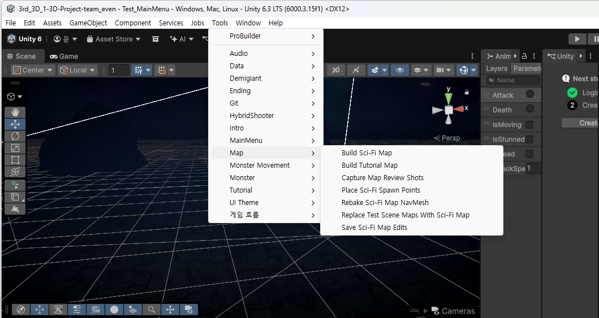
*Unity `Tools/Map` 메뉴입니다. 위 표의 세 명령 말고도 튜토리얼 맵 생성 · 스폰 지점 배치 · NavMesh 다시 굽기 · 테스트 씬 맵 교체 명령이 있습니다.* <!-- ✏️ 11-26 건우 님이 캡처한 화면(팀 레포, Unity 6.3). 옛 자리 주석: 📷 에디터 화면 자리: 맵 빌더 메뉴와 실행 결과 — GIF 촬영 목록 3절 6번 `map-builder-menu.png` -->

#### 큰 작업을 쪼개 맡긴 예 — UI 통합(8-2)

발표 전날(11-03) 게임 전체 UI를 메인 메뉴 스타일로 바꿀 때, 먼저 충돌 위험 지도(파일마다 누가 어느 브랜치에서 고치고 있나)와 원칙 네 가지, 작업 단위 9개를 설계 문서로 정했습니다.
진행 중인 다른 브랜치와 시험 병합해 충돌이 없는 것을 확인한 뒤, 9개 단위를 PR 하나(#112)로 합쳤습니다. 커밋 25개가 11-03 10:36 ~ 12:46에 올라갔고, 12:47에 develop에 합쳐졌습니다. <!-- ✏️ 근거(팀 레포, 11-25 대조 ✅): Docs/Design/UiRedesign_Plan.md §1 충돌 위험 지도 · §2 설계 원칙 · §3 작업 단위(PR 순서 1~9) · 77행 시험 병합(merge-tree) 충돌 0. 첫 커밋 8db435a6 "Chore: UiRedesign plan"(11-03 10:36:52), 마지막 커밋 12:46:50, 머지 0aa1984b(12:47:35). 병합 커밋을 뺀 커밋 수 25 -->

### 10-3. 실제 지시문

설계안의 질문 표에 제가 답한 말 두 개입니다. 원문 그대로이고, 줄바꿈만 「 / 」로 바꿨습니다. <!-- ✏️ -->

#### ① 보급 개편 설계안에 답한 말

10-31에 답한 말입니다(4-3). <!-- ✏️ 11-26 v4.1: 굵은 소결정을 4단계 제목으로, 날짜 괄호는 본문 첫 줄로 -->

> 「Q2: Probs 를 Obstacle 로 지정해서 obstacle 이 아닌 곳에서만 허용 되게 변경 하는 안 고려 / 권장 방식이 더 최적화에 좋다면 권장방식으로 진행 / Q3: 권장안 방안 진행 / … / Q9: 보급 무기는 설계만 하고 구현은 보류」

- 제 안(소품을 Obstacle 레이어로 지정)을 함께 내고, 고르는 기준(최적화)을 주고, 권장안이 그 기준에 맞으면 권장안으로 가게 했습니다. AI는 두 안의 비용이 같고 권장안은 레이어를 빠뜨린 소품 위에도 떨어지지 않는다고 답했고, 그래서 권장안 [B]가 되었습니다(4-3 결정 표).
- Q9처럼 범위를 줄이는 답도 이 자리에서 했습니다. 보급 무기는 이때 설계만 하고, 11-01 2차 피드백 설계에서 로켓 · 유탄 2종으로 넣었습니다(4-4).
<!-- ✏️ 근거: 대화 기록 666bde03(2026-10-31T15:28:22Z, Q1~Q9 답 — 가운데 Q4~Q8은 「…」로 줄였습니다) · 팀 레포 Docs/Design/SupplyUpgradeRework_Proposal.md Q2(권장안 — 비용은 같고 허용 목록 방식이 더 안전) · Supply_2ndFeedback_Proposal.md Q3 「(권장) 로켓·유탄 2종 먼저 (S6-a)」 · §6 Q1~Q5 권장안(2026-11-01). 날짜는 4-3 인용과 같이 (10-31)로 둡니다(대화 기록 시각은 11-01 00:28, 건우 님 결정) -->

#### ② BGM 곡 키 위치를 고르기 전에 물은 말

11-03에 물은 말입니다(5-7). <!-- ✏️ -->

> 「1.inspector 배열에 두는 장단점 이랑 라운드 곡 키를 roundtable 두는 장단점 설명, 추천하는 방법 이유 설명」

- 고르기 전에 두 안의 장단점과 추천, 그 이유를 함께 달라고 했습니다. AI는 장단점 표와 함께 RoundTable을 추천했고("라운드 수·순서와 곡이 어긋나는 문제가 구조적으로 생기지 않습니다"), 저는 「RoundTable (추천)」으로 답해 골랐습니다(5-7 결정 표).
<!-- ✏️ 근거: 대화 기록 7d9580ff — 2026-11-03T10:01Z AI 설계안 「확인 부탁드릴 것」 · 10:14Z 위 인용(원문 첫 줄) · 10:15Z AI 답 「추천은 RoundTable입니다」 · 10:20Z 건우 님 답 「RoundTable (추천)」 -->

### 10-4. AI가 틀린 곳과 막은 방법

아래 표의 앞 네 줄은 제가 확인 화면이나 플레이로 찾았고, 고친 코드는 AI가 썼습니다(1-3). 마지막 줄은 문서를 정리하며 코드와 대조해 찾은 것입니다. 같은 실수가 다시 나지 않게 바꾼 규칙을 함께 적습니다. <!-- ✏️ -->

| AI가 만든 것 | 틀린 곳 | 찾은 방법 | 바꾼 규칙 | 절 |
|---|---|---|---|---|
| 맵 빌더의 배치 | 요청하지 않은 계단을 만들고, 건물과 어울리지 않는 오브젝트를 놓았습니다 | 생성된 배치를 여러 시점에서 확인 | 계단 · 사다리 · 발판이 달린 프리팹은 배치하지 않고, 장애물 윗면 높이는 정해진 단계만 씁니다 | 7-2 |
| 맵 빌더의 크기 맞추기 | 납작한 태양광 패널이 4배로 커졌습니다 | 생성된 배치를 확인 | 크기 배율이 0.8~1.3배를 넘으면 크기를 바꾸지 않습니다 | 7-2 ⑤ |
| 보급 낙하 높이 검사 | 새 맵(지형 원점 y = −20)에서 거의 모든 지점이 탈락해 보급이 하나도 떨어지지 않았습니다 | 플레이 테스트(새 맵 씬에서만) | 높이 기준을 플레이어 발 + 5m로 바꾸고, 실패하면 탈락 사유별 횟수를 경고로 남깁니다 | 4-6 |
| 사운드 연결 | 플레이어 프리팹에 소리 이미터가 붙어 있지 않아 플레이어 소리가 나지 않았습니다 | 플레이 테스트 | 몬스터처럼 라우터가 실행 중에 이미터를 붙입니다 | 5-6 |
| 파트 사이 연결 | 사운드 코드가 팀 규칙(코어만 거치기)과 달리 보스 · 플레이어 클래스를 직접 참조합니다 | 문서를 정리하며 코드 대조(11-24) | 그때는 막지 못했습니다 — 규칙을 컴파일러가 막아 주지 않았습니다 | 3-3 |
<!-- ✏️ 11-25 v4 10-3: 문서에 이미 적힌 사실만 모았습니다(7-2 본문 · 7-2 표 ⑤ · 4-6 · 5-6 · 3-3). 탈락 사유 로그는 옛 「AI에게 건 약속」 표 3행에서 옮겼습니다 -->

반대로, AI가 틀렸다고 먼저 의심했지만 원인이 AI가 아니었던 일도 있습니다. 첫 라운드부터 무기가 모두 열려 있어 AI가 제 범위 밖을 바꿨다고 생각했지만, 원인은 저장된 플레이 기록이었습니다(11-2 ②). 그 뒤로는 원인을 단정하기 전에 문제가 일어난 상황부터 확인합니다. <!-- ✏️ 11-2 ② 「발견」 · 「원인」 · 「해결」 줄에서 가져왔습니다 -->
---

## 11. 결과와 개선 계획
<!-- ✏️ 장 제목 "결과 및 배운 점"을 바꿨습니다(11-24 장 재구성). 지금 11-3 개선 계획이 이 장의 중심이라서입니다 -->

### 11-1. 결과

| 영역 | 개선 전 | 개선 후 / 결과 |
|---|---|---|
| **보급 낙하** | 새 맵에서 드랍 누락 또는 지형·건물·맵 밖 낙하로 10개 중 2~3개 미획득 | 2차 개선 및 경로 검사 적용 후 줍지 못하는 보급 미발생 |
| **보급 확률** | 정해진 확률로 무작위 투하 → 필요한 순간에 필요한 보급을 받지 못했습니다 | 상황 배율 및 투하 확률 로그 도입으로 수류탄 0개 시 수류탄 상자 수급 확인 |
| **사운드** | 파트별 코드 충돌 우려 및 플레이어 사운드 미출력 이슈 | 티라노포드 사운드 25종을 에셋에서 직접 골라 연결 · 튜토리얼 음성 45줄·BGM 9곡(그중 1곡 예비) 연결, 자폭형·중량형·정예 변종 등 후속 몬스터는 테이블 키만으로 사운드 적용 <!-- ✏️ 11-24 코드 대조(옛: "음성 41줄 · BGM 9곡 · 돌진형 · 파르다트록스 등"): 5-3 · 6-2 주석과 같음. BGM 486e6cde "BGM 9곡 추가", 07_TheGreatWall은 SoundTable 키 없음 --> |
| **라운드 종료 강화** | 초기 3종·라운드당 1회 구매로 클리어 보상 체감 부족 | 8종·하급/일반/에픽 3등급 카드(3장 + 리롤)로 개편해 성장 체감 강화 |
| **맵** | 1차 빌드 테스트(10-28)에서 맵이 넓어 이동·회피 부담 지적 | 맵 면적 1/4 축소(BL-059) 및 엄폐물·지형 규칙 적용으로 전투 집중도 향상 |
| **튜토리얼** | 자유 이동으로 학습 흐름 분산 | 7과목 구성 및 과목별 행동 제한으로 목표 집중도 개선 |
<!-- ✏️ 11-24 v3 목차 재배치: 줄 순서를 1-2 표(보급 · 사운드 · 강화 · 맵)에 맞췄습니다. 튜토리얼은 8장이라 마지막에 둡니다 -->

### 11-2. 문제 해결
<!-- ✏️ 11-24 v3 목차 재배치: 옛 8-2 「그 밖의 문제 해결」. 맨 위 요약 표를 새로 만들고, 여러 파트에 걸친 두 건은 통합본 v3 1-5 양식(역할 · 발견 · 원인 · 해결 · 결과)으로 정리했습니다. 「역할」 줄은 통합본 v3 「책임 분리」(발견과 수정을 나눠 씀)를 따릅니다 -->

문서 전체에서 다룬 버그입니다. 원인이 한 기능 안에 있는 것은 그 장에 두었고, 여러 파트에 걸친 것만 아래에 씁니다. <!-- ✏️ -->

| 증상 | 다룬 절 | 발견 | 원인 · 수정 | 확인 |
|---|---|---|---|---|
| 새 맵에서 보급이 하나도 떨어지지 않음 | 4-6 | 저 (플레이 테스트, 새 맵 씬에서만) | AI (Claude Code) | 저 (같은 씬에서 다시 플레이) |
| 플레이어 소리가 나지 않음 | 5-6 | 저 (플레이 테스트) | AI — 고치는 방식은 제가 골랐습니다 | 저 (직접 플레이) |
| GAME START가 인트로 · 튜토리얼을 건너뜀 | 11-2 ① | 저 (처음부터 확인하는 도구로) | AI (Claude Code) | 저 (최종 빌드 전 순서 확인) |
| 첫 라운드부터 무기가 모두 열림 | 11-2 ② | 저 (플레이 테스트) | 버그가 아니라 저장된 해금 기록 — 이후 플레이어 쪽 코드가 저장하지 않게 바뀜(팀원) | — |
<!-- ✏️ 요약 표 근거(팀 레포 develop db706ef5): 4-6 b0c5a684(11-01) · 5-4 b5c192ce(11-02) · ① 36900ce4(11-03) · ② 해금 저장 7520258d(10-30, PlayerPrefs "Unlock.Weapons") → a52ca6d3(11-03) 저장하지 않게. 「원인 · 수정 — AI」는 1-3 「만든 방식」(코드 구현은 AI)을 따른 것입니다. 11-24 건우 님 결정으로 EventBus 재발행 줄(10-29 설계 점검에서 AI가 찾은 잠재 문제, 커밋 97c54a37, 실제 증상 기록 없음)을 뺐습니다 -->

#### ① GAME START가 인트로·튜토리얼을 건너뜀

(11-03, 커밋 `36900ce4`) <!-- ✏️ 11-26 v4.1: 굵은 소사례를 4단계 제목으로, 날짜 괄호는 본문 첫 줄로(②도 같음) -->
- **역할** — 발견: 저 · 원인 · 수정: AI (Claude Code) · 확인: 저 <!-- ✏️ 11-25 v4: "윤건우" → "저"(다른 절의 역할 줄과 같은 말) -->
- **발견** — 처음 플레이하는 사람 기준으로 처음부터 확인하는 도구를 만들어 달라고 한 뒤 찾았습니다. 「게임 스타트를 누르면 인트로- 튜토리얼- 인게임 씬으로 전환이 안됨, 게임스타트 누를시 바로 인게임 씬으로 전환됨」
- **원인** — 메인 메뉴 씬에 저장된 "다음 씬 이름" 값이 테스트용 전투 씬(`Monster Player Integration`)으로 덮어써져 있어서, GAME START가 인트로를 건너뛰고 바로 전투 씬으로 갔습니다.
- **해결** — 그 값을 인트로 씬 이름(기본값 `IntroCrawl`)을 쓰는 새 필드로 바꿔, 씬에 남은 잘못된 값을 무시하게 했습니다.
- **결과** — 최종 빌드 전(11-03 밤)에 고쳐, GAME START → 인트로 → 튜토리얼 → 게임 순서로 다시 이어지게 되었습니다.
<!-- ✏️ 문장 끝을 습니다체로 바꾸고 1-5 양식 순서(발견 → 원인 → 해결 → 결과)로 놓았습니다. 옛 「문제」 줄의 인용은 「발견」 줄로 옮겼습니다. 근거: MainMenuController.cs 67행 introSceneName = "IntroCrawl" (36900ce4) -->

#### ② AI가 건드린 줄 알았던 무기 제한 — 원인은 플레이 기록

(10-30)
- **역할** — 발견: 저 · 원인: 버그가 아니라 저장된 해금 기록 <!-- ✏️ -->
- **발견** — 첫 라운드부터 모든 무기가 열려 있었습니다. 처음에는 「왜 무기 제한이 첫라운드부터 다 풀려있지? 뭐 건드렸어?」라며 보급 작업 중이던 AI가 제 범위 밖을 바꿨다고 생각했습니다.
- **원인** — 바뀐 코드는 없었고, 플레이어의 플레이 기록 때문에 무기 제한이 풀린 상태였습니다. 같은 시기 「혹시 플레이어 쪽도 건드린거같은데」라고 의심했던 씬 오류도, 플레이어에 세이브 정보가 있다는 것을 몰랐기 때문이었습니다.
- **해결** — 원인을 단정하기 전에 문제가 일어난 상황부터 확인합니다. AI를 쓰면 내가 설계하지 않은 것이 작동할 때 "AI가 무슨 일을 했나"부터 의심하게 되기 때문입니다.
<!-- ✏️ 음슴체("생각함", "상태였음")를 습니다체로 바꾸고 1-5 양식으로 정리했습니다. 옛 「느낀 점」 · 「배운 점」 두 줄은 「해결」 줄의 규칙 한 문장으로 흡수했습니다(통합본 4-2 관문).
     옛 원문 — 느낀 점: AI를 쓰다 보면 내가 설계하지 않은 것이 작동할 때 "AI가 무슨 일을 했나" 하고 먼저 의심하게 됩니다. / 배운 점: 앞으로는 원인을 단정하기 전에, 그 문제가 일어난 상황을 먼저 파악하는 것을 우선으로 하려 합니다.
     근거: 무기 해금 기록은 WeaponUnlockLedger가 PlayerPrefs "Unlock.Weapons"에 저장(7520258d 10-30, 플레이어 담당), a52ca6d3(11-03)에서 저장하지 않게 바뀜 -->

### 11-3. 개선 계획
<!-- ✏️ 절 제목 "아쉬운 점 (기술 부채) · 개선 계획"을 "개선 계획"으로 바꿨습니다(통합본 1-3). 절 번호는 그대로입니다 -->

**검증 범위 넓히기 — 동작 검증에서 구조 검증으로**

| | 이번 프로젝트 | 이 프로젝트를 다시 다듬는다면 |
|---|---|---|
| 무엇을 검증했나 | 게임 안의 동작 — 직접 플레이와 로그(투하 확률·탈락 사유)로 결과를 숫자로 확인 | 동작 + 코드 구조 — AI가 만든 코드를 '확인할 가설'로 보고, 코드 리뷰와 디버그 기록으로 구조까지 확인 |
| 성과 · 계획 | 못 줍는 보급 10개 중 2~3개 → 0개, 새 맵 보급 미투하를 고치며 탈락 사유 로그를 넣음(4-6) <!-- ✏️ 11-24 코드 대조(옛: "원인을 로그로 찾음") --> | 이해하지 못한 부분은 AI에게 물어, 구조를 설명할 수 있는 상태로 반영 |

<!-- ✏️ 지웠습니다(11-23 통합본 1-1 핵심 ②, 프로젝트는 따로 봅니다): "이 방식은 이후 첫 프로젝트 「뒤통수를 조심해」의 코드를 다시 열어, AI 코드 리뷰로 나온 개선점 9건을 디버그 기록으로 하나씩 확인하는 데 적용했습니다." — 이 이야기는 자기소개서에 쓸 수 있습니다 -->

그 밖에 다시 다듬을 곳: <!-- ✏️ -->
- **엄폐물과 보스 난이도**: "높은 곳 금지"를 지키면서 피할 곳을 주려고 엄폐물을 지역마다 2~5개 두었는데, 보스 1이 멀리서 쏘기만 하면 되는 구도가 됐습니다(2-3).
  이후 팀장이 마그마 투사체에 바닥 피해를 더하고(10-31), 보스가 몸으로 건물을 부술 수 있게 해(11-03) 엄폐물에 숨어서만 잡는 방식을 줄였습니다. <!-- ✏️ 11-24 코드 대조(옛: "팀장 이찬영 님의 제안으로 보스가 엄폐물을 부술 수 있게 하고, 패턴을 투사체 + 바닥 피해 방식으로 바꿔"): 1404fae6 10-31 MagmaProjectile ApplyGroundDamage · 236ac5a2 11-03 BossBuildingBreaker. 마그마 변경이 1차 피드백 문서(PlaytestFeedback_2026-11-01.md 24행)보다 앞서, "제안으로"인지는 확인하지 못했습니다 -->
- **타격음**: 군중전 소음을 막으려고 총알 타격음 하나로 정리했습니다(5-2). 다시 다듬는다면 몬스터 피부 종류에 따라 타격음을 나눠 생동감을 더하겠습니다. <!-- ✏️ -->
- **몬스터 급증 판정**: 소환 수만 보고 처치 속도는 보지 않습니다. 단순함을 우선해 남겼습니다. 다시 다듬는다면 필드에 살아 있는 몬스터 수를 기준으로 판정하겠습니다. <!-- ✏️ "→ TO-BE:"를 한국어 문장으로 바꿨습니다 -->

<!-- ✏️ 11-24 v3 목차 재배치: 옛 8-4 「배운 점」을 흡수했습니다(통합본 v3 1-3 「배운 점은 따로 두지 않음」). 세 문단은 모두 다른 곳에 같은 말이 있어 숨김 주석으로 남깁니다.
     ① 설계 → 빠진 부분 정리 → 내 확인 → 구현 순서 = 10-2 「고정 순서」 ② 기준 문서를 작업마다 붙임 = 10-1 「AI에게 건 약속」 첫 줄 · 9-2 ③ 게임은 직접 플레이해 봐야 완성 = 2-3 끝 문단
     옛 원문: AI와 함께 작업할 때는 항상 설계 → 빠진 부분 정리 → 내 확인 → 구현 순서로 진행했습니다. 설계 단계에서 제가 놓칠 수 있는 부분을 AI에게 먼저 확인한 뒤 구현하니, 나중에야 발견될 오류나 버그를 줄일 수 있었습니다. 또한 팀장이 만든 기준 문서 「이벤트 버스와 외부 데이터 적용 기준」을 작업마다 AI에게 붙여, 각자의 AI가 다른 팀원의 작업물을 마음대로 건드려 생기는 오류를 줄였습니다. 무엇보다 **게임은 직접 플레이해 봐야 완성된다**는 것을 배웠습니다. 이 문서의 결정 대부분은 플레이어로서 직접 플레이하며 느낀 불편함에서 시작했습니다(2-3·4-5·4-6·5-6·6-3). -->

### 11-4. 개발 일정 — 구간별로 무엇을 했나

팀은 아사나에 작업을 카드로 올려 진행했습니다. 처음 계획한 카드 33개를 10-19에 한꺼번에 올렸고, 이후 만들면서 필요해진 카드를 더해 갔습니다.
아래 날짜는 카드가 시작된 날과 완료된 날이고, 목표일과 실제가 달랐던 카드는 괄호 안에 함께 적었습니다.

| 구간 | 팀 전체 | 제 작업 |
|---|---|---|
| 첫 계획 카드 (10-19 ~ 10-26) | 처음 계획한 카드 33개 등록(10-19). 플레이어 이동·시야·사격·수류탄, 일반 몬스터 5종, 보스 패턴, 라운드 진행 같은 기본 기능 | 전장 개활지·외곽 벽(10-19 → 10-21) · 건물·엄폐물·고지대 배치(10-19 → 10-22) · 보급 투하(10-19 → 10-21) · 보급 획득(10-19 → 10-23) · 라운드 종료 강화 구매(10-19 → 10-25) · 처치 재화 자동 획득(10-19 → 10-25, 목표일 넘김) |
| 1차 사전 통합 · 1차 빌드 테스트 (10-25 ~ 10-28) | 팀장이 완성된 기능을 한 씬에 모아 기능 단위로 통합 테스트(10-26 → 10-28), 통합 중 올라온 버그 카드 3개(사격 피해가 안 들어감 등) 처리 · 1차 빌드 테스트(10-28) | 몬스터 사운드 겹침 줄이기(10-25 → 10-27) · 몬스터 애니메이션에 맞춘 사운드(10-25 → 10-30, 목표 11-03) · 1차 빌드 테스트에서 맵이 너무 크다는 피드백을 받음(1-2) |
| 개선 카드 (10-30 ~ 11-01) | 10-30에 카드 23개가 새로 생겼습니다 — 몬스터 스폰 주기 10초 → 5초, 플레이어 이동 속도 3 → 5, 보스 패턴 강화, 무기 해금 등 | 맵 면적 1/4로 줄이기 BL-059(10-30 → 10-31) · 보급을 더 가까이 떨어뜨리고 소리·색으로 알리기(10-30) · 보스 발소리(10-30) |
| 마무리 카드 (11-02 ~ 11-03) | 11-02에 카드 16개가 새로 생겼습니다 — 게임 제목 「Hive Purge」 확정(11-02), 엔딩, 섬멸전 라운드, 몬스터 약점 표시 등 | 등급이 있는 강화 선택지(11-02 → 11-03, 6장) · 튜토리얼(11-02 → 11-03, 8-1) · 탄약 없음 사운드 조정(11-02 → 11-03) |
| 최종 빌드 · 발표 (11-04) | 팀 레포의 마지막 커밋은 11-03 밤, 최종 빌드는 발표 당일 새벽에 마무리 | — |
<!-- ✏️ 11-25 v4 Pass 1: 이 표와 11-1 표의 음슴체("새로 생김", "받지 못함")를 습니다체로 바꿨습니다 -->

- 기록이 남은 26일(10-15 ~ 11-09) 동안 팀은 작업 97개 중 94개를 끝냈고, 끝낸 일의 82%(77개)를 목표일 안에 마쳤습니다.
- 처음 계획한 일 33개는 모두 끝냈고, 만들면서 새로 생긴 일이 45개(처음의 136%)였습니다. 새 카드는 매일 고르게 생기지 않고 10-30(23개)과 11-02(16개)에 몰려 있습니다.
- 제가 맡은 작업 14개는 모두 끝냈습니다. 리포트에는 13개 완료로 나오는데, 「탄약 없음 사운드 조정」을 끝낸 뒤 아사나에 완료 체크를 빠뜨렸기 때문입니다.
  이 작업은 예비 탄창이 없어 재장전이 안 될 때 빈 총 소리(DryFire)를 내는 것입니다. 발표 전날 커밋 `c04bfecd`(11-03)로 올렸고, 같은 날 develop에 합쳐졌습니다(PR #109).

*(출처: 「스프린트 타임라인 리포트 — Team Even」(2026-11-09 생성), 탄약 없음 사운드 완료일과 마지막 커밋은 팀 레포 커밋 기록)*
