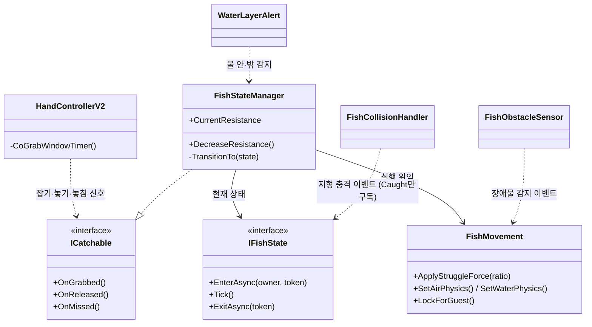
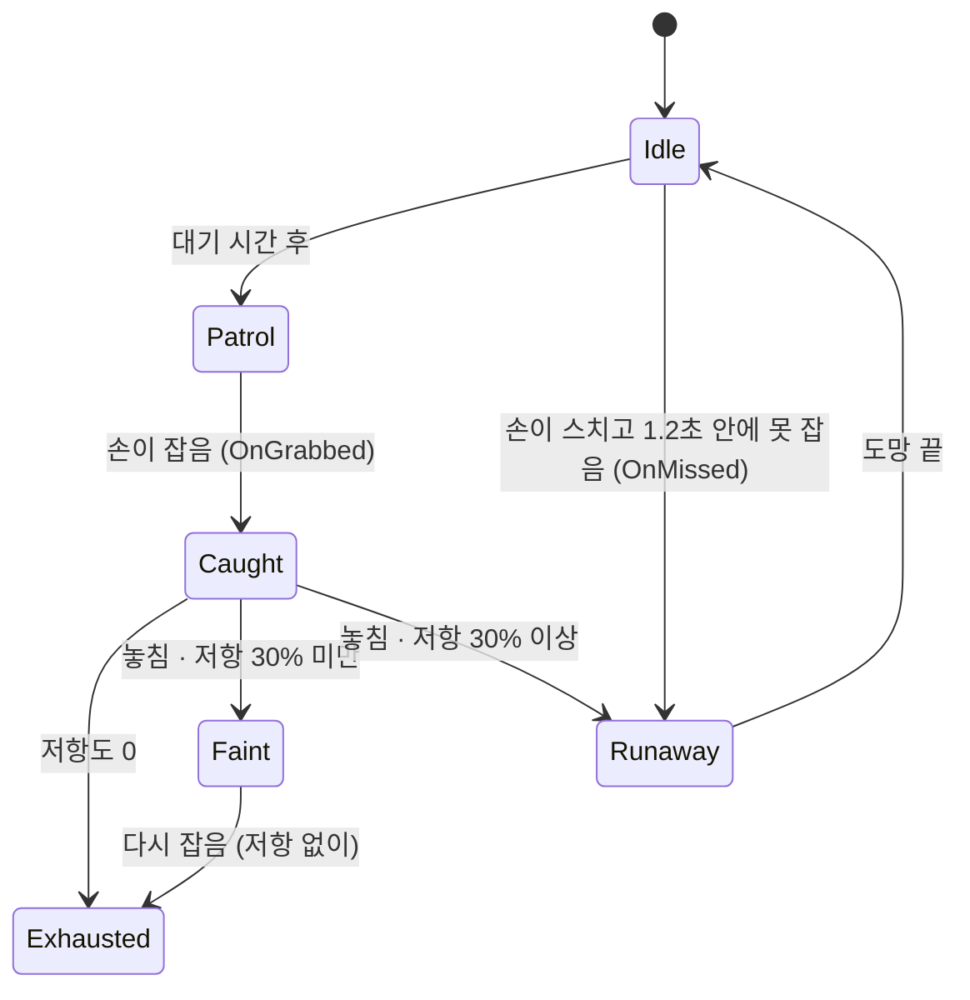
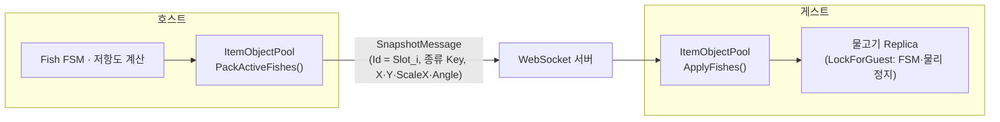

# ❓게임 제목 (Team 산) — 물고기 AI·호스트 동기화 담당 기술 문서

<!--
====================================================================
 ✍ 작성 안내 (이 상자는 다 쓰면 지우세요)
====================================================================
 이 파일은 format/02-tech-document.md 의 「C형 · 팀 프로젝트」 틀입니다.
 팀 레포(3rd-TeamProject-HS)의 커밋 메시지·설계 문서(FishSystemDesignPlan.md)와
 아사나(Team 산) 작업 카드에서 찾은 사실로만 채웠고, 모르는 것은 비워 두었습니다.

   ❓ 답해 주세요   — 사실 확인. 레포·아사나에 없거나 제가 알 수 없는 것 (제목·기간·링크·수치)
   💬 내 의견       — 정답이 없고, 건우 님의 판단·생각이 들어가야 하는 곳
   ✏️ 초안          — 커밋 메시지·설계 문서에서 옮겨 정리한 "고민한 부분". 출처(커밋 해시)를 달았습니다.
                      ⚠ 그대로 두지 말고 본인 말로 다시 쓰세요. 면접에서 물어볼 곳입니다.

 · 표시(> ❓ … 등)는 답을 채운 뒤 지웁니다. 남아 있으면 포트폴리오에도 그대로 보입니다.
 · 코드는 "건우 님이 커밋한 시점"의 버전입니다. 이후 팀원이 리팩토링한 최종 코드와 다를 수 있습니다(1-5 참고).
 · 이미지는 images/ 폴더에 넣고  로 붙입니다. 권장 촬영 목록은 맨 아래에 있습니다.
 · 다 쓴 뒤 /portfolio-check 4-teamproject-hs 로 점검하세요.

 📎 참고 자료: _intake/개발 학습 이력 분석 (2026.06~10).md  (git 제외 · build·check가 읽지 않음)
    AI 대화 기록을 정리한 2차 자료라서, 여기서 가져온 힌트는 "(참고: 학습 이력)"으로 표시했습니다.
    날짜·장면은 기억을 되살리는 실마리로만 쓰고, 문서에는 본인이 확인한 사실만 옮겨 주세요.
====================================================================
-->

## 1. 개요

### 1-1. 무엇을 만들었나 (What)

폭풍우로 조난당한 플레이어들이 섬에서 **물고기를 낚고 나무를 모아 다리를 지으며 육지(최종 지점)까지 가는**
2D 물리 기반 **협동 멀티플레이 게임**입니다(최대 4인). 플레이어는 팔을 직접 움직여 물건을 잡고 던지며,
서로의 몸을 붙잡으면 물 위로 떠오를 수 있습니다.

- **핵심 루프**: 물고기 낚기·나무 수집 → 다리 건설 → 다음 스테이지 → 최종 지점 도달(승리)
  *(출처: 아사나 S13-3 튜토리얼 카드의 하위 작업)*

이 문서는 그중 제가 맡은 **물고기 AI(상태 머신 + 저항도)** 와 **물고기의 호스트-게스트 동기화**를 다룹니다.

> ❓ **답해 주세요** — 게임 제목이 있나요? (코드 네임스페이스가 `WeGotOne`입니다. 이게 제목인가요?) 답: WeGotOne 이 맞아
>
> 💬 **내 의견** — 이 게임의 재미를 한 문장으로. 팀 회의에서 정한 "핵심 재미"가 있었다면 그것을 적어 주세요.
> 레퍼런스 게임이 있었다면 이름과 **우리 게임이 다른 점** 한 줄 (있으면 좋은 항목). 답: Heave Ho 2 라는 물리 잡기 기반의 협동게임을 래퍼런스로 하였고, 
> 우리 게임은 협동 + 오브젝트를 잡아 낚아 올려서 (물고기, 목재 획득) 하는 게임이었다. 처음에 플레이어를 어떤 걸로 할지 고민하다가 우연히 발견한 포켓몬스터의 꼬마돌이 우리 게임에 잘 어울릴 거같아 꼬마돌들이 함께 좌충우돌로 모험하는 게임이 되었다  

### 1-2. 왜 만들었나 (Why) — 제 파트가 풀어야 했던 문제

> ✏️ **초안** — 출처: `FishSystemDesignPlan.md`, 아사나 S4-1·S6-1~S6-4·S11-4 카드
>
> - **물고기 AI**: 물고기는 "주워 담는 아이템"이 아니라 **잡으면 버둥거리며 저항하는 상대**여야 했습니다.
>   그래서 물고기는 순찰 → 잡힘(힘겨루기) → 탈진·기절·도망처럼 **상황에 따라 다르게 행동**해야 했고,
>   플레이어는 지형에 물고기를 부딪쳐 저항을 빨리 꺾는 식으로 **요령을 쓸 수 있어야** 했습니다.
> - **동기화**: 멀티플레이에서 물고기 AI를 호스트와 게스트가 각자 돌리면 화면마다 물고기가 다르게 움직입니다.
>   그래서 **호스트만 AI·저항 계산을 하고, 게스트는 결과(위치·회전)만 보여 주는** 구조가 필요했습니다(아사나 S11-4).

> 💬 **내 의견** — 위 초안은 "요구사항"에 가깝습니다. **왜 이게 중요했는지** 본인 말로 한 줄 덧붙여 주세요.
> (예: 저항도가 없으면 낚시가 어떤 느낌이 되었을지, 협동 게임에서 물고기가 화면마다 다르면 어떤 문제가 생기는지)
>  낚시라는 것이 현실에서도 입질 후에 물고기와의 씨름이 큰 재미입니다. 이 게임에서는 입질 대신 플레이어가 직접 물고기를 잡기 때문에 
>  물고기를 잡는 경험을 더 생동감이 있게 하기 위해 물고기가 잡혔을때 저항하는 것과 탈진, 기절, 도망 기능을 추가하는 것을 생각했습니다. 
> 그리고 게임 플레이 특성상 벽이라는 구조를 이용해 물고기의 저항도를 낮출 수 있게 설계하였습니다. 또한 멀티 플레이 기반의 게임이기 때문에 물고기 AI 를 호스트와 게스트가 각자 돌리면 
> 모든 플레이어의 화면은 다르게 움직여 보이게 됩니다. 그래서 호스트 기반의 멀티 플레이 게임으로 호스트만 물고기 AI·저항 계산을 하고, 게스트는 결과(위치·회전)만 보여 주는** 구조가 필요했습니다
>
> ❓ **답해 주세요** — Why를 숫자나 구체적 장면으로 말할 수 있나요?
> 예: 1차 빌드 테스트(8/31)에서 게스트 화면의 물고기가 어떻게 보였는지 — 아사나 "1차 테스트 결과 정리"에 "보간문제?" 영상 링크가 있습니다.
> 1차 빌드 테스트 때는 호스트와 게스트 화면의 물고기 피드백이 달랐습니다. // 확인 해봐야함

### 1-3. 개발 환경 · 링크

| 항목 | 내용 |
|---|---|
| 엔진 | Unity 6000.3.15f1 (URP, 2D) |
| 언어·도구 | C#, DOTween, Unity Input System, WebSocket(`ClientWebSocket`), Git·GitHub, Asana |
| 기간 | ❓ 레포 커밋 기준 2026-08-18 ~ 2026-09-10 (마지막 스프린트 ~9/7). 공식 기간·발표일을 확인해 주세요 2026-8-18 ~ 2026-8-22 (기획) / 2026-8-22 ~ 2026-9-10 (개발) | 
| 팀 | 4명 — 홍산, 김승구, 신성건, 윤건우 (레포 README) |
| 영상 | https://youtu.be/8Kuv8hg5q3Y (튜토리얼) |
| GitHub | ❓ `KooHoo-Dev/3rd-TeamProject-HS` — 현재는 비공개 추후에 공개 예정  |

### 1-4. 팀 구성과 역할

> ❓ **답해 주세요** — 아래는 **아사나 담당자와 커밋 기록으로 추정**한 것입니다. 맞는지 확인하고, 팀장이 누구였는지 적어 주세요.
> (참고: 학습 이력) 건우 님 담당에 **"플레이어 손·팔"** 도 적혀 있습니다(`HandControllerV2` 수정과 맞음). 내 담당에 넣을지 정해 주세요.
> 또 "RoomClient·스냅샷 설계를 팀장과 맞췄다"는 기록이 있으니, 팀장 이름을 표에 적어 두면 4-3에서 쓰기 좋습니다.

| 이름 | 담당 (추정) |
|---|---|
| 윤건우 (나) | 물고기 AI·저항도, 물고기·자원·시간 게스트 동기화, 튜토리얼, 맵·레벨 디자인 (+ 아래 "그 밖에 맡은 것") |
| 홍산 | 서버·동기화, 인벤토리·풀링·스폰 리팩토링, 물고기 코드 리팩토링, 다리 건설 조건, GDD (팀장) |
| 김승구 | 물고기 확장(대왕 오징어·갯가재·전기 가오리·해마 등), 물고기 코드 리팩토링, 다리 길이 스테이지 |
| 신성건 | 플레이어(배고픔·스태미나·잡기·던지기), 물고기 코드 리팩토링, 게임 흐름 씬, UI 폴리싱 |

### 1-5. 제가 맡은 것

**이 문서에서 자세히 다루는 것**

1. **물고기 AI** — 비동기 상태 머신(FSM), 동적 저항도, 손-물고기 잡기 규약(`ICatchable`), 지형 충돌 감속, BoxCast 장애물 회피, 물 밖 중력
   *(아사나 S4-1, S5-1, S5-2, S6-1~S6-4, "물고기가 물 밖으로 벗어나면 중력을 받는다")*
2. **물고기의 호스트-게스트 동기화** — 게스트 물고기 Replica, 슬롯 ID 매핑, 프리팹 불일치 보정
   *(아사나 S11-4, E11-S5, S11-7)*

**그 밖에 맡은 것** (한 줄씩만)

- 인게임 튜토리얼 — 준비 체크(전원 준비 → 폭풍우·조난 연출 → 섬 낙하), 착지 트리거로 이동 제한 해제 (S13-3)
- 낮·밤 주기 전환과 UI (S9-3), 게임 시간 게스트 동기화 (S11-7)
- 해양 지뢰 — 닿으면 폭발·넉백 (S14-5)
- 맵 디자인 — 섬·바다 스테이지, 튜토리얼/1단계/2단계 레벨 디자인·밸런스 (S13-5, 맵 폴리싱)
- 게임 결과 화면 폴리싱

> ❓ **답해 주세요** — 물고기 코드는 이후 김승구 님이 "물고기 코드 리팩토링(S14-0)"을 했고, `FishStateManager.cs`는 커밋 수로 보면
> 다른 팀원의 수정이 더 많습니다. **최종 빌드에서 내 설계 중 무엇이 그대로 남았고 무엇이 바뀌었나요?**
> 면접에서 "이 코드 지금도 이렇게 돼 있어요?"라고 물을 수 있으니 한 줄로 정리해 두세요.
> 내 답변: 초기 코드 설계는 제가 진행했지만, 물고기 리팩토링 과정 때 제가 몸이 좋지 않아 결석하여 팀원들이 함께 리팩토링을 진행했습니다. 
> 
>
> 💬 **내 의견** — 주력으로 **물고기 AI + 동기화** 두 개를 골랐습니다(설계 문서·커밋 설명이 가장 자세해서).
> 튜토리얼을 더 보여 주고 싶다면 바꿔도 됩니다. 셋 이상이면 문서가 길어져 하나하나가 얕아집니다.

### 1-6. 이 문서에서 다루는 것

2장 구조 → 3장 물고기가 잡히고 저항하는 방식, 게스트에 보이는 방식 → 4장 잡기 구조·상태 머신·동기화 방식을 정할 때 비교한 방법들 → 5장 결과와 트러블슈팅.

---

## 2. 시스템 구조

### 2-1. 물고기 모듈 구조 — "언제 바뀌나"와 "어떻게 움직이나"를 나눈다

> ✏️ **초안** — 출처: `FishSystemDesignPlan.md` "역할 분리 기준", 커밋 `bf51259`·`5850bda`·`05903c9`



| 클래스 | 책임 |
|---|---|
| `FishStateManager` | 상태 전이만 담당 — **"언제 바뀌는가"**. 저항도를 소유하고 바꾸는 창구 |
| `IFishState` 구현 6종 | Idle·Patrol·Caught·Exhausted·Faint·Runaway — 상태마다 진입·매 프레임·퇴장 동작 |
| `FishMovement` | 실제 이동·DOTween·Rigidbody2D 조작 — **"어떻게 움직이는가"** |
| `FishObstacleSensor` | 진행 방향 BoxCast로 벽·다른 물고기 감지 → 이벤트로 알림 |
| `FishCollisionHandler` | 지형과 부딪친 세기(`relativeVelocity`)가 임계치를 넘으면 이벤트로 알림 |
| `WaterLayerAlert` | 물 영역 안·밖 감지 (물 밖이면 중력) |

> 💬 **내 의견 (필수)** — **왜 이렇게 나눴는지** 한두 줄. 가이드 필수 항목입니다.
> 힌트: 처음에는 `FishMovement` 안에 BoxCast 감지 코드와 기즈모가 함께 있었는데, `5850bda`에서 `FishObstacleSensor`로 **따로 뺐습니다.**
> 또 `StateManager`가 Rigidbody를 직접 만지던 것을 `FishMovement.SetAirPhysics()`로 **옮겼습니다.** 왜 그렇게 했나요?
> 
> FishMovement 에서는 움직임만 담당하도록 설계하고 싶었고, `FishObstacleSensor` 는 물고기의 장애물 감지를 이벤트로 넘겨 멀티플레이 동기화를 위해 나누었습니다. 
> StateManager 는 물고기의 상태만 관리하면 되었기 때문에 Rigidbody를 담당할 필요성이 없었고, 이를 FishMovement 로 옮겼습니다.  
>
> (참고: 학습 이력) 이때 건우 님이 직접 하신 말로 기록된 것들입니다. 본인 기억과 맞으면 이 문장들을 살려 쓰세요.
> - "핸들러는 물 밖이라고 **알리기만**, 판단은 물고기가 스스로" → `WaterLayerAlert`·`FishCollisionHandler`가 이벤트만 보내는 이유
> - "DOTween 연출은 CaughtState가 아니라 **FishMovement에서**" → 상태 클래스에 연출 코드를 두지 않은 이유
> - "상태 관리자에 물리 설정이 꼭 필요한가" → `SetAirPhysics()`로 옮긴 계기
> - 8/27쯤 `FishMovement`가 **약 400줄**이 된 뒤에 책임 분리 문제를 알아챘다는 기록 — "언제, 왜 나누기로 했는지"의 좋은 장면입니다(분리 전후 줄 수를 세어 보면 수치가 됩니다)

### 2-2. 상태 전이도

> ✏️ **초안** — 출처: 커밋 `f1d0a24` 메시지의 [FishState 정리], `FishStateManager.cs`



| 상태 | 플레이어가 보는 것 |
|---|---|
| Idle / Patrol | 정해진 범위를 대각선으로 왕복하며 헤엄침 |
| Caught (힘겨루기) | 손에 잡혀 버둥거림. 저항도가 매 프레임 줄고, 저항이 클수록 세게 버둥거림 |
| Exhausted (탈진) | 저항도 0 — 손에 늘어져 저항하지 않음 |
| Faint (기절) | 지친 상태에서 놓치면 물 위에 떠서 잠시 무방비 |
| Runaway (도망) | 싱싱할 때 놓치거나 잡기를 놓치면 반대 방향으로 빠르게 달아남 |

### 2-3. 동기화 구조 — 호스트가 계산하고, 게스트는 보여 주기만

> ✏️ **초안** — 출처: 아사나 S11-4 카드 하위 작업, 커밋 `b9b9ffe`·`f5d5aee`·`8fba446`·`e363b73`



| 규칙 | 내용 |
|---|---|
| 게스트는 Fish AI/FSM을 **실행하지 않는다** | `LockForGuest()` — 트윈 정지, Rigidbody2D를 Kinematic으로, 컴포넌트 비활성 |
| 위치·회전 등 **화면 표현만** 받는다 | 스냅샷의 X·Y·ScaleX(좌우 반전)·Angle 적용 |
| 물고기 ID = **스폰 슬롯 번호** | 스폰 위치 인덱스를 `"Slot_i"`로 매핑 (`PackActiveItems`) |

> 💬 **내 의견** — 왜 물고기마다 새 네트워크 ID를 발급하지 않고 **스폰 슬롯 번호를 ID로** 썼나요? (풀링과 어떤 관계가 있었나요?) 
> 이 부분은 나도 잘 모르겠는데, 함께 분석해보자 

---

## 3. 핵심 기능

### 3-1. 물고기 — 사용법

> ✏️ **초안** — 출처: `ICatchable.cs`, `HandControllerV2.cs`(`af9b561`), `FishStateManager.cs`

```csharp
// 잡을 수 있는 대상은 ICatchable 만 구현하면 된다 (손은 대상이 물고기인지 모름)
if (other.TryGetComponent<ICatchable>(out var catchable))
    grabTimerCoroutine = StartCoroutine(CoGrabWindowTimer(catchable)); // 1.2초 안에 못 잡으면 OnMissed()

catchable.OnGrabbed();   // 잡기 성공 → 힘겨루기(Caught) 또는 기절 중이면 바로 탈진(Exhausted)
catchable.OnReleased();  // 놓기   → 남은 저항 비율로 기절/도망 분기
catchable.OnMissed();    // 놓침   → 도망

// 상태는 밖에서 직접 바꾸지 않고, 저항도도 메서드로만 줄인다
fish.DecreaseResistance(amount);
```

> 💬 **내 의견** — 손 쪽(플레이어 담당)이 알아야 하는 것이 `ICatchable` 메서드 세 개뿐이도록 만든 이유를 한 줄로.
> (`af9b561` 메시지에 "향후 물고기 외 상호작용 오브젝트 확장 기반"이라고 적으셨습니다. 실제로 물고기 말고 이걸 구현한 것이 생겼나요?)
> 내 답변: 플레이어의 손은 벽을 짚고 이동하는 것 뿐만 아니라 다른 오브젝트인 다리 짓기 재료인 목재를 집을 수 있게 구현되었습니다. 

### 3-2. 물고기 — 비동기 상태 전환 (진행 중인 전환은 취소한다)

> ✏️ **초안** — 출처: `FishStateManager.TransitionTo` (`05903c9` 시점)

```csharp
private async void TransitionTo(IFishState newState)
{
    if (newState == null) return;

    // 이전 전환이 아직 진행 중이면 취소하고 새 토큰을 만든다
    stateCts?.Cancel();
    stateCts?.Dispose();
    stateCts = new CancellationTokenSource();
    CancellationToken token = stateCts.Token;

    try
    {
        if (currentState != null)
        {
            await currentState.ExitAsync(token);
            if (this == null) return;        // 기다리는 사이 오브젝트가 파괴됐으면 중단
        }
        currentState = newState;
        await currentState.EnterAsync(this, token);
    }
    catch (OperationCanceledException)
    {
        Debug.Log("상태 전환 취소");
    }
}
```

> 💬 **내 의견 (필수)** — 코드 아래에 **본인 설명**을 붙여 주세요. 예:
> - 상태 진입·퇴장을 왜 `async`(Task)로 만들었나요? 어떤 상태가 "기다리는 연출"을 가졌나요? (힌트: Runaway의 도망 질주 후 Idle 복귀, `004174d`)
> - `CancellationToken`이 없으면 어떤 일이 생기나요? (예: 도망 중에 다시 잡히면?)
> - `if (this == null) return;` 은 왜 필요한가요? (힌트: 풀로 돌아가거나 파괴된 물고기)
> - `OnDisable`에서 토큰을 취소하는 이유는?
> - 내 답변: 물고기가 도망(Runaway) 상태 이후로 대기(Idle) 상태로 전환되기 때문에 도망상태가 끝날때까지 기다려야 한다. 
> - `CancellationToken` 이 없으면 도망중에 다시 잡혔을 경우에 상태 처리를 할수 없다. 잡힌 물고기를 보관함에 넣으면 상태 처리가 필요 없다 
> - OnDisable에 상황은 물고기를 보관함에 넣었을 때이다. (내 답변에 부족한 부분 보완 내용 따로 설명에 추가해줘, 내가 읽고 다시 정리할수 있도록)
> - 

### 3-3. 물고기 — 저항도로 행동이 바뀐다

> ✏️ **초안** — 출처: `FishCaughtState.cs`·`FishStateManager.OnReleased` (`05903c9` 시점. 핵심만 남김 — 원본 `OnReleased`는 세 갈래인데 30~60%도 Runaway라 둘로 줄여 보였습니다)

```csharp
// FishCaughtState — 잡혀 있는 동안 매 프레임
public void Tick()
{
    owner.DecreaseResistance(Time.deltaTime);                 // 초당 1씩 감소 (기본 최대 20)
    float ratio = owner.CurrentResistance / owner.MaxResistance;
    owner.FishMovement.ApplyStruggleForce(ratio);             // 저항이 클수록 세게 버둥거림 → 플레이어 이동 방해
    if (owner.CurrentResistance <= 0f)
        owner.ChangeState(new FishExhaustedState());
}

// 지형에 부딪치면 (Caught 상태일 때만 구독)
private void HandleTerrainSmashed(float impactStrength)
{
    owner.DecreaseResistance(impactStrength * collisionRatio); // 충격이 셀수록 크게 감소 (계수 0.2)
}

// FishStateManager — 놓았을 때 남은 저항으로 분기
public void OnReleased()
{
    float resistanceRatio = CurrentResistance / maxResistance;
    if (resistanceRatio < 0.3f) TransitionTo(new FishFaintState());   // 지친 채 놓침 → 물 위에서 기절
    else                        TransitionTo(new FishRunawayState()); // 아직 싱싱 → 도망
}
```

| 값 | 기본 | 뜻 |
|---|---|---|
| `maxResistance` | 20 | 그냥 잡고만 있으면 20초 뒤 탈진 (물고기 종류마다 프리팹에서 다르게) |
| `collisionRatio` | 0.2 | 지형 충돌 세기 × 0.2 만큼 즉시 감소 |
| `grabWindowTime` | 1.2초 | 손이 닿은 뒤 이 시간 안에 잡아야 함 |
| 기절 기준 | 30% 미만 | 이보다 낮으면 놓쳐도 도망가지 않고 기절 |

> 💬 **내 의견 (필수)** — 면접에서 물어볼 만한 것들입니다.
> - 지형 충돌 이벤트를 **Caught 상태에 들어갈 때만 구독하고, 나갈 때 해제**한 이유는? (`05903c9` 메시지: "다른 상태에서의 의도치 않은 저항도 연산 버그를 원천 방어")
> - 저항도를 `public set`으로 열지 않고 `DecreaseResistance`/`ResetResistance`로만 바꾸게 한 이유는?
> - 20 · 0.2 · 1.2초 · 30% 는 어떻게 정했나요? 플레이 테스트로 조정했다면 그 과정을.
> - (참고: 학습 이력) 버둥거림을 처음엔 DOTween 흔들림으로 했다가 **"손이 허공을 잡는 느낌"** 이라서, 도망 방향 계산을 재사용해
>   Rigidbody2D에 힘을 주는 방식으로 바꿨고 이건 건우 님이 먼저 낸 아이디어라고 적혀 있습니다.
>   코드 주석("Runaway와 공유하는 도망 방향 알고리즘")과도 맞습니다. **연출 방식 A(트윈 흔들림) vs B(물리 힘)** 비교로 4장에 한 절을 더 만들 수 있는 재료입니다.
> - 내 답변: 지형 충돌 이벤트는 플레이어가 물고기를 잡아 벽에 충돌시켜야 하는 조건이기 때문에 벽에 충돌 이후로는 추가 연산이 필요 없다
> - 이외 추가 의견은 너와 함께 조율 해야 할 거 같다. 잘 안읽히네. 
> 
> 
>
> ❓ **답해 주세요** — 실제 코드는 30~60% "회색 영역"도 60% 이상과 **같은 Runaway**로 갑니다.
> 설계 문서에는 "저항도 낮음 → 짧은 지연 후 도주"로 나눌 계획이 있었습니다. 일부러 합친 건가요, 시간이 없어 남긴 건가요? (5-3 기술 부채 후보)
> 제가 병가였던 중에 리팩토링 하는 과정에서 제가 설계한 부분이 누락된 거 같습니다. 

### 3-4. 물고기 — 풀링에 맞춘 순찰과 장애물 회피

> ✏️ **초안** — 출처: 커밋 `296fb12` 메시지, `FishObstacleSensor.cs` (`5850bda`)

- 처음에는 씬에 배치한 `spawnPoint`·`patrolPoint` Transform 사이를 왕복했습니다(`542e7d2`).
  오브젝트 풀링으로 물고기를 재사용하려면 씬 배치에 의존하면 안 되므로, **스폰된 순간의 좌표 + 프리팹의 `patrolRange`** 로 경로를 계산하게 바꿨습니다.
- 한 번 왕복할 때마다 방향과 Y 오프셋을 새로 뽑습니다. Y 범위는 X 범위의 20~50%로 제한해 자연스러운 대각선으로 헤엄치게 했습니다.
- 장애물 감지는 선(Raycast) 대신 **물고기 두께만큼의 상자(BoxCast)** 로 합니다.

```csharp
// 순찰 중일 때만, 목표 방향으로 물고기 크기의 상자를 쏜다
RaycastHit2D hit = Physics2D.BoxCast(
    transform.position, obstacleCheckSize, 0f,
    moveDirection, obstacleCheckDistance, obstacleLayer);   // Wall(지형), fish(다른 물고기)

if (hit.collider != null)
    OnObstacleDetected?.Invoke();   // 트윈 취소 → 반대 방향으로 돌아가 경로 재탐색
```

> 💬 **내 의견** — Raycast로는 **어떤 경우를 놓쳤나요?** (선은 물고기 몸 가운데만 검사 → 지느러미·몸통 가장자리가 벽에 걸림?)
> 실제로 겪은 장면이 있으면 그걸 쓰세요. 기즈모로 감지 상자를 그려 둔 스크린샷이 있으면 좋습니다.
> (참고: 학습 이력) 개인 프로젝트 「뒤통수를 조심해」에서 적 우회를 **Raycast → 여러 개의 레이 → BoxCast** 순서로 바꿔 본 경험이 있다고 적혀 있습니다.
> "전 프로젝트에서 이미 선의 한계를 겪어서, 부피가 있는 물고기에는 처음부터 BoxCast를 골랐다"가 사실이라면 아주 좋은 근거입니다.
> 첫 2D 프로젝트인 뒤통수를 조심해에서 이미 raycast의 선의 한계를 겪었기 때문에 부피가 있는 물고기는 Boxcast를 선택했습니다.  

### 3-5. 동기화 — 게스트 물고기는 생각하지 않는다

> ✏️ **초안** — 출처: `FishMovement.LockForGuest` (`8fba446`), `ItemObjectPool.ApplyFishes` (`e363b73`. 반복문만 짧게 고쳐 보임)

```csharp
// FishMovement — 게스트에서 스폰된 물고기
public void LockForGuest()
{
    isGuestLocked = true;
    StopMove();                                   // 이미 걸린 트윈 정리
    if (rb != null) rb.bodyType = RigidbodyType2D.Kinematic;
    enabled = false;                              // Update 등 자동 콜백 차단
}
// + 트윈을 거는 모든 public 진입점 맨 앞에: if (isGuestLocked) return;

// ItemObjectPool — 스냅샷을 받아 적용
public void ApplyFishes(FishState[] fishes)
{
    foreach (FishState state in fishes)
    {
        if (!TryGetSlotIndex(state.Id, out int slot)) continue;            // "Slot_3" → 3
        if (!PoolObjectDic.TryGetValue(slot, out Collectible c)) continue;

        if (c.ThisItem.Key != state.FishTypeIndex)                          // 게스트가 다른 종류를 뽑았으면
            c = ReplaceWithCorrectPrefab(slot, c, state.FishTypeIndex);     // 호스트 기준 프리팹으로 교체
        if (c == null) continue;

        c.transform.position   = new Vector3(state.X, state.Y, c.transform.position.z);
        c.transform.localScale = new Vector3(state.ScaleX, c.transform.localScale.y, c.transform.localScale.z);
        c.transform.rotation   = Quaternion.Euler(0f, 0f, state.Angle);
    }
}
```

> 💬 **내 의견 (필수)** —
> - `enabled = false`만으로 부족해서 `isGuestLocked` 플래그를 **모든 진입점에** 넣은 이유를 본인 말로. (`8fba446`: "외부에서 직접 호출되는 public 메서드까지는 막지 못한다")
> - 게스트가 스폰 때 **스스로 랜덤 종류를 뽑는 구조**를 그대로 두고 "틀리면 교체"로 고친 이유는? 처음부터 호스트가 종류를 정해 주는 방법과 비교하면?
>
> ❓ **답해 주세요** — 스냅샷 주기가 30ms로 보입니다(`98642aa` 메시지). 맞나요? 네. 
> 그리고 게스트 물고기의 끊김은 아사나 "[Bug] 물고기, 나무 게스트 보간 처리"(홍산 님 담당)로 보간이 추가된 것 같습니다. 맞다면 5-2에 "내 Replica는 위치를 바로 덮어썼고, 끊김은 팀원이 보간으로 보완했다"고 정직하게 쓰는 것을 권합니다.
>
> (참고: 학습 이력) "`Protocol.cs`는 서버와 공유하니 건드리지 않는 방향으로"라고 정했다는 기록이 있습니다.
> 스냅샷 형식을 바꾸지 않고 **이미 있는 `FishTypeIndex` 칸의 값만 고쳐서**(대분류 → Key) 해결한 이유와 연결되는지 확인해 보세요. 맞다면 팀 제약을 지킨 판단으로 쓸 수 있습니다.

---

## 4. 고민과 선택

> 가이드: **대안 2개 이상 비교 + 상황을 근거로 한 선택 이유**. 틀려도 괜찮고, 판단의 근거가 중요합니다.
> 아래 초안의 "선택 이유"는 커밋 메시지에 적힌 근거입니다. **실제로 그 근거로 골랐는지** 확인하고 본인 말로 바꿔 주세요.

### 4-1. 손과 물고기를 어떻게 연결할까 — 이벤트 구독 vs 전체 비동기화 vs 인터페이스 직접 호출

> ✏️ **초안** — 출처: 커밋 `bf51259` → `004174d`(Known Issue) → `af9b561`

이 부분은 **실제로 두 번 방향을 바꾼 기록**이 커밋에 남아 있습니다.

| 방법 | 장점 | 단점 | 실제 |
|---|---|---|---|
| A. 물고기가 씬의 **모든 손을 찾아 이벤트 구독** (`HandRegistry`) | 손 코드 수정이 적음 | 물고기마다 모든 손을 구독·해제 → 구독 해제 관리가 어렵고 무거움 | `bf51259` 시도 ("구독해제 관련 함수 미완") |
| B. 플레이어 컨트롤러 전체를 **비동기 인터페이스 구조로** 바꾸기 | 물고기 FSM과 방식이 통일됨 | 손·팔 등 **플레이어 담당의 모든 클래스**를 고쳐야 함 | `004174d` 시도 → "일이 너무 커짐"으로 중단 |
| **C. 손이 `ICatchable`을 직접 호출, 잡기 타이머도 손이 소유 (선택)** | 손은 대상이 물고기인지 모름. 물고기는 신호 3개에만 반응 | 손 코드(`HandControllerV2`)를 수정해야 함 | `af9b561` |

**선택 이유 (초안)**: 물고기가 스스로 시간을 재며 손을 지켜보던 "수동적" 구조를, 손이 닿은 순간부터 타이머를 재고 결과만 알려 주는 구조로 바꿨습니다.
구독·해제 코드가 통째로 사라져 `FishStateManager`가 단순해졌고, 플레이어 담당의 코드는 `HandControllerV2` 한 곳만 건드렸습니다.

> 💬 **내 의견 (중요)** — 면접관이 가장 좋아할 부분이 **"해 보다가 접은 설계"** 입니다. 
> - B를 접기로 한 순간의 판단 근거를 본인 말로. (남은 기간, 플레이어 담당과의 관계 등)
> - `HandControllerV2`는 플레이어 담당(신성건 님?) 코드인데, 어떻게 합의하고 고쳤나요?
> - 프로젝트 당시 비동기 를 배워 이 점을 살려보고 싶어서 설게했지만, 남은 개발 시간과 플레이어 담당과의 리팩토링 조율로 손이 Icatchable 로 직접 호출하는 것으로 조정하였습니다. 

### 4-2. 상태 머신을 어떻게 만들까

> ✏️ **초안** — 출처: `FishSystemDesignPlan.md`, `IFishState.cs`

| 방법 | 장점 | 단점 |
|---|---|---|
| A. `enum` + `switch` | 짧고 단순 | 상태가 늘면 한 파일이 커지고, 진입·퇴장 정리 코드가 흩어짐 |
| B. Animator(상태 머신 그래프) | 눈으로 보임 | ❓ 검토했나요? |
| **C. 상태 클래스 + `IFishState` (비동기 Enter/Exit + 취소 토큰) (선택)** | 상태별 정리(이벤트 해제 등)를 Exit에 모음. 연출을 `await`로 기다릴 수 있음 | 클래스 수가 많아짐, `async void` 예외 처리 주의 |

> 💬 **내 의견** — A·B와 **실제로 비교했나요?** 비교하지 않았다면 "상태 클래스를 고른 이유"만 정직하게 써도 됩니다.
> 그 뒤 팀원이 상어·문어·오징어 등을 추가할 때 이 구조(`AbductionState`, `FishOctopusState` 등)가 **도움이 됐는지/불편했는지** — 이게 가장 좋은 근거입니다.
> (참고: 학습 이력) 「뒤통수를 조심해」(6~7월)에서 이미 `IEnemyState` + `EnemyStateManager`로 적 FSM을 만들었고, 그때 Chase에 Attack을 합쳤다가 다시 나눴다고 적혀 있습니다.
> **"전 프로젝트에서 써 본 구조를 이번엔 무엇을 바꿔 썼는지"**(예: 이번엔 Enter/Exit를 비동기로, 취소 토큰 추가)를 적으면 A·B를 비교하지 않았어도 선택 근거가 됩니다.
> 전 프로젝트에서 적 FSM 을 인터페이스 구조를 활용하여 설계하였고, 해당 프로젝트 직전에 배운 비동기를 추가하여 멀티 플레이 게임에 잘 활용 할 수 있을거라 생각했었습니다.

### 4-3. 게스트 물고기를 어떻게 보여 줄까

> ✏️ **초안** — 출처: 아사나 S11-4, 커밋 `8fba446`·`e363b73`

| 방법 | 장점 | 단점 |
|---|---|---|
| A. 게스트도 FSM을 돌리고 결과만 가끔 맞춤 | 네트워크 데이터가 적음 | 저항도·상태가 화면마다 달라짐. 협동 게임에서 "같은 물고기"가 아님 |
| **B. 호스트만 FSM·저항 계산, 게스트는 위치·회전만 반영 (선택)** | 모두가 같은 물고기를 봄. 판정이 한 곳 | 매 스냅샷마다 데이터 전송. 게스트 화면 끊김 → 보간 필요 |

> 💬 **내 의견** — B를 고른 이유를 상황(4인 협동, 기간)으로 한 줄. 끊김 문제를 미리 예상했었나요? 4인 협동 멀티플레이 게임이었기 때문에 플레이 테스트 도중 물고기를 잡았을 때 각각의 
> 물고기 상태가 제 각각인 상황이 있었습니다. 

### 4-4. 협업 이슈 — 다른 파트 코드와 맞물린 부분

> ✏️ **초안** — 출처: 커밋 `b9b9ffe` 메시지, 아사나 "인벤토리, 풀링, 스폰 리팩토링 공지"

- `b9b9ffe`에서 `InventoryItemDB`의 잘못된 변수 지정 오류를 발견해 `BridgeManager`·`InventorySlot`을 **임시 주석 처리**하고 커밋했습니다.
- 이후 팀의 "인벤토리, 풀링, 스폰 리팩토링 공지"로 "새 물고기 추가 시 `WorldItem`·SO·`FishObjectPool` 등록" 규칙이 생겼습니다.

> ❓ **답해 주세요** — 임시 주석 처리한 부분은 어떻게 해결됐나요? 그 파일 담당자에게 알렸나요? 네, 담당자에게 알렸습니다. 
> 💬 **내 의견** — 이 경험으로 "다음 팀 프로젝트에서는 이렇게 하겠다"가 있다면. (이 절이 약하면 지우고 4-1의 협업 부분으로 대신해도 됩니다)

---

## 5. 결과 및 배운 점

### 5-1. 결과

> ❓ **답해 주세요** — 1-2의 Why가 해결됐는지 **결과**를 적어 주세요. 가능하면 숫자로. 후보:
> - 이 FSM 위에 팀원이 추가한 물고기 종류 수 (레포 기준: 상어·문어·대왕 오징어·갯가재·전기 가오리·지뢰 물고기·해마 등 — 맞는지 확인) 네 맞습니다. 
> - 2차·3차 빌드 테스트에서 물고기 관련 피드백·버그가 어떻게 줄었는지 (아사나 "2차 빌드 테스트 피드백, 버그 정리") -  
> - 최종 빌드에서 4인 플레이로 물고기가 호스트·게스트 화면에서 같게 보였는지  : 네 같게 보였습니다. 

### 5-2. 트러블슈팅

> ✏️ **초안** — 커밋 메시지에서 옮겼습니다. 문제 → 원인 → 해결 → 결과. **1~2개만 골라** 본인 말로 다시 쓰세요.

**① 꺼 둔 물고기의 상태 머신이 계속 움직임** (커밋 `593ddd8`, 8/30)
- 문제: 물고기 관련 컴포넌트를 모두 비활성화해도 FSM이 동작함
- 원인: `OnTriggerEnter2D`/`Exit2D`는 **컴포넌트가 비활성(disabled)이어도 호출됩니다.** `WaterLayerAlert`가 물 출입 신호를 계속 보내 FSM을 깨움
- 해결: 트리거 콜백 안에서 `enabled`일 때만 처리하도록 조건 추가
- ❓ 어떤 장면에서 처음 발견했나요? (게스트 물고기? 풀에 들어간 물고기?)

**② 같은 슬롯인데 호스트와 게스트에 다른 물고기가 보임** (커밋 `e363b73`)
- 원인 1: 게스트가 스폰할 때 **스스로 랜덤 프리팹을 뽑음**
- 원인 2: 스냅샷의 종류 값(`FishTypeIndex`)을 **대분류(`ItemType`: Plank/Rope/Fish)** 로 채우고 있어, 물고기끼리는 구분이 안 됨
- 해결: 종류 값을 개별 식별값 `Key`로 통일 + 게스트의 Key가 다르면 올바른 프리팹으로 교체(`ReplaceWithCorrectPrefab`) + 교체된 물고기도 `LockForGuest()`
- 💬 "증상(종류가 다름)"에서 "원인(대분류를 보내고 있었음)"을 찾은 과정이 잘 드러나는 사례입니다.

**③ 게스트 물고기를 꺼도 외부에서 움직여짐** (커밋 `8fba446`)
- 원인: `enabled = false`는 `Update` 같은 유니티 콜백만 막고, `FishPatrolState` 등이 **public 메서드를 직접 호출**하는 것은 못 막음
- 해결: `isGuestLocked` 플래그를 트윈을 거는 모든 진입점에 추가

**④ 스냅샷 전송 중 NullReferenceException** (커밋 `98642aa`)
- 원인: 호스트가 30ms마다 스냅샷을 보낼 때, 초기값이 null인 정적 프로퍼티를 복사하려 함
- 해결: `new SnapshotMessage()`로 생성해 채우도록 변경

> (참고: 학습 이력) 커밋에는 없지만 대화 기록에 남은 후보 두 개입니다. **기억나는 것만** 문제 → 원인 → 해결로 채워 주세요.
>
> **⑤ 순찰 중인 물고기가 계속 물 위로 올라감** (8/28쯤)
> - 기록: "patrol 상태에서도 물 밖으로 나가는 경우를 간과했다", 원인으로 **수면 트리거 진동**·**순찰 목적지 미갱신**이 적혀 있음
> - `5850bda` 메시지의 "순찰 시에도 물 센서 적용시켜야 함"과 이어지는 이야기로 보입니다 → 5-3의 같은 항목과 함께 정리
> - ❓ 최종 해결은 어떻게 했나요?
>
> **⑥ 지뢰 넉백 힘을 키워도 플레이어가 안 날아감** (9/2쯤, 그 밖에 맡은 것 — 지뢰)
> - 원인: 대상의 Rigidbody2D가 **Kinematic이라 `AddForce`가 무시됨**
> - 해결: 외부 이동량을 직접 더하는 방식으로 변경
> - ❓ 어느 Rigidbody가 Kinematic이었나요? 이 사례를 쓰면 ③(`LockForGuest`에서 Kinematic으로 바꾼 것)과도 연결됩니다.

### 5-3. 아쉬운 점 (기술 부채) · 개선 계획

> ✏️ **초안** — 코드·커밋에 "미완·To-Do"로 남은 것들입니다.
> - 놓았을 때 30~60% 회색 영역이 60% 이상과 같은 Runaway로 처리됨 → TO-BE: 설계대로 "지연 후 도주" 분기
> - 저항도 계산·기준값(20, 0.2, 30%)이 코드·프리팹에 흩어져 있음 → TO-BE: ❓ 팀이 TSV 데이터로 옮긴 자원·물고기 데이터(홍산 님 `ScriptableObject → tsv`)에 함께 넣기
> - 게스트 Replica가 위치를 바로 덮어씀 → 끊김 (보간은 팀원이 보완)
> - `5850bda` 메시지: "순찰 시에도 물 센서 적용시켜야 함, 직접 테스트 필요" — ❓ 해결됐나요?
> - 아사나 BackLog의 "S6-4. 플레이어 충돌 피드백 구체화"(미완)

> 💬 **내 의견** — 본인이 가장 아쉬운 것 1~2개와, 시간이 더 있었다면 무엇부터 바꿀지.

### 5-4. 배운 점

> 💬 **내 의견** — 이 절은 초안을 쓰지 않았습니다. 기술 하나(예: 비동기 상태 전환과 취소 토큰, 호스트 권한 동기화),
> 협업 하나(예: 다른 파트 코드를 크게 고치려다 접고 인터페이스로 좁힌 경험)를 본인 말로.
>
> (참고: 학습 이력) 실마리로 쓸 만한 것들입니다. 문장을 옮기지 말고, 공감되는 것 하나를 골라 본인 경험으로 쓰세요.
> - 400줄이 된 뒤에야 나눴던 경험 → "이제는 코드 전에 클래스마다 한 줄 책임부터 적는다"
> - 순찰 중 물 밖 문제를 늦게 발견한 경험 → "기능마다 '모든 상태에서 이 조건이 성립하는가'를 표로 점검한다"
> - 팀 설계·서버 공유 파일(`Protocol.cs`)을 먼저 확인하고 고칠 범위를 정한 경험 → 협업 배운 점

---

<!--
 📸 권장 촬영 목록 (images/ 에 넣고 위 각 절에 붙이세요)
 1. 게임 대표 장면 1장 (협동 낚시 중) — 1-1
 2. 물고기 상태별 GIF: 순찰 → 잡힘(버둥) → 지형에 부딪침 → 탈진 / 놓쳐서 도망 — 3-3
 3. 씬 뷰 기즈모: BoxCast 감지 상자와 순찰 경로 — 3-4
 4. 호스트·게스트 화면 나란히 (같은 물고기가 같게 보임) — 3-5
 5. (있다면) 수정 전 게스트 화면에 다른 물고기가 보이던 장면 — 5-2 ②
-->
