# WoW 클래식 하드코어 — 전투 시스템 분석 (게임 분석 스터디)

<!--
✏️ 확인 목록 (11-25 v3 재배치 · 이 상자는 다 확인하면 지우세요)
 · 근거: 코드가 없어 「발표 자료」 개선판 PPTX(19장)의 글과 맞대어 확인했습니다. 게임 속 확인이 필요한 문장은 ❓로 남겼습니다.
 · 이 분석은 프로젝트 설계에 반영하지 않았습니다(건우 님 답변). "이 분석을 보고 설계했다"는 말은 쓰지 않습니다.
 · 4-6 · 7-3 · 7-2의 일부는 11-25에 건우 님이 새로 쓴 글을 Claude가 v3 기준으로 퇴고해 넣은 것입니다.
 · 7-3 「물어야 할 것」 표는 같은 날 한 외부 자료 조사로 채웠습니다. 건우 님이 쓴 「내 답」 7칸은 2차 퇴고에서 내용에 맞는 자리(결정 표 · 부활자 설정 · 규칙 표 · 기대 효과 · 한계 ①)로 옮겼습니다.
 · 1-3 기간은 11-25 본인 답변으로 확인했습니다(1차 8/14~8/17 · 발표 8/18 · 보완 11-25).
 · v4(11-25): 그림 5장 캡션 줄 · 결정 표 3개(5-1 · 5-2 · 7-3)에 「정한 사람」 행 · 6장을 네 칸(6-1 ~ 6-4)으로 · 관문(「크게」 · 「무엇보다」 뺌, 띄어쓰기 2곳) · 4-5에 🎞 GIF 자리 주석 2개
 ❓ 7-3 건우 님이 정할 것: 4번(이 제안이 맞았는지 무엇으로 아는가)에 측정 방법을 더할지
 · v4.1(11-26) 굵게 18곳을 풀었습니다(문장 안 강조 — 목록 머리말 · 결정 표 · 장마다 핵심 문장은 둠).
 · v4(11-26) 답 반영: 5-1 「처음부터 하드코어」(정한 사람 행 · 본문 한 단락) · 5-2 「틀: 저」 · 6-4 사례 넣음 · 「지금 고른다면」은 넣지 않음(본인 답) · 6장 순서를 v4.1 1-10대로(장마다 표를 6-1로)
 · v4(11-26) 5-2 · 6-1 · 6-3: claude.ai 8월 기록 2개를 찾아 넣었습니다(8/17 제작 지시문에 분석 틀 · 5단계가 있음).
 ❓ v4 6-3 지시문: 다른 후보 — 11-25 「확인 했으니, v3 기준으로 퇴고 한번 하고 내용에 맞게 내가 쓴 답변은 재배치 해도 됩니다.」 · 11-25 「개선안의 방향은 줄일 필요 없이 … 질문행으로 넣자. 그리고 다른 세션에서 적절한 모델로 시니어 지적 답을 하기 위한 자료 조사를 해줘.」
 ✏️ 설명 연습 (면접에서 물을 만한 것 — 말로 답해 보고, 답이 정리되면 본문에 반영합니다)
   · 5-1 분석 대상: 왜 일반 클래식이 아니라 하드코어인가? 일반 클래식을 골랐다면 무엇이 달라졌을까? 서버가 아니라 다른 게임이었다면?
   · 5-2 분석 틀: 왜 기능 나열이 아니라 인과로 따라갔는가? 5단계 질문(3-1)이 아니라 다른 틀이었다면? 분석 범위가 레이드(10~40인)로 커지면 이 틀이 그대로 통하는가?
   · 7-3 부활 이벤트: 왜 [B]인가? [C] 일반 서버로 옮기기로는 왜 아쉬움이 풀리지 않는가? 장비는 돌려주고 골드는 왜 초기화하는가? 자수성가 모드에도 없는 새 장비 획득 금지를 왜 더했는가? 부활자가 던전 자리를 차지하면 무엇이 깨지는가? 대기를 왜 날짜가 아니라 이벤트 횟수로 세는가? 부활자가 거래를 못 하면 무엇을 막는가? 서버 규모가 커지면 대기 시간 규칙을 어떻게 바꾸는가? (부활자를 설명할 때 「예토전생」 비유를 써도 됩니다)
   · 7-2 어그로 설계: 위협도를 왜 피해량으로 올리는가? 역할 가중치는 어떤 값이어야 하는가? 몬스터 수가 늘면?
 ✏️ Claude가 쓰거나 줄인 문장: 2-2 · 3-1 · 3-2 그림 문장 · 5-1 · 5-2 결정 표 · 4-5 ② ③ 표 ③ 칸 · 4-6 · 7-3 · 6-1 · 7-1 표 · 7-2 · 7-4 끝 문장 · (v4) 그림 캡션 줄 5개 · 「정한 사람」 행 3개 · 6-1 「일하는 규칙」 · 6-2 결과 문장 · 6-3 셋째 줄 · 6-4 표
-->

## 1. 개요

### 1-1. 무엇을 분석했나

**월드 오브 워크래프트 클래식(WoW 클래식)의 하드코어 서버 전투 시스템**을 분석했습니다.
WoW는 수천 명이 한 세계를 공유하는 대규모 다중 사용자 온라인 롤플레잉 게임(MMORPG)이고,
하드코어 서버는 그중 **캐릭터가 죽으면 부활할 수 없는** 서버입니다. <!-- 출처: 분석 PDF -->

분석의 주제는 **전투를 통해 만들어지는 플레이어 간 상호작용과 멀티플레이의 재미**입니다. <!-- 출처: 분석 PDF -->

### 1-2. 왜 분석했나 — 분석 질문

> 월드 오브 워크래프트 클래식(하드코어 서버)의 전투 시스템은 어떻게 플레이어들이 서로 의존하고 상호작용하도록 만들며,
> 그 상호작용을 어떻게 게임의 재미와 장기적인 플레이로 연결하는가?
<!-- 출처: 분석 PDF -->

<!-- ✏️ 아래 "전쟁 서버" 뒤 괄호 풀이와 1-3 분석 범위의 "어그로"·"군중 제어" 괄호 풀이는 Claude가 넣었습니다(어그로·군중 제어는 4-2·4-3의 설명을 줄인 것). 맞는지 확인해 주세요. -->

**이 질문을 고른 이유** <!-- 출처: 본인 답변 -->
하드코어 서버의 전투 시스템은 일반 WoW 클래식과 같습니다. 다른 것은 죽음을 처리하는 방식 하나입니다.
기존 클래식 전쟁 서버(두 진영인 얼라이언스와 호드의 플레이어가 필드에서 서로 공격할 수 있는 서버)의 플레이어들은 진영 간 싸움에 집중했습니다. 하드코어 서버의 플레이어들은 진영 간 싸움을 내려 두고 생존에 집중했고,
살아남으려고 서로 협력하면서 유대감이 커졌습니다. <!-- ✏️ v4 관문(11-25): 정도를 꾸미는 "크게"를 뺐습니다. 원문: "유대감이 크게 커졌습니다" -->

### 1-3. 분석 정보

| 항목 | 내용 |
|---|---|
| 형식 | 게임 분석 스터디 그룹 — 멀티플레이 게임 조사 발표 자료 (발표 당시 22장 → 개선판 19장 → 문서 순서판 37장) | <!-- ✏️ 11-25 문서 목차 순서로 다시 짠 발표 파일(…_문서순서.pptx)을 더했습니다. -->
| 분석 대상 | World of Warcraft Classic — 하드코어 서버 |
| 분석 범위 | 던전 파티(5인) 전투: 역할 분리 · 어그로(몬스터가 공격할 대상을 정하는 규칙) · 군중 제어(적의 행동을 잠시 묶는 기술) · 하드코어 사망 규칙 · 죽음이 만든 문화와 경제(4-6) |
| 분석 근거 | 약 2년간 직접 플레이한 경험(플레이 영상 2편, 4-5) + 자료 조사 |
| 기간 | 1차 분석 2026-08-14 ~ 2026-08-17 (4일) · 발표 2026-08-18 |
| 보완 분석 | 2026-11-25 (1일) — 하드코어 문화와 경제(4-6) · 한계와 부활 이벤트 설계(7-3) · 같은 규칙의 다른 게임 자료 조사(7-3) · 문서 순서로 발표 자료 재구성 | <!-- 출처: 본인 답변(11-25) -->
| 인원 | 1명 (개인 분석) |
| 자료 | [발표 자료 PDF (문서 순서판, 37장)](Present%20File/WoW_클래식_하드코어_전투시스템_분석_문서순서.pptx.pdf) | <!-- ✏️ 11-25 문서 순서판 PDF로 바꿨습니다. 이전: [발표 자료 PDF (개선판, 19장)](Present%20File/WoW_클래식_하드코어_전투시스템_분석_개선.pptx.pdf) -->

게임 분석 스터디 그룹의 멀티플레이 게임 조사로, 약 2년간 플레이해 온 WoW 하드코어 서버를 직접 겪은 경험과 자료 조사로 분석했습니다. <!-- 출처: 본인 답변 -->

---

## 2. 게임 디자인 — 분석한 게임은 어떻게 짜여 있나

<!-- 2026-11-21 강사님 피드백("모든 문서에 게임 디자인 파트")으로 1-4를 옮겨 만든 장 -->

### 2-1. 분석 대상의 기본 구조

**WoW 클래식의 기본 구조** <!-- 출처: 분석 PDF -->

| 용어 | 뜻 |
|---|---|
| 캐릭터 성장 | 몬스터를 처치하고 경험치를 얻어 레벨을 올립니다. |
| 파티 | 여러 플레이어(최대 5명)가 함께 모여 전투하는 소규모 팀 |
| 던전 | 제한된 인원(주로 5명)이 함께 도전하는 실내형 콘텐츠 |
| 레이드 | 더 많은 인원(2~8파티, 10·20·40명)이 협력해 강력한 보스에 도전하는 콘텐츠 |

**멀티플레이 게임으로서의 특징** <!-- 출처: 분석 PDF -->

- **공유된 세계** — 모든 플레이어가 같은 세계, 같은 몬스터, 같은 자원을 마주합니다.
- **혼자서는 어려운 콘텐츠** — 던전·레이드의 상위 콘텐츠는 여러 명이 함께 해야 클리어할 수 있도록 설계되어 있습니다.
- **자발적 협력** — 시스템이 협력을 강제하지 않아도, 목표 달성을 위해 자연스럽게 팀을 이룹니다.

WoW는 "혼자서도 즐길 수 있는 게임"이 아니라 **"다른 플레이어의 존재가 경험의 일부가 되는 게임"**입니다.

**하드코어의 기원 — 유저 문화에서 공식 콘텐츠로** <!-- 출처: 분석 PDF -->

하드코어는 블리자드가 처음부터 설계한 콘텐츠가 아니라, 유저들이 스스로 만든 놀이 문화에서 출발했습니다.

| 시기 | 일 |
|---|---|
| 2019 | 클래식이 출시되었습니다. 유저들이 스스로 "죽음 금지" 규칙을 만들어 플레이하기 시작했습니다(캐릭터가 죽으면 삭제하거나 더 이상 플레이하지 않았습니다). |
| 확산 | 유저가 만든 감시 애드온이 나왔습니다(부활 · 파티 · 거래 제한을 어기면 기록이 무효가 됩니다). 트위치 스트리머와 유저 사이에서 인기를 얻었습니다. |
| 2023-08-25 | 블리자드가 부활이 불가능한 공식 하드코어 서버를 열었습니다. | <!-- ✏️ 11-25 3차 퇴고: 음슴체("플레이 시작" · "않음" · "등장")를 문장으로, "폭발적인 인기"는 수치가 없어 "인기를 얻었습니다"로 바꿨습니다. -->

유저들이 스스로 만든 놀이 문화가 결국 게임의 공식 규칙이 되었습니다.

출처: 블리자드 공식 소식 (worldofwarcraft.blizzard.com/ko-kr/news/23988130) · WoW 로고와 게임 아트 © Blizzard Entertainment · 게임 스크린샷은 직접 촬영 <!-- 출처: 분석 PDF 5 · 19번 슬라이드 -->

### 2-2. 전투(던전) 한 번의 흐름

<!-- ✏️ 발표 자료 개선판 7 · 8 · 9 · 10 · 12번 슬라이드의 문장만 한 줄씩 이어 만든 절입니다. 새 사실은 넣지 않았고, 설명은 4장이 맡습니다. 순서(전투 시작 → 승리 또는 전멸)를 맞는지 확인해 주세요. -->

5인 파티가 던전에서 전투 한 번을 치르는 흐름입니다. 단계마다 어느 절에서 자세히 다루는지 적었습니다. <!-- ✏️ -->

| 단계 | 일어나는 일 | 다루는 곳 |
|---|---|---|
| ① 파티를 모음 | 탱커 1 · 딜러 3 · 힐러 1이 한 파티를 이룹니다. | 4-1 |
| ② 몬스터를 만남 | 위협도가 가장 높은 탱커를 몬스터가 공격합니다. | 4-2 |
| ③ 적을 나눔 | 여러 마리가 나오면 1마리를 묶어 두고(제어) 나머지에 집중합니다. | 4-3 |
| ④ 싸움을 이어 감 | 딜러는 탱커보다 위협도를 높이지 않는 선에서 공격하고, 힐러는 체력을 유지합니다. | 4-1 · 4-2 |
| ⑤ 끝남 | 이기면 보상을 얻고 다음 전투나 던전으로 이어집니다. 하드코어에서는 파티 전멸이 곧 캐릭터 삭제입니다. | 4-4 · 4-5 |

이 흐름이 한 번 돌 때마다 앞 단계의 판단이 다음 단계에 영향을 줍니다. 그 영향을 이어 보는 것이 3-1의 분석 틀입니다. <!-- ✏️ -->

---

## 3. 분석 구조

### 3-1. 분석 틀 — 시스템에서 결과까지

게임 시스템이 플레이어에게 어떤 행동을 요구하고, 그 행동이 다른 플레이어와 어떻게 이어져, 어떤 결과(재미·장기 플레이)를 만드는지 순서대로 따라갑니다. <!-- 출처: 분석 PDF -->

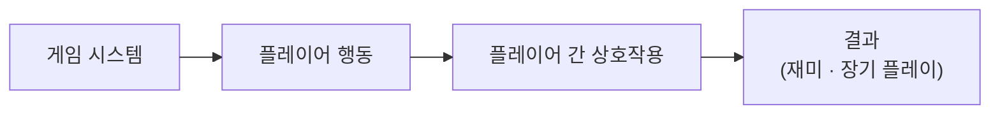

이 그림에서 볼 것은 화살표가 한 방향이라는 점입니다. 시스템이 행동을 요구하고, 그 행동이 상호작용을 만들고, 상호작용이 결과를 만듭니다. <!-- ✏️ v3 「이 그림에서 볼 것」 -->

이 틀을 **5단계 질문**으로 나눠 적용했습니다(4-5). <!-- 출처: 분석 PDF -->

| 단계 | 질문 |
|---|---|
| ① 코어 루프 | 플레이어가 전투에서 무엇을 반복하는가? |
| ② 플레이어 행동 유도 장치 | 시스템이 플레이어에게 어떤 행동을 요구하는가? |
| ③ 역할 간의 상호작용 | 그 행동이 다른 플레이어와 어떻게 연결되는가? |
| ④ 긴장과 보상 | 실패와 성공에 어떤 위험과 보상이 존재하는가? |
| ⑤ 장기 플레이 | 이 경험이 어떻게 성장·커뮤니티·장기 목표로 연결되는가? |

그래서 기능을 하나씩 나열하지 않고 이 순서로 따라갔습니다(5-2). <!-- ✏️ v3 「그래서」 -->

### 3-2. 전투 시스템 전체 구조

이 그림에서 볼 것은 하드코어 사망 리스크가 가운데에 놓여, 앞의 상호의존·상호작용과 뒤의 협력·길드를 이어 주는 자리라는 점입니다. <!-- ✏️ v3 「이 그림에서 볼 것」 -->

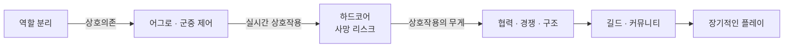

역할 분리가 상호의존을 만들고, 어그로와 군중 제어가 그 의존을 실시간 상호작용으로 바꿉니다. 하드코어의 영구 사망 규칙은 그 상호작용에서 나오는 실수 한 번의 대가를 캐릭터 삭제로 키웁니다.
이렇게 생긴 협력·경쟁·구조는 길드라는 커뮤니티로 이어지고, 길드가 오래 플레이할 이유가 됩니다. <!-- 출처: 분석 PDF -->

그래서 4장은 이 지도의 순서(역할 분리 → 어그로 · 군중 제어 → 하드코어 → 협력과 장기 플레이)대로 한 절씩 따라갑니다. <!-- ✏️ v3 「그래서」 -->

<!-- (선택) PDF의 "전투 시스템 전체 구조" 슬라이드 그림을 PNG로 저장해 images/에 넣으면 위 다이어그램 대신(또는 함께) 쓸 수 있습니다.
     PowerPoint에서 슬라이드를 고르고 [파일 → 다른 이름으로 저장 → PNG]로 저장하면 됩니다. -->

---

## 4. 핵심 분석

### 4-1. 역할 분리 — 서로 다른 책임

던전 콘텐츠는 최대 5명의 플레이어가 하나의 파티를 이루어 함께 도전합니다(탱커 1 · 딜러 3 · 힐러 1).
5명 각각이 다른 책임을 맡고, 하나의 파티로 움직이며 하나의 보스를 상대합니다. <!-- 출처: 분석 PDF -->

<!-- ✏️ 4-1·4-2·4-3의 그림 세 장은 발표 자료 개선판(pptx) 7·8·10번 슬라이드를 PNG로 꺼낸 것입니다. 그림 설명(alt)은 Claude가 쓴 것입니다. -->

*발표 자료(문서 순서판) 12번 슬라이드. 던전 보스 하나를 탱커 1 · 딜러 3 · 힐러 1의 파티가 상대합니다. 역할마다 아래에 하는 일 한 줄을 적었고, 맨 아래 줄은 이 절의 결론(한 역할이 무너지면 다른 역할도 함께 무너집니다)입니다.* <!-- ✏️ v4 캡션 줄(11-25): 앞 두 문장은 alt를 옮긴 것, 뒤 문장은 슬라이드에 보이는 글을 Claude가 설명한 것입니다. -->

| 역할 | 하는 일 |
|---|---|
| 탱커 | 적의 공격 대상을 자신에게 유지해 아군을 보호합니다. |
| 딜러 (DPS, Damage Per Second) | 위협적인 적의 스킬을 차단하거나 적 자체를 무력화합니다. 적에게 최대한 많은 피해를 주어 전투를 끝냅니다. <!-- 11-25 본인 요청으로 앞 문장을 더했습니다. --> |
| 힐러 | 파티원의 체력을 유지시켜 전멸을 막습니다. |

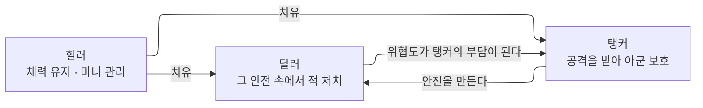

**한 역할이 무너지면 다른 역할도 함께 무너집니다** — 이것이 "협력하라"는 지시 없이도 협력이 발생하는 이유입니다. <!-- 출처: 분석 PDF -->

### 4-2. 어그로 — 몬스터는 누구를 공격하는가

몬스터에게는 "어떤 플레이어를 공격할지"를 결정하는 **위협도(Threat) 수치**가 있습니다.
탱커의 위협도가 가장 높기 때문에 몬스터는 탱커를 공격합니다. 딜러나 힐러의 위협도가 탱커를 넘어서면, 몬스터의 공격 대상이 그쪽으로 바뀝니다. <!-- 출처: 분석 PDF -->

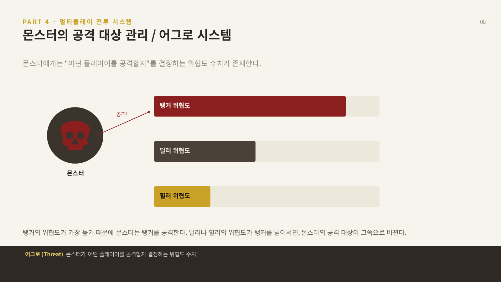
*발표 자료(개선판) 8번 슬라이드. 위협도 막대가 가장 긴 탱커를 몬스터가 공격합니다. 막대는 탱커 · 딜러 · 힐러 순서로 짧아지고, 딜러나 힐러의 막대가 탱커를 넘으면 공격 대상이 그쪽으로 바뀝니다.* <!-- ✏️ v4 캡션 줄(11-25): 둘째 문장은 alt, 셋째 문장은 그림에 보이는 막대와 위 본문 문장을 Claude가 이은 것입니다. -->

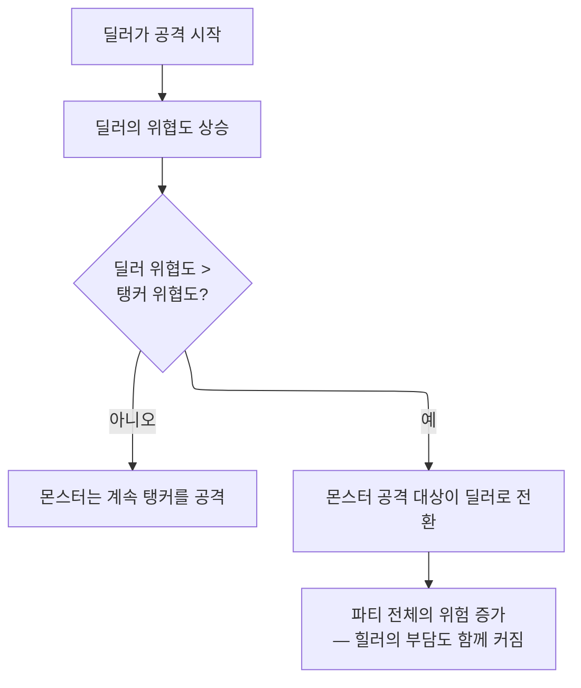

결과적으로 딜러는 **"탱커보다 위협도를 높이지 않는 선"**에서 공격 속도를 조절해야 하고,
탱커는 딜러들의 위협도를 계속 웃돌도록 자신의 위협도를 관리해야 합니다. 이 둘의 판단이 계속 서로에게 영향을 줍니다. <!-- 출처: 분석 PDF -->

### 4-3. 군중 제어(CC) — 어떤 적을, 언제, 누가

플레이어는 적을 공격하는 것 외에도, 특정 적의 행동을 일시적으로 제한할 수 있습니다(마법사: 양 변이 · 흑마법사·사제·전사: 공포 · 도적: 기절).
파티는 3마리 몬스터를 동시에 상대하는 대신, 1마리를 묶어두고(제어) 2마리에 집중합니다. <!-- 출처: 분석 PDF -->

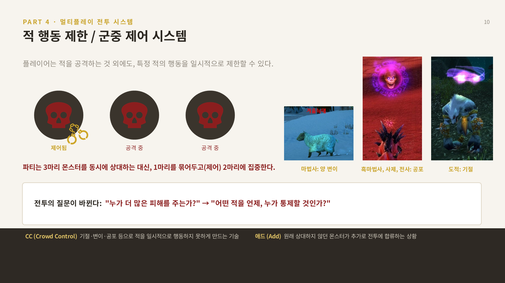
*발표 자료(개선판) 10번 슬라이드. 왼쪽은 3마리 중 1마리를 묶어 두고(제어됨) 나머지 2마리와 싸우는 모습을 그린 것이고, 오른쪽 세 장은 직접 찍은 마법사의 양 변이 · 흑마법사 · 사제 · 전사의 공포 · 도적의 기절 화면입니다.* <!-- ✏️ v4 캡션 줄(11-25): alt를 풀어 쓴 것입니다. 직업 이름은 슬라이드 글과 위 본문 그대로입니다. -->

전투의 질문이 바뀝니다: **"누가 더 많은 피해를 주는가?" → "어떤 적을 언제, 누가 통제할 것인가?"**

군중 제어가 만드는 실시간 의사결정 <!-- 출처: 분석 PDF -->

1. 어떤 적이 가장 위험한가?
2. 누가 그 적을 제어할 것인가?
3. 제어 기술의 효과는 얼마나 지속되는가?
4. 제어가 풀리기 전에 다른 적을 처치할 수 있는가?

이 판단은 혼자 내릴 수 없습니다. 파티원 각자가 자신의 몫을 실시간으로 계산하고, 서로의 타이밍에 맞춰 행동해야 합니다 —
군중 제어는 전투를 **"동시에 풀어야 하는 퍼즐"**로 만듭니다. <!-- 출처: 분석 PDF -->

### 4-4. 하드코어 — 규칙 하나가 바꾸는 것

| | 일반 클래식 | 하드코어 |
|---|---|---|
| 캐릭터가 죽으면 | 부활 가능 | 영구적으로 삭제 |
| 전투 실패의 대가 | 낮은 편입니다 | 큽니다 |
| 플레이 방식 | 위험을 감수한 플레이가 일반적 | 위험 회피와 신중한 판단이 필수 |
| 죽음의 의미 | "일시적인 불편함"에 가까움 | "돌이킬 수 없는 상실" |
| 플레이어의 관심 | 진영 간의 싸움 | 진영 간의 싸움을 내려 두고 생존과 협력 |

<!-- 출처: 분석 PDF · 마지막 줄은 본인 답변, 1-2 -->

규칙은 단 하나만 바뀝니다 — **"죽으면 끝난다."** 그러나 이 규칙 하나가 전투 시스템 전체의 의미를 바꿉니다.

<!-- ✏️ 그림 설명(alt)과 마지막 한 줄("한 역할이 무너지면…")은 Claude가 쓴 것입니다. 장면 설명은 본인 답변을 옮기고 띄어쓰기만 다듬었습니다. -->

*직접 찍은 화면. 만렙 3일 만에 보스전에서 죽은 제 캐릭터입니다. 하드코어 서버라 다시 부활할 수 없습니다. 아래 「내가 겪은 장면」이 이 전투입니다.* <!-- ✏️ v4 캡션 줄(11-25): alt를 옮기고, 직접 찍은 화면(2-1 출처 줄)과 아래 글을 가리키는 말을 더했습니다. -->

**내가 겪은 장면 — 만렙 3일 만의 죽음** <!-- 출처: 본인 답변 -->
만렙을 찍고 3일도 지나지 않았을 때입니다. 같은 파티의 힐러가 잠시 자리를 비운 것을 모르고 전투를 시작해 힐을 받지 못했습니다.
보스는 큰 피해를 주는 스킬을 시전 중이었고, 저는 보스의 속박 기술에 걸려 대처하지 못한 채 죽었습니다.
한 역할(힐러)이 빠지자 파티 전체가 무너진 장면입니다(4-1). 하드코어에서는 그 한 번의 실수가 영구 사망으로 이어졌습니다.

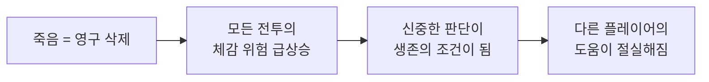

하드코어는 전투 시스템 자체를 바꾸지 않습니다. 대신 **"위험의 무게"**를 바꿉니다.
같은 시스템(역할 분리·어그로·군중 제어)이라도 실수 한 번이 캐릭터 삭제로 이어지므로, 플레이어는 모든 판단을 더 신중하게 내려야 합니다. <!-- 출처: 분석 PDF -->

### 4-5. 5단계 시스템 분석

<!-- ✏️ v4.1(11-26) 1-10 「소결정 제목」: 4-5 · 4-6 · 7-3의 굵은 소제목 15개를 #### 제목으로 바꿨습니다(글자는 그대로). 상세 문서에서 주소가 생기고, 목차는 3단계 제목까지라 길어지지 않습니다. -->
#### ① 코어 루프 — 플레이어가 전투에서 무엇을 반복하는가? <!-- 출처: 분석 PDF -->

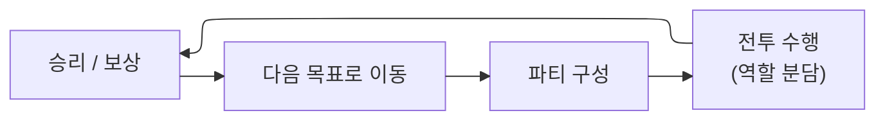

이 반복이 지루하지 않은 이유는 전투마다 파티 구성과 상대 몬스터에 따라 판단할 것이 달라지기 때문입니다.

#### ②·③ 행동 유도와 역할 간 상호작용 — 시스템은 어떤 행동을 요구하고, 그 행동은 다른 플레이어와 어떻게 이어지는가? <!-- 출처: 분석 PDF -->

<!-- ✏️ 발표 자료 개선안에 맞춰 ②·③ 두 문단을 표 하나로 합쳤습니다(4-1·4-2·4-3을 다시 설명하던 글). 표의 ③ 칸은 Claude가 PDF 문장을 줄인 것입니다 — 확인해 주세요. -->

| 시스템 | ② 요구하는 행동 | ③ 다른 역할에 미치는 영향 |
|---|---|---|
| 어그로 | 딜러: 무작정 공격하지 않기 · 탱커: 위협도를 계속 관리하기 | 딜러의 위협도가 다시 탱커의 부담이 됩니다 |
| 군중 제어 | 적을 관찰하고 우선순위 정하기 | 제어 타이밍을 서로 맞춰야 합니다(4-3) |
| 하드코어 사망 | 모든 행동에 "신중함" | 피해는 힐러의 치유로, 힐러의 마나는 파티 전체의 생존 시간으로 이어집니다 |

모든 역할의 선택이 다른 역할의 결과에 실시간으로 영향을 줍니다. 시스템이 역할끼리 서로 의존하게 만드는 방식입니다.

**내가 겪은 장면 1 — 신중하지 않은 이동 한 번** <!-- 출처: 본인 답변 -->
길을 잘 몰라 헤매다가 여러 적의 어그로를 한꺼번에 끌었고, 동시에 공격받아 죽었습니다.
하드코어 사망 규칙이 모든 행동에 "신중함"을 요구한다는 것을 보여 주는 장면입니다.
→ [플레이 영상 (YouTube Shorts)](https://www.youtube.com/shorts/m8lV63PoTOI)

<!-- ✏️ 장면 1 영상의 캡처가 맞습니다(본인 답변: 길을 잃고 몬스터에 둘러싸여 죽는 장면). 그림 설명(alt)은 Claude가 쓴 것입니다. -->

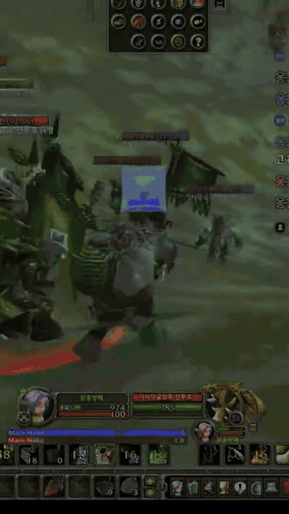
*플레이 영상(YouTube Shorts) 장면 1의 4~12초. 길을 몰라 헤매다 여러 적의 어그로를 한꺼번에 끌어, 동시에 공격받아 죽는 순간입니다. 화면의 자막은 영상에 들어 있던 것입니다.* <!-- ✏️ v4(11-26) GIF: 건우 님 허락으로 쇼츠 m8lV63PoTOI를 받아 4~12초를 잘랐습니다(GIF 촬영 목록 6절 1번, 360px · 8fps). 정지 캡처를 이 GIF로 바꿨습니다. 예전 줄:  -->

#### ④ 긴장과 보상 — 실패와 성공에 어떤 위험과 보상이 존재하는가? <!-- 출처: 분석 PDF -->

- **실패의 대가**: 하드코어에서는 파티 전멸이 곧 캐릭터의 영구적인 죽음입니다.
- **성공의 보상**: 강력한 장비, 캐릭터 성장, 그리고 "살아남았다"는 성취감. <!-- ✏️ v4 관문(11-25): 강조하는 "무엇보다"를 뺐습니다. -->

위험이 클수록 성공했을 때 느끼는 보상도 커집니다. 하드코어의 리스크-보상은 이렇게 작동합니다.

그 긴장은 협력만 만들지 않습니다. <!-- 출처: 본인 답변 -->

- **경쟁** — 하드코어 서버는 던전을 하루에 한 번만 갈 수 있습니다. 아이템을 얻을 기회가 적어, 같은 무기를 쓰는 클래스와 함께 있으면 그 무기를 두고 경쟁하게 됩니다.
- **대가** — 저는 만렙(60레벨) 캐릭터를 3번 잃고 다시 키운 적이 있고, 함께 플레이해 온 길드원 중에는 그보다 더 많이 죽은 분도 있습니다.
- **갈등** — 다른 파티원의 실수로 죽어 다툼이 생기기도 합니다.

그래서 하드코어에서의 죽음은 포기 혹은 다시 시작에 가깝습니다.

#### ⑤ 장기 플레이 — 이 경험이 어떻게 성장·커뮤니티·장기 목표로 연결되는가? <!-- 출처: 분석 PDF -->

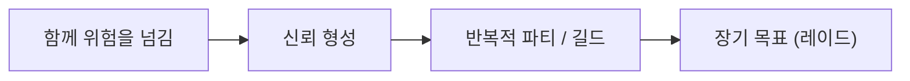

함께 위험을 넘긴 파티원끼리는 서로 믿게 되고, 같은 사람들과 다시 파티를 꾸립니다.
반복된 협력은 길드(고정 커뮤니티)가 되고, 길드는 더 크고 어려운 레이드에 도전할 목표가 됩니다.

**캐릭터가 영구 삭제되는데, 왜 다시 시작하는가?** <!-- 출처: 본인 답변 -->
함께하는 길드원과 친구, 그리고 스스로 정한 목표를 달성하기 위해서입니다. 캐릭터는 사라져도 관계와 목표는 남습니다.

**내가 겪은 장면 2 — 다시 키우던 캐릭터를 살린 길드원의 장비** <!-- 출처: 본인 답변 -->
캐릭터를 잃고 다시 키우던 중 게임이 튕겼는데, 길드원에게 지원받은 장비 덕분에 겨우 살아남았습니다.
→ [플레이 영상 (YouTube Shorts)](https://youtube.com/shorts/xF7WRmsApeA)

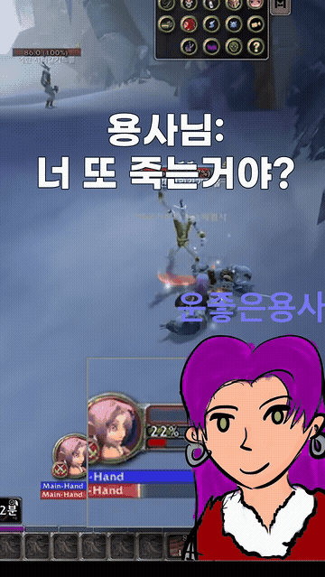
*플레이 영상(YouTube Shorts) 장면 2의 47~54초. 게임이 튕긴 뒤 다시 접속해 몬스터와 싸우다, 체력이 22%까지 내려갔다가 길드원에게 지원받은 불타는 무기 덕분에 살아남는 장면입니다. 영상 자막에 따르면 이 무기는 일정 확률로 40의 고정 피해를 줍니다. 화면의 자막은 영상에 들어 있던 것입니다.* <!-- ✏️ v4(11-26) GIF: 건우 님 허락으로 쇼츠 xF7WRmsApeA를 받아 47~54초를 잘랐습니다(GIF 촬영 목록 6절 2번, 360px · 10fps). 「불타는 무기」가 길드원에게 지원받은 장비라는 것은 11-26 본인 답변("넵 길드원에게 받았어요"), 40 고정 피해는 영상 38~41초 자막입니다. -->

전투 시스템에서 시작된 상호의존이 길드원·친구와의 오래가는 관계로 이어집니다. <!-- 출처: 분석 PDF -->

### 4-6. 죽음이 만든 문화와 경제 — 하드코어에서만 본 것

<!-- ✏️ 2026-11-25 건우 님이 퇴고하며 쓴 글(1 문화 · 2 모르면 죽는다 · 3 경제)을 v3 기준으로 다듬어 넣은 절입니다. 사실은 모두 본인 경험입니다. 다듬은 것: ① "다른 게임에서 볼 수 없는"은 제가 해 본 게임 기준으로 한정 ② 「정말 허무하다」 같은 강조는 사실로 ③ 문장을 "~습니다"로.
     확인 끝(11-25 본인 답변): 40레벨은 유저들이 「말렙」(탈것을 살 수 있는 레벨)이라고 부르는 초보자의 첫 목표 · 그늘숲 · 누더기 · 35레벨 정예 · 길을 따라 움직이는 것은 WoW 클래식 하드코어의 퀘스트와 지역 몬스터 · 비교한 다른 게임은 로스트아크 · 메이플스토리 -->

같은 전투 시스템에 "죽으면 끝난다"는 규칙 하나가 더해지자, 일반 클래식에서는 보지 못한 문화가 생겼습니다. 아래는 제가 약 2년간 하드코어 서버를 플레이하며 직접 겪은 것입니다. <!-- 출처: 본인 답변 -->

| 영역 | 죽으면 끝나서 생긴 것 | 절 |
|---|---|---|
| 서로를 대하는 문화 | 인사가 "장수하세요!"가 되고, 처음 보는 유저도 위험한 사람을 돕습니다. | ① |
| 목표와 속도 | 실력에 따라 목표가 갈리지만, 상위 콘텐츠는 초보 만렙도 함께 갑니다. | ② |
| 알아야 사는 것 | 하면 안 되는 행동과 퀘스트가 있어, 모르면 죽습니다. | ③ |
| 경제 | 낮은 레벨 장비의 거래가 활발하고, 창고 캐릭터를 따로 둡니다. | ④ |

#### ① 서로를 대하는 문화 <!-- 출처: 본인 답변 -->

- **인사** — 일반적으로는 헤어질 때 "즐겜하세요!"라고 하지만, 하드코어에서는 "**장수하세요!**"라고 합니다. 캐릭터가 죽으면 그 캐릭터로는 상대를 다시 볼 수 없기 때문입니다. <!-- ✏️ -->
- **도움** — 위험에 빠진 유저를 처음 보는 유저가 돕는 일을 일반 클래식보다 더 많이 겪었습니다.
- **다시 시작할 때** — 만렙 캐릭터가 죽을 때마다(3번), 함께 플레이하던 길드원과 다른 유저에게서 새 캐릭터의 초기 지원 물품을 받았습니다(4-5 ⑤의 장면 2와 같은 일입니다).

#### ② 저마다 정한 목표, 저마다의 속도 <!-- 출처: 본인 답변 -->

하드코어에서는 유저가 자기 실력과 시간에 맞춰 목표를 따로 정합니다. 숙련자는 만렙(60레벨) 캐릭터를 더 강하게 만들려고 레이드에 가고, 중급자는 만렙에 도달하는 여정을 가고, 초보자는 40레벨 도달을 첫 목표로 삼습니다. 40레벨은 탈것(말)을 살 수 있는 레벨이라 유저들끼리 「말렙」이라고 부르는데, 초보자는 그 전에 죽는 일이 많아 "일단 40레벨을 찍고 말부터 사자"가 대부분의 목표입니다. <!-- 출처: 본인 답변(11-25) -->

| | 제가 해 본 다른 MMORPG (로스트아크, 메이플 스토리) | WoW 클래식 하드코어 |
|---|---|---|
| 만렙 도달 | 실력과 상관없이 대부분 도달합니다. | 실력에 따라 도달 가능성이 다릅니다(60레벨). |
| 상위 콘텐츠의 조건 | 까다롭습니다. 숙련자와 장비를 갖춘 유저를 선호합니다. | 다소 낮습니다. 만렙 유저가 많지 않아, 레이드 경험이 없는 초보 만렙도 함께하는 유저들이 챙겨 주며 같이 갑니다. |

<!-- ✏️ v4 퇴고(11-25): 표 머리 괄호 앞뒤 빈칸만 지웠습니다. 왼쪽 열 게임은 건우 님이 표 머리에 직접 적었습니다(로스트아크, 메이플 스토리). 남아 있던 메모 원문: "일반 클래식, 메이플 스토리, 로스트 아크,  왼쪽 열이 어느 게임인지(예: 일반 클래식, 다른 MMORPG) 정해 주세요. 지금은 "제가 해 본 다른 MMORPG"로 한정했습니다." -->

#### ③ 알아야 사는 것 — 모르면 죽습니다 <!-- 출처: 본인 답변 -->

하드코어에는 피해야 하는 퀘스트와 행동, 위협적인 몬스터가 있고, 마주치면 살아 돌아올 확률이 낮습니다. 예를 들면 다음과 같습니다.

- 필드에서 혼자 동굴에 들어가는 것
- 그늘숲 지역의 35레벨 정예 몬스터 누더기 — 20레벨 초반~30레벨 초반 캐릭터가 퀘스트를 하러 머무는 지역에서, 마을로 가는 길을 따라 움직입니다. 길을 가다 마주치면 죽음을 피하기 어렵습니다.

5-1에서 말한 "모르면 죽는다"가 이런 것입니다. 4-5 ①의 장면 1(길을 몰라 헤매다 죽음)도 같은 종류입니다. <!-- ✏️ -->

#### ④ 경제 — 거래와 경매장 <!-- 출처: 본인 답변 -->

- **낮은 레벨 장비의 거래** — 죽으면 캐릭터를 다시 키워야 하기 때문에, 레벨을 올리는 단계에서 쓰는 낮은 레벨 아이템이 경매장과 유저 사이 거래에서 계속 팔립니다. 일반적인 RPG에서는 높은 레벨에 유저가 몰려 낮은 레벨 아이템 시장이 식는데, 하드코어에서는 그렇지 않았습니다. <!-- ✏️ -->
- **창고 캐릭터** — 1레벨 캐릭터를 레벨링하지 않고 은행처럼 두고, 골드와 귀한 아이템을 보관합니다. 죽으면 캐릭터뿐 아니라 가진 골드와 아이템도 모두 잃기 때문에, 창고 캐릭터를 만드는 것이 당연하게 여겨졌습니다.

---

## 5. 분석하며 정한 것

### 5-1. 분석 대상 — 일반 클래식 vs 하드코어

<!-- ✏️ v3 결정 표(11-25). 아래 설명은 건우 님 원문 그대로이고, 표만 더했습니다. [A] 일반 클래식을 고르지 않은 이유의 반대쪽(장점)은 원문에 없어 ❓로 두었습니다. -->
<!-- ✏️ v4(11-25) 「정한 사람」 행: 고름은 1-2 · 5-1 본인 답변, 표를 만든 것은 이 주석 위 줄이 근거입니다. 「두 안」은 11-26 본인 답변("처음부터 하드코어를 정했어")입니다. -->

> **결정 대상** 분석 대상을 일반 클래식과 하드코어 중 무엇으로 할 것인가
>
> | | [A] 일반 클래식 | **[B] 하드코어 ✓** |
> |---|---|---|
> | 전투 시스템 | 같습니다. | 같습니다. |
> | 다른 점 | — | 죽음을 처리하는 방식 하나(영구 삭제)입니다. |
> | 고른 이유 | 2004년 오리지널 와우를 다시 한번 그대로 즐길 수 있습니다. | 이 규칙 하나가 만든 경험의 차이를 직접 겪었습니다. |
> | 정한 사람 | 기준 · 고름: 저(약 2년 직접 플레이한 경험) · 두 안: 그때는 비교하지 않음(처음부터 하드코어) · 문서를 정리하며 비교(11-25) · 표 작성: Claude | |
>
> **[B]를 골랐습니다.** 같은 시스템에서 규칙 하나가 만든 차이를 볼 수 있기 때문입니다.

두 서버는 전투 시스템이 같고 사망 규칙만 다릅니다(4-4 비교 표). 하드코어를 고른 이유는 이 규칙 하나가 만든 경험의 차이를 직접 겪었기 때문입니다.

분석 대상은 처음부터 하드코어로 정했습니다. 일반 클래식도 해 보았지만 하드코어만큼 재미있지 않았습니다. 하드코어를 한 사람은 하드코어만 하게 됩니다. 죽기 직전에 살아남고, 함께 살아남고, 도전해서 이겨낸 보람이 더 크기 때문입니다. <!-- 출처: 본인 답변(11-26). ✏️ 원문 "클래식도 했지만, 하드코어 만큼 재미가 없거든 . 하드코어 한사람은 하드코어만 하게 돼. 죽기 직전에 살아남고, 함께 살아남고 도전해서 이겨낸 보람이 더 커"를 "~습니다"로만 바꿨습니다. -->

WoW 하드코어를 처음 했을 때 저는 큰 충격을 받았습니다. 20년 전 게임의 완성도 위에 죽으면 끝이라는 규칙 하나가 더해지자,
플레이하는 내내 전투의 매 순간과 대처를 계속 생각해야 했습니다. "모르면 죽는다" 싶은 순간도 여러 번 겪었습니다.
**단순한 규칙 하나를 더하는 것만으로도 새로운 경험을 줄 수 있다**는 것을 이때 깨달았습니다. <!-- 출처: 본인 답변 -->

### 5-2. 분석 틀 — 기능 나열 대신 인과로

<!-- ✏️ v3 결정 표(11-25). 아래 설명은 건우 님 원문 그대로이고, 표만 더했습니다. [A]의 장점은 원문에 없어 로 두었습니다. -->
<!-- ✏️ v4(11-25) 「정한 사람」 행: 고른 이유는 본인 답변(11-09)입니다. 분석 틀(3-1 그림 · 5단계 질문)은 8월 발표 자료에 이미 있었고, 「틀: 저」는 11-26 본인 답변("시스템 - 행동 - 상호작용 - 결과는 내가 틀을 잡았어")입니다. 같은 답에 "이틀은 claude 무료 버전의 도움을 받았던 거 같아"가 있어, 기록을 찾아 확인했습니다: 틀과 5단계 질문은 8/17 건우 님이 Claude에게 준 제작 지시문에 이미 있고, Claude의 답에는 나오지 않습니다. 근거: claude.ai 대화 기록 — 8/14 「월드오브워크래프트 클래식과 하드코어 서버 분석」(cedc6745) · 8/17 「Presentation script and visual QA」(ce189a0c, 첫 메시지에 첨부한 「WoW 클래식 하드코어 전투 시스템 분석 — 최종 PPT 제작 프롬프트」 8,022자). 11-26 Claude가 건우 님 로그인으로 읽음. -->

> **결정 대상** 분석 틀을 기능 나열로 할지, 인과로 따라갈지
>
> | | [A] 기능 나열 | **[B] 시스템 → 행동 → 상호작용 → 결과 ✓** |
> |---|---|---|
> | 설명하는 방식 | 전투 기능을 하나씩 설명합니다. | 유저들이 시스템 안에서 서로 상호작용해 만드는 결과까지 따라갑니다. |
> | 장점 | 전투 기능에 대한 상세한 설명을 통해 전투 시스템을 이해할 수 있습니다. | 플레이어가 없으면 의미가 없는 시스템을, 플레이어의 결과로 설명할 수 있습니다. |
> | 정한 사람 | 틀 · 고름: 저(8월 발표 자료 제작 지시문에 직접 씀, 6-3) · 두 안: 문서를 정리하며 비교(11-25) · 표 작성: Claude | |
>
> **[B]를 골랐습니다.** 게임을 존재하게 하는 것은 그 결과이기 때문입니다.

전투 기능을 하나씩 설명하는 대신, 3-1의 시스템 → 행동 → 상호작용 → 결과 순서로 분석했습니다.

WoW에서 전투는 빼놓을 수 없는 핵심 시스템입니다. 하지만 플레이어가 없다면 이 시스템은 아무 의미가 없습니다.
게임을 존재하게 하는 것은 유저들이 이 시스템 안에서 서로 상호작용해 만드는 결과이기 때문입니다. <!-- 출처: 본인 답변 -->

---

## 6. AI 협업

### 6-1. 장마다 AI가 한 것과 제가 한 것

<!-- ✏️ v4(11-26) 「발표 자료(8월)」 줄 근거: claude.ai 대화 기록 — 8/14 「월드오브워크래프트 클래식과 하드코어 서버 분석」(cedc6745) · 8/17 「Presentation script and visual QA」(ce189a0c, 첫 메시지에 첨부한 「WoW 클래식 하드코어 전투 시스템 분석 — 최종 PPT 제작 프롬프트」 8,022자). 11-26 Claude가 건우 님 로그인으로 읽음. 22장은 1-3 표의 「발표 당시 22장」과 같습니다. -->
<!-- ✏️ v4.1(11-26) 1-10 「장 첫머리」: 장 전체를 모은 이 표를 장 맨 앞 절로 옮겼습니다(예전 6-4). v4(11-25) ④ 가리키기 표: 칸마다 그 절의 숨김 주석(✏️ · 출처)과 6-1 표를 모은 것입니다. 새 사실은 없습니다. -->

| 장 | AI(Claude)가 한 것 | 제가 한 것 |
|---|---|---|
| 1 개요 | 발표 자료의 글을 옮겨 경어체로 바꾸고, 용어 풀이(전쟁 서버 · 어그로 · 군중 제어)를 괄호로 더했습니다. | 분석 질문 · 고른 이유 · 분석 기간을 정하고 답했습니다. |
| 2 게임 디자인 | 슬라이드 문장을 이어 2-2 전투 한 번의 흐름 표를 만들었습니다. | 2-1 기본 구조와 하드코어의 기원을 8월 발표 자료에 정리했습니다. |
| 3 분석 구조 | 그림 앞뒤 문장(「이 그림에서 볼 것」 · 「그래서」)을 썼습니다. | 분석 틀과 전투 시스템 전체 구조가 담긴 8월 발표 자료를 만들었습니다. |
| 4-1 ~ 4-4 | 그림 설명(alt · 캡션 줄)을 썼습니다. | 분석 내용, 직접 찍은 게임 화면, 만렙 3일 만의 죽음 장면, 딜러 역할 문장(4-1)을 썼습니다. |
| 4-5 | ② · ③ 두 문단을 표 하나로 합치고 ③ 칸을 줄였습니다. | 직접 겪은 장면 2개와 플레이 영상, 경쟁 · 대가 · 다시 시작하는 이유를 답했습니다. |
| 4-6 | 구조와 말투를 다듬었습니다. | 글 전부를 쓰고, 말렙 · 누더기 · 비교한 게임을 확인했습니다. |
| 5 정한 것 | 결정 표를 만들었습니다(11-25). | 고른 쪽과 고른 이유를 썼습니다(5-1 · 5-2). |
| 7-1 · 7-2 | 4장 문장을 줄여 분석 질문 순서로 표를 만들고, 원칙 문장을 줄였습니다. 7-2는 발표 자료 18번 슬라이드를 옮겼습니다. | 원칙 세 줄(발표 자료)과 어그로 설계 세 규칙을 냈습니다. |
| 7-3 | 검토 질문 7개 · 외부 자료 조사 · [A] 칸 · 상태 표를 만들고, 제 답을 내용에 맞는 자리로 옮겼습니다. | 부활 이벤트 아이디어와 규칙, 질문 7개의 답을 쓰고 [B]를 골랐습니다. |
| 발표 자료(8월) | 8/14 WoW 클래식과 하드코어 서버의 차이를 요약했습니다. 8/17 제 제작 지시문대로 발표 자료 21장을 만들고, 하드코어의 기원 슬라이드를 더해 22장으로 만들었습니다. | 분석 질문 · 분석 틀 · 5단계 질문 · 슬라이드 구성 · 용어 규칙을 담은 제작 지시문을 썼고, 8/18에 발표했습니다(6-3). |
| 발표 자료(11월) | 개선안(겹치는 곳 7곳 · 질문 9개)을 내고 PPTX를 고쳐 개선판(19장)과 문서 순서판(37장)을 만들었습니다. | 질문에 답하고, 개선안과 목차 안을 보고 골랐습니다. 문서 순서로 다시 만들자고 정했습니다(6-3). | 

### 6-2. 발표 자료를 문서로 옮긴 방법 — AI와 나눈 일

<!-- ✏️ 2026-11-18 답변을 옮겨 Claude가 정리한 절입니다. "잘 된 것·안 된 것"은 Claude가 예로 든 문장을 본인이 맞다고 한 것입니다 — 본인 말투로 다듬어도 됩니다. -->

발표 PDF(22장)를 이 문서로 옮기는 일은 Claude와 함께 했습니다. 구조는 제가 정했고, 옮기고 줄이는 일은 Claude에게 맡겼습니다. <!-- 출처: 본인 답변 -->

| 한 일 | 맡은 쪽 |
|---|---|
| 22장을 5단 구조(개요 → 구조 → 핵심 → 정한 것 → 결과)로 나누기로 정했습니다 | 직접 — 강사님이 제안하신 문서 구조로 만들려는 의도였습니다 |
| PDF의 글을 각 절에 나눠 옮기고 경어체로 바꿨습니다 | Claude |
| 4-5 표의 ③ 칸, 7-1의 원칙 문장을 줄였습니다 | Claude |
| 4-6 · 7-3의 글(하드코어 문화 · 경제 · 한계 · 부활 이벤트)을 직접 쓰고, 구조와 말투를 다듬는 일 | 내용은 직접(2026-11-25), 퇴고는 Claude — 제 경험이 아닌 문장이 들어오지 않게 제 원문과 견줘 확인했습니다 <!-- ✏️ 11-25 "건우 님 원문"을 1인칭으로 바꿨습니다. --> |

<!-- ✏️ v4(11-25) 「AI 협업 장 네 칸」(통합본 v4 1-8): (11-26 v4.1 순서) 6-1 ④ 장마다 가리키기 표 · 6-2 ① 일을 시키는 구조 · 6-3 ② 실제 지시문 · 6-4 ③ AI가 틀린 곳으로 나눴습니다. 「확인 방법」과 「안 된 것」은 6-4로 옮겼고 문장은 그대로입니다.
     아래 「일하는 규칙」 근거: 레포 CLAUDE.md 원칙 1 · 3 · 문단마다 숨김 출처 주석(커밋 4e16a19) · Present File/발표자료-개선안.md 0절 답변 반영표(Q1~Q9) · 7-3 주석(검토 질문 · 외부 자료 조사). -->

**일하는 규칙** — Claude에게 일을 맡길 때 아래 네 가지를 지키게 했습니다. <!-- ✏️ -->

- **사실은 제 자료에서만** — 레포의 규칙 파일(`CLAUDE.md`)에 있는 「지어내지 않는다」를 그대로 따랐습니다. 문단마다 그 글이 발표 자료에서 왔는지 제 답변에서 왔는지를 숨김 주석으로 달았습니다. <!-- ✏️ -->
- **모르는 것은 질문으로** — 발표 자료를 고칠 때 Claude가 필요한 것을 질문 9개(Q1~Q9)로 만들고, 제가 답한 것만 넣었습니다. 발표일, 직접 겪은 장면 2개, 경쟁, 대가, 다시 시작하는 이유가 이렇게 들어왔습니다. <!-- ✏️ -->
- **Claude가 쓴 문장은 표시** — Claude가 줄이거나 새로 쓴 문장에는 ✏️ 표시를 달아, 제가 읽고 확인할 목록으로 남겼습니다. <!-- ✏️ -->
- **검토도 Claude에게** — 7-3 부활 이벤트는 Claude에게 검토를 맡겨 「시스템으로 만든다면 물어야 할 것」 7개를 받고, 외부 자료 조사도 맡겼습니다. 질문에 대한 답은 제가 썼습니다. <!-- ✏️ -->

- **잘 된 것** — 발표 자료를 문서로 옮기는 시간이 줄었습니다. <!-- 출처: 본인 답변 -->

### 6-3. 실제로 준 지시 세 가지

<!-- ✏️ v4(11-25) ② 실제 지시문: 11월 두 지시문의 따옴표 안은 작업 기록(claude-worklog — 11-09 세션 078e7e56 18:01 요청 · 11-25 세션 9ae01bcb 요청)의 원문 그대로이고, 맞춤법도 고치지 않았습니다. 결과 문장의 근거: 발표자료-개선안.md 1절(겹치는 말 7곳 · 22장 → 18장) · 1-3 표(개선판 19장 · 문서 순서판 37장) · 커밋 7c9706d. -->

Claude에게 준 말 원문입니다. 무엇을 할지는 제가 정했고, 어떻게 나눌지는 Claude가 낸 안을 보고 골랐습니다. <!-- ✏️ -->

> 「이 발표는 월드 오브 워크래프트 클래식을 소개하는 팬 발표가 아니다. … 모든 내용을 다음 관점으로 분석한다. 게임 시스템 → 플레이어 행동 → 플레이어 간 상호작용 → 결과 → 장기적인 재미」 — 2026-08-17, 발표 자료 제작 지시문(「최종 PPT 제작 프롬프트」)의 1절

이 지시문에는 역할 · 청중 · 용어 규칙 · 슬라이드 21장의 구성 · 5단계 분석 질문 · 반드시 지킬 제작 규칙 10개를 적었습니다. Claude는 이대로 발표 자료 21장을 만들었고, 제가 하드코어의 기원 슬라이드를 하나 더 요청해 발표 당시의 22장이 되었습니다. 이 문서의 분석 질문(1-2)과 분석 틀(3-1)이 여기서 왔습니다. <!-- ✏️ v4(11-26) 따옴표 안은 지시문 원문에서 굵게 기호만 뺀 것입니다(… 는 사이의 두 문장 생략). 근거: claude.ai 대화 기록 — 8/14 「월드오브워크래프트 클래식과 하드코어 서버 분석」(cedc6745) · 8/17 「Presentation script and visual QA」(ce189a0c, 첫 메시지에 첨부한 「WoW 클래식 하드코어 전투 시스템 분석 — 최종 PPT 제작 프롬프트」 8,022자). 11-26 Claude가 건우 님 로그인으로 읽음. 지시문의 절 제목: 역할 · 발표 제목 · 청중 · 설명 원칙 · 용어 규칙 · 하단 주석 · 이미지 규칙 · 발표 전체 구성(PART 1~7, Slide 1~21) · 핵심 전투 시스템 · 5단계 분석 프레임 · 최종 시스템 구조 · 인사이트 5개 · 최종 메시지 · 제작 규칙 10개. -->

> 「이 분석 자료도 개선했음 하는데, 중복되는 부분이 있어서 그런 부분은 정리해야 할 거 같고, 보완 되야 할 부분도 함께 개선하자」 — 2026-11-09, 발표 PDF를 붙여서

Claude는 같은 말이 여러 장에 되풀이되는 곳 7곳을 표로 찾아 22장을 18장으로 줄이는 개선안을 냈습니다. 보완할 곳(직접 겪은 장면 · 경쟁 · 대가)은 질문으로 받아 제 답만 넣었고, 이 개선안을 거쳐 나온 것이 개선판(19장)입니다. <!-- ✏️ -->

> 「발표 자료도 기술문서와 같은 목차 목록으로 새로 만드는 게 더 좋아보이는데, 디자인이랑 핵심 자료는 어차피 있으니 그대로 사용하되, 기술문서와 같은 형채로 슬라이드를 보여주는게 더 바람직해 보여.」 — 2026-11-25

디자인과 핵심 자료는 개선판 것을 그대로 쓰고, 이 문서의 목차 순서로 다시 짠 문서 순서판(37장)이 나왔습니다(1-3 자료). <!-- ✏️ -->

### 6-4. AI가 틀린 곳과 확인한 방법

- **안 된 것** — 제 경험이 아닌 문장이 섞여 들어와, 다시 고쳐야 했습니다. <!-- 출처: 본인 답변 -->
- **확인 방법** — Claude가 줄이거나 새로 쓴 문장은 직접 읽어 보고, 약 2년간 플레이한 제 경험과 견줘 맞는지 확인했습니다. <!-- 출처: 본인 답변 -->
- **확인할 문장을 찾는 법** — Claude의 문장에는 모두 ✏️ 표시가 붙어 있어(6-2), 그 문장만 골라 읽습니다. 확인을 마치기 전까지는 문서 맨 위 「확인 목록」에 남겨 둡니다. <!-- ✏️ -->
- **사례 — 분석 시기를 거꾸로 쓴 문장** — Claude가 이 문서를 처음 만들 때(2026-11-09) 작성 안내에 "이 분석은 프로젝트를 만든 뒤에 했다"고 썼습니다. 제가 분석 기간(8월)을 알려 주자, Claude가 다른 프로젝트보다 시기가 앞서거나 겹친다는 것을 보고 "프로젝트 설계에 반영하지 않은 분석"으로 고쳤습니다. 그 전에 제가 "설계에 반영하지 않았다"고 답한 것과도 맞지 않는 문장이었습니다. 그 뒤로 이 문서에는 "이 분석을 보고 설계했다"는 말을 쓰지 않습니다. <!-- ✏️ v4(11-26) 본인 답변("네")으로 넣었습니다. 근거: claude-worklog 11-09 세션 078e7e56 두 번째 요청의 Claude 답("제가 쓴 문장 하나를 바로잡았습니다 … 프로젝트 설계에 반영하지 않은 분석으로 고쳤습니다"). 발견 · 수정: Claude, 근거가 된 기간: 저. -->

---

## 7. 결과 · 보완 시스템 제안 <!-- 11-25 장 이름을 「결과와 다음 분석 계획」에서 바꿨습니다(본인 요청). -->

### 7-1. 결과 — 분석 질문에 대한 답

<!-- ✏️ v3 재배치(11-25): 7-1 결론과 7-2 인사이트를 이 절로 모았습니다. 표는 4장의 문장을 줄여 1-2 분석 질문의 순서대로 놓은 것입니다 — 확인해 주세요. 원칙 세 줄은 발표 자료 17번 슬라이드의 것입니다. -->

1-2의 분석 질문에 대한 답입니다. 질문에서 물은 순서(서로 의존하게 → 상호작용하게 → 재미와 장기 플레이로)대로 적었습니다. <!-- ✏️ -->

| 분석 질문 | 답 | 근거 |
|---|---|---|
| 어떻게 플레이어들이 서로 의존하게 만드는가 | 역할을 나눕니다. 한 역할이 무너지면 다른 역할도 무너지므로, 협력하라고 시키지 않아도 협력이 생깁니다. | 4-1 |
| 어떻게 상호작용하게 만드는가 | 어그로는 딜러와 탱커의 판단이 서로에게 영향을 주게 하고, 군중 제어는 제어 타이밍을 서로 맞추게 합니다. | 4-2 · 4-3 |
| 하드코어는 무엇을 바꾸는가 | 시스템은 그대로 두고 실수 한 번의 무게(영구 삭제)만 바꿉니다. 그 위에 인사 · 도움 · 거래 같은 문화가 생겼습니다. | 4-4 · 4-6 |
| 그 상호작용이 재미와 장기 플레이로 어떻게 이어지는가 | 함께 위험을 넘기며 신뢰가 쌓이고, 반복된 협력이 길드가 되어 레이드 같은 장기 목표가 됩니다. | 4-5 ⑤ |

같은 규칙에서 나온 한계(계속할 동기가 유저에게만 있음 · 초고난이도 콘텐츠가 닫혀 있음)와 보완 제안은 7-3에 있습니다. <!-- ✏️ -->

> "WoW 클래식의 멀티플레이 재미는 여러 명이 함께 플레이한다는 사실에서 발생하는 것이 아니라,
> 전투 시스템 자체가 플레이어들이 서로 필요하도록 설계되어 있기 때문에 발생한다."
<!-- 출처: 분석 PDF -->

**핵심 통찰** — 전투 시스템은 "몬스터를 처치하는 기능"이 아니라, **"플레이어들의 행동을 서로 연결하는 장치"**로도 설계될 수 있습니다. <!-- 출처: 분석 PDF -->

게임을 만들 때 원칙으로 가져갈 것은 세 가지입니다. <!-- 출처: 분석 PDF 17번 슬라이드 -->

1. 협력을 강요하기보다 서로의 능력에 의존하게 만듭니다. 의존이 강하면 복잡한 사회 시스템 없이도 플레이어 사이에 관계가 생깁니다(4-1 · 4-5 ⑤).
2. 위험이 커질수록 다른 플레이어의 도움이 갖는 가치도 커집니다(4-4).
3. 규칙 하나로 기존 시스템의 긴장도를 다시 정할 수 있습니다(4-4 · 5-1).

### 7-2. 분석을 구현으로 — 어그로 시스템을 직접 만든다면

<!-- ✏️ 발표 자료 개선판 18번 슬라이드(「분석을 구현으로 — 어그로 시스템 설계」)를 옮겼습니다. 11-25 건우 님이 문서에 넣기로 했습니다. 슬라이드의 세 줄과 아래 문장 그대로이며 코드는 만들지 않았습니다. -->

분석한 어그로(4-2)를 유니티로 직접 만든다면 아래 세 가지 규칙으로 설계할 것입니다. 구현한 것이 아니라 설계입니다. <!-- ✏️ -->

| 규칙 | 내용 |
|---|---|
| 피해량 | 몬스터의 위협도는 플레이어의 공격으로 피해를 입은 만큼 올라갑니다. |
| 역할 가중치 | 공격마다 위협도 수치가 다르게 적용됩니다. 탱커와 딜러의 차별점을 두기 위한 장치입니다. |
| 도발 | 탱커는 강제로 위협도를 가져오는 스킬(도발)로 몬스터의 공격 대상이 될 수 있습니다. |

**몬스터는 위협도가 가장 높은 플레이어를 공격합니다.** 분석한 시스템을 코드로 옮기기 위한 설계입니다. <!-- 출처: 분석 PDF 18번 슬라이드 -->

### 7-3. 하드코어의 한계와 보완 제안

<!-- ✏️ 2026-11-25 건우 님의 아이디어(4 한계 · 부활 이벤트)를 v3 기준으로 다듬은 절입니다. 한계 두 가지는 본인 경험이고, 부활 이벤트는 **제 제안이며 검증하지 않았습니다**. 이 분석은 프로젝트 설계에 반영하지 않았으므로 "적용했다"는 말은 쓰지 않았습니다.
     뺀 문장(원문 보관): "(중요한 건 꺾이지 않는 마음은 와우 하드코어에서도 적용 된다)" · "정말 허무하다" · "굉장히 폐쇄적이다" -->
<!-- ✏️ 11-25 2차 퇴고: 「물어야 할 것」 표의 내 답 7칸(건우 님이 직접 쓴 글)을 내용에 맞는 자리로 옮겼습니다.
     목적(5번) → 결정 표 · 부활자 설정과 기록(2 · 3번) → 「부활자는 어떤 캐릭터인가」 · 규칙(1 · 2 · 6번) → 생존자 · 부활자 표 · 근거(4번) → 기대 효과 · 의도(7번) → 한계 ①.
     표의 내 답 칸에는 한 줄 요약만 남겼습니다. 원문은 이 절 맨 아래 숨김 주석에 그대로 있습니다. -->

4-6의 문화를 만든 하드코어 규칙에는 같은 규칙에서 나오는 한계도 있습니다. 이 절에서는 그 한계 두 가지와, 제가 낸 보완 제안을 적습니다. <!-- 출처: 본인 답변 -->

#### 한계 ① 계속 플레이할 동기가 유저에게만 있습니다 — 하드코어가 의도한 대가입니다

작은 실수 하나로 죽을 수 있고, 만렙에서 죽으면 그 캐릭터는 더 플레이할 수 없습니다. 죽으면 끝나기 때문에 생기는 상실감을 달래고 다시 플레이하게 하는 동기를 게임이 주지 않아, 그것이 전부 유저 자신에게 달려 있습니다(4-5 ⑤의 "스스로 정한 목표"). 저는 이것을 결함이 아니라 하드코어가 의도한 대가로 봅니다. 그래서 아래 보완 제안은 "죽으면 끝난다"는 규칙을 바꾸지 않고, 죽은 캐릭터에 대한 아쉬움만 따로 다룹니다. <!-- ✏️ 앞 문장은 7번 답("의도의 대가 맞다고 봅니다"), 뒤 문장은 5번 답의 목적을 이어 쓴 것입니다. -->

#### 한계 ② 초고난이도 콘텐츠가 닫혀 있습니다

살아남은 유저들이 남는 서버라, 초고난이도 콘텐츠는 위험도 크고 보상도 큰(하이 리스크 하이 리턴) 곳이 됩니다. 난이도가 낮은 상위 콘텐츠는 초보도 환영하지만, 초고난이도 콘텐츠는 숙련자와 배울 의지가 있는 유저만 받습니다. 공략을 모르면 죽기 때문입니다.

#### 보완 제안 — 부활 이벤트

*(제가 낸 아이디어이며 구현하거나 검증하지 않았습니다)*

이 제안의 목표는 **소중히 키운 캐릭터가 죽어 하드코어 서버에서 더는 볼 수 없게 된 아쉬움을, 이벤트로 달래 주는 것**입니다. <!-- 출처: 본인 답변(5번) -->

> **결정 대상** 죽어서 하드코어 서버에서 볼 수 없게 된 캐릭터를 어떻게 할 것인가
>
> | | [A] 지금대로 둔다 | **[B] 정해진 때 부활시킨다 ✓** | [C] 일반 서버로 옮긴다 |
> |---|---|---|---|
> | 죽은 캐릭터 | 하드코어 서버에서 다시 플레이할 수 없습니다. | 이벤트 때 부활해, 하드코어 서버에서 「부활자」로 다시 플레이합니다. | 일반 서버에서 계속 플레이하지만, 하드코어 서버로는 돌아오지 못합니다(WoW 공식 규칙). |
> | 아쉬움 | 그대로 남습니다. | 달랠 수 있습니다. | 하드코어 유저에게는 남습니다. 하드코어 서버에서 살아남은 캐릭터를 가진 것이 플레이하는 이유이기 때문입니다. |
> | 생존자의 기록과 경제 | 영향이 없습니다. | 부활자를 생존자와 나눠 기록하고 거래를 막아 지킵니다(아래 규칙 표). | 하드코어 서버 안에서는 영향이 없습니다. |
> | 선례 | 지금의 WoW 클래식 하드코어 | 조사한 범위에서 찾지 못했습니다. | WoW · Path of Exile · OSRS |
> | 정한 사람 | 기준 · 고름: 저(아쉬움을 달래기) · 두 안: [B] 저 · [A] Claude 작성 · [C] Claude의 검토 질문과 자료 조사 → 추가: 저 | | |
>
> **[B]를 골랐습니다.** [A]로는 아쉬움이 그대로 남습니다. [C]는 이미 있는 길이지만 하드코어 서버로 돌아오지 못해, 하드코어를 계속 플레이하는 사람에게는 큰 의미가 없습니다. [B]는 기독교의 부활절에서 착안한 이벤트로, 1년에 한 번이나 정한 기간에 죽은 캐릭터 하나를 다시 살릴 수 있게 합니다. <!-- ✏️ [A]는 건우 님 원문에 없어 「지금대로」로 채웠고, [C]는 5번 답으로 넣었습니다. [C]의 「생존자의 기록과 경제」 칸은 제 추론, 선례 칸은 조사 결과입니다. -->
<!-- ✏️ v4(11-25) 「정한 사람」 행: 근거는 바로 위 주석([A] · [C]가 들어온 경위)과 아래 「물어야 할 것」 표 다섯째 줄(질문 · 조사 · 내 답)입니다. -->

#### 부활자는 어떤 캐릭터인가

부활자는 영혼이 돌아온 캐릭터가 아니라, 죽은 육체만 흑마법으로 되살린 존재로 설정합니다. 하드코어 서버에서 부활한 캐릭터는 살아 있는 유저들에게 환영받지 못할 것입니다. 2년 동안 하드코어를 플레이한 경험으로는, 부활자를 살아 있는 캐릭터로 기록하면 많은 유저가 반발할 것으로 예상합니다. 그래서 부활자는 생존자로 기록하지 않습니다. 이 이벤트는 생존 기록을 되돌려 주는 제도가 아니라, **죽은 캐릭터를 다시 플레이하고 싶은 유저를 위한 이벤트**입니다. <!-- 출처: 본인 답변(2 · 3번). 원문의 비유 "나루토의 예토전생한 호카게와 같은 존재"는 문서에서는 설명으로 바꿨습니다. 면접에서 말로 설명할 때 쓰기 좋은 비유입니다. -->

#### 생존자와 부활자의 규칙

하드코어 서버의 캐릭터를 생존자와 부활자 두 상태로 나눕니다.

| | 생존자 | 부활자 |
|---|---|---|
| 하드코어 기록 | 살아 있는 캐릭터로 남습니다. | 생존자로 기록하지 않습니다. |
| 죽기 전 장비와 아이템(창고 포함) | — | 그대로 돌려받습니다. |
| 죽기 전 골드 | — | 0으로 초기화합니다. |
| 새 장비 획득 | 됩니다. | 안 됩니다. |
| 소비 아이템 · 몬스터를 잡아 얻는 골드 | 됩니다. | 됩니다. |
| 던전 · 레이드 입장 | 평소 규칙대로 들어갑니다. | 던전은 던전마다 하루 1회입니다. 레이드는 종류와 상관없이 한 주에 1회만 참여하고, 한 레이드에 참여하면 그 주에는 다른 레이드에 참여할 수 없습니다. |
| 플레이어 간 거래(아이템 · 골드) · 경매장 | 됩니다. | 안 됩니다. WoW 클래식 하드코어에 이미 있는 자수성가 모드의 거래 제한을 가져다 씁니다. |
| 이벤트가 끝난 뒤 | — | 부활자로 남아 계속 플레이합니다. |
| 다시 죽으면 | 하드코어 서버에서 더 플레이할 수 없습니다. | 생존자와 같이 더 플레이할 수 없습니다. 다시 부활하려면 다음 이벤트를 기다립니다. |

<!-- 출처: 본인 답변(11-25) — 자수성가 모드는 직접 얻은 장비는 쓸 수 있습니다. 「새 장비 획득 금지」와 「던전 · 레이드 입장 제한」은 이 제안이 더하는 규칙입니다. 입장 횟수(레이드는 한 주에 1회) · 이벤트 뒤 · 다시 죽으면은 11-25 두 번째 답입니다. -->

WoW에서는 레이드 장비를 얻는 것이 골드를 버는 것보다 가치가 크기 때문에, 장비는 돌려주고 골드는 초기화합니다. <!-- 출처: 본인 답변(1번) -->

새 장비 획득 금지는 자수성가 모드에도 없는 제한입니다. 자수성가 모드는 거래를 막을 뿐, 직접 얻은 장비는 쓸 수 있게 합니다. 이 제한을 더한 것은 살아 있는 유저를 위해서입니다. WoW에는 던전과 레이드에서 나온 아이템을 주사위와 입찰로 플레이어끼리 공정하게 나누는 방식이 있습니다. 그런데 하드코어에서 부활자는 원칙적으로 있어서는 안 되는 존재입니다. 그런 캐릭터가 살아 있는 유저와 같은 아이템을 두고 경쟁하면, 살아 있는 유저에게는 불편한 경험이 됩니다. <!-- 출처: 본인 답변(11-25). ✏️ "굉장히 불편한 경험"의 "굉장히"는 강조 부사라 뺐습니다. -->

던전과 레이드 입장도 제한합니다. WoW 하드코어의 중심은 부활자가 아니라 살아 있는 캐릭터라고 보기 때문입니다. 던전과 레이드는 들어갈 수 있는 인원이 정해져 있어, 부활자가 그 자리를 차지하면 그만큼 살아 있는 유저가 참여하지 못해 밸런스가 깨집니다. 그래서 만렙 부활자는 던전마다 하루 한 번, 함께 성장하는 친구나 유저와 던전에 가서 돕는 역할을 합니다. 입장을 제한하면 부활을 고른 유저에게도 이 이벤트의 목적이 분명하게 전달됩니다. <!-- 출처: 본인 답변(11-25 1 · 2 · 4번) -->

정리하면, 부활자에게 주는 이점은 **죽었던 소중한 캐릭터를 다시 플레이할 수 있다는 것 하나뿐**입니다. 이 제안이 "내 소중한 캐릭터를 한 번만 더 플레이했으면 좋겠다"는 제 경험에서 나왔기 때문입니다. <!-- 출처: 본인 답변(11-25), 11-25 선택 답 "부활한 캐릭터는 그저 플레이만 가능한 더미 형태로 유지" -->

#### 상태가 바뀌는 때

플레이할 수 있는 상태는 생존자와 부활자 둘이고, 그 사이에 죽어서 플레이할 수 없는 「사망」이 있습니다.

| 지금 상태 | 일어나는 일 | 다음 상태 |
|---|---|---|
| 생존자 | 죽습니다. | 사망 |
| 사망 | 부활 이벤트에서 부활을 고릅니다. | 부활자 |
| 부활자 | 이벤트가 끝납니다. | 부활자(그대로) |
| 부활자 | 다시 죽습니다. | 사망 — 다음 이벤트까지 부활할 수 없습니다. 제한을 더 두려면 다다음 이벤트로 늦춥니다. |

대기는 날짜가 아니라 부활 이벤트 횟수로 셉니다. 부활자도 죽으면 다시 플레이할 수 없어 하드코어의 핵심 가치는 그대로이고, 다시 부활할 때 한 번을 더 기다리게 하는 것(다다음 이벤트)은 죽음의 무게를 더 지키고 싶을 때 쓰는 조절 장치입니다. <!-- 출처: 본인 답변(11-25 3번). ✏️ 상태 표는 건우 님 답을 상태 전이로 옮긴 것입니다. -->

살아 있는 유저의 반응은 둘로 나뉠 것으로 봅니다. 제 경험상 살아 있는 캐릭터를 가진 유저도 아끼던 죽은 캐릭터가 한두 개는 있어, 이 이벤트를 반길 수 있습니다. 반대로 만렙 캐릭터가 한 번도 죽지 않은 고숙련자는 불만이 생길 수 있습니다. 이 불만을 포함한 걱정과 보완은 아래와 같습니다. <!-- ✏️ "반길 수 있습니다"는 원문의 흐름을 이어 쓴 것입니다. -->

| 걱정 | 보완 |
|---|---|
| 한 번도 죽지 않은 생존자의 불만 | 부활자를 생존자로 기록하지 않으므로, 살아남은 기록의 가치는 그대로입니다. |
| 부활자가 살아 있는 유저와 던전 · 레이드 아이템을 두고 경쟁하는 경우 | 부활자는 새 장비를 얻지 못하고, 던전은 하루 1회 · 레이드는 한 주에 1회만 들어가 자리를 오래 차지하지 않습니다. |
| 부활을 노리고 일부러 죽는 경우 | 부활자는 골드가 초기화되고 새 장비 · 거래가 막혀, 죽어서 얻는 이득이 없습니다. |
| 이미 부활한 적이 있는 캐릭터가 다시 죽는 경우 | 생존자처럼 더 플레이할 수 없습니다. 다시 부활하려면 다음 이벤트를, 제한을 더 두면 다다음 이벤트를 기다려야 합니다. |
| 부활이 흔해져 죽음의 무게가 줄어드는 경우 | 부활은 이벤트 때만 되고 다시 죽으면 이벤트를 기다려야 하므로, 매번 되살아나지 않습니다. |

<!-- ✏️ 위 세 줄은 건우 님 답(2 · 3번, 11-25 새 장비 · 입장 제한)을 걱정 · 보완 형태로 푼 것, 아래 두 줄은 건우 님 첫 아이디어(재부활 대기)입니다. -->

목표는 아쉬움을 달래는 것이지만, 기다리는 시간에는 두 가지 효과도 예상합니다. 하나는 부활을 기다리는 동안 다른 캐릭터를 키울 동기가 생기는 것, 다른 하나는 부활할 때까지 쉬었다가 때가 되면 돌아오는 유저(연어처럼 돌아오는 유저)를 확보하는 것입니다. 이 예상의 근거는 수치가 아니라 경험입니다. 2년 동안 함께 플레이한 유저들 사이에는 "한 번 WoW 하드코어를 한 사람은 언젠가 다시 돌아온다"는 말이 있고, 저도 출시를 앞둔 WoW 포에버 하드코어를 기다리고 있습니다. <!-- 출처: 본인 답변(4번 · 11-25: WoW 포에버는 2026-11-04 오픈 베타, 하드코어는 출시 예정). ✏️ "매우 기다리는"의 "매우"는 강조 부사라 뺐습니다. -->

#### 이 제안을 시스템으로 만든다면 물어야 할 것

<!-- ✏️ 11-25 시니어 개발자 시점 검토에서 나온 질문과, 같은 날 한 외부 자료 조사의 결과입니다. 조사한 것은 사실로만 적었습니다. 「내 답」은 건우 님이 쓴 답을 한 줄로 줄인 것이고, 자세한 내용은 위에 옮겨 두었습니다.

     출처(원문은 `_intake/시니어질문-자료조사.md`, 로컬 전용): WoW 클래식 하드코어 공식 글 두 건(worldofwarcraft.blizzard.com/en-us/news/23973734 · 23988664, 연도 표기 없음) · OSRS 위키 Hardcore_Worlds(2026-11-17 수정) · 보도자료 gamespress(2026-11-04) · 디아블로 4 하드코어 가이드 maxroll.gg(팬 사이트, 2026-07-16) · Blizzard 포럼 2329613(2026-07-23) · Deathlog / Hardcore / Hardcore Achievements 애드온 CurseForge 페이지 · Helpshift 블로그(2026-06-05, 서비스 업체) · Palworld 서버 설정 문서(xgamingserver, 호스팅 업체) · Game Developer 2019-04-11(개인 의견).
     조사는 요약 도구를 거쳐 읽은 것이라 인용하기 전에 원문을 한 번 더 확인합니다. 읽지 못한 것: PC Gamer 기사 4건(디아블로 3 롤백 · PoE 2 후반부 등) · PoE 위키 · Blizzard 지원 문서. -->

조사한 범위(WoW 클래식, Old School RuneScape, 디아블로 2·4, Path of Exile)에서 **죽은 캐릭터를 같은 하드코어 모드에서 되살려 주는 규칙**을 가진 게임은 찾지 못했습니다. 이 제안이 새롭다는 뜻이기도 하고, 검증된 선례가 없다는 뜻이기도 합니다. <!-- ✏️ "찾지 못했다"이지 "없다"가 아니라고 썼습니다. -->

| 질문 | 왜 물어야 하나 | 조사한 것 | 내 답 |
|---|---|---|---|
| 부활하면 골드와 장비도 돌려받는가? | 돌려받으면 "죽으면 다 잃는다"(4-6 ④)와 창고 캐릭터를 두는 이유가 약해집니다. | WoW 공식 규칙에는 같은 서버에서 되살리는 경로가 없고, 일반 서버로 옮기면 부활할 수 있지만 하드코어로 돌아오지 못합니다. 옮길 때 아이템·골드가 어떻게 되는지는 공식 글에서 확인하지 못했습니다. OSRS 하드코어 월드(2026-11)는 죽은 뒤 초기화나 이전을 고르게 하고, 이전하면 보호한 아이템과 은행 아이템만 남깁니다. 디아블로 4는 캐릭터의 아이템을 잃는 대신 공유 보관함과 골드는 남깁니다(팬 사이트 기준). | 장비와 아이템(창고 포함)은 돌려받고, 골드는 초기화합니다. WoW에서는 레이드 장비가 골드보다 가치가 크기 때문입니다. |
| 부활을 노리고 일부러 죽는 사람이 생기면? | 대기 시간이 있어도 이 행동이 이득이면 규칙이 무너집니다. | 같은 구조의 사례는 찾지 못했습니다. 가까운 선례로, 디아블로 3에서 롤백으로 하드코어 캐릭터를 되살리는 통로가 악용되어 막혔다는 기사 제목을 찾았습니다(본문 미확인). WoW 공식이 되살린 유일한 경우는 2026-07 디도스로 죽은 캐릭터를 복원한 것으로, 오류로 죽은 경우에 한정한 재량이었습니다. | 부활자는 새 장비 획득 · 거래 · 경매장이 막히고 던전 · 레이드 입장도 제한되어, 일부러 죽어도 얻는 이득이 없습니다. |
| 부활한 캐릭터의 기록은 어떻게 하는가? | 감시 애드온은 부활하면 기록을 무효로 합니다(2-1). 부활한 캐릭터를 하드코어 기록에 넣을지 정해야 합니다. | 읽은 애드온 설명(Deathlog · Hardcore · Hardcore Achievements) 어디에도 부활을 기록에 넣는 규칙은 없습니다. Hardcore 애드온은 사망과 거래를 추적해 리더보드와 명예의 전당에 올리고, 업적 애드온은 "죽지 않고 N레벨"처럼 무사망에 가치를 둡니다. | 생존자로 기록하지 않습니다. 생존 기록을 돌려주는 제도가 아니라, 죽은 캐릭터를 다시 플레이하게 해 주는 이벤트입니다. |
| 이 제안이 맞았는지 무엇으로 알 수 있는가? | 연어 유저 효과는 가설입니다. 측정값과 시험 방법이 있어야 합니다. | 복귀 이벤트는 D7 · D30 리텐션을 이벤트를 받지 않은 대조군과 비교해 "늘어난 만큼"으로 보라는 업체 글이 있습니다(업계 표준이 아닌 한 업체의 권고). "복귀"를 로그인으로 셀지 일정 시간 플레이로 셀지는 먼저 정의해야 합니다. 일부 서버·시즌에서만 시험하는 방법을 직접 설명한 자료는 찾지 못했습니다. | 아직 수치는 없습니다. 근거는 2년 동안 함께 플레이한 유저들의 말입니다(위 기대 효과). 측정 방법은 아직 정하지 않았습니다. |
| [A] 지금대로, [B] 부활 말고 다른 방법은? | 결정 표가 두 칸뿐이면 [B]를 고른 이유가 선명하지 않습니다. | 실제로 쓰이는 방법은 일반 서버로 옮기기(WoW · PoE · OSRS), 초기화(OSRS는 초기화 뒤 보상에 3일 대기), 기록 전시(디아블로 4 영웅의 전당)입니다. 방법별 장단점을 직접 비교한 개발자 자료는 찾지 못했습니다. | [C] 일반 서버로 옮기기를 결정 표에 넣었습니다. 하드코어 서버에서 살아남은 캐릭터를 가진 것이 플레이하는 이유라, [C]로는 아쉬움이 풀리지 않습니다. |
| 이 규칙을 상태와 수식으로 쓰면? | 개발자로서는 말이 아니라 상태가 있어야 합니다. | 재사망 간격이 짧을수록 대기를 늘리는 설정이 Palworld 서버에 있습니다(호스팅 업체 문서). 부활 횟수 누적이 아니라 간격 기준이라 내 제안과 다릅니다. 지수로 늘리면 몇 번째부터 사실상 불가능해지므로 상한이 필요합니다(일반 자료). 반대로 처벌보다 복귀 보상이 낫다는 설계 글(개인 의견, 2019)도 있어, "늘어나는 대기"와 "돌아오게 하기"가 충돌할 수 있습니다. | 생존자와 부활자 두 상태로 나누고(위 규칙 표 · 상태 표), 대기는 날짜가 아니라 부활 이벤트 횟수로 셉니다(다음 또는 다다음 이벤트). |
| 이것은 하드코어의 한계인가, 의도인가? | 동기를 유저에게 맡기는 것은 결함이라기보다 하드코어가 의도한 대가일 수 있습니다(한계 ①). | WoW 공식 글은 영구 사망을 규칙으로 명시하지만 이유는 설명하지 않았습니다. Jagex는 하드코어 월드 보도자료(2026-11-04)에서 "리스폰 없음"을 앞세웠습니다. 디아블로 4에서는 접속 끊김 같은 오류로 죽는 경우를 조사·수정 대상으로 보는 반면 실력으로 죽는 것은 영구로 둡니다(요약만 확인). | 의도한 대가라고 봅니다(한계 ①). |

<!-- ✏️ 3차 퇴고에서 지운 것: 「수식 예시」(날짜로 센 계산 예시). 건우 님이 대기를 이벤트 횟수로 세기로 정해 필요 없어졌습니다. 원문: **수식 예시** *(근거 자료가 없는 계산 예시이며, 정한 값이 아닙니다)* — 부활 횟수를 n, 기본 대기를 30일로 두면 선형은 `30 × n`(30 · 60 · 90일), 지수는 `30 × 2^(n-1)`(30 · 60 · 120일), 상한이 있으면 `min(식, 180일)`입니다. 지수에 상한 180일을 두면 5번째부터 180일에서 멈춥니다. 이벤트가 1년에 한 번이라면 "며칠 기다리는가"보다 "다음 이벤트까지 받지 못한다"가 더 현실적인 단위일 수 있습니다.  ✏️ 계산 예시입니다. 건우 님이 정한 규칙으로 바꿔 쓰세요.
     2차 퇴고에서 지운 것: 따로 있던 「[C]를 넣는다면」 비교 표(결정 표로 옮김).
     건우 님이 쓴 내 답 원문(11-25, 그대로 보관):
     1. 와우는 레이드 장비를 얻는 것이 골드 획득 하는 것보다 더 가치가 크기 때문에 캐릭터가 죽기 전에 입던 장비와 아이템 (창고포함) 유지하고 해당 캐릭터가 보유했던 골드는 초기화 합니다.
     2. 부활한 캐릭터는 부활한 개념보다는 죽은 영혼이 돌아 온것이 아니라 그 죽은 육체만 흑마법의 마법으로 부활시킨 것으로 설정합니다. 소비 계열 아이템은 획득 하고, 몬스터를 잡으면 얻는 골드를 얻을 수 있지만 장비 획득과 플레이어 간 아이템 골드 거래와 경매장 거래 사용은 못하게 합니다. (기존에 있는 자수성가 시스템을 활용) 이를 통해 부활흔 했지만, 부활한 캐릭터로 이점을 얻는 것을 막습니다.
     3. 부활한 캐릭터는 하드코어에서는 살아있는 유저들에게는 환영받지 못할 캐릭터입니다. 이를 살아있는 캐릭터로 기록한다면 2년 동안 하드코어를 직접 플레이 한 유저로서 많은 유저들의 반발이 있을 것이 예상됩니다. 부활한 캐릭터는 나루토의 예토 전생한 호카게와 같은 존재로서 죽은 캐릭터를 플레이 하고 싶은 유저들을 위한 이벤트 성 시스템으로 방향을 잡는것이 좋다고 판단됩니다.
     4. 실제 데이터나 수치로는 답을 드릴 수 없지만 2년동안 직접 플레이하면서 함께 해온 유저들의 말을 데이터로 삼아 답을 드리자면, "한번 와우 하드코어 한 사람은 언젠가 다시 한번 돌아온다" 입니다. 저 또한 지금 와우 포에버 하드코어를 매우 기다리는 사람 중 한 사람입니다.
     5. 일반 서버를 옮기는 것은 하드코어를 계속 플레이 하는 사람에게는 큰 의미가 없습니다. 하드코어 서버에서 생존한 캐릭터를 보유한 것이 하코 유저들의 플레이 하는 이유 입니다. 부활 이벤트 시스템을 생각한 이유는 유저가 소중히 키웠던 캐릭터가 죽어 더이상 하드코어 서버에서 볼수 없는 그 아쉬움을 이벤트로 달래주는 것이 핵심 목표입니다.
     6. 하드코어 서버 - 생존자 / 부활자 로 상태를 나눔 -> 부활자 (경매장 거래 / 유저간 거래 불가 / 신규 장비 아이템 획득 불가)
     7. 의도의 대가 맞다고 봅니다. -->

### 7-4. 다음 분석 계획

<!-- 출처: 본인 답변 -->

이번에 다루지 못한 것은 아래와 같습니다.

| 다루지 못한 것 | 이유 |
|---|---|
| 레이드 (10~40인) | 던전 파티(5인) 위주로 다뤄, 인원이 많을 때 역할 분리가 어떻게 달라지는지는 보지 못했습니다. |
| 직업(클래스)별 차이 | 역할(탱커·딜러·힐러) 단위로만 보고, 직업마다 다른 스킬·플레이 방식은 다루지 않았습니다. |
| 수치 · 데이터 근거 | 직접 플레이한 경험 위주라, 사망률 같은 수치 자료로 뒷받침하지 못했습니다. |
| PvP 전투 *(의도적으로 제외)* | 하드코어에서는 PvP가 거의 활성화되지 않은 콘텐츠라 분석 대상에서 뺐습니다. |

**다음 분석 계획** — 레이드의 역할 분리를 분석하려 합니다. 5인 파티에서 본 "서로를 필요로 하게 만드는 구조"가
10~40인으로 늘어나면 어떻게 바뀌는지 볼 계획입니다. 이번에 다루지 못한 범위 중 가장 큰 것입니다. <!-- ✏️ "가장 아쉬웠던 부분입니다"를 계획 문장으로 바꿨습니다 -->
