# WoW 클래식 하드코어 — 전투 시스템 분석 (게임 분석 스터디)

> 월드 오브 워크래프트 클래식 하드코어 서버의 전투가 플레이어를 서로 필요하게 만드는 방식을, 약 2년간의 플레이 경험과 발표 자료로 분석한 개인 분석 문서입니다. <!-- ✏️ 11-26 v3 머리 줄(통합본 1-3) — 1-1 · 1-3의 사실만 모았습니다 -->

<!-- 11-26 v3 재배치(통합본 v3 4-0 · 4-6): 1 개요 그대로 · 2 게임 디자인(2-2 전투 한 번의 흐름 신설) · 3 분석 구조(그림 앞뒤 문장) · 4 핵심 분석(4-4 「플레이어에게 던지는 질문」 행) ·
     5 분석하며 정한 것(결정 표 v2 두 개) · 6 AI 협업 · 7 결과와 다음 분석 계획(7-1 분석 질문 | 답 표 · 옛 7-2 인사이트 흡수 · 7-2 다음 분석 계획).
     옛 작성 안내 상자(❓ · 💬 · 🤖 표시 안내)는 화면에 남은 표시가 없어 정리했습니다. 출처 주석(「출처: 분석 PDF」 · 「출처: 본인 답변」)은 그대로 두었습니다.
     「분석 PDF」 = 발표 자료. 11-26부터 기준 파일은 Present File/WoW_클래식_하드코어_전투시스템_분석_개선_v2.pdf(19장, 개선판에서 사실 일곱 곳만 고친 판)이고, 장 번호는 이 판 기준입니다.
     원본 두 벌(…분석.pptx.pdf 22장 · …분석_개선.pptx(.pdf) 19장)은 고치지 않았습니다. -->

<!-- 확인 목록 (11-26 외부 자료 대조 — 코드가 없는 분석 문서라 「코드 대조」 대신 발표 자료 원본과 블리자드 공지 · 위키로 대조했습니다. 확인 날짜 2026-11-25)
     ✅ 외부 자료로 확인 · 그대로 — 2023-08-25 공식 하드코어 서버(한국 공지 날짜) · 2019 클래식 출시 · 파티 최대 5명 · 공대 최대 40명(8파티) · 레이드 10 · 20 · 40명 · 만렙 60 · 군중 제어 기술(양 변이 · 공포 · 기절) · 유저 규칙에서 출발
     ✏️ 외부 자료와 달라 고침(5곳, 고친 곳마다 출처 주석) — ① 죽으면 「영구 삭제」 → 되살릴 수 없음(캐릭터는 유령으로 남음, 4-4 표 외) ② 던전 「하루에 한 번」 → 60레벨 전에는 같은 던전을 24시간에 한 번(4-5 ④)
        ③ 어그로가 바뀌는 선 「탱커를 넘어서면」 → 근접 110% · 원거리 130%(4-2) ④ 3-2 · 4-4의 「캐릭터 삭제」 두 문장 ⑤ 4-5 ⑤ 질문 「영구 삭제되는데」
     ❓ 확인하지 못함 — 2-1 「확산」 줄의 트위치 인기(외부 자료에서 찾지 못함, 발표 자료 그대로 둠) · 7-2 「PvP가 거의 활성화되지 않은」(건우 님 경험, 공지에는 /pvp로 직접 켜야 한다는 규칙만 있음)
     📄 발표 자료 · 본인 답변 그대로 — 나머지 해석 · 경험 문장. 판단이 필요한 것은 변경사항-WoW-v3-11-26.md 「판단이 필요한 것」 -->

<!-- ✏️ 설명 연습 (통합본 1-5 — 제 말로 설명할 수 있게 되면 이 주석을 지웁니다. 면접에서 물을 만한 것)
① 5-1 [B] 하드코어: 왜 일반 클래식이 아니라 하드코어인가 — "전투 시스템은 같고 사망 규칙 하나만 다르다"를 한 문장으로. [A]였다면 진영 간 싸움까지 보지만 협력이 어디서 오는지 떼어 보기 어려운 이유.
② 5-2 [B] 인과: 기능 나열 대신 「시스템 → 행동 → 상호작용 → 결과」로 본 이유. 같은 기능을 4장과 4-5에서 두 번 보게 되는 대가를 어떻게 줄였나(4-5 ②·③ 표 하나).
③ 4-2 어그로: 위협도가 어떻게 오르고(피해 · 치유), 공격 대상이 언제 바뀌는지(근접 110% · 원거리 130%). 7-2의 어그로 설계를 유니티로 만든다면 — 몬스터가 위협도 표를 들고 가장 높은 플레이어를 고르는 구조.
④ 4-4 하드코어 규칙: 죽은 캐릭터는 지워지지 않고 유령으로 남으며, 일반 클래식 서버로 옮겨야 다시 살 수 있다는 것. 발표 때 「영구 삭제」라고 했던 것을 고친 이유.
⑤ 규모가 커지면: 5인 파티 구조가 레이드(10 ~ 40명)에서 어떻게 달라질지 — 7-2 다음 분석 계획. -->

<!-- 이 문서에서 어필할 부분 (옛 작성 안내 상자에서 옮김, 면접관이 보는 것)
   1. 분석 틀이 있다 — 기능을 나열하지 않고 "시스템 → 플레이어 행동 → 상호작용 → 결과"의 인과로 따라갔습니다(3-1, 5-2).
   2. 변수 하나만 다른 비교 — 일반 클래식과 하드코어는 "죽으면 끝난다" 규칙 하나만 다릅니다(4-4, 5-1).
   3. 메커니즘을 구현 가능한 수준으로 설명 — 어그로를 "위협도 수치를 비교해 공격 대상을 정한다"로 설명했고(4-2), 발표 자료 18장의 어그로 설계를 7-2에 옮겼습니다.
   4. 직접 겪은 근거 — 2년 플레이 경험과 플레이 영상 2편(4-5), 경쟁 · 대가 · 갈등까지 짚었습니다.
   (옛 상자의 「내 프로젝트와의 연결」은 프로젝트를 따로 쓰는 규칙(.claude/rules/document-principles.md)에 맞지 않아 뺐습니다.) -->

## 1. 개요

### 1-1. 무엇을 분석했나

**월드 오브 워크래프트 클래식(WoW 클래식)의 하드코어 서버 전투 시스템**을 분석했습니다.
WoW는 수천 명이 한 세계를 공유하는 대규모 다중 사용자 온라인 롤플레잉 게임(MMORPG)이고,
하드코어 서버는 그중 **캐릭터가 죽으면 부활할 수 없는** 서버입니다. <!-- 출처: 분석 PDF -->
<!-- ✅ 11-26 외부 대조: "Death on Hardcore realms is permanent on that realm." — https://worldofwarcraft.blizzard.com/news/23973734/ (확인 2026-11-25) -->

분석의 주제는 **전투를 통해 만들어지는 플레이어 간 상호작용과 멀티플레이의 재미**입니다. <!-- 출처: 분석 PDF -->

### 1-2. 왜 분석했나 — 분석 질문

> 월드 오브 워크래프트 클래식(하드코어 서버)의 전투 시스템은 어떻게 플레이어들이 서로 의존하고 상호작용하도록 만들며,
> 그 상호작용을 어떻게 게임의 재미와 장기적인 플레이로 연결하는가?
<!-- 출처: 분석 PDF -->

<!-- ✏️ 아래 "전쟁 서버" 뒤 괄호 풀이와 1-3 분석 범위의 "어그로"·"군중 제어" 괄호 풀이는 Claude가 넣었습니다(어그로·군중 제어는 4-2·4-3의 설명을 줄인 것). 맞는지 확인해 주세요. -->

**이 질문을 고른 이유** <!-- 출처: 본인 답변 -->
하드코어 서버의 전투 시스템은 일반 WoW 클래식과 같습니다. 다른 것은 **죽음을 처리하는 방식** 하나입니다.
기존 클래식 전쟁 서버(두 진영인 얼라이언스와 호드의 플레이어가 필드에서 서로 공격할 수 있는 서버)의 플레이어들은 진영 간 싸움에 집중했습니다. 하드코어 서버의 플레이어들은 진영 간 싸움을 내려 두고 **생존에 집중**했고,
살아남으려고 서로 협력하면서 **유대감이 커졌습니다**. <!-- ✏️ 11-26 말투 규칙(강조 부사): "크게 커졌습니다" → "커졌습니다" -->

이 질문을 다섯 단계로 나눠 4장에서 따라가고, 7-1에서 같은 순서로 답합니다(3-1). <!-- ✏️ 11-26 v3 다리 문장 -->

### 1-3. 분석 정보

| 항목 | 내용 |
|---|---|
| 형식 | 게임 분석 스터디 그룹 — 멀티플레이 게임 조사 발표 자료 (발표 당시 22장 → 개선판 19장) |
| 분석 대상 | World of Warcraft Classic — 하드코어 서버 |
| 분석 범위 | 던전 파티(5인) 전투: 역할 분리 · 어그로(몬스터가 공격할 대상을 정하는 규칙) · 군중 제어(적의 행동을 잠시 묶는 기술) · 하드코어 사망 규칙 |
| 분석 근거 | 약 2년간 직접 플레이한 경험(플레이 영상 2편, 4-5) + 자료 조사 |
| 기간 | 2026-08-13 ~ 2026-08-16 (4일) · 발표 2026-08-18 |
| 인원 | 1명 (개인 분석) |
| 자료 | [발표 자료 PDF (19장)](Present%20File/WoW_클래식_하드코어_전투시스템_분석_개선_v2.pdf) |

<!-- ✏️ 11-26 자료 링크를 개선판 → v2로 바꿨습니다. v2는 개선판의 디자인 그대로, 외부 자료와 다른 사실 일곱 곳(6 · 8 · 9 · 14 · 15장)만 고친 판입니다(변경사항-WoW-v3-11-26.md). -->

게임 분석 스터디 그룹의 멀티플레이 게임 조사로, 약 2년간 플레이해 온 WoW 하드코어 서버를 **직접 겪은 경험과 자료 조사로** 분석했습니다. <!-- 출처: 본인 답변 -->

---

## 2. 게임 디자인 — 분석한 게임은 어떻게 짜여 있나

<!-- 2026-11-21 강사님 피드백("모든 문서에 게임 디자인 파트")으로 1-4를 옮겨 만든 장 -->

### 2-1. 분석 대상의 기본 구조

**WoW 클래식의 기본 구조** <!-- 출처: 분석 PDF -->

| 용어 | 뜻 |
|---|---|
| 캐릭터 성장 | 몬스터를 처치하고 경험치를 얻어 레벨을 올립니다. |
| 파티 | 여러 플레이어(최대 5명)가 함께 모여 전투하는 소규모 팀 |
| 던전 | 제한된 인원(주로 5명)이 함께 도전하는 실내형 콘텐츠 |
| 레이드 | 더 많은 인원(2~8파티, 10·20·40명)이 협력해 강력한 보스에 도전하는 콘텐츠 |

<!-- ✅ 11-26 외부 대조: 공대 = "up to 40 characters, divided into up to 8 groups of up to 5 players" — https://warcraft.wiki.gg/wiki/Raid ·
     10명 = 검은바위 첨탑 상층 "raid with 10 player cap" — https://warcraft.wiki.gg/wiki/Upper_Blackrock_Spire_(Classic) ·
     20명 = 줄구룹 · 40명 = 화산 심장부 — https://warcraft.wiki.gg/wiki/Zul%27Gurub_(Classic) · https://warcraft.wiki.gg/wiki/Molten_core (확인 2026-11-25) -->

**멀티플레이 게임으로서의 특징** <!-- 출처: 분석 PDF -->

- **공유된 세계** — 모든 플레이어가 같은 세계, 같은 몬스터, 같은 자원을 마주합니다.
- **혼자서는 어려운 콘텐츠** — 던전·레이드의 상위 콘텐츠는 여러 명이 함께 해야 클리어할 수 있도록 설계되어 있습니다.
- **자발적 협력** — 시스템이 협력을 강제하지 않아도, 목표 달성을 위해 자연스럽게 팀을 이룹니다.

WoW는 "혼자서도 즐길 수 있는 게임"이 아니라 **"다른 플레이어의 존재가 경험의 일부가 되는 게임"**입니다.

**하드코어의 기원 — 유저 문화에서 공식 콘텐츠로** <!-- 출처: 분석 PDF -->

하드코어는 블리자드가 처음부터 설계한 콘텐츠가 아니라, 유저들이 스스로 만든 놀이 문화에서 출발했습니다.

| 시기 | 일 |
|---|---|
| 2019 | 클래식 출시. 유저들이 자발적으로 "죽음 금지" 규칙을 만들어 플레이 시작 (캐릭터가 죽으면 삭제하거나 더 이상 플레이하지 않는 규칙) |
| 확산 | 유저가 만든 감시 애드온 등장(부활·파티·거래 제한을 어기면 기록 무효). 트위치 스트리머·유저 사이에서 폭발적인 인기 |
| 2023-08-25 | 블리자드가 부활이 불가능한 공식 하드코어 서버를 정식 오픈 |

<!-- ✏️ 11-26 2019 줄 표 칸 음슴체 「않음」 → 「않는 규칙」 -->
<!-- ✅ 11-26 외부 대조: 2019 클래식 출시 = 2019-08-26/27(지역 시간) — https://warcraft.wiki.gg/wiki/World_of_Warcraft:_Classic ·
     유저 규칙에서 출발 = "inspired by the Hardcore community, which had developed its own deathless rule-set and tracking tools before Blizzard's official support" — https://warcraft.wiki.gg/wiki/World_of_Warcraft:_Classic_Hardcore ·
     2023-08-25 = 한국 공지 "8월 25일 열리는 새로운 WoW 클래식 하드코어 서버" — https://worldofwarcraft.blizzard.com/ko-kr/news/23988130 (미주 공지는 8월 24일, 시간대 차이로 보입니다) (확인 2026-11-25)
     ❓ 「확산」 줄의 트위치 인기는 외부 자료에서 찾지 못했습니다. 발표 자료 그대로 둡니다. -->

유저들이 스스로 만든 놀이 문화가 결국 게임의 공식 규칙이 되었습니다.

### 2-2. 전투 한 번의 흐름

<!-- ✏️ 11-26 v3 신설(통합본 4-0). 발표 자료에 있는 것만 순서대로 이었습니다 — ① 7장 파티 그림 · ② 9장 「탱커의 위협도 상승 → 몬스터가 탱커를 공격 → 딜러가 공격 시작」 ·
     ③ 10장 「3마리 중 1마리를 묶어 두고 2마리에 집중」 · ④ 9장 위협도 조절 · 13장 「피해는 힐러의 치유로」 · ⑤ 12장 「승리 / 보상 → 다음 목표로 이동」 · 14장 「파티 전멸이 곧 캐릭터의 영구적인 죽음」 -->

던전 전투 한 번은 파티를 꾸리는 데서 시작해 승리 또는 전멸로 끝납니다. 이 그림에서 볼 것은 **단계마다 다른 역할이 먼저 움직인다는 것**입니다. 칸 아래의 "→ ○"은 그 단계를 분석한 절입니다.

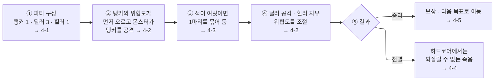

그래서 한 번의 전투 안에서도 탱커 → 군중 제어 → 딜러 · 힐러 순으로 판단이 이어지고, 앞 단계가 무너지면 뒤 단계가 함께 무너집니다. 4장은 이 단계를 하나씩 확대합니다. <!-- ✏️ -->

---

## 3. 분석 구조

### 3-1. 분석 틀 — 시스템에서 결과까지

게임 시스템이 플레이어에게 어떤 행동을 요구하고, 그 행동이 다른 플레이어와 어떻게 이어져, 어떤 결과(재미·장기 플레이)를 만드는지 순서대로 따라갑니다. <!-- 출처: 분석 PDF -->

이 그림에서 볼 것은 **분석이 기능에서 멈추지 않고 결과까지 한 방향으로 간다는 것**입니다. <!-- ✏️ 11-26 그림 앞 문장(통합본 1-5) -->

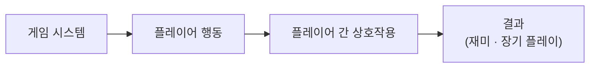

이 틀을 **5단계 질문**으로 나눠 적용했습니다(4-5). <!-- 출처: 분석 PDF -->

| 단계 | 질문 |
|---|---|
| ① 코어 루프 | 플레이어가 전투에서 무엇을 반복하는가? |
| ② 플레이어 행동 유도 장치 | 시스템이 플레이어에게 어떤 행동을 요구하는가? |
| ③ 역할 간의 상호작용 | 그 행동이 다른 플레이어와 어떻게 연결되는가? |
| ④ 긴장과 보상 | 실패와 성공에 어떤 위험과 보상이 존재하는가? |
| ⑤ 장기 플레이 | 이 경험이 어떻게 성장·커뮤니티·장기 목표로 연결되는가? |

그래서 7-1의 답 표도 이 다섯 질문을 같은 순서로 받습니다. <!-- ✏️ 11-26 그림 뒤 문장 -->

### 3-2. 전투 시스템 전체 구조

이 그림에서 볼 것은 **4장의 네 가지 규칙(역할 분리 · 어그로 · 군중 제어 · 하드코어 사망)이 어디에 놓이고, 무엇으로 이어지는지**입니다. 화살표 위의 글은 앞 칸이 뒤 칸에 넘겨주는 것입니다. <!-- ✏️ 11-26 그림 앞 문장 -->

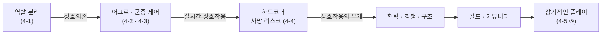

<!-- ✏️ 11-26 상자에 다룬 절 번호를 붙였습니다(통합본 1-3 「→ ○장」) -->

역할 분리가 **상호의존**을 만들고, 어그로와 군중 제어가 그 의존을 **실시간 상호작용**으로 바꿉니다. 하드코어의 영구 사망 규칙은 그 상호작용에서 나오는 실수 한 번의 **대가**를 되살릴 수 없는 죽음으로 키웁니다. <!-- ✏️ 11-26 사실 수정: "캐릭터 삭제로" → "되살릴 수 없는 죽음으로" — 죽은 캐릭터는 지워지지 않고 유령으로 남습니다(4-4 출처 주석) -->
이렇게 생긴 협력·경쟁·구조는 길드라는 커뮤니티로 이어지고, 길드가 오래 플레이할 이유가 됩니다. <!-- 출처: 분석 PDF -->

그래서 4장은 그림의 왼쪽 네 칸을 하나씩(4-1 ~ 4-4), 4-5는 그 칸들이 만드는 결과를 5단계 질문으로 봅니다. <!-- ✏️ 11-26 그림 뒤 문장 -->

<!-- (선택) PDF의 "전투 시스템 전체 구조" 슬라이드 그림을 PNG로 저장해 images/에 넣으면 위 다이어그램 대신(또는 함께) 쓸 수 있습니다.
     PowerPoint에서 슬라이드를 고르고 [파일 → 다른 이름으로 저장 → PNG]로 저장하면 됩니다. -->

---

## 4. 핵심 분석

### 4-1. 역할 분리 — 서로 다른 책임

2-2 흐름의 ① 파티 구성, 3-2 그림의 첫 칸입니다. <!-- ✏️ 11-26 v3 다리 문장 -->

던전 콘텐츠는 최대 5명의 플레이어가 하나의 파티를 이루어 함께 도전합니다(탱커 1 · 딜러 3 · 힐러 1).
5명 각각이 다른 책임을 맡고, 하나의 파티로 움직이며 하나의 보스를 상대합니다. <!-- 출처: 분석 PDF -->

<!-- ✏️ 4-1·4-2·4-3의 그림 세 장은 발표 자료 개선판(pptx) 7·8·10번 슬라이드를 PNG로 꺼낸 것입니다. 그림 설명(alt)은 Claude가 쓴 것입니다. -->

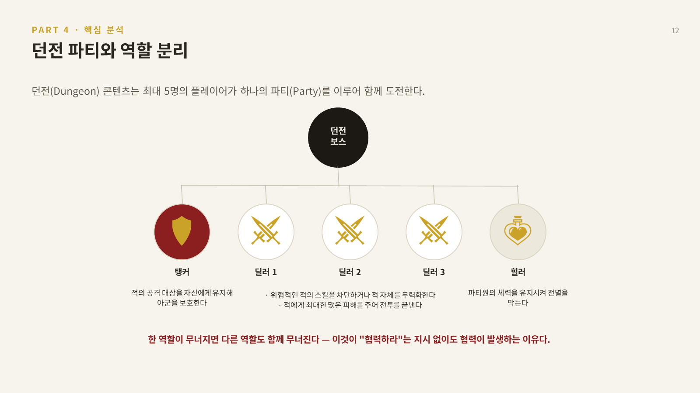

| 역할 | 하는 일 |
|---|---|
| 탱커 | 적의 공격 대상을 자신에게 유지해 아군을 보호합니다. |
| 딜러 (DPS, Damage Per Second) | 적에게 최대한 많은 피해를 주어 전투를 끝냅니다. |
| 힐러 | 파티원의 체력을 유지시켜 전멸을 막습니다. |

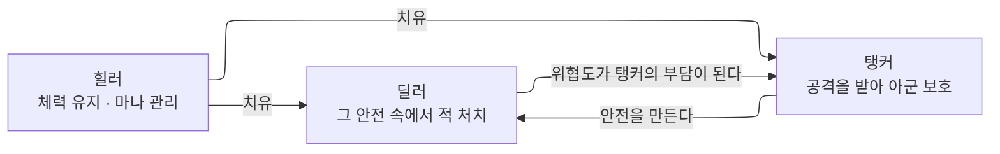

**한 역할이 무너지면 다른 역할도 함께 무너집니다** — 이것이 "협력하라"는 지시 없이도 협력이 발생하는 이유입니다. <!-- 출처: 분석 PDF -->

### 4-2. 어그로 — 몬스터는 누구를 공격하는가

2-2 흐름의 ② · ④ 단계, 4-1에서 본 탱커와 딜러 사이의 화살표를 확대한 절입니다. <!-- ✏️ 11-26 v3 다리 문장 -->

몬스터에게는 "어떤 플레이어를 공격할지"를 결정하는 **위협도(Threat) 수치**가 있습니다.
탱커의 위협도가 가장 높기 때문에 몬스터는 탱커를 공격합니다. 딜러나 힐러의 위협도가 탱커보다 **근접 거리에서는 10%, 원거리에서는 30% 넘게** 높아지면, 몬스터의 공격 대상이 그쪽으로 바뀝니다. <!-- 출처: 분석 PDF -->
<!-- ✏️ 11-26 사실 수정: "탱커를 넘어서면" → "근접 10% · 원거리 30% 넘게 높아지면". 근거: "Exceeds the previous target's threat by 10% while within melee range" · "by 30% while outside melee range" —
     https://warcraft.wiki.gg/wiki/Threat (확인 2026-11-25). 발표 자료 v2 8 · 9장도 같은 수치로 고쳤습니다. -->

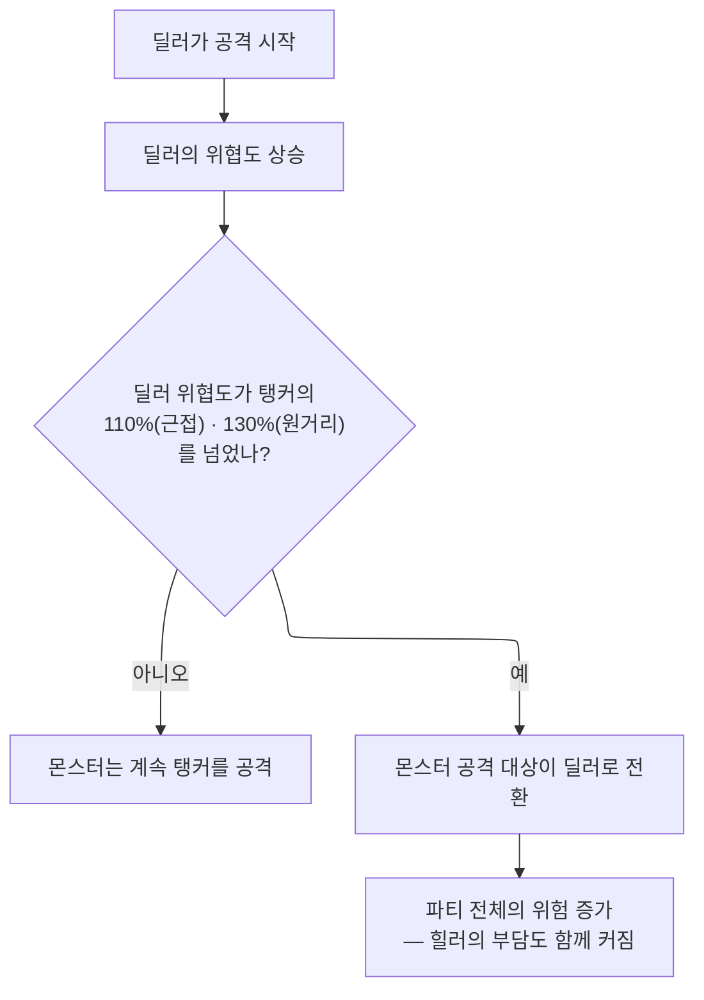

<!-- ✏️ 11-26 갈림길 칸: "딜러 위협도 > 탱커 위협도?" → 위 수치(같은 출처) -->

결과적으로 딜러는 **"탱커보다 위협도를 높이지 않는 선"**에서 공격 속도를 조절해야 하고,
탱커는 딜러들의 위협도를 계속 웃돌도록 자신의 위협도를 관리해야 합니다. 이 둘의 판단이 계속 서로에게 영향을 줍니다. <!-- 출처: 분석 PDF -->

### 4-3. 군중 제어(CC) — 어떤 적을, 언제, 누가

2-2 흐름의 ③ 단계, 적이 여럿일 때 파티가 내리는 판단입니다. <!-- ✏️ 11-26 v3 다리 문장 -->

플레이어는 적을 공격하는 것 외에도, 특정 적의 행동을 일시적으로 제한할 수 있습니다(마법사: 양 변이 · 흑마법사·사제·전사: 공포 · 도적: 기절).
파티는 3마리 몬스터를 동시에 상대하는 대신, 1마리를 묶어두고(제어) 2마리에 집중합니다. <!-- 출처: 분석 PDF -->
<!-- ✅ 11-26 외부 대조(클래식 기준): 마법사 변이 https://warcraft.wiki.gg/wiki/Polymorph · 흑마법사 공포 https://warcraft.wiki.gg/wiki/Fear ·
     사제 영혼의 절규 https://warcraft.wiki.gg/wiki/Psychic_Scream · 전사 위협의 외침 https://warcraft.wiki.gg/wiki/Intimidating_Shout · 도적 혼절시키기 https://warcraft.wiki.gg/wiki/Sap (확인 2026-11-25) -->

전투의 질문이 바뀝니다: **"누가 더 많은 피해를 주는가?" → "어떤 적을 언제, 누가 통제할 것인가?"**

군중 제어가 만드는 실시간 의사결정 <!-- 출처: 분석 PDF -->

1. 어떤 적이 가장 위험한가?
2. 누가 그 적을 제어할 것인가?
3. 제어 기술의 효과는 얼마나 지속되는가?
4. 제어가 풀리기 전에 다른 적을 처치할 수 있는가?

이 판단은 혼자 내릴 수 없습니다. 파티원 각자가 자신의 몫을 실시간으로 계산하고, 서로의 타이밍에 맞춰 행동해야 합니다 —
군중 제어는 전투를 **"동시에 풀어야 하는 퍼즐"**로 만듭니다. <!-- 출처: 분석 PDF -->

### 4-4. 하드코어 — 규칙 하나가 바꾸는 것

2-2 흐름의 ⑤ 전멸 갈래, 3-2 그림에서 앞의 세 칸에 무게를 더하는 칸입니다. <!-- ✏️ 11-26 v3 다리 문장 -->

| | 일반 클래식 | 하드코어 |
|---|---|---|
| 캐릭터가 죽으면 | 부활 가능 | 부활 불가 — 캐릭터는 유령으로 남습니다 |
| 전투 실패의 대가 | 비교적 낮음 | 매우 큼 |
| 플레이 방식 | 위험을 감수한 플레이가 일반적 | 위험 회피와 신중한 판단이 필수 |
| 죽음의 의미 | "일시적인 불편함"에 가까움 | "돌이킬 수 없는 상실" |
| 플레이어의 관심 | 진영 간의 싸움 | 진영 간의 싸움을 내려 두고 생존과 협력 |
| 플레이어에게 던지는 질문 | "죽어도 다시 일어나면 되지 않을까?" | "이 전투에 들어가도 살아남을 수 있을까?" |

<!-- 출처: 분석 PDF · 마지막 줄은 본인 답변, 1-2 -->
<!-- ✏️ 11-26 사실 수정: 「영구적으로 삭제」 → 「부활 불가 — 캐릭터는 유령으로 남습니다」. 근거: "Death on Hardcore realms is permanent on that realm." · "You will continue to exist in the game world as a ghost" ·
     죽은 캐릭터는 무료 이동으로 일반(하드코어가 아닌) 클래식 서버에 옮기면 다시 살 수 있음 — https://worldofwarcraft.blizzard.com/news/23973734/ · https://warcraft.wiki.gg/wiki/World_of_Warcraft:_Classic_Hardcore (확인 2026-11-25)
     ✏️ 11-26 「플레이어에게 던지는 질문」 행 신설(통합본 4-6) — 위 「플레이 방식」 줄(위험 감수 / 신중한 판단)을 질문으로 바꾼 Claude 문장입니다. 본인 말로 고쳐 주세요. -->

규칙은 단 하나만 바뀝니다 — **"죽으면 끝난다."** 그러나 이 규칙 하나가 전투 시스템 전체의 의미를 바꿉니다.

<!-- ✏️ 그림 설명(alt)과 마지막 한 줄("한 역할이 무너지면…")은 Claude가 쓴 것입니다. 장면 설명은 본인 답변을 옮기고 띄어쓰기만 다듬었습니다. -->

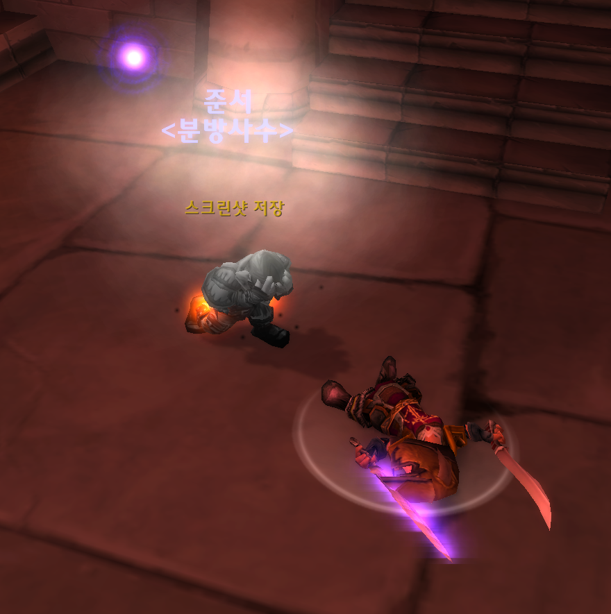

**내가 겪은 장면 — 만렙 3일 만의 죽음** <!-- 출처: 본인 답변 -->
만렙을 찍고 3일도 지나지 않았을 때입니다. 같은 파티의 힐러가 잠시 자리를 비운 것을 모르고 전투를 시작해 힐을 받지 못했습니다.
보스는 큰 피해를 주는 스킬을 시전 중이었고, 저는 보스의 속박 기술에 걸려 대처하지 못한 채 죽었습니다.
한 역할(힐러)이 빠지자 파티 전체가 무너진 장면입니다(4-1). 하드코어에서는 그 한 번의 실수가 영구 사망으로 이어졌습니다.

이 그림에서 볼 것은 **규칙 하나가 판단의 무게를 거쳐 다른 플레이어에게까지 닿는 순서**입니다. <!-- ✏️ 11-26 그림 앞 문장 -->

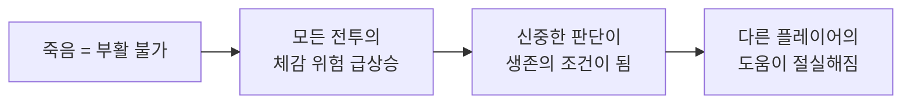

<!-- ✏️ 11-26 사실 수정: 첫 칸 "죽음 = 영구 삭제" → "죽음 = 부활 불가"(위 표의 출처 주석). 발표 자료 v2 6장도 같게 고쳤습니다. -->

하드코어는 전투 시스템 자체를 바꾸지 않습니다. 대신 **"위험의 무게"**를 바꿉니다.
같은 시스템(역할 분리·어그로·군중 제어)이라도 실수 한 번이 되살릴 수 없는 죽음으로 이어지므로, 플레이어는 모든 판단을 더 신중하게 내려야 합니다. <!-- 출처: 분석 PDF -->
<!-- ✏️ 11-26 사실 수정: "캐릭터 삭제로" → "되살릴 수 없는 죽음으로" -->

### 4-5. 5단계 시스템 분석

4-1 ~ 4-4의 규칙이 플레이어에게 무엇을 만드는지, 3-1의 다섯 질문으로 따라갑니다. <!-- ✏️ 11-26 v3 다리 문장 -->

**① 코어 루프 — 플레이어가 전투에서 무엇을 반복하는가?** <!-- 출처: 분석 PDF -->

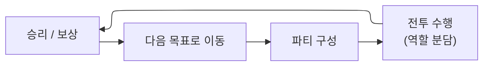

이 반복이 지루하지 않은 이유는 전투마다 파티 구성과 상대 몬스터에 따라 판단할 것이 달라지기 때문입니다.

**②·③ 행동 유도와 역할 간 상호작용 — 시스템은 어떤 행동을 요구하고, 그 행동은 다른 플레이어와 어떻게 이어지는가?** <!-- 출처: 분석 PDF -->

<!-- ✏️ 발표 자료 개선안에 맞춰 ②·③ 두 문단을 표 하나로 합쳤습니다(4-1·4-2·4-3을 다시 설명하던 글). 표의 ③ 칸은 Claude가 PDF 문장을 줄인 것입니다 — 확인해 주세요. -->

| 시스템 | ② 요구하는 행동 | ③ 다른 역할에 미치는 영향 |
|---|---|---|
| 어그로 | 딜러: 무작정 공격하지 않기 · 탱커: 위협도를 계속 관리하기 | 딜러의 위협도가 다시 탱커의 부담이 됩니다 |
| 군중 제어 | 적을 관찰하고 우선순위 정하기 | 제어 타이밍을 서로 맞춰야 합니다(4-3) |
| 하드코어 사망 | 모든 행동에 "신중함" | 피해는 힐러의 치유로, 힐러의 마나는 파티 전체의 생존 시간으로 이어집니다 |

모든 역할의 선택이 다른 역할의 결과에 실시간으로 영향을 줍니다. 시스템이 역할끼리 서로 의존하게 만드는 방식입니다.

**내가 겪은 장면 1 — 신중하지 않은 이동 한 번** <!-- 출처: 본인 답변 -->
길을 잘 몰라 헤매다가 여러 적의 어그로를 한꺼번에 끌었고, 동시에 공격받아 죽었습니다.
하드코어 사망 규칙이 모든 행동에 "신중함"을 요구한다는 것을 보여 주는 장면입니다.
→ [플레이 영상 (YouTube Shorts)](https://www.youtube.com/shorts/m8lV63PoTOI)

<!-- ✏️ 장면 1 영상의 캡처가 맞습니다(본인 답변: 길을 잃고 몬스터에 둘러싸여 죽는 장면). 그림 설명(alt)은 Claude가 쓴 것입니다. -->

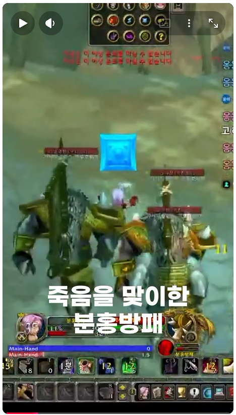

**④ 긴장과 보상 — 실패와 성공에 어떤 위험과 보상이 존재하는가?** <!-- 출처: 분석 PDF -->

- **실패의 대가**: 하드코어에서는 파티 전멸이 곧 캐릭터의 영구적인 죽음입니다.
- **성공의 보상**: 강력한 장비, 캐릭터 성장, 그리고 무엇보다 "살아남았다"는 성취감.

위험이 클수록 성공했을 때 느끼는 보상도 커집니다. 하드코어의 리스크-보상은 이렇게 작동합니다.

그 긴장은 협력만 만들지 않습니다. <!-- 출처: 본인 답변 -->

- **경쟁** — 하드코어 서버에서는 60레벨이 되기 전까지 같은 던전을 24시간에 한 번만 갈 수 있습니다. 아이템을 얻을 기회가 적어, 같은 무기를 쓰는 클래스와 함께 있으면 그 무기를 두고 경쟁하게 됩니다.
- **대가** — 저는 만렙(60레벨) 캐릭터를 3번 잃고 다시 키운 적이 있고, 함께 플레이해 온 길드원 중에는 그보다 더 많이 죽은 분도 있습니다.
- **갈등** — 다른 파티원의 실수로 죽어 다툼이 생기기도 합니다.

<!-- ✏️ 11-26 사실 수정: "던전을 하루에 한 번만" → "60레벨이 되기 전까지 같은 던전을 24시간에 한 번만". 근거: "we've added a 24-hour timer to almost all dungeons for players until they hit level 60" —
     https://worldofwarcraft.blizzard.com/news/23973734/ (확인 2026-11-25). 경쟁 이야기(같은 무기를 두고)는 본인 답변 그대로입니다. 발표 자료 v2 14장도 같게 고쳤습니다. -->

그래서 하드코어에서의 죽음은 **포기 혹은 다시 시작**에 가깝습니다.

**⑤ 장기 플레이 — 이 경험이 어떻게 성장·커뮤니티·장기 목표로 연결되는가?** <!-- 출처: 분석 PDF -->

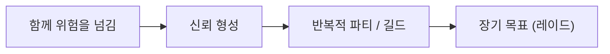

함께 위험을 넘긴 파티원끼리는 서로 믿게 되고, 같은 사람들과 다시 파티를 꾸립니다.
반복된 협력은 길드(고정 커뮤니티)가 되고, 길드는 더 크고 어려운 레이드에 도전할 목표가 됩니다.

**캐릭터를 다시 살릴 수 없는데, 왜 다시 시작하는가?** <!-- 출처: 본인 답변 -->
<!-- ✏️ 11-26 사실 수정: 질문 "캐릭터가 영구 삭제되는데" → "캐릭터를 다시 살릴 수 없는데"(4-4 출처 주석). 답은 본인 답변 그대로입니다. -->
함께하는 **길드원과 친구**, 그리고 **스스로 정한 목표**를 달성하기 위해서입니다. 캐릭터는 사라져도 관계와 목표는 남습니다.

**내가 겪은 장면 2 — 다시 키우던 캐릭터를 살린 길드원의 장비** <!-- 출처: 본인 답변 -->
캐릭터를 잃고 다시 키우던 중 게임이 튕겼는데, 길드원에게 지원받은 장비 덕분에 겨우 살아남았습니다.
→ [플레이 영상 (YouTube Shorts)](https://youtube.com/shorts/xF7WRmsApeA)

전투 시스템에서 시작된 상호의존이 길드원·친구와의 오래가는 관계로 이어집니다. <!-- 출처: 분석 PDF -->

---

## 5. 분석하며 정한 것

### 5-1. 분석 대상 — 일반 클래식 vs 하드코어

> **결정 대상** 분석할 서버를 일반 클래식(전쟁 서버)으로 할지, 하드코어 서버로 할지.

| | [A] 일반 클래식 (전쟁 서버) | **[B] 하드코어 서버 ✓** |
|---|---|---|
| 방식 | 진영 간 싸움이 있는 일반 서버의 전투를 분석합니다 | 전투 시스템은 같고 사망 규칙만 다른 서버의 전투를 분석합니다 |
| 장점 | 진영 간 싸움(PvP)까지 함께 볼 수 있습니다 | 규칙 하나만 다르므로 그 규칙이 만든 경험의 차이를 떼어 볼 수 있습니다(4-4) · 약 2년간 직접 플레이한 서버입니다 |
| 단점 | 플레이어의 관심이 진영 간 싸움에 있어, 던전 협력이 어디서 오는지 따로 보기 어렵습니다(1-2) | 하드코어에서는 PvP가 거의 활성화되지 않아 진영 간 싸움은 분석에서 빠집니다(7-2) |

<!-- ✏️ 11-26 결정 표 v2(통합본 4-6). 표의 칸은 1-2 · 4-4 · 7-2와 아래 본인 답변에 있는 사실로만 채운 Claude 문장입니다. 그때 [A]를 따로 비교했는지는 모릅니다 — 비교하지 않았으면
     표 아래에 "그때는 비교하지 않았고, 문서를 정리하며 비교했습니다."를 넣어 주세요(통합본 1-5). -->

**[B]를 골랐습니다.** 두 서버는 전투 시스템이 같고 사망 규칙만 다릅니다(4-4 비교 표). 하드코어를 고른 이유는 이 **규칙 하나가 만든 경험의 차이**를 직접 겪었기 때문입니다.

WoW 하드코어를 처음 했을 때 저는 큰 충격을 받았습니다. 20년 전 게임의 완성도 위에 **죽으면 끝**이라는 규칙 하나가 더해지자,
플레이하는 내내 전투의 매 순간과 대처를 계속 생각해야 했습니다. "모르면 죽는다" 싶은 순간도 여러 번 겪었습니다.
**단순한 규칙 하나를 더하는 것만으로도 새로운 경험을 줄 수 있다**는 것을 이때 깨달았습니다. <!-- 출처: 본인 답변 -->

### 5-2. 분석 틀 — 기능 나열 대신 인과로

> **결정 대상** 전투를 기능별로 하나씩 설명할지, 3-1의 **시스템 → 행동 → 상호작용 → 결과** 순서로 따라갈지.

| | [A] 기능 나열 | **[B] 인과로 따라가기 ✓** |
|---|---|---|
| 방식 | 역할 분리 · 어그로 · 군중 제어 · 사망 규칙을 기능마다 따로 설명합니다 | 각 기능이 요구하는 행동 → 다른 플레이어와의 상호작용 → 결과(재미 · 장기 플레이)까지 따라갑니다(3-1) |
| 장점 | 기능마다 규칙을 자세히 설명하기 쉽습니다 | 기능이 플레이어 사이에 무엇을 만드는지까지 한 줄로 이어집니다(3-2) |
| 단점 | 기능이 플레이어 사이에 무엇을 만드는지는 드러나지 않습니다 | 같은 기능을 규칙(4-1 ~ 4-4)과 결과(4-5)에서 두 번 다루게 됩니다 — 4-5 ②·③을 표 하나로 줄여 겹침을 덜었습니다 |

<!-- ✏️ 11-26 결정 표 v2. [B] 단점의 「겹침」은 발표자료-개선안.md 1절(겹치는 말 표)에 있는 사실입니다. 나머지 칸은 아래 본인 답변을 표로 옮긴 Claude 문장입니다. -->

**[B]를 골랐습니다.** WoW에서 전투는 빼놓을 수 없는 핵심 시스템입니다. 하지만 플레이어가 없다면 이 시스템은 아무 의미가 없습니다.
게임을 존재하게 하는 것은 유저들이 이 시스템 안에서 서로 상호작용해 만드는 **결과**이기 때문입니다. <!-- 출처: 본인 답변 -->

---

## 6. AI 협업

### 6-1. 발표 자료를 문서로 옮긴 방법 — AI와 나눈 일

<!-- ✏️ 2026-11-18 답변을 옮겨 Claude가 정리한 절입니다. "잘 된 것·안 된 것"은 Claude가 예로 든 문장을 본인이 맞다고 한 것입니다 — 본인 말투로 다듬어도 됩니다. -->

발표 PDF(22장)를 이 문서로 옮기는 일은 Claude와 함께 했습니다. 구조는 제가 정했고, 옮기고 줄이는 일은 Claude에게 맡겼습니다. <!-- 출처: 본인 답변 -->

| 한 일 | 맡은 쪽 |
|---|---|
| 22장을 5단 구조(개요 → 구조 → 핵심 → 정한 것 → 결과)로 나누기로 정했습니다 | 직접 — 강사님이 제안하신 문서 구조로 만들려는 의도였습니다 |
| PDF의 글을 각 절에 나눠 옮기고 경어체로 바꿨습니다 | Claude |
| 4-5 표의 ③ 칸과 7-1의 원칙 문장을 줄였습니다 | Claude |
| 문서의 규칙 · 수치를 블리자드 공지와 위키에 대조해 다른 곳을 고쳤습니다(사망 규칙 · 던전 잠금 · 어그로 비율) | Claude — 고친 곳마다 출처 주석을 달았고, 확인은 제가 합니다 |

<!-- ✏️ 11-26 표 칸의 음슴체("정함" · "바꿈" · "줄임")를 "~습니다"로 고쳤습니다. 마지막 줄은 11-26 외부 대조 작업을 더한 것입니다 — 확인하신 뒤 「확인은 제가 했습니다」로 바꿔 주세요. -->

**확인 방법** — Claude가 줄이거나 새로 쓴 문장은 직접 읽어 보고, 약 2년간 플레이한 제 경험과 견줘 맞는지 확인했습니다. <!-- 출처: 본인 답변 -->

- **잘 된 것** — 발표 자료를 문서로 옮기는 시간이 줄었습니다. <!-- 출처: 본인 답변 -->
- **안 된 것** — 제 경험이 아닌 문장이 섞여 들어와, 다시 고쳐야 했습니다. <!-- 출처: 본인 답변 -->

---

## 7. 결과와 다음 분석 계획

<!-- 11-26 v3: 옛 「7. 결과 및 배운 점」(7-1 결론 · 7-2 개발자로서 얻은 인사이트 · 7-3 아쉬운 점 · 다음 분석 계획)을 다시 묶었습니다.
     7-1 = 분석 질문 | 답 표(1-2 · 3-1과 같은 순서) + 결론 인용 + 옛 7-2 인사이트 세 줄 흡수 / 7-2 = 옛 7-3(표 머리 「이유 · 아쉬운 점」 → 「이유」) + 발표 자료 18장 어그로 설계. -->

### 7-1. 분석 질문과 답

<!-- ✏️ 3-2·4-5와 같은 내용을 되풀이하던 첫 문단("역할 분리, 위협도, 군중 제어, 위험과 보상을 통해…")을 뺐습니다. -->

| 분석 질문 (3-1) | 답 | 다룬 절 |
|---|---|---|
| ① 플레이어가 전투에서 무엇을 반복하는가? | 파티 구성 → 역할을 나눈 전투 → 승리 / 보상 → 다음 목표. 전투마다 판단할 것이 달라 반복이 지루하지 않습니다 | 2-2 · 4-5 ① |
| ② 시스템이 플레이어에게 어떤 행동을 요구하는가? | 어그로는 위협도 관리를, 군중 제어는 적의 우선순위 판단을, 하드코어 사망 규칙은 모든 행동에 신중함을 요구합니다 | 4-2 · 4-3 · 4-4 |
| ③ 그 행동이 다른 플레이어와 어떻게 연결되는가? | 딜러의 위협도는 탱커의 부담이 되고, 피해는 힐러의 치유로, 힐러의 마나는 파티의 생존 시간으로 이어집니다. 한 역할이 무너지면 다른 역할도 무너집니다 | 4-1 · 4-5 ②·③ |
| ④ 실패와 성공에 어떤 위험과 보상이 있는가? | 실패는 되살릴 수 없는 죽음, 성공은 장비 · 성장 · "살아남았다"는 성취감입니다. 그 긴장은 협력과 함께 경쟁과 갈등도 만듭니다 | 4-4 · 4-5 ④ |
| ⑤ 이 경험이 어떻게 장기 플레이로 이어지는가? | 함께 위험을 넘김 → 신뢰 → 반복 파티 · 길드 → 레이드라는 목표. 캐릭터를 잃어도 길드원 · 친구와 스스로 정한 목표가 남습니다 | 4-5 ⑤ |

<!-- ✏️ 11-26 v3 분석 질문 | 답 표(통합본 4-6). 답 칸은 4장 각 절의 문장(발표 자료 · 본인 답변)을 줄인 Claude 문장입니다 — 확인해 주세요. -->

1-2의 질문에 대한 답은 발표 자료의 마지막 문장입니다.

> "WoW 클래식의 멀티플레이 재미는 여러 명이 함께 플레이한다는 사실에서 발생하는 것이 아니라,
> 전투 시스템 자체가 플레이어들이 서로 필요하도록 설계되어 있기 때문에 발생한다."
<!-- 출처: 분석 PDF -->

**핵심 통찰** — 전투 시스템은 "몬스터를 처치하는 기능"이 아니라, **"플레이어들의 행동을 서로 연결하는 장치"**로도 설계될 수 있습니다. <!-- 출처: 분석 PDF -->

게임을 만들 때 원칙으로 가져갈 것은 세 가지입니다. <!-- 출처: 분석 PDF -->
<!-- ✏️ 발표 자료 개선안에 맞춰 5개 → 3개로 줄였습니다. 옛 2번은 핵심 통찰과 같은 문장이라 뺐고, 옛 1·4번은 합쳤습니다.
     합친 1번과 다듬은 3번은 Claude가 줄인 문장입니다 — 확인해 주세요.
     3장과 겹치지 않게 각 원칙을 한 줄로 줄이고 근거 절을 달았습니다. 3번의 둘째 문장("하드코어는 시스템을 늘리지 않고…")은 4-4 끝과 같아서 뺐습니다.
     11-26 v3: 옛 「7-2. 개발자로서 얻은 인사이트」 절을 7-1로 흡수했습니다(통합본 4부 「배운 점」 정리 기준). -->

1. 협력을 강요하기보다 서로의 능력에 의존하게 만듭니다. 의존이 강하면 복잡한 사회 시스템 없이도 플레이어 사이에 관계가 생깁니다(4-1·4-5 ⑤).
2. 위험이 커질수록 다른 플레이어의 도움이 갖는 가치도 커집니다(4-4).
3. 규칙 하나로 기존 시스템의 긴장도를 다시 정할 수 있습니다(4-4·5-1).

### 7-2. 다음 분석 계획

<!-- 출처: 본인 답변 -->

| 다루지 못한 것 | 이유 |
|---|---|
| 레이드 (10~40인) | 던전 파티(5인) 위주로 다뤄, 인원이 많을 때 역할 분리가 어떻게 달라지는지는 보지 못했습니다. |
| 직업(클래스)별 차이 | 역할(탱커·딜러·힐러) 단위로만 보고, 직업마다 다른 스킬·플레이 방식은 다루지 않았습니다. |
| 수치 · 데이터 근거 | 직접 플레이한 경험 위주라, 사망률 같은 수치 자료로 뒷받침하지 못했습니다. |
| PvP 전투 *(의도적으로 제외)* | 하드코어에서는 PvP가 거의 활성화되지 않은 콘텐츠라 분석 대상에서 뺐습니다. |

<!-- ✏️ 11-26 표 머리 「이유 · 아쉬운 점」 → 「이유」(통합본 4-6).
     ❓ PvP 줄은 건우 님 경험입니다. 공지에서 확인한 규칙은 "하드코어에서는 /pvp로 직접 켜야 PvP 상태가 된다 · 전장은 열리지 않는다"뿐입니다 — https://worldofwarcraft.blizzard.com/news/23973734/ (확인 2026-11-25).
     이 규칙을 이유에 덧붙일지 정해 주세요. -->

**다음 분석 계획** — **레이드의 역할 분리**를 분석하려 합니다. 5인 파티에서 본 "서로를 필요로 하게 만드는 구조"가
10~40인으로 늘어나면 어떻게 바뀌는지 볼 계획입니다. 이번 분석의 범위(5인 던전)에서 한 단계 넓힌 질문입니다. <!-- ✏️ 11-26 관문(통합본 4-6): "이번 분석에서 가장 아쉬웠던 부분입니다" → 계획 문장 -->

**분석을 구현으로 옮긴다면 — 어그로 시스템 설계** <!-- 출처: 분석 PDF (발표 자료 v2 18장 「분석을 구현으로 — 어그로 시스템 설계」) -->

| 설계 요소 | 규칙 |
|---|---|
| 피해량 | 몬스터의 위협도는 플레이어의 공격으로 피해를 입은 만큼 올라갑니다. |
| 역할 가중치 | 공격마다 위협도 수치가 다르게 적용됩니다 — 탱커와 딜러의 차별점을 두기 위한 장치입니다. |
| 도발 | 탱커는 강제로 위협도를 가져오는 스킬(도발)로 몬스터의 공격 대상이 될 수 있습니다. |

몬스터는 위협도가 가장 높은 플레이어를 공격합니다 — 분석한 시스템을 코드로 옮기기 위한 설계입니다. <!-- 출처: 분석 PDF -->

<!-- ✏️ 11-26 발표 자료 18장의 표를 옮기고 경어체로만 바꿨습니다(옛 작성 안내 상자의 「7-3에 의사코드로 정리」가 가리키던 내용이 문서에 없어 넣었습니다).
     설계라 실제 게임과 다른 점: 실제 클래식은 공격 대상이 바뀌는 선이 「가장 높은」이 아니라 110% · 130%입니다(4-2). 표에 더할지 정해 주세요. -->
