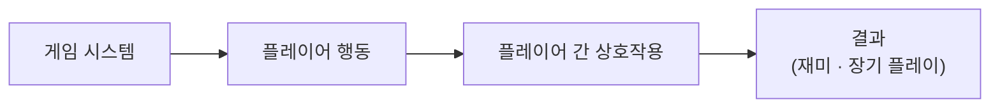
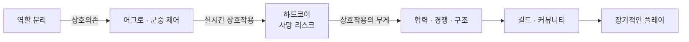
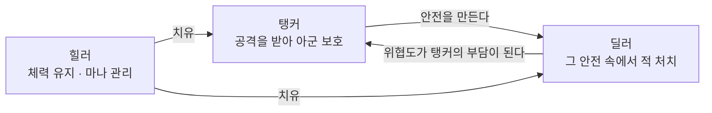
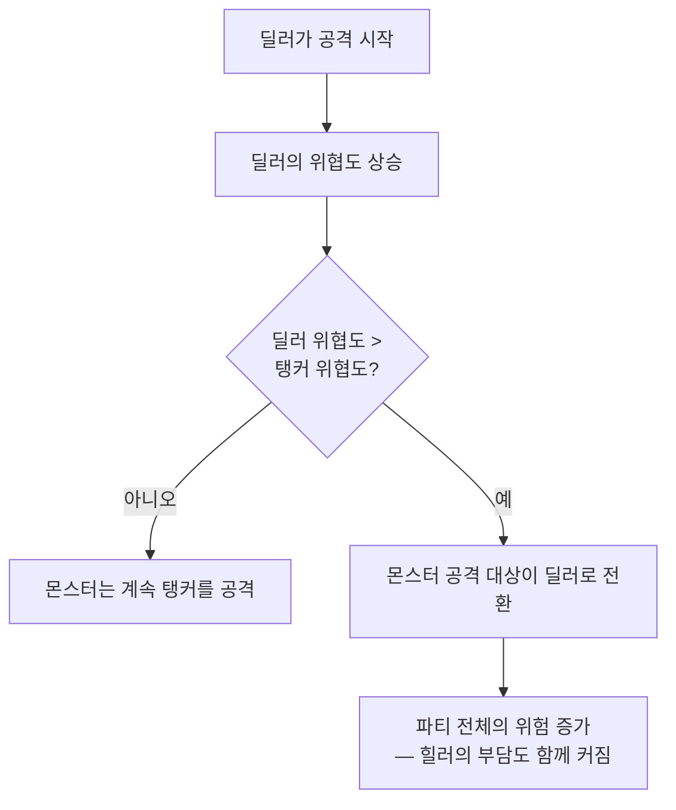
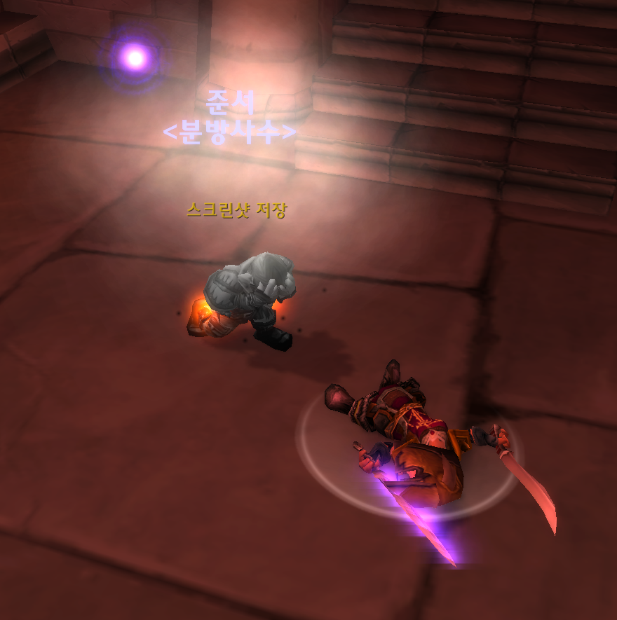
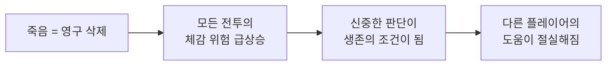
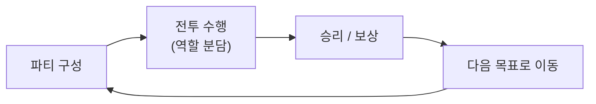
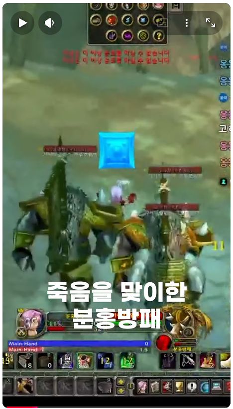
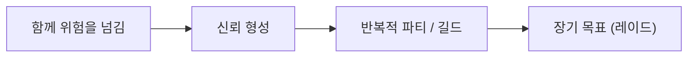

# WoW 클래식 하드코어 — 전투 시스템 분석 (게임 분석 스터디)

<!--
====================================================================
 ✍ 작성 안내 (이 상자는 다 쓰면 지우세요)
====================================================================
 이 파일은 건우 님이 만든 「WoW_클래식_하드코어_전투시스템_분석.pptx.pdf」(22장)의 글을 옮겨,
 기술 문서 5단 구조(개요 → 구조 → 핵심 → 고민과 선택 → 결과)에 맞춰 배치한 것입니다. 옮긴 곳에 "(출처: 분석 PDF)"를 달았습니다.
 PDF의 말투(~한다)는 다른 문서와 맞추려고 경어체(~합니다)로만 바꿨고, 내용은 더하지 않았습니다.
 PDF의 그림은 꺼낼 도구가 없어 옮기지 못했습니다. 그림이 있던 자리는 Mermaid 다이어그램으로 다시 그렸습니다(PDF 그림의 상자·화살표 그대로).

   ❓ 답해 주세요   — 사실 확인
   💬 내 의견       — 건우 님의 판단·생각이 들어가야 하는 곳
   🤖 Claude 분석   — Claude가 PDF와 다른 기술 문서를 비교해 쓴 것. 읽고 본인 말로 바꿔 쓴 뒤 상자를 지우세요.

 · 화면에 보이는 표시(> ❓ · > 💬 · > 🤖)는 답을 채운 뒤 지웁니다. 남아 있으면 포트폴리오에도 그대로 보입니다.
 · 이 분석은 프로젝트 설계에 반영하지 않았습니다(건우 님 답변). 그래서 5-3은 "분석의 관점으로 내 프로젝트를 다시 보면"으로 썼고,
   "이 분석을 보고 설계했다"는 말은 쓰지 않았습니다.
 · 답변은 본문으로 옮기고 "(출처: 본인 답변)"을 달았습니다. 띄어쓰기·오타만 고쳤습니다.
 · 발표 자료 개선안(Present File/발표자료-개선안.md)과 같은 방향으로 맞췄습니다 — 3-5 ②·③을 표 하나로, 5-2 인사이트 5개 → 3개,
   5-1의 연결 고리 그림(2-2와 같음) 삭제. 개선안의 답변(Q1~Q9, R1~R3)도 3-4·3-5·1-3에 넣었습니다.
 · 5-3·5-4는 답변(다음에 해 볼 것 = 적의 대상 선택 기준, 아쉬운 점 4가지, 다음 분석 = 레이드)으로 채웠습니다. 5-3의 ✏️ 메모를 확인해 주세요.

 ⭐ 이 문서에서 어필할 부분 (면접관이 보는 것)
   1. 분석 틀이 있다 — 기능을 나열하지 않고 "시스템 → 플레이어 행동 → 상호작용 → 결과"의 인과로 따라갔습니다(2-1).
      → "시스템이 플레이어의 행동을 어떻게 만드는지 보는 눈"을 보여 줍니다. 개발자가 기획자와 말이 통한다는 근거입니다.
   2. 변수 하나만 다른 비교 — 일반 클래식과 하드코어는 "죽으면 끝난다" 규칙 하나만 다릅니다(3-4).
      → "시스템을 바꾸지 않고 위험의 무게만 바꿨다"는 결론은 같은 시스템을 두고 규칙 하나의 효과를 떼어 본 것이라 설득력이 큽니다.
   3. 메커니즘을 구현 가능한 수준으로 설명 — 어그로를 "위협도 수치를 비교해 공격 대상을 정한다"로 설명했습니다(3-2).
      → 클라이언트 개발자에게는 "이걸 유니티로 만든다면?"으로 이어지는 지점입니다. 4-3에 의사코드로 정리했습니다(실제 구현까지 가면 가장 강해짐).
   5. 직접 겪은 근거 — 2년 플레이 경험과 플레이 영상 2편(3-5), 경쟁·대가·갈등까지 짚어 장점만 말하는 분석이 아닙니다.
   4. 내 프로젝트와의 연결 — 원 히트 원 킬(뒤통수를 조심해), 협동 조작(WeGotOne), 공격 예고음(Team Even)을 이 분석의 언어로 다시 설명할 수 있습니다(5-3).
      → 분석 문서 하나가 다른 프로젝트 문서들의 "왜"를 받쳐 주는 역할을 합니다.

 · 다 쓴 뒤 /portfolio-check 5-wow-hardcore-analysis 로 점검하세요.
====================================================================
-->

## 1. 개요

### 1-1. 무엇을 분석했나 (What)

**월드 오브 워크래프트 클래식(WoW 클래식)의 하드코어 서버 전투 시스템**을 분석했습니다.
WoW는 수천 명이 한 세계를 공유하는 대규모 다중 사용자 온라인 롤플레잉 게임(MMORPG)이고,
하드코어 서버는 그중 **캐릭터가 죽으면 부활할 수 없는** 서버입니다. *(출처: 분석 PDF)*

분석의 주제는 **전투를 통해 만들어지는 플레이어 간 상호작용과 멀티플레이의 재미**입니다. *(출처: 분석 PDF)*

### 1-2. 왜 분석했나 (Why) — 분석 질문

> 월드 오브 워크래프트 클래식(하드코어 서버)의 전투 시스템은 어떻게 플레이어들이 서로 의존하고 상호작용하도록 만들며,
> 그 상호작용을 어떻게 게임의 재미와 장기적인 플레이로 연결하는가?
> *(출처: 분석 PDF)*

**이 질문을 고른 이유** *(출처: 본인 답변)*
하드코어 서버의 전투 시스템은 일반 WoW 클래식과 같습니다. 다른 것은 **죽음을 처리하는 방식** 하나입니다.
기존 클래식 전쟁 서버의 플레이어들은 진영 간 싸움에 집중했습니다. 하드코어 서버의 플레이어들은 진영 간 싸움을 내려 두고 **생존에 집중**했고,
살아남으려고 서로 협력하면서 **유대감이 크게 커졌습니다**.

### 1-3. 분석 정보

| 항목 | 내용 |
|---|---|
| 형식 | 게임 분석 스터디 그룹 — 멀티플레이 게임 조사 발표 자료 (발표 당시 22장 → 개선판 19장) |
| 분석 대상 | World of Warcraft Classic — 하드코어 서버 |
| 분석 범위 | 던전 파티(5인) 전투: 역할 분리 · 어그로 · 군중 제어 · 하드코어 사망 규칙 |
| 분석 근거 | 약 2년간 직접 플레이한 경험(플레이 영상 2편, 3-5) + 자료 조사 |
| 기간 | 2026-08-13 ~ 2026-08-16 (4일) · 발표 2026-08-18 |
| 인원 | 1명 (개인 분석) |
| 자료 | [발표 자료 PDF (개선판, 19장)](Present%20File/WoW_클래식_하드코어_전투시스템_분석_개선.pptx.pdf) |

게임 분석 스터디 그룹의 멀티플레이 게임 조사로, 약 2년간 플레이해 온 WoW 하드코어 서버를 **직접 겪은 경험과 자료 조사로** 분석했습니다. *(출처: 본인 답변)*

### 1-4. 분석 대상의 기본 구조

**WoW 클래식의 기본 구조** *(출처: 분석 PDF)*

| 용어 | 뜻 |
|---|---|
| 캐릭터 성장 | 몬스터를 처치하고 경험치를 얻어 레벨을 올립니다. |
| 파티 | 여러 플레이어(최대 5명)가 함께 모여 전투하는 소규모 팀 |
| 던전 | 제한된 인원(주로 5명)이 함께 도전하는 실내형 콘텐츠 |
| 레이드 | 더 많은 인원(2~8파티, 10·20·40명)이 협력해 강력한 보스에 도전하는 콘텐츠 |

**멀티플레이 게임으로서의 특징** *(출처: 분석 PDF)*

- **공유된 세계** — 모든 플레이어가 같은 세계, 같은 몬스터, 같은 자원을 마주합니다.
- **혼자서는 어려운 콘텐츠** — 던전·레이드의 상위 콘텐츠는 여러 명이 함께 해야 클리어할 수 있도록 설계되어 있습니다.
- **자발적 협력** — 시스템이 협력을 강제하지 않아도, 목표 달성을 위해 자연스럽게 팀을 이룹니다.

WoW는 "혼자서도 즐길 수 있는 게임"이 아니라 **"다른 플레이어의 존재가 경험의 일부가 되는 게임"**입니다.

**하드코어의 기원 — 유저 문화에서 공식 콘텐츠로** *(출처: 분석 PDF)*

하드코어는 블리자드가 처음부터 설계한 콘텐츠가 아니라, 유저들이 스스로 만든 놀이 문화에서 출발했습니다.

| 시기 | 일 |
|---|---|
| 2019 | 클래식 출시. 유저들이 자발적으로 "죽음 금지" 규칙을 만들어 플레이 시작 (캐릭터가 죽으면 삭제하거나 더 이상 플레이하지 않음) |
| 확산 | 유저가 만든 감시 애드온 등장(부활·파티·거래 제한을 어기면 기록 무효). 트위치 스트리머·유저 사이에서 폭발적인 인기 |
| 2023-08-25 | 블리자드가 부활이 불가능한 공식 하드코어 서버를 정식 오픈 |

유저들이 스스로 만든 놀이 문화가 결국 게임의 공식 규칙이 되었습니다.

### 1-5. 이 문서에서 다루는 것

2장 분석 틀과 전투 시스템 전체 구조 → 3장 역할 분리·어그로·군중 제어·하드코어 규칙과 5단계 분석 → 4장 분석하며 정한 것 → 5장 결론, 개발자로서의 인사이트, 그리고 이 관점으로 제 프로젝트를 다시 본 것.

---

## 2. 분석 구조

### 2-1. 분석 틀 — 시스템에서 결과까지

게임 시스템이 플레이어에게 어떤 행동을 요구하고, 그 행동이 다른 플레이어와 어떻게 이어져, 어떤 결과(재미·장기 플레이)를 만드는지 순서대로 따라갑니다. *(출처: 분석 PDF)*

이 틀을 **5단계 질문**으로 나눠 적용했습니다(3-5). *(출처: 분석 PDF)*

| 단계 | 질문 |
|---|---|
| ① 코어 루프 | 플레이어가 전투에서 무엇을 반복하는가? |
| ② 플레이어 행동 유도 장치 | 시스템이 플레이어에게 어떤 행동을 요구하는가? |
| ③ 역할 간의 상호작용 | 그 행동이 다른 플레이어와 어떻게 연결되는가? |
| ④ 긴장과 보상 | 실패와 성공에 어떤 위험과 보상이 존재하는가? |
| ⑤ 장기 플레이 | 이 경험이 어떻게 성장·커뮤니티·장기 목표로 연결되는가? |

### 2-2. 전투 시스템 전체 구조

역할 분리가 **상호의존**을 만들고, 어그로와 군중 제어가 그 의존을 **실시간 상호작용**으로 바꿉니다. 하드코어의 영구 사망 규칙은 그 상호작용에서 나오는 실수 한 번의 **대가**를 캐릭터 삭제로 키웁니다.
이렇게 생긴 협력·경쟁·구조는 길드라는 커뮤니티로 이어지고, 길드가 오래 플레이할 이유가 됩니다. *(출처: 분석 PDF)*

<!-- (선택) PDF의 "전투 시스템 전체 구조" 슬라이드 그림을 PNG로 저장해 images/에 넣으면 위 다이어그램 대신(또는 함께) 쓸 수 있습니다.
     PowerPoint에서 슬라이드를 고르고 [파일 → 다른 이름으로 저장 → PNG]로 저장하면 됩니다. -->

---

## 3. 핵심 분석

### 3-1. 역할 분리 — 서로 다른 책임

던전 콘텐츠는 최대 5명의 플레이어가 하나의 파티를 이루어 함께 도전합니다(탱커 1 · 딜러 3 · 힐러 1).
5명 각각이 다른 책임을 맡고, 하나의 파티로 움직이며 하나의 보스를 상대합니다. *(출처: 분석 PDF)*

| 역할 | 하는 일 |
|---|---|
| 탱커 | 적의 공격 대상을 자신에게 유지해 아군을 보호합니다. |
| 딜러 (DPS, Damage Per Second) | 적에게 최대한 많은 피해를 주어 전투를 끝냅니다. |
| 힐러 | 파티원의 체력을 유지시켜 전멸을 막습니다. |

**한 역할이 무너지면 다른 역할도 함께 무너집니다** — 이것이 "협력하라"는 지시 없이도 협력이 발생하는 이유입니다. *(출처: 분석 PDF)*

### 3-2. 어그로 — 몬스터는 누구를 공격하는가

몬스터에게는 "어떤 플레이어를 공격할지"를 결정하는 **위협도(Threat) 수치**가 있습니다.
탱커의 위협도가 가장 높기 때문에 몬스터는 탱커를 공격합니다. 딜러나 힐러의 위협도가 탱커를 넘어서면, 몬스터의 공격 대상이 그쪽으로 바뀝니다. *(출처: 분석 PDF)*

결과적으로 딜러는 **"탱커보다 위협도를 높이지 않는 선"**에서 공격 속도를 조절해야 하고,
탱커는 딜러들의 위협도를 계속 웃돌도록 자신의 위협도를 관리해야 합니다. 이 둘의 판단이 계속 서로에게 영향을 줍니다. *(출처: 분석 PDF)*

### 3-3. 군중 제어(CC) — 어떤 적을, 언제, 누가

플레이어는 적을 공격하는 것 외에도, 특정 적의 행동을 일시적으로 제한할 수 있습니다(마법사: 양 변이 · 흑마법사·사제·전사: 공포 · 도적: 기절).
파티는 3마리 몬스터를 동시에 상대하는 대신, 1마리를 묶어두고(제어) 2마리에 집중합니다. *(출처: 분석 PDF)*

전투의 질문이 바뀝니다: **"누가 더 많은 피해를 주는가?" → "어떤 적을 언제, 누가 통제할 것인가?"**

군중 제어가 만드는 실시간 의사결정 *(출처: 분석 PDF)*

1. 어떤 적이 가장 위험한가?
2. 누가 그 적을 제어할 것인가?
3. 제어 기술의 효과는 얼마나 지속되는가?
4. 제어가 풀리기 전에 다른 적을 처치할 수 있는가?

이 판단은 혼자 내릴 수 없습니다. 파티원 각자가 자신의 몫을 실시간으로 계산하고, 서로의 타이밍에 맞춰 행동해야 합니다 —
군중 제어는 전투를 **"동시에 풀어야 하는 퍼즐"**로 만듭니다. *(출처: 분석 PDF)*

### 3-4. 하드코어 — 규칙 하나가 바꾸는 것

| | 일반 클래식 | 하드코어 |
|---|---|---|
| 캐릭터가 죽으면 | 부활 가능 | 영구적으로 삭제 |
| 전투 실패의 대가 | 비교적 낮음 | 매우 큼 |
| 플레이 방식 | 위험을 감수한 플레이가 일반적 | 위험 회피와 신중한 판단이 필수 |
| 죽음의 의미 | "일시적인 불편함"에 가까움 | "돌이킬 수 없는 상실" |
| 플레이어의 관심 | 진영 간의 싸움 | 진영 간의 싸움을 내려 두고 생존과 협력 |

*(출처: 분석 PDF · 마지막 줄은 본인 답변, 1-2)*

규칙은 단 하나만 바뀝니다 — **"죽으면 끝난다."** 그러나 이 규칙 하나가 전투 시스템 전체의 의미를 바꿉니다.

<!-- ✏️ 그림 설명(alt)과 마지막 한 줄("한 역할이 무너지면…")은 Claude가 쓴 것입니다. 장면 설명은 본인 답변을 옮기고 띄어쓰기만 다듬었습니다. -->

**내가 겪은 장면 — 만렙 3일 만의 죽음** *(출처: 본인 답변)*
만렙을 찍고 3일도 지나지 않았을 때입니다. 같은 파티의 힐러가 잠시 자리를 비운 것을 모르고 전투를 시작해 힐을 받지 못했습니다.
보스는 큰 피해를 주는 스킬을 시전 중이었고, 저는 보스의 속박 기술에 걸려 대처하지 못한 채 죽었습니다.
한 역할(힐러)이 빠지자 파티 전체가 무너진 장면입니다(3-1). 하드코어에서는 그 한 번의 실수가 영구 사망으로 이어졌습니다.

하드코어는 전투 시스템 자체를 바꾸지 않습니다. 대신 **"위험의 무게"**를 바꿉니다.
같은 시스템(역할 분리·어그로·군중 제어)이라도 실수 한 번이 캐릭터 삭제로 이어지므로, 플레이어는 모든 판단을 더 신중하게 내려야 합니다. *(출처: 분석 PDF)*

### 3-5. 5단계 시스템 분석

**① 코어 루프 — 플레이어가 전투에서 무엇을 반복하는가?** *(출처: 분석 PDF)*

이 반복이 지루하지 않은 이유는 전투마다 파티 구성과 상대 몬스터에 따라 판단할 것이 달라지기 때문입니다.

**②·③ 행동 유도와 역할 간 상호작용 — 시스템은 어떤 행동을 요구하고, 그 행동은 다른 플레이어와 어떻게 이어지는가?** *(출처: 분석 PDF)*

<!-- ✏️ 발표 자료 개선안에 맞춰 ②·③ 두 문단을 표 하나로 합쳤습니다(3-1·3-2·3-3을 다시 설명하던 글). 표의 ③ 칸은 Claude가 PDF 문장을 줄인 것입니다 — 확인해 주세요. -->

| 시스템 | ② 요구하는 행동 | ③ 다른 역할에 미치는 영향 |
|---|---|---|
| 어그로 | 딜러: 무작정 공격하지 않기 · 탱커: 위협도를 계속 관리하기 | 딜러의 위협도가 다시 탱커의 부담이 됩니다 |
| 군중 제어 | 적을 관찰하고 우선순위 정하기 | 제어 타이밍을 서로 맞춰야 합니다 — "동시에 풀어야 하는 퍼즐" |
| 하드코어 사망 | 모든 행동에 "신중함" | 피해는 힐러의 치유로, 힐러의 마나는 파티 전체의 생존 시간으로 이어집니다 |

모든 역할의 선택이 다른 역할의 결과에 실시간으로 영향을 줍니다. 시스템이 역할끼리 서로 의존하게 만드는 방식입니다.

**내가 겪은 장면 1 — 신중하지 않은 이동 한 번** *(출처: 본인 답변)*
길을 잘 몰라 헤매다가 여러 적의 어그로를 한꺼번에 끌었고, 동시에 공격받아 죽었습니다.
하드코어 사망 규칙이 모든 행동에 "신중함"을 요구한다는 것을 보여 주는 장면입니다.
→ [플레이 영상 (YouTube Shorts)](https://www.youtube.com/shorts/m8lV63PoTOI)

<!-- ✏️ 장면 1 영상의 캡처가 맞습니다(본인 답변: 길을 잃고 몬스터에 둘러싸여 죽는 장면). 그림 설명(alt)은 Claude가 쓴 것입니다. -->

**④ 긴장과 보상 — 실패와 성공에 어떤 위험과 보상이 존재하는가?** *(출처: 분석 PDF)*

- **실패의 대가**: 하드코어에서는 파티 전멸이 곧 캐릭터의 영구적인 죽음입니다.
- **성공의 보상**: 강력한 장비, 캐릭터 성장, 그리고 무엇보다 "살아남았다"는 성취감.

위험이 클수록 성공했을 때 느끼는 보상도 커집니다. 하드코어의 리스크-보상은 이렇게 작동합니다.

그 긴장은 협력만 만들지 않습니다. *(출처: 본인 답변)*

- **경쟁** — 하드코어 서버는 던전을 하루에 한 번만 갈 수 있습니다. 아이템을 얻을 기회가 적어, 같은 무기를 쓰는 클래스와 함께 있으면 그 무기를 두고 경쟁하게 됩니다.
- **대가** — 저는 만렙(60레벨) 캐릭터를 3번 잃고 다시 키운 적이 있고, 함께 플레이해 온 길드원 중에는 그보다 더 많이 죽은 분도 있습니다.
- **갈등** — 다른 파티원의 실수로 죽어 다툼이 생기기도 합니다.

그래서 하드코어에서의 죽음은 **포기 혹은 다시 시작**에 가깝습니다.

**⑤ 장기 플레이 — 이 경험이 어떻게 성장·커뮤니티·장기 목표로 연결되는가?** *(출처: 분석 PDF)*

함께 위험을 넘긴 파티원끼리는 서로 믿게 되고, 같은 사람들과 다시 파티를 꾸립니다.
반복된 협력은 길드(고정 커뮤니티)가 되고, 길드는 더 크고 어려운 레이드에 도전할 목표가 됩니다.

**캐릭터가 영구 삭제되는데, 왜 다시 시작하는가?** *(출처: 본인 답변)*
함께하는 **길드원과 친구**, 그리고 **스스로 정한 목표**를 달성하기 위해서입니다. 캐릭터는 사라져도 관계와 목표는 남습니다.

**내가 겪은 장면 2 — 다시 키우던 캐릭터를 살린 길드원의 장비** *(출처: 본인 답변)*
캐릭터를 잃고 다시 키우던 중 게임이 튕겼는데, 길드원에게 지원받은 장비 덕분에 겨우 살아남았습니다.
→ [플레이 영상 (YouTube Shorts)](https://youtube.com/shorts/xF7WRmsApeA)

전투 시스템에서 시작된 상호의존이 길드원·친구와의 오래가는 관계로 이어집니다. *(출처: 분석 PDF)*

---

## 4. 고민과 선택 — 분석하며 정한 것

> 가이드: **대안 2개 이상 비교 + 상황을 근거로 한 선택 이유**. 분석 문서에서는 "무엇을, 어떤 틀로 분석할지" 정한 것이 이 자리입니다.

### 4-1. 분석 대상 — 일반 클래식 vs 하드코어

두 서버는 전투 시스템이 같고 사망 규칙만 다릅니다(3-4 비교 표). 하드코어를 고른 이유는 이 **규칙 하나가 만든 경험의 차이**를 직접 겪었기 때문입니다.

WoW 하드코어를 처음 했을 때 저는 큰 충격을 받았습니다. 20년 전 게임의 완성도 위에 **죽으면 끝**이라는 규칙 하나가 더해지자,
플레이하는 내내 전투의 매 순간과 대처를 계속 생각해야 했습니다. "모르면 죽는다" 싶은 순간도 여러 번 겪었습니다.
**단순한 규칙 하나를 더하는 것만으로도 새로운 경험을 줄 수 있다**는 것을 이때 깨달았습니다. *(출처: 본인 답변)*

### 4-2. 분석 틀 — 기능 나열 vs 시스템 → 행동 → 상호작용 → 결과

전투 기능을 하나씩 설명하는 대신, 2-1의 **시스템 → 행동 → 상호작용 → 결과** 순서로 분석했습니다.

WoW에서 전투는 빼놓을 수 없는 핵심 시스템입니다. 하지만 플레이어가 없다면 이 시스템은 아무 의미가 없습니다.
게임을 존재하게 하는 것은 유저들이 이 시스템 안에서 서로 상호작용해 만드는 **결과**이기 때문입니다. *(출처: 본인 답변)*

### 4-3. 분석한 어그로를 직접 만든다면 — 의사코드

3-2의 어그로 시스템을 코드 대신 의사코드로 정리했습니다. *(출처: 본인 답변)*

1. 몬스터가 플레이어의 공격으로 **피해를 입은 만큼** 위협도 수치가 올라갑니다.
2. 공격마다 위협도 수치를 **다르게 적용**합니다. 탱커와 딜러를 구분하기 위한 장치입니다.
3. 탱커는 **위협도를 강제로 가져오는 스킬(도발)**로 몬스터의 공격 대상이 될 수 있습니다.

---

## 5. 결과 및 배운 점

### 5-1. 결론

WoW 클래식 하드코어의 전투는 적을 처치하기 위한 시스템에서 끝나지 않습니다.
역할 분리, 위협도, 군중 제어, 위험과 보상을 통해 플레이어들이 서로를 필요로 하게 만들고,
그 과정에서 협력·경쟁·신뢰·관계라는 멀티플레이 경험을 만들어 냅니다. *(출처: 분석 PDF)*

> "WoW 클래식의 멀티플레이 재미는 여러 명이 함께 플레이한다는 사실에서 발생하는 것이 아니라,
> 전투 시스템 자체가 플레이어들이 서로 필요하도록 설계되어 있기 때문에 발생한다."
> *(출처: 분석 PDF)*

**핵심 통찰** — 전투 시스템은 "몬스터를 처치하는 기능"이 아니라, **"플레이어들의 행동을 서로 연결하는 장치"**로도 설계될 수 있습니다. *(출처: 분석 PDF)*

### 5-2. 개발자로서 얻은 인사이트

<!-- ✏️ 발표 자료 개선안에 맞춰 5개 → 3개로 줄였습니다. 옛 2번은 5-1 핵심 통찰과 같은 문장이라 뺐고, 옛 1·4번은 합쳤습니다.
     합친 1번과 다듬은 3번은 Claude가 줄인 문장입니다 — 확인해 주세요. -->

1. 협력을 강요하기보다 서로의 능력에 의존하게 만듭니다. 의존이 강하면 복잡한 사회 시스템 없이도 플레이어 사이에 관계가 생깁니다.
2. 위험이 커질수록 다른 플레이어의 도움이 갖는 가치도 커집니다.
3. 규칙 하나로 기존 시스템의 긴장도를 다시 정할 수 있습니다. 하드코어는 시스템을 늘리지 않고 "죽음"이라는 실패의 무게만 바꿨습니다.

*(출처: 분석 PDF)*

### 5-3. 이 관점으로 제 프로젝트를 다시 보면

<!-- ✏️ 답변(다음 프로젝트에서 해 볼 것 = "적의 대상 선택 기준")을 바탕으로 Claude가 쓴 절입니다 — 확인해 주세요.
     "뒤통수를 조심해"의 적 AI 설명(시야 박스로 감지하면 추격)은 그 기술 문서 1-4·2-3에 있는 내용이고, 어그로와 잇는 해석은 Claude가 한 것입니다.
     아래는 Claude가 찾았지만 고르지 않은 연결입니다. 맞다고 생각하면 본인 말로 본문에 옮기세요(이 메모는 화면에 보이지 않습니다).
     · 규칙 하나로 긴장도 재정의 ↔ 뒤통수를 조심해의 원 히트 원 킬 (그 문서 1-2)
     · 강요보다 의존 ↔ WeGotOne, 서로 붙잡아야 떠오르는 조작 (그 문서 1-1)
     · CC의 첫 질문 "어떤 적이 가장 위험한가?" ↔ Team Even, 공격 예고(Windup) 순간의 공격음 (그 문서 3-5) -->

이 분석은 프로젝트를 설계할 때 반영한 것이 아니라, 분석을 마친 뒤 제 프로젝트를 돌아본 것입니다.

**돌아보니** — 「뒤통수를 조심해」의 적 AI는 시야 박스로 플레이어를 **감지했는가**만 판단하고 추격합니다.
플레이어가 한 명이라 "누구를 공격할지" 고를 필요가 없었기 때문입니다.
WoW의 어그로는 그 반대로, 여러 플레이어 중 **누구를 공격할지**를 위협도 수치로 정합니다(3-2).

**다음에 해 볼 것** — 적이 공격 대상을 고르는 기준을 직접 만들어 보고 싶습니다. *(출처: 본인 답변)*
4-3에 정리한 위협도 의사코드(피해만큼 위협도 증가 → 공격마다 다른 가중치 → 도발로 강제 획득)를
유니티에서 실제로 구현해, 적이 위협도가 가장 높은 플레이어를 노리게 만드는 것이 목표입니다.

### 5-4. 아쉬운 점 · 다음 분석 계획

*(출처: 본인 답변)*

| 다루지 못한 것 | 이유 · 아쉬운 점 |
|---|---|
| 레이드 (10~40인) | 던전 파티(5인) 위주로 다뤄, 인원이 많을 때 역할 분리가 어떻게 달라지는지는 보지 못했습니다. |
| 직업(클래스)별 차이 | 역할(탱커·딜러·힐러) 단위로만 보고, 직업마다 다른 스킬·플레이 방식은 다루지 않았습니다. |
| 수치 · 데이터 근거 | 직접 플레이한 경험 위주라, 사망률 같은 수치 자료로 뒷받침하지 못했습니다. |
| PvP 전투 *(의도적으로 제외)* | 하드코어에서는 PvP가 거의 활성화되지 않은 콘텐츠라 분석 대상에서 뺐습니다. |

**다음 분석 계획** — **레이드의 역할 분리**를 분석하려 합니다. 5인 파티에서 본 "서로를 필요로 하게 만드는 구조"가
10~40인으로 늘어나면 어떻게 바뀌는지 볼 계획입니다. 이번 분석에서 가장 아쉬웠던 부분입니다.
