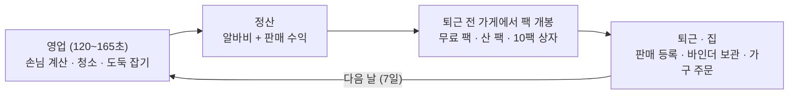
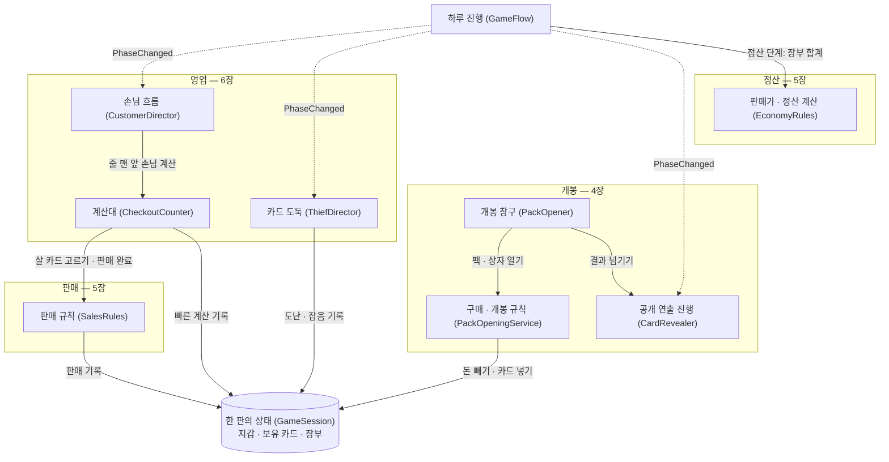
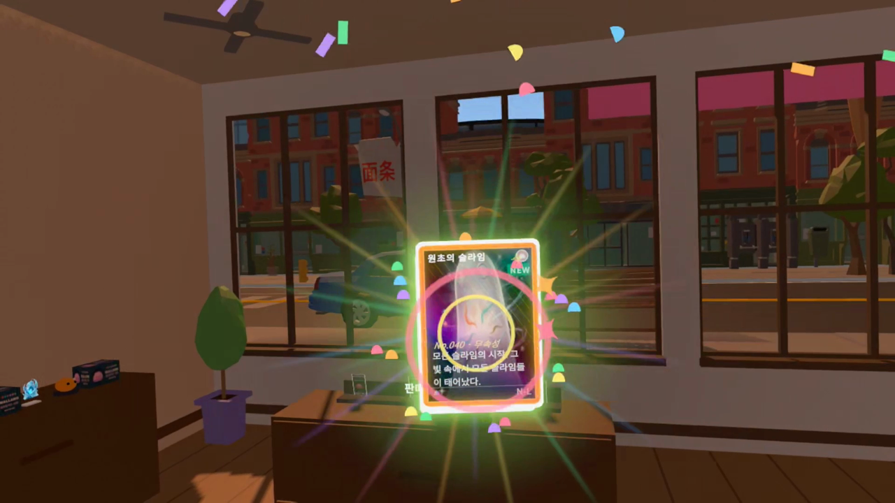
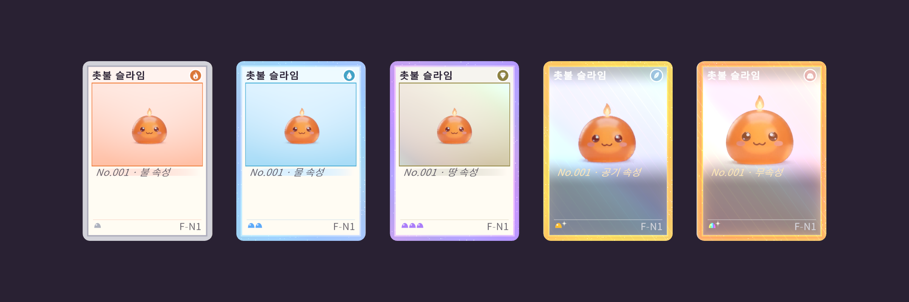
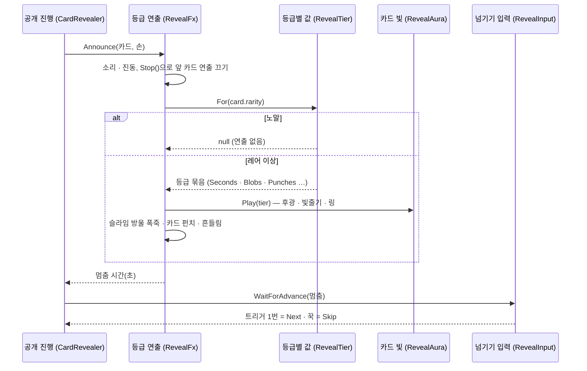
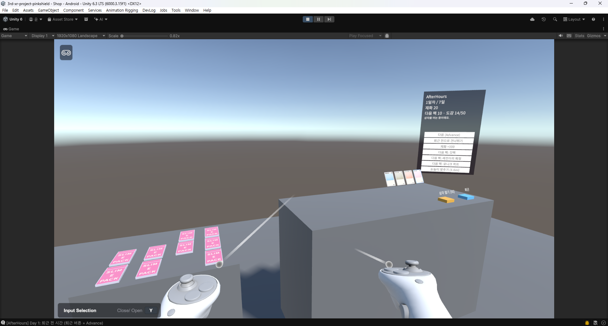
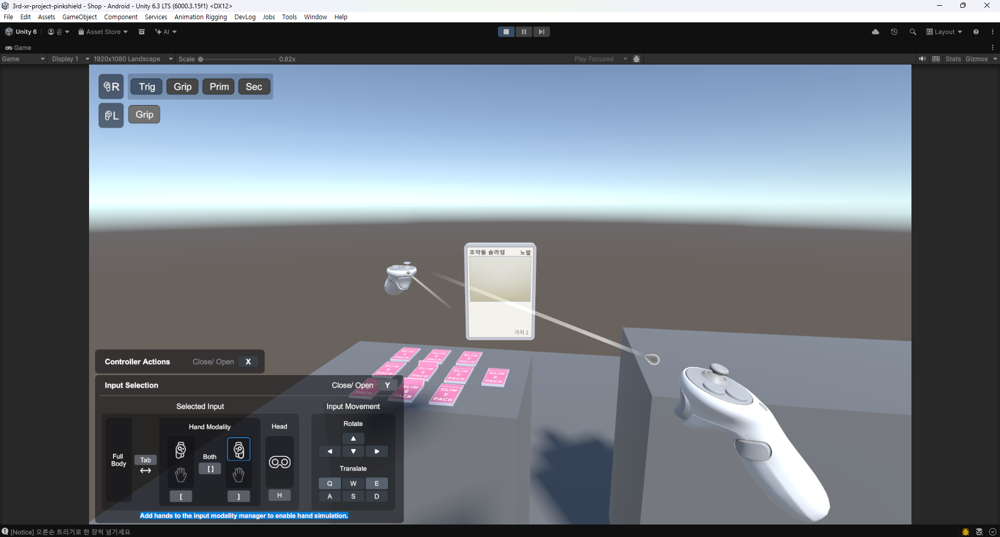
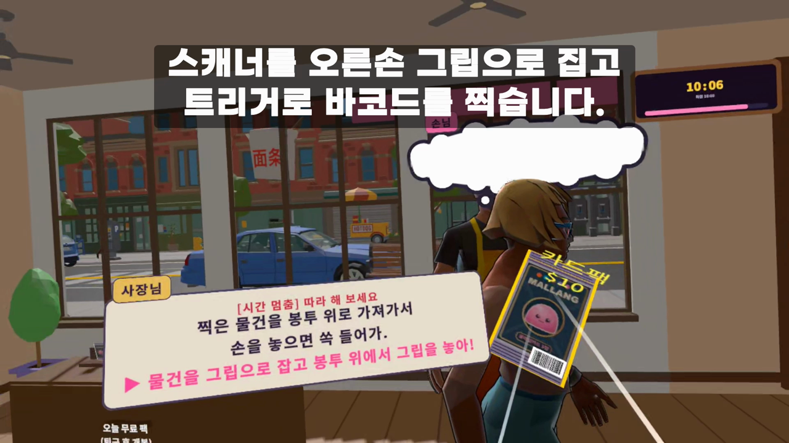
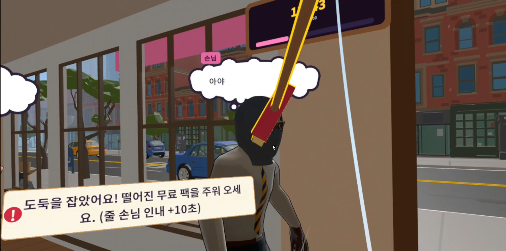
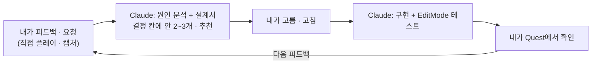

# 슬라임 카드샵 VR — 카드샵 알바생의 일주일 (1인 개발 · Claude Code)

> 알바로 번 돈으로 슬라임 카드팩을 사서 손으로 뜯어 보는 Meta Quest용 VR 게임입니다.
> 기획 · 구현 · 테스트를 혼자 맡았고, 코드는 Claude Code와 함께 썼습니다. 무엇을 만들지와 어떤 안을 고를지는 제가 정했습니다.
>

<!-- 확인 목록 (11-24 v3 재배치): 코드 근거 ✅ 저장소 3rd-xr-project-pinkshield main 0e423c95 대조 · 📄 0 · ❓ 0.
     11-24 코드 대조로 고친 곳(건우 님 "모두 코드대로"): 흐름 그림의 개봉 자리(퇴근 전 가게) · 영업 시간 120~165초 · 한산한 시간 7~11초 · 웨이브 코드 발췌 · 도둑 추격 값 · EconomySimulator 판 수 · RevealTier와 RarityRevealProfile 나눔 · 유니크의 "진동" → 카드 흔들림 · RevealTier 발췌 머리줄 · 개봉 소리 줄 · 300줄 규칙 · 35장 축소안의 계기. 고친 문장마다 ✏️. -->

## 1. 개요

### 1-1. 게임 소개

**슬라임 카드샵 VR**은 카드샵 알바생이 되어 7일 동안 손님을 받고, 번 돈으로 슬라임 카드팩을 사서 **직접 손으로 뜯어 한 장씩 넘겨 보는** Meta Quest용 VR 게임입니다.
모바일 카드 게임에서도 팩을 뜯는 순간은 짜릿하지만, VR에서는 팩을 쥐고 · 찢고 · 넘기는 손동작 자체가 긴장감이 됩니다. 여기에 "일해서 번 돈으로 산 팩"이라는 흐름을 붙여 **노동 → 보상 → 기대감**이 하루마다 돌아가게 만들고 싶었습니다.

| 항목 | 내용 |
|---|---|
| 한 판 | 7일. 하루 = 영업 → 정산 → 퇴근 전 팩 개봉 → 집에서 판매 등록 · 가구 주문 (2-1) |
| 하루 영업 | 120 ~ 165초, 손님 5 ~ 11명 (일차가 지날수록 늘어남) |
| 카드 | 오리지널 슬라임 카드 50장 — 속성 슬라임 40장(5속성 × 8장) · 필드 5장 · 슬라임 알 5장, 등급 5단계 |
| 팩 | 1팩 5장 · 10달러, 10팩 상자 90달러, 하루 무료 팩 1개 |
| 7일 뒤 | 최종 정산(점수 · 랭크) → 평가 없는 무한 모드 |
<!-- ✏️ 11-24 v3 사양 표 신설 — 근거: CampaignConfig.asset days(1일 120초 · 손님 5 ~ 7일 165초 · 손님 10~11), cards.csv(Slime 40 · Field 5 · Snack 5 = 슬라임 알), EconomyConfig.asset(packPrice 10 · boxPrice 90 · freePacksPerDay 1), PackOddsConfig.asset slotLayout 5칸, GamePhases.cs(AfterHours → Home → DayEnd → Final), DEC-035 무한 모드 (main 0e423c95, 11-24 대조 ✅) -->


### 1-2. 풀어야 했던 문제

| 풀어야 했던 문제 | 다룬 장 | 결과 한 줄 |
|---|---|---|
| 희귀 카드가 나오는 순간이 등급마다 달라 보여야 합니다 | 4장 | 레어 0.6초 ~ 레전더리 2.2초, 등급마다 연출 요소를 한 층씩 더했고 보이는 연출 값은 한 파일(`RevealTier`)에 모았습니다 |
| 알바로 번 돈과 팩 한 개의 가치가 맞지 않았습니다 | 5장 | 상자 하나(카드 10팩) 다 팔기 약 $235(초기) → 약 $83 (변경 후) / 가구를 다 산 점수 −46%(초기) → +4% (변경 후) |
| 손님이 고르게 와서 계산대를 떠날 틈이 없었습니다 | 6장 | 2 ~ 3명씩 몰려오는 웨이브 사이에 한산한 7~11초를 두어 계산 → 대처 → 계산 리듬을 만들었습니다 |
<!-- ✏️ 11-24 v3: 「핵심 피처 세 가지」 표를 문제 표로 바꿈. 문제 문장은 4-4 ③(수퍼레어 · 유니크가 같은 연출) · 5-1(7일 7,000달러) · 6-2(계산대를 떠날 틈이 없음)에서 가져옴. 결과 칸은 원래 표 그대로, 한산한 시간만 코드대로 12~20 → 7~11초(CampaignConfig.asset lullSeconds), RevealTier는 보이는 연출 값만 담음(RevealFx.cs 10~12행) -->
<!-- 원래 표의 「한 줄 소개」 칸(손으로 팩을 찢고 한 장씩 … / "팩을 다 팔면 조금 손해 …" 시뮬레이션 7일 × 3,000판 / 2~3명씩 몰려오는 손님 웨이브 …)은 각 장 첫 절과 같은 내용이라 문제 표로 바꾸며 뺐습니다 -->

### 1-3. 만든 방식

| 맡긴 사람 | 한 일 |
|---|---|
| 나 | 기획, 피드백 찾기(직접 플레이 · 캡처), 설계안 중 고르기와 고치기, 맵 · 가구 배치, 카드 그림 손보기, Quest 확인, 시연 영상 |
| Claude Code | 원인 분석, 설계서 초안(결정 칸 · 추천안), 구현, 테스트, 경제 시뮬레이션, 작업 기록(DevLog) 초안 |
| Gemini | 카드 그림 생성 — 제가 쓴 그림 규칙서와 기준 그림을 따라 그립니다(7-2) |
<!-- ✏️ 11-24 v3: AI 협업 장의 「맡긴 사람 | 한 일」 표를 1-3으로 올림. Gemini 줄만 새로 씀 — 근거: 카드아트_작업키트/0_세션설정_프롬프트.txt(규칙서 · 기준 그림), 건우 님 정리본 「AI를 활용한 VR 게임 슬라임 카드 제작 과정」, 건우 님 11-24 답(GPT 그림은 만들었지만 쓰지 않음) -->

### 1-4. 개발 환경 · 링크

| 항목 | 내용 |
|---|---|
| 엔진 | Unity 6000.3 (URP 17.3) · XR Interaction Toolkit 3.5 · OpenXR |
| 플랫폼 | Meta Quest (Android APK), 컨트롤러 조작 |
| AI 도구 | Claude Code (Claude Opus · Sonnet · Haiku를 일에 따라 나눠 썼습니다), 카드 그림은 Gemini로 만든 뒤 직접 손봤습니다 |
| 기간 | 2026-11-16 ~ 2026-11-23 (컨셉 기획 1일 · 개발 5일 · 마무리 2일) |
| 인원 | 1명 |
| 규모 | C# 392파일 · 약 4.4만 줄, EditMode 테스트 416개, 커밋 248개 · 결정 기록 44건 · 버그 카드 24건 |
| 영상 | [플레이 시연 영상 (YouTube)](https://youtu.be/kPjbouM2AXg) |
| GitHub | 비공개 |
<!-- ✏️ 11-24 커밋 247 → 248 (저장소 HEAD 0e423c95 기준 git rev-list --count) -->
<!-- 근거: ProjectSettings/ProjectVersion.txt 6000.3.15f1 · Packages/manifest.json(URP 17.3.0 · XRI 3.5.1 · OpenXR 1.17.1) · Assets/01. Scripts 392파일 44,176줄 · Tests의 [Test] 376 + [TestCase] 40 · DevLog decisions 44 · bugs 24 (11-24 대조 ✅) -->

---

## 2. 게임 디자인

### 2-1. 하루의 흐름

목표한 경험은 **"하루 알바를 마치고, 내 손으로 뜯은 팩에서 희귀 카드가 나오는 순간의 두근거림"** 입니다.

아래 그림에서 볼 것은 **영업으로 번 돈이 팩 개봉으로 이어지고, 개봉한 카드가 다음 날 영업의 상품이 되는 순환**입니다.


<!-- ✏️ 11-24 코드 대조로 그림을 고침 — 개봉은 집이 아니라 퇴근 전 가게(AfterHoursPhase "퇴근 전: 무료 팩 · 구매 · 개봉 · 진열", PackOpener "개봉 가능 시점: 퇴근 전", DEC-021 무료 팩은 계산대 위에서), 집(HomePhase)은 정리 · 판매 등록 · 커뮤니티 · 잠자기. 영업 시간은 CampaignConfig.asset businessSeconds 120 · 135 · 135 · 150 · 150 · 165 · 165 (11-19 A9로 올림, 예전 90~150). 근거: Core/Phases/GamePhases.cs 166~226행 (main 0e423c95, 11-24 대조 ✅) -->

알바해서 번 돈으로 팩을 사서 뜯고(4장), 뜯은 카드를 팔지 · 모을지 고르며(5장), 다음 날 손님이 그 카드를 사 갑니다(6장). 그래서 팩을 뜯을 때마다 다음 날 영업에서 팔 상품이 생깁니다. 7일째 최종 정산에서 점수와 랭크가 나오고, 그 뒤에는 평가 없는 무한 모드로 이어집니다.
<!-- ✏️ 11-24 v3: 괄호 장 번호를 새 목차로 맞춤(팩 사서 뜯기 = 4장 개봉, 팔지 · 모을지 = 5장 경제, 손님 = 6장) -->

### 2-2. 조작

조작은 컨트롤러로 하고, 가게에 걸린 「조작 안내」 판과 같습니다.

| 조작 | 버튼 | 게임에서 쓰는 곳 |
|---|---|---|
| 잡기 | 그립 (가운뎃손가락) | 팩 · 스캐너 · 상품 · 대걸레를 잡습니다. 상품은 봉투 위에서 그립을 놓으면 담깁니다 |
| 누르기 · 카드 넘기기 | 트리거 (검지) | 팩 윗부분의 흰 선을 트리거를 누른 채 그어 찢고, 한 번 누를 때마다 카드를 한 장씩 넘깁니다. 꾹 누르면 건너뜁니다. 스캐너로 바코드를 찍을 때도 씁니다 |
| 멀리 있는 물건 당기기 | 레이저로 잡고 왼손 트리거를 꾹 | 멀리 떨어진 쓰레기를 손으로 당겨 옵니다 |
| 걷기 · 돌기 | 왼쪽 스틱 · 오른쪽 스틱 | 물건을 쥔 채로도 걷고 돕니다 |
| 일시정지 | 왼손 메뉴 버튼 | 일시정지 · 안내 다시 보기 |

### 2-3. 레퍼런스와 다른 점

| 참고한 게임 | 가져온 것 | 다르게 한 것 |
|---|---|---|
| 모바일 포켓몬 카드 게임 (Pocket) | 팩을 뜯는 순간의 기대감, 팩 고르기 | 카드팩을 공중에 띄워 선택하지 않고, **테이블에 놓인 카드팩**을 직접 골라 카드팩을 개봉합니다. |
| TCG Card Shop Simulator | 가게를 운영하며 팩을 여는 흐름 | 사장이 아니라 **알바생** — 가게 돈이 아니라 내 알바비로 팩을 삽니다. 기존 IP와 겹치지 않게 **오리지널 슬라임 카드 50장**을 AI 이미지 생성으로 직접 만들었습니다 |


---

## 3. 전체 구조 — 하루의 네 단계를 코드에서 다시 그리면

2-1의 네 단계(영업 · 정산 · 개봉 · 판매)를 코드 쪽에서 다시 그린 지도입니다. 4~6장은 이 그림의 묶음 하나씩을 확대해 들어갑니다. <!-- ✏️ 11-24 v3 3장 신설 -->

### 3-1. 구조 그림

이 그림에서 볼 것은 **단계를 넘기는 클래스는 하루 진행(`GameFlow`) 하나이고, 단계마다 일하는 클래스는 "단계가 바뀌었다"는 알림을 듣고 스스로 움직인다**는 점입니다. 실선은 직접 호출, 점선은 이벤트 구독입니다. <!-- ✏️ -->


<!-- ✏️ 11-24 v3 구조 그림 — 화살표 근거(main 0e423c95, 11-24 대조 ✅):
     F→CD · TD · CR 점선: GameFlow.GoTo가 Events.RaisePhaseChanged(GameFlow.cs 197행), 구독은 CustomerDirector.cs 109 · 118~121행(영업 시작 BeginDay, 영업 끝 DismissAll) · ThiefDirector · CardRevealer.cs 106 · 117~119행(영업 시작 때 Clear)
     F→ER: SettlementPhase.Enter가 Context.EconomyRules.SettlementTotal(ledger) (GamePhases.cs 174~180행)
     CD→CC: CustomerDirector의 부품 CheckoutLine이 counter.Begin (CheckoutLine.cs 121행)
     CC→SR: ctx.Sales.PickPurchase · CustomerPrice · CompleteSale (CheckoutCounter.cs 64~65 · 176행)
     PO→PS · CR: TryOpenFree · TryOpenSingle · TryOpenBox → revealer.RevealPack · RevealBox (PackOpener.cs 44~45 · 68 · 94 · 101행)
     →GS: Ledger.checkoutsFast(CheckoutCounter.cs 174) · freePackStolen · thievesCaught(ThiefDirector.cs 197 · 209) · Wallet.TrySpend · Collection.Add(PackOpeningService.cs 41 · 68 · 85) · Ledger 판매 기록(SalesRules.cs 198) -->

그래서 단계 순서를 바꿀 때는 `GameFlow`의 단계 클래스만 고치고 손님 · 연출 코드는 건드리지 않습니다. 마지막 날에 집을 건너뛰고 바로 최종 정산으로 가는 규칙도 퇴근 전 단계(`AfterHoursPhase`)의 한 줄입니다. <!-- ✏️ 근거: GamePhases.cs 202~207행 OnAdvanceRequested(lastDay ? DayEnd : Home) -->

규칙 서비스(`EconomyRules` · `PackOpeningService` · `SalesRules` · `ScoreRules` 등)와 설정 에셋은 씬의 유일한 진입점인 `GameContext`가 시작할 때 한 번 만들어 들고 있고, 다른 클래스는 여기서 꺼내 씁니다. <!-- ✏️ 근거: GameContext.cs 8~11행 summary("씬의 유일한 진입점"), Awake에서 new EconomyRules · PackOpeningService · SalesRules · ScoreRules -->

### 3-2. 핵심 클래스

| 역할 (이름) | 하는 일 | 하지 않는 일 | 다룬 장 |
|---|---|---|---|
| 하루 진행 (GameFlow) | 단계(타이틀 · 영업 · 정산 · 퇴근 전 · 집 · 하루 끝 · 최종)를 바꾸고 `PhaseChanged`를 알립니다. 단계마다 할 일은 단계 클래스(`GamePhases.cs`)에 있습니다 | 손님 · 도둑 클래스를 직접 모릅니다 — `ICustomerFloor` · `IThiefFloor` 인터페이스로만 묻습니다 | 2-1 · 3-3 |
| 손님 흐름 (CustomerDirector) | 웨이브 일정대로 손님을 들여보내고, 구경 → 계산대 줄 → 계산 → 퇴장 순서를 이끕니다 | 결제와 판매 판정을 하지 않습니다 — 계산대와 판매 규칙이 합니다 | 6-2 |
| 계산대 (CheckoutCounter) | 줄 맨 앞 손님의 장바구니를 올리고 바코드 찍기 · 포스기 화면 · 결제를 맡습니다 | 줄 · 동선을 다루지 않습니다 — 손님 흐름(CustomerDirector)이 합니다 | 6-1 |
| 카드 도둑 (ThiefDirector) | 3일차부터 하루 한 번 도둑을 내보내고, 빗자루에 맞았는지 판정합니다 | 도둑의 몸(외형 · 걷기 · 말풍선)을 만들지 않습니다 — 손님 흐름의 `SpawnExtra`를 빌려 씁니다 | 6-1 · 6-3 |
| 판매가 · 정산 계산 (EconomyRules) | 장부를 읽어 그날 알바비 합계와 카드 판매가를 계산합니다 | 지갑에 돈을 넣지 않습니다 — 정산 단계(`SettlementPhase`)가 넣습니다 | 5-2 |
| 개봉 창구 (PackOpener) | 팩 · 상자를 열어 달라는 요청을 받아 규칙을 부르고, 결과를 연출에 넘깁니다. 퇴근 전에만 열립니다 | 카드를 뽑지 않습니다 — 구매 · 개봉 규칙이 합니다 | 4-1 |
| 구매 · 개봉 규칙 (PackOpeningService) | 돈을 빼고(그날 무료 팩이 남았으면 무료), 카드를 뽑아 바로 보유 목록(도감 포함)에 넣습니다 | 연출을 모릅니다 — 화면 쪽 클래스를 참조하지 않는 순수 C#입니다 | 4-1 · 5-2 |
| 공개 연출 진행 (CardRevealer) | 팩 찢기 → 한 장씩 넘기기 → 결과 순서를 이끌고, 일은 부품(`RevealFx` · `RevealStack` · `RevealInput` 등)에 맡깁니다 | 어떤 카드가 나올지 정하지 않고 돈도 다루지 않습니다 — 카드는 개봉 때 이미 보유 목록에 들어가 있어 보여 주기만 합니다 | 4장 |
| 판매 규칙 (SalesRules) | 판매 등록 · 집에서 바로 팔기 · 손님이 살 카드 고르기와 판매 완료를 판정합니다. 집의 판매 판(`SalesPanel`)과 계산대가 부릅니다 | 손님에게 파는 값(시세 반영)을 직접 계산하지 않습니다 — 판매가 계산(EconomyRules)에 묻습니다 | 5-2 |
| 한 판의 상태 (GameSession) | 일차 · 지갑 · 보유 카드 · 판매 등록 · 그날 장부를 들고 있습니다 | 저장하지 않습니다 — 새 게임은 새 `GameSession`입니다 | 3-3 |
<!-- ✏️ 11-24 v3 핵심 클래스 표 — 「하지 않는 일」 근거(main 0e423c95, 11-24 대조 ✅. ① 그 클래스에 없음 ② 대신 하는 클래스에 있음):
     GameFlow: GameFlow.cs 31~51행 ICustomerFloor · IThiefFloor, 98~105행 등록 속성 · GamePhases.cs에 CustomerDirector · ThiefDirector 이름 0회
     CustomerDirector: SalesRules · EconomyRules 참조 0회 / CheckoutCounter.cs 64 · 176행
     CheckoutCounter: QueueMover · BrowseArea · Route 참조 0회 / summary "줄 · 동선은 CustomerDirector가 맡고"
     ThiefDirector: ThiefDirector.cs 147행 customers.SpawnExtra("Thief")
     EconomyRules: Wallet 참조 0회 / GamePhases.cs 179행 Context.Session.Wallet.Add(LastTotal)
     PackOpener: PackRoller · Roll 참조 0회 / PackOpeningService.cs 19 · 22행 roller
     PackOpeningService: using은 CardShop.Cards뿐(Presentation 없음)
     CardRevealer: PackRoller · PackOpening · Wallet · Ledger 참조 0회 / summary "카드 데이터는 개봉 시점에 이미 보유 목록에 들어가 있어, 연출은 보여 주기만 합니다"
     SalesRules: SalesRules.cs 209행 prices.GrossPrice(EconomyRules), 즉시 판매가(InstantValue)는 매입가로 직접 계산
     GameSession: summary "저장 기능은 없습니다" -->

### 3-3. 약속 — 클래스끼리 무엇으로 이어지나

| 약속 | 보내는 쪽 · 값이 있는 곳 | 받는 쪽 | 무엇이 일어나나 |
|---|---|---|---|
| 이벤트 `PhaseChanged(이전, 다음)` | 하루 진행 (`GameFlow.GoTo`) | 손님 흐름 · 카드 도둑 · 공개 연출 진행, 가게 소품 · 집 패널(`PhaseListener`) | 영업이 시작되면 손님 일정을 짜고, 영업이 끝나면 남은 손님을 내보냅니다. 공개 연출은 영업이 시작될 때 지난 카드 더미를 치웁니다 |
| 인터페이스 `ICustomerFloor` · `IThiefFloor` | 영업 단계 (`BusinessPhase`) | 손님 흐름 · 카드 도둑 (시작할 때 `GameFlow`에 스스로 등록) | 영업 시간이 끝나면 `StopSpawning()`으로 새 손님 · 도둑을 멈추고, 남은 손님 · 도둑이 없으면 정산으로 넘어갑니다 |
| 장부 `DayLedger` (`GameSession.Ledger`) | 계산대(빠른 계산) · 계산대 줄(떠난 손님) · 카드 도둑(도난 · 잡음) · 판매 규칙(판매) | 정산 단계 → 판매가 · 정산 계산 | 영업 중 일어난 일을 숫자로 적어 두고, 정산은 장부만 읽어 알바비를 계산합니다 |
| 데이터 표 `cards.csv` → `CardDatabase.asset` | 카드 50장(id · 종류 · 속성 · 등급 · 이름 · 설명 · 그림 이름), 에디터 도구(`CardCsvImporter`)가 에셋으로 바꿈 | 팩 뽑기(`PackRoller`) · 판매 규칙 · 점수(`ScoreRules`) | 카드 id로 카드를 찾고, 그 카드의 등급으로 값을 찾습니다 |
| 등급 값 `RarityTable.asset` | 등급마다 기준가 · 손님 구매 확률 · 매입가 | 판매가 · 정산 계산 · 판매 규칙 · 점수 | 같은 등급 표 하나로 판매와 점수를 계산합니다(5-2) |
| 연출 값 `RevealTier` · `RarityRevealProfile.asset` | 등급마다 보이는 연출(`RevealTier`) / 멈춤 · 진동 · 소리(`RarityRevealProfile`) | 등급 연출 (`RevealFx`) | 연출 코드는 "몇 개 · 몇 초"만 묻습니다(4-2) |
| 설정 `EconomyConfig` · `CampaignConfig` | 팩 값 · 알바비 · 판매 칸 / 일차별 영업 시간 · 손님 수 · 웨이브 · 도둑 | `GameContext`가 들고 규칙 · 감독 클래스에 넘김 | 숫자를 코드가 아니라 에셋에서 고칩니다 |
<!-- ✏️ 11-24 v3 약속 표 — 근거(main 0e423c95, 11-24 대조 ✅): GameContext.cs 93~121행 GameEvents(PhaseChanged · DayStarted · SessionStarted …) · PhaseListener.cs(소품 · 집 패널 공통 구독) · GameFlow.cs 31~51 · 98~105행 인터페이스와 등록 · GamePhases.cs 119~120 · 148행 StopSpawning · HasCustomers · DayLedger 기록 줄은 3-1 그림 주석과 같음 · Editor/Data/CardCsvImporter.cs · CardDatabase.cs · GameContext.Awake(PackRoller · SalesRules · ScoreRules에 cardDatabase · rarityTable 넘김) · RevealFx.cs 10~12 · 75 · 81행 -->

---

## 4. 카드팩 개봉 연출 — 희귀할수록 한 층씩 더 화려하게

1-2의 첫 번째 문제(희귀 카드가 나오는 순간이 등급마다 달라 보여야 합니다)를 푸는 장입니다. 하루의 흐름에서 퇴근 전 팩 개봉 단계, 3장 그림의 「개봉」 묶음입니다. <!-- ✏️ 11-24 v3 다리 문장 -->

### 4-1. 손으로 찢고 한 장씩 넘기는 개봉

목표한 경험의 **"희귀 카드가 나오는 순간"** 을 만드는 장면입니다. 
팩을 찢으면 카드 5장이 앞면으로 쌓이고, 트리거로 한 장씩 넘깁니다. 레어 이상 카드가 나오면 등급마다 **연출 요소가 한 층씩 더해집니다**.
10팩 상자를 열 때는 팩 10개가 한 줄로 서서 한꺼번에 뜯기고, 수퍼레어 이상이 든 팩만 빛납니다.





| 요소 | 레어 | 수퍼레어 | 유니크 | 레전더리 |
|---|---|---|---|---|
| 색 | 하늘 | 연보라 | 금 | 무지개 |
| 카드 등장 효과 | 1번 | 1번 | 2번 | 2번 + 둥실 |
| 뒤 후광 | 작게 | 중간 | 크게  | 아주 크게 |
| 슬라임 방울 폭죽 | 1겹 | 2겹 | 2겹 | 3겹 |
| 별 · 빛줄기 · 충격파 링 | | ○ | ○ | ○ (반대로 도는 빛줄기를 더합니다) |
| 주변 어둡게 · 색종이 · 카드 흔들림 | | | ○ | ○ (더 길게) |
| 카드 등장 연출 길이 | 0.6초 | 1.1초 | 1.5초 | 2.2초 |

컨트롤러 진동은 노말부터 모든 등급에 있고, 좋은 등급일수록 세고 깁니다(유니크는 2번). <!-- ✏️ 11-24 코드 대조: 표의 "진동"을 "카드 흔들림"으로(RevealTier.ShakeSeconds — 유니크 0.45초 · 레전더리 0.9초), 진동은 RarityRevealProfile.asset 다섯 등급 모두 hapticCount 1 · 유니크 2 (RevealFx.cs 75~78행) -->
<!-- 근거: RevealTier.cs 40~62행 — Punches 1 · 1 · 2 · 2 + Lift, Blobs 1 · 2 · 2 · 3겹, Stars · Rays · Rings 수퍼레어부터, CounterRays 레전더리, Dim · Confetti 유니크부터, Seconds 0.6 · 1.1 · 1.5 · 2.2 (main 0e423c95, 11-24 대조 ✅) -->

### 4-2. 등급별 값을 한곳에

보이는 연출 값(후광 · 폭죽 · 빛줄기 · 펀치 · 흔들림)은 등급마다 한 묶음(`RevealTier`)으로 모았습니다. 연출 코드(소리 · 진동 · 폭죽을 내는 `RevealFx`, 카드 둘레 빛을 그리는 `RevealAura`)는 "몇 개 · 몇 초"를 묻기만 하고, 보이는 연출을 바꿀 때는 이 파일만 고칩니다. 멈춤 · 진동 · 소리 값은 등급별 공개 연출 설정 에셋(`RarityRevealProfile`)에 따로 있습니다. <!-- ✏️ 11-24 코드 대조: "값을 바꿀 때는 이 파일만" → 보이는 연출은 RevealTier, 멈춤 · 진동 · 소리는 RarityRevealProfile (RevealFx.cs 10~12 · 75~83행, RevealTier.cs 10행) -->

아래 그림에서 볼 것은 **카드 한 장을 넘길 때 `RevealFx`가 등급 묶음(`RevealTier`)에 "몇 개 · 몇 초"만 묻고, 노말이면 아무것도 하지 않는다**는 점입니다.


<!-- 근거: RevealFx.Announce 71~84행 · Celebrate 86~106행 · CardRevealer.cs 233~234행 · RevealInput.cs 16 · 75행 (main 0e423c95, 11-24 대조 ✅) -->

그래서 보이는 연출을 바꿀 때 `CardRevealer`와 `RevealFx`는 그대로 두고 `RevealTier`의 값만 고치면 됩니다. <!-- ✏️ 11-24 "등급 연출을" → "보이는 연출을" -->

```csharp
// RevealTier.cs (45~56행 · 64~72행 발췌)
static readonly RevealTier SuperRare = new RevealTier
{
    Seconds = 1.1f, Halo = 1.9f, Blobs = new[] { 12, 8 }, Radius = 0.10f, Stars = 8, Rays = 10, RayAlpha = 0.22f,
    EdgePulses = 1, Rings = 1, Punches = 1, PunchScale = 1.11f,
    Colors = new[] { new Color(0.9f, 0.74f, 1f) },
};
static readonly RevealTier Unique = new RevealTier
{
    Seconds = 1.5f, Halo = 2.3f, HaloBreathe = true, Blobs = new[] { 16, 10 }, Radius = 0.13f, Stars = 10, Rays = 12, RayAlpha = 0.26f,
    EdgePulses = 2, Rings = 2, Dim = 0.3f, Confetti = 14, Punches = 2, PunchScale = 1.11f, ShakeSeconds = 0.45f,
    Colors = new[] { new Color(1f, 0.86f, 0.45f) },
};
// 이하 Legendary(57~62행) 생략

/// <summary>노말이면 null (연출 없음).</summary>
public static RevealTier For(CardRarity rarity) => rarity switch
{
    CardRarity.Rare => Rare,
    CardRarity.SuperRare => SuperRare,
    CardRarity.Unique => Unique,
    CardRarity.Legendary => Legendary,
    _ => null,
};
```
<!-- ✏️ 11-24 코드 대조: 머리줄을 행 번호 형식으로, 원본에 없던 줄 끝 주석(// 레어 연출 등)을 빼고 원본 그대로. 원본 클래스 summary(7~8행)는 "한 등급 올라갈 때마다 요소를 하나씩 더합니다" -->

- 노말은 가장 낮은 등급이라 `RevealTier`에 묶음을 두지 않았습니다(`null`). 빠르게 카드를 넘기고 싶은 사람을 고려하여 다음 카드로 넘기면 앞 연출은 바로 꺼집니다.

### 4-3. 문제와 해결 — 카드 묶음이 눈앞이 아니라 옛 자리로 튀던 버그

**증상** — 팩을 자르면 눈앞 35cm에 카드 5장이 나와야 하는데, 가끔(3번 중 1번) 카드가 카운터 뒤쪽 옛 자리에 나타났습니다. 에러 로그는 없었습니다.



**원인을 찾은 방법** — 카드의 Transform 위치와 Rigidbody 위치를 프레임마다 나란히 찍었습니다. 문제가 난 개봉에서만 첫 프레임에 Transform은 눈앞, Rigidbody는 옛 자리였고, 다음 프레임에 카드가 옛 자리로 돌아갔습니다.

```text
2번째 개봉
f0  Card pos=(-1.279, 1.318, -0.038)  rb pos=(0.150, 1.100, 0.500)   ← Transform은 눈앞, 물리는 옛 자리
f1  Card pos=( 0.150, 1.100,  0.500)  rb pos=(0.150, 1.100, 0.500)   ← 다음 프레임에 옛 자리로 되돌아감
```

**원인** — 카드 프리팹의 Rigidbody가 보간(Interpolate)으로 설정돼 있었습니다. 보간은 매 프레임 물리 위치를 Transform에 다시 써 넣는데, 공개 연출 코드는 Transform만 옮겼습니다. 그래서 옮긴 뒤 물리 스텝이 먼저 오면 정상이고, 렌더 프레임이 먼저 오면 보간이 옛 물리 위치로 덮어썼습니다. 풀에서 다시 꺼낸 카드에서만 드러난 것도 이 때문입니다.

**해결** — 스크립트로만 움직이는 공개용 카드는 보간을 끄고, 옮길 때 Transform과 Rigidbody를 함께 옮기게 했습니다. 씬 전체를 맞추는 `Physics.SyncTransforms()`도 생각했지만, 비용이 크고 원인(보간)이 그대로 남아 쓰지 않았습니다.

```csharp
// CardRevealView.Teleport (234~242행 발췌)
// Transform과 Rigidbody를 함께 옮겨, 다음 물리 스텝에서 옛 위치로 되돌아가지 않게 합니다.
void Teleport(Vector3 position, Quaternion rotation)
{
    transform.SetPositionAndRotation(position, rotation);
    if (body != null)
    {
        body.position = position;
        body.rotation = rotation;
    }
}
```



**배운 점** — Rigidbody가 있는 물체를 스크립트로 순간이동시킬 때는 Transform만 옮기면 안 됩니다. 간헐적인 버그는 추측보다 프레임별 값 로그가 빠릅니다.
<!-- ✏️ 11-24 Claude 초안 — 근거: 게임 저장소 DevLog/bugs/BUG-003(증상 · 진단 로그 · 원인 · 해결 · 배운 점), 커밋 305bf3d, CardRevealView.cs Teleport(origin/main). 그림은 DevLog/screenshots/BUG-003 before · after. 원인은 Claude가 진단 로그를 제안해 찾았고 건우 님은 재현 빌드로 로그를 받았음(BUG-003 7절) — 면접에서 설명할 수 있게 본인 말로 확인. 카드 기록상 확인은 에디터 1회 -->
<!-- 11-24 v3: 이 절은 지금 3-4였고, v3 1-4(문제와 해결 → 결정 표가 장의 마지막)에 맞춰 결정 표 앞으로 옮김. 코드 대조: Teleport 233~242행 · 보간 끄기 CardRevealView.cs 55행 (main 0e423c95 ✅) -->

### 4-4. 고민과 선택 — 연출 규칙을 세 번 바꿨다

**① 시연 뒤 뒤집은 처음 규칙 (11-17)**
설계 단계에서는 "유니크 이상은 건너뛰기 불가, AI가 제안했던 갓팩(전부 유니크 이상)은 전용 동시 공개" 규칙을 정했습니다. VR 기기 Quest에서 직접 해 보니 갓팩 연출은 제가 원했던 결과가 아니었습니다.

> **결정 대상** 희귀 카드 공개 규칙(건너뛰기 · 갓팩 · 레전더리 연출)을 처음 설계대로 둘지, 시연 뒤 바꿀지.

| | [A] 설계 단계 | **[B] 시연 뒤 변경 ✓** |
|---|---|---|
| 건너뛰기 | 유니크 이상은 못 건너뜁니다 | 꾹 누르면 모든 등급을 건너뜁니다 (갓팩만 예외) |
| 갓팩 | 전용 5장 동시 공개 | 금빛 폭죽 · 진동 3번으로 예고한 뒤 한 장씩, 건너뛸 수 없습니다 |
| 레전더리 | 카메라 흔들기 + 큰 폭죽 | 폭죽 확대 + 카드 흔들림 + 진동 |
| 플레이어에게 던지는 질문 | "특별한 팩이 나왔습니다. 연출을 끝까지 보시겠어요?" | "다음 장에는 무엇이 나올까요?" |
| 단점 | 갓팩도 한 장씩 확인하는 재미가 없고, 카메라 흔들기는 VR에서 어지러움을 부릅니다 | 희귀 카드를 실수로 넘겨 놓칠 수 있습니다 |

**[B]를 골랐습니다.** 갓팩은 한 장 한 장 까면서 희귀 카드를 직접 확인하는 재미가 더 컸습니다. 그래서 갓팩도 동시 공개 대신 한 장씩 보여 주고, 대신 결과를 빨리 보고 싶은 사람은 **꾹 눌러 바로 넘어갈 수 있게** 보완했습니다. 다만 갓팩만은 건너뛸 수 없게 하고, 첫 장 전에 금빛 폭죽과 진동 3번으로 예고합니다. 갓팩은 직접 한 장씩 봐야 하는 순간이기 때문입니다. 그 대가로 일반 팩에서는 희귀 카드를 실수로 넘겨 놓칠 수 있고, 갓팩이 나오면 건너뛰기가 막혀 시간이 더 걸립니다.

*정한 사람: 갓팩 전용 동시 공개는 AI가 제안한 규칙이었지만, Quest에서 직접 해 보고 제가 한 장씩 공개로 바꿨습니다.*

처음 기획 때는 카메라 흔들기를 넣으려고 했지만 VR에서 시야가 흔들리니 어지러움을 느껴 **카드만 흔들리고 컨트롤러가 진동**하도록 변경하였습니다. 

뒤에 만든 10팩 상자에서는 꾹 눌러 건너뛰어도 수퍼레어 이상 카드는 남겨 한 장씩 보여 줍니다(②와 같은 날 정함). <!-- ✏️ 11-24 코드 대조 — 근거: RevealQueue.Keeps 66~70행(갓팩 또는 상자 · 수퍼레어 이상), DEC-029 (main 0e423c95 ✅) -->
<!-- 근거: 갓팩 건너뛰기 막기 RevealInput.WaitForAdvance allowSkip(74행) · CardRevealer.cs 234행 !godPack, 예고 RevealFx.GodIntro 108~119행(금빛 폭죽 · 진동 3번 + 긴 진동), 카메라 셰이크 안 씀 RevealFx.cs 11행 (main 0e423c95, 11-24 대조 ✅) -->

**② 상자 10팩 장면에만 미리 보여 주기 (11-19)**
상자 개봉은 시연 영상에서 가장 길게 쓰는 장면인데, 팩 10개가 똑같이 뜯겨 밋밋했습니다.

> **결정 대상** 상자 10팩을 뜯는 순간에 결과를 어디까지 미리 보여 줄지.

| | [A] 그대로 (결과 숨김) | **[B] 좋은 팩만 빛남 ✓** | [C] 넘길 때만 연출 |
|---|---|---|---|
| 방식 | 10팩이 모두 똑같이 뜯깁니다 | 수퍼레어 이상이 든 팩만 뜯길 때 빛납니다 | 한 장씩 넘길 때의 등급 연출만 둡니다 |
| 플레이어에게 던지는 질문 | "넘겨 보기 전까지 무엇이 들었을까요?" | "어느 팩에 좋은 카드가 들었을까요?" | [A]와 같습니다 |
| 장점 | 넘길 때까지 결과를 숨깁니다 | 뜯는 순간 "뭔가 나왔다" | 이미 있습니다 |
| 단점 | 10팩 장면이 밋밋합니다 | 결과를 일부 미리 알려 줍니다 | 문제를 풀지 못합니다 |

**[B]를 골랐습니다.** 10팩 상자는 빠른 결과를 원하는 사람이 고르는 선택지입니다. 한 장씩 깔 때는 장마다 "무엇이 나올까" 기대하지만, 상자를 까서 한 번에 다 나와 버리면 그런 기대감이 사라집니다. 팩만 잘라도 좋은 카드가 든 팩이 빛나면 **"오, 좋은 카드 나왔나 보다"** 하며 기대감과 궁금증이 올라갑니다.

모바일 포켓몬 카드 게임에도 이런 연출이 있어 참고했습니다. 
처음에는 빛난 팩을 넘기는 순서의 맨 뒤로 보내 **좋은 건 마지막에 한꺼번에 연출** 을 생각했지만, 해 보니 팩 개봉이 **조작된 것처럼** 느껴져 원래 순서로 되돌렸습니다. 빛나는 연출만 남기고, 카드가 나오는 순서는 손대지 않았습니다. 
<!-- 근거: BoxPackRarityFx.OnTorn 38~58행 · RevealQueue.TierOf 46~50행(수퍼레어 이상 = 금빛), 맨 뒤로 보내기(RevealQueue.GoodLast 53행)는 런타임에서 쓰이지 않고 테스트에만 남음 — BoxOpening.cs 46행 "예전 정렬은 RevealQueue.GoodLast로 남겨 둠" (main 0e423c95, 11-24 대조 ✅) -->

**③ 수퍼레어 · 유니크를 하나로 묶던 것을 계단식으로 (11-22)**
수퍼레어와 유니크가 같은 연출이라 등급 차이가 느껴지지 않았습니다. 움직이는 HTML 미리 보기를 3판 만들어 보면서 "레어에도 가벼운 연출, 유니크는 레전더리보다 조금 덜"로 정했습니다.

---

## 5. 경제 재설계 — 팩을 다 팔면 조금 손해 보게

1-2의 두 번째 문제(알바로 번 돈과 팩 한 개의 가치가 맞지 않았습니다)를 푸는 장입니다. 하루의 흐름에서 정산과 집에서의 판매 단계, 3장 그림의 「정산」 · 「판매」 묶음입니다. <!-- ✏️ 11-24 v3 다리 문장 -->

### 5-1. 일주일에 7,000달러를 번 알바생

**노동 → 보상 → 기대감**(1장)이 하루마다 돌아가려면, 알바로 번 돈과 팩 한 개의 무게가 맞아야 합니다. 
테스트 플레이에서 7일 동안 7,000달러가 모였습니다. 인기 속성 때문인 줄 알았는데, Claude에게 시뮬레이션을 맡겨 보니 원인은 다른 곳에 있었습니다.

- **상자(90달러)를 열어 집에서 바로 팔면 평균 약 235달러가 돌아옵니다** → 사서 팔기만 반복해도 돈이 하루 2.6배씩 불어납니다 (시뮬레이션 7일 가운데값 약 32,500)
- 손님이 진열 카드 1장만 보고 판정해서, 판매 칸을 늘려도 수입이 늘지 않았습니다
- 점수가 카드 기준가로 계산돼, 가구를 전부 사면 점수가 46% 떨어졌습니다(5-2). 그래서 가구를 살 이유가 없었습니다
<!-- 근거: DevLog/decisions/DEC-041 「문제」(235 · 2.6배 · 32,500 · 판매 칸 · −46%) (11-24 대조 ✅) -->

### 5-2. 바꾼 규칙

실제 카드 게임처럼 **"팩을 까서 다 팔면 조금 손해, 대박 카드와 손님 판매가 이득"** 인 구조로 바꿨습니다. 돈을 버는 실력이 "진열 판매 · 인기 속성 맞추기"로 가도록 하기 위해서입니다.

| 등급 | 손님 판매 기준가 | 집에서 바로 팔 때 (매입가) |
|---|---|---|
| 노말 | 1 | 0.2 (5장에 1) |
| 레어 | 5 | 1 |
| 수퍼레어 | 20 | 5 |
| 유니크 | 100 | 25 |
| 레전더리 | 500 | 100 |

| 바꾼 것 | 전 | 후 |
|---|---|---|
| 상자 하나 다 팔기 | 약 235 (90에 사서) | 약 83 (90보다 적은 값) |
| 판매 칸 4 → 6칸 | 하루 판매 그대로 | 120 → 153 (손님이 진열 카드를 **모두 둘러봄**) |
| 가구 전부 산 사람의 점수 | −46% | +4% (점수의 카드 가치 = 매입가) |
| 인기 속성 | 1개 | 2개 (2순위는 보너스 절반), 강도 4단계 |

```csharp
// RarityTable.cs (29~33행 발췌) — 등급별 값 (노말, 레어, 수퍼레어, 유니크, 레전더리)
new Entry { basePrice = 1,   customerBuyChance = 0.80f, buybackPrice = 0.2f, ... },
new Entry { basePrice = 5,   customerBuyChance = 0.60f, buybackPrice = 1f,   ... },
new Entry { basePrice = 20,  customerBuyChance = 0.35f, buybackPrice = 5f,   ... },
new Entry { basePrice = 100, customerBuyChance = 0.12f, buybackPrice = 25f,  ... },
new Entry { basePrice = 500, customerBuyChance = 0.03f, buybackPrice = 100f, ... },

// ScoreRules.cs (62행 발췌) — 최종 점수의 카드 가치 = "지금 다 팔면 얼마" (매입가 합)
if (card != null) cardValue += pair.Value * rarity.BuybackPrice(card.rarity);
```
<!-- ✏️ 11-24 머리줄에 행 번호. 「...」는 revealColor · highlightInBox 생략. 근거: RarityTable.asset · RarityTable.cs 29~33행 · ScoreRules.cs 62행 · EconomyConfig.asset salesDisplaySlots 4 + UpgradeCatalog extraSalesSlots {0, 2, 4} · DEC-041 Q1~Q8 (main 0e423c95, 11-24 대조 ✅) -->


값은 ScriptableObject(`RarityTable` · `EconomyConfig`)에 두어 코드를 고치지 않고 에디터에서 바꿀 수 있습니다. 규칙은 설계 단계의 시뮬레이션(7일 × 3,000판)으로 정했고, 실제 규칙 코드를 그대로 쓰는 밸런스 시뮬레이터(`EconomySimulator`)로 7일 × 400판을 돌려 보는 EditMode 테스트를 두었습니다.
<!-- ✏️ 11-24 코드 대조: "다시 빌드하지 않고" → 에디터에서 코드 수정 없이(Quest에는 다시 빌드 필요), "EconomySimulator로 7일 × 3,000판" → 3,000판은 설계 단계 시뮬레이션(DEC-040 「문제」), EconomySimulator는 Tests/EconomySimulationTests.cs 17행 Runs = 400 · 60행 sim.Run(p, Runs, 1000) (main 0e423c95 ✅) -->

### 5-3. 고민과 선택 — 가구는 값만 내릴까, 다시 설계할까

경제를 보던 중 제가 짚었습니다. "가구를 사는 보람이 없으면 업그레이드 시스템 자체가 있을 이유가 없다." 시뮬레이션으로 보니 가구를 안 산 사람보다 **바인더만 이득(+37), 나머지는 모두 손해**(전부 사면 −140)였습니다.

> **결정 대상** 손해인 가구를 값만 내릴지, 가구마다 사는 보람을 다시 설계할지.

| | [A] 가격만 조정 | **[B] 가구마다 보람을 다시 설계 ✓** |
|---|---|---|
| 방식 | 손해인 가구 값을 내립니다 | 진열장 세트 보너스 · 컴퓨터 온라인 장터 · 꾸미기 5종 세트(무료 팩 +1) · 방 점수 · 그날 밤 택배 · 정산에 "가구 덕분에" 줄 |
| 플레이어에게 던지는 질문 | "어느 가구가 싸졌을까요?" | "어느 분야를 끝까지 채울까요?" |
| 장점 | 작업이 작습니다 | 한 분야를 끝까지 사면 대부분 이득 (진열장 +107 · 바인더 +70 · 꾸미기 +63), 손으로 느끼는 반응(조명 줄 당기기 · 에어컨) |
| 단점 | 진열장 · 꾸미기는 값을 내려도 효과가 0 → 보람 문제 그대로 | 새 클래스 여럿, 생활 반응은 플레이로만 확인 가능 |


**[B]를 골랐습니다.** 가구를 사는 보람이 없으면 업그레이드 시스템이 있을 이유가 없기 때문입니다. 그 대가로 즉시 판매로 크게 버는 맛이 사라졌고, 컴퓨터 분야는 여전히 조금 손해(−25)입니다. 시뮬레이션은 단순화한 플레이어 모델이라 마지막 확인은 플레이로 해야 합니다.

경제 9개 항목과 가구 재설계는 **Claude의 추천안으로 정했습니다.** 경제처럼 숫자가 서로 얽힌 큰 시스템은 시뮬레이션을 빠르게 돌릴 수 있는 AI의 추천안을 따르는 편이 더 빨리, 더 정확하게 맞출 수 있다고 판단했습니다. 대신 "가구를 사는 보람"처럼 **무엇이 문제인지는 제가 짚었고**, 추천안의 근거는 시뮬레이션 숫자(5-2)로 남겼습니다.
<!-- 근거: DEC-040(+37 · −140 · +107 · +70 · +63 · −25, A안 / B안) · DEC-041 「고른 것과 이유」(Q1~Q9 추천안, 사용자 이유 11-23) (11-24 대조 ✅) -->

---

## 6. 손님 · 계산 · 도둑 — 바쁘지만 숨 돌릴 틈이 있게

1-2의 세 번째 문제(손님이 고르게 와서 계산대를 떠날 틈이 없었습니다)를 푸는 장입니다. 하루의 흐름에서 영업 단계, 3장 그림의 「영업」 묶음입니다. <!-- ✏️ 11-24 v3 다리 문장 -->

### 6-1. 계산 · 청소 · 도둑

하루 알바(노동)의 리듬을 만드는 장입니다. 바쁘게 일한 만큼 퇴근 뒤 팩 개봉이 보상으로 느껴지도록, 청소를 하거나 쓰레기를 주우면 알바비를 더 받습니다.

손님은 진열대를 둘러보고 물건을 골라 계산대 줄에 섭니다. 플레이어는 바코드를 찍고, 물건을 **종이봉투에 담고**, 결제 버튼을 누릅니다. 영업 중에는 바닥 쓰레기 · 흐트러진 팩 · 얼룩이 생기고, 3일차부터는 **복면 쓴 도둑**이 무료 팩을 훔쳐 달아납니다 — 빗자루로 한 대 때리면 잡힙니다.




<!-- 근거: EconomyConfig.asset cleanupBonus 5 · CampaignConfig.asset cleanup(쓰레기 · 흐트러진 팩 · 바닥 얼룩) · thief.firstDay 3 · ThiefRules.CountToday 12행 · ThiefDirector summary (main 0e423c95, 11-24 대조 ✅) -->

### 6-2. 몰려왔다 한산해지는 손님 웨이브

손님이 고르게 오면 계산대를 떠날 틈이 없었습니다. (그때 영업 90초 기준으로 평균 13초마다 오는데 한 명 계산에 15~ 30초 소요). <!-- ✏️ 11-24 "그때 영업 90초 기준" 덧붙임 — DEC-015 「문제」의 숫자이고 지금 영업 시간은 120~165초 -->
그래서 **2~3명씩 몰려오고, 그 손님들을 계산할 시간 + 한산한 시간**이 지난 뒤 다음 웨이브가 오게 했습니다.

```csharp
// CustomerRules.cs — CustomerSchedule.Waves (101~116행 발췌)
float waveStart = 0f;
int i = 0;
while (i < count)
{
    int size = random.Range(minSize, maxSize + 1);
    if (size > count - i) size = count - i;
    float t = waveStart;
    for (int k = 0; k < size; k++, i++)
    {
        if (k > 0) t += Between(w.inWaveGapSeconds, random);
        times[i] = t;
    }
    // 다음 물결: 이번 물결 첫 손님부터 (계산 예상 시간 × 인원) + 한산한 시간
    waveStart += size * w.secondsPerCustomer + Between(w.lullSeconds, random);
    if (waveStart < t) waveStart = t;
}
// 이하 전체가 등장 구간을 넘으면 비율대로 줄이는 118~120행 생략
```

- **값은 `CampaignConfig` 에셋에 있습니다** — 웨이브 인원 2~3명(`waveSize`), 웨이브 안 간격 3~6초(`inWaveGapSeconds`), 계산 예상 10초 × 인원(`secondsPerCustomer`), 한산한 시간 7~11초(`lullSeconds`).
- 처음 값은 계산 예상 15초 · 한산한 시간 12~20초였고, 11-19 빌드 테스트에서 영업 시간과 손님 수를 늘리며 손님이 영업 시간 안에 다 나오도록 줄였습니다.
<!-- ✏️ 11-24 코드 대조: 발췌를 원본 그대로(원본에 없던 "// 이번 웨이브 인원 (2~3명)" · "// 웨이브 안 간격 3~6초" 주석을 빼고, 113행 원본 주석으로), 값은 글머리표로. 근거: CustomerRules.cs 95~122행 · CampaignConfig.asset waves(waveSize 2~3 · inWaveGapSeconds 3~6 · secondsPerCustomer 10 · lullSeconds 7~11) · CampaignConfig.cs 68 · 70행 주석 "11-19 A9: 15 → 10", "12~20 → 7~11" · 빌드피드백_11-19_FIX설계 A9 (main 0e423c95 ✅) -->

순수 C# 함수라, 난수를 넣어 주는 인터페이스(`IRandomSource`)를 고정 시드로 바꿔 끼워 EditMode 테스트로 확인합니다. 계산이 느리면 다음 웨이브와 겹쳐 줄이 길어지는데, 이것은 의도한 긴장입니다(6-3).

### 6-3. 고민과 선택 — 알바를 얼마나 바쁘게 할까

**① 상황들을 겹치지 않게 조율 할 것인가? (AI 추천을 일부 거절)**

> **결정 대상** 손님이 몰렸다 한산해지는 리듬만 만들지, 청소 · 도둑 사건이 손님과 겹치지 않게 조율까지 할지.

| | **[A] 손님 웨이브 ✓** | [B] 일어나는 상황값을 설정 (뺌) |
|---|---|---|
| 방식 | 몰려왔다 한산해지는 리듬 | 청소 · 도둑은 줄이 한산할 때만 생기고, 도둑을 쫓는 동안 줄 손님은 기다려 줍니다 |
| 플레이어에게 던지는 질문 | "도둑부터 잡을까요, 줄 손님부터 받을까요?" | "한산한 틈에 무엇을 치울까요?" |
| 장점 | 계산 → 대처 → 계산 리듬 | 겹침이 아예 없습니다 |
| 단점 | 하루가 길어집니다(그때 90 → 최대 150초, 지금은 120~165초) | **긴장감이 줄어듭니다** |
<!-- ✏️ 11-24 코드 대조: 단점 칸에 지금 영업 시간 덧붙임 — CampaignConfig.asset businessSeconds 120~165 -->

**[A]만 골랐습니다.** 긴장감이 줄어드는 위험을 감수하고 싶지 않았고, **도둑을 잡고 돌아와 밀린 줄을 처리하는 경험**이 플레이어에게 더 생동감을 준다고 봤습니다.
B를 빼서 생기는 위험은 따로 막았습니다: 추격은 10~15초 안에 끝나게 하고(설계 때 경로 약 17m ÷ 도둑 속도 1.8m/s ≈ 10초, 지금 값은 문 밖 인도 10m · 속도 2.4m/s), 도둑을 잡으면 계산대에서 기다리던 손님의 인내 시간이 10초 늘어납니다. <!-- ✏️ 11-24 코드 대조: "도망 거리 약 17m"는 DEC-019의 설계 계산(경로 17m ÷ 1.8m/s), 지금 CampaignConfig.asset thief.escapeDistance 10 · runSpeed 2.4(11-20 커밋 4543ee67 「도둑 속도」) · heroPatienceBonus 10 -->
*정한 사람: Claude는 A + B를 함께 권했지만, 긴장감을 지키려고 제가 B를 뺐습니다.*
<!-- 근거: DEC-015(물결 · 사건 조율 안 함 · 10~15초), CustomerRules.cs 92행 summary "사건 조율은 하지 않음" (11-24 대조 ✅) -->

**② 계산을 못 하면 깎을까**

> **결정 대상** 계산을 기다리다 떠난 손님을 점수에서 깎을지.

| | [A] 보너스 + 떠난 손님 감점 | **[B] 보너스만 ✓** |
|---|---|---|
| 플레이어에게 던지는 질문 | "손님이 떠나기 전에 계산을 끝낼 수 있을까요?" | "얼마나 빨리 계산해서 보너스를 받을까요?" |
| 장점 | 느리면 손해 → 긴장 | 계산을 잘하면 이득만 |
| 단점 | 매일 하는 단순 업무가 "하기 싫은 일"이 됩니다 | 대충 해도 잃는 게 판매 수익뿐 |

**[B]를 골랐습니다.** 계산은 단순 업무지만 게임 루프에 매일 나오는 기능이라, 이 경험이 부정적으로 남지 않았으면 했습니다. 그 대가로 대충 계산해도 잃는 것이 판매 수익뿐입니다. 떠난 손님 수는 계속 세고 있어, 나중에 필요하면 감점 값 하나만 올리면 됩니다.
<!-- 근거: EconomyConfig.asset checkoutBonus 2 · checkoutPenalty 0, CheckoutLine.cs 156행 Ledger.customersLost++ (main 0e423c95, 11-24 대조 ✅) -->

**③ 가격을 직접 입력할까, 봉투에 담을까**

> **결정 대상** 포스기에 가격을 직접 입력하게 할지, 합계는 자동으로 하고 물건을 봉투에 담게 할지.

| | [A] 가격 직접 입력 | **[B] 합계 자동 + 봉투 담기 ✓** |
|---|---|---|
| 방식 | 포스기 키패드로 가격을 누릅니다 | 합계는 자동, 물건을 손으로 집어 봉투에 담습니다 |
| 플레이어에게 던지는 질문 | "가격을 정확히 눌렀나요?" | "물건을 봉투에 다 담았나요?" |
| 장점 | 가게 시뮬레이터 PC 버전에서 많이 쓰는 익숙한 방식입니다 | VR의 손 조작을 살리고 생동감을 더합니다 |
| 단점 | VR에서는 숫자를 하나하나 정확히 누르기가 어렵습니다 | 가격을 맞히는 재미는 없습니다 |

처음에는 포스기에 가격을 직접 입력하는 방식을 생각했습니다. 가격 입력은 이런 가게 시뮬레이터의 PC 버전에서 많이 쓰는 기능입니다. 하지만 VR에서는 숫자를 하나하나 정확히 누르기가 어렵습니다. 그래서 **합계는 자동, 대신 물건을 손으로 집어 봉투에 담는** 방식을 골랐습니다. 간단하지만 VR의 장점을 살리고 생동감을 더할 수 있는 방식이라고 생각했습니다. 키패드는 나중에 그 위에 얹을 수 있게 설계해 두었습니다.

---

## 7. AI 협업 — 나는 기준과 선택을 정하고, AI는 구현한다. 

### 7-1. 일하는 방식

개발 과정은 게임 저장소의 작업 노트 폴더(`DevLog/`)에 남겼습니다. 하루마다 쓴 일일 노트 7일치(11-16 ~ 22), 무엇을 왜 골랐는지 적은 결정 기록 44건, AI 안을 고치거나 거절한 AI 협업 기록 7건, 버그 카드 24건입니다. 빌드 테스트를 할 때마다 피드백을 체크 목록으로 모으고, 그 목록을 고칠 설계서(「빌드 피드백 FIX 설계」, 11-19 ~ 22)로 바꾼 뒤에 구현을 맡겼습니다. 이 문서의 숫자와 결정은 이 기록에서 가져왔습니다.
<!-- ✏️ 11-24 v3 신설 — 근거: DevLog/daily 7개(2026-11-16 ~ 22) · decisions 44 · ai-collab 7 · bugs 24 · 빌드테스트_체크목록_11-19 ~ 22 · 빌드피드백_11-19 · 11-21 · 11-21_2차 · 11-22 FIX설계(+ 11-20 FIX제안) · 저장소 CLAUDE.md 「DevLog — 꼭 지킬 것」 (main 0e423c95, 11-24 대조 ✅) -->

이 그림에서 볼 것은 **AI가 안을 내고 구현할 때마다, 그 사이에 제가 고르고 확인하는 단계가 하나씩 끼어 있다**는 점입니다. 



그래서 AI가 낸 안은 모두 제가 고른 뒤에 구현으로 넘어갔습니다. 

- 맡긴 사람과 한 일은 1-3 표에 있습니다. <!-- ✏️ 11-24 v3: 「맡긴 사람 | 한 일」 표를 1-3으로 올리고 가리키는 줄만 남김 -->
- 결정할 일은 설계서의 **결정 칸**에 모았고, 고른 결과를 **추후에 확인 하기위해** 결정 기록 44건으로 남겼습니다. 
- 프로젝트 규칙 파일(`CLAUDE.md`)에 AI가 지킬 규칙을 적어 두었습니다: 새 기능은 새 클래스로, 300줄 넘는 클래스를 고칠 때는 새 코드가 그 클래스가 원래 맡은 일인지 확인하고 다른 일이 섞이거나 400줄을 넘으면 나눌지 묻기, 씬 파일은 한 폴더에서만 고치기, 일에 맞게 모델 나눠 쓰기, 등 **'AI' 와 작업하면서 효율적인 방식을 위해 규칙을 설정했습니다.** <!-- ✏️ 11-24 코드 대조: 300줄 규칙을 저장소 CLAUDE.md 7~11행대로("300줄은 점검선 … 다른 일이 섞이면 먼저 나눌지 … 400줄을 넘으면 맡은 일 안이라도 나눌지") -->

### 7-2. 카드 만들기 — 그림 규칙은 문서로 세우고, 컨셉은 사람이 잡았다

카드 50장의 그림은 Gemini로 만들었습니다. "귀여운 슬라임 그려 줘"처럼 짧게 부탁하면 장마다 그림체와 크기가 달라져 같은 카드 틀에 넣을 수 없었습니다. 그래서 아래 순서를 정해 두고 그렸습니다.

1. **기준 그림과 규칙서를 먼저 줍니다** — 기준 그림에서는 그림체와 질감만 따라 하고, 색과 속성은 제가 새로 말한 대로 그리게 합니다. 규칙서에는 몸 비율(가로가 세로보다 약 1.2배 넓게) · 눈 위치 · 눈동자 반짝임 위치와 금지 목록(팔 · 다리 · 귀 · 사람 같은 모습, 무서운 표정, 배경의 글자나 테두리)을 적었습니다.
2. **등급마다 연출 수준을 다르게 주문합니다** — 아래 표처럼 등급이 높을수록 화려하고 웅장하게 그립니다.
3. **틀린 부분만 골라 고칩니다** — 전체는 좋은데 일부만 이상하면 처음부터 다시 그리지 않고 "나머지는 그대로 두고 이 부분만"으로 고칩니다.

| 카드 등급 | 그림 느낌 | 화면 연출 |
|---|---|---|
| 노말 · 레어 | 반짝이는 피규어(장난감) 느낌 | 정면을 보는 깔끔한 모습, 단순하고 귀여운 표정 |
| 수퍼레어 | 섬세한 판타지 일러스트 느낌 | 슬라임을 감싸는 마법 효과와 파편 |
| 유니크 | 풀아트 카드 느낌 | 아래에서 올려다보는 각도, 강한 빛과 반짝임 |
| 레전더리 | 고대 신화 속 괴수 느낌 | 화면을 채우는 크기, 빛나는 눈동자 |

부분 수정의 예는 에메랄드 수정 슬라임입니다. 몸통 가운데에 보석 대신 심장 모양이 그려져 징그러워 보였습니다. "몸통 · 주변 수정 · 빛줄기 · 배경은 그대로 두고, ① 가운데 심장을 반짝이는 보석으로 ② 두 눈은 자리를 그대로 두고 금빛으로"처럼 바꿀 곳 두 군데만 짚어 고쳤습니다.

다시 뽑을 그림은 진행표에 순서를 정해 두고 골랐습니다: **① 규칙을 어긴 그림 → ② 이름과 그림이 안 맞는 카드 → ③ 나머지.** 규칙서와 카드마다의 주문은 작업 키트(`카드아트_작업키트/`)에 속성 · 종류별 폴더(불 · 물 · 땅 · 공기 · 무속성 · 배경 · 알 · 필드 · 수퍼레어)로 모았습니다.

카드 수와 컨셉은 제가 정했습니다. 분량을 줄이는 방안을 묻자 Claude는 등급당 1장(35장)으로 줄이는 안을 추천했지만, 작업량을 비용으로만 본 안이었습니다. 50장을 유지하고, 마음에 들지 않는 카드를 골라 슬라임 컨셉(속성별 디자인, 간식 카드를 슬라임 알로)을 직접 다시 잡았습니다. 이때 Claude는 카드를 그대로 지우면 몇몇 등급이 0장이 되어 데이터 검사와 확률 구성이 깨진다고 짚었고, 저는 카드 id를 그대로 두고 컨셉만 바꾸는 쪽을 받아들였습니다.
<!-- ✏️ 11-24 v3 신설 — 근거: 건우 님 정리본 「AI를 활용한 VR 게임 슬라임 카드 제작 과정 정리본」(4단계 중 1~3단계 · 등급별 스타일 표 · 에메랄드 수정 슬라임 사례. 4단계 「유료 플랜 전환」과 2절 사용량 한도 · 구독은 1-6 「사정을 들어 이해를 구하는 말」이라 넣지 않음), 카드아트_작업키트/0_세션설정_프롬프트.txt(anchors · 1.2 times wider than tall · Never: ears, hair, arms, legs …), 0_진행표.md 4행(우선순위 ①②③), 폴더 1_불 ~ 9_수퍼레어, DevLog/ai-collab/AI-004(분량 축소안은 사용자 요청에 대한 답 → 35장 추천 · 쓰지 않음 · 컨셉 사람이 고침 · 0장 문제를 AI가 짚음 · ID 유지), 건우 님 11-24 답(GPT 그림은 쓰지 않음, 게임에 들어간 50장 모두 완성본). 「잘된 것」 첫 줄(50장 유지)을 이 절에 흡수 -->
<!-- 원래 「잘된 것」 첫 줄: "AI 축소안 대신 50장 유지 — Claude는 마감기간을 고려하여 카드 그림 분량을 35장으로 줄이자고 했지만 …" — 11-24 코드 대조(AI-004에는 마감 이야기가 없고 축소안은 사용자가 요청함)로 위 문단에 고쳐 옮김 -->

### 7-3. 잘된 것

- **거대 클래스를 규칙으로 막은 일** — 카드 연출 시스템을 설계하면서 이것 저것 기능을 추가하다보니 (`CardRevealer` — 팩 개봉 연출 → 카드 한 장씩 공개 → 결과로 이어 주는 클래스)에 한 클래스에 계속 쌓이는 것을 알아차리고 분석을 맡겼습니다. 이 클래스는 시연 피드백을 한 번에 넣은 커밋 하나에서 +633줄, 최대 1,044줄까지 커졌습니다. "AI는 요청 하나를 가장 작게 풀려고 열린 파일에 붙인다"는 분석을 읽고, 7-1의 300줄 규칙을 만들었습니다(지금 398줄 + 부품 5개). <!-- ✏️ 11-24 v3 "위 300줄 규칙" → "7-1의 300줄 규칙". 근거: AI-005 23행(f5afb0f +633줄 · 최대 1044) · CardRevealer.cs 398줄 (main 0e423c95 ✅) -->
  
- **사람은 쉬지만 AI는 일한다** — 밤늦게 까지 빌드 피드백을 하고 난 후, 그동안 제가 고른 선택지로 저의 성향을 Claude가 분석하게 하여 정리하게 하고, 그 기준으로 아침까지 피드백 관련 수정 작업을 맡겼습니다. 주요 결정 사안은 미리 파악하여 시작 전에 먼저 물어보게 했습니다. 아침까지 커밋 19개가 쌓였고, 테스트는 309개에서 323개로 늘었습니다.
<!-- 근거: AI-006 34행(커밋 19개 · 309 → 323) (11-24 대조 ✅) -->

### 7-4. 안된 것 — AI가 낸 사고와 막은 방법

| 사고 | 알아챈 방법 · 막은 방법 |
|---|---|
| 연출 피드백("색깔 예시 카드가 먼저 나온다")을 "등급이 미리 보인다"로 잘못 알아듣고 카드 뒤집기를 만들었습니다. 눈이 아파 되돌렸습니다 | 모호한 연출 피드백은 구현 전에 "어느 장면의 무엇인지" 캡처로 먼저 확인합니다. 이후 연출은 **HTML 미리 보기를 먼저 보고** 골랐습니다(4-4 ③) |
| 밤샘 작업 중 다른 세션이 만들던 파일까지 함께 커밋했습니다 | `git status`에 모르는 파일이 있으면 고친 파일만 골라 커밋하게 했습니다 |
| 테스트가 실패했는데도 커밋까지 진행했습니다(컴파일 오류 커밋) | 스크립트 끝에 "실패하면 멈춤" 줄을 추가했습니다 |
| 버그를 좁게 고쳤습니다(튜토리얼 잠그기가 손에 든 물건까지 놓게 하는 버그에서 한 경우만 고쳤습니다) | 다음 날 플레이 캡처로 다른 경우를 발견해, 모든 경우에 맞게 다시 고쳤습니다 |
<!-- 11-24 v3: 첫 줄의 가리키는 절 3-3 ③ → 4-4 ③ -->

### 7-5. AI 결과를 확인한 방법

| 단계 | 확인한 방법 |
|---|---|
| 만들기 전 | Claude가 쓴 **설계서와 결정 칸**(안 2~3개 + 추천)을 읽고 고르거나 고칩니다. 연출 · 버튼은 **움직이는 HTML 미리 보기**를 먼저 보고 고릅니다 |
| 만든 뒤 | **EditMode 테스트** 결과(최종 416개 통과)를 보고 다음 작업으로 넘어갑니다 |
| 플레이 | **Quest에서 직접 플레이** → 이상한 곳은 캡처와 체크 목록으로 정리해 Claude에게 돌려줍니다 |
| 구조 이해 | 거대 클래스 분석을 읽고 **왜 클래스를 그렇게 나누는지** 원리를 이해했습니다. 핵심 클래스는 구조를 파악하려고 직접 열어 봅니다 |

---

## 8. 결과와 개선 계획

### 8-1. 결과

| 풀어야 했던 문제 (1-2) | 한 것 | 결과 (전 → 후) |
|---|---|---|
| 희귀 카드가 나오는 순간이 등급마다 달라 보여야 합니다 | 등급마다 연출 요소를 한 층씩 더하는 계단식 연출과 보이는 연출 값을 모은 한 파일(`RevealTier`) (4장) | 수퍼레어 · 유니크가 같은 연출 → 4등급이 모두 다른 연출(레어 0.6초 ~ 레전더리 2.2초) |
| 알바로 번 돈과 팩 한 개의 가치가 맞지 않았습니다 | 매입가 표 · 진열 카드를 모두 둘러보는 손님 · 점수의 카드 가치 = 매입가 · 가구 재설계 (5장) | 상자 하나 다 팔기 약 235 → 약 83, 가구를 다 산 점수 −46% → +4% (시뮬레이션) |
| 손님이 고르게 와서 계산대를 떠날 틈이 없었습니다 | 2~3명씩 몰려오는 손님 웨이브 (6장) | 웨이브 사이에 한산한 7~11초 → 계산 → 대처 → 계산 리듬 |
<!-- ✏️ 11-24 v3 결과 표 신설 — 줄 순서 · 첫 칸 낱말은 1-2와 같음. 숫자는 4-1 표 · 4-4 ③ · 5-2 표 · 6-2 글머리표에서 가져옴(새 숫자 없음). 경제 숫자는 시뮬레이션 값이라 괄호로 밝힘 -->

**성과** — 설계부터 핵심 루프, 그리고 게임의 미감(연출 · UI · 카드 디자인)까지 AI와 협업해 **약 8일 안에** 기획부터 Quest 빌드까지 혼자 완성했습니다
(C# 392파일 · EditMode 테스트 416개 · 결정 기록 44건).

**목표한 경험** — "내 손으로 뜯은 팩에서 희귀 카드가 나오는 순간의 두근거림"은 직접 플레이하며 제가 원했던 수준으로 근사치에 가깝게 완성했습니다. 이 두근거림이 다른 플레이어에게도 전해지는지는 다음 단계인 **외부 플레이 테스트**에서 확인할 계획입니다.

**거대 클래스를 나눈 규칙** — AI 협업 「잘된 것」(7-3)의 거대 클래스 일에서 **왜 한 클래스에 줄이 쌓이는지** 알게 되었고, 그것을 300줄 규칙으로 만들어 이후 작업에 적용했습니다. <!-- ✏️ 11-24 v3 "(7-3)" 덧붙임 -->

### 8-2. 문제 해결 요약

| 증상 | 다룬 절 | 찾은 사람 · 고친 사람 |
|---|---|---|
| 팩을 자르면 3번 중 1번꼴로 카드 묶음이 눈앞이 아니라 카운터 뒤 옛 자리에 나타났습니다 | 4-3 | 발견 — 저(증상 보고, 진단 로그를 넣은 빌드로 재현) · 원인 진단과 수정 — Claude |
| 튜토리얼 잠그기가 손에 든 물건까지 놓게 했습니다(처음에는 한 경우만 고쳤습니다) | 7-4 | 발견 — 저(Quest 빌드 테스트, 다음 날 플레이 캡처로 두 번째 경우) · 원인 진단과 수정 — Claude |
<!-- ✏️ 11-24 v3 요약 표 신설 — 근거: DevLog/bugs/BUG-003 7 · 70행("내가 한 일: 증상 발견 · 보고, 진단 로그를 넣은 빌드로 재현", 해결 커밋 305bf3d) · BUG-020 7 · 11 · 54행(11-19 Quest 3s 빌드 테스트 · 11-20 에디터 Play, 해결 커밋 d054d81 · 14d440e, "AI가 제안한 것: 원인을 … XRI의 부모 떼기로 찾음") -->

### 8-3. 개선 계획

| 항목 | 이번 | 다음 계획 |
|---|---|---|
| 확인 단계 | 핵심 루프 구현을 우선해, 여러 수정이 「Play · Quest 확인 전」 상태로 쌓였습니다 | 큰 수정은 **Quest 확인까지 끝낸 뒤** 다음 일로 넘어갑니다 |
| 카드 그림 일정 | 카드 그림 50장을 AI 그림 생성으로 만들고 손봤습니다. 결과가 들쭉날쭉해 프롬프트 작업 도구를 만들었고(7-2), 핵심 루프를 완성한 뒤 마지막 전날까지 그림 작업에 집중했습니다 | 결과가 들쭉날쭉한 작업은 **초반에 몇 장을 먼저 시험해** 걸리는 시간을 재서 일정에 넣습니다 |
| 값의 위치 기록 | 등급별 개봉 소리는 레어부터 레전더리까지 들어가 있고, 그 값은 공개 연출 설정 에셋(`RarityRevealProfile`)에, 보이는 연출 값은 `RevealTier`에 나뉘어 있습니다 | 기능을 받을 때마다 **"이 값은 어느 파일에 있나"를 함께 적어 둡니다** |
<!-- ✏️ 11-24 코드 대조: 「값의 위치 기록」 이번 칸 — 원래 "등급별 개봉 소리(레어는 빼고 수퍼레어 이상만)는 남은 작업입니다"였으나 RarityRevealProfile.asset에 레어 · 수퍼레어 · 유니크 · 레전더리 모두 sound 클립이 있음(노말만 없음). 「카드 그림 일정」에 (7-2) 덧붙임 -->

### 8-4. 일정 — 계획 대비 실제

| 날짜 | 기획서 계획 | 실제 |
|---|---|---|
| 11-16 | 컨셉 기획서 | 기획서 + 시스템 설계서 (규칙 공백 14개 찾기) |
| 11-17 ~ 18 | Quest 빌드 확인 · 팩 · 개봉 · 확률 | 같음 + 첫 시연 뒤 개봉 규칙 변경, 계산 확장 · 청소 · 도둑 설계 |
| 11-19 ~ 20 | 셰이더 · 연출 · 영업 · 정산 | 같음 + 빌드 테스트 피드백 반영, 튜토리얼, 경제 · 가구 재설계 |
| 11-21 | 7일 루프 · 최종 정산 · 폴리싱 | 이름 · 브랜드(MALLANG) 확정, 팩 · 상자 디자인, 사운드 |
| 11-22 ~ 23 | 버그 수정 · 시연 영상 | 폴리싱(젤리 버튼 · 계단식 연출) · 카드 그림 교체 · 시연 영상 |

**계획에서 제외한 기능**: 가격 직접 입력(키패드)은 VR에서 숫자를 정확히 누르기 어려워 봉투 담기로 바꿨습니다(6-3 ③). 타이틀 화면의 비행 영상은 "디버그 버튼 없이 한 판을 끝까지 하기"를 먼저 고치느라 뒤로 미루고, 가게 앞 실시간 거리로 시작합니다. 7일 뒤 이어지는 무한 모드는 랭크 평가 없이 열어 두었습니다. 7일을 끝까지 하는 플레이 테스트는 아직 하지 않아, 무한 모드의 플레이 피드백은 다음 테스트에서 기록합니다.
<!-- 11-24 v3: 이 절은 지금 6-1이었고, v3 결과 장 순서(결과 → 문제 해결 → 개선 계획 → 일정)에 맞춰 맨 끝으로 옮김. 가리키는 절 5-3 ③ → 6-3 ③ -->
