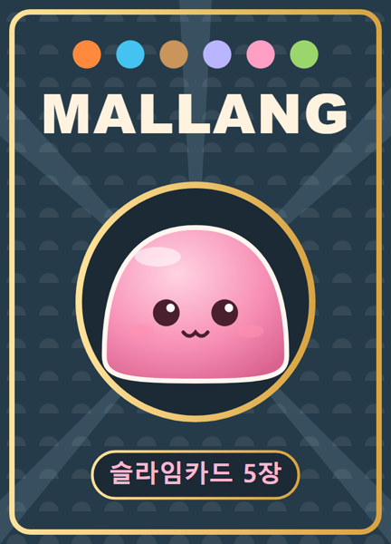
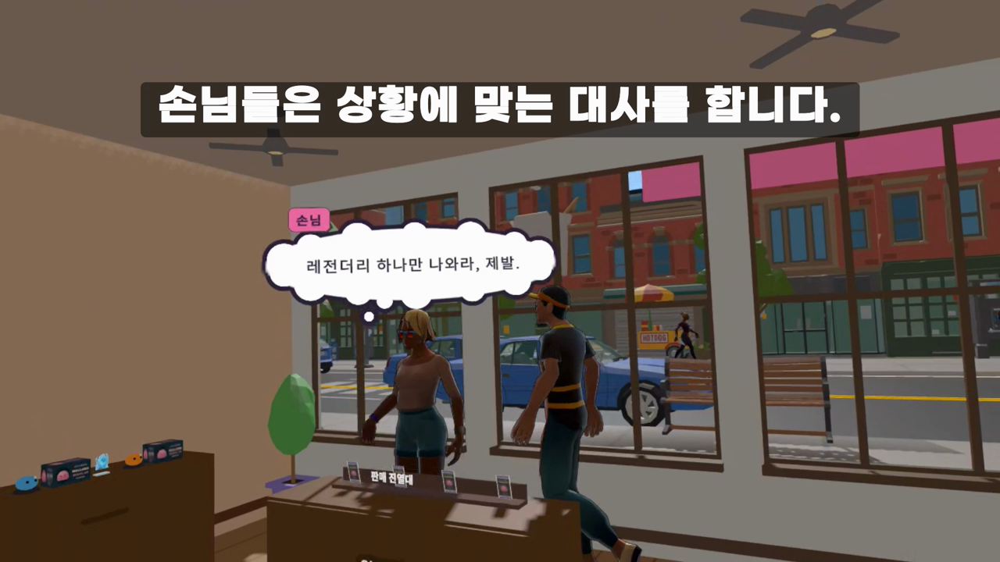
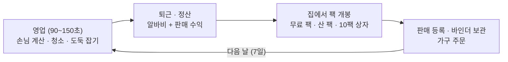
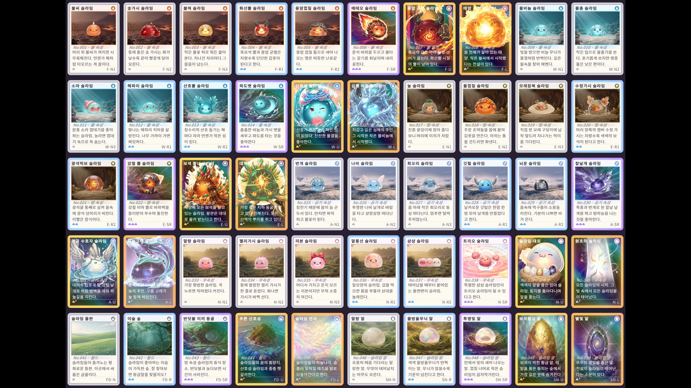
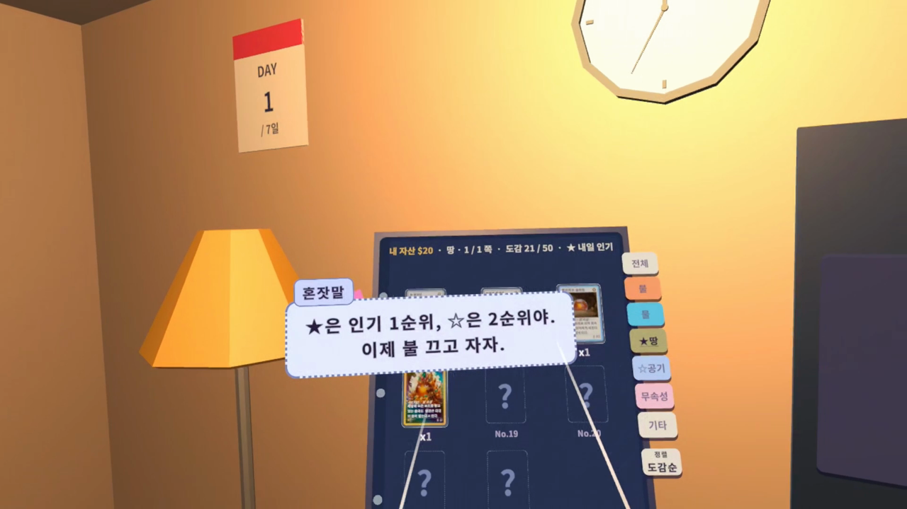
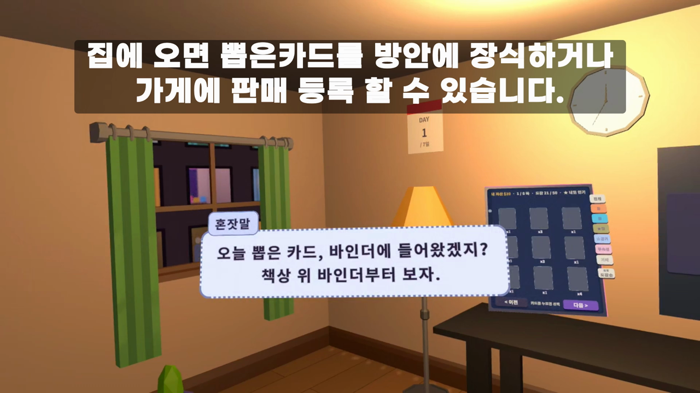
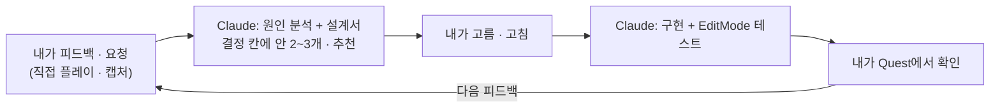

# 슬라임 카드샵 VR — 카드샵 알바생의 일주일 (1인 개발 · Claude Code)

<!-- ✏️ 2026-11-23 Claude 초안. 게임 저장소 DevLog(결정 기록 DEC · AI 협업 AI · 버그 BUG · 일일 노트)와 커밋에 있는 사실로만 썼습니다.
     표시: ✏️ = Claude가 쓴 문장(본인 말로 확인) · ❓ = 본인만 채울 수 있는 칸(이유 · 회고 · 그림). 확인이 끝나면 표시를 지웁니다.
     근거 파일은 각 절 끝 주석에 적었습니다 (게임 저장소 3rd-xr-project-pinkshield/DevLog/…). -->
<!-- ✏️ 2026-11-23 건우 님 요청으로 음슴체("~함", "~됨", "~음")를 "~습니다"체로 바꿨습니다(Claude). 뜻은 그대로이고 어미만 바꿨습니다. 개요 표 · 참고 게임 표 · 그림 설명 · 3-3 ① 제목과 결정 표 · 4-1 목록 · 4-3 · 5-3 표 · AI 협업 머리말과 표 · 6-2 표가 대상입니다. 예전 문장은 git 기록에 있습니다. -->

## 1. 개요

**슬라임 카드샵 VR**은 카드샵 알바생이 되어 7일 동안 손님을 받고, 번 돈으로 슬라임 카드팩을 사서 **직접 손으로 뜯어 한 장씩 넘겨 보는** Meta Quest용 VR 게임입니다.
모바일 카드 게임에서도 팩을 뜯는 순간은 짜릿하지만, VR에서는 팩을 쥐고 · 찢고 · 넘기는 손동작 자체가 긴장감이 됩니다. 여기에 "일해서 번 돈으로 산 팩"이라는 흐름을 붙여 **노동 → 보상 → 기대감**이 하루마다 돌아가게 만들고 싶었습니다.

목표한 경험은 한 문장으로 **"하루 알바를 마치고, 내 손으로 뜯은 팩에서 희귀 카드가 나오는 순간의 두근거림"** 입니다. <!-- ✏️ 기획서 2장 문장을 줄인 것 — 본인 말로 확인 -->





<!-- 11-23 시연 영상(SlimeCardShopVRPlayVideo.mov)에서 잘라 낸 그림: gameplay-shop 1:12 · reveal-legendary 0:13 · checkout-bag 1:26 · home-desk 2:16 · market-popular 2:25 · card-gallery 2:36. 영상은 11-22 판이라 카드 이름이 11-23 바꾸기 전 이름(원초의 슬라임 · 슬라임 대모 등)으로 보임 -->

이 프로젝트는 기획 · 구현 · 테스트를 **혼자** 했고, 코드는 **Claude Code와 함께** 썼습니다. 저는 무엇을 만들지와 어떤 안을 고를지를 정하고, AI에게는 설계 초안 · 구현 · 시뮬레이션을 맡겼습니다(AI 협업 절).

**핵심 피처 세 가지** <!-- ✏️ 3 · 4 · 5장 내용을 한 줄씩 줄인 것 — 본인 확인 -->

| 피처 | 한 줄 소개 | 자세히 |
|---|---|---|
| 카드팩 개봉 연출 | 손으로 팩을 찢고 한 장씩 넘기며, 등급이 오를수록 연출 요소가 한 층씩 더해집니다 | 3장 |
| 경제 재설계 | "팩을 다 팔면 조금 손해, 대박 카드와 손님 판매가 이득" 규칙을 시뮬레이션 7일 × 3,000판으로 확인 | 4장 |
| 손님 · 계산 · 도둑 | 2~3명씩 몰려오는 손님 물결, 물건을 봉투에 담는 계산, 빗자루로 잡는 도둑 | 5장 |

### 개발 환경 · 링크

| 항목 | 내용 |
|---|---|
| 엔진 | Unity 6000.3 (URP 17.3) · XR Interaction Toolkit 3.5 · OpenXR |
| 플랫폼 | Meta Quest (Android APK), 컨트롤러 조작 |
| AI 도구 | Claude Code (Claude Opus · Sonnet · Haiku를 일에 따라 나눠 썼습니다), 카드 그림은 Gemini로 만든 뒤 직접 손봤습니다 |
| 기간 | 2026-11-16 ~ 2026-11-23 (컨셉 기획 1일 · 개발 5일 · 마무리 2일) |
| 인원 | 1명 |
| 규모 | C# 392파일 · 약 4.4만 줄, EditMode 테스트 416개, 커밋 247개 · 결정 기록 44건 · 버그 카드 24건 |
| 영상 | [플레이 시연 영상 (YouTube)](https://youtu.be/kPjbouM2AXg) |
| GitHub | 비공개 |

<!-- 근거: Assets/98. Doc/카드깡_알바생의_하루_VR_컨셉기획서_v2.md 1~2장, git log, DevLog/INDEX.md -->

---

## 2. 게임 디자인

### 2-1. 하루의 흐름

이 그림에서 볼 것은 **영업으로 번 돈이 팩 개봉으로 이어지고, 개봉한 카드가 다음 날 영업의 상품이 되는 순환**입니다.



영업에서 번 돈으로 팩을 사고(3장), 뜯은 카드를 팔지 · 모을지 고르며(4장), 다음 날 손님이 그 카드를 사 갑니다(5장). 7일째 최종 정산에서 점수와 랭크가 나오고, 그 뒤에는 평가 없는 무한 모드로 이어집니다.

### 2-2. 레퍼런스와 다른 점

| 참고한 게임 | 가져온 것 | 다르게 한 것 |
|---|---|---|
| 모바일 포켓몬 카드 게임 (Pocket) | 팩을 뜯는 순간의 기대감, 팩 고르기 | VR에서 손으로 찢고 넘깁니다. 선반의 팩을 **뒤집어 둔 방향이 그대로 남아** 기억해 둔 팩을 다시 고를 수 있습니다 |
| TCG Card Shop Simulator | 가게를 운영하며 팩을 여는 흐름 | 사장이 아니라 **알바생** — 가게 돈이 아니라 내 알바비로 팩을 삽니다. 기존 IP와 겹치지 않게 **오리지널 슬라임 카드 50장**을 만들었습니다 |



---

## 3. 카드팩 개봉 연출 — 희귀할수록 한 층씩 더 화려하게

### 3-1. 무엇을 만들었나

목표한 경험의 **"희귀 카드가 나오는 순간"** 을 만드는 장면입니다. <!-- ✏️ 장 첫 문장 — 목표와 잇는 Claude 정리 -->
팩을 찢으면 카드 5장이 앞면으로 쌓이고, 트리거로 한 장씩 넘깁니다. 레어 이상 카드가 나오면 등급마다 **연출 요소가 한 층씩 더해집니다**.
10팩 상자를 열 때는 팩 10개가 한 줄로 서서 한꺼번에 뜯기고, 수퍼레어 이상이 든 팩만 빛납니다.


| 요소 | 레어 | 수퍼레어 | 유니크 | 레전더리 |
|---|---|---|---|---|
| 색 | 하늘 | 연보라 | 금 | 무지개 |
| 카드 말랑 펀치 | 1번 | 1번 | 2번 | 2번 + 둥실 |
| 뒤 후광 | 작게 | 중간 | 크게 · 숨쉬기 | 아주 크게 |
| 슬라임 방울 폭죽 | 1겹 | 2겹 | 2겹 | 3겹 |
| 별 · 빛줄기 · 충격파 링 | | ○ | ○ | ○ (반대로 도는 빛줄기를 더합니다) |
| 주변 어둡게 · 색종이 · 진동 | | | ○ | ○ (더 길게) |
| 길이 | 0.6초 | 1.1초 | 1.5초 | 2.2초 |

### 3-2. 등급별 값을 한곳에

연출 값은 등급마다 한 묶음으로 모았습니다. 연출 코드(소리 · 진동 · 폭죽을 내는 `RevealFx`, 카드 둘레 빛을 그리는 `RevealAura`)는 "몇 개 · 몇 초"를 묻기만 하고, 값을 바꿀 때는 이 파일만 고칩니다.

```csharp
// RevealTier.cs (일부) — 한 등급 올라갈 때마다 요소를 하나씩 더함
static readonly RevealTier SuperRare = new RevealTier
{
    Seconds = 1.1f, Halo = 1.9f, Blobs = new[] { 12, 8 }, Radius = 0.10f, Stars = 8, Rays = 10, RayAlpha = 0.22f,
    EdgePulses = 1, Rings = 1, Punches = 1, PunchScale = 1.11f,
    Colors = new[] { new Color(0.9f, 0.74f, 1f) },
};
static readonly RevealTier Unique = new RevealTier
{
    Seconds = 1.5f, Halo = 2.3f, HaloBreathe = true, Blobs = new[] { 16, 10 }, Radius = 0.13f, Stars = 10, Rays = 12, RayAlpha = 0.26f,
    EdgePulses = 2, Rings = 2, Dim = 0.3f, Confetti = 14, Punches = 2, PunchScale = 1.11f, ShakeSeconds = 0.45f,
    Colors = new[] { new Color(1f, 0.86f, 0.45f) },
};

/// <summary>노말이면 null (연출 없음).</summary>
public static RevealTier For(CardRarity rarity) => rarity switch
{
    CardRarity.Rare => Rare,
    CardRarity.SuperRare => SuperRare,
    CardRarity.Unique => Unique,
    CardRarity.Legendary => Legendary,
    _ => null,
};
```

- 노말은 `null`을 돌려 연출 코드가 아무것도 하지 않게 했습니다. 다음 카드로 넘기면 앞 연출은 바로 꺼집니다(빨리 넘기는 사람을 붙잡지 않기 위해). <!-- ✏️ -->
- 카메라 흔들기 대신 **카드만 부르르 떨고 컨트롤러가 진동**합니다. VR에서 시야가 흔들리면 멀미가 나기 때문입니다.

### 3-3. 고민과 선택 — 연출 규칙을 세 번 바꿨다

**① 시연 뒤 뒤집은 처음 규칙 (11-17)**
설계 단계에서는 "유니크 이상은 건너뛰기 불가, 갓팩(전부 유니크 이상)은 전용 동시 공개" 규칙을 정했습니다. Quest에서 직접 해 보고 바꿨습니다.

> **결정 대상** 희귀 카드 공개 규칙(건너뛰기 · 갓팩 · 레전더리 연출)을 처음 설계대로 둘지, 시연 뒤 바꿀지.

| | [A] 처음 규칙 | **[B] 시연 뒤 변경 ✓** |
|---|---|---|
| 건너뛰기 | 유니크 이상은 못 건너뜀 | 꾹 누르면 모든 등급 건너뜀 |
| 갓팩 | 전용 5장 동시 공개 | 일반 팩처럼 한 장씩 |
| 레전더리 | 카메라 흔들기 + 큰 폭죽 | 폭죽 확대 + 카드 흔들림 + 진동 |
| 치른 대가 | — | 희귀 카드를 실수로 넘겨 놓칠 수 있습니다. 갓팩의 특별함이 연출이 아닌 카드 구성으로만 남습니다 |

**[B]를 골랐습니다.** 갓팩은 한 장 한 장 까면서 희귀 카드를 직접 확인하는 재미가 아주 큽니다. 그래서 갓팩도 일반 팩처럼 한 장씩 보여 주고, 대신 결과를 빨리 보고 싶은 사람은 **꾹 눌러 바로 넘어갈 수 있게** 보완했습니다.

**② 상자 10팩 장면에만 미리 보여 주기 (11-19)**
상자 개봉은 시연 영상에서 가장 길게 쓰는 장면인데, 팩 10개가 똑같이 뜯겨 밋밋했습니다.

> **결정 대상** 상자 10팩을 뜯는 순간에 결과를 어디까지 미리 보여 줄지.

| | [A] 그대로 (결과 숨김) | **[B] 좋은 팩만 빛남 ✓** | [C] 넘길 때만 연출 |
|---|---|---|---|
| 장점 | 넘길 때까지 결과를 숨깁니다 | 뜯는 순간 "뭔가 나왔다" | 이미 있습니다 |
| 단점 | 10팩 장면이 밋밋합니다 | 결과를 일부 미리 알려 줍니다 | 문제를 풀지 못합니다 |

**[B]를 골랐습니다.** 10팩 상자는 빠른 결과를 원하는 사람이 고르는 선택지입니다. 한 장씩 깔 때는 장마다 "무엇이 나올까" 기대하지만, 상자를 까서 한 번에 다 나와 버리면 그런 기대감이 전혀 없습니다. 팩만 잘라도 좋은 카드가 든 팩이 빛나면 **"오, 좋은 카드 나왔나 보다"** 하며 기대감과 궁금증이 올라갑니다.
모바일 포켓몬 카드 게임에도 이런 연출이 있어 참고했습니다. 10팩을 한 번에 깠을 때 팩 연출이 나왔을 때와 안 나왔을 때의 감정 차이는 꽤 큽니다.
처음에는 빛난 팩을 넘기는 순서의 맨 뒤로 보내 "좋은 건 마지막에"를 지키게 했지만, 해 보니 팩 개봉이 **조작된 것처럼** 느껴져 원래 순서로 되돌렸습니다. 빛나는 연출만 남기고, 카드가 나오는 순서는 손대지 않았습니다. <!-- 근거: DevLog/빌드피드백_11-20_FIX제안.md A2("결과판 순서 정렬을 뺌. 금빛 폭죽 · 진동은 남김"), 커밋 4543ee6(11-20 "상자 팩을 뽑힌 순서 그대로"). 되돌린 이유("조작된 느낌")는 11-23 본인 답변 -->


**③ 수퍼레어 · 유니크를 하나로 묶던 것을 계단식으로 (11-22)**
수퍼레어와 유니크가 같은 연출이라 등급 차이가 느껴지지 않았습니다. 움직이는 HTML 미리 보기를 3판 만들어 보면서 "레어에도 가벼운 연출, 유니크는 레전더리보다 조금 덜"로 정했습니다.

<!-- ✏️ 근거: DevLog/decisions/DEC-004 · DEC-029, ai-collab/AI-002, Assets/98. Doc/폴리싱_설계.md 2장, 커밋 bf50e04. Play · Quest 확인 전인 값이 있음 — 영상에 나온 장면 기준으로 확인 -->

---

## 4. 경제 재설계 — 팩을 다 팔면 조금 손해 보게

### 4-1. 문제: 7,000달러가 모였다

**노동 → 보상 → 기대감**(1장)이 하루마다 돌아가려면, 알바로 번 돈과 팩 한 개의 무게가 맞아야 합니다. <!-- ✏️ 장 첫 문장 — 목표와 잇는 Claude 정리 -->
테스트 플레이에서 7일 동안 7,000달러가 모였습니다. 인기 속성 때문인 줄 알았는데, Claude에게 시뮬레이션을 맡겨 보니 원인은 다른 곳에 있었습니다.

- **상자(90달러)를 열어 집에서 바로 팔면 평균 약 235달러가 돌아옴** → 사서 팔기만 반복해도 돈이 하루 2.6배씩 불어남 (시뮬레이션 7일 가운데값 약 32,500)
- 손님이 진열 카드 1장만 보고 판정해서, 판매 칸을 늘려도 수입이 늘지 않았습니다
- 점수가 카드 기준가로 계산돼, 가구를 사면 점수가 크게 떨어졌습니다. 그래서 가구를 살 이유가 없었습니다

### 4-2. 바꾼 규칙

실제 카드 게임처럼 **"팩을 까서 다 팔면 조금 손해, 대박 카드와 손님 판매가 이득"** 인 구조로 바꿨습니다. 돈을 버는 실력이 "진열 판매 · 인기 속성 맞추기"로 가도록 하기 위해서입니다.

| 등급 | 손님 판매 기준가 | 집에서 바로 팔 때 (매입가) |
|---|---|---|
| 노말 | 1 | 0.2 (5장에 1) |
| 레어 | 5 | 1 |
| 수퍼레어 | 20 | 5 |
| 유니크 | 100 | 25 |
| 레전더리 | 500 | 100 |

| 바꾼 것 | 전 | 후 |
|---|---|---|
| 상자 하나 다 팔기 | 약 235 (90에 사서) | 약 83 (90보다 적은 값) |
| 판매 칸 4 → 6칸 | 하루 판매 그대로 | 120 → 153 (손님이 진열 카드를 **모두 둘러봄**) |
| 가구 전부 산 사람의 점수 | −46% | +4% (점수의 카드 가치 = 매입가) |
| 인기 속성 | 1개 | 2개 (2순위는 보너스 절반), 강도 4단계 |

```csharp
// RarityTable.cs — 등급별 값 (노말, 레어, 수퍼레어, 유니크, 레전더리)
new Entry { basePrice = 1,   customerBuyChance = 0.80f, buybackPrice = 0.2f, ... },
new Entry { basePrice = 5,   customerBuyChance = 0.60f, buybackPrice = 1f,   ... },
new Entry { basePrice = 20,  customerBuyChance = 0.35f, buybackPrice = 5f,   ... },
new Entry { basePrice = 100, customerBuyChance = 0.12f, buybackPrice = 25f,  ... },
new Entry { basePrice = 500, customerBuyChance = 0.03f, buybackPrice = 100f, ... },

// ScoreRules.cs — 최종 점수의 카드 가치 = "지금 다 팔면 얼마" (매입가 합)
if (card != null) cardValue += pair.Value * rarity.BuybackPrice(card.rarity);
```



값은 ScriptableObject에 두어 다시 빌드하지 않고 바꿀 수 있고, 실제 규칙 코드를 그대로 쓰는 밸런스 시뮬레이터(`EconomySimulator`)로 7일 × 3,000판을 돌려 확인했습니다.

### 4-3. 고민과 선택 — 가구는 값만 내릴까, 다시 설계할까

경제를 보던 중 제가 짚었습니다. "가구를 사는 보람이 없으면 업그레이드 시스템 자체가 있을 이유가 없다." 시뮬레이션으로 보니 가구를 안 산 사람보다 **바인더만 이득(+37), 나머지는 모두 손해**(전부 사면 −140)였습니다.

> **결정 대상** 손해인 가구를 값만 내릴지, 가구마다 사는 보람을 다시 설계할지.

| | [A] 가격만 조정 | **[B] 가구마다 보람을 다시 설계 ✓** |
|---|---|---|
| 방법 | 손해인 가구 값을 내립니다 | 진열장 세트 보너스 · 컴퓨터 온라인 장터 · 꾸미기 5종 세트(무료 팩 +1) · 방 점수 · 그날 밤 택배 · 정산에 "가구 덕분에" 줄 |
| 장점 | 작업이 작습니다 | 한 분야를 끝까지 사면 대부분 이득 (진열장 +107 · 바인더 +70 · 꾸미기 +63), 손으로 느끼는 반응(조명 줄 당기기 · 에어컨) |
| 단점 | 진열장 · 꾸미기는 값을 내려도 효과가 0 → 보람 문제 그대로 | 새 클래스 여럿, 생활 반응은 플레이로만 확인 가능 |



**[B]를 골랐습니다.** 치른 대가: 즉시 판매로 크게 버는 맛이 사라졌고, 컴퓨터 분야는 여전히 조금 손해(−25)입니다. 시뮬레이션은 단순화한 플레이어 모델이라 마지막 확인은 플레이로 해야 합니다.

경제 9개 항목과 가구 재설계는 **Claude의 추천안으로 정했습니다.** 가장 큰 문제는 정해진 시간 안에 끝내는 것이었고, 경제처럼 숫자가 서로 얽힌 큰 시스템은 시뮬레이션을 빠르게 돌릴 수 있는 AI가 정하는 편이 더 빨리 끝난다고 판단했습니다. 대신 "가구를 사는 보람"처럼 **무엇이 문제인지는 제가 짚었고**, 추천안의 근거는 시뮬레이션 숫자(4-2)로 남겼습니다.

<!-- ✏️ 근거: DevLog/decisions/DEC-040 · DEC-041, Assets/98. Doc/경제시스템_설계.md, Logic/SalesRules.cs · ScoreRules.cs · EconomySimulator.cs -->

---

## 5. 손님 · 계산 · 도둑 — 바쁘지만 숨 돌릴 틈이 있게

### 5-1. 무엇을 만들었나

하루 알바(노동)의 리듬을 만드는 장입니다 — 바쁘게 일한 만큼 퇴근 뒤 팩 개봉이 보상으로 느껴지도록. <!-- ✏️ 장 첫 문장 — 목표와 잇는 Claude 정리 -->
손님은 진열대를 둘러보고 물건을 골라 계산대 줄에 섭니다. 플레이어는 바코드를 찍고, 물건을 **종이봉투에 담고**, 결제 버튼을 누릅니다. 영업 중에는 바닥 쓰레기 · 흐트러진 팩 · 얼룩이 생기고, 3일차부터는 **복면 쓴 도둑**이 무료 팩을 훔쳐 달아납니다 — 빗자루로 한 대 때리면 잡힙니다.


<!-- ❓ 도둑 장면은 시연 영상에 없음 — 사용자가 집에서 녹화해 thief-broom.png로 넣을 예정 (11-23) -->

### 5-2. 손님 물결

손님이 고르게 오면 계산대를 떠날 틈이 없었습니다(평균 13초마다 오는데 한 명 계산에 15~30초). 그래서 **2~3명씩 몰려오고, 그 손님들을 계산할 시간 + 한산한 시간**이 지난 뒤 다음 물결이 오게 했습니다.

```csharp
// CustomerRules.cs — CustomerSchedule.Waves (일부)
float waveStart = 0f;
int i = 0;
while (i < count)
{
    int size = random.Range(minSize, maxSize + 1);          // 이번 물결 인원 (2~3명)
    if (size > count - i) size = count - i;
    float t = waveStart;
    for (int k = 0; k < size; k++, i++)
    {
        if (k > 0) t += Between(w.inWaveGapSeconds, random);   // 물결 안 간격 3~6초
        times[i] = t;
    }
    // 다음 물결: (계산 예상 시간 × 인원) + 한산한 시간 12~20초
    waveStart += size * w.secondsPerCustomer + Between(w.lullSeconds, random);
    if (waveStart < t) waveStart = t;
}
```

순수 C# 함수라, 난수를 넣어 주는 인터페이스(`IRandomSource`)를 고정 시드로 바꿔 끼워 EditMode 테스트로 확인합니다. 계산이 느리면 다음 물결과 겹쳐 줄이 길어지는데, 이것은 의도한 긴장입니다(5-3).

### 5-3. 고민과 선택

**① 사건이 겹치지 않게 조율할까 (AI 추천을 일부 거절)**

> **결정 대상** 손님이 몰렸다 한산해지는 리듬만 만들지, 청소 · 도둑 사건이 손님과 겹치지 않게 조율까지 할지.

| | **[A] 손님 물결 ✓** | [B] 사건 조율 (뺌) |
|---|---|---|
| 방법 | 몰려왔다 한산해지는 리듬 | 청소 · 도둑은 줄이 한산할 때만 생기고, 도둑을 쫓는 동안 줄 손님은 기다려 줌 |
| 장점 | 계산 → 대처 → 계산 리듬 | 겹침이 아예 없습니다 |
| 단점 | 하루가 길어집니다(90 → 최대 150초) | **긴장감이 줄어듭니다** |

Claude는 A + B를 추천했지만 저는 **A만** 골랐습니다. 긴장감이 줄어드는 위험을 감수하고 싶지 않았고, **도둑을 잡고 돌아와 밀린 줄을 처리하는 경험**이 플레이어에게 더 생동감을 준다고 봤습니다.
B를 빼서 생기는 위험은 따로 막았습니다: 추격은 10~15초 안에 끝나게(도망 거리 약 17m), 도둑을 잡으면 줄 손님이 박수 + 인내 시간 +10초.

**② 계산을 못 하면 깎을까**

> **결정 대상** 계산을 기다리다 떠난 손님을 점수에서 깎을지.

| | [A] 보너스 + 떠난 손님 감점 | **[B] 보너스만 ✓** |
|---|---|---|
| 장점 | 느리면 손해 → 긴장 | 계산을 잘하면 이득만 |
| 단점 | 매일 하는 단순 업무가 "하기 싫은 일"이 됨 | 대충 해도 잃는 게 판매 수익뿐 |

**[B]를 골랐습니다.** 계산은 단순 업무지만 게임 루프에 매일 나오는 기능이라, 이 경험이 부정적으로 남지 않았으면 했습니다. 떠난 손님 수는 계속 세고 있어, 나중에 필요하면 감점 값 하나만 올리면 됩니다.

**③ 가격을 직접 입력할까, 봉투에 담을까**

> **결정 대상** 포스기에 가격을 직접 입력하게 할지, 합계는 자동으로 하고 물건을 봉투에 담게 할지.

처음에는 포스기에 가격을 직접 입력하는 방식을 생각했습니다. 가격 입력은 이런 가게 시뮬레이터의 PC 버전에서 많이 쓰는 기능입니다. 하지만 VR에서는 숫자를 하나하나 정확히 누르기가 어렵습니다. 그래서 **합계는 자동, 대신 물건을 손으로 집어 봉투에 담는** 방식을 골랐습니다. 간단하지만 VR의 장점을 살리고 생동감을 더할 수 있는 방식이라고 생각했습니다. 키패드는 나중에 그 위에 얹을 수 있게 설계해 두었습니다.

<!-- ✏️ 근거: DevLog/decisions/DEC-011 · DEC-012 · DEC-015 · DEC-019, Logic/CustomerRules.cs. DEC-012 · 015의 이유는 본인 답변이 기록돼 있음 -->

---

## AI 협업 — AI에게는 실행을, 나는 기준과 선택을

### 일하는 방식

이 그림에서 볼 것은 **AI가 안을 내고 구현할 때마다, 그 사이에 제가 고르고 확인하는 단계가 하나씩 끼어 있다**는 점입니다. <!-- ✏️ -->



| 맡긴 사람 | 한 일 |
|---|---|
| 나 | 기획, 피드백 찾기(직접 플레이 · 캡처), 설계안 중 고르기와 고치기, 맵 · 가구 배치, 카드 그림 손보기, Quest 확인, 시연 영상 |
| Claude Code | 원인 분석, 설계서 초안(결정 칸 · 추천안), 구현, 테스트, 경제 시뮬레이션, 작업 기록(DevLog) 초안 |

- 결정할 일은 설계서의 **결정 칸**에 모았고, 고른 결과를 결정 기록 44건으로 남겼습니다.
- 프로젝트 규칙 파일(`CLAUDE.md`)에 AI가 지킬 규칙을 적어 두었습니다: 새 기능은 새 클래스로, 300줄 넘는 클래스는 고치기 전에 나눌지 묻기, 씬 파일은 한 폴더에서만 고치기, 일에 맞게 모델 나눠 쓰기.

### 잘된 것

- **AI가 몰랐던 기획 의도를 짚어 준 일** — 시스템 설계 검토에서 Claude는 선반 팩의 뒤집힌 방향을 "확률 조작을 막는 표시"로만 봤습니다. 저는 포켓몬 카드 게임처럼 **뒤집어 둔 팩을 기억해 두는 경험**을 원했기 때문에 "확률은 따로 저장, 방향은 플레이어가 놓은 대로"로 고쳤습니다.
- **AI 축소안 대신 50장 유지** — Claude는 카드 그림 분량을 35장으로 줄이자고 했지만, 작업량을 비용으로만 본 안이었습니다. 50장을 유지하고 슬라임 컨셉(속성별 디자인, 간식 카드를 슬라임 알로)을 직접 다시 잡았습니다.
- **거대 클래스를 규칙으로 막은 일** — 카드 공개 진행기(`CardRevealer` — 팩 개봉 연출 → 카드 한 장씩 공개 → 결과로 이어 주는 클래스)에 기능이 계속 쌓이는 것을 알아차리고 분석을 맡겼습니다. 이 클래스는 시연 피드백을 한 번에 넣은 커밋 하나에서 +633줄, 최대 1,044줄까지 커졌습니다. "AI는 요청 하나를 가장 작게 풀려고 열린 파일에 붙인다"는 분석을 읽고, 위 300줄 규칙을 만들었습니다(지금 398줄 + 부품 5개).
- **밤새 맡기기** — 빌드 피드백을 받은 밤, 그동안 제가 고른 것을 Claude가 분석해 성향(세상 속 물건 · 손으로 하는 상호작용 · 빈 시간을 싫어하는 것)을 정리하게 하고, 그 기준으로 아침까지 전부 맡겼습니다. 결정 12개는 시작 전에 먼저 물어보게 했습니다. 커밋 19개, 테스트 309 → 323개.

### 안된 것 — AI가 낸 사고와 막은 방법

| 사고 | 알아챈 방법 · 막은 방법 |
|---|---|
| 연출 피드백("색깔 예시 카드가 먼저 나온다")을 "등급이 미리 보인다"로 잘못 알아듣고 카드 뒤집기를 만들었습니다. 눈이 아파 되돌렸습니다 | 모호한 연출 피드백은 구현 전에 "어느 장면의 무엇인지" 캡처로 먼저 확인합니다. 이후 연출은 **HTML 미리 보기를 먼저 보고** 골랐습니다(3-3 ③) |
| 밤샘 작업 중 다른 세션이 만들던 파일까지 함께 커밋했습니다 | `git status`에 모르는 파일이 있으면 고친 파일만 골라 커밋하게 했습니다 |
| 테스트가 실패했는데도 커밋까지 진행했습니다(컴파일 오류 커밋) | 스크립트 끝에 "실패하면 멈춤" 줄을 추가했습니다 |
| 버그를 좁게 고쳤습니다(튜토리얼 잠그기가 손에 든 물건까지 놓게 하는 버그를 한 경우만 고침) | 다음 날 플레이 캡처로 다른 경우를 발견해, 모든 경우에 맞게 다시 고쳤습니다 |

### AI 결과를 확인한 방법

| 단계 | 확인한 방법 |
|---|---|
| 만들기 전 | Claude가 쓴 **설계서와 결정 칸**(안 2~3개 + 추천)을 읽고 고르거나 고칩니다. 연출 · 버튼은 **움직이는 HTML 미리 보기**를 먼저 보고 고릅니다 |
| 만든 뒤 | **EditMode 테스트** 결과(최종 416개 통과)를 보고 다음 작업으로 넘어갑니다 |
| 플레이 | **Quest에서 직접 플레이** → 이상한 곳은 캡처와 체크 목록으로 정리해 Claude에게 돌려줍니다 |
| 구조 이해 | 거대 클래스 분석을 읽고 **왜 클래스를 그렇게 나누는지** 원리를 이해했습니다. 핵심 클래스는 구조를 파악하려고 직접 열어 봅니다 |

<!-- 11-23 강사님 기준(약점·하소연 X)으로 "코드를 혼자 찾아 고치는 데까지는 부족 · AI 사용량을 다 쓴 뒤 못 찾음" 문단을 지움. 남은 작업(등급별 개봉 소리)은 6-2 표로 옮김. 예전 문장은 git 기록에 있음 -->

<!-- ✏️ 근거: DevLog/ai-collab/AI-001 · 002 · 004 · 005 · 006 · 007, CLAUDE.md. AI-006 "내 판단" 칸이 비어 있음 — 성향 요약이 맞았는지 한 줄 있으면 좋음 -->

---

## 6. 결론

### 6-1. 계획 대비 실제

| 날짜 | 기획서 계획 | 실제 |
|---|---|---|
| 11-16 | 컨셉 기획서 | 기획서 + 시스템 설계서 (규칙 공백 14개 찾기) |
| 11-17 ~ 18 | Quest 빌드 확인 · 팩 · 개봉 · 확률 | 같음 + 첫 시연 뒤 개봉 규칙 변경, 계산 확장 · 청소 · 도둑 설계 |
| 11-19 ~ 20 | 셰이더 · 연출 · 영업 · 정산 | 같음 + 빌드 테스트 피드백 반영, 튜토리얼, 경제 · 가구 재설계 |
| 11-21 | 7일 루프 · 최종 정산 · 폴리싱 | 이름 · 브랜드(MALLANG) 확정, 팩 · 상자 디자인, 사운드 |
| 11-22 ~ 23 | 버그 수정 · 시연 영상 | 폴리싱(젤리 버튼 · 계단식 연출) · 카드 그림 교체 · 시연 영상 |

범위를 줄인 것: 가격 직접 입력(키패드)은 다음으로 미룸, 타이틀 비행 영상 대신 가게 앞 실시간 거리, 무한 모드는 평가 없이.
❓ 일정이 어긋난 곳이 있었다면 한 줄

### 6-2. 성과와 개선 계획

<!-- 11-23 본인 답변(질문 1~5)을 말투를 살려 다듬은 것. 11-23 강사님 기준(약점·하소연 X, 다른 프로젝트 언급 X, 「아쉬운 점」은 이번 → 다음 계획 표)으로 다시 정리함. 예전 문장은 git 기록에 있음 -->

**성과** — 설계부터 핵심 루프, 그리고 게임의 미감(연출 · UI · 카드 디자인)까지 AI와 협업해 **약 8일 안에** 기획부터 Quest 빌드까지 혼자 완성했습니다(C# 392파일 · EditMode 테스트 416개 · 결정 기록 44건).

**목표한 경험** — "내 손으로 뜯은 팩에서 희귀 카드가 나오는 순간의 두근거림"은 직접 플레이하며 아주 잘 느꼈습니다. 이 두근거림이 다른 플레이어에게도 전해지는지는 다음 단계인 **외부 플레이 테스트**에서 확인할 계획입니다. <!-- ✏️ 뒤 문장을 계획으로 바꿈 — 본인 확인 -->

**가장 값진 경험** — AI 협업 절의 거대 클래스 이야기입니다. `CardRevealer`가 최대 1,044줄까지 커진 원인을 AI와 함께 분석하면서 **왜 한 클래스에 줄이 쌓이는지** 알게 되었고, 그것을 300줄 규칙으로 만들어 이후 작업에 적용했습니다. <!-- ✏️ 다른 프로젝트 언급을 빼고 이 프로젝트 이야기로 줄임 — 본인 확인 -->

**개선 계획**

| 항목 | 이번 | 다음 계획 |
|---|---|---|
| 확인 단계 | 핵심 루프 구현을 우선해, 여러 수정이 「Play · Quest 확인 전」 상태로 쌓였습니다 | 큰 수정은 **Quest 확인까지 끝낸 뒤** 다음 일로 넘어갑니다 |
| 카드 그림 일정 | 카드 그림 50장을 AI 그림 생성으로 만들고 손봤습니다. 결과가 들쭉날쭉해 프롬프트 작업 도구를 만들었고, 핵심 루프를 완성한 뒤 마지막 전날까지 그림 작업에 집중했습니다 | 결과가 들쭉날쭉한 작업은 **초반에 몇 장을 먼저 시험해** 걸리는 시간을 재서 일정에 넣습니다. AI 사용량도 일정의 일부로 보고 **마지막 날 쓸 몫을 남겨 둡니다** |
| 값의 위치 기록 | 등급별 개봉 소리(레어는 빼고 수퍼레어 이상만)는 남은 작업입니다. 값은 등급별 공개 연출 설정 에셋(`RarityRevealProfile`)에 있습니다 | 기능을 받을 때마다 **"이 값은 어느 파일에 있나"를 함께 적어 둡니다** |

<!-- ✏️ 개선 계획 표는 예전 「아쉬운 점」·「다음에는」 문장을 표로 옮긴 것 — 본인 확인. 「결정 기록의 '고른 이유' 칸」 줄은 포트폴리오 독자에게 필요 없는 정보라 뺌 -->
