# **포트폴리오 수정 피드백 및 분석**

[https\://gemini.google.com/app/0239b6d79ef154b6](https://gemini.google.com/app/0239b6d79ef154b6)

*User prompt: 이건 내가 지금 너가 써준 글 읽으면서 일단 수정했어, 이 글을 바탕으로 다시 퇴고해줄래? \*\*윤건우\*\* · 유니티(C\#) 게임 개발자 지망 · 디벨로켓 에듀 「(VR/AR 콘텐츠 개발) Unity 프로젝트 기반 메타버스 게임 개발자 양성 과정」 2026-04-27 \~ 2026-12-15(수료 예정) \#\# 1\. 멈춘 자리에서 다시 꺼낸 꿈 — 성장 과정과 지원 동기 중학생 때부터 저는 게임 아이디어를 그림으로 그리고 노트에 적어 가며, 상상 속의 규칙을 구체화하는 데서 즐거움을 느꼈습니다. 중학교 1학년 때 즐긴 카트라이더에서는 새 카트와 맵을, 고등학교 때까지 즐긴 팡야에서는 새 마스코트를 직접 그려 홈페이지에 올렸고 GM에게 아이템을 선물 받기도 했습니다. 고등학교 1학년 때는 노트에 직접 쓰고 그린 나루토 RPG로 쉬는 시간에 친구들과 '공책 게임'을 운영했습니다. 그 시절 제 꿈은 게임 개발자였지만, 수학을 잘해야 한다는 말에 지레 겁을 먹고 오랫동안 꿈을 접어 두었습니다. 군 복무 후에는 하고 싶은 일을 찾기 위해 1년간 모은 돈으로 혼자 미국 여행을 다녀왔고, 이후 골프장 캐디, 외국계 재보험 중개, 영상 보조 편집, 디저트 생산 공장 등 다양한 현장을 거쳤습니다. 특히 골프장 캐디로 일하며 익힌 공간과 타구의 감각은 훗날 3D 레벨 디자인 프로젝트 「Escape for Freedom」의 홀인원 기믹으로 이어졌습니다. 2026년 1월 부상으로 일을 쉬던 중 게임 개발 교육 광고를 보며 잊었던 꿈을 다시 마주했습니다. 아내의 전폭적인 지지 덕분에 2026년 4월 27일 디벨로켓 에듀 과정에 합류했고, 열 살 이상 어린 동료들 사이에서 늦은 출발이었지만, 같은 꿈을 꾸며 게임 개발에 몰입했습니다. 과정 동안 개인 프로젝트(「뒤통수를 조심해」, 「Escape for Freedom」, 「슬라임 카드샵 VR」)와 팀 프로젝트(「We got one」, 「HIVE PURGE」)를 완주하며 기획한 규칙이 실제 플레이로 작동하는 보람을 확인했습니다. 넷마블네오 AI 인턴십(AI Game Maker)은 기획과 구현의 경계를 허물고 AI 도구를 활용해 끝까지 플레이 가능한 게임을 만들어 내는 직무입니다. 레벨 디자인과 코어 루프 설계를 주도하고, AI와 역할을 분담해 실제 플레이 테스트까지 완결해 온 저의 개발 방식이 이 자리와 가장 잘 맞다고 확신합니다. \#\# 2\. 직접 해 봐야 끝난다고 생각합니다 — 성격의 장단점 \*\*장점 — 직접 플레이하고 데이터로 검증하기 전에는 끝났다고 보지 않습니다.\*\* 팀 프로젝트 「HIVE PURGE」에서는 AI가 구현한 기능이라도 실제 빌드를 플레이하며 예외 상황을 확인하는 것을 원칙으로 삼았습니다. 이 검증 루틴을 통해 보급 상자 10개 중 2\~3개가 건물 위나 맵 밖에 스폰되어 획득할 수 없는 문제를 조기에 발견하고 수정했습니다. 개인 프로젝트 「Escape for Freedom」에서도 지인 플레이 테스트를 진행해 공이 커튼봉에 끼거나 창문 밖으로 이탈하는 물리 판정 오류를 모두 바로잡았습니다. \*\*단점 — 검증 기준이 엄격해 초기 프로토타입 단계에서 세부 수치 조율에 많은 시간을 쏟습니다.\*\* 플레이어의 몰입을 깨는 작은 오류를 허용하지 않으려다 보니, 초기 구현 단계에서도 판정과 예외 케이스를 일일이 확인하느라 속도가 늦어지는 경향이 있습니다. 이를 보완하기 위해 현재는 작업 단위를 작게 분할(브랜치·PR 단위 세분화)하여 핵심 코어 루프를 먼저 빠르게 완성한 뒤, 2차 단계에서 세부 밸런스와 예외 처리를 집중적으로 다듬는 방식으로 속도와 완성도의 균형을 맞추고 있습니다. \#\# 3\. 디버그 로그로 AI의 가설을 검증하다 — 어려움을 극복한 경험 \*\*문제 인식\*\* — 첫 개인 프로젝트 「뒤통수를 조심해」를 제작할 당시에는 디버그 로그로 내부 상태를 추적하는 습관이 자리 잡지 않아, AI가 생성한 로직에서 간헐적 버그가 발생해도 정확한 원인을 파악하기 어려웠습니다. \*\*원인 분석\*\* — 이후 팀 프로젝트 「HIVE PURGE」를 진행하며, 게임이 겉으로 작동하는 것만 확인하고 내부 데이터 흐름을 검증하지 않으면 시스템의 허점을 놓칠 수 있다는 점을 명확히 깨달았습니다. \*\*해결 과정\*\* — 시스템의 신뢰도를 높이기 위해 첫 게임 「뒤통수를 조심해」의 코드를 다시 열고, AI 코드 리뷰로 도출한 9건의 개선 포인트를 디버그 로그로 하나씩 실측 검증했습니다. 적이 벽을 회피할 빈 공간을 탐색하는 각도 배열을 로그로 출력해 보니 \`0, \-30, 30, \-30, 60\` 순서로 \`-30\`을 중복 검사하고 \`-60\` 방향은 아예 탐색하지 않는 로직 오류를 찾아냈습니다. 또한 적의 순찰 전환 대기 시간 역시 설정값인 3초가 아니라 278회 테스트 모두 1초 만에 전환되고 있음을 데이터로 확인하고 수정했습니다. \*\*성과 및 원칙\*\* — 로그 기반 검증을 도입한 이후 원인을 찾기 어려웠던 AI 로직 결함을 단시간에 해결할 수 있었습니다. 이 경험을 계기로 AI가 제안하는 코드와 설계안은 반드시 '검증해야 할 가설'로 다루고, 디버그 로그와 인게임 테스트로 수치를 증명한 뒤 반영하는 개발 원칙을 확립했습니다. \#\# 4\. AI와 역할을 나눠 끝까지 만든 게임 — 프로젝트 경험 \*\*상황\*\* — 「HIVE PURGE」는 1인칭 군중 슈팅과 3인칭 거대 보스전을 결합한 하이브리드 슈터입니다. 4명의 팀원이 기획 1주, 개발 2주(총 3주) 동안 제작했으며, 저는 보급·재화 시스템, 강화 상점, 몬스터 사운드, 맵 레벨 디자인, 튜토리얼, 메인 메뉴 및 전체 UI 통합을 담당했습니다. \*\*협업 방식\*\* — 기획 의도, 게임 규칙, 밸런스 수치 설계는 제가 주도하고, 구조 설계안과 코드 구현은 Claude Code와 협업했습니다. 모든 작업에서 「설계 명세 작성 → 누락 요소 점검 → 로직 확인 → 구현」의 4단계 파이프라인을 유지했고, 팀 공통 기준 문서를 프롬프트에 고정 반영해 AI가 다른 팀원의 코드 영역을 침범하지 않도록 제어했습니다. \*\*과제\*\* — 팀 내부 테스트 중 보급 상자의 20\~30%(10개 중 2\~3개)가 높은 건물 위나 맵 외곽에 낙하해 획득할 수 없는 문제가 발생했습니다. 핵심 보상 루프가 막히면 플레이어의 전투 동기가 급격히 저하되는 치명적인 이슈였습니다. \*\*해결\*\* — 레벨 디자인 원칙("몬스터가 접근할 수 없는 안전지대에서의 일방적 사격 배제")을 보급 스폰 로직에도 동일하게 적용했습니다. 스폰 좌표 선정 시 ① 지면(Ground) 레이어 여부, ② 플레이어 위치 기준 높이 5m 이내, ③ 지형 경사도 25° 이하, ④ NavMesh 기반 이동 가능 경로 존재 여부를 순차 검증하도록 설계했습니다. 특히 지면 판별 방식은 소품 레이어 누락 위험이 있는 방식 대신, 지면 레이어만 명확히 허용하는 AI의 제안을 채택해 유지보수 안정성을 높였습니다. \*\*결과\*\* — 개선 후 플레이 테스트에서 획득 불가 보급 상자 발생률을 0%로 줄였습니다. UI 통합 역시 파일별 수정 현황을 정리한 '브랜치 위험 지도'를 먼저 작성하고, 작업을 9개의 작은 PR로 쪼개 사전 병합 테스트를 거친 끝에 코드 충돌 없이 하루 만에 통합을 완료했습니다. \#\# 5\. 반복 공정은 효율화하고, 작은 오차는 두 번 검증하는 현장 감각 — 조직 경험 \*\*모센즈 스위트 — 생산 파트 담당 (2024.9 \~ 2026.1)\*\* 8\~10명 규모의 디저트 생산 현장에서 중간 관리자로 근무하며 생산일지·위생 점검표 작성, 재고 및 생산량 관리를 담당했습니다. 매일 반복되는 문서 작업의 비효율을 줄이기 위해 양식 간소화를 제안해 불필요한 기록 공수를 줄였으며, 위생·세척 등 기피 업무에 솔선수범해 팀의 작업 흐름을 원활하게 유지했습니다. \*\*SCRAPPY ENTERTAINMENT — 영상 보조 편집자 (2022.11 \~ 2024.8)\*\* Apple TV 아이돌 다큐멘터리·Netflix 생존서바이벌쇼 등의 프로젝트들의 보조 편집을 맡아, 메인 편집자가 즉시 작업에 착수할 수 있도록 원본 소스를 규격에 맞게 정리하고 컷을 다듬는 업무를 담당했습니다. 1프레임의 오차도 결과물의 완성도를 좌우하는 환경에서 작업물을 이중으로 검수하는 습관을 길렀습니다. \*\*NS Korea — 재보험 중개·클레임 담당 (2021.6 \~ 2022.11)\*\* 외국계 재보험 중개사에서 기업 재산·손실 계약 자료를 분석하고, 영문 문서 작성 및 이메일·유선 소통으로 해외 재보험사를 설득하는 업무를 수행했습니다. 계약 조건과 수치의 작은 오류가 큰 손실로 이어지는 만큼, 모든 문서와 데이터를 교차 검증하는 꼼꼼함을 체득했습니다. 반복 공정을 단순화하던 습관은 AI에게 맡길 영역과 제가 주도할 기획·검증 영역을 분리하는 개발 파이프라인으로 이어졌습니다. 또한 1프레임과 수치 오차를 허용하지 않던 검수 태도는, AI의 결과물을 그대로 믿지 않고 플레이 테스트와 디버그 로그로 끝까지 확인하는 강점이 되었습니다. \#\# 6\. AI와 함께 기획부터 검증까지 완결하는 Game Maker — 입사 후 포부 넷마블네오 AI 인턴십에 합류하면, 제가 가장 잘하는 \*\*'명확한 코어 루프 설계'와 '철저한 플레이 검증'\*\*으로 팀의 프로토타이핑 속도와 완성도를 동시에 끌어올리겠습니다. 입사 초기에는 기획 의도와 데이터·트리거 구조를 명세화해 AI와 함께 빠르게 플레이 가능한 프로토타입(MVP)을 제작하고, 지인·팀 테스트와 디버그 로그 분석을 통해 재미를 해치는 판정 오류와 밸런스 허점을 즉각 수정하는 데 집중하겠습니다. 나아가 AI가 생성한 코드의 아키텍처와 흐름을 깊이 있게 파악해 팀원들과 명확히 소통하고, 기획과 프로그래밍의 경계 없이 아이디어를 실제 게임으로 완결 짓는 AI Game Maker로 성장하겠습니다.*

Response: 건우 님이 직접 사실관계(카트라이더 맵 추가, 8\~10명 규모, Apple TV 아이돌 다큐·Netflix 생존 서바이벌 쇼, "같은 꿈을 꾸며 게임 개발에 몰입했습니다" 등)를 꼼꼼히 바로잡으신 버전을 바탕으로, **인사담당자가 막힘없이 쭉 읽으며 몰입할 수 있도록 전문 용어는 쉬운 말로 풀고 문장 호흡을 매끄럽게 다듬은 퇴고본**입니다.

### **주요 수정 포인트**

> 1. **전문 용어 순화 (가독성 확보):** 스폰, 로직, 실측 검증, 레이어, NavMesh, 파이프라인, MVP, 아키텍처, 명세화 등 인사담당자에게 낯설 수 있는 개발 용어를 자연스러운 일상어(낙하, 코드 흐름, 직접 확인, 바닥 조건, 걸어서 갈 수 있는 길, 일하는 순서, 먼저 플레이해 볼 수 있는 버전, 전체 구조)로 바꿨습니다.  
> 2. **건우 님이 수정한 사실관계 100% 유지:** 새 카트와 맵, 같은 꿈을 꾸며 게임 개발에 몰입했습니다, 8\~10명 규모, Apple TV 아이돌 다큐멘터리·Netflix 생존 서바이벌 쇼 등 직접 고치신 디테일은 그대로 살렸습니다.  
> 3. **비문·어색한 조사 정리:** 프로젝트들의 보조 편집 → 프로젝트의 보조 편집 등 중복 표현과 문장 호흡을 정리했습니다.

### **퇴고 완료본 (자기소개서.md 교체용)**

`**윤건우** · 유니티(C#) 게임 개발자 지망 · 디벨로켓 에듀 「(VR/AR 콘텐츠 개발) Unity 프로젝트 기반 메타버스 게임 개발자 양성 과정」 2026-04-27 ~ 2026-12-15(수료 예정)`

`## 1. 멈춘 자리에서 다시 꺼낸 꿈 — 성장 과정과 지원 동기`

`중학생 때부터 저는 게임 아이디어를 그림으로 그리고 노트에 적어 가며, 상상 속의 규칙을 눈앞에 펼쳐 내는 데서 큰 즐거움을 느꼈습니다. 즐겨 하던 게임마다 추가되었으면 하는 맵과 캐릭터, 아이템을 떠올렸습니다. 중학교 1학년 때 즐긴 카트라이더에서는 새 카트와 맵을, 고등학교 때까지 즐긴 팡야에서는 새 마스코트를 직접 그려 홈페이지에 올렸고 운영자(GM)에게 아이템을 선물 받기도 했습니다. 고등학교 1학년 때는 노트에 직접 쓰고 그린 나루토 RPG로 쉬는 시간에 친구들과 '공책 게임'을 운영했습니다.`

`그 시절 제 꿈은 게임 개발자였습니다. 하지만 게임 개발은 수학을 잘해야 한다는 말에 지레 겁을 먹고 오랫동안 꿈을 접어 두었습니다. 군 복무 후에는 하고 싶은 일을 찾기 위해 1년간 모은 돈으로 혼자 미국 여행을 다녀왔고, 이후 골프장 캐디, 외국계 재보험 중개, 영상 보조 편집, 디저트 생산 공장 등 다양한 현장을 거쳤습니다. 특히 골프장 캐디로 일하며 익힌 공간과 타구의 감각은 훗날 3D 레벨 디자인 프로젝트 「Escape for Freedom」의 홀인원 아이디어로 이어졌습니다.`

`2026년 1월 부상으로 일을 쉬던 중 게임 개발 교육 광고를 보며 잊었던 꿈을 다시 마주했습니다. 아내의 전폭적인 지지 덕분에 2026년 4월 27일 디벨로켓 에듀 과정에 합류했고, 열 살 이상 어린 동료들 사이에서 늦은 출발이었지만 같은 꿈을 꾸며 게임 개발에 몰입했습니다.`

`과정 동안 개인 프로젝트(「뒤통수를 조심해」, 「Escape for Freedom」, 「슬라임 카드샵 VR」)와 팀 프로젝트(「We got one」, 「HIVE PURGE」)를 완주하며 기획한 규칙이 실제 플레이로 작동하는 보람을 확인했습니다. 넷마블네오 AI 인턴십(AI Game Maker)은 기획과 구현의 경계를 허물고 AI 도구를 활용해 끝까지 플레이 가능한 게임을 만들어 내는 직무입니다. 레벨 디자인과 핵심 재미(코어 루프) 설계를 주도하고, AI와 역할을 나눠 실제 플레이 테스트까지 완결해 온 저의 방식이 이 자리와 가장 잘 맞는다고 확신합니다.`

`## 2. 직접 해 봐야 끝난다고 생각합니다 — 성격의 장단점`

`**장점 — 직접 플레이하고 결과 수치로 검증하기 전에는 끝났다고 보지 않습니다.**`  
`팀 프로젝트 「HIVE PURGE」에서는 AI가 만든 기능이라도 실제 게임을 플레이하며 예외 상황을 확인하는 것을 원칙으로 삼았습니다. 이 확인 습관 덕분에 보급 상자 10개 중 2~3개가 건물 위나 맵 밖에 떨어져 주울 수 없는 문제를 일찍 발견하고 고쳤습니다. 개인 프로젝트 「Escape for Freedom」에서도 지인들에게 게임을 보내 플레이 테스트를 진행했고, 공이 커튼봉에 끼거나 창문 밖으로 빠져나가는 판정 오류를 모두 바로잡았습니다.`

`**단점 — 검증 기준이 엄격해 초기 제작 단계에서 세부 수치 조율에 많은 시간을 쏟습니다.**`  
`플레이어의 몰입을 깨는 작은 오류를 허용하지 않으려다 보니, 초기 구현 단계에서도 판정과 예외 상황을 일일이 확인하느라 속도가 늦어지는 경향이 있습니다. 이를 보완하기 위해 지금은 작업 단위를 작게 쪼개어(브랜치·PR 단위 세분화) 핵심 재미가 돌아가는 뼈대부터 먼저 완성한 뒤, 다음 단계에서 세부 밸런스와 예외 처리를 집중적으로 다듬는 방식으로 속도와 완성도의 균형을 맞추고 있습니다.`

`## 3. 디버그 기록으로 AI의 가설을 검증하다 — 어려움을 극복한 경험`

`**문제 인식** — 첫 개인 프로젝트 「뒤통수를 조심해」를 만들 당시에는 코드 내부의 숫자 변화를 기록(디버그 로그)으로 추적하는 습관이 자리 잡지 않아, AI가 만든 기능에서 간헐적 버그가 발생해도 정확한 원인을 파악하기 어려웠습니다.`

`**원인 분석** — 이후 팀 프로젝트 「HIVE PURGE」를 진행하며, 게임이 겉으로 작동하는 것만 확인하고 내부 데이터 흐름을 검증하지 않으면 숨은 오류를 놓칠 수밖에 없다는 점을 명확히 깨달았습니다.`

``**해결 과정** — 시스템의 신뢰도를 높이기 위해 첫 게임 「뒤통수를 조심해」의 코드를 다시 열고, AI 코드 리뷰로 도출한 9건의 개선 포인트를 디버그 기록으로 하나씩 직접 확인했습니다. 적이 벽을 피할 빈 공간을 찾는 각도 목록을 출력해 보니 `0, -30, 30, -30, 60` 순서로 `-30`을 중복 검사하고 `-60` 방향은 아예 살피지 않는 오류를 찾아냈습니다. 또한 적의 순찰 전환 대기 시간 역시 설정값인 3초가 아니라 278회 테스트 모두 1초 만에 전환되고 있음을 수치로 확인하고 수정했습니다.``

`**성과 및 원칙** — 기록 기반 검증을 도입한 이후 원인을 찾기 어려웠던 결함을 단시간에 해결할 수 있었습니다. 이 경험을 계기로 AI가 제안하는 코드와 설계안은 반드시 '확인해 볼 가설'로 다루고, 디버그 기록과 직접 플레이로 수치를 증명한 뒤 반영하는 개발 원칙을 확립했습니다.`

`## 4. AI와 역할을 나눠 끝까지 만든 게임 — 프로젝트 경험`

`**상황** — 「HIVE PURGE」는 1인칭 군중 슈팅과 3인칭 거대 보스전을 결합한 하이브리드 슈터입니다. 4명의 팀원이 기획 1주, 개발 2주(총 3주) 동안 제작했으며, 저는 보급·재화 시스템, 강화 상점, 몬스터 사운드, 맵 구성, 튜토리얼, 메인 메뉴 및 전체 화면(UI) 통합을 담당했습니다.`

`**협업 방식** — 기획 의도, 게임 규칙, 밸런스 수치 설계는 제가 주도하고, 구조 설계안과 코드 구현은 Claude Code와 협업했습니다. 모든 작업에서 「기획 정리 → 빠진 부분 점검 → 내 확인 → 구현」의 4단계 순서를 지켰고, 팀장이 만든 기준 문서를 매번 함께 전달해 각자의 AI가 다른 팀원의 코드 영역을 건드리지 않도록 관리했습니다.`

`**과제** — 팀 내부 테스트 중 보급 상자의 20~30%(10개 중 2~3개)가 높은 건물 위나 맵 밖에 떨어져 주울 수 없는 문제가 발생했습니다. 핵심 보상 흐름이 막히면 플레이어의 전투 동기가 급격히 떨어지는 치명적인 문제였습니다.`

`**해결** — 맵을 만들 때 세운 원칙("몬스터가 오지 못하는 안전지대에서 일방적으로 쏘는 꼼수는 주지 않는다")을 보급 낙하 규칙에도 동일하게 적용했습니다. 상자가 떨어질 자리를 고를 때 ① 땅 위인지, ② 플레이어 위치 기준 높이 5m 이내인지, ③ 지형 경사가 25° 이하인지, ④ 걸어서 갈 수 있는 길인지를 차례로 검사하도록 설계했습니다. 특히 땅을 판별하는 방식은 작은 소품들을 일일이 예외 처리하다 누락할 위험이 있는 방식 대신, 땅만 명확히 허용하는 AI의 제안을 채택해 안정성을 높였습니다.`

`**결과** — 개선 후 플레이 테스트에서 주울 수 없는 보급 상자 발생률을 0%로 줄였습니다. 전체 화면(UI) 통합 역시 파일별 수정 현황을 정리한 '브랜치 위험 지도'를 먼저 작성하고, 작업을 9개의 작은 단위로 쪼개 사전 병합 테스트를 거친 끝에 코드 충돌 없이 하루 만에 통합을 마쳤습니다.`

`## 5. 반복 공정은 효율화하고, 작은 오차는 두 번 검증하는 현장 감각 — 조직 경험`

`**모센즈 스위트 — 생산 파트 담당 (2024.9 ~ 2026.1)**`  
`8~10명 규모의 디저트 생산 현장에서 중간 관리자로 근무하며 생산일지·위생 점검표 작성, 재고 및 생산량 관리를 담당했습니다. 매일 반복되는 문서 작업의 비효율을 줄이기 위해 양식 간소화를 제안해 불필요한 기록 시간을 줄였으며, 위생·세척 등 모두가 기피하는 업무에 솔선수범해 팀의 작업 흐름을 원활하게 유지했습니다.`

`**SCRAPPY ENTERTAINMENT — 영상 보조 편집자 (2022.11 ~ 2024.8)**`  
`Apple TV 아이돌 다큐멘터리·Netflix 생존 서바이벌 쇼 등 여러 프로젝트의 보조 편집을 맡아, 메인 편집자가 즉시 작업에 착수할 수 있도록 원본 영상을 규격에 맞게 정리하고 컷을 다듬는 업무를 담당했습니다. 한 프레임의 오차도 결과물의 완성도를 좌우하는 환경에서 작업물을 이중으로 검수하는 습관을 길렀습니다.`

`**NS Korea — 재보험 중개·클레임 담당 (2021.6 ~ 2022.11)**`  
`외국계 재보험 중개사에서 기업 재산·손실 계약 자료를 분석하고, 영문 문서 작성 및 이메일·유선 소통으로 해외 재보험사를 설득하는 업무를 수행했습니다. 계약 조건과 수치의 작은 오류가 큰 손실로 이어지는 만큼, 모든 문서와 데이터를 교차 검증하는 꼼꼼함을 체득했습니다.`

`반복 공정을 단순화하던 습관은 AI에게 맡길 영역과 제가 주도할 기획·검증 영역을 분리하는 개발 방식으로 이어졌습니다. 또한 한 프레임과 수치 오차를 허용하지 않던 검수 태도는, AI의 결과물을 그대로 믿지 않고 플레이 테스트와 디버그 기록으로 끝까지 확인하는 강점이 되었습니다.`

`## 6. AI와 함께 기획부터 검증까지 완결하는 Game Maker — 입사 후 포부`

`넷마블네오 AI 인턴십에 합류하면, 제가 가장 잘하는 **'재미있는 핵심 규칙 설계'와 '철저한 플레이 검증'**으로 팀의 제작 속도와 완성도를 동시에 끌어올리겠습니다.`

`입사 초기에는 기획 의도와 게임 규칙을 명확히 정리해 AI와 함께 빠르게 플레이할 수 있는 버전을 제작하고, 직접 플레이해 보며 재미를 해치는 판정 오류와 밸런스 허점을 즉각 수정하는 데 집중하겠습니다. 나아가 AI가 만든 코드의 전체 구조와 흐름을 깊이 있게 파악해 팀원들과 막힘없이 소통하고, 기획과 개발의 경계 없이 아이디어를 실제 게임으로 완성해 내는 AI Game Maker로 성장하겠습니다.`

---

*User prompt: 다음은 기술문서야. 분석해서 보완 사항부터 보여줄래? \<html lang="ko" data-doc-ready="1" style="--accent: \#EC1C23; \--accent-ink: \#F47B7F; \--accent-fill: \#E71B22; \--accent-soft: \#341314; \--accent-chip: \#4E1416; \--accent-mid: \#9F181D; \--accent-2: \#EC1C23; \--accent-2-ink: \#F47B7F; \--accent-2-fill: \#E71B22; \--accent-3: \#EC1C23; \--accent-ink-p: \#AF151A; \--accent-fill-p: \#AF151A; \--accent-soft-p: \#FDEBEB; \--accent-chip-p: \#FCD6D7; \--accent-mid-p: \#F58286;"\>\<head\> \<meta charset="UTF-8"\> \<meta name="viewport" content="width=device-width, initial-scale=1"\> \<title\>HIVE PURGE — 프로젝트 상세 문서 · 윤 건우\</title\> \<link rel="icon" href="data:,"\>\<\!-- 아이콘 파일 없음: 브라우저가 /favicon.ico를 요청해 404가 나지 않게 \--\> \<\!-- 고정 렌더러 — 프로젝트 상세 문서(흐르는 읽기 문서): doc.html?p=\<src 폴더 이름\>\#\<제목 slug\>. 내용은 data/projects/\<폴더\>.json \+ src/\<폴더\>/\<프로젝트 문서\>에서 읽습니다. 슬라이드는 project.html?p=\<폴더\>, 포트폴리오 페이지는 index.html. md 해석(상대경로·제목 slug)은 assets/md-blocks.js(슬라이드와 공용). 인쇄는 A4(코드·그림이 쪽 사이에서 잘리지 않게만, 포트폴리오 페이지와 같은 A4 인쇄 방식). CDN은 버전 고정(marked 12.0.2, mermaid 11.4.1, highlight.js 11.9.0 — 화면 github-dark · 인쇄 github, Pretendard v1.3.9, Montserrat 5.2.8 — 영문 라벨). 장면 키트 CSS는 싣지 않습니다. \--\> \<link rel="stylesheet" href="https\://cdn.jsdelivr.net/gh/orioncactus/pretendard@v1.3.9/dist/web/static/pretendard.css"\> \<link rel="stylesheet" href="https\://cdn.jsdelivr.net/npm/@fontsource/montserrat@5.2.8/latin-700.css"\> \<link rel="stylesheet" href="https\://cdn.jsdelivr.net/npm/@fontsource/montserrat@5.2.8/latin-800.css"\> \<link rel="stylesheet" media="screen" href="https\://cdn.jsdelivr.net/npm/@highlightjs/cdn-assets@11.9.0/styles/github-dark.min.css"\> \<link rel="stylesheet" media="print" href="https\://cdn.jsdelivr.net/npm/@highlightjs/cdn-assets@11.9.0/styles/github.min.css"\> \<link rel="stylesheet" href="assets/doc.css"\> \<link rel="stylesheet" href="theme/theme.css"\>\<\!-- 테마(색·모양·영문 글꼴): /portfolio-theme가 씀. /portfolio-update가 건드리지 않음 \--\> \<script src="https\://cdn.jsdelivr.net/npm/marked@12.0.2/marked.min.js"\>\</script\> \<script src="https\://cdn.jsdelivr.net/npm/mermaid@11.4.1/dist/mermaid.min.js"\>\</script\> \<script src="https\://cdn.jsdelivr.net/npm/@highlightjs/cdn-assets@11.9.0/highlight.min.js"\>\</script\> \</head\> \<body\> \<div id="top"\>\</div\> \<a class="skip-link" href="\#main"\>본문으로 건너뛰기\</a\> \<div id="app"\> \<header class="doc-head"\> \<div class="doc-head-in"\> \<p class="crumb"\>\<a href="index.html" target="\_blank" rel="noopener"\>← 포트폴리오\<svg class="pf-newtab-icon" aria-hidden="true" focusable="false" viewBox="0 0 12 12" width="12" height="12"\>\<path d="M4.5 2.5h5v5M9.5 2.5 3 9" fill="none" stroke="currentColor" stroke-width="1.6" stroke-linecap="round" stroke-linejoin="round"\>\</path\>\</svg\>\<span class="pf-sr-only pf-newtab-sr"\>(새 탭)\</span\>\</a\>\<span aria-hidden="true"\>›\</span\>\<b\>HIVE PURGE — 프로젝트 상세 문서\</b\>\</p\> \<nav class="head-nav" aria-label="프로젝트 링크"\> \<a class="btn primary" href="project.html?p=4-team-even" target="\_blank" rel="noopener"\>슬라이드\<svg class="pf-newtab-icon" aria-hidden="true" focusable="false" viewBox="0 0 12 12" width="12" height="12"\>\<path d="M4.5 2.5h5v5M9.5 2.5 3 9" fill="none" stroke="currentColor" stroke-width="1.6" stroke-linecap="round" stroke-linejoin="round"\>\</path\>\</svg\>\<span class="pf-sr-only pf-newtab-sr"\>(새 탭)\</span\>\</a\>\<a class="btn" href="https\://youtu.be/H4MNlsQbh80" target="\_blank" rel="noopener"\>시연 영상\<svg class="pf-newtab-icon" aria-hidden="true" focusable="false" viewBox="0 0 12 12" width="12" height="12"\>\<path d="M4.5 2.5h5v5M9.5 2.5 3 9" fill="none" stroke="currentColor" stroke-width="1.6" stroke-linecap="round" stroke-linejoin="round"\>\</path\>\</svg\>\<span class="pf-sr-only pf-newtab-sr"\>(새 탭)\</span\>\</a\>\<a class="btn" href="https\://youtube.com/shorts/6vDZDAhEoyc" target="\_blank" rel="noopener"\>한 판 몰아보기 쇼츠 (1분 13초)\<svg class="pf-newtab-icon" aria-hidden="true" focusable="false" viewBox="0 0 12 12" width="12" height="12"\>\<path d="M4.5 2.5h5v5M9.5 2.5 3 9" fill="none" stroke="currentColor" stroke-width="1.6" stroke-linecap="round" stroke-linejoin="round"\>\</path\>\</svg\>\<span class="pf-sr-only pf-newtab-sr"\>(새 탭)\</span\>\</a\> \<span class="newtab-note"\>링크는 새 탭에서 열립니다\</span\> \</nav\> \</div\> \</header\> \<div class="print-only print-urls"\>\<p\>웹에서 보기: https\://pinkshield.github.io/portfolio/doc.html?p=4-team-even\</p\>\<p\>슬라이드: https\://pinkshield.github.io/portfolio/project.html?p=4-team-even\</p\>\</div\> \<div class="doc-page"\> \<nav class="toc" id="toc" aria-label="문서 목차"\>\<p class="toc-title"\>목차\</p\>\<div class="toc-links" id="toc-links"\>\<a class="h2" href="\#1-개요"\>1. 개요\</a\>\<a class="h3" href="\#1-1-무엇을-만들었나"\>1-1. 무엇을 만들었나\</a\>\<a class="h3" href="\#1-2-왜-만들었나--제-파트가-풀어야-했던-문제"\>1-2. 왜 만들었나 — 제 파트가 풀어야 했던 문제\</a\>\<a class="h3" href="\#1-3-개발-환경--링크"\>1-3. 개발 환경 · 링크\</a\>\<a class="h2" href="\#2-게임-디자인"\>2. 게임 디자인\</a\>\<a class="h3" href="\#2-1-한-라운드의-흐름--쓸어내고-맞서고-강해진다"\>2-1. 한 라운드의 흐름 — 쓸어내고, 맞서고, 강해진다\</a\>\<a class="h3" href="\#2-2-누가-무엇을-기획했나"\>2-2. 누가 무엇을 기획했나\</a\>\<a class="h2" href="\#3-팀-협업"\>3. 팀 협업\</a\>\<a class="h3" href="\#3-1-팀-구성과-역할"\>3-1. 팀 구성과 역할\</a\>\<a class="h3" href="\#3-2-팀이-일한-방식"\>3-2. 팀이 일한 방식\</a\>\<a class="h3" href="\#3-3-제가-맡은-것"\>3-3. 제가 맡은 것\</a\>\<a class="h3" href="\#3-4-협업--내-담당-범위와-다른-파트-코드"\>3-4. 협업 — 내 담당 범위와 다른 파트 코드\</a\>\<a class="h2" href="\#4-시스템-구조"\>4. 시스템 구조\</a\>\<a class="h3" href="\#4-1-팀-공통-규칙--파트끼리-서로-모른다"\>4-1. 팀 공통 규칙 — 파트끼리 서로 모른다\</a\>\<a class="h3" href="\#4-2-보급-모듈-구조"\>4-2. 보급 모듈 구조\</a\>\<a class="h3" href="\#4-3-사운드-모듈-구조--소리-하나에-경로-하나"\>4-3. 사운드 모듈 구조 — 소리 하나에 경로 하나\</a\>\<a class="h2" href="\#5-핵심-기능"\>5. 핵심 기능\</a\>\<a class="h3" href="\#5-1-라운드-중-정해진-간격으로-보급이-떨어진다--보급-사용법"\>5-1. 라운드 중 정해진 간격으로 보급이 떨어진다 — 보급 사용법\</a\>\<a class="h3" href="\#5-2-주울-수-있는-곳에만-보급이-떨어진다--낙하-지점-찾기-값싼-검사부터-길-찾기는-마지막"\>5-2. 주울 수 있는 곳에만 보급이 떨어진다 — 낙하 지점 찾기 (값싼 검사부터, 길 찾기는 마지막)\</a\>\<a class="h3" href="\#5-3-지금-필요한-보급이-더-잘-나온다--상황에-따라-바뀌는-확률"\>5-3. 지금 필요한 보급이 더 잘 나온다 — 상황에 따라 바뀌는 확률\</a\>\<a class="h3" href="\#5-4-사운드-표의-키만-넘기면-소리가-난다--사운드-사용법"\>5-4. 사운드 표의 키만 넘기면 소리가 난다 — 사운드 사용법\</a\>\<a class="h3" href="\#5-5-새-몬스터도-표만-채우면-소리가-난다--다른-파트-코드를-고치지-않고-소리-붙이기"\>5-5. 새 몬스터도 표만 채우면 소리가 난다 — 다른 파트 코드를 고치지 않고 소리 붙이기\</a\>\<a class="h2" href="\#6-고민과-선택"\>6. 고민과 선택\</a\>\<a class="h3" href="\#6-1-높은-곳에서-쏘는-이점은-주지-않는다--맵navmesh보급을-한-원칙으로"\>6-1. "높은 곳에서 쏘는 이점은 주지 않는다" — 맵·NavMesh·보급을 한 원칙으로\</a\>\<a class="h3" href="\#6-2-보급-줍기--조준해서-줍기-vs-가까이-가서-줍기"\>6-2. 보급 줍기 — 조준해서 줍기 vs 가까이 가서 줍기\</a\>\<a class="h3" href="\#6-3-보급-확률--고정-확률-vs-상황에-따라-바뀌는-확률"\>6-3. 보급 확률 — 고정 확률 vs 상황에 따라 바뀌는 확률\</a\>\<a class="h3" href="\#6-4-사운드에서-정한-두-가지--피격-소리는-빼고-곡-키는-라운드-표에"\>6-4. 사운드에서 정한 두 가지 — 피격 소리는 빼고, 곡 키는 라운드 표에\</a\>\<a class="h3" href="\#6-5-ui-통합--메인-메뉴-스타일을-게임-전체로-다른-사람-작업과-부딪히지-않게"\>6-5. UI 통합 — 메인 메뉴 스타일을 게임 전체로, 다른 사람 작업과 부딪히지 않게\</a\>\<a class="h3" href="\#6-6-라운드-종료-강화--작게-느껴진-보상을-어떻게-키울까"\>6-6. 라운드 종료 강화 — 작게 느껴진 보상을 어떻게 키울까\</a\>\<a class="h2" href="\#7-ai-협업"\>7. AI 협업\</a\>\<a class="h3" href="\#7-1-제-파트를-만든-방식--aiclaude-code와-역할-나누기"\>7-1. 제 파트를 만든 방식 — AI(Claude Code)와 역할 나누기\</a\>\<a class="h3" href="\#7-2-맵튜토리얼--ai가-만들고-디테일은-제가-고쳤다"\>7-2. 맵·튜토리얼 — AI가 만들고, 디테일은 제가 고쳤다\</a\>\<a class="h2" href="\#8-결과-및-배운-점"\>8. 결과 및 배운 점\</a\>\<a class="h3" href="\#8-1-결과"\>8-1. 결과\</a\>\<a class="h3" href="\#8-2-트러블슈팅"\>8-2. 트러블슈팅\</a\>\<a class="h3" href="\#8-3-아쉬운-점-기술-부채--개선-계획"\>8-3. 아쉬운 점 (기술 부채) · 개선 계획\</a\>\<a class="h3" href="\#8-4-배운-점"\>8-4. 배운 점\</a\>\<a class="h3" href="\#8-5-개발-일정--구간별로-무엇을-했나"\>8-5. 개발 일정 — 구간별로 무엇을 했나\</a\>\</div\>\</nav\> \<main class="doc-main" id="main" tabindex="-1"\> \<div class="doc-intro"\> \<p class="eyebrow"\>프로젝트 상세 문서\</p\> \<h1\>HIVE PURGE\</h1\> \<p class="tagline"\>1인칭으로 몰려오는 군중을 쓸어내고, 3인칭으로 거대한 보스와 맞서는 하이브리드 슈터\</p\> \<dl class="meta-line"\>\<div\>\<dt\>장르\</dt\>\<dd\>3D 하이브리드 슈터\</dd\>\</div\>\<div\>\<dt\>기간\</dt\>\<dd\>2026-10-15 \~ 2026-11-04 (약 3주 — 기획 1주 · 개발 2주)\</dd\>\</div\>\<div\>\<dt\>인원\</dt\>\<dd\>4명 (팀장 1 · 팀원 3)\</dd\>\</div\>\<div\>\<dt\>환경\</dt\>\<dd\>Unity 6000.3 (URP), C\#, Git(Git flow, Git LFS), Asana\</dd\>\</div\>\<div\>\<dt\>AI 도구\</dt\>\<dd\>Claude Opus (Claude Code로 사용)\</dd\>\</div\>\<div class="role"\>\<dt\>내 역할\</dt\>\<dd\>보급·사운드 시스템과 라운드 종료 강화·맵·튜토리얼·메인 메뉴·UI 통합\</dd\>\</div\>\</dl\> \<ul class="tags"\>\<li\>Unity 6.3 (URP)\</li\>\<li\>C\#\</li\>\<li\>EventBus\</li\>\<li\>ServiceLocator\</li\>\<li\>NavMesh\</li\>\<li\>AudioMixer\</li\>\<li\>Claude Code\</li\>\</ul\> \<details class="glance" id="glance" open=""\>\<summary\>한눈에 · 링크\</summary\> \<div class="glance-body"\>\<div class="actions"\>\<a class="btn primary" href="project.html?p=4-team-even" target="\_blank" rel="noopener"\>슬라이드\<svg class="pf-newtab-icon" aria-hidden="true" focusable="false" viewBox="0 0 12 12" width="12" height="12"\>\<path d="M4.5 2.5h5v5M9.5 2.5 3 9" fill="none" stroke="currentColor" stroke-width="1.6" stroke-linecap="round" stroke-linejoin="round"\>\</path\>\</svg\>\<span class="pf-sr-only pf-newtab-sr"\>(새 탭)\</span\>\</a\>\<a class="btn" href="https\://youtu.be/H4MNlsQbh80" target="\_blank" rel="noopener"\>시연 영상\<svg class="pf-newtab-icon" aria-hidden="true" focusable="false" viewBox="0 0 12 12" width="12" height="12"\>\<path d="M4.5 2.5h5v5M9.5 2.5 3 9" fill="none" stroke="currentColor" stroke-width="1.6" stroke-linecap="round" stroke-linejoin="round"\>\</path\>\</svg\>\<span class="pf-sr-only pf-newtab-sr"\>(새 탭)\</span\>\</a\>\<a class="btn" href="https\://youtube.com/shorts/6vDZDAhEoyc" target="\_blank" rel="noopener"\>한 판 몰아보기 쇼츠 (1분 13초)\<svg class="pf-newtab-icon" aria-hidden="true" focusable="false" viewBox="0 0 12 12" width="12" height="12"\>\<path d="M4.5 2.5h5v5M9.5 2.5 3 9" fill="none" stroke="currentColor" stroke-width="1.6" stroke-linecap="round" stroke-linejoin="round"\>\</path\>\</svg\>\<span class="pf-sr-only pf-newtab-sr"\>(새 탭)\</span\>\</a\>\</div\> \<p class="newtab-note"\>링크는 새 탭에서 열립니다. 슬라이드는 PC에서 보기 좋습니다.\</p\>\</div\> \</details\> \</div\> \<article class="md" id="doc"\>\<h1 id="hive-purge--3d-하이브리드-슈터-team-even--보급사운드-외-담당-파트"\>HIVE PURGE — 3D 하이브리드 슈터 (Team Even) · 보급·사운드 외 담당 파트\</h1\> \<h2 id="1-개요"\>1. 개요\</h2\> \<h3 id="1-1-무엇을-만들었나"\>1-1. 무엇을 만들었나\</h3\> \<p\>\<strong\>HIVE PURGE\</strong\>는 1인칭으로 몰려오는 군중을 쓸어내고, 3인칭으로 거대한 보스와 맞서는 \<strong\>하이브리드 슈터\</strong\>입니다. 몰려오는 수많은 적을 여러 총으로 처치하고, 보스의 공격 패턴을 공략하는 재미를 목표로 했습니다. 한 라운드는 \<strong\>군중전(약 3분) → 보스 등장·시점 전환 → 보스전 → 강화 선택 → 다음 라운드\</strong\>로 이어집니다.\</p\> \<\!-- ✏️ 11-10에 붙인 그림(1-1 두 장, 5-2, 7-2 눈높이·탑뷰·튜토리얼, 6-5 메인 메뉴·통합 후, 6-6 상점, 11-11 6-2 supply-pickup.gif)의 그림 설명(alt)은 Claude가 쓴 것입니다 — 본인 말투인지 확인해 주세요. \--\> \<p class="pf-figure"\>\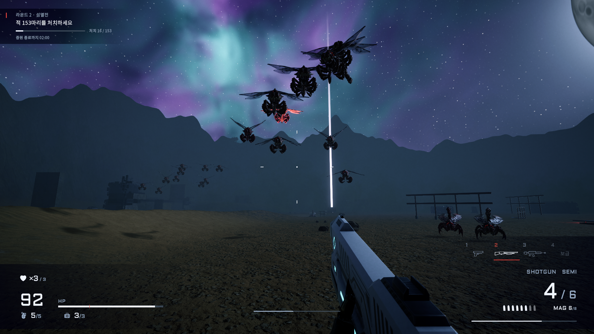\</p\> \<p class="pf-figure"\>\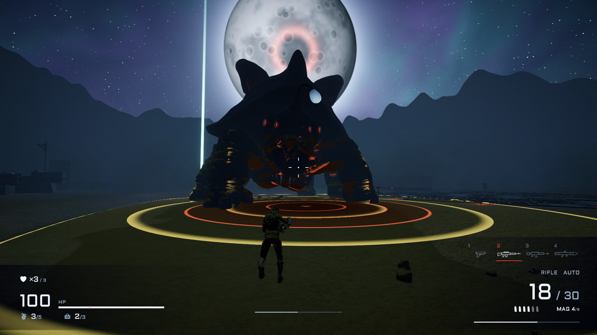\</p\> \<p\>제가 맡은 것은 \<strong\>보급·사운드 시스템\</strong\>과 \<strong\>라운드 종료 강화·맵·튜토리얼·메인 메뉴·UI 통합\</strong\>입니다(3-3).\</p\> \<h3 id="1-2-왜-만들었나--제-파트가-풀어야-했던-문제"\>1-2. 왜 만들었나 — 제 파트가 풀어야 했던 문제\</h3\> \<\!-- 2026-11-21 강사님 피드백("개요가 너무 길어, 표로 쉽게, 내용 줄일 것")으로 문단을 표로 줄임. 예전 문단은 git 기록(11-21 이전)에 있음. ✏️ 줄인 문장 확인 필요 \--\> \<div class="table-wrap" role="region" tabindex="0" aria-label="표 1"\>\<table\> \<thead\> \<tr\> \<th\>파트\</th\> \<th\>풀어야 했던 문제\</th\> \<th\>다룬 곳\</th\> \</tr\> \</thead\> \<tbody\>\<tr\> \<td\>\<strong\>보급\</strong\>\</td\> \<td\>새 맵에서 보급이 떨어지지 않거나, 지형·높은 건물 위·맵 밖에 떨어져 \<strong\>10개 중 2\~3개\</strong\>를 줍지 못했습니다. 주울 수 없으면 플레이어는 답답함을 느낍니다\</td\> \<td\>5-1\~5-3 · 8-2 ④\</td\> \</tr\> \<tr\> \<td\>\<strong\>사운드\</strong\>\</td\> \<td\>4명이 각자 만드는 몬스터·보스·무기에 \<strong\>다른 사람의 코드를 고치지 않고\</strong\> 소리를 붙여야 했습니다. 플레이어 소리가 전혀 나지 않는 버그도 있었습니다\</td\> \<td\>5-4 · 5-5 · 6-4\</td\> \</tr\> \<tr\> \<td\>\<strong\>맵\</strong\>\</td\> \<td\>1차 빌드 테스트(10-28)에서 "맵이 너무 크다"는 피드백. 도망만 다니게 되고 보급을 주우러 가는 길이 스트레스였습니다 → 면적 1/4, 언덕 제거, 엄폐물 추가\</td\> \<td\>6-1 · 7-2\</td\> \</tr\> \<tr\> \<td\>\<strong\>라운드 종료 강화\</strong\>\</td\> \<td\>처음 3종뿐이라 라운드를 깬 보상이 작게 느껴졌습니다 → 8종, 등급 카드 3장 \+ 리롤\</td\> \<td\>6-6\</td\> \</tr\> \<tr\> \<td\>\<strong\>튜토리얼\</strong\>\</td\> \<td\>자유롭게 움직일 수 있어 배우는 것에 집중하지 못했습니다 → 단계마다 지시한 행동만\</td\> \<td\>7-2\</td\> \</tr\> \</tbody\>\</table\>\</div\> \<h3 id="1-3-개발-환경--링크"\>1-3. 개발 환경 · 링크\</h3\> \<div class="table-wrap" role="region" tabindex="0" aria-label="표 2"\>\<table\> \<thead\> \<tr\> \<th\>항목\</th\> \<th\>내용\</th\> \</tr\> \</thead\> \<tbody\>\<tr\> \<td\>엔진\</td\> \<td\>Unity 6000.3 (URP)\</td\> \</tr\> \<tr\> \<td\>언어·도구\</td\> \<td\>C\#, Git(Git flow, Git LFS), Asana\</td\> \</tr\> \<tr\> \<td\>AI 도구\</td\> \<td\>Claude Opus (저는 Claude Code로 사용). ChatGPT를 함께 쓴 팀원도 있었습니다\</td\> \</tr\> \<tr\> \<td\>기간\</td\> \<td\>2026-10-15 \~ 2026-11-04 (약 3주 — 기획 1주 · 개발 2주) · 최종 빌드 11-04 새벽 · 같은 날 발표\</td\> \</tr\> \<tr\> \<td\>팀\</td\> \<td\>4명 — 팀장 이찬영, 팀원 김민성·윤건우·홍산\</td\> \</tr\> \<tr\> \<td\>영상\</td\> \<td\>\<a href="https\://youtu.be/H4MNlsQbh80" target="\_blank" rel="noopener"\>플레이 시연 영상 (YouTube, 4분 23초)\<svg class="pf-newtab-icon" aria-hidden="true" focusable="false" viewBox="0 0 12 12" width="12" height="12"\>\<path d="M4.5 2.5h5v5M9.5 2.5 3 9" fill="none" stroke="currentColor" stroke-width="1.6" stroke-linecap="round" stroke-linejoin="round"\>\</path\>\</svg\>\<span class="pf-sr-only pf-newtab-sr"\>(새 탭)\</span\>\</a\>\<sup class="print-only fn"\>\[1\]\</sup\> · \<a href="https\://youtube.com/shorts/6vDZDAhEoyc" target="\_blank" rel="noopener"\>한 판 몰아보기 쇼츠 (1분 13초)\<svg class="pf-newtab-icon" aria-hidden="true" focusable="false" viewBox="0 0 12 12" width="12" height="12"\>\<path d="M4.5 2.5h5v5M9.5 2.5 3 9" fill="none" stroke="currentColor" stroke-width="1.6" stroke-linecap="round" stroke-linejoin="round"\>\</path\>\</svg\>\<span class="pf-sr-only pf-newtab-sr"\>(새 탭)\</span\>\</a\>\<sup class="print-only fn"\>\[2\]\</sup\>\</td\> \</tr\> \<tr\> \<td\>GitHub\</td\> \<td\>비공개\</td\> \</tr\> \</tbody\>\</table\>\</div\> \<hr\> \<h2 id="2-게임-디자인"\>2. 게임 디자인\</h2\> \<\!-- 2026-11-21 강사님 피드백("모든 문서에 게임 디자인 파트")으로 만든 장. 2-2 표는 본인 답변(11-21). ✏️ 2-1 그림과 그 아래 문단은 Claude가 1-1·1-2의 사실로 쓴 것 — 본인 말로 확인 필요 \--\> \<h3 id="2-1-한-라운드의-흐름--쓸어내고-맞서고-강해진다"\>2-1. 한 라운드의 흐름 — 쓸어내고, 맞서고, 강해진다\</h3\> \<figure class="mmd" data-label="다이어그램 1"\>\<div class="mermaid" id="mmd-0" data-processed="true"\>\<svg id="mermaid-1795405126016" width="1032" xmlns="http\://www\.w3.org/2000/svg" xmlns:xlink="http\://www\.w3.org/1999/xlink" class="flowchart" style="max-width: 100%;" viewBox="0 0 1031.453125 143" role="img" aria-roledescription="flowchart-v2" data-natural-width="1031.453125" aria-label="다이어그램 1"\>\<style\>\#mermaid-1795405126016{font-family:Pretendard,sans-serif;font-size:16px;fill:\#000000;}\#mermaid-1795405126016 .error-icon{fill:\#552222;}\#mermaid-1795405126016 .error-text{fill:\#552222;stroke:\#552222;}\#mermaid-1795405126016 .edge-thickness-normal{stroke-width:1px;}\#mermaid-1795405126016 .edge-thickness-thick{stroke-width:3.5px;}\#mermaid-1795405126016 .edge-pattern-solid{stroke-dasharray:0;}\#mermaid-1795405126016 .edge-thickness-invisible{stroke-width:0;fill:none;}\#mermaid-1795405126016 .edge-pattern-dashed{stroke-dasharray:3;}\#mermaid-1795405126016 .edge-pattern-dotted{stroke-dasharray:2;}\#mermaid-1795405126016 .marker{fill:\#666;stroke:\#666;}\#mermaid-1795405126016 .marker.cross{stroke:\#666;}\#mermaid-1795405126016 svg{font-family:Pretendard,sans-serif;font-size:16px;}\#mermaid-1795405126016 p{margin:0;}\#mermaid-1795405126016 .label{font-family:Pretendard,sans-serif;color:\#000000;}\#mermaid-1795405126016 .cluster-label text{fill:\#333;}\#mermaid-1795405126016 .cluster-label span{color:\#333;}\#mermaid-1795405126016 .cluster-label span p{background-color:transparent;}\#mermaid-1795405126016 .label text,\#mermaid-1795405126016 span{fill:\#000000;color:\#000000;}\#mermaid-1795405126016 .node rect,\#mermaid-1795405126016 .node circle,\#mermaid-1795405126016 .node ellipse,\#mermaid-1795405126016 .node polygon,\#mermaid-1795405126016 .node path{fill:\#eee;stroke:\#999;stroke-width:1px;}\#mermaid-1795405126016 .rough-node .label text,\#mermaid-1795405126016 .node .label text,\#mermaid-1795405126016 .image-shape .label,\#mermaid-1795405126016 .icon-shape .label{text-anchor:middle;}\#mermaid-1795405126016 .node .katex path{fill:\#000;stroke:\#000;stroke-width:1px;}\#mermaid-1795405126016 .rough-node .label,\#mermaid-1795405126016 .node .label,\#mermaid-1795405126016 .image-shape .label,\#mermaid-1795405126016 .icon-shape .label{text-align:center;}\#mermaid-1795405126016 .node.clickable{cursor:pointer;}\#mermaid-1795405126016 .root .anchor path{fill:\#666\!important;stroke-width:0;stroke:\#666;}\#mermaid-1795405126016 .arrowheadPath{fill:\#333333;}\#mermaid-1795405126016 .edgePath .path{stroke:\#666;stroke-width:2.0px;}\#mermaid-1795405126016 .flowchart-link{stroke:\#666;fill:none;}\#mermaid-1795405126016 .edgeLabel{background-color:white;text-align:center;}\#mermaid-1795405126016 .edgeLabel p{background-color:white;}\#mermaid-1795405126016 .edgeLabel rect{opacity:0.5;background-color:white;fill:white;}\#mermaid-1795405126016 .labelBkg{background-color:rgba(255, 255, 255, 0.5);}\#mermaid-1795405126016 .cluster rect{fill:hsl(0, 0%, 98.9215686275%);stroke:\#707070;stroke-width:1px;}\#mermaid-1795405126016 .cluster text{fill:\#333;}\#mermaid-1795405126016 .cluster span{color:\#333;}\#mermaid-1795405126016 div.mermaidTooltip{position:absolute;text-align:center;max-width:200px;padding:2px;font-family:Pretendard,sans-serif;font-size:12px;background:hsl(-160, 0%, 93.3333333333%);border:1px solid \#707070;border-radius:2px;pointer-events:none;z-index:100;}\#mermaid-1795405126016 .flowchartTitleText{text-anchor:middle;font-size:18px;fill:\#000000;}\#mermaid-1795405126016 rect.text{fill:none;stroke-width:0;}\#mermaid-1795405126016 .icon-shape,\#mermaid-1795405126016 .image-shape{background-color:white;text-align:center;}\#mermaid-1795405126016 .icon-shape p,\#mermaid-1795405126016 .image-shape p{background-color:white;padding:2px;}\#mermaid-1795405126016 .icon-shape rect,\#mermaid-1795405126016 .image-shape rect{opacity:0.5;background-color:white;fill:white;}\#mermaid-1795405126016 :root{--mermaid-font-family:Pretendard,sans-serif;}\</style\>\<g\>\<marker id="mermaid-1795405126016\_flowchart-v2-pointEnd" class="marker flowchart-v2" viewBox="0 0 10 10" refX="5" refY="5" markerUnits="userSpaceOnUse" markerWidth="8" markerHeight="8" orient="auto"\>\<path d="M 0 0 L 10 5 L 0 10 z" class="arrowMarkerPath" style="stroke-width: 1; stroke-dasharray: 1, 0;"\>\</path\>\</marker\>\<marker id="mermaid-1795405126016\_flowchart-v2-pointStart" class="marker flowchart-v2" viewBox="0 0 10 10" refX="4.5" refY="5" markerUnits="userSpaceOnUse" markerWidth="8" markerHeight="8" orient="auto"\>\<path d="M 0 5 L 10 10 L 10 0 z" class="arrowMarkerPath" style="stroke-width: 1; stroke-dasharray: 1, 0;"\>\</path\>\</marker\>\<marker id="mermaid-1795405126016\_flowchart-v2-circleEnd" class="marker flowchart-v2" viewBox="0 0 10 10" refX="11" refY="5" markerUnits="userSpaceOnUse" markerWidth="11" markerHeight="11" orient="auto"\>\<circle cx="5" cy="5" r="5" class="arrowMarkerPath" style="stroke-width: 1; stroke-dasharray: 1, 0;"\>\</circle\>\</marker\>\<marker id="mermaid-1795405126016\_flowchart-v2-circleStart" class="marker flowchart-v2" viewBox="0 0 10 10" refX="-1" refY="5" markerUnits="userSpaceOnUse" markerWidth="11" markerHeight="11" orient="auto"\>\<circle cx="5" cy="5" r="5" class="arrowMarkerPath" style="stroke-width: 1; stroke-dasharray: 1, 0;"\>\</circle\>\</marker\>\<marker id="mermaid-1795405126016\_flowchart-v2-crossEnd" class="marker cross flowchart-v2" viewBox="0 0 11 11" refX="12" refY="5.2" markerUnits="userSpaceOnUse" markerWidth="11" markerHeight="11" orient="auto"\>\<path d="M 1,1 l 9,9 M 10,1 l \-9,9" class="arrowMarkerPath" style="stroke-width: 2; stroke-dasharray: 1, 0;"\>\</path\>\</marker\>\<marker id="mermaid-1795405126016\_flowchart-v2-crossStart" class="marker cross flowchart-v2" viewBox="0 0 11 11" refX="-1" refY="5.2" markerUnits="userSpaceOnUse" markerWidth="11" markerHeight="11" orient="auto"\>\<path d="M 1,1 l 9,9 M 10,1 l \-9,9" class="arrowMarkerPath" style="stroke-width: 2; stroke-dasharray: 1, 0;"\>\</path\>\</marker\>\<g class="root"\>\<g class="clusters"\>\</g\>\<g class="edgePaths"\>\<path d="M268,52.968L272.167,51.973C276.333,50.978,284.667,48.989,292.333,47.995C300,47,307,47,310.5,47L314,47" id="L\_A\_B\_0" class=" edge-thickness-normal edge-pattern-solid edge-thickness-normal edge-pattern-solid flowchart-link" style="" marker-end="url(\#mermaid-1795405126016\_flowchart-v2-pointEnd)"\>\</path\>\<path d="M506.531,47L516.794,47C527.057,47,547.583,47,567.443,47C587.302,47,606.495,47,616.091,47L625.688,47" id="L\_B\_C\_1" class=" edge-thickness-normal edge-pattern-solid edge-thickness-normal edge-pattern-solid flowchart-link" style="" marker-end="url(\#mermaid-1795405126016\_flowchart-v2-pointEnd)"\>\</path\>\<path d="M780.688,47L784.854,47C789.021,47,797.354,47,805.05,48.076C812.745,49.151,819.803,51.303,823.332,52.379L826.861,53.454" id="L\_C\_D\_2" class=" edge-thickness-normal edge-pattern-solid edge-thickness-normal edge-pattern-solid flowchart-link" style="" marker-end="url(\#mermaid-1795405126016\_flowchart-v2-pointEnd)"\>\</path\>\<path d="M830.688,113.379L826.521,114.65C822.354,115.92,814.021,118.46,793.104,119.73C772.188,121,738.688,121,699.091,121C659.495,121,613.802,121,564.982,121C516.161,121,464.214,121,418.362,121C372.51,121,332.755,121,309.359,120.16C285.964,119.32,278.927,117.641,275.409,116.801L271.891,115.961" id="L\_D\_A\_3" class=" edge-thickness-normal edge-pattern-solid edge-thickness-normal edge-pattern-solid flowchart-link" style="" marker-end="url(\#mermaid-1795405126016\_flowchart-v2-pointEnd)"\>\</path\>\</g\>\<g class="edgeLabels"\>\<g class="edgeLabel"\>\<g class="label" transform="translate(0, 0)"\>\<foreignObject width="0" height="0"\>\<div xmlns="http\://www\.w3.org/1999/xhtml" class="labelBkg" style="display: table-cell; white-space: nowrap; line-height: 1.5; max-width: 200px; text-align: center;"\>\<span class="edgeLabel "\>\</span\>\</div\>\</foreignObject\>\</g\>\</g\>\<g class="edgeLabel"\>\<g class="label" transform="translate(0, 0)"\>\<foreignObject width="0" height="0"\>\<div xmlns="http\://www\.w3.org/1999/xhtml" class="labelBkg" style="display: table-cell; white-space: nowrap; line-height: 1.5; max-width: 200px; text-align: center;"\>\<span class="edgeLabel "\>\</span\>\</div\>\</foreignObject\>\</g\>\</g\>\<g class="edgeLabel"\>\<g class="label" transform="translate(0, 0)"\>\<foreignObject width="0" height="0"\>\<div xmlns="http\://www\.w3.org/1999/xhtml" class="labelBkg" style="display: table-cell; white-space: nowrap; line-height: 1.5; max-width: 200px; text-align: center;"\>\<span class="edgeLabel "\>\</span\>\</div\>\</foreignObject\>\</g\>\</g\>\<g class="edgeLabel" transform="translate(568.109375, 121)"\>\<g class="label" transform="translate(-36.578125, \-12)"\>\<foreignObject width="73.15625" height="24"\>\<div xmlns="http\://www\.w3.org/1999/xhtml" class="labelBkg" style="display: table-cell; white-space: nowrap; line-height: 1.5; max-width: 200px; text-align: center;"\>\<span class="edgeLabel "\>\<p\>다음 라운드\</p\>\</span\>\</div\>\</foreignObject\>\</g\>\</g\>\</g\>\<g class="nodes"\>\<g class="node default " id="flowchart-A-0" transform="translate(138, 84)"\>\<rect class="basic label-container" style="" x="-130" y="-51" width="260" height="102"\>\</rect\>\<g class="label" style="" transform="translate(-100, \-36)"\>\<rect\>\</rect\>\<foreignObject width="200" height="72"\>\<div xmlns="http\://www\.w3.org/1999/xhtml" style="display: table; white-space: break-spaces; line-height: 1.5; max-width: 200px; text-align: center; width: 200px;"\>\<span class="nodeLabel "\>\<p\>1인칭 군중전 (약 3분)\<br\>몰려오는 몬스터 처치 · 보급 줍기\</p\>\</span\>\</div\>\</foreignObject\>\</g\>\</g\>\<g class="node default " id="flowchart-B-1" transform="translate(412.265625, 47)"\>\<rect class="basic label-container" style="" x="-94.265625" y="-39" width="188.53125" height="78"\>\</rect\>\<g class="label" style="" transform="translate(-64.265625, \-24)"\>\<rect\>\</rect\>\<foreignObject width="128.53125" height="48"\>\<div xmlns="http\://www\.w3.org/1999/xhtml" style="display: table-cell; white-space: nowrap; line-height: 1.5; max-width: 200px; text-align: center;"\>\<span class="nodeLabel "\>\<p\>보스 등장\<br\>3인칭으로 시점 전환\</p\>\</span\>\</div\>\</foreignObject\>\</g\>\</g\>\<g class="node default " id="flowchart-C-3" transform="translate(705.1875, 47)"\>\<rect class="basic label-container" style="" x="-75.5" y="-39" width="151" height="78"\>\</rect\>\<g class="label" style="" transform="translate(-45.5, \-24)"\>\<rect\>\</rect\>\<foreignObject width="91" height="48"\>\<div xmlns="http\://www\.w3.org/1999/xhtml" style="display: table-cell; white-space: nowrap; line-height: 1.5; max-width: 200px; text-align: center;"\>\<span class="nodeLabel "\>\<p\>보스전\<br\>공격 패턴 공략\</p\>\</span\>\</div\>\</foreignObject\>\</g\>\</g\>\<g class="node default " id="flowchart-D-5" transform="translate(927.0703125, 84)"\>\<rect class="basic label-container" style="" x="-96.3828125" y="-39" width="192.765625" height="78"\>\</rect\>\<g class="label" style="" transform="translate(-66.3828125, \-24)"\>\<rect\>\</rect\>\<foreignObject width="132.765625" height="48"\>\<div xmlns="http\://www\.w3.org/1999/xhtml" style="display: table-cell; white-space: nowrap; line-height: 1.5; max-width: 200px; text-align: center;"\>\<span class="nodeLabel "\>\<p\>라운드 종료 강화\<br\>등급 카드 3장 \+ 리롤\</p\>\</span\>\</div\>\</foreignObject\>\</g\>\</g\>\</g\>\</g\>\</g\>\</svg\>\</div\>\<div class="mmd-bar"\>\<details class="mmd-src"\>\<summary\>다이어그램 원문\</summary\>\<pre\>\<code\>flowchart LR A\["1인칭 군중전 (약 3분)\<br/\>몰려오는 몬스터 처치 · 보급 줍기"\] \--\> B\["보스 등장\<br/\>3인칭으로 시점 전환"\] B \--\> C\["보스전\<br/\>공격 패턴 공략"\] C \--\> D\["라운드 종료 강화\<br/\>등급 카드 3장 \+ 리롤"\] D \--\>\|"다음 라운드"\| A \</code\>\</pre\>\</details\>\<button type="button" class="mmd-zoom"\>크게 보기\</button\>\</div\>\</figure\> \<p\>군중전에서는 하늘에서 떨어지는 \<strong\>보급\</strong\>으로 몰려오는 적을 버티고(5-1), 라운드가 끝나면 \<strong\>강화\</strong\>를 골라 다음 라운드를 더 강한 상태로 시작합니다(6-6).\</p\> \<h3 id="2-2-누가-무엇을-기획했나"\>2-2. 누가 무엇을 기획했나\</h3\> \<div class="table-wrap" role="region" tabindex="0" aria-label="표 3"\>\<table\> \<thead\> \<tr\> \<th\>기획\</th\> \<th\>정한 사람\</th\> \</tr\> \</thead\> \<tbody\>\<tr\> \<td\>게임 콘셉트 (1인칭 군중전 \+ 3인칭 보스전)\</td\> \<td\>팀장\</td\> \</tr\> \<tr\> \<td\>몬스터와 몬스터 패턴\</td\> \<td\>팀장과 회의하며, AI와 함께 정함\</td\> \</tr\> \<tr\> \<td\>보급 시스템\</td\> \<td\>제가 AI와 함께 기획 (5-1\~5-3)\</td\> \</tr\> \<tr\> \<td\>업그레이드(라운드 종료 강화) 시스템\</td\> \<td\>팀원들, AI와 함께 기획 (6-6)\</td\> \</tr\> \<tr\> \<td\>대부분 기능의 기획 초기 틀\</td\> \<td\>제가 잡음\</td\> \</tr\> \</tbody\>\</table\>\</div\> \<p\>맵·보급·NavMesh를 한 원칙("높은 곳에서 쏘는 이점은 주지 않는다")으로 묶은 기획은 6-1에서 다룹니다.\</p\> \<hr\> \<h2 id="3-팀-협업"\>3. 팀 협업\</h2\> \<h3 id="3-1-팀-구성과-역할"\>3-1. 팀 구성과 역할\</h3\> \<div class="table-wrap" role="region" tabindex="0" aria-label="표 4"\>\<table\> \<thead\> \<tr\> \<th\>이름\</th\> \<th\>담당\</th\> \</tr\> \</thead\> \<tbody\>\<tr\> \<td\>윤건우 (나)\</td\> \<td\>보급(공중 투하·획득 알림)·재화 획득, 라운드 종료 강화 상점, 몬스터 사운드, 맵(전장·엄폐물·고지대), 튜토리얼, 메인 메뉴·UI 통합\</td\> \</tr\> \<tr\> \<td\>이찬영 (팀장)\</td\> \<td\>코어(데이터·이벤트·서비스), 보스(패턴·등장·처치 연출·지형 파괴), 라운드 진행(웨이브·보스전 시작·재시작), 1차 사전 통합·테스트\</td\> \</tr\> \<tr\> \<td\>홍산\</td\> \<td\>일반 몬스터(근접·돌진 무리·공중·침투·독안개, 공통 상태 전환), 몬스터 스폰·이동, 피격 반응(경직·약점·처치 연출), 섬멸전 라운드 기믹\</td\> \</tr\> \<tr\> \<td\>김민성\</td\> \<td\>플레이어(이동·시점·피격·부활), 무기(라이플·수류탄·투사체·무기 해금)와 강화 효과 적용, 인트로·엔딩, 조명·쉐이더, 2스테이지 보스 쓸기 패턴\</td\> \</tr\> \</tbody\>\</table\>\</div\> \<\!-- 출처: Asana 팀 보드 「Team Even」의 담당자별 완료 업무 \--\> \<h3 id="3-2-팀이-일한-방식"\>3-2. 팀이 일한 방식\</h3\> \<ul\> \<li\>파트 사이 약속(4-1의 "파트끼리 서로 모른다" 규칙, 이벤트·서비스·데이터 형식)은 \<strong\>강의 내용과 Opus로 먼저 정한 팀 공통 규칙\</strong\>을 따랐습니다.\</li\> \<li\>팀 차원에서 따로 정한 AI 사용 규칙은 없었습니다. 팀장이 만든 기준 문서 「이벤트 버스와 외부 데이터 적용 기준」이 사실상 가장 큰 규칙이었고, 저는 각자의 AI가 이 약속을 지키도록 이 문서를 작업마다 붙였습니다.\</li\> \</ul\> \<h3 id="3-3-제가-맡은-것"\>3-3. 제가 맡은 것\</h3\> \<p\>\<strong\>주로 맡은 것\</strong\>\</p\> \<ol\> \<li\>\<strong\>보급 시스템\</strong\> — 공중 투하, 낙하 지점 찾기, 상황에 따라 바뀌는 보급 확률, 근접 획득\</li\> \<li\>\<strong\>사운드 시스템\</strong\> — 이벤트 → 소리 연결(GameSoundRouter), 객체별 이미터, BGM, AudioMixer\</li\> \</ol\> \<p\>\<strong\>그 밖에 맡은 것\</strong\> (한 줄씩만)\</p\> \<ul\> \<li\>라운드 종료 강화 상점 (등급 카드 3장 \+ 리롤, 강화 8종)\</li\> \<li\>인게임 맵(Sci-Fi Base 기반)·튜토리얼 맵, 맵 빌더 에디터 도구\</li\> \<li\>메인 메뉴(디오라마 배경·호버 연출·옵션 팝업), 튜토리얼 6단계\</li\> \<li\>게임 전체 UI 통합 (메인 메뉴 스타일 기준, \<code\>UiTheme\</code\>)\</li\> \<li\>플레이 테스트 분석기(PlaytestAnalyzer), 바이너리 에셋 자동 복구 도구\</li\> \</ul\> \<h3 id="3-4-협업--내-담당-범위와-다른-파트-코드"\>3-4. 협업 — 내 담당 범위와 다른 파트 코드\</h3\> \<p\>4명이 동시에 작업해서, \<strong\>어디까지 내가 고칠지\</strong\>를 매번 정해야 했습니다.\</p\> \<div class="table-wrap" role="region" tabindex="0" aria-label="표 5"\>\<table\> \<thead\> \<tr\> \<th\>상황\</th\> \<th\>내 결정\</th\> \</tr\> \</thead\> \<tbody\>\<tr\> \<td\>팀 피드백에 라운드 포맷 변경(섬멸전 등)이 섞여 옴\</td\> \<td\>「라운드 포맷은 담당자가 있어서, 나는 업그레이드 시스템만 담당」 → 요청 사항만 문서에 남김\</td\> \</tr\> \<tr\> \<td\>강화(스태미나·최대 체력)가 플레이어 코드를 건드림\</td\> \<td\>「스테미나와 최대체력은 플레이어 담당에게 큰 문제를 일으키나?」 먼저 확인 → 「직접 고치고 PR에서 담당자 리뷰 요청」\</td\> \</tr\> \<tr\> \<td\>근접 획득이 \<code\>PlayerInteractor\</code\>(플레이어 담당)를 바꿈\</td\> \<td\>바꾼 내용을 정리해 디스코드로 공유\</td\> \</tr\> \<tr\> \<td\>보급 정보 UI\</td\> \<td\>처음에는 「ui 구현은 플레이어 담당이 구현 예정」으로 보급은 정보만 주려 했지만, \<strong\>UI까지 직접 만듦\</strong\>\</td\> \</tr\> \<tr\> \<td\>커밋 직전\</td\> \<td\>「다른 팀원들에게 영향이 안갈 경우에 커밋」 — 영향이 있으면 버림(discard)\</td\> \</tr\> \</tbody\>\</table\>\</div\> \<div class="table-wrap" role="region" tabindex="0" aria-label="표 6"\>\<table\> \<thead\> \<tr\> \<th\>방법\</th\> \<th\>장점\</th\> \<th\>단점\</th\> \</tr\> \</thead\> \<tbody\>\<tr\> \<td\>담당자에게 요청하고 기다림\</td\> \<td\>소유권이 분명\</td\> \<td\>약 3주 일정에서 내 작업이 멈춤\</td\> \</tr\> \<tr\> \<td\>\<strong\>작게 직접 고치고 PR에서 담당자 리뷰 (선택)\</strong\>\</td\> \<td\>기다리지 않음, 담당자가 확인함\</td\> \<td\>리뷰 부담을 담당자에게 줌\</td\> \</tr\> \<tr\> \<td\>내 쪽에서 우회\</td\> \<td\>남의 코드를 안 건드림\</td\> \<td\>같은 기능이 두 곳에 생김\</td\> \</tr\> \</tbody\>\</table\>\</div\> \<p\>강화 시스템은 라운드가 끝난 뒤에 따라오는 시스템이어서 담당자 리뷰에서 고쳐 달라는 피드백은 없었습니다. 보급 정보 UI를 직접 만든 것은, AI로 작업하고 있었기 때문에 제가 기획하고 직접 구현해 원하는 방향으로 만드는 편이 더 빠르다고 판단했기 때문입니다.\</p\> \<hr\> \<h2 id="4-시스템-구조"\>4. 시스템 구조\</h2\> \<h3 id="4-1-팀-공통-규칙--파트끼리-서로-모른다"\>4-1. 팀 공통 규칙 — 파트끼리 서로 모른다\</h3\> \<p\>이 규칙은 강의 내용과 Claude Opus로 정한 \<strong\>팀 공통 규칙\</strong\>이고, 코어(\<code\>HybridShooter.Core\</code\>)는 팀장 담당입니다. 저는 이 규칙에 맞춰 작업했습니다.\</p\> \<figure class="mmd" data-label="다이어그램 2"\>\<div class="mermaid" id="mmd-1" data-processed="true"\>\<svg id="mermaid-1795405126040" width="630" xmlns="http\://www\.w3.org/2000/svg" xmlns:xlink="http\://www\.w3.org/1999/xlink" class="flowchart" style="max-width: 100%;" viewBox="4 4 629.421875 406" role="img" aria-roledescription="flowchart-v2" data-natural-width="629.421875" aria-label="다이어그램 2"\>\<style\>\#mermaid-1795405126040{font-family:Pretendard,sans-serif;font-size:16px;fill:\#000000;}\#mermaid-1795405126040 .error-icon{fill:\#552222;}\#mermaid-1795405126040 .error-text{fill:\#552222;stroke:\#552222;}\#mermaid-1795405126040 .edge-thickness-normal{stroke-width:1px;}\#mermaid-1795405126040 .edge-thickness-thick{stroke-width:3.5px;}\#mermaid-1795405126040 .edge-pattern-solid{stroke-dasharray:0;}\#mermaid-1795405126040 .edge-thickness-invisible{stroke-width:0;fill:none;}\#mermaid-1795405126040 .edge-pattern-dashed{stroke-dasharray:3;}\#mermaid-1795405126040 .edge-pattern-dotted{stroke-dasharray:2;}\#mermaid-1795405126040 .marker{fill:\#666;stroke:\#666;}\#mermaid-1795405126040 .marker.cross{stroke:\#666;}\#mermaid-1795405126040 svg{font-family:Pretendard,sans-serif;font-size:16px;}\#mermaid-1795405126040 p{margin:0;}\#mermaid-1795405126040 .label{font-family:Pretendard,sans-serif;color:\#000000;}\#mermaid-1795405126040 .cluster-label text{fill:\#333;}\#mermaid-1795405126040 .cluster-label span{color:\#333;}\#mermaid-1795405126040 .cluster-label span p{background-color:transparent;}\#mermaid-1795405126040 .label text,\#mermaid-1795405126040 span{fill:\#000000;color:\#000000;}\#mermaid-1795405126040 .node rect,\#mermaid-1795405126040 .node circle,\#mermaid-1795405126040 .node ellipse,\#mermaid-1795405126040 .node polygon,\#mermaid-1795405126040 .node path{fill:\#eee;stroke:\#999;stroke-width:1px;}\#mermaid-1795405126040 .rough-node .label text,\#mermaid-1795405126040 .node .label text,\#mermaid-1795405126040 .image-shape .label,\#mermaid-1795405126040 .icon-shape .label{text-anchor:middle;}\#mermaid-1795405126040 .node .katex path{fill:\#000;stroke:\#000;stroke-width:1px;}\#mermaid-1795405126040 .rough-node .label,\#mermaid-1795405126040 .node .label,\#mermaid-1795405126040 .image-shape .label,\#mermaid-1795405126040 .icon-shape .label{text-align:center;}\#mermaid-1795405126040 .node.clickable{cursor:pointer;}\#mermaid-1795405126040 .root .anchor path{fill:\#666\!important;stroke-width:0;stroke:\#666;}\#mermaid-1795405126040 .arrowheadPath{fill:\#333333;}\#mermaid-1795405126040 .edgePath .path{stroke:\#666;stroke-width:2.0px;}\#mermaid-1795405126040 .flowchart-link{stroke:\#666;fill:none;}\#mermaid-1795405126040 .edgeLabel{background-color:white;text-align:center;}\#mermaid-1795405126040 .edgeLabel p{background-color:white;}\#mermaid-1795405126040 .edgeLabel rect{opacity:0.5;background-color:white;fill:white;}\#mermaid-1795405126040 .labelBkg{background-color:rgba(255, 255, 255, 0.5);}\#mermaid-1795405126040 .cluster rect{fill:hsl(0, 0%, 98.9215686275%);stroke:\#707070;stroke-width:1px;}\#mermaid-1795405126040 .cluster text{fill:\#333;}\#mermaid-1795405126040 .cluster span{color:\#333;}\#mermaid-1795405126040 div.mermaidTooltip{position:absolute;text-align:center;max-width:200px;padding:2px;font-family:Pretendard,sans-serif;font-size:12px;background:hsl(-160, 0%, 93.3333333333%);border:1px solid \#707070;border-radius:2px;pointer-events:none;z-index:100;}\#mermaid-1795405126040 .flowchartTitleText{text-anchor:middle;font-size:18px;fill:\#000000;}\#mermaid-1795405126040 rect.text{fill:none;stroke-width:0;}\#mermaid-1795405126040 .icon-shape,\#mermaid-1795405126040 .image-shape{background-color:white;text-align:center;}\#mermaid-1795405126040 .icon-shape p,\#mermaid-1795405126040 .image-shape p{background-color:white;padding:2px;}\#mermaid-1795405126040 .icon-shape rect,\#mermaid-1795405126040 .image-shape rect{opacity:0.5;background-color:white;fill:white;}\#mermaid-1795405126040 :root{--mermaid-font-family:Pretendard,sans-serif;}\</style\>\<g\>\<marker id="mermaid-1795405126040\_flowchart-v2-pointEnd" class="marker flowchart-v2" viewBox="0 0 10 10" refX="5" refY="5" markerUnits="userSpaceOnUse" markerWidth="8" markerHeight="8" orient="auto"\>\<path d="M 0 0 L 10 5 L 0 10 z" class="arrowMarkerPath" style="stroke-width: 1; stroke-dasharray: 1, 0;"\>\</path\>\</marker\>\<marker id="mermaid-1795405126040\_flowchart-v2-pointStart" class="marker flowchart-v2" viewBox="0 0 10 10" refX="4.5" refY="5" markerUnits="userSpaceOnUse" markerWidth="8" markerHeight="8" orient="auto"\>\<path d="M 0 5 L 10 10 L 10 0 z" class="arrowMarkerPath" style="stroke-width: 1; stroke-dasharray: 1, 0;"\>\</path\>\</marker\>\<marker id="mermaid-1795405126040\_flowchart-v2-circleEnd" class="marker flowchart-v2" viewBox="0 0 10 10" refX="11" refY="5" markerUnits="userSpaceOnUse" markerWidth="11" markerHeight="11" orient="auto"\>\<circle cx="5" cy="5" r="5" class="arrowMarkerPath" style="stroke-width: 1; stroke-dasharray: 1, 0;"\>\</circle\>\</marker\>\<marker id="mermaid-1795405126040\_flowchart-v2-circleStart" class="marker flowchart-v2" viewBox="0 0 10 10" refX="-1" refY="5" markerUnits="userSpaceOnUse" markerWidth="11" markerHeight="11" orient="auto"\>\<circle cx="5" cy="5" r="5" class="arrowMarkerPath" style="stroke-width: 1; stroke-dasharray: 1, 0;"\>\</circle\>\</marker\>\<marker id="mermaid-1795405126040\_flowchart-v2-crossEnd" class="marker cross flowchart-v2" viewBox="0 0 11 11" refX="12" refY="5.2" markerUnits="userSpaceOnUse" markerWidth="11" markerHeight="11" orient="auto"\>\<path d="M 1,1 l 9,9 M 10,1 l \-9,9" class="arrowMarkerPath" style="stroke-width: 2; stroke-dasharray: 1, 0;"\>\</path\>\</marker\>\<marker id="mermaid-1795405126040\_flowchart-v2-crossStart" class="marker cross flowchart-v2" viewBox="0 0 11 11" refX="-1" refY="5.2" markerUnits="userSpaceOnUse" markerWidth="11" markerHeight="11" orient="auto"\>\<path d="M 1,1 l 9,9 M 10,1 l \-9,9" class="arrowMarkerPath" style="stroke-width: 2; stroke-dasharray: 1, 0;"\>\</path\>\</marker\>\</g\>\<g class="subgraphs"\>\<g class="subgraph"\>\<g class="cluster " id="Core" data-look="classic"\>\<rect style="" x="12" y="249" width="613.421875" height="153"\>\</rect\>\<g class="cluster-label " transform="translate(218.7109375, 249)"\>\<foreignObject width="200" height="48"\>\<div xmlns="http\://www\.w3.org/1999/xhtml" style="display: table; white-space: break-spaces; line-height: 1.5; max-width: 200px; text-align: center; width: 200px;"\>\<span class="nodeLabel "\>\<p\>팀 공통 코어 (HybridShooter.Core)\</p\>\</span\>\</div\>\</foreignObject\>\</g\>\</g\>\</g\>\</g\>\<g class="nodes"\>\<g class="node default " id="flowchart-EV-8" transform="translate(332.1640625, 351)"\>\<rect class="basic label-container" style="" x="-82.4140625" y="-39" width="164.828125" height="78"\>\</rect\>\<g class="label" style="" transform="translate(-52.4140625, \-24)"\>\<rect\>\</rect\>\<foreignObject width="104.828125" height="48"\>\<div xmlns="http\://www\.w3.org/1999/xhtml" style="display: table-cell; white-space: nowrap; line-height: 1.5; max-width: 200px; text-align: center;"\>\<span class="nodeLabel "\>\<p\>이벤트 버스\<br\>일어난 일 알리기\</p\>\</span\>\</div\>\</foreignObject\>\</g\>\</g\>\<g class="node default " id="flowchart-SL-9" transform="translate(529, 351)"\>\<rect class="basic label-container" style="" x="-84.421875" y="-39" width="168.84375" height="78"\>\</rect\>\<g class="label" style="" transform="translate(-54.421875, \-24)"\>\<rect\>\</rect\>\<foreignObject width="108.84375" height="48"\>\<div xmlns="http\://www\.w3.org/1999/xhtml" style="display: table-cell; white-space: nowrap; line-height: 1.5; max-width: 200px; text-align: center;"\>\<span class="nodeLabel "\>\<p\>서비스 찾기\<br\>씬 전역 기능 요청\</p\>\</span\>\</div\>\</foreignObject\>\</g\>\</g\>\<g class="node default " id="flowchart-DM-10" transform="translate(121.875, 351)"\>\<rect class="basic label-container" style="" x="-97.875" y="-27" width="195.75" height="54"\>\</rect\>\<g class="label" style="" transform="translate(-67.875, \-12)"\>\<rect\>\</rect\>\<foreignObject width="135.75" height="24"\>\<div xmlns="http\://www\.w3.org/1999/xhtml" style="display: table-cell; white-space: nowrap; line-height: 1.5; max-width: 200px; text-align: center;"\>\<span class="nodeLabel "\>\<p\>데이터 표 읽기 (TSV)\</p\>\</span\>\</div\>\</foreignObject\>\</g\>\</g\>\<g class="node default " id="flowchart-Supply-11" transform="translate(191.040625, 39)"\>\<rect class="basic label-container" style="" x="-74.0625" y="-27" width="148.125" height="54"\>\</rect\>\<g class="label" style="" transform="translate(-44.0625, \-12)"\>\<rect\>\</rect\>\<foreignObject width="88.125" height="24"\>\<div xmlns="http\://www\.w3.org/1999/xhtml" style="display: table-cell; white-space: nowrap; line-height: 1.5; max-width: 200px; text-align: center;"\>\<span class="nodeLabel "\>\<p\>보급·보상 (나)\</p\>\</span\>\</div\>\</foreignObject\>\</g\>\</g\>\<g class="node default " id="flowchart-Audio-13" transform="translate(380.053125, 187)"\>\<rect class="basic label-container" style="" x="-65.1171875" y="-27" width="130.234375" height="54"\>\</rect\>\<g class="label" style="" transform="translate(-35.1171875, \-12)"\>\<rect\>\</rect\>\<foreignObject width="70.234375" height="24"\>\<div xmlns="http\://www\.w3.org/1999/xhtml" style="display: table-cell; white-space: nowrap; line-height: 1.5; max-width: 200px; text-align: center;"\>\<span class="nodeLabel "\>\<p\>사운드 (나)\</p\>\</span\>\</div\>\</foreignObject\>\</g\>\</g\>\<g class="node default " id="flowchart-Monster-15" transform="translate(546.771875, 187)"\>\<rect class="basic label-container" style="" x="-66.6015625" y="-27" width="133.203125" height="54"\>\</rect\>\<g class="label" style="" transform="translate(-36.6015625, \-12)"\>\<rect\>\</rect\>\<foreignObject width="73.203125" height="24"\>\<div xmlns="http\://www\.w3.org/1999/xhtml" style="display: table-cell; white-space: nowrap; line-height: 1.5; max-width: 200px; text-align: center;"\>\<span class="nodeLabel "\>\<p\>몬스터·보스\</p\>\</span\>\</div\>\</foreignObject\>\</g\>\</g\>\<g class="node default " id="flowchart-Player-17" transform="translate(166.353125, 187)"\>\<rect class="basic label-container" style="" x="-73.515625" y="-27" width="147.03125" height="54"\>\</rect\>\<g class="label" style="" transform="translate(-43.515625, \-12)"\>\<rect\>\</rect\>\<foreignObject width="87.03125" height="24"\>\<div xmlns="http\://www\.w3.org/1999/xhtml" style="display: table-cell; white-space: nowrap; line-height: 1.5; max-width: 200px; text-align: center;"\>\<span class="nodeLabel "\>\<p\>플레이어·무기\</p\>\</span\>\</div\>\</foreignObject\>\</g\>\</g\>\</g\>\<g class="edges edgePaths"\>\<path d="M215.728,66L215.728,68.083C215.728,70.167,215.728,74.333,216.09,76.888C216.452,79.443,217.176,80.386,218.009,81.219C218.843,82.052,219.785,82.776,225.53,83.138C231.275,83.5,241.822,83.5,247.567,83.862C253.312,84.224,254.254,84.948,255.088,85.781C255.921,86.614,256.645,87.557,257.007,92.112C257.369,96.667,257.369,104.833,257.369,121.25C257.369,137.667,257.369,162.333,257.369,184.333C257.369,206.333,257.369,225.667,257.369,235.333L257.369,245" id="L\_Supply\_Core\_0\_0" class=" edge-thickness-normal edge-pattern-solid edge-thickness-normal edge-pattern-solid flowchart-link" style="" marker-end="url(\#mermaid-1795405126040\_flowchart-v2-pointEnd)"\>\</path\>\<path d="M380.053,214L380.053,245" id="L\_Audio\_Core\_1\_0" class=" edge-thickness-normal edge-pattern-solid edge-thickness-normal edge-pattern-solid flowchart-link" style="" marker-end="url(\#mermaid-1795405126040\_flowchart-v2-pointEnd)"\>\</path\>\<path d="M546.772,214L546.772,216.083C546.772,218.167,546.772,222.333,546.41,224.888C546.048,227.443,545.324,228.386,544.491,229.219C543.657,230.052,542.715,230.776,536.571,231.138C530.427,231.5,519.082,231.5,512.938,231.862C506.795,232.224,505.852,232.948,505.019,233.781C504.185,234.614,503.461,235.557,503.099,237.445C502.737,239.333,502.737,242.167,502.738,243.583L502.737,245" id="L\_Monster\_Core\_2\_0" class=" edge-thickness-normal edge-pattern-solid edge-thickness-normal edge-pattern-solid flowchart-link" style="" marker-end="url(\#mermaid-1795405126040\_flowchart-v2-pointEnd)"\>\</path\>\<path d="M166.353,214L166.353,216.083C166.353,218.167,166.353,222.333,165.991,224.888C165.629,227.443,164.905,228.386,164.072,229.219C163.239,230.052,162.296,230.776,158.213,231.138C154.13,231.5,146.907,231.5,142.824,231.862C138.742,232.224,137.799,232.948,136.965,233.781C136.132,234.614,135.408,235.557,135.046,237.445C134.684,239.333,134.684,242.167,134.684,243.583L134.684,245" id="L\_Player\_Core\_3\_0" class=" edge-thickness-normal edge-pattern-solid edge-thickness-normal edge-pattern-solid flowchart-link" style="" marker-end="url(\#mermaid-1795405126040\_flowchart-v2-pointEnd)"\>\</path\>\<path d="M166.353,66L166.353,156" id="L\_Supply\_Player\_4\_0" class=" edge-thickness-normal edge-pattern-dotted edge-thickness-normal edge-pattern-solid flowchart-link" style="" marker-end="url(\#mermaid-1795405126040\_flowchart-v2-pointEnd)"\>\</path\>\</g\>\<g class="edgeLabels"\>\<g class="edgeLabel"\>\<g class="label" transform="translate(0, 0)"\>\<foreignObject width="0" height="0"\>\<div xmlns="http\://www\.w3.org/1999/xhtml" class="labelBkg" style="display: table-cell; white-space: nowrap; line-height: 1.5; max-width: 200px; text-align: center;"\>\<span class="edgeLabel "\>\</span\>\</div\>\</foreignObject\>\</g\>\</g\>\<g class="edgeLabel"\>\<g class="label" transform="translate(0, 0)"\>\<foreignObject width="0" height="0"\>\<div xmlns="http\://www\.w3.org/1999/xhtml" class="labelBkg" style="display: table-cell; white-space: nowrap; line-height: 1.5; max-width: 200px; text-align: center;"\>\<span class="edgeLabel "\>\</span\>\</div\>\</foreignObject\>\</g\>\</g\>\<g class="edgeLabel"\>\<g class="label" transform="translate(0, 0)"\>\<foreignObject width="0" height="0"\>\<div xmlns="http\://www\.w3.org/1999/xhtml" class="labelBkg" style="display: table-cell; white-space: nowrap; line-height: 1.5; max-width: 200px; text-align: center;"\>\<span class="edgeLabel "\>\</span\>\</div\>\</foreignObject\>\</g\>\</g\>\<g class="edgeLabel"\>\<g class="label" transform="translate(0, 0)"\>\<foreignObject width="0" height="0"\>\<div xmlns="http\://www\.w3.org/1999/xhtml" class="labelBkg" style="display: table-cell; white-space: nowrap; line-height: 1.5; max-width: 200px; text-align: center;"\>\<span class="edgeLabel "\>\</span\>\</div\>\</foreignObject\>\</g\>\</g\>\<g class="edgeLabel" transform="translate(166.3453125, 113)"\>\<g class="label" transform="translate(-58.4921875, \-12)"\>\<foreignObject width="116.984375" height="24"\>\<div xmlns="http\://www\.w3.org/1999/xhtml" class="labelBkg" style="display: table-cell; white-space: nowrap; line-height: 1.5; max-width: 200px; text-align: center;"\>\<span class="edgeLabel "\>\<p\>❌ 직접 참조 금지\</p\>\</span\>\</div\>\</foreignObject\>\</g\>\</g\>\</g\>\</svg\>\</div\>\<div class="mmd-bar"\>\<details class="mmd-src"\>\<summary\>다이어그램 원문\</summary\>\<pre\>\<code\>%%{init: {"layout": "elk"}}%% flowchart TB subgraph Core\["팀 공통 코어 (HybridShooter.Core)"\] EV\["이벤트 버스\<br/\>일어난 일 알리기"\] SL\["서비스 찾기\<br/\>씬 전역 기능 요청"\] DM\["데이터 표 읽기 (TSV)"\] end Supply\["보급·보상 (나)"\] \--\> Core Audio\["사운드 (나)"\] \--\> Core Monster\["몬스터·보스"\] \--\> Core Player\["플레이어·무기"\] \--\> Core Supply \-. "❌ 직접 참조 금지" .- Player \</code\>\</pre\>\</details\>\<button type="button" class="mmd-zoom"\>크게 보기\</button\>\</div\>\</figure\> \<p\>파트는 \<code\>HybridShooter.Core\</code\>에만 의존하고, 서로 통신할 때는 세 가지 중 하나를 씁니다.\</p\> \<div class="table-wrap" role="region" tabindex="0" aria-label="표 7"\>\<table\> \<thead\> \<tr\> \<th\>상황\</th\> \<th\>방법\</th\> \</tr\> \</thead\> \<tbody\>\<tr\> \<td\>대상을 이미 들고 있음 (충돌·레이캐스트)\</td\> \<td\>인터페이스 (\<code\>IItemUser\</code\>, \<code\>ISupplyWeaponUser\</code\>)\</td\> \</tr\> \<tr\> \<td\>씬 전역 기능 요청\</td\> \<td\>\<code\>ServiceLocator.Get\<T\>()\</code\> (\<code\>ISoundService\</code\>, \<code\>ISpawnZoneProvider\</code\>)\</td\> \</tr\> \<tr\> \<td\>일어난 일 알리기\</td\> \<td\>\<code\>EventBus\<T\>\</code\> (\<code\>MonsterSpawnedEvent\</code\>, \<code\>SupplyCollectedEvent\</code\>)\</td\> \</tr\> \</tbody\>\</table\>\</div\> \<p\>이 규칙 위에서 각자 AI로 구현하니 작업 시간이 크게 줄었습니다. 다만 AI가 구현한 것이라도 제가 직접 확인하지 않으면 팀원들과 작업 이야기를 나누기 어려웠고, 이 경험이 8-3의 개선 계획으로 이어졌습니다.\</p\> \<h3 id="4-2-보급-모듈-구조"\>4-2. 보급 모듈 구조\</h3\> \<figure class="mmd" data-label="다이어그램 3"\>\<div class="mermaid" id="mmd-2" data-processed="true"\>\<svg id="mermaid-1795405126297" width="481" xmlns="http\://www\.w3.org/2000/svg" xmlns:xlink="http\://www\.w3.org/1999/xlink" class="classDiagram" style="max-width: 100%;" viewBox="4 4 480.23046875 636" role="img" aria-roledescription="class" data-natural-width="480.23046875" aria-label="다이어그램 3"\>\<style\>\#mermaid-1795405126297{font-family:Pretendard,sans-serif;font-size:16px;fill:\#000000;}\#mermaid-1795405126297 .error-icon{fill:\#552222;}\#mermaid-1795405126297 .error-text{fill:\#552222;stroke:\#552222;}\#mermaid-1795405126297 .edge-thickness-normal{stroke-width:1px;}\#mermaid-1795405126297 .edge-thickness-thick{stroke-width:3.5px;}\#mermaid-1795405126297 .edge-pattern-solid{stroke-dasharray:0;}\#mermaid-1795405126297 .edge-thickness-invisible{stroke-width:0;fill:none;}\#mermaid-1795405126297 .edge-pattern-dashed{stroke-dasharray:3;}\#mermaid-1795405126297 .edge-pattern-dotted{stroke-dasharray:2;}\#mermaid-1795405126297 .marker{fill:\#666;stroke:\#666;}\#mermaid-1795405126297 .marker.cross{stroke:\#666;}\#mermaid-1795405126297 svg{font-family:Pretendard,sans-serif;font-size:16px;}\#mermaid-1795405126297 p{margin:0;}\#mermaid-1795405126297 g.classGroup text{fill:\#999;stroke:none;font-family:Pretendard,sans-serif;font-size:10px;}\#mermaid-1795405126297 g.classGroup text .title{font-weight:bolder;}\#mermaid-1795405126297 .nodeLabel,\#mermaid-1795405126297 .edgeLabel{color:\#111111;}\#mermaid-1795405126297 .edgeLabel .label rect{fill:\#eee;}\#mermaid-1795405126297 .label text{fill:\#111111;}\#mermaid-1795405126297 .labelBkg{background:\#eee;}\#mermaid-1795405126297 .edgeLabel .label span{background:\#eee;}\#mermaid-1795405126297 .classTitle{font-weight:bolder;}\#mermaid-1795405126297 .node rect,\#mermaid-1795405126297 .node circle,\#mermaid-1795405126297 .node ellipse,\#mermaid-1795405126297 .node polygon,\#mermaid-1795405126297 .node path{fill:\#eee;stroke:\#999;stroke-width:1px;}\#mermaid-1795405126297 .divider{stroke:\#999;stroke-width:1;}\#mermaid-1795405126297 g.clickable{cursor:pointer;}\#mermaid-1795405126297 g.classGroup rect{fill:\#eee;stroke:\#999;}\#mermaid-1795405126297 g.classGroup line{stroke:\#999;stroke-width:1;}\#mermaid-1795405126297 .classLabel .box{stroke:none;stroke-width:0;fill:\#eee;opacity:0.5;}\#mermaid-1795405126297 .classLabel .label{fill:\#999;font-size:10px;}\#mermaid-1795405126297 .relation{stroke:\#666;stroke-width:1;fill:none;}\#mermaid-1795405126297 .dashed-line{stroke-dasharray:3;}\#mermaid-1795405126297 .dotted-line{stroke-dasharray:1 2;}\#mermaid-1795405126297 \#compositionStart,\#mermaid-1795405126297 .composition{fill:\#666\!important;stroke:\#666\!important;stroke-width:1;}\#mermaid-1795405126297 \#compositionEnd,\#mermaid-1795405126297 .composition{fill:\#666\!important;stroke:\#666\!important;stroke-width:1;}\#mermaid-1795405126297 \#dependencyStart,\#mermaid-1795405126297 .dependency{fill:\#666\!important;stroke:\#666\!important;stroke-width:1;}\#mermaid-1795405126297 \#dependencyStart,\#mermaid-1795405126297 .dependency{fill:\#666\!important;stroke:\#666\!important;stroke-width:1;}\#mermaid-1795405126297 \#extensionStart,\#mermaid-1795405126297 .extension{fill:transparent\!important;stroke:\#666\!important;stroke-width:1;}\#mermaid-1795405126297 \#extensionEnd,\#mermaid-1795405126297 .extension{fill:transparent\!important;stroke:\#666\!important;stroke-width:1;}\#mermaid-1795405126297 \#aggregationStart,\#mermaid-1795405126297 .aggregation{fill:transparent\!important;stroke:\#666\!important;stroke-width:1;}\#mermaid-1795405126297 \#aggregationEnd,\#mermaid-1795405126297 .aggregation{fill:transparent\!important;stroke:\#666\!important;stroke-width:1;}\#mermaid-1795405126297 \#lollipopStart,\#mermaid-1795405126297 .lollipop{fill:\#eee\!important;stroke:\#666\!important;stroke-width:1;}\#mermaid-1795405126297 \#lollipopEnd,\#mermaid-1795405126297 .lollipop{fill:\#eee\!important;stroke:\#666\!important;stroke-width:1;}\#mermaid-1795405126297 .edgeTerminals{font-size:11px;line-height:initial;}\#mermaid-1795405126297 .classTitleText{text-anchor:middle;font-size:18px;fill:\#000000;}\#mermaid-1795405126297 :root{--mermaid-font-family:Pretendard,sans-serif;}\</style\>\<g\>\<defs\>\<marker id="mermaid-1795405126297\_class-aggregationStart" class="marker aggregation class" refX="18" refY="7" markerWidth="190" markerHeight="240" orient="auto"\>\<path d="M 18,7 L9,13 L1,7 L9,1 Z"\>\</path\>\</marker\>\</defs\>\<defs\>\<marker id="mermaid-1795405126297\_class-aggregationEnd" class="marker aggregation class" refX="1" refY="7" markerWidth="20" markerHeight="28" orient="auto"\>\<path d="M 18,7 L9,13 L1,7 L9,1 Z"\>\</path\>\</marker\>\</defs\>\<defs\>\<marker id="mermaid-1795405126297\_class-extensionStart" class="marker extension class" refX="18" refY="7" markerWidth="190" markerHeight="240" orient="auto"\>\<path d="M 1,7 L18,13 V 1 Z"\>\</path\>\</marker\>\</defs\>\<defs\>\<marker id="mermaid-1795405126297\_class-extensionEnd" class="marker extension class" refX="1" refY="7" markerWidth="20" markerHeight="28" orient="auto"\>\<path d="M 1,1 V 13 L18,7 Z"\>\</path\>\</marker\>\</defs\>\<defs\>\<marker id="mermaid-1795405126297\_class-compositionStart" class="marker composition class" refX="18" refY="7" markerWidth="190" markerHeight="240" orient="auto"\>\<path d="M 18,7 L9,13 L1,7 L9,1 Z"\>\</path\>\</marker\>\</defs\>\<defs\>\<marker id="mermaid-1795405126297\_class-compositionEnd" class="marker composition class" refX="1" refY="7" markerWidth="20" markerHeight="28" orient="auto"\>\<path d="M 18,7 L9,13 L1,7 L9,1 Z"\>\</path\>\</marker\>\</defs\>\<defs\>\<marker id="mermaid-1795405126297\_class-dependencyStart" class="marker dependency class" refX="6" refY="7" markerWidth="190" markerHeight="240" orient="auto"\>\<path d="M 5,7 L9,13 L1,7 L9,1 Z"\>\</path\>\</marker\>\</defs\>\<defs\>\<marker id="mermaid-1795405126297\_class-dependencyEnd" class="marker dependency class" refX="13" refY="7" markerWidth="20" markerHeight="28" orient="auto"\>\<path d="M 18,7 L9,13 L14,7 L9,1 Z"\>\</path\>\</marker\>\</defs\>\<defs\>\<marker id="mermaid-1795405126297\_class-lollipopStart" class="marker lollipop class" refX="13" refY="7" markerWidth="190" markerHeight="240" orient="auto"\>\<circle stroke="black" fill="transparent" cx="7" cy="7" r="6"\>\</circle\>\</marker\>\</defs\>\<defs\>\<marker id="mermaid-1795405126297\_class-lollipopEnd" class="marker lollipop class" refX="1" refY="7" markerWidth="190" markerHeight="240" orient="auto"\>\<circle stroke="black" fill="transparent" cx="7" cy="7" r="6"\>\</circle\>\</marker\>\</defs\>\</g\>\<g class="subgraphs"\>\</g\>\<g class="nodes"\>\<g class="node default " id="classId-SupplyDropper-0" transform="translate(351.01953125, 87)"\>\<g class="basic label-container"\>\<path d="M-120.4921875 \-75 L120.4921875 \-75 L120.4921875 75 L-120.4921875 75" stroke="none" stroke-width="0" fill="\#eee" style=""\>\</path\>\<path d="M-120.4921875 \-75 C-48.41816016118386 \-75, 23.655867177632274 \-75, 120.4921875 \-75 M-120.4921875 \-75 C-44.68060986230667 \-75, 31.130967775386665 \-75, 120.4921875 \-75 M120.4921875 \-75 C120.4921875 \-18.757054863230252, 120.4921875 37.485890273539496, 120.4921875 75 M120.4921875 \-75 C120.4921875 \-37.35016543486702, 120.4921875 0.2996691302659542, 120.4921875 75 M120.4921875 75 C55.52542267150817 75, \-9.441342156983666 75, \-120.4921875 75 M120.4921875 75 C71.31847554813046 75, 22.144763596260944 75, \-120.4921875 75 M-120.4921875 75 C-120.4921875 18.70585243385287, \-120.4921875 \-37.58829513229426, \-120.4921875 \-75 M-120.4921875 75 C-120.4921875 44.54623296553136, \-120.4921875 14.09246593106272, \-120.4921875 \-75" stroke="\#999" stroke-width="1.3" fill="none" style=""\>\</path\>\</g\>\<g class="annotation-group text" transform="translate(0, \-51)"\>\</g\>\<g class="label-group text" transform="translate(-56.859375, \-51)"\>\<g class="label" style="font-weight: bolder" transform="translate(0,-12)"\>\<foreignObject width="113.71875" height="24"\>\<div xmlns="http\://www\.w3.org/1999/xhtml" style="display: table-cell; white-space: nowrap; line-height: 1.5; max-width: 164px; text-align: center;"\>\<span class="nodeLabel markdown-node-label" style=""\>\<p\>SupplyDropper\</p\>\</span\>\</div\>\</foreignObject\>\</g\>\</g\>\<g class="members-group text" transform="translate(-108.4921875, \-3)"\>\</g\>\<g class="methods-group text" transform="translate(-108.4921875, 27)"\>\<g class="label" style="" transform="translate(0,-12)"\>\<foreignObject width="114.65625" height="24"\>\<div xmlns="http\://www\.w3.org/1999/xhtml" style="display: table-cell; white-space: nowrap; line-height: 1.5; max-width: 177px; text-align: center;"\>\<span class="nodeLabel markdown-node-label" style=""\>\<p\>+DropRandom()\</p\>\</span\>\</div\>\</foreignObject\>\</g\>\<g class="label" style="" transform="translate(0,12)"\>\<foreignObject width="160.125" height="24"\>\<div xmlns="http\://www\.w3.org/1999/xhtml" style="display: table-cell; white-space: nowrap; line-height: 1.5; max-width: 226px; text-align: center;"\>\<span class="nodeLabel markdown-node-label" style=""\>\<p\>-TryFindGroundPoint()\</p\>\</span\>\</div\>\</foreignObject\>\</g\>\</g\>\<g class="divider" style=""\>\<path d="M-120.4921875 \-27 C-72.28970351775848 \-27, \-24.08721953551698 \-27, 120.4921875 \-27 M-120.4921875 \-27 C-55.31591355396104 \-27, 9.860360392077922 \-27, 120.4921875 \-27" stroke="\#999" stroke-width="1.3" fill="none" style=""\>\</path\>\</g\>\<g class="divider" style=""\>\<path d="M-120.4921875 \-3 C-43.91272086142685 \-3, 32.6667457771463 \-3, 120.4921875 \-3 M-120.4921875 \-3 C-26.679131594089526 \-3, 67.13392431182095 \-3, 120.4921875 \-3" stroke="\#999" stroke-width="1.3" fill="none" style=""\>\</path\>\</g\>\</g\>\<g class="node default " id="classId-SupplyDropWeights-1" transform="translate(141.84765625, 343)"\>\<g class="basic label-container"\>\<path d="M-129.84765625 \-87 L129.84765625 \-87 L129.84765625 87 L-129.84765625 87" stroke="none" stroke-width="0" fill="\#eee" style=""\>\</path\>\<path d="M-129.84765625 \-87 C-62.69898015934547 \-87, 4.449695931309066 \-87, 129.84765625 \-87 M-129.84765625 \-87 C-33.60014687968058 \-87, 62.64736249063884 \-87, 129.84765625 \-87 M129.84765625 \-87 C129.84765625 \-31.597633976315464, 129.84765625 23.804732047369072, 129.84765625 87 M129.84765625 \-87 C129.84765625 \-51.30530866120064, 129.84765625 \-15.610617322401282, 129.84765625 87 M129.84765625 87 C36.973103963622336 87, \-55.90144832275533 87, \-129.84765625 87 M129.84765625 87 C74.93039346395221 87, 20.013130677904428 87, \-129.84765625 87 M-129.84765625 87 C-129.84765625 38.782070988380504, \-129.84765625 \-9.435858023238993, \-129.84765625 \-87 M-129.84765625 87 C-129.84765625 47.105631638717426, \-129.84765625 7.211263277434853, \-129.84765625 \-87" stroke="\#999" stroke-width="1.3" fill="none" style=""\>\</path\>\</g\>\<g class="annotation-group text" transform="translate(0, \-63)"\>\</g\>\<g class="label-group text" transform="translate(-74.9453125, \-63)"\>\<g class="label" style="font-weight: bolder" transform="translate(0,-12)"\>\<foreignObject width="149.890625" height="24"\>\<div xmlns="http\://www\.w3.org/1999/xhtml" style="display: table-cell; white-space: nowrap; line-height: 1.5; max-width: 198px; text-align: center;"\>\<span class="nodeLabel markdown-node-label" style=""\>\<p\>SupplyDropWeights\</p\>\</span\>\</div\>\</foreignObject\>\</g\>\</g\>\<g class="members-group text" transform="translate(-117.84765625, \-15)"\>\</g\>\<g class="methods-group text" transform="translate(-117.84765625, 15)"\>\<g class="label" style="" transform="translate(0,-12)"\>\<foreignObject width="160.75" height="24"\>\<div xmlns="http\://www\.w3.org/1999/xhtml" style="display: table-cell; white-space: nowrap; line-height: 1.5; max-width: 223px; text-align: center;"\>\<span class="nodeLabel markdown-node-label" style=""\>\<p\>+WeightOf(def, active)\</p\>\</span\>\</div\>\</foreignObject\>\</g\>\<g class="label" style="" transform="translate(0,12)"\>\<foreignObject width="122.015625" height="24"\>\<div xmlns="http\://www\.w3.org/1999/xhtml" style="display: table-cell; white-space: nowrap; line-height: 1.5; max-width: 185px; text-align: center;"\>\<span class="nodeLabel markdown-node-label" style=""\>\<p\>-NeedMultiplier()\</p\>\</span\>\</div\>\</foreignObject\>\</g\>\<g class="label" style="" transform="translate(0,36)"\>\<foreignObject width="141.109375" height="24"\>\<div xmlns="http\://www\.w3.org/1999/xhtml" style="display: table-cell; white-space: nowrap; line-height: 1.5; max-width: 206px; text-align: center;"\>\<span class="nodeLabel markdown-node-label" style=""\>\<p\>-WeaponMultiplier()\</p\>\</span\>\</div\>\</foreignObject\>\</g\>\</g\>\<g class="divider" style=""\>\<path d="M-129.84765625 \-39 C-31.88508884534606 \-39, 66.07747855930788 \-39, 129.84765625 \-39 M-129.84765625 \-39 C-49.50179167575442 \-39, 30.844072898491163 \-39, 129.84765625 \-39" stroke="\#999" stroke-width="1.3" fill="none" style=""\>\</path\>\</g\>\<g class="divider" style=""\>\<path d="M-129.84765625 \-15 C-40.190272645759364 \-15, 49.46711095848127 \-15, 129.84765625 \-15 M-129.84765625 \-15 C-71.6395705629294 \-15, \-13.431484875858814 \-15, 129.84765625 \-15" stroke="\#999" stroke-width="1.3" fill="none" style=""\>\</path\>\</g\>\</g\>\<g class="node default " id="classId-SupplyCrate-2" transform="translate(391.18359375, 343)"\>\<g class="basic label-container"\>\<path d="M-84.48828125 \-63 L84.48828125 \-63 L84.48828125 63 L-84.48828125 63" stroke="none" stroke-width="0" fill="\#eee" style=""\>\</path\>\<path d="M-84.48828125 \-63 C-42.64892244810408 \-63, \-0.8095636462081615 \-63, 84.48828125 \-63 M-84.48828125 \-63 C-42.69908543068927 \-63, \-0.9098896113785457 \-63, 84.48828125 \-63 M84.48828125 \-63 C84.48828125 \-29.192296779025547, 84.48828125 4.615406441948906, 84.48828125 63 M84.48828125 \-63 C84.48828125 \-31.895820453986236, 84.48828125 \-0.7916409079724716, 84.48828125 63 M84.48828125 63 C27.203606803017962 63, \-30.081067643964076 63, \-84.48828125 63 M84.48828125 63 C44.74250563839088 63, 4.996730026781762 63, \-84.48828125 63 M-84.48828125 63 C-84.48828125 26.926306496605896, \-84.48828125 \-9.147387006788207, \-84.48828125 \-63 M-84.48828125 63 C-84.48828125 33.29877852395059, \-84.48828125 3.5975570479011836, \-84.48828125 \-63" stroke="\#999" stroke-width="1.3" fill="none" style=""\>\</path\>\</g\>\<g class="annotation-group text" transform="translate(0, \-39)"\>\</g\>\<g class="label-group text" transform="translate(-46.8671875, \-39)"\>\<g class="label" style="font-weight: bolder" transform="translate(0,-12)"\>\<foreignObject width="93.734375" height="24"\>\<div xmlns="http\://www\.w3.org/1999/xhtml" style="display: table-cell; white-space: nowrap; line-height: 1.5; max-width: 141px; text-align: center;"\>\<span class="nodeLabel markdown-node-label" style=""\>\<p\>SupplyCrate\</p\>\</span\>\</div\>\</foreignObject\>\</g\>\</g\>\<g class="members-group text" transform="translate(-72.48828125, 9)"\>\</g\>\<g class="methods-group text" transform="translate(-72.48828125, 39)"\>\<g class="label" style="" transform="translate(0,-12)"\>\<foreignObject width="98.109375" height="24"\>\<div xmlns="http\://www\.w3.org/1999/xhtml" style="display: table-cell; white-space: nowrap; line-height: 1.5; max-width: 158px; text-align: center;"\>\<span class="nodeLabel markdown-node-label" style=""\>\<p\>+TryInteract()\</p\>\</span\>\</div\>\</foreignObject\>\</g\>\</g\>\<g class="divider" style=""\>\<path d="M-84.48828125 \-15 C-19.63688571651909 \-15, 45.21450981696182 \-15, 84.48828125 \-15 M-84.48828125 \-15 C-21.936949498314995 \-15, 40.61438225337001 \-15, 84.48828125 \-15" stroke="\#999" stroke-width="1.3" fill="none" style=""\>\</path\>\</g\>\<g class="divider" style=""\>\<path d="M-84.48828125 9 C-40.868229615596555 9, 2.751822018806891 9, 84.48828125 9 M-84.48828125 9 C-28.673926806186827 9, 27.140427637626345 9, 84.48828125 9" stroke="\#999" stroke-width="1.3" fill="none" style=""\>\</path\>\</g\>\</g\>\<g class="node default " id="classId-RoundStartSupply-3" transform="translate(114.52734375, 87)"\>\<g class="basic label-container"\>\<path d="M-81 \-42 L81 \-42 L81 42 L-81 42" stroke="none" stroke-width="0" fill="\#eee" style=""\>\</path\>\<path d="M-81 \-42 C-44.235457461400046 \-42, \-7.470914922800091 \-42, 81 \-42 M-81 \-42 C-25.713864018253034 \-42, 29.572271963493932 \-42, 81 \-42 M81 \-42 C81 \-15.578984550198424, 81 10.842030899603152, 81 42 M81 \-42 C81 \-12.535337978666316, 81 16.929324042667368, 81 42 M81 42 C23.624767501900173 42, \-33.75046499619965 42, \-81 42 M81 42 C29.13669632239253 42, \-22.726607355214938 42, \-81 42 M-81 42 C-81 14.903351423537028, \-81 \-12.193297152925943, \-81 \-42 M-81 42 C-81 15.088883815533688, \-81 \-11.822232368932625, \-81 \-42" stroke="\#999" stroke-width="1.3" fill="none" style=""\>\</path\>\</g\>\<g class="annotation-group text" transform="translate(0, \-18)"\>\</g\>\<g class="label-group text" transform="translate(-69, \-18)"\>\<g class="label" style="font-weight: bolder" transform="translate(0,-12)"\>\<foreignObject width="138" height="24"\>\<div xmlns="http\://www\.w3.org/1999/xhtml" style="display: table-cell; white-space: nowrap; line-height: 1.5; max-width: 188px; text-align: center;"\>\<span class="nodeLabel markdown-node-label" style=""\>\<p\>RoundStartSupply\</p\>\</span\>\</div\>\</foreignObject\>\</g\>\</g\>\<g class="members-group text" transform="translate(-69, 30)"\>\</g\>\<g class="methods-group text" transform="translate(-69, 60)"\>\</g\>\<g class="divider" style=""\>\<path d="M-81 6 C-38.37615099152976 6, 4.247698016940475 6, 81 6 M-81 6 C-44.519843342214074 6, \-8.039686684428148 6, 81 6" stroke="\#999" stroke-width="1.3" fill="none" style=""\>\</path\>\</g\>\<g class="divider" style=""\>\<path d="M-81 24 C-34.90412258951829 24, 11.191754820963425 24, 81 24 M-81 24 C-23.44673928137236 24, 34.10652143725528 24, 81 24" stroke="\#999" stroke-width="1.3" fill="none" style=""\>\</path\>\</g\>\</g\>\<g class="node default " id="classId-IItemUser-4" transform="translate(391.18359375, 590)"\>\<g class="basic label-container"\>\<path d="M-48.453125 \-42 L48.453125 \-42 L48.453125 42 L-48.453125 42" stroke="none" stroke-width="0" fill="\#eee" style=""\>\</path\>\<path d="M-48.453125 \-42 C-19.92685745232743 \-42, 8.599410095345142 \-42, 48.453125 \-42 M-48.453125 \-42 C-25.665277061870952 \-42, \-2.877429123741905 \-42, 48.453125 \-42 M48.453125 \-42 C48.453125 \-10.337313181220864, 48.453125 21.325373637558272, 48.453125 42 M48.453125 \-42 C48.453125 \-24.354192015813883, 48.453125 \-6.708384031627766, 48.453125 42 M48.453125 42 C15.814658527870264 42, \-16.82380794425947 42, \-48.453125 42 M48.453125 42 C22.119303495097366 42, \-4.214518009805268 42, \-48.453125 42 M-48.453125 42 C-48.453125 20.970340686196778, \-48.453125 \-0.05931862760644435, \-48.453125 \-42 M-48.453125 42 C-48.453125 14.41936467512803, \-48.453125 \-13.16127064974394, \-48.453125 \-42" stroke="\#999" stroke-width="1.3" fill="none" style=""\>\</path\>\</g\>\<g class="annotation-group text" transform="translate(0, \-18)"\>\</g\>\<g class="label-group text" transform="translate(-36.453125, \-18)"\>\<g class="label" style="font-weight: bolder" transform="translate(0,-12)"\>\<foreignObject width="72.90625" height="24"\>\<div xmlns="http\://www\.w3.org/1999/xhtml" style="display: table-cell; white-space: nowrap; line-height: 1.5; max-width: 124px; text-align: center;"\>\<span class="nodeLabel markdown-node-label" style=""\>\<p\>IItemUser\</p\>\</span\>\</div\>\</foreignObject\>\</g\>\</g\>\<g class="members-group text" transform="translate(-36.453125, 30)"\>\</g\>\<g class="methods-group text" transform="translate(-36.453125, 60)"\>\</g\>\<g class="divider" style=""\>\<path d="M-48.453125 6 C-12.110840298887638 6, 24.231444402224724 6, 48.453125 6 M-48.453125 6 C-24.849659320590238 6, \-1.2461936411804757 6, 48.453125 6" stroke="\#999" stroke-width="1.3" fill="none" style=""\>\</path\>\</g\>\<g class="divider" style=""\>\<path d="M-48.453125 24 C-27.60138701450679 24, \-6.749649029013582 24, 48.453125 24 M-48.453125 24 C-22.58573792283033 24, 3.281649154339341 24, 48.453125 24" stroke="\#999" stroke-width="1.3" fill="none" style=""\>\</path\>\</g\>\</g\>\<g class="node default " id="classId-EventBus-5" transform="translate(141.84765625, 590)"\>\<g class="basic label-container"\>\<path d="M-47.6796875 \-42 L47.6796875 \-42 L47.6796875 42 L-47.6796875 42" stroke="none" stroke-width="0" fill="\#eee" style=""\>\</path\>\<path d="M-47.6796875 \-42 C-23.02940333061364 \-42, 1.6208808387727203 \-42, 47.6796875 \-42 M-47.6796875 \-42 C-14.029898582435969 \-42, 19.619890335128062 \-42, 47.6796875 \-42 M47.6796875 \-42 C47.6796875 \-9.404416923491858, 47.6796875 23.191166153016283, 47.6796875 42 M47.6796875 \-42 C47.6796875 \-13.77722916023933, 47.6796875 14.445541679521341, 47.6796875 42 M47.6796875 42 C12.759397346471985 42, \-22.16089280705603 42, \-47.6796875 42 M47.6796875 42 C22.18013038990535 42, \-3.3194267201892984 42, \-47.6796875 42 M-47.6796875 42 C-47.6796875 16.06513112499515, \-47.6796875 \-9.869737750009698, \-47.6796875 \-42 M-47.6796875 42 C-47.6796875 9.357417637741115, \-47.6796875 \-23.28516472451777, \-47.6796875 \-42" stroke="\#999" stroke-width="1.3" fill="none" style=""\>\</path\>\</g\>\<g class="annotation-group text" transform="translate(0, \-18)"\>\</g\>\<g class="label-group text" transform="translate(-35.6796875, \-18)"\>\<g class="label" style="font-weight: bolder" transform="translate(0,-12)"\>\<foreignObject width="71.359375" height="24"\>\<div xmlns="http\://www\.w3.org/1999/xhtml" style="display: table-cell; white-space: nowrap; line-height: 1.5; max-width: 120px; text-align: center;"\>\<span class="nodeLabel markdown-node-label" style=""\>\<p\>EventBus\</p\>\</span\>\</div\>\</foreignObject\>\</g\>\</g\>\<g class="members-group text" transform="translate(-35.6796875, 30)"\>\</g\>\<g class="methods-group text" transform="translate(-35.6796875, 60)"\>\</g\>\<g class="divider" style=""\>\<path d="M-47.6796875 6 C-11.54545009774963 6, 24.58878730450074 6, 47.6796875 6 M-47.6796875 6 C-26.85680834989619 6, \-6.033929199792382 6, 47.6796875 6" stroke="\#999" stroke-width="1.3" fill="none" style=""\>\</path\>\</g\>\<g class="divider" style=""\>\<path d="M-47.6796875 24 C-27.468852206638754 24, \-7.258016913277508 24, 47.6796875 24 M-47.6796875 24 C-28.363993113540246 24, \-9.048298727080493 24, 47.6796875 24" stroke="\#999" stroke-width="1.3" fill="none" style=""\>\</path\>\</g\>\</g\>\</g\>\<g class="edges edgePaths"\>\<path d="M310.855,162L310.855,164.083C310.855,166.167,310.855,170.333,310.494,172.888C310.132,175.443,309.408,176.386,308.574,177.219C307.741,178.052,306.798,178.776,279.826,179.138C252.853,179.5,199.85,179.5,172.878,179.862C145.905,180.224,144.962,180.948,144.129,181.781C143.295,182.614,142.572,183.557,142.21,194.945C141.848,206.333,141.848,228.167,141.848,239.083L141.848,250" id="id\_SupplyDropper\_SupplyDropWeights\_1\_0" class=" edge-thickness-normal edge-pattern-solid relation" style=";" marker-end="url(\#mermaid-1795405126297\_class-dependencyEnd)"\>\</path\>\<path d="M391.184,162L391.184,274" id="id\_SupplyDropper\_SupplyCrate\_2\_0" class=" edge-thickness-normal edge-pattern-solid relation" style=";" marker-end="url(\#mermaid-1795405126297\_class-dependencyEnd)"\>\</path\>\<path d="M391.184,406L391.184,542" id="id\_SupplyCrate\_IItemUser\_3\_0" class=" edge-thickness-normal edge-pattern-dashed relation" style=";" marker-end="url(\#mermaid-1795405126297\_class-dependencyEnd)"\>\</path\>\<path d="M141.848,430L141.848,542" id="id\_SupplyDropWeights\_EventBus\_4\_0" class=" edge-thickness-normal edge-pattern-dashed relation" style=";" marker-end="url(\#mermaid-1795405126297\_class-dependencyEnd)"\>\</path\>\</g\>\<g class="edgeLabels"\>\<g class="edgeLabel" transform="translate(141.58984375, 209)"\>\<g class="label" transform="translate(-66.2421875, \-12)"\>\<foreignObject width="132.484375" height="24"\>\<div xmlns="http\://www\.w3.org/1999/xhtml" class="labelBkg" style="display: table-cell; white-space: nowrap; line-height: 1.5; max-width: 200px; text-align: center;"\>\<span class="edgeLabel "\>\<p\>투하마다 가중치 계산\</p\>\</span\>\</div\>\</foreignObject\>\</g\>\</g\>\<g class="edgeLabel" transform="translate(391.05859375, 209)"\>\<g class="label" transform="translate(-65.375, \-12)"\>\<foreignObject width="130.75" height="24"\>\<div xmlns="http\://www\.w3.org/1999/xhtml" class="labelBkg" style="display: table-cell; white-space: nowrap; line-height: 1.5; max-width: 200px; text-align: center;"\>\<span class="edgeLabel "\>\<p\>생성 · 최대 개수 관리\</p\>\</span\>\</div\>\</foreignObject\>\</g\>\</g\>\<g class="edgeLabel" transform="translate(390.70703125, 489)"\>\<g class="label" transform="translate(-85.5234375, \-12)"\>\<foreignObject width="171.046875" height="24"\>\<div xmlns="http\://www\.w3.org/1999/xhtml" class="labelBkg" style="display: table-cell; white-space: nowrap; line-height: 1.5; max-width: 200px; text-align: center;"\>\<span class="edgeLabel "\>\<p\>획득 (플레이어 인터페이스)\</p\>\</span\>\</div\>\</foreignObject\>\</g\>\</g\>\<g class="edgeLabel" transform="translate(141.84765625, 489)"\>\<g class="label" transform="translate(-100, \-24)"\>\<foreignObject width="200" height="48"\>\<div xmlns="http\://www\.w3.org/1999/xhtml" class="labelBkg" style="display: table; white-space: break-spaces; line-height: 1.5; max-width: 200px; text-align: center; width: 200px;"\>\<span class="edgeLabel "\>\<p\>MonsterSpawnedEvent 구독 (급증 판정)\</p\>\</span\>\</div\>\</foreignObject\>\</g\>\</g\>\</g\>\</svg\>\</div\>\<div class="mmd-bar"\>\<details class="mmd-src"\>\<summary\>다이어그램 원문\</summary\>\<pre\>\<code\>%%{init: {"layout": "elk"}}%% classDiagram class SupplyDropper { \+DropRandom() \-TryFindGroundPoint() } class SupplyDropWeights { \+WeightOf(def, active) \-NeedMultiplier() \-WeaponMultiplier() } class SupplyCrate { \+TryInteract() } class RoundStartSupply SupplyDropper \--\> SupplyDropWeights : 투하마다 가중치 계산 SupplyDropper \--\> SupplyCrate : 생성 · 최대 개수 관리 SupplyCrate ..\> IItemUser : 획득 (플레이어 인터페이스) SupplyDropWeights ..\> EventBus : MonsterSpawnedEvent 구독 (급증 판정) \</code\>\</pre\>\</details\>\<button type="button" class="mmd-zoom"\>크게 보기\</button\>\</div\>\</figure\> \<div class="table-wrap" role="region" tabindex="0" aria-label="표 8"\>\<table\> \<thead\> \<tr\> \<th\>클래스\</th\> \<th\>하는 일\</th\> \</tr\> \</thead\> \<tbody\>\<tr\> \<td\>\<code\>SupplyDropper\</code\>\</td\> \<td\>언제·어디에 떨어뜨릴지. 낙하 지점 찾기, 필드 상자 수 제한\</td\> \</tr\> \<tr\> \<td\>\<code\>SupplyDropWeights\</code\>\</td\> \<td\>무엇을 떨어뜨릴지. 테이블 기본 가중치 × 지금 상황 배율\</td\> \</tr\> \<tr\> \<td\>\<code\>SupplyCrate\</code\>\</td\> \<td\>낙하 연출, 획득 영역, 플레이어에게 아이템 주기\</td\> \</tr\> \<tr\> \<td\>\<code\>RoundStartSupply\</code\>\</td\> \<td\>다음 라운드 시작 지급\</td\> \</tr\> \</tbody\>\</table\>\</div\> \<p\>보급 시스템에서 중요한 것은 \<strong\>언제 떨어지는가, 얼마나 떨어지는가, 무엇이 떨어지는가\</strong\>입니다. 그래서 떨어뜨릴 지점과 시간을 맡는 \<code\>SupplyDropper\</code\>, 외부 테이블로 무엇을 떨어뜨릴지 확률을 정하는 \<code\>SupplyDropWeights\</code\>, 라운드 정보를 받아 다음 라운드 보급을 정하는 \<code\>RoundStartSupply\</code\>로 나뉘었습니다.\</p\> \<p\>클래스를 이렇게 나눈 것은 AI의 설계이고, 확률 계산(\<code\>SupplyDropWeights\</code\>)은 플레이 테스트에서 필요한 아이템이 잘 나오지 않는다고 느껴 2차 피드백 때 제가 제안한 기능입니다. 지금 돌아보면 \<code\>SupplyDropper\</code\>와 \<code\>RoundStartSupply\</code\>는 굳이 나누지 않고 합쳐도 되었을 것 같습니다. \<code\>RoundStartSupply\</code\>가 하는 일(라운드 시작 때 보급 주기)도 결국 \<strong\>언제 보급을 줄지\</strong\> 정하는 일이라, 언제·어디에를 맡은 \<code\>SupplyDropper\</code\>와 역할이 겹치기 때문입니다.\</p\> \<h3 id="4-3-사운드-모듈-구조--소리-하나에-경로-하나"\>4-3. 사운드 모듈 구조 — 소리 하나에 경로 하나\</h3\> \<figure class="mmd" data-label="다이어그램 4"\>\<div class="mermaid" id="mmd-3" data-processed="true"\>\<svg id="mermaid-1795405126354" width="1028" xmlns="http\://www\.w3.org/2000/svg" xmlns:xlink="http\://www\.w3.org/1999/xlink" class="flowchart" style="max-width: 100%;" viewBox="4 4 1027.296875 713" role="img" aria-roledescription="flowchart-v2" data-natural-width="1027.296875" aria-label="다이어그램 4"\>\<style\>\#mermaid-1795405126354{font-family:Pretendard,sans-serif;font-size:16px;fill:\#000000;}\#mermaid-1795405126354 .error-icon{fill:\#552222;}\#mermaid-1795405126354 .error-text{fill:\#552222;stroke:\#552222;}\#mermaid-1795405126354 .edge-thickness-normal{stroke-width:1px;}\#mermaid-1795405126354 .edge-thickness-thick{stroke-width:3.5px;}\#mermaid-1795405126354 .edge-pattern-solid{stroke-dasharray:0;}\#mermaid-1795405126354 .edge-thickness-invisible{stroke-width:0;fill:none;}\#mermaid-1795405126354 .edge-pattern-dashed{stroke-dasharray:3;}\#mermaid-1795405126354 .edge-pattern-dotted{stroke-dasharray:2;}\#mermaid-1795405126354 .marker{fill:\#666;stroke:\#666;}\#mermaid-1795405126354 .marker.cross{stroke:\#666;}\#mermaid-1795405126354 svg{font-family:Pretendard,sans-serif;font-size:16px;}\#mermaid-1795405126354 p{margin:0;}\#mermaid-1795405126354 .label{font-family:Pretendard,sans-serif;color:\#000000;}\#mermaid-1795405126354 .cluster-label text{fill:\#333;}\#mermaid-1795405126354 .cluster-label span{color:\#333;}\#mermaid-1795405126354 .cluster-label span p{background-color:transparent;}\#mermaid-1795405126354 .label text,\#mermaid-1795405126354 span{fill:\#000000;color:\#000000;}\#mermaid-1795405126354 .node rect,\#mermaid-1795405126354 .node circle,\#mermaid-1795405126354 .node ellipse,\#mermaid-1795405126354 .node polygon,\#mermaid-1795405126354 .node path{fill:\#eee;stroke:\#999;stroke-width:1px;}\#mermaid-1795405126354 .rough-node .label text,\#mermaid-1795405126354 .node .label text,\#mermaid-1795405126354 .image-shape .label,\#mermaid-1795405126354 .icon-shape .label{text-anchor:middle;}\#mermaid-1795405126354 .node .katex path{fill:\#000;stroke:\#000;stroke-width:1px;}\#mermaid-1795405126354 .rough-node .label,\#mermaid-1795405126354 .node .label,\#mermaid-1795405126354 .image-shape .label,\#mermaid-1795405126354 .icon-shape .label{text-align:center;}\#mermaid-1795405126354 .node.clickable{cursor:pointer;}\#mermaid-1795405126354 .root .anchor path{fill:\#666\!important;stroke-width:0;stroke:\#666;}\#mermaid-1795405126354 .arrowheadPath{fill:\#333333;}\#mermaid-1795405126354 .edgePath .path{stroke:\#666;stroke-width:2.0px;}\#mermaid-1795405126354 .flowchart-link{stroke:\#666;fill:none;}\#mermaid-1795405126354 .edgeLabel{background-color:white;text-align:center;}\#mermaid-1795405126354 .edgeLabel p{background-color:white;}\#mermaid-1795405126354 .edgeLabel rect{opacity:0.5;background-color:white;fill:white;}\#mermaid-1795405126354 .labelBkg{background-color:rgba(255, 255, 255, 0.5);}\#mermaid-1795405126354 .cluster rect{fill:hsl(0, 0%, 98.9215686275%);stroke:\#707070;stroke-width:1px;}\#mermaid-1795405126354 .cluster text{fill:\#333;}\#mermaid-1795405126354 .cluster span{color:\#333;}\#mermaid-1795405126354 div.mermaidTooltip{position:absolute;text-align:center;max-width:200px;padding:2px;font-family:Pretendard,sans-serif;font-size:12px;background:hsl(-160, 0%, 93.3333333333%);border:1px solid \#707070;border-radius:2px;pointer-events:none;z-index:100;}\#mermaid-1795405126354 .flowchartTitleText{text-anchor:middle;font-size:18px;fill:\#000000;}\#mermaid-1795405126354 rect.text{fill:none;stroke-width:0;}\#mermaid-1795405126354 .icon-shape,\#mermaid-1795405126354 .image-shape{background-color:white;text-align:center;}\#mermaid-1795405126354 .icon-shape p,\#mermaid-1795405126354 .image-shape p{background-color:white;padding:2px;}\#mermaid-1795405126354 .icon-shape rect,\#mermaid-1795405126354 .image-shape rect{opacity:0.5;background-color:white;fill:white;}\#mermaid-1795405126354 :root{--mermaid-font-family:Pretendard,sans-serif;}\</style\>\<g\>\<marker id="mermaid-1795405126354\_flowchart-v2-pointEnd" class="marker flowchart-v2" viewBox="0 0 10 10" refX="5" refY="5" markerUnits="userSpaceOnUse" markerWidth="8" markerHeight="8" orient="auto"\>\<path d="M 0 0 L 10 5 L 0 10 z" class="arrowMarkerPath" style="stroke-width: 1; stroke-dasharray: 1, 0;"\>\</path\>\</marker\>\<marker id="mermaid-1795405126354\_flowchart-v2-pointStart" class="marker flowchart-v2" viewBox="0 0 10 10" refX="4.5" refY="5" markerUnits="userSpaceOnUse" markerWidth="8" markerHeight="8" orient="auto"\>\<path d="M 0 5 L 10 10 L 10 0 z" class="arrowMarkerPath" style="stroke-width: 1; stroke-dasharray: 1, 0;"\>\</path\>\</marker\>\<marker id="mermaid-1795405126354\_flowchart-v2-circleEnd" class="marker flowchart-v2" viewBox="0 0 10 10" refX="11" refY="5" markerUnits="userSpaceOnUse" markerWidth="11" markerHeight="11" orient="auto"\>\<circle cx="5" cy="5" r="5" class="arrowMarkerPath" style="stroke-width: 1; stroke-dasharray: 1, 0;"\>\</circle\>\</marker\>\<marker id="mermaid-1795405126354\_flowchart-v2-circleStart" class="marker flowchart-v2" viewBox="0 0 10 10" refX="-1" refY="5" markerUnits="userSpaceOnUse" markerWidth="11" markerHeight="11" orient="auto"\>\<circle cx="5" cy="5" r="5" class="arrowMarkerPath" style="stroke-width: 1; stroke-dasharray: 1, 0;"\>\</circle\>\</marker\>\<marker id="mermaid-1795405126354\_flowchart-v2-crossEnd" class="marker cross flowchart-v2" viewBox="0 0 11 11" refX="12" refY="5.2" markerUnits="userSpaceOnUse" markerWidth="11" markerHeight="11" orient="auto"\>\<path d="M 1,1 l 9,9 M 10,1 l \-9,9" class="arrowMarkerPath" style="stroke-width: 2; stroke-dasharray: 1, 0;"\>\</path\>\</marker\>\<marker id="mermaid-1795405126354\_flowchart-v2-crossStart" class="marker cross flowchart-v2" viewBox="0 0 11 11" refX="-1" refY="5.2" markerUnits="userSpaceOnUse" markerWidth="11" markerHeight="11" orient="auto"\>\<path d="M 1,1 l 9,9 M 10,1 l \-9,9" class="arrowMarkerPath" style="stroke-width: 2; stroke-dasharray: 1, 0;"\>\</path\>\</marker\>\</g\>\<g class="subgraphs"\>\<g class="subgraph"\>\<g class="cluster " id="D" data-look="classic"\>\<rect style="" x="419.296875" y="12" width="284" height="153"\>\</rect\>\<g class="cluster-label " transform="translate(461.296875, 12)"\>\<foreignObject width="200" height="48"\>\<div xmlns="http\://www\.w3.org/1999/xhtml" style="display: table; white-space: break-spaces; line-height: 1.5; max-width: 200px; text-align: center; width: 200px;"\>\<span class="nodeLabel "\>\<p\>③ 직접 호출 — 자기 동작의 효과\</p\>\</span\>\</div\>\</foreignObject\>\</g\>\</g\>\</g\>\<g class="subgraph"\>\<g class="cluster " id="L" data-look="classic"\>\<rect style="" x="12" y="412" width="691.296875" height="297"\>\</rect\>\<g class="cluster-label " transform="translate(257.6484375, 412)"\>\<foreignObject width="200" height="48"\>\<div xmlns="http\://www\.w3.org/1999/xhtml" style="display: table; white-space: break-spaces; line-height: 1.5; max-width: 200px; text-align: center; width: 200px;"\>\<span class="nodeLabel "\>\<p\>② 지역 이벤트 — 객체 자기 몸 소리\</p\>\</span\>\</div\>\</foreignObject\>\</g\>\</g\>\</g\>\<g class="subgraph"\>\<g class="cluster " id="G" data-look="classic"\>\<rect style="" x="129.296875" y="200" width="574" height="177"\>\</rect\>\<g class="cluster-label " transform="translate(316.296875, 200)"\>\<foreignObject width="200" height="48"\>\<div xmlns="http\://www\.w3.org/1999/xhtml" style="display: table; white-space: break-spaces; line-height: 1.5; max-width: 200px; text-align: center; width: 200px;"\>\<span class="nodeLabel "\>\<p\>① 전역 이벤트 — 게임에서 일어난 사실\</p\>\</span\>\</div\>\</foreignObject\>\</g\>\</g\>\</g\>\</g\>\<g class="nodes"\>\<g class="node default " id="flowchart-Gun-29" transform="translate(561.296875, 114)"\>\<rect class="basic label-container" style="" x="-130" y="-39" width="260" height="78"\>\</rect\>\<g class="label" style="" transform="translate(-100, \-24)"\>\<rect\>\</rect\>\<foreignObject width="200" height="48"\>\<div xmlns="http\://www\.w3.org/1999/xhtml" style="display: table; white-space: break-spaces; line-height: 1.5; max-width: 200px; text-align: center; width: 200px;"\>\<span class="nodeLabel "\>\<p\>Gun · Projectile · SupplyDropper\</p\>\</span\>\</div\>\</foreignObject\>\</g\>\</g\>\<g class="node default " id="flowchart-M-23" transform="translate(118.8359375, 502)"\>\<rect class="basic label-container" style="" x="-94.8359375" y="-27" width="189.671875" height="54"\>\</rect\>\<g class="label" style="" transform="translate(-64.8359375, \-12)"\>\<rect\>\</rect\>\<foreignObject width="129.671875" height="24"\>\<div xmlns="http\://www\.w3.org/1999/xhtml" style="display: table-cell; white-space: nowrap; line-height: 1.5; max-width: 200px; text-align: center;"\>\<span class="nodeLabel "\>\<p\>MonsterController\</p\>\</span\>\</div\>\</foreignObject\>\</g\>\</g\>\<g class="node default " id="flowchart-ME-24" transform="translate(583.0546875, 502)"\>\<rect class="basic label-container" style="" x="-108.2421875" y="-27" width="216.484375" height="54"\>\</rect\>\<g class="label" style="" transform="translate(-78.2421875, \-12)"\>\<rect\>\</rect\>\<foreignObject width="156.484375" height="24"\>\<div xmlns="http\://www\.w3.org/1999/xhtml" style="display: table-cell; white-space: nowrap; line-height: 1.5; max-width: 200px; text-align: center;"\>\<span class="nodeLabel "\>\<p\>MonsterSoundEmitter\</p\>\</span\>\</div\>\</foreignObject\>\</g\>\</g\>\<g class="node default " id="flowchart-B-25" transform="translate(143.2578125, 586)"\>\<rect class="basic label-container" style="" x="-70.4140625" y="-27" width="140.828125" height="54"\>\</rect\>\<g class="label" style="" transform="translate(-40.4140625, \-12)"\>\<rect\>\</rect\>\<foreignObject width="80.828125" height="24"\>\<div xmlns="http\://www\.w3.org/1999/xhtml" style="display: table-cell; white-space: nowrap; line-height: 1.5; max-width: 200px; text-align: center;"\>\<span class="nodeLabel "\>\<p\>BossAttack\</p\>\</span\>\</div\>\</foreignObject\>\</g\>\</g\>\<g class="node default " id="flowchart-BE-26" transform="translate(344.2421875, 586)"\>\<rect class="basic label-container" style="" x="-96" y="-27" width="192" height="54"\>\</rect\>\<g class="label" style="" transform="translate(-66, \-12)"\>\<rect\>\</rect\>\<foreignObject width="132" height="24"\>\<div xmlns="http\://www\.w3.org/1999/xhtml" style="display: table-cell; white-space: nowrap; line-height: 1.5; max-width: 200px; text-align: center;"\>\<span class="nodeLabel "\>\<p\>BossSoundEmitter\</p\>\</span\>\</div\>\</foreignObject\>\</g\>\</g\>\<g class="node default " id="flowchart-P-27" transform="translate(126.5078125, 670)"\>\<rect class="basic label-container" style="" x="-87.1640625" y="-27" width="174.328125" height="54"\>\</rect\>\<g class="label" style="" transform="translate(-57.1640625, \-12)"\>\<rect\>\</rect\>\<foreignObject width="114.328125" height="24"\>\<div xmlns="http\://www\.w3.org/1999/xhtml" style="display: table-cell; white-space: nowrap; line-height: 1.5; max-width: 200px; text-align: center;"\>\<span class="nodeLabel "\>\<p\>PlayerController\</p\>\</span\>\</div\>\</foreignObject\>\</g\>\</g\>\<g class="node default " id="flowchart-PE-28" transform="translate(344.2421875, 670)"\>\<rect class="basic label-container" style="" x="-100.5703125" y="-27" width="201.140625" height="54"\>\</rect\>\<g class="label" style="" transform="translate(-70.5703125, \-12)"\>\<rect\>\</rect\>\<foreignObject width="141.140625" height="24"\>\<div xmlns="http\://www\.w3.org/1999/xhtml" style="display: table-cell; white-space: nowrap; line-height: 1.5; max-width: 200px; text-align: center;"\>\<span class="nodeLabel "\>\<p\>PlayerSoundEmitter\</p\>\</span\>\</div\>\</foreignObject\>\</g\>\</g\>\<g class="node default " id="flowchart-E1-21" transform="translate(271.296875, 314)"\>\<rect class="basic label-container" style="" x="-130" y="-51" width="260" height="102"\>\</rect\>\<g class="label" style="" transform="translate(-100, \-36)"\>\<rect\>\</rect\>\<foreignObject width="200" height="72"\>\<div xmlns="http\://www\.w3.org/1999/xhtml" style="display: table; white-space: break-spaces; line-height: 1.5; max-width: 200px; text-align: center; width: 200px;"\>\<span class="nodeLabel "\>\<p\>RoundStarted · BossAppeared · DamageDealt ...\</p\>\</span\>\</div\>\</foreignObject\>\</g\>\</g\>\<g class="node default " id="flowchart-R-22" transform="translate(561.296875, 314)"\>\<rect class="basic label-container" style="" x="-130" y="-51" width="260" height="102"\>\</rect\>\<g class="label" style="" transform="translate(-100, \-36)"\>\<rect\>\</rect\>\<foreignObject width="200" height="72"\>\<div xmlns="http\://www\.w3.org/1999/xhtml" style="display: table; white-space: break-spaces; line-height: 1.5; max-width: 200px; text-align: center; width: 200px;"\>\<span class="nodeLabel "\>\<p\>GameSoundRouter\<br\>(.Bgm .Round .Combat .Boss .Items .Ui)\</p\>\</span\>\</div\>\</foreignObject\>\</g\>\</g\>\<g class="node default " id="flowchart-S-31" transform="translate(893.296875, 502)"\>\<rect class="basic label-container" style="" x="-130" y="-51" width="260" height="102"\>\</rect\>\<g class="label" style="" transform="translate(-100, \-36)"\>\<rect\>\</rect\>\<foreignObject width="200" height="72"\>\<div xmlns="http\://www\.w3.org/1999/xhtml" style="display: table; white-space: break-spaces; line-height: 1.5; max-width: 200px; text-align: center; width: 200px;"\>\<span class="nodeLabel "\>\<p\>ISoundService\<br\>(SoundService \+ AudioMixer)\</p\>\</span\>\</div\>\</foreignObject\>\</g\>\</g\>\</g\>\<g class="edges edgePaths"\>\<path d="M401.297,314L427.297,314" id="L\_E1\_R\_0\_0" class=" edge-thickness-normal edge-pattern-solid edge-thickness-normal edge-pattern-solid flowchart-link" style="" marker-end="url(\#mermaid-1795405126354\_flowchart-v2-pointEnd)"\>\</path\>\<path d="M213.672,502L470.813,502" id="L\_M\_ME\_1\_0" class=" edge-thickness-normal edge-pattern-solid edge-thickness-normal edge-pattern-solid flowchart-link" style="" marker-end="url(\#mermaid-1795405126354\_flowchart-v2-pointEnd)"\>\</path\>\<path d="M213.672,586L244.242,586" id="L\_B\_BE\_2\_0" class=" edge-thickness-normal edge-pattern-solid edge-thickness-normal edge-pattern-solid flowchart-link" style="" marker-end="url(\#mermaid-1795405126354\_flowchart-v2-pointEnd)"\>\</path\>\<path d="M213.672,670L239.672,670" id="L\_P\_PE\_3\_0" class=" edge-thickness-normal edge-pattern-solid edge-thickness-normal edge-pattern-solid flowchart-link" style="" marker-end="url(\#mermaid-1795405126354\_flowchart-v2-pointEnd)"\>\</path\>\<path d="M691.297,314L694.547,314C697.797,314,704.297,314,709.63,314C714.964,314,719.13,314,721.685,314.362C724.24,314.724,725.182,315.448,726.016,316.281C726.849,317.114,727.573,318.057,727.935,345.362C728.297,372.667,728.297,426.333,728.659,453.638C729.021,480.943,729.745,481.886,730.578,482.719C731.411,483.552,732.354,484.276,737.159,484.638C741.964,485,750.63,485,754.964,485L759.297,485" id="L\_R\_S\_4\_0" class=" edge-thickness-normal edge-pattern-solid edge-thickness-normal edge-pattern-solid flowchart-link" style="" marker-end="url(\#mermaid-1795405126354\_flowchart-v2-pointEnd)"\>\</path\>\<path d="M691.297,502L694.547,502C697.797,502,704.297,502,715.63,502C726.964,502,743.13,502,751.214,502L759.297,502" id="L\_ME\_S\_5\_0" class=" edge-thickness-normal edge-pattern-solid edge-thickness-normal edge-pattern-solid flowchart-link" style="" marker-end="url(\#mermaid-1795405126354\_flowchart-v2-pointEnd)"\>\</path\>\<path d="M440.242,586L485.335,586C530.427,586,620.612,586,667.788,586C714.964,586,719.13,586,721.685,585.638C724.24,585.276,725.182,584.552,726.016,583.719C726.849,582.886,727.573,581.943,727.935,571.971C728.297,562,728.297,543,728.659,533.029C729.021,523.057,729.745,522.114,730.578,521.281C731.411,520.448,732.354,519.724,737.159,519.362C741.964,519,750.63,519,754.964,519L759.297,519" id="L\_BE\_S\_6\_0" class=" edge-thickness-normal edge-pattern-solid edge-thickness-normal edge-pattern-solid flowchart-link" style="" marker-end="url(\#mermaid-1795405126354\_flowchart-v2-pointEnd)"\>\</path\>\<path d="M444.813,670L489.143,670C533.474,670,622.135,670,671.466,670C720.797,670,730.797,670,736.268,669.638C741.74,669.276,742.682,668.552,743.516,667.719C744.349,666.886,745.073,665.943,745.435,644.805C745.797,623.667,745.797,582.333,746.159,561.195C746.521,540.057,747.245,539.114,748.078,538.281C748.911,537.448,749.854,536.724,751.742,536.362C753.63,536,756.464,536,757.88,536L759.297,536" id="L\_PE\_S\_7\_0" class=" edge-thickness-normal edge-pattern-solid edge-thickness-normal edge-pattern-solid flowchart-link" style="" marker-end="url(\#mermaid-1795405126354\_flowchart-v2-pointEnd)"\>\</path\>\<path d="M691.297,114L694.547,114C697.797,114,704.297,114,712.547,114C720.797,114,730.797,114,736.268,114.362C741.74,114.724,742.682,115.448,743.516,116.281C744.349,117.114,745.073,118.057,745.435,175.862C745.797,233.667,745.797,348.333,746.159,406.138C746.521,463.943,747.245,464.886,748.078,465.719C748.911,466.552,749.854,467.276,751.742,467.638C753.63,468,756.464,468,757.88,468L759.297,468" id="L\_Gun\_S\_8\_0" class=" edge-thickness-normal edge-pattern-solid edge-thickness-normal edge-pattern-solid flowchart-link" style="" marker-end="url(\#mermaid-1795405126354\_flowchart-v2-pointEnd)"\>\</path\>\</g\>\<g class="edgeLabels"\>\<g class="edgeLabel"\>\<g class="label" transform="translate(0, 0)"\>\<foreignObject width="0" height="0"\>\<div xmlns="http\://www\.w3.org/1999/xhtml" class="labelBkg" style="display: table-cell; white-space: nowrap; line-height: 1.5; max-width: 200px; text-align: center;"\>\<span class="edgeLabel "\>\</span\>\</div\>\</foreignObject\>\</g\>\</g\>\<g class="edgeLabel" transform="translate(344.2421875, 501.5)"\>\<g class="label" transform="translate(-99.9765625, \-12)"\>\<foreignObject width="199.953125" height="24"\>\<div xmlns="http\://www\.w3.org/1999/xhtml" class="labelBkg" style="display: table-cell; white-space: nowrap; line-height: 1.5; max-width: 200px; text-align: center;"\>\<span class="edgeLabel "\>\<p\>AttackPhaseChanged · Died\</p\>\</span\>\</div\>\</foreignObject\>\</g\>\</g\>\<g class="edgeLabel"\>\<g class="label" transform="translate(0, 0)"\>\<foreignObject width="0" height="0"\>\<div xmlns="http\://www\.w3.org/1999/xhtml" class="labelBkg" style="display: table-cell; white-space: nowrap; line-height: 1.5; max-width: 200px; text-align: center;"\>\<span class="edgeLabel "\>\</span\>\</div\>\</foreignObject\>\</g\>\</g\>\<g class="edgeLabel"\>\<g class="label" transform="translate(0, 0)"\>\<foreignObject width="0" height="0"\>\<div xmlns="http\://www\.w3.org/1999/xhtml" class="labelBkg" style="display: table-cell; white-space: nowrap; line-height: 1.5; max-width: 200px; text-align: center;"\>\<span class="edgeLabel "\>\</span\>\</div\>\</foreignObject\>\</g\>\</g\>\<g class="edgeLabel"\>\<g class="label" transform="translate(0, 0)"\>\<foreignObject width="0" height="0"\>\<div xmlns="http\://www\.w3.org/1999/xhtml" class="labelBkg" style="display: table-cell; white-space: nowrap; line-height: 1.5; max-width: 200px; text-align: center;"\>\<span class="edgeLabel "\>\</span\>\</div\>\</foreignObject\>\</g\>\</g\>\<g class="edgeLabel"\>\<g class="label" transform="translate(0, 0)"\>\<foreignObject width="0" height="0"\>\<div xmlns="http\://www\.w3.org/1999/xhtml" class="labelBkg" style="display: table-cell; white-space: nowrap; line-height: 1.5; max-width: 200px; text-align: center;"\>\<span class="edgeLabel "\>\</span\>\</div\>\</foreignObject\>\</g\>\</g\>\<g class="edgeLabel"\>\<g class="label" transform="translate(0, 0)"\>\<foreignObject width="0" height="0"\>\<div xmlns="http\://www\.w3.org/1999/xhtml" class="labelBkg" style="display: table-cell; white-space: nowrap; line-height: 1.5; max-width: 200px; text-align: center;"\>\<span class="edgeLabel "\>\</span\>\</div\>\</foreignObject\>\</g\>\</g\>\<g class="edgeLabel"\>\<g class="label" transform="translate(0, 0)"\>\<foreignObject width="0" height="0"\>\<div xmlns="http\://www\.w3.org/1999/xhtml" class="labelBkg" style="display: table-cell; white-space: nowrap; line-height: 1.5; max-width: 200px; text-align: center;"\>\<span class="edgeLabel "\>\</span\>\</div\>\</foreignObject\>\</g\>\</g\>\<g class="edgeLabel"\>\<g class="label" transform="translate(0, 0)"\>\<foreignObject width="0" height="0"\>\<div xmlns="http\://www\.w3.org/1999/xhtml" class="labelBkg" style="display: table-cell; white-space: nowrap; line-height: 1.5; max-width: 200px; text-align: center;"\>\<span class="edgeLabel "\>\</span\>\</div\>\</foreignObject\>\</g\>\</g\>\</g\>\</svg\>\</div\>\<div class="mmd-bar"\>\<details class="mmd-src"\>\<summary\>다이어그램 원문\</summary\>\<pre\>\<code\>%%{init: {"layout": "elk"}}%% flowchart LR subgraph G\["① 전역 이벤트 — 게임에서 일어난 사실"\] E1\["RoundStarted · BossAppeared · DamageDealt ..."\] \--\> R\["GameSoundRouter\<br/\>(.Bgm .Round .Combat .Boss .Items .Ui)"\] end subgraph L\["② 지역 이벤트 — 객체 자기 몸 소리"\] M\["MonsterController"\] \--\>\|"AttackPhaseChanged · Died"\| ME\["MonsterSoundEmitter"\] B\["BossAttack"\] \--\> BE\["BossSoundEmitter"\] P\["PlayerController"\] \--\> PE\["PlayerSoundEmitter"\] end subgraph D\["③ 직접 호출 — 자기 동작의 효과"\] Gun\["Gun · Projectile · SupplyDropper"\] end R \--\> S\["ISoundService\<br/\>(SoundService \+ AudioMixer)"\] ME \--\> S BE \--\> S PE \--\> S Gun \--\> S \</code\>\</pre\>\</details\>\<button type="button" class="mmd-zoom"\>크게 보기\</button\>\</div\>\</figure\> \<div class="table-wrap" role="region" tabindex="0" aria-label="표 9"\>\<table\> \<thead\> \<tr\> \<th\>경로\</th\> \<th\>언제\</th\> \<th\>예\</th\> \</tr\> \</thead\> \<tbody\>\<tr\> \<td\>① 전역 이벤트 → Router\</td\> \<td\>여러 파트가 함께 알아야 하는 \<strong\>사실\</strong\>\</td\> \<td\>라운드 시작 → 군중 BGM \+ "적 출현 알림"\</td\> \</tr\> \<tr\> \<td\>② 지역 이벤트 → 이미터\</td\> \<td\>그 객체 \<strong\>자기 몸\</strong\>의 소리\</td\> \<td\>몬스터 공격 예고음, 사망음\</td\> \</tr\> \<tr\> \<td\>③ 직접 호출\</td\> \<td\>발행하는 쪽 \<strong\>자기 동작\</strong\>의 효과\</td\> \<td\>총 발사음, 폭발음\</td\> \</tr\> \</tbody\>\</table\>\</div\> \<p\>이 세 갈래 구분은 AI가 설계 문서(\<code\>SoundSystemRefactor\_v3.md §4\</code\>)에서 정리한 것입니다. 제가 직접 고른 것은 플레이어 소리가 나지 않던 버그(11-01) 때, 몬스터처럼 \<strong\>플레이어에도 라우터가 이미터를 자동으로 붙이는\</strong\> 방식입니다(5-5 ③).\</p\> \<hr\> \<h2 id="5-핵심-기능"\>5. 핵심 기능\</h2\> \<p\>이 장은 코드 대신 \<strong\>동작 흐름과 제가 정한 규칙\</strong\>으로 설명합니다(코드는 제가 직접 고른 방식인 5-5 ③ 한 곳만 보입니다). 구현은 AI(Claude Code)가 했고, 코드는 팀 레포에 있습니다(1-3, 비공개). 제 역할은 무엇을 막아야 하는지 정하고, AI가 낸 안 중에서 고르고, 직접 플레이해 확인하는 것이었습니다.\</p\> \<h3 id="5-1-라운드-중-정해진-간격으로-보급이-떨어진다--보급-사용법"\>5-1. 라운드 중 정해진 간격으로 보급이 떨어진다 — 보급 사용법\</h3\> \<div class="table-wrap" role="region" tabindex="0" aria-label="표 10"\>\<table\> \<thead\> \<tr\> \<th\>누가\</th\> \<th\>무엇을 하면\</th\> \<th\>결과\</th\> \</tr\> \</thead\> \<tbody\>\<tr\> \<td\>라운드 담당(\<code\>RoundSequencer\</code\>)\</td\> \<td\>자동 투하 시작·정지 (\<code\>StartAutoDropCycle\</code\> / \<code\>StopAutoDropCycle\</code\>)\</td\> \<td\>라운드 표(\<code\>RoundTable\</code\>)의 간격마다 상자가 떨어짐\</td\> \</tr\> \<tr\> \<td\>튜토리얼\</td\> \<td\>종류와 위치를 정해 한 번 투하 (\<code\>Drop\</code\>)\</td\> \<td\>낙하 지점 검사 없이 그 위치 아래 지면에 떨어짐\</td\> \</tr\> \<tr\> \<td\>HUD·사운드\</td\> \<td\>획득 이벤트(\<code\>SupplyCollectedEvent\</code\>) 구독\</td\> \<td\>보급을 주웠을 때 알림·소리\</td\> \</tr\> \</tbody\>\</table\>\</div\> \<p\>라운드 담당은 \<code\>StartAutoDropCycle\</code\>만 부르면 됩니다. 라운드 흐름은 \<code\>RoundSequencer\</code\>의 몫이므로, \<strong\>언제\</strong\> 떨어뜨릴지는 \<code\>RoundSequencer\</code\>가, \<strong\>어디에·무엇을\</strong\>은 보급이 정하도록 나눴습니다.\</p\> \<h3 id="5-2-주울-수-있는-곳에만-보급이-떨어진다--낙하-지점-찾기-값싼-검사부터-길-찾기는-마지막"\>5-2. 주울 수 있는 곳에만 보급이 떨어진다 — 낙하 지점 찾기 (값싼 검사부터, 길 찾기는 마지막)\</h3\> \<p class="pf-figure"\>\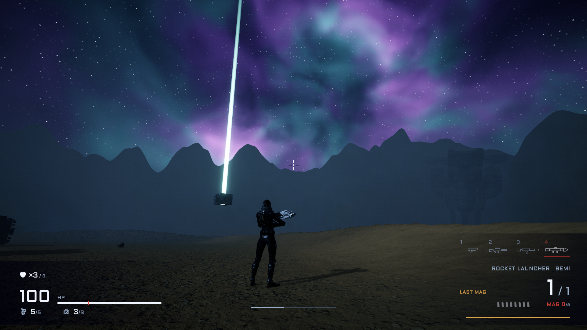\</p\> \<p\>플레이어 기준 20\~60m 둘레에서 후보 지점을 뽑고, 위에서 아래로 광선을 쏴 맞은 지면을 아래 다섯 검사에 통과시킵니다. 하나라도 걸리면 그 후보는 버리고 다시 뽑습니다(최대 30번).\</p\> \<figure class="mmd" data-label="다이어그램 5"\>\<div class="mermaid" id="mmd-4" data-processed="true"\>\<svg id="mermaid-1795405126412" width="1771" xmlns="http\://www\.w3.org/2000/svg" xmlns:xlink="http\://www\.w3.org/1999/xlink" class="flowchart" style="max-width: 100%;" viewBox="4 4 1770.390625 404.6614685058594" role="img" aria-roledescription="flowchart-v2" data-natural-width="1770.390625" aria-label="다이어그램 5"\>\<style\>\#mermaid-1795405126412{font-family:Pretendard,sans-serif;font-size:16px;fill:\#000000;}\#mermaid-1795405126412 .error-icon{fill:\#552222;}\#mermaid-1795405126412 .error-text{fill:\#552222;stroke:\#552222;}\#mermaid-1795405126412 .edge-thickness-normal{stroke-width:1px;}\#mermaid-1795405126412 .edge-thickness-thick{stroke-width:3.5px;}\#mermaid-1795405126412 .edge-pattern-solid{stroke-dasharray:0;}\#mermaid-1795405126412 .edge-thickness-invisible{stroke-width:0;fill:none;}\#mermaid-1795405126412 .edge-pattern-dashed{stroke-dasharray:3;}\#mermaid-1795405126412 .edge-pattern-dotted{stroke-dasharray:2;}\#mermaid-1795405126412 .marker{fill:\#666;stroke:\#666;}\#mermaid-1795405126412 .marker.cross{stroke:\#666;}\#mermaid-1795405126412 svg{font-family:Pretendard,sans-serif;font-size:16px;}\#mermaid-1795405126412 p{margin:0;}\#mermaid-1795405126412 .label{font-family:Pretendard,sans-serif;color:\#000000;}\#mermaid-1795405126412 .cluster-label text{fill:\#333;}\#mermaid-1795405126412 .cluster-label span{color:\#333;}\#mermaid-1795405126412 .cluster-label span p{background-color:transparent;}\#mermaid-1795405126412 .label text,\#mermaid-1795405126412 span{fill:\#000000;color:\#000000;}\#mermaid-1795405126412 .node rect,\#mermaid-1795405126412 .node circle,\#mermaid-1795405126412 .node ellipse,\#mermaid-1795405126412 .node polygon,\#mermaid-1795405126412 .node path{fill:\#eee;stroke:\#999;stroke-width:1px;}\#mermaid-1795405126412 .rough-node .label text,\#mermaid-1795405126412 .node .label text,\#mermaid-1795405126412 .image-shape .label,\#mermaid-1795405126412 .icon-shape .label{text-anchor:middle;}\#mermaid-1795405126412 .node .katex path{fill:\#000;stroke:\#000;stroke-width:1px;}\#mermaid-1795405126412 .rough-node .label,\#mermaid-1795405126412 .node .label,\#mermaid-1795405126412 .image-shape .label,\#mermaid-1795405126412 .icon-shape .label{text-align:center;}\#mermaid-1795405126412 .node.clickable{cursor:pointer;}\#mermaid-1795405126412 .root .anchor path{fill:\#666\!important;stroke-width:0;stroke:\#666;}\#mermaid-1795405126412 .arrowheadPath{fill:\#333333;}\#mermaid-1795405126412 .edgePath .path{stroke:\#666;stroke-width:2.0px;}\#mermaid-1795405126412 .flowchart-link{stroke:\#666;fill:none;}\#mermaid-1795405126412 .edgeLabel{background-color:white;text-align:center;}\#mermaid-1795405126412 .edgeLabel p{background-color:white;}\#mermaid-1795405126412 .edgeLabel rect{opacity:0.5;background-color:white;fill:white;}\#mermaid-1795405126412 .labelBkg{background-color:rgba(255, 255, 255, 0.5);}\#mermaid-1795405126412 .cluster rect{fill:hsl(0, 0%, 98.9215686275%);stroke:\#707070;stroke-width:1px;}\#mermaid-1795405126412 .cluster text{fill:\#333;}\#mermaid-1795405126412 .cluster span{color:\#333;}\#mermaid-1795405126412 div.mermaidTooltip{position:absolute;text-align:center;max-width:200px;padding:2px;font-family:Pretendard,sans-serif;font-size:12px;background:hsl(-160, 0%, 93.3333333333%);border:1px solid \#707070;border-radius:2px;pointer-events:none;z-index:100;}\#mermaid-1795405126412 .flowchartTitleText{text-anchor:middle;font-size:18px;fill:\#000000;}\#mermaid-1795405126412 rect.text{fill:none;stroke-width:0;}\#mermaid-1795405126412 .icon-shape,\#mermaid-1795405126412 .image-shape{background-color:white;text-align:center;}\#mermaid-1795405126412 .icon-shape p,\#mermaid-1795405126412 .image-shape p{background-color:white;padding:2px;}\#mermaid-1795405126412 .icon-shape rect,\#mermaid-1795405126412 .image-shape rect{opacity:0.5;background-color:white;fill:white;}\#mermaid-1795405126412 :root{--mermaid-font-family:Pretendard,sans-serif;}\</style\>\<g\>\<marker id="mermaid-1795405126412\_flowchart-v2-pointEnd" class="marker flowchart-v2" viewBox="0 0 10 10" refX="5" refY="5" markerUnits="userSpaceOnUse" markerWidth="8" markerHeight="8" orient="auto"\>\<path d="M 0 0 L 10 5 L 0 10 z" class="arrowMarkerPath" style="stroke-width: 1; stroke-dasharray: 1, 0;"\>\</path\>\</marker\>\<marker id="mermaid-1795405126412\_flowchart-v2-pointStart" class="marker flowchart-v2" viewBox="0 0 10 10" refX="4.5" refY="5" markerUnits="userSpaceOnUse" markerWidth="8" markerHeight="8" orient="auto"\>\<path d="M 0 5 L 10 10 L 10 0 z" class="arrowMarkerPath" style="stroke-width: 1; stroke-dasharray: 1, 0;"\>\</path\>\</marker\>\<marker id="mermaid-1795405126412\_flowchart-v2-circleEnd" class="marker flowchart-v2" viewBox="0 0 10 10" refX="11" refY="5" markerUnits="userSpaceOnUse" markerWidth="11" markerHeight="11" orient="auto"\>\<circle cx="5" cy="5" r="5" class="arrowMarkerPath" style="stroke-width: 1; stroke-dasharray: 1, 0;"\>\</circle\>\</marker\>\<marker id="mermaid-1795405126412\_flowchart-v2-circleStart" class="marker flowchart-v2" viewBox="0 0 10 10" refX="-1" refY="5" markerUnits="userSpaceOnUse" markerWidth="11" markerHeight="11" orient="auto"\>\<circle cx="5" cy="5" r="5" class="arrowMarkerPath" style="stroke-width: 1; stroke-dasharray: 1, 0;"\>\</circle\>\</marker\>\<marker id="mermaid-1795405126412\_flowchart-v2-crossEnd" class="marker cross flowchart-v2" viewBox="0 0 11 11" refX="12" refY="5.2" markerUnits="userSpaceOnUse" markerWidth="11" markerHeight="11" orient="auto"\>\<path d="M 1,1 l 9,9 M 10,1 l \-9,9" class="arrowMarkerPath" style="stroke-width: 2; stroke-dasharray: 1, 0;"\>\</path\>\</marker\>\<marker id="mermaid-1795405126412\_flowchart-v2-crossStart" class="marker cross flowchart-v2" viewBox="0 0 11 11" refX="-1" refY="5.2" markerUnits="userSpaceOnUse" markerWidth="11" markerHeight="11" orient="auto"\>\<path d="M 1,1 l 9,9 M 10,1 l \-9,9" class="arrowMarkerPath" style="stroke-width: 2; stroke-dasharray: 1, 0;"\>\</path\>\</marker\>\</g\>\<g class="subgraphs"\>\</g\>\<g class="nodes"\>\<g class="node default " id="flowchart-C-40" transform="translate(94.109375, 105.4765625)"\>\<rect class="basic label-container" style="" x="-82.109375" y="-39" width="164.21875" height="78"\>\</rect\>\<g class="label" style="" transform="translate(-52.109375, \-24)"\>\<rect\>\</rect\>\<foreignObject width="104.21875" height="48"\>\<div xmlns="http\://www\.w3.org/1999/xhtml" style="display: table-cell; white-space: nowrap; line-height: 1.5; max-width: 200px; text-align: center;"\>\<span class="nodeLabel "\>\<p\>후보 지점\<br\>(20\~60m 둘레)\</p\>\</span\>\</div\>\</foreignObject\>\</g\>\</g\>\<g class="node default " id="flowchart-K1-41" transform="translate(304.6953125, 105.4765625)"\>\<polygon points="93.4765625,0 186.953125,-93.4765625 93.4765625,-186.953125 0,-93.4765625" class="label-container" transform="translate(-93.4765625,93.4765625)"\>\</polygon\>\<g class="label" style="" transform="translate(-54.4765625, \-24)"\>\<rect\>\</rect\>\<foreignObject width="108.953125" height="48"\>\<div xmlns="http\://www\.w3.org/1999/xhtml" style="display: table-cell; white-space: nowrap; line-height: 1.5; max-width: 200px; text-align: center;"\>\<span class="nodeLabel "\>\<p\>① 처음 맞은 것이\<br\>Ground인가\</p\>\</span\>\</div\>\</foreignObject\>\</g\>\</g\>\<g class="node default " id="flowchart-K2-43" transform="translate(567.125, 269.0625)"\>\<polygon points="85.125,0 170.25,-85.125 85.125,-170.25 0,-85.125" class="label-container" transform="translate(-85.125,85.125)"\>\</polygon\>\<g class="label" style="" transform="translate(-46.125, \-24)"\>\<rect\>\</rect\>\<foreignObject width="92.25" height="48"\>\<div xmlns="http\://www\.w3.org/1999/xhtml" style="display: table-cell; white-space: nowrap; line-height: 1.5; max-width: 200px; text-align: center;"\>\<span class="nodeLabel "\>\<p\>② 플레이어 발\<br\>+5m 이하인가\</p\>\</span\>\</div\>\</foreignObject\>\</g\>\</g\>\<g class="node default " id="flowchart-K3-45" transform="translate(817.6328125, 240.68750000000003)"\>\<polygon points="81.5546875,0 163.109375,-81.5546875 81.5546875,-163.109375 0,-81.5546875" class="label-container" transform="translate(-81.5546875,81.5546875)"\>\</polygon\>\<g class="label" style="" transform="translate(-42.5546875, \-24)"\>\<rect\>\</rect\>\<foreignObject width="85.109375" height="48"\>\<div xmlns="http\://www\.w3.org/1999/xhtml" style="display: table-cell; white-space: nowrap; line-height: 1.5; max-width: 200px; text-align: center;"\>\<span class="nodeLabel "\>\<p\>③ 경사\<br\>25° 이하인가\</p\>\</span\>\</div\>\</foreignObject\>\</g\>\</g\>\<g class="node default " id="flowchart-K4-47" transform="translate(1092.4609375, 213.50260416666669)"\>\<polygon points="81.7890625,0 163.578125,-81.7890625 81.7890625,-163.578125 0,-81.7890625" class="label-container" transform="translate(-81.7890625,81.7890625)"\>\</polygon\>\<g class="label" style="" transform="translate(-42.7890625, \-24)"\>\<rect\>\</rect\>\<foreignObject width="85.578125" height="48"\>\<div xmlns="http\://www\.w3.org/1999/xhtml" style="display: table-cell; white-space: nowrap; line-height: 1.5; max-width: 200px; text-align: center;"\>\<span class="nodeLabel "\>\<p\>④ NavMesh\<br\>위인가\</p\>\</span\>\</div\>\</foreignObject\>\</g\>\</g\>\<g class="node default " id="flowchart-K5-49" transform="translate(1379.15625, 186.23958333333334)"\>\<polygon points="93.421875,0 186.84375,-93.421875 93.421875,-186.84375 0,-93.421875" class="label-container" transform="translate(-93.421875,93.421875)"\>\</polygon\>\<g class="label" style="" transform="translate(-54.421875, \-24)"\>\<rect\>\</rect\>\<foreignObject width="108.84375" height="48"\>\<div xmlns="http\://www\.w3.org/1999/xhtml" style="display: table-cell; white-space: nowrap; line-height: 1.5; max-width: 200px; text-align: center;"\>\<span class="nodeLabel "\>\<p\>⑤ 플레이어가\<br\>걸어서 갈 수 있나\</p\>\</span\>\</div\>\</foreignObject\>\</g\>\</g\>\<g class="node default " id="flowchart-OK-51" transform="translate(1645.390625, 155.09895833333334)"\>\<rect class="basic label-container" style="" x="-43.828125" y="-27" width="87.65625" height="54"\>\</rect\>\<g class="label" style="" transform="translate(-13.828125, \-12)"\>\<rect\>\</rect\>\<foreignObject width="27.65625" height="24"\>\<div xmlns="http\://www\.w3.org/1999/xhtml" style="display: table-cell; white-space: nowrap; line-height: 1.5; max-width: 200px; text-align: center;"\>\<span class="nodeLabel "\>\<p\>투하\</p\>\</span\>\</div\>\</foreignObject\>\</g\>\</g\>\<g class="node default " id="flowchart-R-57" transform="translate(1683.9765625, 327.16145833333337)"\>\<rect class="basic label-container" style="" x="-82.4140625" y="-39" width="164.828125" height="78"\>\</rect\>\<g class="label" style="" transform="translate(-52.4140625, \-24)"\>\<rect\>\</rect\>\<foreignObject width="104.828125" height="48"\>\<div xmlns="http\://www\.w3.org/1999/xhtml" style="display: table-cell; white-space: nowrap; line-height: 1.5; max-width: 200px; text-align: center;"\>\<span class="nodeLabel "\>\<p\>버리고 다시 뽑기\<br\>(탈락 사유를 셈)\</p\>\</span\>\</div\>\</foreignObject\>\</g\>\</g\>\</g\>\<g class="edges edgePaths"\>\<path d="M176.219,105.477L207.219,105.477" id="L\_C\_K1\_0\_0" class=" edge-thickness-normal edge-pattern-solid edge-thickness-normal edge-pattern-solid flowchart-link" style="" marker-end="url(\#mermaid-1795405126412\_flowchart-v2-pointEnd)"\>\</path\>\<path d="M375.303,129.346L379.114,130.561C382.926,131.776,390.549,134.206,396.444,135.42C402.339,136.635,406.505,136.635,409.06,136.997C411.615,137.359,412.557,138.083,413.391,138.916C414.224,139.75,414.948,140.693,415.31,161.569C415.672,182.444,415.672,223.253,416.034,244.129C416.396,265.005,417.12,265.948,417.953,266.781C418.786,267.615,419.729,268.339,429.755,268.701C439.781,269.063,458.891,269.063,468.445,269.063L478,269.063" id="L\_K1\_K2\_1\_0" class=" edge-thickness-normal edge-pattern-solid edge-thickness-normal edge-pattern-solid flowchart-link" style="" marker-end="url(\#mermaid-1795405126412\_flowchart-v2-pointEnd)"\>\</path\>\<path d="M631.469,248.281L634.932,247.016C638.396,245.75,645.323,243.219,662.091,241.953C678.859,240.688,705.469,240.688,718.773,240.688L732.078,240.688" id="L\_K2\_K3\_2\_0" class=" edge-thickness-normal edge-pattern-solid edge-thickness-normal edge-pattern-solid flowchart-link" style="" marker-end="url(\#mermaid-1795405126412\_flowchart-v2-pointEnd)"\>\</path\>\<path d="M879.299,220.799L882.614,219.583C885.928,218.367,892.558,215.935,913.787,214.719C935.016,213.503,970.844,213.503,988.758,213.503L1006.672,213.503" id="L\_K3\_K4\_3\_0" class=" edge-thickness-normal edge-pattern-solid edge-thickness-normal edge-pattern-solid flowchart-link" style="" marker-end="url(\#mermaid-1795405126412\_flowchart-v2-pointEnd)"\>\</path\>\<path d="M1154.303,193.555L1157.627,192.336C1160.952,191.117,1167.601,188.678,1188.84,187.459C1210.078,186.24,1245.906,186.24,1263.82,186.24L1281.734,186.24" id="L\_K4\_K5\_4\_0" class=" edge-thickness-normal edge-pattern-solid edge-thickness-normal edge-pattern-solid flowchart-link" style="" marker-end="url(\#mermaid-1795405126412\_flowchart-v2-pointEnd)"\>\</path\>\<path d="M1449.723,163.384L1453.532,162.003C1457.341,160.622,1464.96,157.861,1489.6,156.48C1514.24,155.099,1555.901,155.099,1576.732,155.099L1597.563,155.099" id="L\_K5\_OK\_5\_0" class=" edge-thickness-normal edge-pattern-solid edge-thickness-normal edge-pattern-solid flowchart-link" style="" marker-end="url(\#mermaid-1795405126412\_flowchart-v2-pointEnd)"\>\</path\>\<path d="M375.303,82.607L379.114,81.226C382.926,79.844,390.549,77.081,401.346,75.699C412.143,74.318,426.115,74.318,454.273,74.318C482.432,74.318,524.779,74.318,567.125,74.318C609.471,74.318,651.818,74.318,693.569,74.318C735.32,74.318,776.477,74.318,842.859,74.318C909.242,74.318,1000.852,74.318,1069.578,74.318C1138.305,74.318,1184.148,74.318,1231.931,74.318C1279.714,74.318,1329.435,74.318,1379.156,74.318C1428.878,74.318,1478.599,74.318,1511.917,74.318C1545.234,74.318,1562.148,74.318,1571.077,74.68C1580.005,75.042,1580.948,75.765,1581.781,76.599C1582.615,77.432,1583.339,78.375,1583.701,114.987C1584.063,151.599,1584.063,223.88,1584.424,260.492C1584.786,297.104,1585.51,298.047,1586.344,298.88C1587.177,299.714,1588.12,300.438,1590.008,300.8C1591.896,301.161,1594.729,301.161,1596.146,301.161L1597.563,301.161" id="L\_K1\_R\_6\_0" class=" edge-thickness-normal edge-pattern-solid edge-thickness-normal edge-pattern-solid flowchart-link" style="" marker-end="url(\#mermaid-1795405126412\_flowchart-v2-pointEnd)"\>\</path\>\<path d="M631.469,290.844L634.932,291.943C638.396,293.042,645.323,295.24,650.87,296.339C656.417,297.438,660.583,297.438,663.138,297.799C665.693,298.161,666.636,298.885,667.469,299.719C668.302,300.552,669.026,301.495,669.388,315.587C669.75,329.679,669.75,356.92,670.112,371.012C670.474,385.104,671.198,386.047,672.031,386.88C672.864,387.714,673.807,388.438,677.514,388.8C681.221,389.161,687.693,389.161,711.507,389.161C735.32,389.161,776.477,389.161,819.938,389.161C863.398,389.161,909.164,389.161,977.891,389.161C1046.617,389.161,1138.305,389.161,1209.009,389.161C1279.714,389.161,1329.435,389.161,1379.156,389.161C1428.878,389.161,1478.599,389.161,1511.917,389.161C1545.234,389.161,1562.148,389.161,1571.077,388.8C1580.005,388.438,1580.948,387.714,1581.781,386.88C1582.615,386.047,1583.339,385.104,1583.701,380.3C1584.063,375.495,1584.063,366.828,1584.424,362.023C1584.786,357.219,1585.51,356.276,1586.344,355.443C1587.177,354.609,1588.12,353.885,1590.008,353.523C1591.896,353.161,1594.729,353.161,1596.146,353.161L1597.563,353.161" id="L\_K2\_R\_7\_0" class=" edge-thickness-normal edge-pattern-solid edge-thickness-normal edge-pattern-solid flowchart-link" style="" marker-end="url(\#mermaid-1795405126412\_flowchart-v2-pointEnd)"\>\</path\>\<path d="M879.299,261.576L882.614,262.626C885.928,263.675,892.558,265.774,897.956,266.823C903.354,267.872,907.521,267.872,910.076,268.234C912.63,268.596,913.573,269.32,914.406,270.153C915.24,270.987,915.964,271.93,916.326,285.783C916.688,299.635,916.688,326.398,917.049,340.251C917.411,354.104,918.135,355.047,918.969,355.88C919.802,356.714,920.745,357.438,926.756,357.8C932.768,358.161,943.849,358.161,972.311,358.161C1000.773,358.161,1046.617,358.161,1117.322,358.161C1188.026,358.161,1283.591,358.161,1356.234,358.161C1428.878,358.161,1478.599,358.161,1509,358.161C1539.401,358.161,1550.482,358.161,1556.494,357.8C1562.505,357.438,1563.448,356.714,1564.281,355.88C1565.115,355.047,1565.839,354.104,1566.201,352.3C1566.563,350.495,1566.563,347.828,1566.924,346.023C1567.286,344.219,1568.01,343.276,1568.844,342.443C1569.677,341.609,1570.62,340.885,1575.424,340.523C1580.229,340.161,1588.896,340.161,1593.229,340.161L1597.563,340.161" id="L\_K3\_R\_8\_0" class=" edge-thickness-normal edge-pattern-solid edge-thickness-normal edge-pattern-solid flowchart-link" style="" marker-end="url(\#mermaid-1795405126412\_flowchart-v2-pointEnd)"\>\</path\>\<path d="M1154.303,234.45L1157.627,235.502C1160.952,236.555,1167.601,238.66,1173.009,239.713C1178.417,240.766,1182.583,240.766,1185.138,241.128C1187.693,241.489,1188.636,242.213,1189.469,243.047C1190.302,243.88,1191.026,244.823,1191.388,258.027C1191.75,271.231,1191.75,296.696,1192.112,309.9C1192.474,323.104,1193.198,324.047,1194.031,324.88C1194.864,325.714,1195.807,326.438,1201.819,326.8C1207.831,327.161,1218.911,327.161,1274.173,327.161C1329.435,327.161,1428.878,327.161,1490.139,327.161C1551.401,327.161,1574.482,327.161,1586.022,327.161L1597.563,327.161" id="L\_K4\_R\_9\_0" class=" edge-thickness-normal edge-pattern-solid edge-thickness-normal edge-pattern-solid flowchart-link" style="" marker-end="url(\#mermaid-1795405126412\_flowchart-v2-pointEnd)"\>\</path\>\<path d="M1449.723,210.095L1453.532,211.309C1457.341,212.523,1464.96,214.952,1483.6,216.166C1502.24,217.38,1531.901,217.38,1547.203,217.742C1562.505,218.104,1563.448,218.828,1564.281,219.661C1565.115,220.495,1565.839,221.437,1566.201,236.372C1566.563,251.307,1566.563,280.234,1566.924,295.169C1567.286,310.104,1568.01,311.047,1568.844,311.88C1569.677,312.714,1570.62,313.438,1575.424,313.8C1580.229,314.161,1588.896,314.161,1593.229,314.161L1597.563,314.161" id="L\_K5\_R\_10\_0" class=" edge-thickness-normal edge-pattern-solid edge-thickness-normal edge-pattern-solid flowchart-link" style="" marker-end="url(\#mermaid-1795405126412\_flowchart-v2-pointEnd)"\>\</path\>\</g\>\<g class="edgeLabels"\>\<g class="edgeLabel"\>\<g class="label" transform="translate(0, 0)"\>\<foreignObject width="0" height="0"\>\<div xmlns="http\://www\.w3.org/1999/xhtml" class="labelBkg" style="display: table-cell; white-space: nowrap; line-height: 1.5; max-width: 200px; text-align: center;"\>\<span class="edgeLabel "\>\</span\>\</div\>\</foreignObject\>\</g\>\</g\>\<g class="edgeLabel" transform="translate(440.0859375, 268.5625)"\>\<g class="label" transform="translate(-6.9140625, \-12)"\>\<foreignObject width="13.828125" height="24"\>\<div xmlns="http\://www\.w3.org/1999/xhtml" class="labelBkg" style="display: table-cell; white-space: nowrap; line-height: 1.5; max-width: 200px; text-align: center;"\>\<span class="edgeLabel "\>\<p\>예\</p\>\</span\>\</div\>\</foreignObject\>\</g\>\</g\>\<g class="edgeLabel" transform="translate(694.1640625, 240.18750000000003)"\>\<g class="label" transform="translate(-6.9140625, \-12)"\>\<foreignObject width="13.828125" height="24"\>\<div xmlns="http\://www\.w3.org/1999/xhtml" class="labelBkg" style="display: table-cell; white-space: nowrap; line-height: 1.5; max-width: 200px; text-align: center;"\>\<span class="edgeLabel "\>\<p\>예\</p\>\</span\>\</div\>\</foreignObject\>\</g\>\</g\>\<g class="edgeLabel" transform="translate(954.9296875, 213.00260416666669)"\>\<g class="label" transform="translate(-6.9140625, \-12)"\>\<foreignObject width="13.828125" height="24"\>\<div xmlns="http\://www\.w3.org/1999/xhtml" class="labelBkg" style="display: table-cell; white-space: nowrap; line-height: 1.5; max-width: 200px; text-align: center;"\>\<span class="edgeLabel "\>\<p\>예\</p\>\</span\>\</div\>\</foreignObject\>\</g\>\</g\>\<g class="edgeLabel" transform="translate(1229.9921875, 185.73958333333334)"\>\<g class="label" transform="translate(-6.9140625, \-12)"\>\<foreignObject width="13.828125" height="24"\>\<div xmlns="http\://www\.w3.org/1999/xhtml" class="labelBkg" style="display: table-cell; white-space: nowrap; line-height: 1.5; max-width: 200px; text-align: center;"\>\<span class="edgeLabel "\>\<p\>예\</p\>\</span\>\</div\>\</foreignObject\>\</g\>\</g\>\<g class="edgeLabel" transform="translate(1528.3203125, 154.59895833333334)"\>\<g class="label" transform="translate(-6.9140625, \-12)"\>\<foreignObject width="13.828125" height="24"\>\<div xmlns="http\://www\.w3.org/1999/xhtml" class="labelBkg" style="display: table-cell; white-space: nowrap; line-height: 1.5; max-width: 200px; text-align: center;"\>\<span class="edgeLabel "\>\<p\>예\</p\>\</span\>\</div\>\</foreignObject\>\</g\>\</g\>\<g class="edgeLabel" transform="translate(954.9296875, 73.81770833333334)"\>\<g class="label" transform="translate(-20.7421875, \-12)"\>\<foreignObject width="41.484375" height="24"\>\<div xmlns="http\://www\.w3.org/1999/xhtml" class="labelBkg" style="display: table-cell; white-space: nowrap; line-height: 1.5; max-width: 200px; text-align: center;"\>\<span class="edgeLabel "\>\<p\>아니오\</p\>\</span\>\</div\>\</foreignObject\>\</g\>\</g\>\<g class="edgeLabel" transform="translate(1092.4609375, 388.66145833333337)"\>\<g class="label" transform="translate(-20.7421875, \-12)"\>\<foreignObject width="41.484375" height="24"\>\<div xmlns="http\://www\.w3.org/1999/xhtml" class="labelBkg" style="display: table-cell; white-space: nowrap; line-height: 1.5; max-width: 200px; text-align: center;"\>\<span class="edgeLabel "\>\<p\>아니오\</p\>\</span\>\</div\>\</foreignObject\>\</g\>\</g\>\<g class="edgeLabel" transform="translate(1229.9921875, 357.66145833333337)"\>\<g class="label" transform="translate(-20.7421875, \-12)"\>\<foreignObject width="41.484375" height="24"\>\<div xmlns="http\://www\.w3.org/1999/xhtml" class="labelBkg" style="display: table-cell; white-space: nowrap; line-height: 1.5; max-width: 200px; text-align: center;"\>\<span class="edgeLabel "\>\<p\>아니오\</p\>\</span\>\</div\>\</foreignObject\>\</g\>\</g\>\<g class="edgeLabel" transform="translate(1379.15625, 326.66145833333337)"\>\<g class="label" transform="translate(-20.7421875, \-12)"\>\<foreignObject width="41.484375" height="24"\>\<div xmlns="http\://www\.w3.org/1999/xhtml" class="labelBkg" style="display: table-cell; white-space: nowrap; line-height: 1.5; max-width: 200px; text-align: center;"\>\<span class="edgeLabel "\>\<p\>아니오\</p\>\</span\>\</div\>\</foreignObject\>\</g\>\</g\>\<g class="edgeLabel" transform="translate(1528.3203125, 216.88020833333334)"\>\<g class="label" transform="translate(-20.7421875, \-12)"\>\<foreignObject width="41.484375" height="24"\>\<div xmlns="http\://www\.w3.org/1999/xhtml" class="labelBkg" style="display: table-cell; white-space: nowrap; line-height: 1.5; max-width: 200px; text-align: center;"\>\<span class="edgeLabel "\>\<p\>아니오\</p\>\</span\>\</div\>\</foreignObject\>\</g\>\</g\>\</g\>\</svg\>\</div\>\<div class="mmd-bar"\>\<details class="mmd-src"\>\<summary\>다이어그램 원문\</summary\>\<pre\>\<code\>%%{init: {"layout": "elk"}}%% flowchart LR C\["후보 지점\<br/\>(20\~60m 둘레)"\] \--\> K1{"① 처음 맞은 것이\<br/\>Ground인가"} K1 \--\>\|예\| K2{"② 플레이어 발\<br/\>+5m 이하인가"} K2 \--\>\|예\| K3{"③ 경사\<br/\>25° 이하인가"} K3 \--\>\|예\| K4{"④ NavMesh\<br/\>위인가"} K4 \--\>\|예\| K5{"⑤ 플레이어가\<br/\>걸어서 갈 수 있나"} K5 \--\>\|예\| OK\["투하"\] K1 & K2 & K3 & K4 & K5 \--\>\|아니오\| R\["버리고 다시 뽑기\<br/\>(탈락 사유를 셈)"\] \</code\>\</pre\>\</details\>\<button type="button" class="mmd-zoom"\>크게 보기\</button\>\</div\>\</figure\> \<div class="table-wrap" role="region" tabindex="0" aria-label="표 11"\>\<table\> \<thead\> \<tr\> \<th\>검사\</th\> \<th\>막는 문제\</th\> \<th\>어디서 나왔나\</th\> \</tr\> \</thead\> \<tbody\>\<tr\> \<td\>① 처음 맞은 것이 Ground\</td\> \<td\>지붕·바위·나무 위\</td\> \<td\>제가 낸 A안과 비교해 고른 B안 (6-1)\</td\> \</tr\> \<tr\> \<td\>② 플레이어 발 \+5m 이하\</td\> \<td\>높은 건물·언덕 위\</td\> \<td\>플레이 피드백으로 기준을 지형 높이 → 플레이어 발 높이로 바꿈\</td\> \</tr\> \<tr\> \<td\>③ 경사 25° 이하\</td\> \<td\>상자가 비탈에 묻힘\</td\> \<td\>—\</td\> \</tr\> \<tr\> \<td\>④ NavMesh 위\</td\> \<td\>맵 밖·고립된 지붕\</td\> \<td\>2차 피드백 뒤 추가 (6-1)\</td\> \</tr\> \<tr\> \<td\>⑤ 걸어서 갈 수 있음\</td\> \<td\>구덩이 속·절벽 위\</td\> \<td\>2차 피드백 뒤 추가 (6-1)\</td\> \</tr\> \</tbody\>\</table\>\</div\> \<ul\> \<li\>\<strong\>길 찾기를 맨 마지막에 둔 이유\</strong\>: \<code\>CalculatePath\</code\>는 실제로 길을 계산하므로 다섯 검사 중 가장 비쌉니다. 레이어·높이·경사는 숫자 비교 한 번이면 됩니다. 값싼 검사로 먼저 거르면 비싼 길 찾기는 살아남은 후보 몇 개만 받으므로, 보급이 늦어지지 않습니다.\</li\> \<li\>\<strong\>실패 사유를 종류별로 세는 이유\</strong\>: 플레이 테스트 중에는 어떤 상자가 왜 실패했는지 눈으로 확인하기 어려워, 사유별 횟수를 경고로 남겼습니다(8-2 ④).\</li\> \<li\>\<strong\>④⑤를 건너뛰는 경우\</strong\>: 플레이어가 NavMesh 위에 없으면 "걸어서 갈 수 있는지"를 따질 수 없어서 NavMesh 검사를 통째로 건너뜁니다. NavMesh를 굽지 않은 테스트 씬에서 이 검사를 하면 모든 후보가 탈락해 보급이 하나도 떨어지지 않기 때문입니다.\</li\> \</ul\> \<h3 id="5-3-지금-필요한-보급이-더-잘-나온다--상황에-따라-바뀌는-확률"\>5-3. 지금 필요한 보급이 더 잘 나온다 — 상황에 따라 바뀌는 확률\</h3\> \<p\>플레이어는 수많은 적과 보스를 상대해야 해서, 보급 상자는 플레이어의 생사를 가르는 중요한 시스템입니다. 확률을 바꾸기 전에는 정해진 확률대로 무작위로 떨어뜨렸고, 플레이 테스트 중 정작 필요한 순간에 필요한 보급을 받지 못하는 상황을 겪었습니다. 이를 개선하려고 플레이어가 가진 아이템 상황에 따라 확률이 바뀌도록 바꿨습니다.\</p\> \<p\>최종 가중치 \= \<strong\>테이블 기본 Weight × 상황 배율\</strong\>\</p\> \<div class="table-wrap" role="region" tabindex="0" aria-label="표 12"\>\<table\> \<thead\> \<tr\> \<th\>상자\</th\> \<th\>배율\</th\> \</tr\> \</thead\> \<tbody\>\<tr\> \<td\>수류탄·회복 팩\</td\> \<td\>보유량이 0개면 ×2.0, 가득이면 ×0.25 (사이는 선형)\</td\> \</tr\> \<tr\> \<td\>무기 상자\</td\> \<td\>몬스터 급증(최근 10초 12마리 이상 소환) ×2.5, 보급 무기 소진 ×2.5, 상한 ×4. 이미 들고 있으면 나오지 않음\</td\> \</tr\> \</tbody\>\</table\>\</div\> \<div class="table-wrap" role="region" tabindex="0" aria-label="표 13"\>\<table\> \<thead\> \<tr\> \<th\>상황 (기본 40/40/10/10, 설계 문서의 계산값)\</th\> \<th\>수류탄\</th\> \<th\>회복\</th\> \<th\>로켓\</th\> \<th\>유탄\</th\> \</tr\> \</thead\> \<tbody\>\<tr\> \<td\>평소 (둘 다 절반 보유)\</td\> \<td\>41%\</td\> \<td\>41%\</td\> \<td\>9%\</td\> \<td\>9%\</td\> \</tr\> \<tr\> \<td\>수류탄 0 · 회복 가득\</td\> \<td\>73%\</td\> \<td\>9%\</td\> \<td\>9%\</td\> \<td\>9%\</td\> \</tr\> \<tr\> \<td\>급증 \+ 무기 소진\</td\> \<td\>26%\</td\> \<td\>26%\</td\> \<td\>24%\</td\> \<td\>24%\</td\> \</tr\> \</tbody\>\</table\>\</div\> \<p\>배율 숫자(가득일 때 0.25 등)와 ConfigTable에 둔 구조는 AI가 정한 초기값입니다. 저는 투하 확률 로그(\<code\>\[SupplyDropper\] 투하 확률: …\</code\>)로 수류탄이 0개일 때 수류탄 상자가 자주 나오는 것을 확인했습니다.\</p\> \<h3 id="5-4-사운드-표의-키만-넘기면-소리가-난다--사운드-사용법"\>5-4. 사운드 표의 키만 넘기면 소리가 난다 — 사운드 사용법\</h3\> \<p\>다른 파트는 소리 서비스(\<code\>ISoundService\</code\>)에 \<strong\>사운드 표(\<code\>SoundTable.tsv\</code\>)의 키\</strong\>만 넘기면 됩니다.\</p\> \<div class="table-wrap" role="region" tabindex="0" aria-label="표 14"\>\<table\> \<thead\> \<tr\> \<th\>하고 싶은 것\</th\> \<th\>방법\</th\> \</tr\> \</thead\> \<tbody\>\<tr\> \<td\>효과음 한 번\</td\> \<td\>키로 재생. 위치를 주면 3D, 안 주면 2D\</td\> \</tr\> \<tr\> \<td\>따라다니는 반복음\</td\> \<td\>키와 따라갈 대상을 주고 재생, 끝나면 정지\</td\> \</tr\> \<tr\> \<td\>배경음 바꾸기\</td\> \<td\>곡 키로 재생\</td\> \</tr\> \<tr\> \<td\>잠깐 다른 소리 줄이기\</td\> \<td\>종류별로 음량을 낮춤 (예: 보스 경고 동안 몬스터 소리)\</td\> \</tr\> \<tr\> \<td\>새 몬스터에 소리 붙이기\</td\> \<td\>\<strong\>코드 수정 없이\</strong\> 몬스터 표(\<code\>MonsterTable\</code\>)의 사운드 키 열만 채움 (5-5)\</td\> \</tr\> \</tbody\>\</table\>\</div\> \<h3 id="5-5-새-몬스터도-표만-채우면-소리가-난다--다른-파트-코드를-고치지-않고-소리-붙이기"\>5-5. 새 몬스터도 표만 채우면 소리가 난다 — 다른 파트 코드를 고치지 않고 소리 붙이기\</h3\> \<p\>AI와 협업할 때 생기는 문제 중 하나는, AI가 작업하다가 다른 파트 담당자의 코드까지 바꿔 버리는 것입니다. 이를 막으려고 소리를 코드가 아니라 TSV 표로 관리하도록 설계했습니다.\</p\> \<p\>몬스터 프리팹은 홍산 님 담당이라, 프리팹에 사운드 컴포넌트를 미리 붙여 두지 않았습니다. 몬스터가 생기면 Router가 이미터를 붙이고, 이미터는 몬스터가 Core 계약(\<code\>IMonsterSoundSource\</code\>)으로 알려 주는 \<strong\>지역 이벤트\</strong\>만 듣습니다.\</p\> \<p\>\<strong\>몬스터는 어디서 생기나 — 몬스터 파트의 소환 구조\</strong\> (홍산 님 담당 코드)\</p\> \<figure class="mmd" data-label="다이어그램 6"\>\<div class="mermaid" id="mmd-5" data-processed="true"\>\<svg id="mermaid-1795405126451" width="475" xmlns="http\://www\.w3.org/2000/svg" xmlns:xlink="http\://www\.w3.org/1999/xlink" class="flowchart" style="max-width: 100%;" viewBox="4 4 474.3828125 1272" role="img" aria-roledescription="flowchart-v2" data-natural-width="474.3828125" aria-label="다이어그램 6"\>\<style\>\#mermaid-1795405126451{font-family:Pretendard,sans-serif;font-size:16px;fill:\#000000;}\#mermaid-1795405126451 .error-icon{fill:\#552222;}\#mermaid-1795405126451 .error-text{fill:\#552222;stroke:\#552222;}\#mermaid-1795405126451 .edge-thickness-normal{stroke-width:1px;}\#mermaid-1795405126451 .edge-thickness-thick{stroke-width:3.5px;}\#mermaid-1795405126451 .edge-pattern-solid{stroke-dasharray:0;}\#mermaid-1795405126451 .edge-thickness-invisible{stroke-width:0;fill:none;}\#mermaid-1795405126451 .edge-pattern-dashed{stroke-dasharray:3;}\#mermaid-1795405126451 .edge-pattern-dotted{stroke-dasharray:2;}\#mermaid-1795405126451 .marker{fill:\#666;stroke:\#666;}\#mermaid-1795405126451 .marker.cross{stroke:\#666;}\#mermaid-1795405126451 svg{font-family:Pretendard,sans-serif;font-size:16px;}\#mermaid-1795405126451 p{margin:0;}\#mermaid-1795405126451 .label{font-family:Pretendard,sans-serif;color:\#000000;}\#mermaid-1795405126451 .cluster-label text{fill:\#333;}\#mermaid-1795405126451 .cluster-label span{color:\#333;}\#mermaid-1795405126451 .cluster-label span p{background-color:transparent;}\#mermaid-1795405126451 .label text,\#mermaid-1795405126451 span{fill:\#000000;color:\#000000;}\#mermaid-1795405126451 .node rect,\#mermaid-1795405126451 .node circle,\#mermaid-1795405126451 .node ellipse,\#mermaid-1795405126451 .node polygon,\#mermaid-1795405126451 .node path{fill:\#eee;stroke:\#999;stroke-width:1px;}\#mermaid-1795405126451 .rough-node .label text,\#mermaid-1795405126451 .node .label text,\#mermaid-1795405126451 .image-shape .label,\#mermaid-1795405126451 .icon-shape .label{text-anchor:middle;}\#mermaid-1795405126451 .node .katex path{fill:\#000;stroke:\#000;stroke-width:1px;}\#mermaid-1795405126451 .rough-node .label,\#mermaid-1795405126451 .node .label,\#mermaid-1795405126451 .image-shape .label,\#mermaid-1795405126451 .icon-shape .label{text-align:center;}\#mermaid-1795405126451 .node.clickable{cursor:pointer;}\#mermaid-1795405126451 .root .anchor path{fill:\#666\!important;stroke-width:0;stroke:\#666;}\#mermaid-1795405126451 .arrowheadPath{fill:\#333333;}\#mermaid-1795405126451 .edgePath .path{stroke:\#666;stroke-width:2.0px;}\#mermaid-1795405126451 .flowchart-link{stroke:\#666;fill:none;}\#mermaid-1795405126451 .edgeLabel{background-color:white;text-align:center;}\#mermaid-1795405126451 .edgeLabel p{background-color:white;}\#mermaid-1795405126451 .edgeLabel rect{opacity:0.5;background-color:white;fill:white;}\#mermaid-1795405126451 .labelBkg{background-color:rgba(255, 255, 255, 0.5);}\#mermaid-1795405126451 .cluster rect{fill:hsl(0, 0%, 98.9215686275%);stroke:\#707070;stroke-width:1px;}\#mermaid-1795405126451 .cluster text{fill:\#333;}\#mermaid-1795405126451 .cluster span{color:\#333;}\#mermaid-1795405126451 div.mermaidTooltip{position:absolute;text-align:center;max-width:200px;padding:2px;font-family:Pretendard,sans-serif;font-size:12px;background:hsl(-160, 0%, 93.3333333333%);border:1px solid \#707070;border-radius:2px;pointer-events:none;z-index:100;}\#mermaid-1795405126451 .flowchartTitleText{text-anchor:middle;font-size:18px;fill:\#000000;}\#mermaid-1795405126451 rect.text{fill:none;stroke-width:0;}\#mermaid-1795405126451 .icon-shape,\#mermaid-1795405126451 .image-shape{background-color:white;text-align:center;}\#mermaid-1795405126451 .icon-shape p,\#mermaid-1795405126451 .image-shape p{background-color:white;padding:2px;}\#mermaid-1795405126451 .icon-shape rect,\#mermaid-1795405126451 .image-shape rect{opacity:0.5;background-color:white;fill:white;}\#mermaid-1795405126451 :root{--mermaid-font-family:Pretendard,sans-serif;}\</style\>\<g\>\<marker id="mermaid-1795405126451\_flowchart-v2-pointEnd" class="marker flowchart-v2" viewBox="0 0 10 10" refX="5" refY="5" markerUnits="userSpaceOnUse" markerWidth="8" markerHeight="8" orient="auto"\>\<path d="M 0 0 L 10 5 L 0 10 z" class="arrowMarkerPath" style="stroke-width: 1; stroke-dasharray: 1, 0;"\>\</path\>\</marker\>\<marker id="mermaid-1795405126451\_flowchart-v2-pointStart" class="marker flowchart-v2" viewBox="0 0 10 10" refX="4.5" refY="5" markerUnits="userSpaceOnUse" markerWidth="8" markerHeight="8" orient="auto"\>\<path d="M 0 5 L 10 10 L 10 0 z" class="arrowMarkerPath" style="stroke-width: 1; stroke-dasharray: 1, 0;"\>\</path\>\</marker\>\<marker id="mermaid-1795405126451\_flowchart-v2-circleEnd" class="marker flowchart-v2" viewBox="0 0 10 10" refX="11" refY="5" markerUnits="userSpaceOnUse" markerWidth="11" markerHeight="11" orient="auto"\>\<circle cx="5" cy="5" r="5" class="arrowMarkerPath" style="stroke-width: 1; stroke-dasharray: 1, 0;"\>\</circle\>\</marker\>\<marker id="mermaid-1795405126451\_flowchart-v2-circleStart" class="marker flowchart-v2" viewBox="0 0 10 10" refX="-1" refY="5" markerUnits="userSpaceOnUse" markerWidth="11" markerHeight="11" orient="auto"\>\<circle cx="5" cy="5" r="5" class="arrowMarkerPath" style="stroke-width: 1; stroke-dasharray: 1, 0;"\>\</circle\>\</marker\>\<marker id="mermaid-1795405126451\_flowchart-v2-crossEnd" class="marker cross flowchart-v2" viewBox="0 0 11 11" refX="12" refY="5.2" markerUnits="userSpaceOnUse" markerWidth="11" markerHeight="11" orient="auto"\>\<path d="M 1,1 l 9,9 M 10,1 l \-9,9" class="arrowMarkerPath" style="stroke-width: 2; stroke-dasharray: 1, 0;"\>\</path\>\</marker\>\<marker id="mermaid-1795405126451\_flowchart-v2-crossStart" class="marker cross flowchart-v2" viewBox="0 0 11 11" refX="-1" refY="5.2" markerUnits="userSpaceOnUse" markerWidth="11" markerHeight="11" orient="auto"\>\<path d="M 1,1 l 9,9 M 10,1 l \-9,9" class="arrowMarkerPath" style="stroke-width: 2; stroke-dasharray: 1, 0;"\>\</path\>\</marker\>\</g\>\<g class="subgraphs"\>\</g\>\<g class="nodes"\>\<g class="node default " id="flowchart-RS-58" transform="translate(294.83072916666663, 51)"\>\<rect class="basic label-container" style="" x="-91.6328125" y="-39" width="183.265625" height="78"\>\</rect\>\<g class="label" style="" transform="translate(-61.6328125, \-24)"\>\<rect\>\</rect\>\<foreignObject width="123.265625" height="48"\>\<div xmlns="http\://www\.w3.org/1999/xhtml" style="display: table-cell; white-space: nowrap; line-height: 1.5; max-width: 200px; text-align: center;"\>\<span class="nodeLabel "\>\<p\>RoundSequencer\<br\>라운드 시작·종료\</p\>\</span\>\</div\>\</foreignObject\>\</g\>\</g\>\<g class="node default " id="flowchart-WD-59" transform="translate(294.83072916666663, 235)"\>\<rect class="basic label-container" style="" x="-130" y="-51" width="260" height="102"\>\</rect\>\<g class="label" style="" transform="translate(-100, \-36)"\>\<rect\>\</rect\>\<foreignObject width="200" height="72"\>\<div xmlns="http\://www\.w3.org/1999/xhtml" style="display: table; white-space: break-spaces; line-height: 1.5; max-width: 200px; text-align: center; width: 200px;"\>\<span class="nodeLabel "\>\<p\>MonsterWaveDirector\<br\>라운드 시간 재기 · 스테이지 시작\</p\>\</span\>\</div\>\</foreignObject\>\</g\>\</g\>\<g class="node default " id="flowchart-ST-61" transform="translate(294.83072916666663, 419)"\>\<rect class="basic label-container" style="" x="-100.1328125" y="-39" width="200.265625" height="78"\>\</rect\>\<g class="label" style="" transform="translate(-70.1328125, \-24)"\>\<rect\>\</rect\>\<foreignObject width="140.265625" height="48"\>\<div xmlns="http\://www\.w3.org/1999/xhtml" style="display: table-cell; white-space: nowrap; line-height: 1.5; max-width: 200px; text-align: center;"\>\<span class="nodeLabel "\>\<p\>MonsterWaveStage\<br\>스테이지 1줄\</p\>\</span\>\</div\>\</foreignObject\>\</g\>\</g\>\<g class="node default " id="flowchart-WV-63" transform="translate(294.83072916666663, 591)"\>\<rect class="basic label-container" style="" x="-79.21875" y="-39" width="158.4375" height="78"\>\</rect\>\<g class="label" style="" transform="translate(-49.21875, \-24)"\>\<rect\>\</rect\>\<foreignObject width="98.4375" height="48"\>\<div xmlns="http\://www\.w3.org/1999/xhtml" style="display: table-cell; white-space: nowrap; line-height: 1.5; max-width: 200px; text-align: center;"\>\<span class="nodeLabel "\>\<p\>MonsterWave\<br\>웨이브 1줄\</p\>\</span\>\</div\>\</foreignObject\>\</g\>\</g\>\<g class="node default " id="flowchart-SP-65" transform="translate(294.83072916666663, 787)"\>\<rect class="basic label-container" style="" x="-130" y="-63" width="260" height="126"\>\</rect\>\<g class="label" style="" transform="translate(-100, \-48)"\>\<rect\>\</rect\>\<foreignObject width="200" height="96"\>\<div xmlns="http\://www\.w3.org/1999/xhtml" style="display: table; white-space: break-spaces; line-height: 1.5; max-width: 200px; text-align: center; width: 200px;"\>\<span class="nodeLabel "\>\<p\>MonsterSpawner\<br\>StartDelay 뒤 SpawnInterval 간격으로 Count마리\</p\>\</span\>\</div\>\</foreignObject\>\</g\>\</g\>\<g class="node default " id="flowchart-ZP-67" transform="translate(116.375, 971)"\>\<rect class="basic label-container" style="" x="-104.375" y="-27" width="208.75" height="54"\>\</rect\>\<g class="label" style="" transform="translate(-74.375, \-12)"\>\<rect\>\</rect\>\<foreignObject width="148.75" height="24"\>\<div xmlns="http\://www\.w3.org/1999/xhtml" style="display: table-cell; white-space: nowrap; line-height: 1.5; max-width: 200px; text-align: center;"\>\<span class="nodeLabel "\>\<p\>ISpawnZoneProvider\</p\>\</span\>\</div\>\</foreignObject\>\</g\>\</g\>\<g class="node default " id="flowchart-PL-69" transform="translate(338.1640625, 983)"\>\<rect class="basic label-container" style="" x="-82.4140625" y="-39" width="164.828125" height="78"\>\</rect\>\<g class="label" style="" transform="translate(-52.4140625, \-24)"\>\<rect\>\</rect\>\<foreignObject width="104.828125" height="48"\>\<div xmlns="http\://www\.w3.org/1999/xhtml" style="display: table-cell; white-space: nowrap; line-height: 1.5; max-width: 200px; text-align: center;"\>\<span class="nodeLabel "\>\<p\>MonsterPool\<br\>쉬던 개체를 꺼냄\</p\>\</span\>\</div\>\</foreignObject\>\</g\>\</g\>\<g class="node default " id="flowchart-EV-71" transform="translate(338.1640625, 1135.5)"\>\<rect class="basic label-container" style="" rx="19.5" ry="19.5" x="-95.859375" y="-19.5" width="191.71875" height="39"\>\</rect\>\<g class="label" style="" transform="translate(-83.484375, \-12)"\>\<rect\>\</rect\>\<foreignObject width="166.96875" height="24"\>\<div xmlns="http\://www\.w3.org/1999/xhtml" style="display: table-cell; white-space: nowrap; line-height: 1.5; max-width: 200px; text-align: center;"\>\<span class="nodeLabel "\>\<p\>MonsterSpawnedEvent\</p\>\</span\>\</div\>\</foreignObject\>\</g\>\</g\>\<g class="node default " id="flowchart-SR-73" transform="translate(137.125, 1229)"\>\<rect class="basic label-container" style="" x="-97.7265625" y="-39" width="195.453125" height="78"\>\</rect\>\<g class="label" style="" transform="translate(-67.7265625, \-24)"\>\<rect\>\</rect\>\<foreignObject width="135.453125" height="48"\>\<div xmlns="http\://www\.w3.org/1999/xhtml" style="display: table-cell; white-space: nowrap; line-height: 1.5; max-width: 200px; text-align: center;"\>\<span class="nodeLabel "\>\<p\>GameSoundRouter\<br\>이미터 부착 (나)\</p\>\</span\>\</div\>\</foreignObject\>\</g\>\</g\>\<g class="node default " id="flowchart-SW-75" transform="translate(370.1171875, 1229)"\>\<rect class="basic label-container" style="" x="-100.265625" y="-39" width="200.53125" height="78"\>\</rect\>\<g class="label" style="" transform="translate(-70.265625, \-24)"\>\<rect\>\</rect\>\<foreignObject width="140.53125" height="48"\>\<div xmlns="http\://www\.w3.org/1999/xhtml" style="display: table-cell; white-space: nowrap; line-height: 1.5; max-width: 200px; text-align: center;"\>\<span class="nodeLabel "\>\<p\>SupplyDropWeights\<br\>급증 판정 (나)\</p\>\</span\>\</div\>\</foreignObject\>\</g\>\</g\>\</g\>\<g class="edges edgePaths"\>\<path d="M294.831,90L294.831,180" id="L\_RS\_WD\_0\_0" class=" edge-thickness-normal edge-pattern-solid edge-thickness-normal edge-pattern-solid flowchart-link" style="" marker-end="url(\#mermaid-1795405126451\_flowchart-v2-pointEnd)"\>\</path\>\<path d="M294.831,286L294.831,376" id="L\_WD\_ST\_1\_0" class=" edge-thickness-normal edge-pattern-solid edge-thickness-normal edge-pattern-solid flowchart-link" style="" marker-end="url(\#mermaid-1795405126451\_flowchart-v2-pointEnd)"\>\</path\>\<path d="M294.831,458L294.831,548" id="L\_ST\_WV\_2\_0" class=" edge-thickness-normal edge-pattern-solid edge-thickness-normal edge-pattern-solid flowchart-link" style="" marker-end="url(\#mermaid-1795405126451\_flowchart-v2-pointEnd)"\>\</path\>\<path d="M294.831,630L294.831,720" id="L\_WV\_SP\_3\_0" class=" edge-thickness-normal edge-pattern-solid edge-thickness-normal edge-pattern-solid flowchart-link" style="" marker-end="url(\#mermaid-1795405126451\_flowchart-v2-pointEnd)"\>\</path\>\<path d="M251.497,850L251.497,852.083C251.497,854.167,251.497,858.333,251.135,860.888C250.774,863.443,250.05,864.386,249.216,865.219C248.383,866.052,247.44,866.776,226.115,867.138C204.79,867.5,163.082,867.5,141.757,867.862C120.432,868.224,119.489,868.948,118.656,869.781C117.823,870.614,117.099,871.557,116.737,883.279C116.375,895,116.375,917.5,116.375,928.75L116.375,940" id="L\_SP\_ZP\_4\_0" class=" edge-thickness-normal edge-pattern-solid edge-thickness-normal edge-pattern-solid flowchart-link" style="" marker-end="url(\#mermaid-1795405126451\_flowchart-v2-pointEnd)"\>\</path\>\<path d="M338.164,850L338.164,940" id="L\_SP\_PL\_5\_0" class=" edge-thickness-normal edge-pattern-solid edge-thickness-normal edge-pattern-solid flowchart-link" style="" marker-end="url(\#mermaid-1795405126451\_flowchart-v2-pointEnd)"\>\</path\>\<path d="M338.164,1022L338.164,1112" id="L\_PL\_EV\_6\_0" class=" edge-thickness-normal edge-pattern-solid edge-thickness-normal edge-pattern-solid flowchart-link" style="" marker-end="url(\#mermaid-1795405126451\_flowchart-v2-pointEnd)"\>\</path\>\<path d="M306.211,1155L306.211,1157.083C306.211,1159.167,306.211,1163.333,305.849,1165.888C305.487,1168.443,304.763,1169.386,303.93,1170.219C303.097,1171.052,302.154,1171.776,275.168,1172.138C248.182,1172.5,195.154,1172.5,168.168,1172.862C141.182,1173.224,140.239,1173.948,139.406,1174.781C138.573,1175.614,137.849,1176.557,137.487,1178.445C137.125,1180.333,137.125,1183.167,137.125,1184.583L137.125,1186" id="L\_EV\_SR\_7\_0" class=" edge-thickness-normal edge-pattern-solid edge-thickness-normal edge-pattern-solid flowchart-link" style="" marker-end="url(\#mermaid-1795405126451\_flowchart-v2-pointEnd)"\>\</path\>\<path d="M370.117,1155L370.117,1186" id="L\_EV\_SW\_8\_0" class=" edge-thickness-normal edge-pattern-solid edge-thickness-normal edge-pattern-solid flowchart-link" style="" marker-end="url(\#mermaid-1795405126451\_flowchart-v2-pointEnd)"\>\</path\>\</g\>\<g class="edgeLabels"\>\<g class="edgeLabel" transform="translate(294.52604166666663, 137)"\>\<g class="label" transform="translate(-40.6953125, \-12)"\>\<foreignObject width="81.390625" height="24"\>\<div xmlns="http\://www\.w3.org/1999/xhtml" class="labelBkg" style="display: table-cell; white-space: nowrap; line-height: 1.5; max-width: 200px; text-align: center;"\>\<span class="edgeLabel "\>\<p\>StartRound\</p\>\</span\>\</div\>\</foreignObject\>\</g\>\</g\>\<g class="edgeLabel" transform="translate(294.68229166666663, 333)"\>\<g class="label" transform="translate(-57.8515625, \-12)"\>\<foreignObject width="115.703125" height="24"\>\<div xmlns="http\://www\.w3.org/1999/xhtml" class="labelBkg" style="display: table-cell; white-space: nowrap; line-height: 1.5; max-width: 200px; text-align: center;"\>\<span class="edgeLabel "\>\<p\>StartTime이 되면\</p\>\</span\>\</div\>\</foreignObject\>\</g\>\</g\>\<g class="edgeLabel" transform="translate(294.68229166666663, 505)"\>\<g class="label" transform="translate(-57.8515625, \-12)"\>\<foreignObject width="115.703125" height="24"\>\<div xmlns="http\://www\.w3.org/1999/xhtml" class="labelBkg" style="display: table-cell; white-space: nowrap; line-height: 1.5; max-width: 200px; text-align: center;"\>\<span class="edgeLabel "\>\<p\>StartTime이 되면\</p\>\</span\>\</div\>\</foreignObject\>\</g\>\</g\>\<g class="edgeLabel" transform="translate(294.48697916666663, 677)"\>\<g class="label" transform="translate(-73.15625, \-12)"\>\<foreignObject width="146.3125" height="24"\>\<div xmlns="http\://www\.w3.org/1999/xhtml" class="labelBkg" style="display: table-cell; white-space: nowrap; line-height: 1.5; max-width: 200px; text-align: center;"\>\<span class="edgeLabel "\>\<p\>스포너를 한꺼번에 시작\</p\>\</span\>\</div\>\</foreignObject\>\</g\>\</g\>\<g class="edgeLabel" transform="translate(116.0390625, 897)"\>\<g class="label" transform="translate(-29.6640625, \-12)"\>\<foreignObject width="59.328125" height="24"\>\<div xmlns="http\://www\.w3.org/1999/xhtml" class="labelBkg" style="display: table-cell; white-space: nowrap; line-height: 1.5; max-width: 200px; text-align: center;"\>\<span class="edgeLabel "\>\<p\>위치 묻기\</p\>\</span\>\</div\>\</foreignObject\>\</g\>\</g\>\<g class="edgeLabel" transform="translate(337.78125, 897)"\>\<g class="label" transform="translate(-61.6171875, \-12)"\>\<foreignObject width="123.234375" height="24"\>\<div xmlns="http\://www\.w3.org/1999/xhtml" class="labelBkg" style="display: table-cell; white-space: nowrap; line-height: 1.5; max-width: 200px; text-align: center;"\>\<span class="edgeLabel "\>\<p\>Spawn(종류, 위치)\</p\>\</span\>\</div\>\</foreignObject\>\</g\>\</g\>\<g class="edgeLabel" transform="translate(338.1484375, 1069)"\>\<g class="label" transform="translate(-49.484375, \-12)"\>\<foreignObject width="98.96875" height="24"\>\<div xmlns="http\://www\.w3.org/1999/xhtml" class="labelBkg" style="display: table-cell; white-space: nowrap; line-height: 1.5; max-width: 200px; text-align: center;"\>\<span class="edgeLabel "\>\<p\>EventBus 발행\</p\>\</span\>\</div\>\</foreignObject\>\</g\>\</g\>\<g class="edgeLabel"\>\<g class="label" transform="translate(0, 0)"\>\<foreignObject width="0" height="0"\>\<div xmlns="http\://www\.w3.org/1999/xhtml" class="labelBkg" style="display: table-cell; white-space: nowrap; line-height: 1.5; max-width: 200px; text-align: center;"\>\<span class="edgeLabel "\>\</span\>\</div\>\</foreignObject\>\</g\>\</g\>\<g class="edgeLabel"\>\<g class="label" transform="translate(0, 0)"\>\<foreignObject width="0" height="0"\>\<div xmlns="http\://www\.w3.org/1999/xhtml" class="labelBkg" style="display: table-cell; white-space: nowrap; line-height: 1.5; max-width: 200px; text-align: center;"\>\<span class="edgeLabel "\>\</span\>\</div\>\</foreignObject\>\</g\>\</g\>\</g\>\</svg\>\</div\>\<div class="mmd-bar"\>\<details class="mmd-src"\>\<summary\>다이어그램 원문\</summary\>\<pre\>\<code\>%%{init: {"layout": "elk"}}%% flowchart TB RS\["RoundSequencer\<br/\>라운드 시작·종료"\] \--\>\|"StartRound"\| WD\["MonsterWaveDirector\<br/\>라운드 시간 재기 · 스테이지 시작"\] WD \--\>\|"StartTime이 되면"\| ST\["MonsterWaveStage\<br/\>스테이지 1줄"\] ST \--\>\|"StartTime이 되면"\| WV\["MonsterWave\<br/\>웨이브 1줄"\] WV \--\>\|"스포너를 한꺼번에 시작"\| SP\["MonsterSpawner\<br/\>StartDelay 뒤 SpawnInterval 간격으로 Count마리"\] SP \--\>\|"위치 묻기"\| ZP\["ISpawnZoneProvider"\] SP \--\>\|"Spawn(종류, 위치)"\| PL\["MonsterPool\<br/\>쉬던 개체를 꺼냄"\] PL \--\>\|"EventBus 발행"\| EV(\["MonsterSpawnedEvent"\]) EV \--\> SR\["GameSoundRouter\<br/\>이미터 부착 (나)"\] EV \--\> SW\["SupplyDropWeights\<br/\>급증 판정 (나)"\] \</code\>\</pre\>\</details\>\<button type="button" class="mmd-zoom"\>크게 보기\</button\>\</div\>\</figure\> \<ul\> \<li\>데이터 표(스테이지 → 웨이브 → 스포너)의 한 줄이 클래스 하나의 실행 1회입니다. 위층이 아래층을 만들고, 매 프레임 \<code\>Tick\</code\>으로 시간을 넘겨 줍니다.\</li\> \<li\>스포너는 스스로 시간을 재지 않고 \<code\>Time.deltaTime\</code\>을 받기만 해서, 강화 화면(\<code\>timeScale\</code\> 0)에서는 소환이 저절로 멈춥니다.\</li\> \<li\>\<code\>MonsterSpawnedEvent\</code\>는 스포너가 아니라 \<strong\>풀(\<code\>MonsterPool\</code\>)이 몬스터를 꺼낼 때\</strong\> 발행합니다. 제 사운드·보급 코드는 이 소환 구조의 어느 클래스도 모르고, 이 이벤트 하나만 듣습니다 — 4-1의 "파트끼리 서로 모른다"가 실제로 이렇게 동작합니다.\</li\> \</ul\> \<figure class="mmd" data-label="다이어그램 7"\>\<div class="mermaid" id="mmd-6" data-processed="true"\>\<svg id="mermaid-1795405126480" width="1194" xmlns="http\://www\.w3.org/2000/svg" xmlns:xlink="http\://www\.w3.org/1999/xlink" style="max-width: 100%;" viewBox="-50 \-10 1194 461" role="img" aria-roledescription="sequence" data-natural-width="1194" aria-label="다이어그램 7"\>\<g\>\<rect x="909" y="375" fill="\#eaeaea" stroke="\#666" width="185" height="65" name="E" rx="3" ry="3" class="actor actor-bottom"\>\</rect\>\<text x="1001.5" y="407.5" dominant-baseline="central" alignment-baseline="central" class="actor actor-box" style="text-anchor: middle; font-size: 16px; font-weight: 400; font-family: Pretendard, sans-serif;"\>\<tspan x="1001.5" dy="0"\>MonsterSoundEmitter\</tspan\>\</text\>\</g\>\<g\>\<rect x="552" y="375" fill="\#eaeaea" stroke="\#666" width="157" height="65" name="M" rx="3" ry="3" class="actor actor-bottom"\>\</rect\>\<text x="630.5" y="407.5" dominant-baseline="central" alignment-baseline="central" class="actor actor-box" style="text-anchor: middle; font-size: 16px; font-weight: 400; font-family: Pretendard, sans-serif;"\>\<tspan x="630.5" dy="0"\>MonsterController\</tspan\>\</text\>\</g\>\<g\>\<rect x="339" y="375" fill="\#eaeaea" stroke="\#666" width="163" height="65" name="R" rx="3" ry="3" class="actor actor-bottom"\>\</rect\>\<text x="420.5" y="407.5" dominant-baseline="central" alignment-baseline="central" class="actor actor-box" style="text-anchor: middle; font-size: 16px; font-weight: 400; font-family: Pretendard, sans-serif;"\>\<tspan x="420.5" dy="0"\>GameSoundRouter\</tspan\>\</text\>\</g\>\<g\>\<rect x="0" y="375" fill="\#eaeaea" stroke="\#666" width="207" height="65" name="MF" rx="3" ry="3" class="actor actor-bottom"\>\</rect\>\<text x="103.5" y="407.5" dominant-baseline="central" alignment-baseline="central" class="actor actor-box" style="text-anchor: middle; font-size: 16px; font-weight: 400; font-family: Pretendard, sans-serif;"\>\<tspan x="103.5" dy="0"\>MonsterPool (몬스터 담당)\</tspan\>\</text\>\</g\>\<g\>\<line id="actor3" x1="1001.5" y1="65" x2="1001.5" y2="375" class="actor-line 200" stroke-width="0.5px" stroke="\#999" name="E"\>\</line\>\<g id="root-3"\>\<rect x="909" y="0" fill="\#eaeaea" stroke="\#666" width="185" height="65" name="E" rx="3" ry="3" class="actor actor-top"\>\</rect\>\<text x="1001.5" y="32.5" dominant-baseline="central" alignment-baseline="central" class="actor actor-box" style="text-anchor: middle; font-size: 16px; font-weight: 400; font-family: Pretendard, sans-serif;"\>\<tspan x="1001.5" dy="0"\>MonsterSoundEmitter\</tspan\>\</text\>\</g\>\</g\>\<g\>\<line id="actor2" x1="630.5" y1="65" x2="630.5" y2="375" class="actor-line 200" stroke-width="0.5px" stroke="\#999" name="M"\>\</line\>\<g id="root-2"\>\<rect x="552" y="0" fill="\#eaeaea" stroke="\#666" width="157" height="65" name="M" rx="3" ry="3" class="actor actor-top"\>\</rect\>\<text x="630.5" y="32.5" dominant-baseline="central" alignment-baseline="central" class="actor actor-box" style="text-anchor: middle; font-size: 16px; font-weight: 400; font-family: Pretendard, sans-serif;"\>\<tspan x="630.5" dy="0"\>MonsterController\</tspan\>\</text\>\</g\>\</g\>\<g\>\<line id="actor1" x1="420.5" y1="65" x2="420.5" y2="375" class="actor-line 200" stroke-width="0.5px" stroke="\#999" name="R"\>\</line\>\<g id="root-1"\>\<rect x="339" y="0" fill="\#eaeaea" stroke="\#666" width="163" height="65" name="R" rx="3" ry="3" class="actor actor-top"\>\</rect\>\<text x="420.5" y="32.5" dominant-baseline="central" alignment-baseline="central" class="actor actor-box" style="text-anchor: middle; font-size: 16px; font-weight: 400; font-family: Pretendard, sans-serif;"\>\<tspan x="420.5" dy="0"\>GameSoundRouter\</tspan\>\</text\>\</g\>\</g\>\<g\>\<line id="actor0" x1="103.5" y1="65" x2="103.5" y2="375" class="actor-line 200" stroke-width="0.5px" stroke="\#999" name="MF"\>\</line\>\<g id="root-0"\>\<rect x="0" y="0" fill="\#eaeaea" stroke="\#666" width="207" height="65" name="MF" rx="3" ry="3" class="actor actor-top"\>\</rect\>\<text x="103.5" y="32.5" dominant-baseline="central" alignment-baseline="central" class="actor actor-box" style="text-anchor: middle; font-size: 16px; font-weight: 400; font-family: Pretendard, sans-serif;"\>\<tspan x="103.5" dy="0"\>MonsterPool (몬스터 담당)\</tspan\>\</text\>\</g\>\</g\>\<style\>\#mermaid-1795405126480{font-family:Pretendard,sans-serif;font-size:16px;fill:\#000000;}\#mermaid-1795405126480 .error-icon{fill:\#552222;}\#mermaid-1795405126480 .error-text{fill:\#552222;stroke:\#552222;}\#mermaid-1795405126480 .edge-thickness-normal{stroke-width:1px;}\#mermaid-1795405126480 .edge-thickness-thick{stroke-width:3.5px;}\#mermaid-1795405126480 .edge-pattern-solid{stroke-dasharray:0;}\#mermaid-1795405126480 .edge-thickness-invisible{stroke-width:0;fill:none;}\#mermaid-1795405126480 .edge-pattern-dashed{stroke-dasharray:3;}\#mermaid-1795405126480 .edge-pattern-dotted{stroke-dasharray:2;}\#mermaid-1795405126480 .marker{fill:\#666;stroke:\#666;}\#mermaid-1795405126480 .marker.cross{stroke:\#666;}\#mermaid-1795405126480 svg{font-family:Pretendard,sans-serif;font-size:16px;}\#mermaid-1795405126480 p{margin:0;}\#mermaid-1795405126480 .actor{stroke:hsl(0, 0%, 83%);fill:\#eee;}\#mermaid-1795405126480 text.actor\>tspan{fill:\#333;stroke:none;}\#mermaid-1795405126480 .actor-line{stroke:hsl(0, 0%, 83%);}\#mermaid-1795405126480 .messageLine0{stroke-width:1.5;stroke-dasharray:none;stroke:\#333;}\#mermaid-1795405126480 .messageLine1{stroke-width:1.5;stroke-dasharray:2,2;stroke:\#333;}\#mermaid-1795405126480 \#arrowhead path{fill:\#333;stroke:\#333;}\#mermaid-1795405126480 .sequenceNumber{fill:white;}\#mermaid-1795405126480 \#sequencenumber{fill:\#333;}\#mermaid-1795405126480 \#crosshead path{fill:\#333;stroke:\#333;}\#mermaid-1795405126480 .messageText{fill:\#333;stroke:none;}\#mermaid-1795405126480 .labelBox{stroke:hsl(0, 0%, 83%);fill:\#eee;}\#mermaid-1795405126480 .labelText,\#mermaid-1795405126480 .labelText\>tspan{fill:\#333;stroke:none;}\#mermaid-1795405126480 .loopText,\#mermaid-1795405126480 .loopText\>tspan{fill:\#333;stroke:none;}\#mermaid-1795405126480 .loopLine{stroke-width:2px;stroke-dasharray:2,2;stroke:hsl(0, 0%, 83%);fill:hsl(0, 0%, 83%);}\#mermaid-1795405126480 .note{stroke:\#999;fill:\#666;}\#mermaid-1795405126480 .noteText,\#mermaid-1795405126480 .noteText\>tspan{fill:\#fff;stroke:none;}\#mermaid-1795405126480 .activation0{fill:\#f4f4f4;stroke:\#666;}\#mermaid-1795405126480 .activation1{fill:\#f4f4f4;stroke:\#666;}\#mermaid-1795405126480 .activation2{fill:\#f4f4f4;stroke:\#666;}\#mermaid-1795405126480 .actorPopupMenu{position:absolute;}\#mermaid-1795405126480 .actorPopupMenuPanel{position:absolute;fill:\#eee;box-shadow:0px 8px 16px 0px rgba(0,0,0,0.2);filter:drop-shadow(3px 5px 2px rgb(0 0 0 / 0.4));}\#mermaid-1795405126480 .actor-man line{stroke:hsl(0, 0%, 83%);fill:\#eee;}\#mermaid-1795405126480 .actor-man circle,\#mermaid-1795405126480 line{stroke:hsl(0, 0%, 83%);fill:\#eee;stroke-width:2px;}\#mermaid-1795405126480 :root{--mermaid-font-family:Pretendard,sans-serif;}\</style\>\<g\>\</g\>\<defs\>\<symbol id="computer" width="24" height="24"\>\<path transform="scale(.5)" d="M2 2v13h20v-13h-20zm18 11h-16v-9h16v9zm-10.228 6l.466-1h3.524l.467 1h-4.457zm14.228 3h-24l2-6h2.104l-1.33 4h18.45l-1.297-4h2.073l2 6zm-5-10h-14v-7h14v7z"\>\</path\>\</symbol\>\</defs\>\<defs\>\<symbol id="database" fill-rule="evenodd" clip-rule="evenodd"\>\<path transform="scale(.5)" d="M12.258.001l.256.004.255.005.253.008.251.01.249.012.247.015.246.016.242.019.241.02.239.023.236.024.233.027.231.028.229.031.225.032.223.034.22.036.217.038.214.04.211.041.208.043.205.045.201.046.198.048.194.05.191.051.187.053.183.054.18.056.175.057.172.059.168.06.163.061.16.063.155.064.15.066.074.033.073.033.071.034.07.034.069.035.068.035.067.035.066.035.064.036.064.036.062.036.06.036.06.037.058.037.058.037.055.038.055.038.053.038.052.038.051.039.05.039.048.039.047.039.045.04.044.04.043.04.041.04.04.041.039.041.037.041.036.041.034.041.033.042.032.042.03.042.029.042.027.042.026.043.024.043.023.043.021.043.02.043.018.044.017.043.015.044.013.044.012.044.011.045.009.044.007.045.006.045.004.045.002.045.001.045v17l-.001.045-.002.045-.004.045-.006.045-.007.045-.009.044-.011.045-.012.044-.013.044-.015.044-.017.043-.018.044-.02.043-.021.043-.023.043-.024.043-.026.043-.027.042-.029.042-.03.042-.032.042-.033.042-.034.041-.036.041-.037.041-.039.041-.04.041-.041.04-.043.04-.044.04-.045.04-.047.039-.048.039-.05.039-.051.039-.052.038-.053.038-.055.038-.055.038-.058.037-.058.037-.06.037-.06.036-.062.036-.064.036-.064.036-.066.035-.067.035-.068.035-.069.035-.07.034-.071.034-.073.033-.074.033-.15.066-.155.064-.16.063-.163.061-.168.06-.172.059-.175.057-.18.056-.183.054-.187.053-.191.051-.194.05-.198.048-.201.046-.205.045-.208.043-.211.041-.214.04-.217.038-.22.036-.223.034-.225.032-.229.031-.231.028-.233.027-.236.024-.239.023-.241.02-.242.019-.246.016-.247.015-.249.012-.251.01-.253.008-.255.005-.256.004-.258.001-.258-.001-.256-.004-.255-.005-.253-.008-.251-.01-.249-.012-.247-.015-.245-.016-.243-.019-.241-.02-.238-.023-.236-.024-.234-.027-.231-.028-.228-.031-.226-.032-.223-.034-.22-.036-.217-.038-.214-.04-.211-.041-.208-.043-.204-.045-.201-.046-.198-.048-.195-.05-.19-.051-.187-.053-.184-.054-.179-.056-.176-.057-.172-.059-.167-.06-.164-.061-.159-.063-.155-.064-.151-.066-.074-.033-.072-.033-.072-.034-.07-.034-.069-.035-.068-.035-.067-.035-.066-.035-.064-.036-.063-.036-.062-.036-.061-.036-.06-.037-.058-.037-.057-.037-.056-.038-.055-.038-.053-.038-.052-.038-.051-.039-.049-.039-.049-.039-.046-.039-.046-.04-.044-.04-.043-.04-.041-.04-.04-.041-.039-.041-.037-.041-.036-.041-.034-.041-.033-.042-.032-.042-.03-.042-.029-.042-.027-.042-.026-.043-.024-.043-.023-.043-.021-.043-.02-.043-.018-.044-.017-.043-.015-.044-.013-.044-.012-.044-.011-.045-.009-.044-.007-.045-.006-.045-.004-.045-.002-.045-.001-.045v-17l.001-.045.002-.045.004-.045.006-.045.007-.045.009-.044.011-.045.012-.044.013-.044.015-.044.017-.043.018-.044.02-.043.021-.043.023-.043.024-.043.026-.043.027-.042.029-.042.03-.042.032-.042.033-.042.034-.041.036-.041.037-.041.039-.041.04-.041.041-.04.043-.04.044-.04.046-.04.046-.039.049-.039.049-.039.051-.039.052-.038.053-.038.055-.038.056-.038.057-.037.058-.037.06-.037.061-.036.062-.036.063-.036.064-.036.066-.035.067-.035.068-.035.069-.035.07-.034.072-.034.072-.033.074-.033.151-.066.155-.064.159-.063.164-.061.167-.06.172-.059.176-.057.179-.056.184-.054.187-.053.19-.051.195-.05.198-.048.201-.046.204-.045.208-.043.211-.041.214-.04.217-.038.22-.036.223-.034.226-.032.228-.031.231-.028.234-.027.236-.024.238-.023.241-.02.243-.019.245-.016.247-.015.249-.012.251-.01.253-.008.255-.005.256-.004.258-.001.258.001zm-9.258 20.499v.01l.001.021.003.021.004.022.005.021.006.022.007.022.009.023.01.022.011.023.012.023.013.023.015.023.016.024.017.023.018.024.019.024.021.024.022.025.023.024.024.025.052.049.056.05.061.051.066.051.07.051.075.051.079.052.084.052.088.052.092.052.097.052.102.051.105.052.11.052.114.051.119.051.123.051.127.05.131.05.135.05.139.048.144.049.147.047.152.047.155.047.16.045.163.045.167.043.171.043.176.041.178.041.183.039.187.039.19.037.194.035.197.035.202.033.204.031.209.03.212.029.216.027.219.025.222.024.226.021.23.02.233.018.236.016.24.015.243.012.246.01.249.008.253.005.256.004.259.001.26-.001.257-.004.254-.005.25-.008.247-.011.244-.012.241-.014.237-.016.233-.018.231-.021.226-.021.224-.024.22-.026.216-.027.212-.028.21-.031.205-.031.202-.034.198-.034.194-.036.191-.037.187-.039.183-.04.179-.04.175-.042.172-.043.168-.044.163-.045.16-.046.155-.046.152-.047.148-.048.143-.049.139-.049.136-.05.131-.05.126-.05.123-.051.118-.052.114-.051.11-.052.106-.052.101-.052.096-.052.092-.052.088-.053.083-.051.079-.052.074-.052.07-.051.065-.051.06-.051.056-.05.051-.05.023-.024.023-.025.021-.024.02-.024.019-.024.018-.024.017-.024.015-.023.014-.024.013-.023.012-.023.01-.023.01-.022.008-.022.006-.022.006-.022.004-.022.004-.021.001-.021.001-.021v-4.127l-.077.055-.08.053-.083.054-.085.053-.087.052-.09.052-.093.051-.095.05-.097.05-.1.049-.102.049-.105.048-.106.047-.109.047-.111.046-.114.045-.115.045-.118.044-.12.043-.122.042-.124.042-.126.041-.128.04-.13.04-.132.038-.134.038-.135.037-.138.037-.139.035-.142.035-.143.034-.144.033-.147.032-.148.031-.15.03-.151.03-.153.029-.154.027-.156.027-.158.026-.159.025-.161.024-.162.023-.163.022-.165.021-.166.02-.167.019-.169.018-.169.017-.171.016-.173.015-.173.014-.175.013-.175.012-.177.011-.178.01-.179.008-.179.008-.181.006-.182.005-.182.004-.184.003-.184.002h-.37l-.184-.002-.184-.003-.182-.004-.182-.005-.181-.006-.179-.008-.179-.008-.178-.01-.176-.011-.176-.012-.175-.013-.173-.014-.172-.015-.171-.016-.17-.017-.169-.018-.167-.019-.166-.02-.165-.021-.163-.022-.162-.023-.161-.024-.159-.025-.157-.026-.156-.027-.155-.027-.153-.029-.151-.03-.15-.03-.148-.031-.146-.032-.145-.033-.143-.034-.141-.035-.14-.035-.137-.037-.136-.037-.134-.038-.132-.038-.13-.04-.128-.04-.126-.041-.124-.042-.122-.042-.12-.044-.117-.043-.116-.045-.113-.045-.112-.046-.109-.047-.106-.047-.105-.048-.102-.049-.1-.049-.097-.05-.095-.05-.093-.052-.09-.051-.087-.052-.085-.053-.083-.054-.08-.054-.077-.054v4.127zm0-5.654v.011l.001.021.003.021.004.021.005.022.006.022.007.022.009.022.01.022.011.023.012.023.013.023.015.024.016.023.017.024.018.024.019.024.021.024.022.024.023.025.024.024.052.05.056.05.061.05.066.051.07.051.075.052.079.051.084.052.088.052.092.052.097.052.102.052.105.052.11.051.114.051.119.052.123.05.127.051.131.05.135.049.139.049.144.048.147.048.152.047.155.046.16.045.163.045.167.044.171.042.176.042.178.04.183.04.187.038.19.037.194.036.197.034.202.033.204.032.209.03.212.028.216.027.219.025.222.024.226.022.23.02.233.018.236.016.24.014.243.012.246.01.249.008.253.006.256.003.259.001.26-.001.257-.003.254-.006.25-.008.247-.01.244-.012.241-.015.237-.016.233-.018.231-.02.226-.022.224-.024.22-.025.216-.027.212-.029.21-.03.205-.032.202-.033.198-.035.194-.036.191-.037.187-.039.183-.039.179-.041.175-.042.172-.043.168-.044.163-.045.16-.045.155-.047.152-.047.148-.048.143-.048.139-.05.136-.049.131-.05.126-.051.123-.051.118-.051.114-.052.11-.052.106-.052.101-.052.096-.052.092-.052.088-.052.083-.052.079-.052.074-.051.07-.052.065-.051.06-.05.056-.051.051-.049.023-.025.023-.024.021-.025.02-.024.019-.024.018-.024.017-.024.015-.023.014-.023.013-.024.012-.022.01-.023.01-.023.008-.022.006-.022.006-.022.004-.021.004-.022.001-.021.001-.021v-4.139l-.077.054-.08.054-.083.054-.085.052-.087.053-.09.051-.093.051-.095.051-.097.05-.1.049-.102.049-.105.048-.106.047-.109.047-.111.046-.114.045-.115.044-.118.044-.12.044-.122.042-.124.042-.126.041-.128.04-.13.039-.132.039-.134.038-.135.037-.138.036-.139.036-.142.035-.143.033-.144.033-.147.033-.148.031-.15.03-.151.03-.153.028-.154.028-.156.027-.158.026-.159.025-.161.024-.162.023-.163.022-.165.021-.166.02-.167.019-.169.018-.169.017-.171.016-.173.015-.173.014-.175.013-.175.012-.177.011-.178.009-.179.009-.179.007-.181.007-.182.005-.182.004-.184.003-.184.002h-.37l-.184-.002-.184-.003-.182-.004-.182-.005-.181-.007-.179-.007-.179-.009-.178-.009-.176-.011-.176-.012-.175-.013-.173-.014-.172-.015-.171-.016-.17-.017-.169-.018-.167-.019-.166-.02-.165-.021-.163-.022-.162-.023-.161-.024-.159-.025-.157-.026-.156-.027-.155-.028-.153-.028-.151-.03-.15-.03-.148-.031-.146-.033-.145-.033-.143-.033-.141-.035-.14-.036-.137-.036-.136-.037-.134-.038-.132-.039-.13-.039-.128-.04-.126-.041-.124-.042-.122-.043-.12-.043-.117-.044-.116-.044-.113-.046-.112-.046-.109-.046-.106-.047-.105-.048-.102-.049-.1-.049-.097-.05-.095-.051-.093-.051-.09-.051-.087-.053-.085-.052-.083-.054-.08-.054-.077-.054v4.139zm0-5.666v.011l.001.02.003.022.004.021.005.022.006.021.007.022.009.023.01.022.011.023.012.023.013.023.015.023.016.024.017.024.018.023.019.024.021.025.022.024.023.024.024.025.052.05.056.05.061.05.066.051.07.051.075.052.079.051.084.052.088.052.092.052.097.052.102.052.105.051.11.052.114.051.119.051.123.051.127.05.131.05.135.05.139.049.144.048.147.048.152.047.155.046.16.045.163.045.167.043.171.043.176.042.178.04.183.04.187.038.19.037.194.036.197.034.202.033.204.032.209.03.212.028.216.027.219.025.222.024.226.021.23.02.233.018.236.017.24.014.243.012.246.01.249.008.253.006.256.003.259.001.26-.001.257-.003.254-.006.25-.008.247-.01.244-.013.241-.014.237-.016.233-.018.231-.02.226-.022.224-.024.22-.025.216-.027.212-.029.21-.03.205-.032.202-.033.198-.035.194-.036.191-.037.187-.039.183-.039.179-.041.175-.042.172-.043.168-.044.163-.045.16-.045.155-.047.152-.047.148-.048.143-.049.139-.049.136-.049.131-.051.126-.05.123-.051.118-.052.114-.051.11-.052.106-.052.101-.052.096-.052.092-.052.088-.052.083-.052.079-.052.074-.052.07-.051.065-.051.06-.051.056-.05.051-.049.023-.025.023-.025.021-.024.02-.024.019-.024.018-.024.017-.024.015-.023.014-.024.013-.023.012-.023.01-.022.01-.023.008-.022.006-.022.006-.022.004-.022.004-.021.001-.021.001-.021v-4.153l-.077.054-.08.054-.083.053-.085.053-.087.053-.09.051-.093.051-.095.051-.097.05-.1.049-.102.048-.105.048-.106.048-.109.046-.111.046-.114.046-.115.044-.118.044-.12.043-.122.043-.124.042-.126.041-.128.04-.13.039-.132.039-.134.038-.135.037-.138.036-.139.036-.142.034-.143.034-.144.033-.147.032-.148.032-.15.03-.151.03-.153.028-.154.028-.156.027-.158.026-.159.024-.161.024-.162.023-.163.023-.165.021-.166.02-.167.019-.169.018-.169.017-.171.016-.173.015-.173.014-.175.013-.175.012-.177.01-.178.01-.179.009-.179.007-.181.006-.182.006-.182.004-.184.003-.184.001-.185.001-.185-.001-.184-.001-.184-.003-.182-.004-.182-.006-.181-.006-.179-.007-.179-.009-.178-.01-.176-.01-.176-.012-.175-.013-.173-.014-.172-.015-.171-.016-.17-.017-.169-.018-.167-.019-.166-.02-.165-.021-.163-.023-.162-.023-.161-.024-.159-.024-.157-.026-.156-.027-.155-.028-.153-.028-.151-.03-.15-.03-.148-.032-.146-.032-.145-.033-.143-.034-.141-.034-.14-.036-.137-.036-.136-.037-.134-.038-.132-.039-.13-.039-.128-.041-.126-.041-.124-.041-.122-.043-.12-.043-.117-.044-.116-.044-.113-.046-.112-.046-.109-.046-.106-.048-.105-.048-.102-.048-.1-.05-.097-.049-.095-.051-.093-.051-.09-.052-.087-.052-.085-.053-.083-.053-.08-.054-.077-.054v4.153zm8.74-8.179l-.257.004-.254.005-.25.008-.247.011-.244.012-.241.014-.237.016-.233.018-.231.021-.226.022-.224.023-.22.026-.216.027-.212.028-.21.031-.205.032-.202.033-.198.034-.194.036-.191.038-.187.038-.183.04-.179.041-.175.042-.172.043-.168.043-.163.045-.16.046-.155.046-.152.048-.148.048-.143.048-.139.049-.136.05-.131.05-.126.051-.123.051-.118.051-.114.052-.11.052-.106.052-.101.052-.096.052-.092.052-.088.052-.083.052-.079.052-.074.051-.07.052-.065.051-.06.05-.056.05-.051.05-.023.025-.023.024-.021.024-.02.025-.019.024-.018.024-.017.023-.015.024-.014.023-.013.023-.012.023-.01.023-.01.022-.008.022-.006.023-.006.021-.004.022-.004.021-.001.021-.001.021.001.021.001.021.004.021.004.022.006.021.006.023.008.022.01.022.01.023.012.023.013.023.014.023.015.024.017.023.018.024.019.024.02.025.021.024.023.024.023.025.051.05.056.05.06.05.065.051.07.052.074.051.079.052.083.052.088.052.092.052.096.052.101.052.106.052.11.052.114.052.118.051.123.051.126.051.131.05.136.05.139.049.143.048.148.048.152.048.155.046.16.046.163.045.168.043.172.043.175.042.179.041.183.04.187.038.191.038.194.036.198.034.202.033.205.032.21.031.212.028.216.027.22.026.224.023.226.022.231.021.233.018.237.016.241.014.244.012.247.011.25.008.254.005.257.004.26.001.26-.001.257-.004.254-.005.25-.008.247-.011.244-.012.241-.014.237-.016.233-.018.231-.021.226-.022.224-.023.22-.026.216-.027.212-.028.21-.031.205-.032.202-.033.198-.034.194-.036.191-.038.187-.038.183-.04.179-.041.175-.042.172-.043.168-.043.163-.045.16-.046.155-.046.152-.048.148-.048.143-.048.139-.049.136-.05.131-.05.126-.051.123-.051.118-.051.114-.052.11-.052.106-.052.101-.052.096-.052.092-.052.088-.052.083-.052.079-.052.074-.051.07-.052.065-.051.06-.05.056-.05.051-.05.023-.025.023-.024.021-.024.02-.025.019-.024.018-.024.017-.023.015-.024.014-.023.013-.023.012-.023.01-.023.01-.022.008-.022.006-.023.006-.021.004-.022.004-.021.001-.021.001-.021-.001-.021-.001-.021-.004-.021-.004-.022-.006-.021-.006-.023-.008-.022-.01-.022-.01-.023-.012-.023-.013-.023-.014-.023-.015-.024-.017-.023-.018-.024-.019-.024-.02-.025-.021-.024-.023-.024-.023-.025-.051-.05-.056-.05-.06-.05-.065-.051-.07-.052-.074-.051-.079-.052-.083-.052-.088-.052-.092-.052-.096-.052-.101-.052-.106-.052-.11-.052-.114-.052-.118-.051-.123-.051-.126-.051-.131-.05-.136-.05-.139-.049-.143-.048-.148-.048-.152-.048-.155-.046-.16-.046-.163-.045-.168-.043-.172-.043-.175-.042-.179-.041-.183-.04-.187-.038-.191-.038-.194-.036-.198-.034-.202-.033-.205-.032-.21-.031-.212-.028-.216-.027-.22-.026-.224-.023-.226-.022-.231-.021-.233-.018-.237-.016-.241-.014-.244-.012-.247-.011-.25-.008-.254-.005-.257-.004-.26-.001-.26.001z"\>\</path\>\</symbol\>\</defs\>\<defs\>\<symbol id="clock" width="24" height="24"\>\<path transform="scale(.5)" d="M12 2c5.514 0 10 4.486 10 10s-4.486 10-10 10-10-4.486-10-10 4.486-10 10-10zm0-2c-6.627 0-12 5.373-12 12s5.373 12 12 12 12-5.373 12-12-5.373-12-12-12zm5.848 12.459c.202.038.202.333.001.372-1.907.361-6.045 1.111-6.547 1.111-.719 0-1.301-.582-1.301-1.301 0-.512.77-5.447 1.125-7.445.034-.192.312-.181.343.014l.985 6.238 5.394 1.011z"\>\</path\>\</symbol\>\</defs\>\<defs\>\<marker id="arrowhead" refX="7.9" refY="5" markerUnits="userSpaceOnUse" markerWidth="12" markerHeight="12" orient="auto-start-reverse"\>\<path d="M \-1 0 L 10 5 L 0 10 z"\>\</path\>\</marker\>\</defs\>\<defs\>\<marker id="crosshead" markerWidth="15" markerHeight="8" orient="auto" refX="4" refY="4.5"\>\<path fill="none" stroke="\#000000" stroke-width="1pt" d="M 1,2 L 6,7 M 6,2 L 1,7" style="stroke-dasharray: 0, 0;"\>\</path\>\</marker\>\</defs\>\<defs\>\<marker id="filled-head" refX="15.5" refY="7" markerWidth="20" markerHeight="28" orient="auto"\>\<path d="M 18,7 L9,13 L14,7 L9,1 Z"\>\</path\>\</marker\>\</defs\>\<defs\>\<marker id="sequencenumber" refX="15" refY="15" markerWidth="60" markerHeight="40" orient="auto"\>\<circle cx="15" cy="15" r="6"\>\</circle\>\</marker\>\</defs\>\<text x="261" y="80" text-anchor="middle" dominant-baseline="middle" alignment-baseline="middle" class="messageText" dy="1em" style="font-family: Pretendard, sans-serif; font-size: 16px; font-weight: 400;"\>EventBus MonsterSpawnedEvent\</text\>\<line x1="104.5" y1="123" x2="416.5" y2="123" class="messageLine0" stroke-width="2" stroke="none" marker-end="url(\#arrowhead)" style="fill: none;"\>\</line\>\<text x="710" y="138" text-anchor="middle" dominant-baseline="middle" alignment-baseline="middle" class="messageText" dy="1em" style="font-family: Pretendard, sans-serif; font-size: 16px; font-weight: 400;"\>없으면 AddComponent → Bind(Def)\</text\>\<line x1="421.5" y1="181" x2="997.5" y2="181" class="messageLine0" stroke-width="2" stroke="none" marker-end="url(\#arrowhead)" style="fill: none;"\>\</line\>\<text x="818" y="196" text-anchor="middle" dominant-baseline="middle" alignment-baseline="middle" class="messageText" dy="1em" style="font-family: Pretendard, sans-serif; font-size: 16px; font-weight: 400;"\>켜질 때 IMonsterSoundSource를 찾아 구독\</text\>\<line x1="1000.5" y1="239" x2="634.5" y2="239" class="messageLine0" stroke-width="2" stroke="none" marker-end="url(\#arrowhead)" style="fill: none;"\>\</line\>\<text x="815" y="254" text-anchor="middle" dominant-baseline="middle" alignment-baseline="middle" class="messageText" dy="1em" style="font-family: Pretendard, sans-serif; font-size: 16px; font-weight: 400;"\>AttackPhaseChanged(Windup) → 예고음\</text\>\<line x1="631.5" y1="297" x2="997.5" y2="297" class="messageLine1" stroke-width="2" stroke="none" marker-end="url(\#arrowhead)" style="stroke-dasharray: 3, 3; fill: none;"\>\</line\>\<text x="815" y="312" text-anchor="middle" dominant-baseline="middle" alignment-baseline="middle" class="messageText" dy="1em" style="font-family: Pretendard, sans-serif; font-size: 16px; font-weight: 400;"\>Died → 울음·루프 정지 \+ 사망음\</text\>\<line x1="631.5" y1="355" x2="997.5" y2="355" class="messageLine1" stroke-width="2" stroke="none" marker-end="url(\#arrowhead)" style="stroke-dasharray: 3, 3; fill: none;"\>\</line\>\</svg\>\</div\>\<div class="mmd-bar"\>\<details class="mmd-src"\>\<summary\>다이어그램 원문\</summary\>\<pre\>\<code\>sequenceDiagram participant MF as MonsterPool (몬스터 담당) participant R as GameSoundRouter participant M as MonsterController participant E as MonsterSoundEmitter MF-\>\>R: EventBus MonsterSpawnedEvent R-\>\>E: 없으면 AddComponent → Bind(Def) E-\>\>M: 켜질 때 IMonsterSoundSource를 찾아 구독 M--\>\>E: AttackPhaseChanged(Windup) → 예고음 M--\>\>E: Died → 울음·루프 정지 \+ 사망음 \</code\>\</pre\>\</details\>\<button type="button" class="mmd-zoom"\>크게 보기\</button\>\</div\>\</figure\> \<div class="table-wrap" role="region" tabindex="0" aria-label="표 15"\>\<table\> \<thead\> \<tr\> \<th\>누가\</th\> \<th\>하는 일\</th\> \</tr\> \</thead\> \<tbody\>\<tr\> \<td\>① \<code\>GameSoundRouter\</code\>\</td\> \<td\>몬스터가 생기면(\<code\>MonsterSpawnedEvent\</code\>) 그 몬스터에 이미터를 붙임. 보스는 구조가 달라 따로 처리\</td\> \</tr\> \<tr\> \<td\>② \<code\>MonsterSoundEmitter\</code\>\</td\> \<td\>몬스터가 알려 주는 순간(공격 예고·기절·착지·명중·사망)에 그 몬스터 위치에서 소리를 냄. 15m 안에 있으면 울음을 더 자주 냄\</td\> \</tr\> \</tbody\>\</table\>\</div\> \<p\>\<strong\>왜 이렇게 했나\</strong\>\</p\> \<ul\> \<li\>\<strong\>씬에 직접 놓은 몬스터에도 붙이기\</strong\> — 테스트 중에는 풀(\<code\>MonsterPool\</code\>)을 거치지 않고 씬에 켜진 채 미리 배치해 둔 몬스터들이 있었습니다. \<code\>MonsterSpawnedEvent\</code\>는 풀이 몬스터를 꺼낼 때만 발행되므로 이 몬스터들에는 소리가 붙지 않았고, 그래서 씬에 있는 몬스터에도 이미터를 붙이는 \<code\>AttachEmittersInScene()\</code\>을 따로 두었습니다.\</li\> \<li\>\<strong\>명중이 아니라 예고(Windup) 순간에 공격음\</strong\> — 플레이어에게 공격이 온다는 정보를 미리 주기 위한 장치입니다.\</li\> \<li\>\<strong\>\<code\>Awake\</code\>가 아니라 \<code\>OnEnable\</code\>에서 구독\</strong\> — 몬스터는 오브젝트 풀을 쓰기 때문에, 풀에서 다시 꺼낼 때 \<code\>Awake\</code\>가 다시 불리지 않습니다.\</li\> \<li\>\<strong\>\<code\>MonsterController\</code\>가 아니라 \<code\>IMonsterSoundSource\</code\>를 찾기\</strong\> — 이미터는 \<code\>MonsterController\</code\>가 무엇을 하는지 알 필요가 없습니다. 인터페이스(\<code\>IMonsterSoundSource\</code\>)를 통해 몬스터의 종류와 공격 순간만 전달받고, \<code\>MonsterTable\</code\>의 사운드 키로 소리를 연결하는 역할입니다.\</li\> \</ul\> \<p\>\<strong\>③ 같은 방식을 플레이어에도 — 직접 고른 A안\</strong\> (11-01)\</p\> \<p\>플레이 중 플레이어 소리(발소리·피격 등)가 전혀 나지 않았습니다. 원인은 \<code\>PlayerSoundEmitter\</code\>가 플레이어 프리팹에 없었던 것입니다(\<code\>SoundFix\_Handoff.md §1\</code\>).\</p\> \<div class="table-wrap" role="region" tabindex="0" aria-label="표 16"\>\<table\> \<thead\> \<tr\> \<th\>방법\</th\> \<th\>내 판단\</th\> \</tr\> \</thead\> \<tbody\>\<tr\> \<td\>B안. 플레이어 프리팹에 이미터를 직접 붙이기\</td\> \<td\>플레이어 프리팹은 김민성 님 담당이라, 담당자의 작업물을 바꾸고 싶지 않았음\</td\> \</tr\> \<tr\> \<td\>\<strong\>A안. 라우터가 실행 중에 자동으로 붙이기 (선택)\</strong\>\</td\> \<td\>프리팹은 그대로 둠\</td\> \</tr\> \</tbody\>\</table\>\</div\> \<pre tabindex="0" role="region" aria-label="코드 (C\#)" class="fade-r"\>\<code class="language-csharp hljs" data-highlighted="yes"\>\<span class="hljs-function"\>\<span class="hljs-keyword"\>private\</span\> \<span class="hljs-keyword"\>void\</span\> \<span class="hljs-title"\>AttachPlayerEmitters\</span\>() \<span class="hljs-comment"\>// Start 에서 1번\</span\>\</span\> { \<span class="hljs-keyword"\>foreach\</span\> (\<span class="hljs-function"\>\<span class="hljs-keyword"\>var\</span\> player \<span class="hljs-keyword"\>in\</span\> \<span class="hljs-title"\>FindObjectsByType\</span\>\<\<span class="hljs-title"\>PlayerController\</span\>\>(\<span class="hljs-params"\>FindObjectsInactive.Include, FindObjectsSortMode.None\</span\>)) \<span class="hljs-title"\>if\</span\> (\<span class="hljs-params"\>player.GetComponent\<PlayerSoundEmitter\>(\</span\>)\</span\> \== \<span class="hljs-literal"\>null\</span\>) player.gameObject.AddComponent\<PlayerSoundEmitter\>(); } \</code\>\</pre\> \<p\>쉽게 놓칠 수 있는 버그였습니다. 자동으로 붙이는 방식도 팀원의 작업물에 영향을 줄 수 있어 처음에는 피했고, 플레이어 작업이 거의 마무리되어 더 이상 시스템이 추가되지 않을 시점에 적용했습니다.\</p\> \<p\>몬스터 담당이 고친 것은 \<code\>MonsterController\</code\>가 \<code\>IMonsterSoundSource\</code\>를 구현하고, 정해진 순간에 이벤트를 발행하는 줄을 넣은 것뿐입니다 (사망은 \<code\>MonsterDiedEvent\</code\> 바로 앞에 \<code\>Died?.Invoke()\</code\> 한 줄.) \<\!-- 출처: \`SoundSystemRefactor\_v3.md §5 S1\` \--\> 어떤 소리를 낼지는 \<code\>MonsterTable\</code\>·\<code\>MonsterAttackTable\</code\>의 사운드 키 열이 정합니다.\</p\> \<p\>\<strong\>효과\</strong\>: 나중에 추가된 돌진형 몬스터, 파르다트록스 등은 사운드 코드를 고치지 않고 \<strong\>사운드 파일을 추가해 테이블의 사운드 키에 넣는 것만으로\</strong\> 소리를 붙였습니다.\</p\> \<hr\> \<h2 id="6-고민과-선택"\>6. 고민과 선택\</h2\> \<p\>AI가 대안을 정리하면, 저는 기준을 주고 골랐습니다. 이 장의 「따옴표」는 작업할 때 제가 실제로 쓴 문장입니다.\</p\> \<h3 id="6-1-높은-곳에서-쏘는-이점은-주지-않는다--맵navmesh보급을-한-원칙으로"\>6-1. "높은 곳에서 쏘는 이점은 주지 않는다" — 맵·NavMesh·보급을 한 원칙으로\</h3\> \<p\>맵을 만들면서 세운 원칙입니다.\</p\> \<blockquote\> \<p\>「플레이어가 몬스터들이 오지 못하는 곳에서 사격해서 얻는 이점을 얻지 않는 것이 맵의 핵심 설계」 (10-30)\</p\> \</blockquote\> \<p\>군중전은 몰려오는 몬스터를 정리하는 재미입니다. 플레이어가 지붕에 올라가면 몬스터가 닿지 못해 그 재미가 사라집니다. 이 원칙을 세 곳에 똑같이 적용했습니다.\</p\> \<div class="table-wrap" role="region" tabindex="0" aria-label="표 17"\>\<table\> \<thead\> \<tr\> \<th\>시스템\</th\> \<th\>적용\</th\> \</tr\> \</thead\> \<tbody\>\<tr\> \<td\>맵\</td\> \<td\>계단·2층 구조 금지, "높고 얇은 벽 \+ 지붕" 건물 금지. 엄폐물은 지역마다 2\~5개 (보스 마그마·돌진 패턴을 피할 정도)\</td\> \</tr\> \<tr\> \<td\>NavMesh\</td\> \<td\>걸을 수 있는 곳은 Ground(Terrain)만, 나머지 소품은 Obstacle (10-31, 몬스터가 지붕 위에 스폰되는 문제를 보고)\</td\> \</tr\> \<tr\> \<td\>보급 낙하\</td\> \<td\>Ground 레이어·플레이어보다 5m 이하인 곳에만 투하 → 2차 피드백 뒤 \<strong\>NavMesh로 걸어서 갈 수 있는 곳\</strong\>에만 (5-2)\</td\> \</tr\> \</tbody\>\</table\>\</div\> \<p\>플레이 테스트를 하다가 건물 위에 올라간 보급을 본 순간 "저걸 어떻게 먹어?" 하는 불쾌감이 들었습니다. 그래서 맵의 원칙을 보급에도 적용했습니다. 게임은 만들기만 하면 끝이 아니라, 직접 플레이어로서 플레이해 봐야 경험이 완성된다고 생각합니다.\</p\> \<p\>\<strong\>보급 낙하 판정에서 비교한 방법\</strong\> (10-31)\</p\> \<div class="table-wrap" role="region" tabindex="0" aria-label="표 18"\>\<table\> \<thead\> \<tr\> \<th\>방법\</th\> \<th\>누가 냄\</th\> \<th\>장단점\</th\> \</tr\> \</thead\> \<tbody\>\<tr\> \<td\>A. 소품을 Obstacle 레이어로 지정하고, Obstacle이 \<strong\>아닌\</strong\> 곳에 투하\</td\> \<td\>\<strong\>나\</strong\>\</td\> \<td\>직관적. 하지만 레이어를 빠뜨린 소품이나 새로 추가한 오브젝트 위에는 떨어짐\</td\> \</tr\> \<tr\> \<td\>\<strong\>B. 레이캐스트가 처음 맞은 것이 Ground일 때만 투하 (선택)\</strong\>\</td\> \<td\>AI 권장\</td\> \<td\>비용은 A와 같음(레이캐스트 1회 \+ 레이어 비교). 맵 소품 레이어를 바꾸지 않아도 되고, 빠뜨린 소품 위에도 안 떨어짐\</td\> \</tr\> \<tr\> \<td\>C. Ground만 마스크로 레이캐스트\</td\> \<td\>AI 비교안\</td\> \<td\>지붕을 뚫고 건물 \<strong\>안\</strong\>에 떨어짐\</td\> \</tr\> \</tbody\>\</table\>\</div\> \<blockquote\> \<p\>「Probs 를 Obstacle 로 지정해서 obstacle 이 아닌 곳에서만 허용 되게 변경 하는 안 고려 / 권장 방식이 더 최적화에 좋다면 권장방식으로 진행」 (10-31)\</p\> \</blockquote\> \<p\>\<strong\>선택 이유\</strong\>: 성능은 두 안이 같습니다. 하지만 제가 낸 A안처럼 소품마다 레이어를 직접 지정하면, 맵을 만들다 보면 \<strong\>레이어를 빠뜨리는 실수\</strong\>가 생깁니다. B안은 Ground만 허용하므로 소품 레이어를 빠뜨려도 틀리지 않습니다. 이 실수를 막으려고 B안을 골랐습니다. 그래도 절벽 위·구덩이처럼 Ground인데 못 가는 곳이 2차 피드백에서 남았고, 그때 NavMesh 경로 검사를 더했습니다(5-2).\</p\> \<p\>\<strong\>이 원칙의 대가\</strong\>: 1차 플레이 테스트에서 직접 쓴 피드백입니다 — 「엄폐물이 많아 지니 보스가 멀리서 쏘기만 하면되서 쉬워짐」. 엄폐물을 늘린 결정이 보스전 긴장감을 떨어뜨렸습니다(8-3).\</p\> \<h3 id="6-2-보급-줍기--조준해서-줍기-vs-가까이-가서-줍기"\>6-2. 보급 줍기 — 조준해서 줍기 vs 가까이 가서 줍기\</h3\> \<p\>처음에는 플레이어가 보급 상자에 \<strong\>닿기만 하면\</strong\> 바로 획득했습니다. 하지만 플레이 테스트 중 보급과 주고받는 것이 없어 아쉽다는 팀원의 피드백을 받았습니다. 그래서 \<strong\>F키로 직접 줍게\</strong\> 바꿔, 보급을 내 손으로 얻는 느낌을 더했습니다. 또 빛기둥 색으로만 구분하던 보급을 \<strong\>보급 정보 UI\</strong\>로도 보여 주어, 어떤 보급인지 줍기 전에 확인할 수 있게 했습니다.\</p\> \<p\>이때는 상자를 \<strong\>조준\</strong\>해야 F키로 주울 수 있었습니다. 직접 플레이해 보고 다시 바꿨습니다.\</p\> \<blockquote\> \<p\>「현재 플레이어의 마우스 raycast가 보급상자를 바라보고 있어야 획득이 가능한 것은 3인칭이나 긴박한 상황에서 불편함을 경험시켜준다. → 플레이어가 보급 상자 근처에 있으면(trigger collider 적용) F키를 눌러 획득 하는 방식」 (11-01)\</p\> \</blockquote\> \<div class="table-wrap" role="region" tabindex="0" aria-label="표 19"\>\<table\> \<thead\> \<tr\> \<th\>방법\</th\> \<th\>장점\</th\> \<th\>단점\</th\> \</tr\> \</thead\> \<tbody\>\<tr\> \<td\>조준만 (전에)\</td\> \<td\>상자가 여러 개일 때 골라 집을 수 있음\</td\> \<td\>3인칭·몬스터에 쫓길 때 정확히 겨누기 어려움\</td\> \</tr\> \<tr\> \<td\>근접만\</td\> \<td\>편함\</td\> \<td\>상자가 붙어 있으면 무엇을 집을지 고를 수 없음\</td\> \</tr\> \<tr\> \<td\>\<strong\>둘 다: 조준한 상자 먼저, 없으면 반경 2m 안 가장 가까운 상자 (선택)\</strong\>\</td\> \<td\>두 장점을 다 가짐\</td\> \<td\>플레이어 담당의 \<code\>PlayerInteractor\</code\>를 고쳐야 함 → 변경 내용을 디스코드로 공유\</td\> \</tr\> \</tbody\>\</table\>\</div\> \<p\>획득 반경 \<strong\>2m\</strong\>, 조준 정보 카드는 \<strong\>30m 안\</strong\>에서만, 상자 투하는 \<strong\>60m 안\</strong\> — 숫자는 직접 플레이하면서 정했습니다.\</p\> \<p class="pf-figure"\>\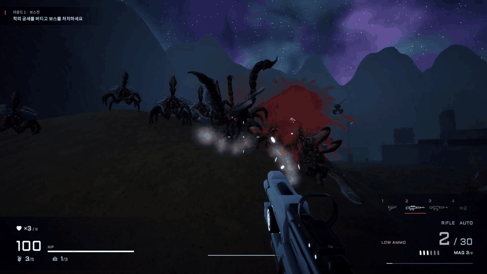\</p\> \<p\>같은 이유("긴박한 상황")로 \<strong\>보여 주지 않을 것\</strong\>도 정했습니다.\</p\> \<ul\> \<li\>「사격 중에는 보급 상자 정보 UI 는 안나오게」\</li\> \<li\>「1회용 탄 1 예비 4 이런 정보는 빼두자, 유저들에게는 꼭 명시할 필요는 없는 정보야」\</li\> \<li\>무기 설명은 짧게: 「로켓 런처 : 재장전 시간이 느리지만 파괴력이 강력한 무기입니다」 (직접 쓴 문구)\</li\> \</ul\> \<h3 id="6-3-보급-확률--고정-확률-vs-상황에-따라-바뀌는-확률"\>6-3. 보급 확률 — 고정 확률 vs 상황에 따라 바뀌는 확률\</h3\> \<p\>시작은 불만 하나였습니다.\</p\> \<blockquote\> \<p\>「무기 상자 확률이 지금 몇퍼센트야 조금 낮아보여서」 (11-01)\</p\> \</blockquote\> \<p\>기본 확률을 올리는 대신, \<strong\>언제 무엇이 필요한지\</strong\>에 따라 확률이 바뀌게 하자고 제안했습니다.\</p\> \<blockquote\> \<p\>「보급 상자가 떨어지는 비율 조건은 플레이어의 수류탄/ 힐팩 현재 보유 갯수에 따라 드랍이 조정됨 무기상자는 웨이브의 몬스터수가 확 늘어 날때, 플레이어가 보급 무기를 다 사용 했을 때 확률을 높임」 (11-01)\</p\> \</blockquote\> \<div class="table-wrap" role="region" tabindex="0" aria-label="표 20"\>\<table\> \<thead\> \<tr\> \<th\>방법\</th\> \<th\>장점\</th\> \<th\>단점\</th\> \</tr\> \</thead\> \<tbody\>\<tr\> \<td\>무기 상자 기본 확률만 올리기\</td\> \<td\>숫자 하나\</td\> \<td\>수류탄이 가득해도 수류탄 상자가 같은 확률로 나옴\</td\> \</tr\> \<tr\> \<td\>\<strong\>기본 확률 × 상황 배율 (선택)\</strong\>\</td\> \<td\>필요한 것이 필요할 때 더 잘 나옴\</td\> \<td\>판정 조건과 배율 숫자가 늘어남 → 전부 ConfigTable에 두고 투하 로그로 확인\</td\> \</tr\> \</tbody\>\</table\>\</div\> \<p\>이어서 정한 것:\</p\> \<ul\> \<li\>수류탄·회복 팩이 \<strong\>둘 다 가득\</strong\>이면 무기 상자 확률이 크게 오르는 부작용 → 「그대로 허용」 (Q-C). 무기 상자로 강력한 무기를 경험하면 전투 경험이 다양해집니다. 다른 보급이 이미 가득 찬 상황에서는 무기를 주는 것이 좋다고 판단했습니다.\</li\> \<li\>보급 무기를 \<strong\>들고 있으면\</strong\> 무기 상자는 아예 나오지 않게 (3차 개선) — 들고 있는 무기가 새 무기로 버려지는 것을 막음\</li\> \</ul\> \<h3 id="6-4-사운드에서-정한-두-가지--피격-소리는-빼고-곡-키는-라운드-표에"\>6-4. 사운드에서 정한 두 가지 — 피격 소리는 빼고, 곡 키는 라운드 표에\</h3\> \<p\>사운드 시스템을 만들며 내린 작은 결정 두 가지입니다. 하나는 만들 수 있었지만 만들지 않은 소리이고, 하나는 곡 이름을 어디에 둘지입니다.\</p\> \<h4 id="몬스터-피격hurt-소리--만들-수-있지만-만들지-않은-소리"\>몬스터 피격(Hurt) 소리 — 만들 수 있지만 만들지 않은 소리\</h4\> \<blockquote\> \<p\>「Hurt 사운드는 게임 특성상 일반 몬스터는 금방 죽고, 중간체 몬스터 또한 많지 않기 때문에 총기 피격음 구현 외에는 크게 중요하지 않을 거 같아」 (10-25)\</p\> \</blockquote\> \<div class="table-wrap" role="region" tabindex="0" aria-label="표 21"\>\<table\> \<thead\> \<tr\> \<th\>방법\</th\> \<th\>장점\</th\> \<th\>단점\</th\> \</tr\> \</thead\> \<tbody\>\<tr\> \<td\>몬스터마다 Hurt 소리\</td\> \<td\>몬스터마다 다른 반응\</td\> \<td\>금방 죽는 군중 수십 마리가 동시에 비명 → 소음. 몬스터마다 에셋 필요\</td\> \</tr\> \<tr\> \<td\>\<strong\>총알 타격음 하나 \+ 히트마커 (선택)\</strong\>\</td\> \<td\>군중전에서도 깔끔. 에셋 1개\</td\> \<td\>몬스터 종류별 차이는 없음 → 대신 사망음·공격 예고음이 몬스터를 구분\</td\> \</tr\> \</tbody\>\</table\>\</div\> \<p\>결과: 타격감은 총알 타격음(3D, 맞은 위치)과 히트마커(2D)로 주고, 약점을 맞히면 같은 타격음의 \<strong\>음높이만 올립니다\</strong\>(제 아이디어). 같은 효과음의 음높이만 바꿔 여러 소리처럼 들리게 하는 방법을 써서, 새 사운드를 찾지 않고 재생 값만 바꿔 여러 가지 소리를 낼 수 있었습니다. \<code\>MonsterTable\</code\>의 \<code\>HurtSfxKey\</code\> 열은 쓰는 곳이 없어져 삭제했습니다.\</p\> \<p\>플레이해 보니 타격음이 더 다양했으면 좋았겠다는 생각은 들었습니다. 몬스터 피부의 종류에 따라 타격음을 다르게 하면 더 생동감이 있었을 것입니다(8-3).\</p\> \<h4 id="bgm-곡-키--inspector-배열-vs-roundtable"\>BGM 곡 키 — Inspector 배열 vs RoundTable\</h4\> \<p\>라운드·보스전·강화 화면마다 다른 곡을 틀기로 하면서, 곡 이름을 어디에 둘지 비교를 요청했습니다.\</p\> \<blockquote\> \<p\>「inspector 배열에 두는 장단점 이랑 라운드 곡 키를 roundtable 두는 장단점 설명, 추천하는 방법 이유 설명」 (11-03)\</p\> \</blockquote\> \<div class="table-wrap" role="region" tabindex="0" aria-label="표 22"\>\<table\> \<thead\> \<tr\> \<th\>방법\</th\> \<th\>장점\</th\> \<th\>단점\</th\> \</tr\> \</thead\> \<tbody\>\<tr\> \<td\>Router Inspector 배열\</td\> \<td\>사운드 파트 안에서 끝남\</td\> \<td\>라운드 순서와 배열 순서를 따로 맞춰야 함. 라운드가 바뀌면 두 곳을 고침\</td\> \</tr\> \<tr\> \<td\>\<strong\>RoundTable에 \<code\>CrowdBgm\</code\>·\<code\>BossBgm\</code\> 열 (선택)\</strong\>\</td\> \<td\>라운드마다 다른 값이 라운드 데이터와 한 줄에. 기준값이 한 곳\</td\> \<td\>라운드 담당의 테이블·코드를 고쳐야 함\</td\> \</tr\> \</tbody\>\</table\>\</div\> \<p\>\<strong\>선택 이유\</strong\>: Inspector로 하면 수작업 실수가 생길 수 있어서 RoundTable을 골랐습니다. 수작업을 하다 보면 깜빡하고 넣지 않거나 생각하지 못한 것을 놓치는 일이 흔하기 때문입니다.\</p\> \<p\>Inspector에는 \<strong\>열이 비었을 때 쓰는 기본 곡\</strong\>과 강화 화면 곡만 남겼습니다. 그 밖에 직접 정한 규칙: 튜토리얼에서는 강화 화면 곡을 틀지 않음 · 보스 처치 직후에는 강화 곡을 \<strong\>3.5초 늦게\</strong\> 시작(클리어 효과음·승리 아나운서와 겹치지 않게) · 장면별 선곡.\</p\> \<h3 id="6-5-ui-통합--메인-메뉴-스타일을-게임-전체로-다른-사람-작업과-부딪히지-않게"\>6-5. UI 통합 — 메인 메뉴 스타일을 게임 전체로, 다른 사람 작업과 부딪히지 않게\</h3\> \<p\>개발하는 동안 각자 만든 UI는 색·글꼴·모양이 제각각이었습니다. 저는 먼저 \<strong\>메인 메뉴\</strong\>를 만들면서(10-28 \~ 10-30) 어두운 외계 행성의 밤 분위기에 맞춘 UI 틀("Moonlit Night" — 달빛 흰색·청회색·붉은 포인트, 상자 대신 선과 띠)을 잡았고, 마감 직전(11-03)에 이 틀을 기준으로 \<strong\>게임 전체 UI를 하나로 통합\</strong\>했습니다.\</p\> \<p\>메인 메뉴를 기준으로 삼은 이유는, 메인 메뉴가 \<strong\>게임의 첫인상\</strong\>이기 때문입니다. 게임 안의 모든 화면을 같은 색·글꼴·모양으로 맞추면, 화면이 바뀌어도 플레이어의 몰입이 깨지지 않는다고 생각했습니다.\</p\> \<p class="pf-figure"\>\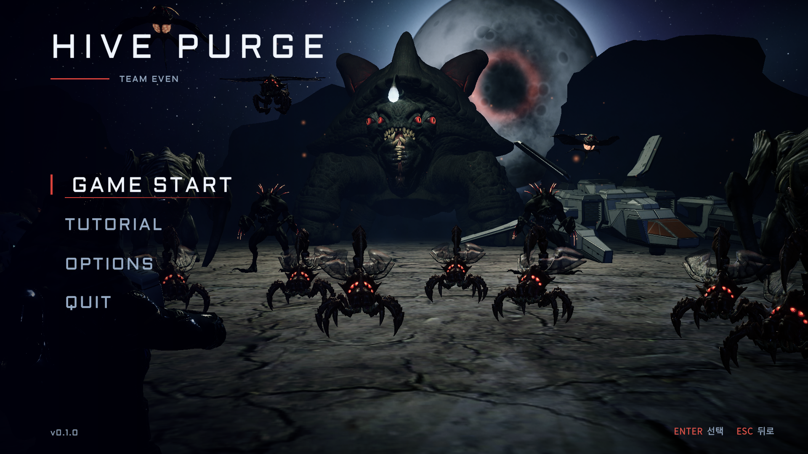\</p\> \<p class="pf-figure"\>\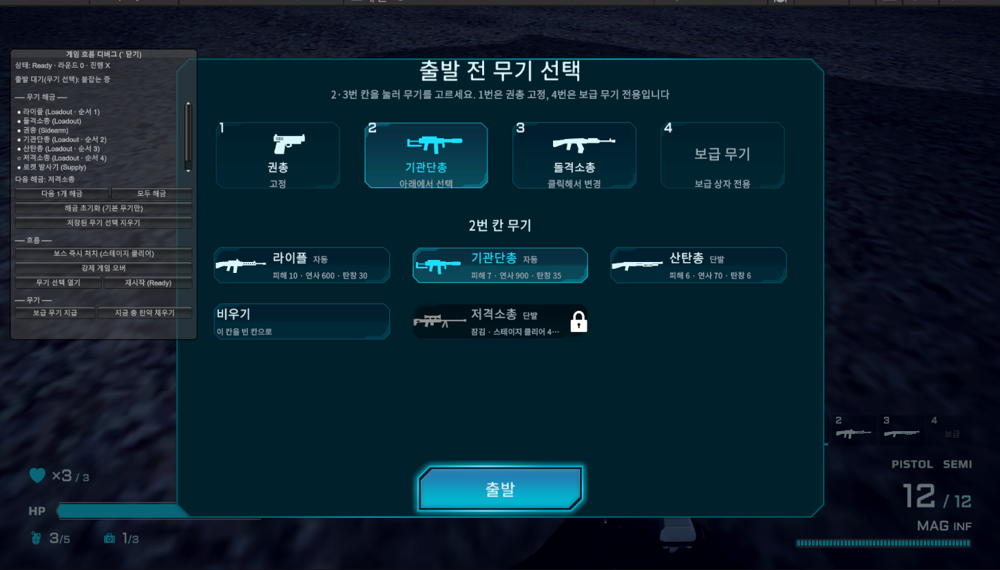\</p\> \<p class="pf-figure"\>\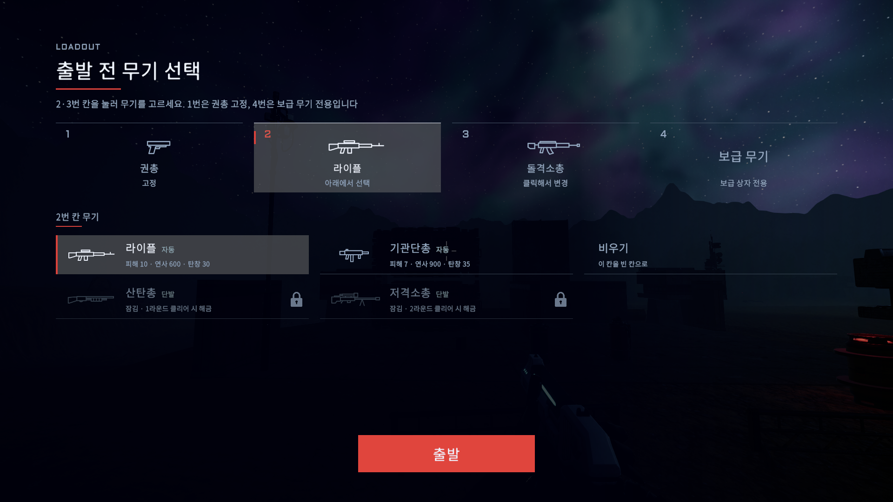\</p\> \<blockquote\> \<p\>이 작업의 커밋 작성자는 팀장 이찬영 님(\<code\>chan\</code\>)으로 남아 있습니다. 제 Claude 사용량을 거의 다 써서, 팀장님의 강의실 컴퓨터에 있는 Claude로 작업했기 때문입니다.\</p\> \</blockquote\> \<p\>\<strong\>가장 신경 쓴 것 — 다른 사람이 작업 중인 파일과 부딪히지 않기\</strong\>\</p\> \<p\>마감 직전이라 팀원 모두가 UI 파일을 동시에 고치고 있었습니다. 그래서 작업 전에 \<strong\>파일마다 누가 어떤 브랜치에서 고치고 있는지\</strong\> 위험 지도를 먼저 만들고, 원칙을 정했습니다.\</p\> \<div class="table-wrap" role="region" tabindex="0" aria-label="표 23"\>\<table\> \<thead\> \<tr\> \<th\>원칙\</th\> \<th\>이유\</th\> \</tr\> \</thead\> \<tbody\>\<tr\> \<td\>색·글꼴·크기는 \<strong\>새 파일\</strong\>(\<code\>UiTheme\</code\>, 공통 부품 \<code\>UiThemeKit\</code\>)에 모은다\</td\> \<td\>새 파일은 누구와도 충돌하지 않음\</td\> \</tr\> \<tr\> \<td\>기존 파일은 \<strong\>그리는 코드만\</strong\> 바꾼다. 동작 로직·public 이름·\<code\>\[SerializeField\]\</code\> 이름은 그대로\</td\> \<td\>다른 사람의 기능과 프리팹·씬 참조가 깨지지 않음\</td\> \</tr\> \<tr\> \<td\>씬·프리팹은 손으로 고치지 않고, 빌더 코드만 고친 뒤 \<strong\>담당자와 시간을 맞춰 재생성\</strong\>\</td\> \<td\>씬 파일은 합치기(merge)가 거의 불가능함\</td\> \</tr\> \<tr\> \<td\>공용 파일(\<code\>GameEvents.cs\</code\>, 데이터 테이블)은 건드리지 않는다\</td\> \<td\>모든 파트가 쓰는 곳이라 충돌하면 피해가 큼\</td\> \</tr\> \</tbody\>\</table\>\</div\> \<p\>작업은 작은 PR 9개로 나눴습니다(테마·아이콘 → 전투 HUD → 알림·카드 → 보상·강화·게임 오버 → 무기 선택·라운드 목표 → 옵션 → 보스·부활 → 인트로·엔딩 → 정리). 진행 중인 다른 브랜치와 미리 시험 병합해 보며 충돌 없이 하루 안에 develop에 합쳤고(PR \#112), 이후 develop 머지 과정에서 엔딩 화면의 스타일이 되돌아간 것은 제가 다시 적용했습니다(\<code\>37cf13c6\</code\>).\</p\> \<h3 id="6-6-라운드-종료-강화--작게-느껴진-보상을-어떻게-키울까"\>6-6. 라운드 종료 강화 — 작게 느껴진 보상을 어떻게 키울까\</h3\> \<p\>처음 만든 강화(10-23)는 \<strong\>재장전·탄창·수류탄 파우치 3종\</strong\>이었고, 각 3레벨까지, 라운드마다 \<strong\>한 번만\</strong\> 살 수 있었습니다. 직접 플레이해 보니 라운드를 클리어하고 받는 보상이 작게 느껴졌고(1-2), 팀원들과 상의하며 여러 번 고쳤습니다.\</p\> \<div class="table-wrap" role="region" tabindex="0" aria-label="표 24"\>\<table\> \<thead\> \<tr\> \<th\>버전\</th\> \<th\>바뀐 것\</th\> \<th\>바뀐 이유\</th\> \</tr\> \</thead\> \<tbody\>\<tr\> \<td\>첫 구현 (10-23)\</td\> \<td\>3종 · 최대 3레벨 · 라운드당 1회 구매\</td\> \<td\>—\</td\> \</tr\> \<tr\> \<td\>1차 개선 (11-01)\</td\> \<td\>라운드당 1회 구매 제한 삭제 → 재화가 있으면 여러 번 구매\</td\> \<td\>1차 플레이 피드백\</td\> \</tr\> \<tr\> \<td\>기획안 v1 (11-02)\</td\> \<td\>9\~12종 · 전체 나열 상점 · 최대 3레벨\</td\> \<td\>첫 제안\</td\> \</tr\> \<tr\> \<td\>기획안 v2\</td\> \<td\>\<strong\>무작위 카드 3장 \+ 리롤\</strong\> · 최대 2레벨 · 비용 60 / 100\</td\> \<td\>한 스테이지 재화가 많아야 약 300이라 v1 비용(전부 사면 4,940)이 너무 비쌈\</td\> \</tr\> \<tr\> \<td\>v3\</td\> \<td\>일반 강화 10종 · 6등급\</td\> \<td\>2차 빌드 팀원 피드백\</td\> \</tr\> \<tr\> \<td\>\<strong\>v3.2 (구현)\</strong\>\</td\> \<td\>\<strong\>8종 · 하급·일반·에픽 3등급 · 에픽 25%\</strong\>\</td\> \<td\>팀장 의견 — 회피 기동·연사력은 밸런스·효용성 문제로 삭제\</td\> \</tr\> \</tbody\>\</table\>\</div\> \<p class="pf-figure"\>\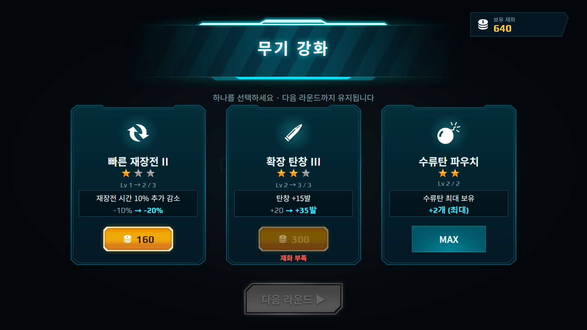\</p\> \<p\>\<strong\>상점 방식 — 전체 나열 vs 무작위 3장\</strong\>\</p\> \<div class="table-wrap" role="region" tabindex="0" aria-label="표 25"\>\<table\> \<thead\> \<tr\> \<th\>방법\</th\> \<th\>장점\</th\> \<th\>단점\</th\> \</tr\> \</thead\> \<tbody\>\<tr\> \<td\>전체 나열\</td\> \<td\>원하는 강화를 바로 골라 살 수 있음\</td\> \<td\>한 판 재화로는 몇 개 사지 못하고, 매번 같은 화면이라 고르는 재미가 적음\</td\> \</tr\> \<tr\> \<td\>\<strong\>무작위 카드 3장 \+ 리롤 (선택)\</strong\>\</td\> \<td\>상점마다 선택지가 달라지고, 리롤로 원하는 카드를 찾는 재미가 생김\</td\> \<td\>원하는 강화가 바로 안 나올 수 있음 → 리롤 비용을 낮게(5) 고정\</td\> \</tr\> \</tbody\>\</table\>\</div\> \<p\>제가 정한 조건은 네 가지였습니다: 한 스테이지 재화는 \<strong\>많아야 약 300\</strong\>, 리롤은 \<strong\>5부터\</strong\>(20은 비쌈), 게임은 \<strong\>3스테이지로 마무리\</strong\>해 상점은 \<strong\>2번\</strong\>, 상점은 전체 나열이 아니라 \<strong\>무작위 3장\</strong\>으로 선택을 제한. 라운드 흐름·구매 처리·재시작 초기화 같은 기존 시스템은 크게 바꾸지 않는 것도 조건이었습니다.\</p\> \<p class="pf-figure"\>\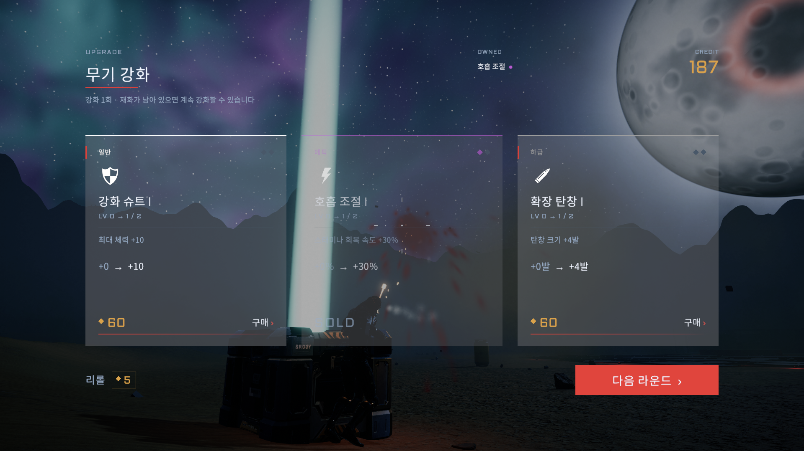\</p\> \<p\>\<strong\>등급 — 강해지는 체감을 크게\</strong\>\</p\> \<p\>카드마다 하급(40%)·일반(35%)·에픽(25%) 등급이 붙고, 에픽은 증가량이 일반의 약 2\~2.5배입니다. 3장 중 에픽이 1장 이상 나올 확률이 약 58%라, 상점을 열 때마다 절반 이상은 에픽을 보게 됩니다. 처음 v3에서는 6등급이었지만, 팀장 의견으로 3등급으로 줄이고 에픽 확률을 25%로 높였습니다.\</p\> \<p class="pf-figure"\>\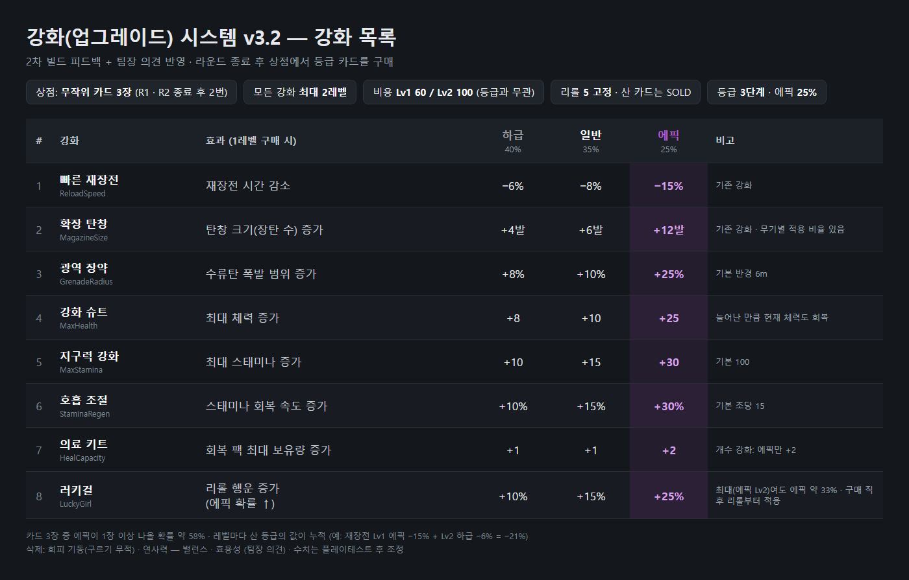\</p\> \<p class="pf-figure"\>\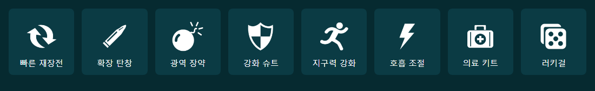\</p\> \<p\>강화 범위는 강화 시스템까지만 맡았고, 라운드 구성(섬멸전 등)은 라운드 담당에게 요청 사항으로만 남겼습니다(3-4).\</p\> \<hr\> \<h2 id="7-ai-협업"\>7. AI 협업\</h2\> \<h3 id="7-1-제-파트를-만든-방식--aiclaude-code와-역할-나누기"\>7-1. 제 파트를 만든 방식 — AI(Claude Code)와 역할 나누기\</h3\> \<p\>팀원 모두 AI(주로 Claude Opus)와 함께 각자 맡은 파트를 설계·구현했습니다. 다른 팀원들은 프로그래밍 전공자였고, 비전공자인 저는 \<strong\>AI를 가장 적극적으로 활용한 팀원\</strong\>이었습니다. 코드를 처음부터 직접 짜는 대신 \<strong\>무엇을 만들지 정하고, AI의 설계안 중에서 고르고, 직접 플레이해 문제를 찾는 역할\</strong\>에 집중했고, 그 덕분에 보급·사운드 외에도 맵·튜토리얼·강화·UI 통합까지 맡을 수 있었습니다.\</p\> \<div class="table-wrap" role="region" tabindex="0" aria-label="표 26"\>\<table\> \<thead\> \<tr\> \<th\>누가\</th\> \<th\>무엇을\</th\> \</tr\> \</thead\> \<tbody\>\<tr\> \<td\>나\</td\> \<td\>무엇을 만들지(요구사항)와 수치 정하기 · 설계안의 질문에 답하며 \<strong\>선택\</strong\> · 직접 플레이하고 문제 찾기 · 팀 공유(피드백 문서·PR·디스코드)\</td\> \</tr\> \<tr\> \<td\>나 (직접 작업)\</td\> \<td\>맵 배치·콜라이더, 사운드·BGM 선정, 튜토리얼 음성(TTS) 제작, 에디터에서 값 조정\</td\> \</tr\> \<tr\> \<td\>Claude Code\</td\> \<td\>설계안과 그 설계에서 빠진 부분 정리, 코드 구현, 커밋·PR 문서\</td\> \</tr\> \</tbody\>\</table\>\</div\> \<p\>작업마다 순서를 고정했습니다: \<strong\>설계 → 빠진 부분 정리 → 내 확인 → 구현.\</strong\> 설계는 「이벤트 버스와 외부 데이터 적용 기준」 v0.1을 매번 붙여 따르게 했습니다.\</p\> \<p\>\<strong\>AI에게 맡기지 않은 것\</strong\>\</p\> \<div class="table-wrap" role="region" tabindex="0" aria-label="표 27"\>\<table\> \<thead\> \<tr\> \<th\>맡기지 않은 것\</th\> \<th\>예\</th\> \</tr\> \</thead\> \<tbody\>\<tr\> \<td\>게임의 원칙\</td\> \<td\>"높은 곳에서 쏘는 이점은 주지 않는다"(6-1) — AI가 만든 계단·2층 구조를 이 원칙으로 고침(7-2)\</td\> \</tr\> \<tr\> \<td\>플레이로 정한 숫자\</td\> \<td\>획득 반경 2m · 정보 카드 30m · 투하 60m(6-2), 강화 상점 조건 네 가지(6-6)\</td\> \</tr\> \<tr\> \<td\>만들지 않을 것\</td\> \<td\>몬스터 피격(Hurt) 소리(6-4), 사격 중 보급 정보 UI(6-2)\</td\> \</tr\> \<tr\> \<td\>다른 파트 코드를 고칠지 말지\</td\> \<td\>담당자에게 먼저 확인하고, 고치면 PR 리뷰·디스코드로 공유(3-4)\</td\> \</tr\> \<tr\> \<td\>소리 고르기\</td\> \<td\>티라노포드 사운드 25종·BGM 선곡을 에셋에서 직접 고름(8-1)\</td\> \</tr\> \</tbody\>\</table\>\</div\> \<h3 id="7-2-맵튜토리얼--ai가-만들고-디테일은-제가-고쳤다"\>7-2. 맵·튜토리얼 — AI가 만들고, 디테일은 제가 고쳤다\</h3\> \<p\>\<strong\>인게임 맵\</strong\>\</p\> \<p\>처음에는 제가 맵을 직접 디자인하고 배치했습니다(10-20 「맵 기초 디자인 설계」 → 10-22 「맵 디자인 완료」).\</p\> \<p class="pf-figure"\>\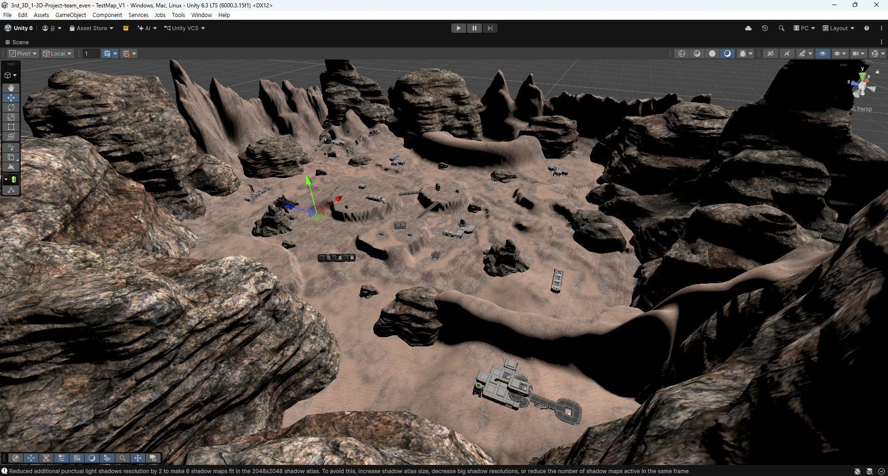\</p\> \<p\>그런데 1차 빌드 테스트(10-28) 때 \<strong\>맵이 너무 크고, 오래된 에셋이라 텍스처가 좋지 않다\</strong\>는 피드백을 받았습니다(설계 문서에는 "너무 심심하다"는 평가로도 기록되어 있습니다).\</p\> \<p class="pf-figure"\>\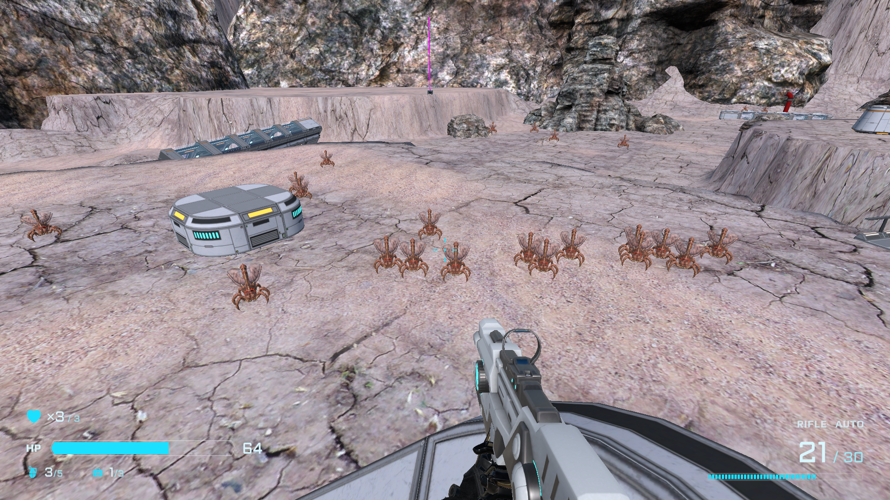\</p\> \<p\>맵을 줄인 버전을 먼저 만들었지만(10-29), 마감인 발표일(11-04)까지 남은 기간이 \<strong\>일주일 정도\</strong\>뿐이었습니다(최종 빌드는 발표 당일 새벽에 마무리).\</p\> \<p class="pf-figure"\>\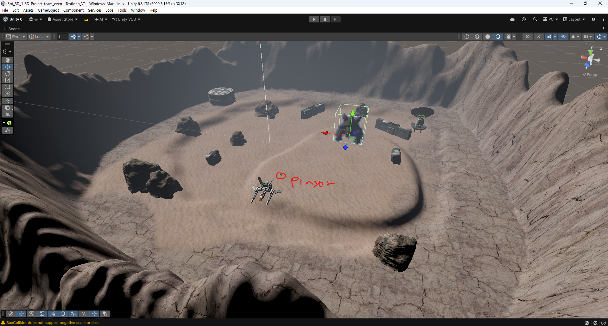\</p\> \<div class="table-wrap" role="region" tabindex="0" aria-label="표 28"\>\<table\> \<thead\> \<tr\> \<th\>방법\</th\> \<th\>장점\</th\> \<th\>단점\</th\> \</tr\> \</thead\> \<tbody\>\<tr\> \<td\>지금까지처럼 전부 손으로 다시 배치\</td\> \<td\>원하는 대로 정확히 놓을 수 있음\</td\> \<td\>일주일 안에 새 에셋으로 맵 전체를 다시 만들기 어려움\</td\> \</tr\> \<tr\> \<td\>\<strong\>Claude와 함께 생성 \+ 확인하며 수정 \+ 디테일은 수작업 (선택)\</strong\>\</td\> \<td\>큰 배치를 빠르게 만들고, 디테일한 부분은 수작업\</td\> \<td\>AI가 놓은 배치를 하나하나 확인해야 함\</td\> \</tr\> \</tbody\>\</table\>\</div\> \<p\>그래서 Sci-Fi Base 에셋으로 맵을 새로 만들면서, 맵 제작을 Claude와 함께 진행했습니다. Claude가 생성·배치한 결과를 확인해 가며 고칠 부분은 고쳤고, 디테일한 배치는 직접 손으로 했습니다.\</p\> \<div class="table-wrap" role="region" tabindex="0" aria-label="표 29"\>\<table\> \<thead\> \<tr\> \<th\>순서\</th\> \<th\>누가\</th\> \<th\>내용\</th\> \</tr\> \</thead\> \<tbody\>\<tr\> \<td\>① 설계\</td\> \<td\>나 \+ Claude\</td\> \<td\>세계관(불시착한 행성의 전초기지 잔해)·지점 배치를 문서로 먼저 정함. 1차 안(구역 4개를 게이트로 연결)은 폐기하고, 팀장 요청대로 \<strong\>튜토리얼과 인게임을 분리 · 인게임은 한 지역\</strong\>으로 확정\</td\> \</tr\> \<tr\> \<td\>② 생성\</td\> \<td\>Claude\</td\> \<td\>맵 빌더 에디터 도구(\<code\>Tools/Map/Build Sci-Fi Map\</code\>): 지형에 분화구·순환로를 파고, 지점 6곳 소품과 엄폐물 2\~5개를 배치\</td\> \</tr\> \<tr\> \<td\>③ 확인·수정\</td\> \<td\>나\</td\> \<td\>생성된 배치를 여러 시점에서 확인(\<code\>Capture Map Review Shots\</code\>)하고 고칠 곳을 고침\</td\> \</tr\> \<tr\> \<td\>④ 수작업\</td\> \<td\>나\</td\> \<td\>씬에서 손으로 옮기기·지우기·추가. \<code\>Save Sci-Fi Map Edits\</code\>가 이 수정을 기록해 두어 \<strong\>다시 생성해도 손으로 고친 배치가 남게\</strong\> 함\</td\> \</tr\> \<tr\> \<td\>⑤ 규칙으로\</td\> \<td\>나 \+ Claude\</td\> \<td\>손으로 고친 배치를 다시 빌더 규칙에 넣음 (예: 납작한 태양광 패널이 4배로 커지는 문제 → 크기 배율이 0.8\~1.3배를 넘으면 크기를 바꾸지 않음)\</td\> \</tr\> \</tbody\>\</table\>\</div\> \<p\>AI에게 맵 생성 설계와 구현을 맡겼을 때 가장 큰 문제는 \<strong\>맵의 디테일\</strong\>이었습니다. 건물에 전혀 어울리지 않는 오브젝트를 배치하거나, 요청하지도 않은 계단을 만들어 플레이어가 계단으로 높은 곳에 올라가 쉽게 플레이할 수 있게 되는 식이었습니다. 플레이어가 고지대를 활용해 우위를 갖지 못하게 하는 것이 이 맵 디자인의 핵심이었기 때문에, 이런 부분은 그냥 넘어갈 수 없었습니다. 그래서 6-1의 "높은 곳에서 쏘는 이점은 주지 않는다" 원칙을 빌더 규칙으로 넣어, 계단·사다리·발판이 달린 프리팹은 배치하지 않고, 장애물 윗면 높이도 정해진 단계(0.35m 이하 · 1.6\~1.8m · 3.1m 이상, 점프 높이 1.2m)만 쓰게 했습니다. 또한 쓰지 않는 에셋을 정리해 Sci-Fi Base 에셋을 \<strong\>3.25GB → 1.65GB\</strong\>로 줄였습니다(10-31).\</p\> \<p class="pf-figure"\>\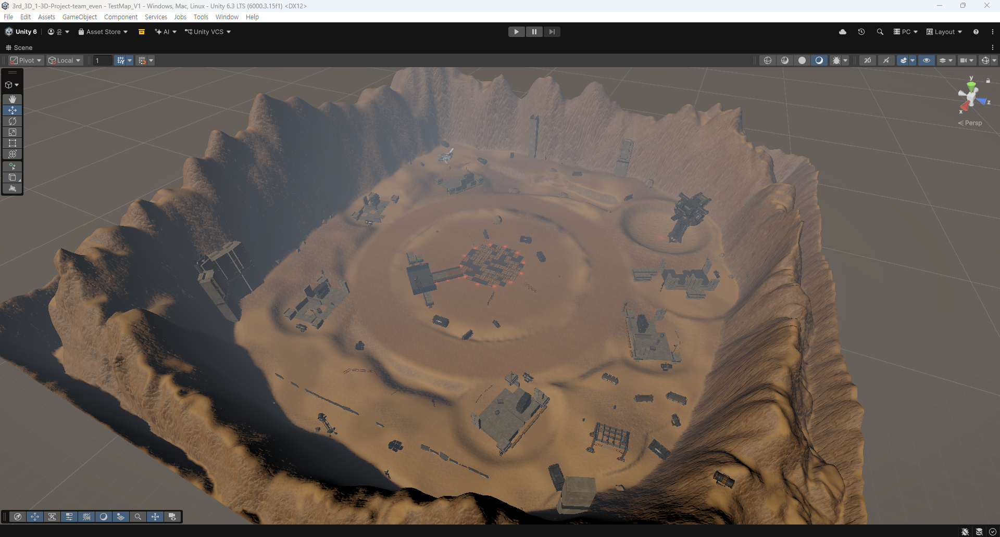\</p\> \<p class="pf-figure"\>\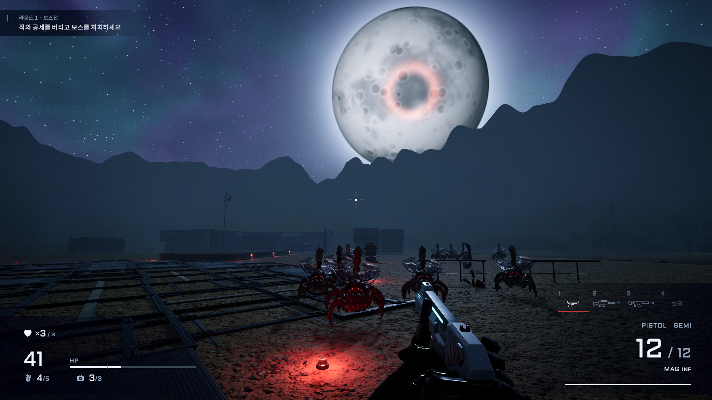\</p\> \<p class="pf-figure"\>\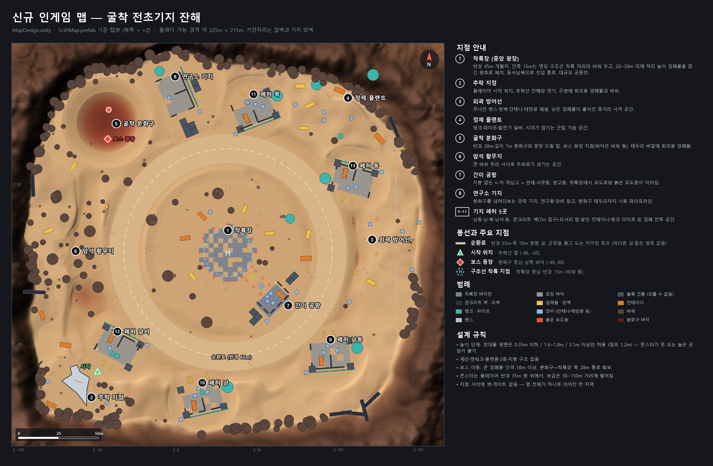\</p\> \<p\>\<strong\>튜토리얼\</strong\>\</p\> \<p\>튜토리얼도 AI와 함께 구현했습니다. 맵은 인게임 맵과 같은 빌더로 만든 \<strong\>약 60m × 200m 선형 협곡\</strong\>(10-30)이고, 기획은 세 번 바뀌었습니다(11-02).\</p\> \<div class="table-wrap" role="region" tabindex="0" aria-label="표 30"\>\<table\> \<thead\> \<tr\> \<th\>기획안\</th\> \<th\>내용\</th\> \<th\>결과\</th\> \</tr\> \</thead\> \<tbody\>\<tr\> \<td\>v1\</td\> \<td\>강하 전 모함 격납고에서 출격 준비\</td\> \<td\>폐기\</td\> \</tr\> \<tr\> \<td\>v2\</td\> \<td\>출격 전 훈련장 — 이미 만든 튜토리얼 맵에 스토리를 맞춤\</td\> \<td\>팀장 피드백으로 수정\</td\> \</tr\> \<tr\> \<td\>\<strong\>v3\</strong\>\</td\> \<td\>\<strong\>불시착한 행성에서 기본 전투 테스트 → 통과하면 전장 입장\</strong\> (시놉시스와 연결). 흐름은 메인 메뉴 → 인트로 → 튜토리얼 → 게임\</td\> \<td\>\<strong\>채택\</strong\>\</td\> \</tr\> \</tbody\>\</table\>\</div\> \<p\>구현한 것 (11-02 \~ 11-03):\</p\> \<ul\> \<li\>\<strong\>6단계\</strong\>: 이동·질주·구르기 → 사격·처치 보상 → 수류탄 → 보급 → 강화 체험 → 전초기지 게이트\</li\> \<li\>\<strong\>오퍼레이터 음성 41줄\</strong\>: 대사를 직접 TTS로 만들고, 녹음 한 파일을 대사별로 나눠 사운드 테이블에 연결\</li\> \<li\>\<strong\>행동 제한\</strong\>: 단계마다 지시한 행동만 할 수 있게 하고, 끝나거나 건너뛰면 풀어 줌\</li\> \</ul\> \<p class="pf-figure"\>\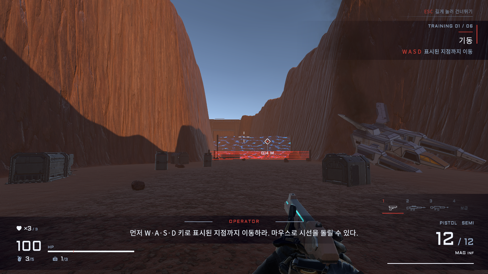\</p\> \<hr\> \<h2 id="8-결과-및-배운-점"\>8. 결과 및 배운 점\</h2\> \<h3 id="8-1-결과"\>8-1. 결과\</h3\> \<ul\> \<li\>\<strong\>보급\</strong\>: 2차 개선 뒤 플레이 테스트에서 \<strong\>못 줍는 보급은 더 이상 나오지 않았습니다.\</strong\> (개선 전: 10개 중 2\~3개를 줍지 못함)\</li\> \<li\>\<strong\>보급 확률\</strong\>: 투하 확률 로그로 수류탄이 0개일 때 수류탄 상자가 자주 나오는 것을 확인했습니다.\</li\> \<li\>\<strong\>사운드\</strong\>: 티라노포드의 사운드 \<strong\>25종을 에셋에서 직접 골라\</strong\> 연결했고, 튜토리얼 음성 41줄, BGM 9곡도 연결했습니다. 몬스터 소리와 보급에 쓴 에셋도 제가 직접 찾아 골랐습니다. 나중에 추가된 몬스터(돌진형, 파르다트록스 등)는 사운드 코드 수정 없이 테이블만 채워 소리를 붙였습니다(5-5).\</li\> \<li\>\<strong\>맵\</strong\>: 맵 면적을 \<strong\>1/4\</strong\>로 줄인 뒤(Asana BL-059) 몬스터를 피해 도망 다니거나 먼 보급을 주우러 가는 부담이 줄어, 전투에 더 몰입할 수 있게 되었습니다.\</li\> \<li\>\<strong\>라운드 종료 강화\</strong\>: 강화를 \<strong\>3종 → 8종\</strong\>으로 늘리고 등급 카드를 넣은 개편 뒤(6-6), 라운드를 마치고 보상을 얻어 \<strong\>플레이어가 강해지는 경험\</strong\>을 더 크게 체감할 수 있었습니다.\</li\> \<li\>\<strong\>튜토리얼\</strong\>: 행동 제한을 넣은 뒤 플레이어가 튜토리얼에 더 집중할 수 있게 되었습니다.\</li\> \</ul\> \<h3 id="8-2-트러블슈팅"\>8-2. 트러블슈팅\</h3\> \<p\>\<strong\>① 플레이어 소리가 전혀 나지 않음\</strong\> (11-01)\</p\> \<ul\> \<li\>문제: 플레이 중 플레이어의 발소리·피격음 등이 전혀 나지 않음\</li\> \<li\>원인: \<code\>PlayerSoundEmitter\</code\>가 플레이어 프리팹에 붙어 있지 않았음 (\<code\>SoundFix\_Handoff.md §1\</code\>)\</li\> \<li\>해결: 플레이어 프리팹(김민성 님 담당)을 직접 고치지 않고, 라우터가 실행 중에 이미터를 자동으로 붙이는 A안 (5-5 ③)\</li\> \<li\>결과: 고친 뒤 직접 플레이해 플레이어 소리가 나는 것을 확인했습니다. AI가 구현했어도 직접 테스트해 확인하기 전에는 구현되었다고 할 수 없기 때문에, AI 구현 뒤 플레이 테스트는 항상 하는 루틴이었습니다.\</li\> \</ul\> \<p\>\<strong\>② GAME START가 인트로·튜토리얼을 건너뜀\</strong\> (11-03)\</p\> \<ul\> \<li\>문제: 「게임 스타트를 누르면 인트로- 튜토리얼- 인게임 씬으로 전환이 안됨, 게임스타트 누를시 바로 인게임 씬으로 전환됨」\</li\> \<li\>발견: 처음 플레이하는 사람 기준으로 처음부터 확인하는 도구를 만들어 달라고 한 뒤 찾음\</li\> \<li\>원인: 메인 메뉴 씬에 저장된 "다음 씬 이름" 값이 테스트용 전투 씬(\<code\>Monster Player Integration\</code\>)으로 덮어써져 있어서, GAME START가 인트로를 건너뛰고 바로 전투 씬으로 갔음\</li\> \<li\>해결: 그 값을 인트로 씬 이름(기본값 \<code\>IntroCrawl\</code\>)을 쓰는 새 필드로 바꿔, 씬에 남은 잘못된 값을 무시하게 함 (커밋 \<code\>36900ce4\</code\>)\</li\> \<li\>결과: 최종 빌드 전(11-03 밤)에 고쳐, GAME START → 인트로 → 튜토리얼 → 게임 순서로 다시 이어지게 되었습니다.\</li\> \</ul\> \<p\>\<strong\>③ AI가 건드린 줄 알았던 무기 제한 — 원인은 플레이 기록\</strong\> (10-30)\</p\> \<ul\> \<li\>문제: 첫 라운드부터 모든 무기가 열려 있음\</li\> \<li\>처음 의심: 「왜 무기 제한이 첫라운드부터 다 풀려있지? 뭐 건드렸어?」 — 보급 작업 중이던 AI가 내 범위 밖을 바꿨다고 생각함\</li\> \<li\>원인: 바뀐 코드는 없었고, 플레이어의 플레이 기록 때문에 무기 제한이 풀린 상태였음\</li\> \<li\>비슷한 일: 같은 시기 「혹시 플레이어 쪽도 건드린거같은데」라고 의심했던 씬 오류도, 플레이어에 세이브 정보가 있다는 것을 몰랐기 때문이었습니다.\</li\> \<li\>느낀 점: AI를 쓰다 보면 내가 설계하지 않은 것이 작동할 때 "AI가 무슨 일을 했나" 하고 먼저 의심하게 됩니다.\</li\> \<li\>배운 점: 앞으로는 원인을 단정하기 전에, 그 문제가 일어난 \<strong\>상황을 먼저 파악하는 것\</strong\>을 우선으로 하려 합니다.\</li\> \</ul\> \<p\>\<strong\>④ 새 맵에서 보급이 하나도 떨어지지 않음\</strong\> (10-31 발견 → 11-01 수정)\</p\> \<ul\> \<li\>문제: 「'Monster Player Intergration' 씬에서 테스트 중인데 보급이 배급이 안됨」 — 직접 플레이 테스트를 하다 보급이 전혀 떨어지지 않는 것을 발견했습니다. 팀에 공유한 플레이 테스트 피드백도 보급을 하나도 받지 못한 상태로 진행해야 했습니다.\</li\> \<li\>원인: 새 맵(SciFiMap)의 지형 원점이 y \= \-20이라, 실제 전장 지면이 \<strong\>지형 기준 높이 약 18m\</strong\>로 계산되었습니다. 그래서 "지형 기준 높이 5m 이하에만 투하" 조건에 거의 모든 지점이 탈락했습니다. 맵을 새로 만들면서(7-2) 기준점이 바뀐 것이 원인이었습니다.\</li\> \<li\>해결: 높이 기준을 \<strong\>플레이어 발 높이 \+ 5m\</strong\>로 바꿔, 맵 원점이나 보스 아레나 높이와 상관없이 같은 규칙이 되게 했습니다(5-2 표의 ②). 또 다음에 같은 일이 생기면 바로 원인을 알 수 있도록, 투하에 실패하면 \<strong\>탈락 사유별 횟수\</strong\>(지면 없음·레이어·높이 등)를 경고로 남기게 했습니다.\</li\> \<li\>결과: 같은 씬에서 보급이 다시 떨어지는 것을 확인했고, 이후 2차 피드백에서는 "어디에 떨어지는가"(지붕·절벽 위) 문제로 넘어갔습니다(6-1).\</li\> \</ul\> \<h3 id="8-3-아쉬운-점-기술-부채--개선-계획"\>8-3. 아쉬운 점 (기술 부채) · 개선 계획\</h3\> \<p\>\<strong\>가장 아쉬운 점 — AI가 구현한 코드를 직접 확인하지 않은 것.\</strong\>\</p\> \<p\>→ \<strong\>개선 계획\</strong\>: 다음 프로젝트에서는 AI가 생성한 코드를 파악하고, 이해하지 못하는 부분은 AI에게 직접 물어 구조를 완전히 이해한 상태로 게임을 개발하려 합니다.\</p\> \<p\>이번에는 Unity에서 실제로 동작하는지만 확인하고 코드는 점검하지 않아서, 시스템을 제대로 파악하지 못했습니다.\</p\> \<p\>그 밖의 아쉬운 점:\</p\> \<ul\> \<li\>\<strong\>엄폐물과 보스 난이도\</strong\>: "높은 곳 금지"를 지키면서 피할 곳을 주려고 엄폐물을 지역마다 2\~5개 두었는데, 보스 1이 멀리서 쏘기만 하면 되는 구도가 됐습니다(6-1). 이후 팀장 이찬영 님의 제안으로 보스가 엄폐물을 부술 수 있게 하고, 패턴을 투사체 \+ 바닥 피해 방식으로 바꿔 엄폐물에 숨어서만 잡는 방식을 줄였습니다.\</li\> \<li\>\<strong\>타격음\</strong\>: 총알 타격음 하나로 정리했지만(6-4), 몬스터 피부 종류에 따라 타격음을 다르게 하면 더 생동감이 있었을 것입니다.\</li\> \<li\>\<strong\>몬스터 급증 판정\</strong\>: 소환 수만 보고 처치 속도는 보지 않습니다. 단순함을 우선해 남겼습니다 → TO-BE: 필드에 살아 있는 몬스터 수 기준\</li\> \</ul\> \<h3 id="8-4-배운-점"\>8-4. 배운 점\</h3\> \<p\>AI와 함께 작업할 때는 항상 \<strong\>설계 → 빠진 부분 정리 → 내 확인 → 구현\</strong\> 순서로 진행했습니다. 설계 단계에서 제가 놓칠 수 있는 부분을 AI에게 먼저 확인한 뒤 구현하니, 나중에야 발견될 오류나 버그를 줄일 수 있었습니다.\</p\> \<p\>또한 팀장이 만든 기준 문서 「이벤트 버스와 외부 데이터 적용 기준」을 작업마다 AI에게 붙여, 각자의 AI가 다른 팀원의 작업물을 마음대로 건드려 생기는 오류를 줄였습니다.\</p\> \<p\>무엇보다 \<strong\>게임은 직접 플레이해 봐야 완성된다\</strong\>는 것을 배웠습니다. 이 문서의 결정 대부분은 플레이어로서 직접 플레이하며 느낀 불편함에서 시작했습니다(6-1·6-2·6-6·8-2).\</p\> \<h3 id="8-5-개발-일정--구간별로-무엇을-했나"\>8-5. 개발 일정 — 구간별로 무엇을 했나\</h3\> \<p\>팀은 아사나에 작업을 카드로 올려 진행했습니다. 처음 계획한 카드 33개를 10-19에 한꺼번에 올렸고, 이후 만들면서 필요해진 카드를 더해 갔습니다. 아래 날짜는 카드가 시작된 날과 완료된 날이고, 목표일과 실제가 달랐던 카드는 괄호 안에 함께 적었습니다.\</p\> \<div class="table-wrap" role="region" tabindex="0" aria-label="표 31"\>\<table\> \<thead\> \<tr\> \<th\>구간\</th\> \<th\>팀 전체\</th\> \<th\>제 작업\</th\> \</tr\> \</thead\> \<tbody\>\<tr\> \<td\>첫 계획 카드 (10-19 \~ 10-26)\</td\> \<td\>처음 계획한 카드 33개 등록(10-19). 플레이어 이동·시야·사격·수류탄, 일반 몬스터 5종, 보스 패턴, 라운드 진행 같은 기본 기능\</td\> \<td\>전장 개활지·외곽 벽(10-19 → 10-21) · 건물·엄폐물·고지대 배치(10-19 → 10-22) · 보급 투하(10-19 → 10-21) · 보급 획득(10-19 → 10-23) · 라운드 종료 강화 구매(10-19 → 10-25) · 처치 재화 자동 획득(10-19 → 10-25, 목표일 넘김)\</td\> \</tr\> \<tr\> \<td\>1차 사전 통합 · 1차 빌드 테스트 (10-25 \~ 10-28)\</td\> \<td\>팀장이 완성된 기능을 한 씬에 모아 기능 단위로 통합 테스트(10-26 → 10-28), 통합 중 올라온 버그 카드 3개(사격 피해가 안 들어감 등) 처리 · 1차 빌드 테스트(10-28)\</td\> \<td\>몬스터 사운드 겹침 줄이기(10-25 → 10-27) · 몬스터 애니메이션에 맞춘 사운드(10-25 → 10-30, 목표 11-03) · 1차 빌드 테스트에서 맵이 너무 크다는 피드백을 받음(1-2)\</td\> \</tr\> \<tr\> \<td\>개선 카드 (10-30 \~ 11-01)\</td\> \<td\>10-30에 카드 23개가 새로 생김 — 몬스터 스폰 주기 10초 → 5초, 플레이어 이동 속도 3 → 5, 보스 패턴 강화, 무기 해금 등\</td\> \<td\>맵 면적 1/4로 줄이기 BL-059(10-30 → 10-31) · 보급을 더 가까이 떨어뜨리고 소리·색으로 알리기(10-30) · 보스 발소리(10-30)\</td\> \</tr\> \<tr\> \<td\>마무리 카드 (11-02 \~ 11-03)\</td\> \<td\>11-02에 카드 16개가 새로 생김 — 게임 제목 「Hive Purge」 확정(11-02), 엔딩, 섬멸전 라운드, 몬스터 약점 표시 등\</td\> \<td\>등급이 있는 강화 선택지(11-02 → 11-03, 6-6) · 튜토리얼(11-02 → 11-03, 7-2) · 탄약 없음 사운드 조정(11-02 → 11-03)\</td\> \</tr\> \<tr\> \<td\>최종 빌드 · 발표 (11-04)\</td\> \<td\>팀 레포의 마지막 커밋은 11-03 밤, 최종 빌드는 발표 당일 새벽에 마무리\</td\> \<td\>—\</td\> \</tr\> \</tbody\>\</table\>\</div\> \<ul\> \<li\>기록이 남은 26일(10-15 \~ 11-09) 동안 팀은 작업 97개 중 94개를 끝냈고, 끝낸 일의 82%(77개)를 목표일 안에 마쳤습니다.\</li\> \<li\>처음 계획한 일 33개는 모두 끝냈고, 만들면서 새로 생긴 일이 45개(처음의 136%)였습니다. 새 카드는 매일 고르게 생기지 않고 10-30(23개)과 11-02(16개)에 몰려 있습니다.\</li\> \<li\>제가 맡은 작업 14개는 모두 끝냈습니다. 리포트에는 13개 완료로 나오는데, 「탄약 없음 사운드 조정」을 끝낸 뒤 아사나에 완료 체크를 빠뜨렸기 때문입니다. 이 작업은 예비 탄창이 없어 재장전이 안 될 때 빈 총 소리(DryFire)를 내는 것입니다. 발표 전날 커밋 \<code\>c04bfecd\</code\>(11-03)로 올렸고, 같은 날 develop에 합쳐졌습니다(PR \#109).\</li\> \</ul\> \<\!-- 출처: 「스프린트 타임라인 리포트 — Team Even」(2026-11-09 생성), 탄약 없음 사운드 완료일과 마지막 커밋은 팀 레포 커밋 기록 \--\> \<section class="print-only link-list"\>\<p class="ll-title"\>링크 목록\</p\>\<ol\>\<li\>https\://youtu.be/H4MNlsQbh80\</li\>\<li\>https\://youtube.com/shorts/6vDZDAhEoyc\</li\>\</ol\>\</section\>\</article\> \</main\> \<aside class="rail" aria-label="프로젝트 정보"\> \<section class="rail-card"\>\<p class="rail-title"\>이 프로젝트\</p\>\<dl class="rail-meta"\>\<div\>\<dt\>장르\</dt\>\<dd\>3D 하이브리드 슈터\</dd\>\</div\>\<div\>\<dt\>기간\</dt\>\<dd\>2026-10-15 \~ 2026-11-04 (약 3주 — 기획 1주 · 개발 2주)\</dd\>\</div\>\<div\>\<dt\>인원\</dt\>\<dd\>4명 (팀장 1 · 팀원 3)\</dd\>\</div\>\<div\>\<dt\>환경\</dt\>\<dd\>Unity 6000.3 (URP), C\#, Git(Git flow, Git LFS), Asana\</dd\>\</div\>\<div\>\<dt\>AI 도구\</dt\>\<dd\>Claude Opus (Claude Code로 사용)\</dd\>\</div\>\<div class="role"\>\<dt\>내 역할\</dt\>\<dd\>보급·사운드 시스템과 라운드 종료 강화·맵·튜토리얼·메인 메뉴·UI 통합\</dd\>\</div\>\</dl\> \<div class="actions"\>\<a class="btn primary" href="project.html?p=4-team-even" target="\_blank" rel="noopener"\>슬라이드\<svg class="pf-newtab-icon" aria-hidden="true" focusable="false" viewBox="0 0 12 12" width="12" height="12"\>\<path d="M4.5 2.5h5v5M9.5 2.5 3 9" fill="none" stroke="currentColor" stroke-width="1.6" stroke-linecap="round" stroke-linejoin="round"\>\</path\>\</svg\>\<span class="pf-sr-only pf-newtab-sr"\>(새 탭)\</span\>\</a\>\<a class="btn" href="https\://youtu.be/H4MNlsQbh80" target="\_blank" rel="noopener"\>시연 영상\<svg class="pf-newtab-icon" aria-hidden="true" focusable="false" viewBox="0 0 12 12" width="12" height="12"\>\<path d="M4.5 2.5h5v5M9.5 2.5 3 9" fill="none" stroke="currentColor" stroke-width="1.6" stroke-linecap="round" stroke-linejoin="round"\>\</path\>\</svg\>\<span class="pf-sr-only pf-newtab-sr"\>(새 탭)\</span\>\</a\>\<a class="btn" href="https\://youtube.com/shorts/6vDZDAhEoyc" target="\_blank" rel="noopener"\>한 판 몰아보기 쇼츠 (1분 13초)\<svg class="pf-newtab-icon" aria-hidden="true" focusable="false" viewBox="0 0 12 12" width="12" height="12"\>\<path d="M4.5 2.5h5v5M9.5 2.5 3 9" fill="none" stroke="currentColor" stroke-width="1.6" stroke-linecap="round" stroke-linejoin="round"\>\</path\>\</svg\>\<span class="pf-sr-only pf-newtab-sr"\>(새 탭)\</span\>\</a\>\</div\>\</section\> \<section class="rail-card" id="rail-now" aria-live="polite"\>\<p class="rail-title"\>지금 읽는 절\</p\>\<p class="now-title"\>문서 처음\</p\>\<div class="now-body"\>\<p class="now-none"\>절 제목을 지나면 여기에 지금 읽는 절이 보입니다.\</p\>\</div\>\</section\> \<section class="rail-card rail-misc"\> \<a href="src/4-team-even/%EA%B8%B0%EC%88%A0%EB%AC%B8%EC%84%9C.md" target="\_blank" rel="noopener"\>원문 마크다운\<svg class="pf-newtab-icon" aria-hidden="true" focusable="false" viewBox="0 0 12 12" width="12" height="12"\>\<path d="M4.5 2.5h5v5M9.5 2.5 3 9" fill="none" stroke="currentColor" stroke-width="1.6" stroke-linecap="round" stroke-linejoin="round"\>\</path\>\</svg\>\<span class="pf-sr-only pf-newtab-sr"\>(새 탭)\</span\>\</a\> \<a href="\#top" class="to-top"\>맨 위로 ↑\</a\> \</section\> \</aside\> \</div\> \<div class="doc-fab" role="group" aria-label="빠른 이동"\>\<button type="button" class="fab-toc" aria-haspopup="dialog"\>목차\</button\>\<a class="fab-top" href="\#top" aria-label="맨 위로"\>↑\</a\>\</div\> \<dialog class="toc-dialog" aria-label="문서 목차"\>\<div class="toc-dialog-head"\>\<p class="toc-title"\>목차\</p\>\<button type="button" class="btn dlg-close"\>닫기\</button\>\</div\>\<div class="toc-links"\>\<a class="h2" href="\#1-개요"\>1. 개요\</a\>\<a class="h3" href="\#1-1-무엇을-만들었나"\>1-1. 무엇을 만들었나\</a\>\<a class="h3" href="\#1-2-왜-만들었나--제-파트가-풀어야-했던-문제"\>1-2. 왜 만들었나 — 제 파트가 풀어야 했던 문제\</a\>\<a class="h3" href="\#1-3-개발-환경--링크"\>1-3. 개발 환경 · 링크\</a\>\<a class="h2" href="\#2-게임-디자인"\>2. 게임 디자인\</a\>\<a class="h3" href="\#2-1-한-라운드의-흐름--쓸어내고-맞서고-강해진다"\>2-1. 한 라운드의 흐름 — 쓸어내고, 맞서고, 강해진다\</a\>\<a class="h3" href="\#2-2-누가-무엇을-기획했나"\>2-2. 누가 무엇을 기획했나\</a\>\<a class="h2" href="\#3-팀-협업"\>3. 팀 협업\</a\>\<a class="h3" href="\#3-1-팀-구성과-역할"\>3-1. 팀 구성과 역할\</a\>\<a class="h3" href="\#3-2-팀이-일한-방식"\>3-2. 팀이 일한 방식\</a\>\<a class="h3" href="\#3-3-제가-맡은-것"\>3-3. 제가 맡은 것\</a\>\<a class="h3" href="\#3-4-협업--내-담당-범위와-다른-파트-코드"\>3-4. 협업 — 내 담당 범위와 다른 파트 코드\</a\>\<a class="h2" href="\#4-시스템-구조"\>4. 시스템 구조\</a\>\<a class="h3" href="\#4-1-팀-공통-규칙--파트끼리-서로-모른다"\>4-1. 팀 공통 규칙 — 파트끼리 서로 모른다\</a\>\<a class="h3" href="\#4-2-보급-모듈-구조"\>4-2. 보급 모듈 구조\</a\>\<a class="h3" href="\#4-3-사운드-모듈-구조--소리-하나에-경로-하나"\>4-3. 사운드 모듈 구조 — 소리 하나에 경로 하나\</a\>\<a class="h2" href="\#5-핵심-기능"\>5. 핵심 기능\</a\>\<a class="h3" href="\#5-1-라운드-중-정해진-간격으로-보급이-떨어진다--보급-사용법"\>5-1. 라운드 중 정해진 간격으로 보급이 떨어진다 — 보급 사용법\</a\>\<a class="h3" href="\#5-2-주울-수-있는-곳에만-보급이-떨어진다--낙하-지점-찾기-값싼-검사부터-길-찾기는-마지막"\>5-2. 주울 수 있는 곳에만 보급이 떨어진다 — 낙하 지점 찾기 (값싼 검사부터, 길 찾기는 마지막)\</a\>\<a class="h3" href="\#5-3-지금-필요한-보급이-더-잘-나온다--상황에-따라-바뀌는-확률"\>5-3. 지금 필요한 보급이 더 잘 나온다 — 상황에 따라 바뀌는 확률\</a\>\<a class="h3" href="\#5-4-사운드-표의-키만-넘기면-소리가-난다--사운드-사용법"\>5-4. 사운드 표의 키만 넘기면 소리가 난다 — 사운드 사용법\</a\>\<a class="h3" href="\#5-5-새-몬스터도-표만-채우면-소리가-난다--다른-파트-코드를-고치지-않고-소리-붙이기"\>5-5. 새 몬스터도 표만 채우면 소리가 난다 — 다른 파트 코드를 고치지 않고 소리 붙이기\</a\>\<a class="h2" href="\#6-고민과-선택"\>6. 고민과 선택\</a\>\<a class="h3" href="\#6-1-높은-곳에서-쏘는-이점은-주지-않는다--맵navmesh보급을-한-원칙으로"\>6-1. "높은 곳에서 쏘는 이점은 주지 않는다" — 맵·NavMesh·보급을 한 원칙으로\</a\>\<a class="h3" href="\#6-2-보급-줍기--조준해서-줍기-vs-가까이-가서-줍기"\>6-2. 보급 줍기 — 조준해서 줍기 vs 가까이 가서 줍기\</a\>\<a class="h3" href="\#6-3-보급-확률--고정-확률-vs-상황에-따라-바뀌는-확률"\>6-3. 보급 확률 — 고정 확률 vs 상황에 따라 바뀌는 확률\</a\>\<a class="h3" href="\#6-4-사운드에서-정한-두-가지--피격-소리는-빼고-곡-키는-라운드-표에"\>6-4. 사운드에서 정한 두 가지 — 피격 소리는 빼고, 곡 키는 라운드 표에\</a\>\<a class="h3" href="\#6-5-ui-통합--메인-메뉴-스타일을-게임-전체로-다른-사람-작업과-부딪히지-않게"\>6-5. UI 통합 — 메인 메뉴 스타일을 게임 전체로, 다른 사람 작업과 부딪히지 않게\</a\>\<a class="h3" href="\#6-6-라운드-종료-강화--작게-느껴진-보상을-어떻게-키울까"\>6-6. 라운드 종료 강화 — 작게 느껴진 보상을 어떻게 키울까\</a\>\<a class="h2" href="\#7-ai-협업"\>7. AI 협업\</a\>\<a class="h3" href="\#7-1-제-파트를-만든-방식--aiclaude-code와-역할-나누기"\>7-1. 제 파트를 만든 방식 — AI(Claude Code)와 역할 나누기\</a\>\<a class="h3" href="\#7-2-맵튜토리얼--ai가-만들고-디테일은-제가-고쳤다"\>7-2. 맵·튜토리얼 — AI가 만들고, 디테일은 제가 고쳤다\</a\>\<a class="h2" href="\#8-결과-및-배운-점"\>8. 결과 및 배운 점\</a\>\<a class="h3" href="\#8-1-결과"\>8-1. 결과\</a\>\<a class="h3" href="\#8-2-트러블슈팅"\>8-2. 트러블슈팅\</a\>\<a class="h3" href="\#8-3-아쉬운-점-기술-부채--개선-계획"\>8-3. 아쉬운 점 (기술 부채) · 개선 계획\</a\>\<a class="h3" href="\#8-4-배운-점"\>8-4. 배운 점\</a\>\<a class="h3" href="\#8-5-개발-일정--구간별로-무엇을-했나"\>8-5. 개발 일정 — 구간별로 무엇을 했나\</a\>\</div\>\</dialog\> \<footer class="doc-foot"\>\<span\>© 윤 건우\</span\>\<a href="index.html" target="\_blank" rel="noopener"\>← 포트폴리오\<svg class="pf-newtab-icon" aria-hidden="true" focusable="false" viewBox="0 0 12 12" width="12" height="12"\>\<path d="M4.5 2.5h5v5M9.5 2.5 3 9" fill="none" stroke="currentColor" stroke-width="1.6" stroke-linecap="round" stroke-linejoin="round"\>\</path\>\</svg\>\<span class="pf-sr-only pf-newtab-sr"\>(새 탭)\</span\>\</a\>\</footer\>\</div\> \<noscript\>\<div class="notice"\>\<h1\>JavaScript를 켜 주세요\</h1\>\<p\>이 문서는 data/와 프로젝트 문서를 읽어 브라우저에서 그립니다. JavaScript를 켠 뒤 다시 열어 주세요.\</p\>\</div\>\</noscript\> \<script src="assets/strings.js"\>\</script\>\<\!-- UI 문구 표(기본 문구) \+ theme/strings.tsv(내 문구) 읽기. common.js보다 먼저 \--\> \<script src="assets/common.js"\>\</script\> \<script src="assets/md-blocks.js"\>\</script\> \<script src="assets/doc.js"\>\</script\> \<dialog class="lightbox" aria-label="크게 보기"\>\<div class="lb-stage"\>\</div\>\<p class="lb-cap"\>\</p\>\<button type="button" class="btn lb-close"\>닫기 (Esc)\</button\>\</dialog\>\<div class="mermaidTooltip" style="opacity: 0;"\>\</div\>\</body\>\</html\>*

Response: **HIVE PURGE** 프로젝트 기술문서(포트폴리오 상세 문서)의 전반적인 구성, 문제 해결 과정, 의사결정 근거(Trade-off) 정리는 매우 탄탄합니다. 특히 비전공자로서 AI(Claude Code)와 역할을 명확히 나누고, 팀 공통 아키텍처 규칙을 준수하며 작업한 맥락이 잘 드러납니다.

포트폴리오의 완성도와 면접관/독자의 가독성을 한 단계 더 높이기 위해 **우선적으로 보완해야 할 사항**을 중요도 순으로 정리했습니다.

### **1\. \[최우선\] 내부 작업 메모(HTML 주석) 정리 및 본인 문체 검수**

현재 렌더링된 HTML 내부에 작성 과정에서 남긴 편집용 주석(\<\!-- ... \--\>)이 그대로 노출되어 있습니다.

> * **노출된 주석 위치:**  
  * 1-1 하단: ✏️ 11-10에 붙인 그림(...)의 그림 설명(alt)은 Claude가 쓴 것입니다 — 본인 말투인지 확인해 주세요.  
  * 1-2 하단: 2026-11-21 강사님 피드백(...)으로 문단을 표로 줄임. ✏️ 줄인 문장 확인 필요  
  * 2-1 상단: ✏️ 2-1 그림과 그 아래 문단은 Claude가 1-1·1-2의 사실로 쓴 것 — 본인 말로 확인 필요  
> * **보완 방법:** 해당 주석들을 마크다운 원문에서 삭제하고, 표시된 구간(이미지 alt 텍스트, 1-2 표 요약 문장, 2-1 흐름 설명)이 본인의 평소 어투와 일치하는지 최종 검수하세요.

### **2\. \[핵심\] AI 활용의 '구체적 프롬프트/검증 사례' 및 기술적 이해도 보완**

문서 전반에 "AI가 설계/구현했고, 나는 선택했다"는 표현이 솔직하게 담겨 있으나, 채용 담당자 입장에서는 "그래서 본인이 기술적으로 무엇을 통제하고 검증했는가?"에 대한 의문이 생길 수 있습니다.

> * **아쉬운 점 (8-3 언급):** "AI가 구현한 코드를 직접 확인하지 않은 것"을 가장 아쉬운 점으로 꼽았는데, 이는 포트폴리오에서 치명적인 약점으로 보일 수 있습니다.  
> * **보완 방법:**  
  * **검증 역량 강조:** 코드를 한 줄씩 짜지 않았더라도, **로그(PlaytestAnalyzer, 탈락 사유 카운트, 투하 확률 로그)와 테스트 도구(Capture Map Review Shots)를 직접 설계·요구하여 블랙박스 상태의 AI 코드를 검증했다**는 점을 7-1이나 8-4에서 더 강하게 어필하세요.  
  * **구체적 디렉션 예시 추가:** 7-1에 본인이 AI에게 내린 구체적인 제약 조건(예: *"NavMesh를 굽지 않은 테스트 씬에서도 보급이 작동하도록 예외 처리를 넣어줘"*, *"씬 파일 머지 충돌을 막기 위해 에디터 빌더 스크립트 방식으로 UI를 생성해줘"*)을 1\~2개 추가하면 엔지니어링적 사고력이 훨씬 돋보입니다.

### **3\. \[구조·가독성\] 중복 내용 압축 및 다이어그램 가독성 개선**

문서 분량이 상당히 길어(8개 장, 표 31개, 다이어그램 7개) 핵심 기여도가 분산되는 경향이 있습니다.

> * **내용 중복 축소:**  
  * 1-2(문제 표)와 8-1(결과 리스트), 6-1\~6-6(고민과 선택)에 동일한 내용(예: 보급 10개 중 2\~3개 미획득, 맵 면적 1/4 축소, 강화 3종→8종 개편)이 3번 이상 반복됩니다.  
  * **보완:** 1-2는 한눈에 보는 요약으로만 남기고, 8-1은 단순 텍스트 나열 대신 **Before / After 핵심 지표 비교표**로 압축하면 가독성이 크게 좋아집니다.  
> * **다이어그램 5 (5-2 낙하 지점 찾기) 단순화:**  
  * 5단계 조건문(K1\~K5)에서 모두 버리고 다시 뽑기 노드로 선이 연결되면서 화살표가 복잡하게 교차합니다.  
  * **보완:** 실패 화살표를 각각 연결하지 않고, 서브그래프나 단일 실패 분기 흐름으로 정리하면 한눈에 들어옵니다.

### **4\. \[기술적 디테일\] 수치·데이터 근거 및 용어 통일**

> * **상점 확률 계산 근거 (6-6):** *"에픽 확률 25%, 3장 중 1장 이상 나올 확률 약 58%"* (1−0.753≈57.8%)처럼 확률 계산까지 고려한 점은 매우 좋습니다. 여기에 **스테이지당 평균 획득 재화(약 300\) 대비 카드 가격(60/100)과 리롤 비용(5)을 책정한 밸런싱 의도**(예: 한 상점에서 평균 2\~3회 리롤 후 2\~3개 구매 가능하도록 설계)를 한 줄 덧붙이면 기획적 설득력이 높아집니다.  
> * **용어 및 오타 통일:**  
  * 6-1 인용문 내 오타: Probs → Props (원문 인용이라면 괄호로 \[Props\] 병기 권장)  
  * 8-2 ④ 인용문 내 오타: Intergration → Integration  
  * 사운드 모듈 설명(4-3, 5-5)에서 GameSoundRouter가 붙이는 컴포넌트 이름이 본문에서는 MonsterSoundEmitter / PlayerSoundEmitter로 잘 통일되어 있으나, 5-5 시퀀스 다이어그램의 MF 참여자 명칭(MonsterPool (몬스터 담당))과 본문 용어를 일치시키면 더 깔끔합니다.

### **5\. \[UX/UI\] 웹 문서 자체의 편의성 보완**

> * **에디터 도구 설명 보충 (3-3, 7-2):** PlaytestAnalyzer, 바이너리 에셋 자동 복구 도구, Save Sci-Fi Map Edits 등 개발 생산성을 높이기 위해 만든 에디터 툴들이 언급만 되고 구체적인 역할이 생략되어 있습니다. 협업 효율을 높인 좋은 소재이므로 7-2나 8-2에 2\~3줄 정도로 간략히 설명을 보태는 것을 추천합니다.  
> * **GitHub 비공개 대안 안내 (1-3):** 팀 레포지토리가 비공개라면, 본인이 작성/설계한 핵심 스크립트(예: SupplyDropper.cs, SupplyDropWeights.cs, GameSoundRouter.cs)나 설계 문서 일부를 **별도 Gist 또는 포트폴리오 저장소에 발췌 공개**하여 링크를 걸어두면 코드 검증을 원하는 면접관에게 큰 도움이 됩니다.

우선순위에 따라 **1번(주석 제거 및 문체 확인) → 3번(중복 표 정리) → 2번(검증 역량 강조)** 순으로 수정해 보시는 것을 권해드립니다. 특정 섹션(예: 8-1 결과 표나 8-3 회고 문단)의 수정 초안이 필요하시면 말씀해 주세요.

---

*User prompt: Gemini님과 함께 같이 작성하자\! 할수 있어\!*

Response: 좋아요\! 함께 다듬으면 충분히 멋진 포트폴리오 문서로 완성할 수 있습니다.

저희가 이미 정해둔 방식대로, **바로 파일을 생성해 드리기 전에 먼저 어떤 부분부터 손볼지 방향과 보강할 점을 여쭤보고**, 답변 주신 내용을 반영해 함께 작성해 나갈게요.

현재 **HIVE PURGE** 문서에서 먼저 함께 다듬어 보면 좋을 항목들입니다:

> 1. **작업 진행 방식**: 원하시는 섹션(예: 8-1 결과 요약, 7-1/8-3 AI 협업 및 회고, 5-2 다이어그램 정리 등)을 하나씩 순서대로 다듬을지, 아니면 전체 수정안 초안을 한 번에 정리할지 알려주세요.  
> 2. **구체적 사실 보강 (빈칸/추정치 확인)**:  
   * 스테이지당 평균 획득 재화량이나 상점 구매 횟수 등 밸런싱 의도에 들어갈 실제 수치가 있는지요?  
   * PlaytestAnalyzer, Capture Map Review Shots, Save Sci-Fi Map Edits 같은 에디터 툴의 핵심 역할(1\~2줄 요약)을 어떻게 적으면 좋을지 알려주실 수 있나요?  
   * 8-3 회고에서 "코드를 직접 확인하지 못한 점"을 어떤 식으로 **로그·툴 기반 검증 역량** 중심으로 풀어내면 좋을지 본인의 실제 경험을 들려주세요.

어디부터 시작할까요? 편하신 방향과 보충 내용을 알려주세요\!

---

*User prompt: 구체적 사실보강은 내가 클로드 pro를 사용해서 작업할게. 너는 그 외적인 부분을 전체적으로 봐주면 좋을 거 같아. 내가 제시한 방향에 보완 사항이 있다면 이야기해주세요*

Response: 역할을 그렇게 나누는 건 아주 합리적입니다. 실제 수치, 툴 설명, 구체적 회고 사실 같은 **사실 보강**은 클로드 Pro로 작업하시고, 저는 문서의 **구조, 중복 제거, 문체/주석 정리, 다이어그램 가독성, 용어 통일, 가독성 개선** 등 **외적·편집적 완성도**를 맡으면 서로 겹치지 않고 효율적일 것 같아요.

제시하신 방향에서 **주의하거나 보완하면 좋을 점**이 몇 가지 있습니다:

> 1. **작업 순서(사실 보강 vs 외적 정리)의 선후 관계**  
   * 클로드 Pro에서 사실 수치나 에디터 툴 설명, 8-3 회고 문장 등을 먼저 보강한 뒤 제가 외적 구조를 다듬으면, **새로 추가된 문장에서도 중복이나 오탈자, 주석 흔적이 남지 않게 한 번에 깔끔하게 정리**할 수 있습니다.  
   * 반대로 제가 먼저 중복 표나 섹션 구조를 줄여버리면, 나중에 클로드 Pro가 어느 위치에 어떤 사실을 넣어야 할지 기준선이 바뀔 수 있습니다.  
> 2. **클로드 Pro와 병행할 때 '버전 충돌' 주의**  
   * 두 AI가 같은 문서를 각자 수정하게 되면, 어느 쪽이 최신본인지 헷갈리기 쉽습니다.  
   * **사실 보강본(클로드 Pro) → 구조/문체/다이어그램/오탈자 다듬기(제미나이)** 순으로 한 방향으로 흐르게 하시거나, 섹션 단위로 역할을 고정하는 것이 안전합니다.  
> 3. **주석(\<\!-- ... \--\>)과 말투 검수 기준**  
   * 클로드 Pro가 새 문장을 쓸 때도 작업 메모나 과도하게 설명적인 AI 말투가 섞일 수 있으므로, 마지막 단계에서는 반드시 **내부 주석 제거 \+ 본인 어투 통일**을 거치는 게 좋습니다.

지금 구상하신 방향대로 진행하려면 **먼저 클로드 Pro에서 사실 보강을 마친 뒤** 저에게 넘겨주시는 것이 가장 깔끔한데, 혹시 지금 당장 제가 먼저 손봐두었으면 하는 외적 부분(예: 중복 구조 정리, 다이어그램 단순화 기준, 오타/용어 목록 등)이 있을까요? 편하신 대로 알려주세요\!

---

*User prompt: 내가 클로드 토큰 제한이 있어서 내일(11월 24일 화요일 4시)부터 사실 보강을 전달할수 있어 포트폴리오 사이트는 추후에 수정이 가능해서 그래도 내일 할 작업을 최소화 하려고 해. 이 방향성을 기반으로 우리는 수정하면 될 거같아. 너의 작업 방향을 정해줘볼래?*

Response: 내일(11월 24일 화요일 오후 4시) 이후에 사실 보강 내용을 전달해 주시고, 그 과정에서 **내일 해야 할 작업량을 최소화**하는 방향으로 제 작업 방향을 잡았습니다. 포트폴리오 사이트(pinkshield.github.io/portfolio)는 언제든 추후 수정할 수 있으니, 지금은 당장 병목을 줄이고 내일 합치기 쉽게 만드는 데 집중할게요.

### **제 작업 방향 (4단계)**

> 1. **선제적 외적 정리 (11월 24일 오후 4시 이전 가능)**  
   * 클로드 Pro의 사실 보강과 별개로 미리 확정할 수 있는 **내부 편집 주석(\<\!-- ... \--\>) 정리, 오탈자(Probs, Intergration 등) 및 용어 통일, 다이어그램(5-2) 단순화 가이드**를 먼저 정리해 둡니다.  
   * 중복 표·섹션 구조도 내일 사실이 들어갈 자리를 해치지 않는 선에서 미리 골격을 잡아두어, 내일 다시 전체를 뜯어고치는 일을 줄입니다.  
> 2. **내일 오후 4시 이후: '붙여넣기용 삽입 포인트' 중심 병합**  
   * 내일 클로드 Pro에서 받은 사실 보강 내용을 주실 때, 문서 전체를 처음부터 다시 쓰기보다 **해당 섹션(1-2, 5-2, 7-1, 7-2, 8-1, 8-3 등)에 바로 끼워 넣을 수 있도록** 미리 자리(앵커/블록)를 정리해 둔 기준에 맞춰 반영합니다.  
   * 새로 추가되는 문장에서도 작업 주석이나 과장/방어적 표현이 섞이지 않도록 매끄럽게 다듬습니다.  
> 3. **포트폴리오 사이트 반영 최소화**  
   * 당장 포트폴리오 사이트 전체를 한 번에 갈아엎기보다는, **문서 원문(마크다운/초안)을 먼저 확정**한 뒤 사이트에는 핵심 변경분만 빠르게 옮길 수 있도록 섹션 단위로 깔끔하게 정리합니다.  
   * 추후 사이트 디자인이나 세부 문구를 다듬을 때도 그대로 가져다 쓰기 쉬운 형태로 유지합니다.  
> 4. **파일 생성 전 확인 원칙 준수**  
   * 별도의 결과물 파일을 생성해야 할 시점이 오면, 바로 파일을 만들기 전에 먼저 보강이 필요한 부분이나 확인 사항을 여쭙고 답변을 반영한 뒤 진행합니다.

내일 오후 4시 전까지 **제가 먼저 외적 정리(주석/오탈자/다이어그램·구조 정리)를 진행해 둘까요**, 아니면 **내일 클로드 Pro 사실 보강본을 받으신 뒤 한 번에 정리할까요?** 편하신 쪽으로 말씀해 주세요\!

---

*User prompt: 깜빡한게있는데, 인턴쉽 채용 마감은 내일 24일 까지야 .그래서 이작업이 굉장히 중요해*

Response: 인턴십 채용 마감이 내일(11월 24일)까지라면 시간이 정말 촉박하네요. 더더욱 **내일 오후 4시 클로드 토큰 제한 해제 전까지 기다리지 않고, 지금부터 최대한 병목을 없애는 쪽**으로 움직여야 제출 직전 허둥대는 일을 막을 수 있습니다.

마감이 내일까지인 상황을 기준으로, **지금 \~ 내일 오후 4시 전까지** 가장 현실적이고 안전한 실행 순서를 제안해 드릴게요.

### **마감(내일 11/24) 대비 긴급 작업 전략**

> 1. **지금 바로 할 수 있는 외적 정리 먼저 처리**  
   * 내부 편집 주석(\<\!-- ... \--\>) 제거, 오탈자(Probs, Intergration 등)와 용어 정리, 다이어그램(5-2) 단순화, 중복 표/문단 압축 등 **사실 확인 없이도 바로 고칠 수 있는 외적 요소**를 지금 먼저 정리해 두면, 내일 오후 4시 이후에는 사실 보강 내용을 끼워 넣고 최종 검수만 하면 됩니다.  
> 2. **클로드 Pro 없이도 채울 수 있는 '사실 보강 초안' 미리 준비**  
   * 내일 오후 4시까지 기다렸다가 처음부터 물어보면 시간이 줄어들 수 있으니, 지금 기억나는 수치나 툴 역할, 회고 포인트 중 **확실한 것부터 먼저 메모**해 두시는 걸 추천합니다.  
   * 확실하지 않은 수치는 임의로 지어내지 않고 \[확인 필요\] 표시로 남겨두면, 내일 오후 4시에 클로드 Pro로 딱 필요한 부분만 빠르게 확인·보강할 수 있습니다.  
> 3. **제출용 최종본(문서 \+ 포트폴리오 사이트) 반영 순서 고정**  
   * 마감 전에는 **제출에 직접 쓰이는 문서/페이지부터 우선 확정**하고, 사이트 전체를 한 번에 갈아엎는 작업은 제출 직전 리스크를 줄이기 위해 꼭 필요한 핵심 변경분 위주로 빠르게 반영하는 게 안전합니다.

시간이 촉박한 만큼 **먼저 지금 당장 제가 외적 정리(주석/오탈자/다이어그램·구조 정리)를 진행해 둘까요**, 아니면 **제출용 문서에서 가장 먼저 손봐야 할 구간(예: 8-1 요약, 7-1/8-3 회고 등)부터 짚어드릴까요?** 편하신 대로 말씀해 주세요\!

---

*User prompt: 그럽시다\!*

Response: 좋습니다\! 마감 일정에 맞춰 지금 바로 할 수 있는 외적 정리부터 깔끔하게 시작하죠.

현재 대화에는 **HIVE PURGE** 기술문서의 원문(마크다운이나 HTML 파일)이 아직 첨부되지 않았으니, 먼저 작업 대상을 가져와야 합니다.

> 1. **문서 원문 공유**: 현재 수정하려는 **HIVE PURGE** 기술문서 파일(.md 또는 .html)을 여기에 붙여넣거나 파일로 올려주세요.  
> 2. **수정 범위 및 우선순위 확인**:  
   * **즉시 정리할 외적 요소**: 내부 편집 주석(\<\!-- ... \--\>) 제거, 오탈자(Probs, Intergration 등) 및 용어 통일, 5-2 다이어그램 단순화, 1-2와 8-1 간 중복 표/문단 구조 압축을 먼저 처리할까요?  
   * **내일(11/24 오후 4시 이후) 클로드 Pro 보강용 자리 표시**: 실제 수치(6-6 상점 밸런싱 등), 에디터 툴 설명(3-3/7-2), 회고(8-3) 보완 부분은 내일 바로 끼워 넣기 쉽도록 \[사실 보강 예정: ...\] 형태로 깔끔하게 자리를 비워둘까요?

문서 원문을 올려주시고, 위 방향대로 바로 외적 정리 초안을 만들어도 될지 알려주세요\!

---

Response: 문서 원문 잘 받았습니다\! 내일(11/24) 인턴십 마감과 오후 4시 클로드 Pro 보강 일정을 고려해, **지금 당장 외적 정리(주석 제거, 오탈자 수정, 다이어그램·구조 정리, 중복 축소)를 마친 초안**을 바로 작성해 드립니다.

내일 클로드 Pro에서 받은 사실 보강 내용을 끼워 넣기 쉽도록 **사실 보강이 들어갈 위치는 \[사실 보강 예정: ...\] 태그**로 명확히 표시해 두었습니다.

# **HIVE PURGE — 3D 하이브리드 슈터 (Team Even) · 보급·사운드 외 담당 파트**

## **1\. 개요**

### **1-1. 무엇을 만들었나**

**HIVE PURGE**는 1인칭으로 몰려오는 군중을 쓸어내고, 3인칭으로 거대한 보스와 맞서는 **하이브리드 슈터**입니다. 몰려오는 수많은 적을 여러 총으로 처치하고, 보스의 공격 패턴을 공략하는 재미를 목표로 했습니다. 한 라운드는 **군중전(약 3분) → 보스 등장·시점 전환 → 보스전 → 강화 선택 → 다음 라운드**로 이어집니다.

제가 맡은 것은 **보급·사운드 시스템**과 **라운드 종료 강화·맵·튜토리얼·메인 메뉴·UI 통합**입니다(3-3).

### **1-2. 왜 만들었나 — 제 파트가 풀어야 했던 문제**

| 파트 | 풀어야 했던 문제 | 다룬 곳 |
| :---- | :---- | :---- |
| **보급** | 새 맵에서 보급이 떨어지지 않거나, 지형·높은 건물 위·맵 밖에 떨어져 **10개 중 2\~3개**를 줍지 못했습니다. 주울 수 없으면 플레이어는 답답함을 느낍니다 | 5-1\~5-3 · 8-2 ④ |
| **사운드** | 4명이 각자 만드는 몬스터·보스·무기에 **다른 사람의 코드를 고치지 않고** 소리를 붙여야 했습니다. 플레이어 소리가 전혀 나지 않는 버그도 있었습니다 | 5-4 · 5-5 · 6-4 |
| **맵** | 1차 빌드 테스트(10-28)에서 "맵이 너무 크다"는 피드백으로 도망만 다니고 보급 동선이 길어졌습니다 → 면적 1/4 축소, 언덕 제거, 엄폐물 추가 | 6-1 · 7-2 |
| **라운드 종료 강화** | 초기 3종 구성으로는 라운드 클리어 보상이 작게 느껴졌습니다 → 8종 개편, 등급 카드 3장 \+ 리롤 도입 | 6-6 |
| **튜토리얼** | 이동 자유도가 높아 학습 집중도가 떨어졌습니다 → 단계별 지시 행동 제한 적용 | 7-2 |

### **1-3. 개발 환경 · 링크**

| 항목 | 내용 |
| :---- | :---- |
| 엔진 | Unity 6000.3 (URP) |
| 언어·도구 | C\#, Git(Git flow, Git LFS), Asana |
| AI 도구 | Claude Opus (저는 Claude Code로 사용). ChatGPT를 함께 쓴 팀원도 있었습니다 |
| 기간 | 2026-10-15 \~ 2026-11-04 (약 3주 — 기획 1주 · 개발 2주) · 최종 빌드 11-04 새벽 · 같은 날 발표 |
| 팀 | 4명 — 팀장 이찬영, 팀원 김민성·윤건우·홍산 |
| 영상 | [플레이 시연 영상 (YouTube, 4분 23초)](https://youtu.be/H4MNlsQbh80) · [한 판 몰아보기 쇼츠 (1분 13초)](https://youtube.com/shorts/6vDZDAhEoyc) |
| GitHub | 비공개 *(추후 핵심 스크립트 발췌 공개 링크 추가 예정)* |

## **2\. 게임 디자인**

### **2-1. 한 라운드의 흐름 — 쓸어내고, 맞서고, 강해진다**

`flowchart LR`  
    `A["1인칭 군중전 (약 3분)<br/>몰려오는 몬스터 처치 · 보급 줍기"] --> B["보스 등장<br/>3인칭으로 시점 전환"]`  
    `B --> C["보스전<br/>공격 패턴 공략"]`  
    `C --> D["라운드 종료 강화<br/>등급 카드 3장 + 리롤"]`  
    `D -->|"다음 라운드"| A`

군중전에서는 하늘에서 떨어지는 **보급**으로 몰려오는 적을 버티고(5-1), 라운드가 끝나면 **강화**를 골라 다음 라운드를 더 강한 상태로 시작합니다(6-6).

### **2-2. 누가 무엇을 기획했나**

| 기획 | 정한 사람 |
| :---- | :---- |
| 게임 콘셉트 (1인칭 군중전 \+ 3인칭 보스전) | 팀장 |
| 몬스터와 몬스터 패턴 | 팀장과 회의하며, AI와 함께 정함 |
| 보급 시스템 | 제가 AI와 함께 기획 (5-1\~5-3) |
| 업그레이드(라운드 종료 강화) 시스템 | 팀원들, AI와 함께 기획 (6-6) |
| 대부분 기능의 기획 초기 틀 | 제가 잡음 |

맵·보급·NavMesh를 한 원칙("높은 곳에서 쏘는 이점은 주지 않는다")으로 묶은 기획은 6-1에서 다룹니다.

## **3\. 팀 협업**

### **3-1. 팀 구성과 역할**

| 이름 | 담당 |
| :---- | :---- |
| 윤건우 (나) | 보급(공중 투하·획득 알림)·재화 획득, 라운드 종료 강화 상점, 몬스터 사운드, 맵(전장·엄폐물·고지대), 튜토리얼, 메인 메뉴·UI 통합 |
| 이찬영 (팀장) | 코어(데이터·이벤트·서비스), 보스(패턴·등장·처치 연출·지형 파괴), 라운드 진행(웨이브·보스전 시작·재시작), 1차 사전 통합·테스트 |
| 홍산 | 일반 몬스터(근접·돌진 무리·공중·침투·독안개, 공통 상태 전환), 몬스터 스폰·이동, 피격 반응(경직·약점·처치 연출), 섬멸전 라운드 기믹 |
| 김민성 | 플레이어(이동·시점·피격·부활), 무기(라이플·수류탄·투사체·무기 해금)와 강화 효과 적용, 인트로·엔딩, 조명·쉐이더, 2스테이지 보스 쓸기 패턴 |

*(출처: Asana 팀 보드 「Team Even」의 담당자별 완료 업무)*

### **3-2. 팀이 일한 방식**

> * 파트 사이 약속(4-1의 "파트끼리 서로 모른다" 규칙, 이벤트·서비스·데이터 형식)은 **강의 내용과 Opus로 먼저 정한 팀 공통 규칙**을 따랐습니다.  
> * 팀 차원에서 따로 정한 AI 사용 규칙은 없었습니다. 팀장이 만든 기준 문서 「이벤트 버스와 외부 데이터 적용 기준」이 사실상 가장 큰 규칙이었고, 저는 각자의 AI가 이 약속을 지키도록 이 문서를 작업마다 붙였습니다.

### **3-3. 제가 맡은 것**

**주로 맡은 것**

> 1. **보급 시스템** — 공중 투하, 낙하 지점 찾기, 상황에 따라 바뀌는 보급 확률, 근접 획득  
> 2. **사운드 시스템** — 이벤트 → 소리 연결(GameSoundRouter), 객체별 이미터, BGM, AudioMixer

**그 밖에 맡은 것**

> * 라운드 종료 강화 상점 (등급 카드 3장 \+ 리롤, 강화 8종)  
> * 인게임 맵(Sci-Fi Base 기반)·튜토리얼 맵, 맵 빌더 에디터 도구  
> * 메인 메뉴(디오라마 배경·호버 연출·옵션 팝업), 튜토리얼 6단계  
> * 게임 전체 UI 통합 (메인 메뉴 스타일 기준, UiTheme)  
> * 플레이 테스트 분석기(PlaytestAnalyzer), 바이너리 에셋 자동 복구 도구 \[사실 보강 예정: 에디터 툴 2\~3줄 요약\]

### **3-4. 협업 — 내 담당 범위와 다른 파트 코드**

4명이 동시에 작업해서, **어디까지 내가 고칠지**를 매번 정해야 했습니다.

| 상황 | 내 결정 |
| :---- | :---- |
| 팀 피드백에 라운드 포맷 변경(섬멸전 등)이 섞여 옴 | 「라운드 포맷은 담당자가 있어서, 나는 업그레이드 시스템만 담당」 → 요청 사항만 문서에 남김 |
| 강화(스태미나·최대 체력)가 플레이어 코드를 건드림 | 「스테미나와 최대체력은 플레이어 담당에게 큰 문제를 일으키나?」 먼저 확인 → 「직접 고치고 PR에서 담당자 리뷰 요청」 |
| 근접 획득이 PlayerInteractor(플레이어 담당)를 바꿈 | 바꾼 내용을 정리해 디스코드로 공유 |
| 보급 정보 UI | 처음에는 「ui 구현은 플레이어 담당이 구현 예정」으로 보급은 정보만 주려 했지만, **UI까지 직접 만듦** |
| 커밋 직전 | 「다른 팀원들에게 영향이 안갈 경우에 커밋」 — 영향이 있으면 버림(discard) |

| 방법 | 장점 | 단점 |
| :---- | :---- | :---- |
| 담당자에게 요청하고 기다림 | 소유권이 분명 | 약 3주 일정에서 내 작업이 멈춤 |
| **작게 직접 고치고 PR에서 담당자 리뷰 (선택)** | 기다리지 않음, 담당자가 확인함 | 리뷰 부담을 담당자에게 줌 |
| 내 쪽에서 우회 | 남의 코드를 안 건드림 | 같은 기능이 두 곳에 생김 |

강화 시스템은 라운드가 끝난 뒤에 따라오는 시스템이어서 담당자 리뷰에서 고쳐 달라는 피드백은 없었습니다. 보급 정보 UI를 직접 만든 것은, AI로 작업하고 있었기 때문에 제가 기획하고 직접 구현해 원하는 방향으로 만드는 편이 더 빠르다고 판단했기 때문입니다.

## **4\. 시스템 구조**

### **4-1. 팀 공통 규칙 — 파트끼리 서로 모른다**

이 규칙은 강의 내용과 Claude Opus로 정한 **팀 공통 규칙**이고, 코어(HybridShooter.Core)는 팀장 담당입니다. 저는 이 규칙에 맞춰 작업했습니다.

`%%{init: {"layout": "elk"}}%%`  
`flowchart TB`  
    `subgraph Core["팀 공통 코어 (HybridShooter.Core)"]`  
        `EV["이벤트 버스<br/>일어난 일 알리기"]`  
        `SL["서비스 찾기<br/>씬 전역 기능 요청"]`  
        `DM["데이터 표 읽기 (TSV)"]`  
    `end`  
    `Supply["보급·보상 (나)"] --> Core`  
    `Audio["사운드 (나)"] --> Core`  
    `Monster["몬스터·보스"] --> Core`  
    `Player["플레이어·무기"] --> Core`  
    `Supply -. "❌ 직접 참조 금지" .- Player`

파트는 HybridShooter.Core에만 의존하고, 서로 통신할 때는 세 가지 중 하나를 씁니다.

| 상황 | 방법 |
| :---- | :---- |
| 대상을 이미 들고 있음 (충돌·레이캐스트) | 인터페이스 (IItemUser, ISupplyWeaponUser) |
| 씬 전역 기능 요청 | ServiceLocator.Get\<T\>() (ISoundService, ISpawnZoneProvider) |
| 일어난 일 알리기 | EventBus\<T\> (MonsterSpawnedEvent, SupplyCollectedEvent) |

이 규칙 위에서 각자 AI로 구현하니 작업 시간이 크게 줄었습니다. 다만 AI가 구현한 것이라도 제가 직접 확인하지 않으면 팀원들과 작업 이야기를 나누기 어려웠고, 이 경험이 8-3의 개선 계획으로 이어졌습니다.

### **4-2. 보급 모듈 구조**

`%%{init: {"layout": "elk"}}%%`  
`classDiagram`  
    `class SupplyDropper {`  
        `+DropRandom()`  
        `-TryFindGroundPoint()`  
    `}`  
    `class SupplyDropWeights {`  
        `+WeightOf(def, active)`  
        `-NeedMultiplier()`  
        `-WeaponMultiplier()`  
    `}`  
    `class SupplyCrate {`  
        `+TryInteract()`  
    `}`  
    `class RoundStartSupply`  
    `SupplyDropper --> SupplyDropWeights : 투하마다 가중치 계산`  
    `SupplyDropper --> SupplyCrate : 생성 · 최대 개수 관리`  
    `SupplyCrate ..> IItemUser : 획득 (플레이어 인터페이스)`  
    `SupplyDropWeights ..> EventBus : MonsterSpawnedEvent 구독 (급증 판정)`

| 클래스 | 하는 일 |
| :---- | :---- |
| SupplyDropper | 언제·어디에 떨어뜨릴지. 낙하 지점 찾기, 필드 상자 수 제한 |
| SupplyDropWeights | 무엇을 떨어뜨릴지. 테이블 기본 가중치 × 지금 상황 배율 |
| SupplyCrate | 낙하 연출, 획득 영역, 플레이어에게 아이템 주기 |
| RoundStartSupply | 다음 라운드 시작 지급 |

보급 시스템에서 중요한 것은 **언제 떨어지는가, 얼마나 떨어지는가, 무엇이 떨어지는가**입니다. 그래서 떨어뜨릴 지점과 시간을 맡는 SupplyDropper, 외부 테이블로 무엇을 떨어뜨릴지 확률을 정하는 SupplyDropWeights, 라운드 정보를 받아 다음 라운드 보급을 정하는 RoundStartSupply로 나뉘었습니다.

클래스를 이렇게 나눈 것은 AI의 설계이고, 확률 계산(SupplyDropWeights)은 플레이 테스트에서 필요한 아이템이 잘 나오지 않는다고 느껴 2차 피드백 때 제가 제안한 기능입니다. 지금 돌아보면 SupplyDropper와 RoundStartSupply는 굳이 나누지 않고 합쳐도 되었을 것 같습니다. RoundStartSupply가 하는 일(라운드 시작 때 보급 주기)도 결국 **언제 보급을 줄지** 정하는 일이라, 언제·어디에를 맡은 SupplyDropper와 역할이 겹치기 때문입니다.

### **4-3. 사운드 모듈 구조 — 소리 하나에 경로 하나**

`%%{init: {"layout": "elk"}}%%`  
`flowchart LR`  
    `subgraph G["① 전역 이벤트 — 게임에서 일어난 사실"]`  
        `E1["RoundStarted · BossAppeared · DamageDealt ..."] --> R["GameSoundRouter<br/>(.Bgm .Round .Combat .Boss .Items .Ui)"]`  
    `end`  
    `subgraph L["② 지역 이벤트 — 객체 자기 몸 소리"]`  
        `M["MonsterController"] -->|"AttackPhaseChanged · Died"| ME["MonsterSoundEmitter"]`  
        `B["BossAttack"] --> BE["BossSoundEmitter"]`  
        `P["PlayerController"] --> PE["PlayerSoundEmitter"]`  
    `end`  
    `subgraph D["③ 직접 호출 — 자기 동작의 효과"]`  
        `Gun["Gun · Projectile · SupplyDropper"]`  
    `end`  
    `R --> S["ISoundService<br/>(SoundService + AudioMixer)"]`  
    `ME --> S`  
    `BE --> S`  
    `PE --> S`  
    `Gun --> S`

| 경로 | 언제 | 예 |
| :---- | :---- | :---- |
| ① 전역 이벤트 → Router | 여러 파트가 함께 알아야 하는 **사실** | 라운드 시작 → 군중 BGM \+ "적 출현 알림" |
| ② 지역 이벤트 → 이미터 | 그 객체 **자기 몸**의 소리 | 몬스터 공격 예고음, 사망음 |
| ③ 직접 호출 | 발행하는 쪽 **자기 동작**의 효과 | 총 발사음, 폭발음 |

이 세 갈래 구분은 AI가 설계 문서(SoundSystemRefactor\_v3.md §4)에서 정리한 것입니다. 제가 직접 고른 것은 플레이어 소리가 나지 않던 버그(11-01) 때, 몬스터처럼 **플레이어에도 라우터가 이미터를 자동으로 붙이는** 방식입니다(5-5 ③).

## **5\. 핵심 기능**

이 장은 코드 대신 **동작 흐름과 제가 정한 규칙**으로 설명합니다(코드는 제가 직접 고른 방식인 5-5 ③ 한 곳만 보입니다). 구현은 AI(Claude Code)가 했고, 코드는 팀 레포에 있습니다(1-3, 비공개). 제 역할은 무엇을 막아야 하는지 정하고, AI가 낸 안 중에서 고르고, 직접 플레이해 확인하는 것이었습니다.

### **5-1. 라운드 중 정해진 간격으로 보급이 떨어진다 — 보급 사용법**

| 누가 | 무엇을 하면 | 결과 |
| :---- | :---- | :---- |
| 라운드 담당(RoundSequencer) | 자동 투하 시작·정지 (StartAutoDropCycle / StopAutoDropCycle) | 라운드 표(RoundTable)의 간격마다 상자가 떨어짐 |
| 튜토리얼 | 종류와 위치를 정해 한 번 투하 (Drop) | 낙하 지점 검사 없이 그 위치 아래 지면에 떨어짐 |
| HUD·사운드 | 획득 이벤트(SupplyCollectedEvent) 구독 | 보급을 주웠을 때 알림·소리 |

라운드 담당은 StartAutoDropCycle만 부르면 됩니다. 라운드 흐름은 RoundSequencer의 몫이므로, **언제** 떨어뜨릴지는 RoundSequencer가, **어디에·무엇을**은 보급이 정하도록 나눴습니다.

### **5-2. 주울 수 있는 곳에만 보급이 떨어진다 — 낙하 지점 찾기 (값싼 검사부터, 길 찾기는 마지막)**

플레이어 기준 20\~60m 둘레에서 후보 지점을 뽑고, 위에서 아래로 광선을 쏴 맞은 지면을 아래 다섯 검사에 통과시킵니다. 하나라도 걸리면 그 후보는 버리고 다시 뽑습니다(최대 30번).

`%%{init: {"layout": "elk"}}%%`  
`flowchart LR`  
    `C["후보 지점<br/>(20~60m 둘레)"] --> K1{"① Ground인가"}`  
    `K1 -->|아니오| R["버리고 재추첨<br/>(실패 사유 기록)"]`  
    `K1 -->|예| K2{"② 플레이어 발<br/>+5m 이하인가"}`  
    `K2 -->|아니오| R`  
    `K2 -->|예| K3{"③ 경사<br/>25° 이하인가"}`  
    `K3 -->|아니오| R`  
    `K3 -->|예| K4{"④ NavMesh 위인가<br/>(미구움 시 생략)"}`  
    `K4 -->|아니오| R`  
    `K4 -->|예| K5{"⑤ 걸어서<br/>갈 수 있나"}`  
    `K5 -->|아니오| R`  
    `K5 -->|예| OK["투하"]`

| 검사 | 막는 문제 | 어디서 나왔나 |
| :---- | :---- | :---- |
| ① 처음 맞은 것이 Ground | 지붕·바위·나무 위 | 제가 낸 A안과 비교해 고른 B안 (6-1) |
| ② 플레이어 발 \+5m 이하 | 높은 건물·언덕 위 | 플레이 피드백으로 기준을 지형 높이 → 플레이어 발 높이로 바꿈 |
| ③ 경사 25° 이하 | 상자가 비탈에 묻힘 | — |
| ④ NavMesh 위 | 맵 밖·고립된 지붕 | 2차 피드백 뒤 추가 (6-1) |
| ⑤ 걸어서 갈 수 있음 | 구덩이 속·절벽 위 | 2차 피드백 뒤 추가 (6-1) |

> * **길 찾기를 맨 마지막에 둔 이유**: CalculatePath는 실제로 길을 계산하므로 다섯 검사 중 가장 비쌉니다. 레이어·높이·경사는 숫자 비교 한 번이면 됩니다. 값싼 검사로 먼저 거르면 비싼 길 찾기는 살아남은 후보 몇 개만 받으므로, 보급이 늦어지지 않습니다.  
> * **실패 사유를 종류별로 세는 이유**: 플레이 테스트 중에는 어떤 상자가 왜 실패했는지 눈으로 확인하기 어려워, 사유별 횟수를 경고로 남겼습니다(8-2 ④).  
> * **④⑤를 건너뛰는 경우**: 플레이어가 NavMesh 위에 없으면 "걸어서 갈 수 있는지"를 따질 수 없어서 NavMesh 검사를 통째로 건너뜁니다. NavMesh를 굽지 않은 테스트 씬에서 이 검사를 하면 모든 후보가 탈락해 보급이 하나도 떨어지지 않기 때문입니다.

### **5-3. 지금 필요한 보급이 더 잘 나온다 — 상황에 따라 바뀌는 확률**

플레이어는 수많은 적과 보스를 상대해야 해서, 보급 상자는 플레이어의 생사를 가르는 중요한 시스템입니다. 확률을 바꾸기 전에는 정해진 확률대로 무작위로 떨어뜨렸고, 플레이 테스트 중 정작 필요한 순간에 필요한 보급을 받지 못하는 상황을 겪었습니다. 이를 개선하려고 플레이어가 가진 아이템 상황에 따라 확률이 바뀌도록 바꿨습니다.

최종 가중치 \= **테이블 기본 Weight × 상황 배율**

| 상자 | 배율 |
| :---- | :---- |
| 수류탄·회복 팩 | 보유량이 0개면 ×2.0, 가득이면 ×0.25 (사이는 선형) |
| 무기 상자 | 몬스터 급증(최근 10초 12마리 이상 소환) ×2.5, 보급 무기 소진 ×2.5, 상한 ×4. 이미 들고 있으면 나오지 않음 |

| 상황 (기본 40/40/10/10, 설계 문서의 계산값) | 수류탄 | 회복 | 로켓 | 유탄 |
| :---- | :---- | :---- | :---- | :---- |
| 평소 (둘 다 절반 보유) | 41% | 41% | 9% | 9% |
| 수류탄 0 · 회복 가득 | 73% | 9% | 9% | 9% |
| 급증 \+ 무기 소진 | 26% | 26% | 24% | 24% |

배율 숫자(가득일 때 0.25 등)와 ConfigTable에 둔 구조는 AI가 정한 초기값입니다. 저는 투하 확률 로그(\[SupplyDropper\] 투하 확률: …)로 수류탄이 0개일 때 수류탄 상자가 자주 나오는 것을 확인했습니다.

### **5-4. 사운드 표의 키만 넘기면 소리가 난다 — 사운드 사용법**

다른 파트는 소리 서비스(ISoundService)에 **사운드 표(SoundTable.tsv)의 키**만 넘기면 됩니다.

| 하고 싶은 것 | 방법 |
| :---- | :---- |
| 효과음 한 번 | 키로 재생. 위치를 주면 3D, 안 주면 2D |
| 따라다니는 반복음 | 키와 따라갈 대상을 주고 재생, 끝나면 정지 |
| 배경음 바꾸기 | 곡 키로 재생 |
| 잠깐 다른 소리 줄이기 | 종류별로 음량을 낮춤 (예: 보스 경고 동안 몬스터 소리) |
| 새 몬스터에 소리 붙이기 | **코드 수정 없이** 몬스터 표(MonsterTable)의 사운드 키 열만 채움 (5-5) |

### **5-5. 새 몬스터도 표만 채우면 소리가 난다 — 다른 파트 코드를 고치지 않고 소리 붙이기**

AI와 협업할 때 생기는 문제 중 하나는, AI가 작업하다가 다른 파트 담당자의 코드까지 바꿔 버리는 것입니다. 이를 막으려고 소리를 코드가 아니라 TSV 표로 관리하도록 설계했습니다.

몬스터 프리팹은 홍산 님 담당이라, 프리팹에 사운드 컴포넌트를 미리 붙여 두지 않았습니다. 몬스터가 생기면 Router가 이미터를 붙이고, 이미터는 몬스터가 Core 계약(IMonsterSoundSource)으로 알려 주는 **지역 이벤트**만 듣습니다.

**몬스터는 어디서 생기나 — 몬스터 파트의 소환 구조** (홍산 님 담당 코드)

`%%{init: {"layout": "elk"}}%%`  
`flowchart TB`  
    `RS["RoundSequencer<br/>라운드 시작·종료"] -->|"StartRound"| WD["MonsterWaveDirector<br/>라운드 시간 재기 · 스테이지 시작"]`  
    `WD -->|"StartTime이 되면"| ST["MonsterWaveStage<br/>스테이지 1줄"]`  
    `ST -->|"StartTime이 되면"| WV["MonsterWave<br/>웨이브 1줄"]`  
    `WV -->|"스포너를 한꺼번에 시작"| SP["MonsterSpawner<br/>StartDelay 뒤 SpawnInterval 간격으로 Count마리"]`  
    `SP -->|"위치 묻기"| ZP["ISpawnZoneProvider"]`  
    `SP -->|"Spawn(종류, 위치)"| PL["MonsterPool<br/>쉬던 개체를 꺼냄"]`  
    `PL -->|"EventBus 발행"| EV(["MonsterSpawnedEvent"])`  
    `EV --> SR["GameSoundRouter<br/>이미터 부착 (나)"]`  
    `EV --> SW["SupplyDropWeights<br/>급증 판정 (나)"]`

> * 데이터 표(스테이지 → 웨이브 → 스포너)의 한 줄이 클래스 하나의 실행 1회입니다. 위층이 아래층을 만들고, 매 프레임 Tick으로 시간을 넘겨 줍니다.  
> * 스포너는 스스로 시간을 재지 않고 Time.deltaTime을 받기만 해서, 강화 화면(timeScale 0)에서는 소환이 저절로 멈춥니다.  
> * MonsterSpawnedEvent는 스포너가 아니라 **풀(MonsterPool)이 몬스터를 꺼낼 때** 발행합니다. 제 사운드·보급 코드는 이 소환 구조의 어느 클래스도 모르고, 이 이벤트 하나만 듣습니다 — 4-1의 "파트끼리 서로 모른다"가 실제로 이렇게 동작합니다.

`sequenceDiagram`  
    `participant MP as MonsterPool (몬스터 풀)`  
    `participant R as GameSoundRouter`  
    `participant M as MonsterController`  
    `participant E as MonsterSoundEmitter`  
    `MP->>R: EventBus MonsterSpawnedEvent`  
    `R->>E: 없으면 AddComponent → Bind(Def)`  
    `E->>M: 켜질 때 IMonsterSoundSource를 찾아 구독`  
    `M-->>E: AttackPhaseChanged(Windup) → 예고음`  
    `M-->>E: Died → 울음·루프 정지 + 사망음`

| 누가 | 하는 일 |
| :---- | :---- |
| ① GameSoundRouter | 몬스터가 생기면(MonsterSpawnedEvent) 그 몬스터에 이미터를 붙임. 보스는 구조가 달라 따로 처리 |
| ② MonsterSoundEmitter | 몬스터가 알려 주는 순간(공격 예고·기절·착지·명중·사망)에 그 몬스터 위치에서 소리를 냄. 15m 안에 있으면 울음을 더 자주 냄 |

**왜 이렇게 했나**

> * **씬에 직접 놓은 몬스터에도 붙이기** — 테스트 중에는 풀(MonsterPool)을 거치지 않고 씬에 켜진 채 미리 배치해 둔 몬스터들이 있었습니다. MonsterSpawnedEvent는 풀이 몬스터를 꺼낼 때만 발행되므로 이 몬스터들에는 소리가 붙지 않았고, 그래서 씬에 있는 몬스터에도 이미터를 붙이는 AttachEmittersInScene()을 따로 두었습니다.  
> * **명중이 아니라 예고(Windup) 순간에 공격음** — 플레이어에게 공격이 온다는 정보를 미리 주기 위한 장치입니다.  
> * **Awake가 아니라 OnEnable에서 구독** — 몬스터는 오브젝트 풀을 쓰기 때문에, 풀에서 다시 꺼낼 때 Awake가 다시 불리지 않습니다.  
> * **MonsterController가 아니라 IMonsterSoundSource를 찾기** — 이미터는 MonsterController가 무엇을 하는지 알 필요가 없습니다. 인터페이스(IMonsterSoundSource)를 통해 몬스터의 종류와 공격 순간만 전달받고, MonsterTable의 사운드 키로 소리를 연결하는 역할입니다.

**③ 같은 방식을 플레이어에도 — 직접 고른 A안** (11-01)

플레이 중 플레이어 소리(발소리·피격 등)가 전혀 나지 않았습니다. 원인은 PlayerSoundEmitter가 플레이어 프리팹에 없었던 것입니다(SoundFix\_Handoff.md §1).

| 방법 | 내 판단 |
| :---- | :---- |
| B안. 플레이어 프리팹에 이미터를 직접 붙이기 | 플레이어 프리팹은 김민성 님 담당이라, 담당자의 작업물을 바꾸고 싶지 않았음 |
| **A안. 라우터가 실행 중에 자동으로 붙이기 (선택)** | 프리팹은 그대로 둠 |

`private void AttachPlayerEmitters()   // Start 에서 1번`  
`{`  
    `foreach (var player in FindObjectsByType<PlayerController>(FindObjectsInactive.Include, FindObjectsSortMode.None))`  
        `if (player.GetComponent<PlayerSoundEmitter>() == null) player.gameObject.AddComponent<PlayerSoundEmitter>();`  
`}`

쉽게 놓칠 수 있는 버그였습니다. 자동으로 붙이는 방식도 팀원의 작업물에 영향을 줄 수 있어 처음에는 피했고, 플레이어 작업이 거의 마무리되어 더 이상 시스템이 추가되지 않을 시점에 적용했습니다.

몬스터 담당이 고친 것은 MonsterController가 IMonsterSoundSource를 구현하고, 정해진 순간에 이벤트를 발행하는 줄을 넣은 것뿐입니다 (사망은 MonsterDiedEvent 바로 앞에 Died?.Invoke() 한 줄. 출처: SoundSystemRefactor\_v3.md §5 S1). 어떤 소리를 낼지는 MonsterTable·MonsterAttackTable의 사운드 키 열이 정합니다.

**효과**: 나중에 추가된 돌진형 몬스터, 파르다트록스 등은 사운드 코드를 고치지 않고 **사운드 파일을 추가해 테이블의 사운드 키에 넣는 것만으로** 소리를 붙였습니다.

## **6\. 고민과 선택**

AI가 대안을 정리하면, 저는 기준을 주고 골랐습니다. 이 장의 「따옴표」는 작업할 때 제가 실제로 쓴 문장입니다.

### **6-1. "높은 곳에서 쏘는 이점은 주지 않는다" — 맵·NavMesh·보급을 한 원칙으로**

맵을 만들면서 세운 원칙입니다.

「플레이어가 몬스터들이 오지 못하는 곳에서 사격해서 얻는 이점을 얻지 않는 것이 맵의 핵심 설계」 (10-30)

군중전은 몰려오는 몬스터를 정리하는 재미입니다. 플레이어가 지붕에 올라가면 몬스터가 닿지 못해 그 재미가 사라집니다. 이 원칙을 세 곳에 똑같이 적용했습니다.

| 시스템 | 적용 |
| :---- | :---- |
| 맵 | 계단·2층 구조 금지, "높고 얇은 벽 \+ 지붕" 건물 금지. 엄폐물은 지역마다 2\~5개 (보스 마그마·돌진 패턴을 피할 정도) |
| NavMesh | 걸을 수 있는 곳은 Ground(Terrain)만, 나머지 소품은 Obstacle (10-31, 몬스터가 지붕 위에 스폰되는 문제를 보고) |
| 보급 낙하 | Ground 레이어·플레이어보다 5m 이하인 곳에만 투하 → 2차 피드백 뒤 **NavMesh로 걸어서 갈 수 있는 곳**에만 (5-2) |

플레이 테스트를 하다가 건물 위에 올라간 보급을 본 순간 "저걸 어떻게 먹어?" 하는 불쾌감이 들었습니다. 그래서 맵의 원칙을 보급에도 적용했습니다. 게임은 만들기만 하면 끝이 아니라, 직접 플레이어로서 플레이해 봐야 경험이 완성된다고 생각합니다.

**보급 낙하 판정에서 비교한 방법** (10-31)

| 방법 | 누가 냄 | 장단점 |
| :---- | :---- | :---- |
| A. 소품을 Obstacle 레이어로 지정하고, Obstacle이 **아닌** 곳에 투하 | **나** | 직관적. 하지만 레이어를 빠뜨린 소품이나 새로 추가한 오브젝트 위에는 떨어짐 |
| **B. 레이캐스트가 처음 맞은 것이 Ground일 때만 투하 (선택)** | AI 권장 | 비용은 A와 같음(레이캐스트 1회 \+ 레이어 비교). 맵 소품 레이어를 바꾸지 않아도 되고, 빠뜨린 소품 위에도 안 떨어짐 |
| C. Ground만 마스크로 레이캐스트 | AI 비교안 | 지붕을 뚫고 건물 **안**에 떨어짐 |

「Props \[원문: Probs\] 를 Obstacle 로 지정해서 obstacle 이 아닌 곳에서만 허용 되게 변경 하는 안 고려 / 권장 방식이 더 최적화에 좋다면 권장방식으로 진행」 (10-31)

**선택 이유**: 성능은 두 안이 같습니다. 하지만 제가 낸 A안처럼 소품마다 레이어를 직접 지정하면, 맵을 만들다 보면 **레이어를 빠뜨리는 실수**가 생깁니다. B안은 Ground만 허용하므로 소품 레이어를 빠뜨려도 틀리지 않습니다. 이 실수를 막으려고 B안을 골랐습니다. 그래도 절벽 위·구덩이처럼 Ground인데 못 가는 곳이 2차 피드백에서 남았고, 그때 NavMesh 경로 검사를 더했습니다(5-2).

**이 원칙의 대가**: 1차 플레이 테스트에서 직접 쓴 피드백입니다 — 「엄폐물이 많아 지니 보스가 멀리서 쏘기만 하면되서 쉬워짐」. 엄폐물을 늘린 결정이 보스전 긴장감을 떨어뜨렸습니다(8-3).

### **6-2. 보급 줍기 — 조준해서 줍기 vs 가까이 가서 줍기**

처음에는 플레이어가 보급 상자에 **닿기만 하면** 바로 획득했습니다. 하지만 플레이 테스트 중 보급과 주고받는 것이 없어 아쉽다는 팀원의 피드백을 받았습니다. 그래서 **F키로 직접 줍게** 바꿔, 보급을 내 손으로 얻는 느낌을 더했습니다. 또 빛기둥 색으로만 구분하던 보급을 **보급 정보 UI**로도 보여 주어, 어떤 보급인지 줍기 전에 확인할 수 있게 했습니다.

이때는 상자를 **조준**해야 F키로 주울 수 있었습니다. 직접 플레이해 보고 다시 바꿨습니다.

「현재 플레이어의 마우스 raycast가 보급상자를 바라보고 있어야 획득이 가능한 것은 3인칭이나 긴박한 상황에서 불편함을 경험시켜준다. → 플레이어가 보급 상자 근처에 있으면(trigger collider 적용) F키를 눌러 획득 하는 방식」 (11-01)

| 방법 | 장점 | 단점 |
| :---- | :---- | :---- |
| 조준만 (전에) | 상자가 여러 개일 때 골라 집을 수 있음 | 3인칭·몬스터에 쫓길 때 정확히 겨누기 어려움 |
| 근접만 | 편함 | 상자가 붙어 있으면 무엇을 집을지 고를 수 없음 |
| **둘 다: 조준한 상자 먼저, 없으면 반경 2m 안 가장 가까운 상자 (선택)** | 두 장점을 다 가짐 | 플레이어 담당의 PlayerInteractor를 고쳐야 함 → 변경 내용을 디스코드로 공유 |

획득 반경 **2m**, 조준 정보 카드는 **30m 안**에서만, 상자 투하는 **60m 안** — 숫자는 직접 플레이하면서 정했습니다.

같은 이유("긴박한 상황")로 **보여 주지 않을 것**도 정했습니다.

> * 「사격 중에는 보급 상자 정보 UI 는 안나오게」  
> * 「1회용 탄 1 예비 4 이런 정보는 빼두자, 유저들에게는 꼭 명시할 필요는 없는 정보야」  
> * 무기 설명은 짧게: 「로켓 런처 : 재장전 시간이 느리지만 파괴력이 강력한 무기입니다」 (직접 쓴 문구)

### **6-3. 보급 확률 — 고정 확률 vs 상황에 따라 바뀌는 확률**

시작은 불만 하나였습니다.

「무기 상자 확률이 지금 몇퍼센트야 조금 낮아보여서」 (11-01)

기본 확률을 올리는 대신, **언제 무엇이 필요한지**에 따라 확률이 바뀌게 하자고 제안했습니다.

「보급 상자가 떨어지는 비율 조건은 플레이어의 수류탄/ 힐팩 현재 보유 갯수에 따라 드랍이 조정됨 무기상자는 웨이브의 몬스터수가 확 늘어 날때, 플레이어가 보급 무기를 다 사용 했을 때 확률을 높임」 (11-01)

| 방법 | 장점 | 단점 |
| :---- | :---- | :---- |
| 무기 상자 기본 확률만 올리기 | 숫자 하나 | 수류탄이 가득해도 수류탄 상자가 같은 확률로 나옴 |
| **기본 확률 × 상황 배율 (선택)** | 필요한 것이 필요할 때 더 잘 나옴 | 판정 조건과 배율 숫자가 늘어남 → 전부 ConfigTable에 두고 투하 로그로 확인 |

이어서 정한 것:

> * 수류탄·회복 팩이 **둘 다 가득**이면 무기 상자 확률이 크게 오르는 부작용 → 「그대로 허용」 (Q-C). 무기 상자로 강력한 무기를 경험하면 전투 경험이 다양해집니다. 다른 보급이 이미 가득 찬 상황에서는 무기를 주는 것이 좋다고 판단했습니다.  
> * 보급 무기를 **들고 있으면** 무기 상자는 아예 나오지 않게 (3차 개선) — 들고 있는 무기가 새 무기로 버려지는 것을 막음

\[사실 보강 예정: 상점 가격(60/100)·리롤(5)·스테이지당 재화(약 300\) 기준 밸런싱 보충\]

### **6-4. 사운드에서 정한 두 가지 — 피격 소리는 빼고, 곡 키는 라운드 표에**

사운드 시스템을 만들며 내린 작은 결정 두 가지입니다. 하나는 만들 수 있었지만 만들지 않은 소리이고, 하나는 곡 이름을 어디에 둘지입니다.

#### **몬스터 피격(Hurt) 소리 — 만들 수 있지만 만들지 않은 소리**

「Hurt 사운드는 게임 특성상 일반 몬스터는 금방 죽고, 중간체 몬스터 또한 많지 않기 때문에 총기 피격음 구현 외에는 크게 중요하지 않을 거 같아」 (10-25)

| 방법 | 장점 | 단점 |
| :---- | :---- | :---- |
| 몬스터마다 Hurt 소리 | 몬스터마다 다른 반응 | 금방 죽는 군중 수십 마리가 동시에 비명 → 소음. 몬스터마다 에셋 필요 |
| **총알 타격음 하나 \+ 히트마커 (선택)** | 군중전에서도 깔끔. 에셋 1개 | 몬스터 종류별 차이는 없음 → 대신 사망음·공격 예고음이 몬스터를 구분 |

결과: 타격감은 총알 타격음(3D, 맞은 위치)과 히트마커(2D)로 주고, 약점을 맞히면 같은 타격음의 **음높이만 올립니다**(제 아이디어). 같은 효과음의 음높이만 바꿔 여러 소리처럼 들리게 하는 방법을 써서, 새 사운드를 찾지 않고 재생 값만 바꿔 여러 가지 소리를 낼 수 있었습니다. MonsterTable의 HurtSfxKey 열은 쓰는 곳이 없어져 삭제했습니다.

플레이해 보니 타격음이 더 다양했으면 좋았겠다는 생각은 들었습니다. 몬스터 피부의 종류에 따라 타격음을 다르게 하면 더 생동감이 있었을 것입니다(8-3).

#### **BGM 곡 키 — Inspector 배열 vs RoundTable**

라운드·보스전·강화 화면마다 다른 곡을 틀기로 하면서, 곡 이름을 어디에 둘지 비교를 요청했습니다.

「inspector 배열에 두는 장단점 이랑 라운드 곡 키를 roundtable 두는 장단점 설명, 추천하는 방법 이유 설명」 (11-03)

| 방법 | 장점 | 단점 |
| :---- | :---- | :---- |
| Router Inspector 배열 | 사운드 파트 안에서 끝남 | 라운드 순서와 배열 순서를 따로 맞춰야 함. 라운드가 바뀌면 두 곳을 고침 |
| **RoundTable에 CrowdBgm·BossBgm 열 (선택)** | 라운드마다 다른 값이 라운드 데이터와 한 줄에. 기준값이 한 곳 | 라운드 담당의 테이블·코드를 고쳐야 함 |

**선택 이유**: Inspector로 하면 수작업 실수가 생길 수 있어서 RoundTable을 골랐습니다. 수작업을 하다 보면 깜빡하고 넣지 않거나 생각하지 못한 것을 놓치는 일이 흔하기 때문입니다.

Inspector에는 **열이 비었을 때 쓰는 기본 곡**과 강화 화면 곡만 남겼습니다. 그 밖에 직접 정한 규칙: 튜토리얼에서는 강화 화면 곡을 틀지 않음 · 보스 처치 직후에는 강화 곡을 **3.5초 늦게** 시작(클리어 효과음·승리 아나운서와 겹치지 않게) · 장면별 선곡.

### **6-5. UI 통합 — 메인 메뉴 스타일을 게임 전체로, 다른 사람 작업과 부딪히지 않게**

개발하는 동안 각자 만든 UI는 색·글꼴·모양이 제각각이었습니다. 저는 먼저 **메인 메뉴**를 만들면서(10-28 \~ 10-30) 어두운 외계 행성의 밤 분위기에 맞춘 UI 틀("Moonlit Night" — 달빛 흰색·청회색·붉은 포인트, 상자 대신 선과 띠)을 잡았고, 마감 직전(11-03)에 이 틀을 기준으로 **게임 전체 UI를 하나로 통합**했습니다.

메인 메뉴를 기준으로 삼은 이유는, 메인 메뉴가 **게임의 첫인상**이기 때문입니다. 게임 안의 모든 화면을 같은 색·글꼴·모양으로 맞추면, 화면이 바뀌어도 플레이어의 몰입이 깨지지 않는다고 생각했습니다.

이 작업의 커밋 작성자는 팀장 이찬영 님(chan)으로 남아 있습니다. 제 Claude 사용량을 거의 다 써서, 팀장님의 강의실 컴퓨터에 있는 Claude로 작업했기 때문입니다.

**가장 신경 쓴 것 — 다른 사람이 작업 중인 파일과 부딪히지 않기**

마감 직전이라 팀원 모두가 UI 파일을 동시에 고치고 있었습니다. 그래서 작업 전에 **파일마다 누가 어떤 브랜치에서 고치고 있는지** 위험 지도를 먼저 만들고, 원칙을 정했습니다.

| 원칙 | 이유 |
| :---- | :---- |
| 색·글꼴·크기는 **새 파일**(UiTheme, 공통 부품 UiThemeKit)에 모은다 | 새 파일은 누구와도 충돌하지 않음 |
| 기존 파일은 **그리는 코드만** 바꾼다. 동작 로직·public 이름·\[SerializeField\] 이름은 그대로 | 다른 사람의 기능과 프리팹·씬 참조가 깨지지 않음 |
| 씬·프리팹은 손으로 고치지 않고, 빌더 코드만 고친 뒤 **담당자와 시간을 맞춰 재생성** | 씬 파일은 합치기(merge)가 거의 불가능함 |
| 공용 파일(GameEvents.cs, 데이터 테이블)은 건드리지 않는다 | 모든 파트가 쓰는 곳이라 충돌하면 피해가 큼 |

작업은 작은 PR 9개로 나눴습니다(테마·아이콘 → 전투 HUD → 알림·카드 → 보상·강화·게임 오버 → 무기 선택·라운드 목표 → 옵션 → 보스·부활 → 인트로·엔딩 → 정리). 진행 중인 다른 브랜치와 미리 시험 병합해 보며 충돌 없이 하루 안에 develop에 합쳤고(PR \#112), 이후 develop 머지 과정에서 엔딩 화면의 스타일이 되돌아간 것은 제가 다시 적용했습니다(37cf13c6).

### **6-6. 라운드 종료 강화 — 작게 느껴진 보상을 어떻게 키울까**

처음 만든 강화(10-23)는 **재장전·탄창·수류탄 파우치 3종**이었고, 각 3레벨까지, 라운드마다 **한 번만** 살 수 있었습니다. 직접 플레이해 보니 라운드를 클리어하고 받는 보상이 작게 느껴졌고(1-2), 팀원들과 상의하며 여러 번 고쳤습니다.

| 버전 | 바뀐 것 | 바뀐 이유 |
| :---- | :---- | :---- |
| 첫 구현 (10-23) | 3종 · 최대 3레벨 · 라운드당 1회 구매 | — |
| 1차 개선 (11-01) | 라운드당 1회 구매 제한 삭제 → 재화가 있으면 여러 번 구매 | 1차 플레이 피드백 |
| 기획안 v1 (11-02) | 9\~12종 · 전체 나열 상점 · 최대 3레벨 | 첫 제안 |
| 기획안 v2 | **무작위 카드 3장 \+ 리롤** · 최대 2레벨 · 비용 60 / 100 | 한 스테이지 재화가 많아야 약 300이라 v1 비용(전부 사면 4,940)이 너무 비쌈 |
| v3 | 일반 강화 10종 · 6등급 | 2차 빌드 팀원 피드백 |
| **v3.2 (구현)** | **8종 · 하급·일반·에픽 3등급 · 에픽 25%** | 팀장 의견 — 회피 기동·연사력은 밸런스·효용성 문제로 삭제 |

**상점 방식 — 전체 나열 vs 무작위 3장**

| 방법 | 장점 | 단점 |
| :---- | :---- | :---- |
| 전체 나열 | 원하는 강화를 바로 골라 살 수 있음 | 한 판 재화로는 몇 개 사지 못하고, 매번 같은 화면이라 고르는 재미가 적음 |
| **무작위 카드 3장 \+ 리롤 (선택)** | 상점마다 선택지가 달라지고, 리롤로 원하는 카드를 찾는 재미가 생김 | 원하는 강화가 바로 안 나올 수 있음 → 리롤 비용을 낮게(5) 고정 |

제가 정한 조건은 네 가지였습니다: 한 스테이지 재화는 **많아야 약 300**, 리롤은 **5부터**(20은 비쌈), 게임은 **3스테이지로 마무리**해 상점은 **2번**, 상점은 전체 나열이 아니라 **무작위 3장**으로 선택을 제한. 라운드 흐름·구매 처리·재시작 초기화 같은 기존 시스템은 크게 바꾸지 않는 것도 조건이었습니다.

**등급 — 강해지는 체감을 크게**

카드마다 하급(40%)·일반(35%)·에픽(25%) 등급이 붙고, 에픽은 증가량이 일반의 약 2\~2.5배입니다. 3장 중 에픽이 1장 이상 나올 확률이 약 58%라, 상점을 열 때마다 절반 이상은 에픽을 보게 됩니다. 처음 v3에서는 6등급이었지만, 팀장 의견으로 3등급으로 줄이고 에픽 확률을 25%로 높였습니다.

강화 범위는 강화 시스템까지만 맡았고, 라운드 구성(섬멸전 등)은 라운드 담당에게 요청 사항으로만 남겼습니다(3-4).

## **7\. AI 협업**

### **7-1. 제 파트를 만든 방식 — AI(Claude Code)와 역할 나누기**

팀원 모두 AI(주로 Claude Opus)와 함께 각자 맡은 파트를 설계·구현했습니다. 다른 팀원들은 프로그래밍 전공자였고, 비전공자인 저는 **AI를 가장 적극적으로 활용한 팀원**이었습니다. 코드를 처음부터 직접 짜는 대신 **무엇을 만들지 정하고, AI의 설계안 중에서 고르고, 직접 플레이해 문제를 찾는 역할**에 집중했고, 그 덕분에 보급·사운드 외에도 맵·튜토리얼·강화·UI 통합까지 맡을 수 있었습니다.

| 누가 | 무엇을 |
| :---- | :---- |
| 나 | 무엇을 만들지(요구사항)와 수치 정하기 · 설계안의 질문에 답하며 **선택** · 직접 플레이하고 문제 찾기 · 팀 공유(피드백 문서·PR·디스코드) |
| 나 (직접 작업) | 맵 배치·콜라이더, 사운드·BGM 선정, 튜토리얼 음성(TTS) 제작, 에디터에서 값 조정 |
| Claude Code | 설계안과 그 설계에서 빠진 부분 정리, 코드 구현, 커밋·PR 문서 |

작업마다 순서를 고정했습니다: **설계 → 빠진 부분 정리 → 내 확인 → 구현.** 설계는 「이벤트 버스와 외부 데이터 적용 기준」 v0.1을 매번 붙여 따르게 했습니다.

\[사실 보강 예정: AI에게 내린 구체적 제약/검증 조건 1\~2개 추가\]

**AI에게 맡기지 않은 것**

| 맡기지 않은 것 | 예 |
| :---- | :---- |
| 게임의 원칙 | "높은 곳에서 쏘는 이점은 주지 않는다"(6-1) — AI가 만든 계단·2층 구조를 이 원칙으로 고침(7-2) |
| 플레이로 정한 숫자 | 획득 반경 2m · 정보 카드 30m · 투하 60m(6-2), 강화 상점 조건 네 가지(6-6) |
| 만들지 않을 것 | 몬스터 피격(Hurt) 소리(6-4), 사격 중 보급 정보 UI(6-2) |
| 다른 파트 코드를 고칠지 말지 | 담당자에게 먼저 확인하고, 고치면 PR 리뷰·디스코드로 공유(3-4) |
| 소리 고르기 | 티라노포드 사운드 25종·BGM 선곡을 에셋에서 직접 고름(8-1) |

### **7-2. 맵·튜토리얼 — AI가 만들고, 디테일은 제가 고쳤다**

**인게임 맵**

처음에는 제가 맵을 직접 디자인하고 배치했습니다(10-20 「맵 기초 디자인 설계」 → 10-22 「맵 디자인 완료」).

그런데 1차 빌드 테스트(10-28) 때 **맵이 너무 크고, 오래된 에셋이라 텍스처가 좋지 않다**는 피드백을 받았습니다(설계 문서에는 "너무 심심하다"는 평가로도 기록되어 있습니다).

맵을 줄인 버전을 먼저 만들었지만(10-29), 마감인 발표일(11-04)까지 남은 기간이 **일주일 정도**뿐이었습니다(최종 빌드는 발표 당일 새벽에 마무리).

| 방법 | 장점 | 단점 |
| :---- | :---- | :---- |
| 지금까지처럼 전부 손으로 다시 배치 | 원하는 대로 정확히 놓을 수 있음 | 일주일 안에 새 에셋으로 맵 전체를 다시 만들기 어려움 |
| **Claude와 함께 생성 \+ 확인하며 수정 \+ 디테일은 수작업 (선택)** | 큰 배치를 빠르게 만들고, 디테일한 부분은 수작업 | AI가 놓은 배치를 하나하나 확인해야 함 |

그래서 Sci-Fi Base 에셋으로 맵을 새로 만들면서, 맵 제작을 Claude와 함께 진행했습니다. Claude가 생성·배치한 결과를 확인해 가며 고칠 부분은 고쳤고, 디테일한 배치는 직접 손으로 했습니다.

| 순서 | 누가 | 내용 |
| :---- | :---- | :---- |
| ① 설계 | 나 \+ Claude | 세계관(불시착한 행성의 전초기지 잔해)·지점 배치를 문서로 먼저 정함. 1차 안(구역 4개를 게이트로 연결)은 폐기하고, 팀장 요청대로 **튜토리얼과 인게임을 분리 · 인게임은 한 지역**으로 확정 |
| ② 생성 | Claude | 맵 빌더 에디터 도구(Tools/Map/Build Sci-Fi Map): 지형에 분화구·순환로를 파고, 지점 6곳 소품과 엄폐물 2\~5개를 배치 |
| ③ 확인·수정 | 나 | 생성된 배치를 여러 시점에서 확인(Capture Map Review Shots)하고 고칠 곳을 고침 |
| ④ 수작업 | 나 | 씬에서 손으로 옮기기·지우기·추가. Save Sci-Fi Map Edits가 이 수정을 기록해 두어 **다시 생성해도 손으로 고친 배치가 남게** 함 |
| ⑤ 규칙으로 | 나 \+ Claude | 손으로 고친 배치를 다시 빌더 규칙에 넣음 (예: 납작한 태양광 패널이 4배로 커지는 문제 → 크기 배율이 0.8\~1.3배를 넘으면 크기를 바꾸지 않음) |

AI에게 맵 생성 설계와 구현을 맡겼을 때 가장 큰 문제는 **맵의 디테일**이었습니다. 건물에 전혀 어울리지 않는 오브젝트를 배치하거나, 요청하지도 않은 계단을 만들어 플레이어가 계단으로 높은 곳에 올라가 쉽게 플레이할 수 있게 되는 식이었습니다. 플레이어가 고지대를 활용해 우위를 갖지 못하게 하는 것이 이 맵 디자인의 핵심이었기 때문에, 이런 부분은 그냥 넘어갈 수 없었습니다. 그래서 6-1의 "높은 곳에서 쏘는 이점은 주지 않는다" 원칙을 빌더 규칙으로 넣어, 계단·사다리·발판이 달린 프리팹은 배치하지 않고, 장애물 윗면 높이도 정해진 단계(0.35m 이하 · 1.6\~1.8m · 3.1m 이상, 점프 높이 1.2m)만 쓰게 했습니다. 또한 쓰지 않는 에셋을 정리해 Sci-Fi Base 에셋을 **3.25GB → 1.65GB**로 줄였습니다(10-31).

**튜토리얼**

튜토리얼도 AI와 함께 구현했습니다. 맵은 인게임 맵과 같은 빌더로 만든 **약 60m × 200m 선형 협곡**(10-30)이고, 기획은 세 번 바뀌었습니다(11-02).

| 기획안 | 내용 | 결과 |
| :---- | :---- | :---- |
| v1 | 강하 전 모함 격납고에서 출격 준비 | 폐기 |
| v2 | 출격 전 훈련장 — 이미 만든 튜토리얼 맵에 스토리를 맞춤 | 팀장 피드백으로 수정 |
| **v3** | **불시착한 행성에서 기본 전투 테스트 → 통과하면 전장 입장** (시놉시스와 연결). 흐름은 메인 메뉴 → 인트로 → 튜토리얼 → 게임 | **채택** |

구현한 것 (11-02 \~ 11-03):

> * **6단계**: 이동·질주·구르기 → 사격·처치 보상 → 수류탄 → 보급 → 강화 체험 → 전초기지 게이트  
> * **오퍼레이터 음성 41줄**: 대사를 직접 TTS로 만들고, 녹음 한 파일을 대사별로 나눠 사운드 테이블에 연결  
> * **행동 제한**: 단계마다 지시한 행동만 할 수 있게 하고, 끝나거나 건너뛰면 풀어 줌

## **8\. 결과 및 배운 점**

### **8-1. 결과**

| 영역 | 개선 전 | 개선 후 / 결과 |
| :---- | :---- | :---- |
| **보급 낙하** | 새 맵에서 드랍 누락 또는 지형·건물·맵 밖 낙하로 **10개 중 2\~3개 미획득** | 2차 개선 및 경로 검사 적용 후 **줍지 못하는 보급 미발생** |
| **보급 확률** | 고정 확률 드랍으로 필요한 순간 보급 수급 편차 발생 | 상황 배율 및 투하 확률 로그 도입으로 수류탄 0개 시 수류탄 상자 수급 확인 |
| **사운드** | 파트별 코드 충돌 우려 및 플레이어 사운드 미출력 이슈 | 티라노포드 사운드 25종·튜토리얼 음성 41줄·BGM 9곡 연결, 신규 몬스터(돌진형·파르다트록스 등) 테이블 키만으로 사운드 적용 |
| **맵** | 1차 빌드 테스트(10-28)에서 맵이 넓어 이동·회피 부담 지적 | 맵 면적 **1/4 축소**(BL-059) 및 엄폐물·지형 규칙 적용으로 전투 집중도 향상 |
| **라운드 종료 강화** | 초기 **3종**·라운드당 1회 구매로 클리어 보상 체감 부족 | **8종**·하급/일반/에픽 3등급 카드(3장 \+ 리롤)로 개편해 성장 체감 강화 |
| **튜토리얼** | 자유 이동으로 학습 흐름 분산 | 6단계 구성 및 단계별 행동 제한으로 목표 집중도 개선 |

### **8-2. 트러블슈팅**

**① 플레이어 소리가 전혀 나지 않음** (11-01)

> * 문제: 플레이 중 플레이어의 발소리·피격음 등이 전혀 나지 않음  
> * 원인: PlayerSoundEmitter가 플레이어 프리팹에 붙어 있지 않았음 (SoundFix\_Handoff.md §1)  
> * 해결: 플레이어 프리팹(김민성 님 담당)을 직접 고치지 않고, 라우터가 실행 중에 이미터를 자동으로 붙이는 A안 (5-5 ③)  
> * 결과: 고친 뒤 직접 플레이해 플레이어 소리가 나는 것을 확인했습니다. AI가 구현했어도 직접 테스트해 확인하기 전에는 구현되었다고 할 수 없기 때문에, AI 구현 뒤 플레이 테스트는 항상 하는 루틴이었습니다.

**② GAME START가 인트로·튜토리얼을 건너뜀** (11-03)

> * 문제: 「게임 스타트를 누르면 인트로- 튜토리얼- 인게임 씬으로 전환이 안됨, 게임스타트 누를시 바로 인게임 씬으로 전환됨」  
> * 발견: 처음 플레이하는 사람 기준으로 처음부터 확인하는 도구를 만들어 달라고 한 뒤 찾음  
> * 원인: 메인 메뉴 씬에 저장된 "다음 씬 이름" 값이 테스트용 전투 씬(Monster Player Integration)으로 덮어써져 있어서, GAME START가 인트로를 건너뛰고 바로 전투 씬으로 갔음  
> * 해결: 그 값을 인트로 씬 이름(기본값 IntroCrawl)을 쓰는 새 필드로 바꿔, 씬에 남은 잘못된 값을 무시하게 함 (커밋 36900ce4)  
> * 결과: 최종 빌드 전(11-03 밤)에 고쳐, GAME START → 인트로 → 튜토리얼 → 게임 순서로 다시 이어지게 되었습니다.

**③ AI가 건드린 줄 알았던 무기 제한 — 원인은 플레이 기록** (10-30)

> * 문제: 첫 라운드부터 모든 무기가 열려 있음  
> * 처음 의심: 「왜 무기 제한이 첫라운드부터 다 풀려있지? 뭐 건드렸어?」 — 보급 작업 중이던 AI가 내 범위 밖을 바꿨다고 생각함  
> * 원인: 바뀐 코드는 없었고, 플레이어의 플레이 기록 때문에 무기 제한이 풀린 상태였음  
> * 비슷한 일: 같은 시기 「혹시 플레이어 쪽도 건드린거같은데」라고 의심했던 씬 오류도, 플레이어에 세이브 정보가 있다는 것을 몰랐기 때문이었습니다.  
> * 느낀 점: AI를 쓰다 보면 내가 설계하지 않은 것이 작동할 때 "AI가 무슨 일을 했나" 하고 먼저 의심하게 됩니다.  
> * 배운 점: 앞으로는 원인을 단정하기 전에, 그 문제가 일어난 **상황을 먼저 파악하는 것**을 우선으로 하려 합니다.

**④ 새 맵에서 보급이 하나도 떨어지지 않음** (10-31 발견 → 11-01 수정)

> * 문제: 「'Monster Player Integration' \[원문: Intergration\] 씬에서 테스트 중인데 보급이 배급이 안됨」 — 직접 플레이 테스트를 하다 보급이 전혀 떨어지지 않는 것을 발견했습니다. 팀에 공유한 플레이 테스트 피드백도 보급을 하나도 받지 못한 상태로 진행해야 했습니다.  
> * 원인: 새 맵(SciFiMap)의 지형 원점이 y \= \-20이라, 실제 전장 지면이 **지형 기준 높이 약 18m**로 계산되었습니다. 그래서 "지형 기준 높이 5m 이하에만 투하" 조건에 거의 모든 지점이 탈락했습니다. 맵을 새로 만들면서(7-2) 기준점이 바뀐 것이 원인이었습니다.  
> * 해결: 높이 기준을 **플레이어 발 높이 \+ 5m**로 바꿔, 맵 원점이나 보스 아레나 높이와 상관없이 같은 규칙이 되게 했습니다(5-2 표의 ②). 또 다음에 같은 일이 생기면 바로 원인을 알 수 있도록, 투하에 실패하면 **탈락 사유별 횟수**(지면 없음·레이어·높이 등)를 경고로 남기게 했습니다.  
> * 결과: 같은 씬에서 보급이 다시 떨어지는 것을 확인했고, 이후 2차 피드백에서는 "어디에 떨어지는가"(지붕·절벽 위) 문제로 넘어갔습니다(6-1).

### **8-3. 아쉬운 점 (기술 부채) · 개선 계획**

\[사실 보강 예정: 8-3 회고에서 '코드를 직접 확인하지 않은 점'을 로그·테스트 도구 기반 검증 역량과 함께 균형 있게 다듬는 내용\]

그 밖의 아쉬운 점:

> * **엄폐물과 보스 난이도**: "높은 곳 금지"를 지키면서 피할 곳을 주려고 엄폐물을 지역마다 2\~5개 두었는데, 보스 1이 멀리서 쏘기만 하면 되는 구도가 됐습니다(6-1). 이후 팀장 이찬영 님의 제안으로 보스가 엄폐물을 부술 수 있게 하고, 패턴을 투사체 \+ 바닥 피해 방식으로 바꿔 엄폐물에 숨어서만 잡는 방식을 줄였습니다.  
> * **타격음**: 총알 타격음 하나로 정리했지만(6-4), 몬스터 피부 종류에 따라 타격음을 다르게 하면 더 생동감이 있었을 것입니다.  
> * **몬스터 급증 판정**: 소환 수만 보고 처치 속도는 보지 않습니다. 단순함을 우선해 남겼습니다 → TO-BE: 필드에 살아 있는 몬스터 수 기준

### **8-4. 배운 점**

AI와 함께 작업할 때는 항상 **설계 → 빠진 부분 정리 → 내 확인 → 구현** 순서로 진행했습니다. 설계 단계에서 제가 놓칠 수 있는 부분을 AI에게 먼저 확인한 뒤 구현하니, 나중에야 발견될 오류나 버그를 줄일 수 있었습니다.

또한 팀장이 만든 기준 문서 「이벤트 버스와 외부 데이터 적용 기준」을 작업마다 AI에게 붙여, 각자의 AI가 다른 팀원의 작업물을 마음대로 건드려 생기는 오류를 줄였습니다.

무엇보다 **게임은 직접 플레이해 봐야 완성된다**는 것을 배웠습니다. 이 문서의 결정 대부분은 플레이어로서 직접 플레이하며 느낀 불편함에서 시작했습니다(6-1·6-2·6-6·8-2).

### **8-5. 개발 일정 — 구간별로 무엇을 했나**

팀은 아사나에 작업을 카드로 올려 진행했습니다. 처음 계획한 카드 33개를 10-19에 한꺼번에 올렸고, 이후 만들면서 필요해진 카드를 더해 갔습니다. 아래 날짜는 카드가 시작된 날과 완료된 날이고, 목표일과 실제가 달랐던 카드는 괄호 안에 함께 적었습니다.

| 구간 | 팀 전체 | 제 작업 |
| :---- | :---- | :---- |
| 첫 계획 카드 (10-19 \~ 10-26) | 처음 계획한 카드 33개 등록(10-19). 플레이어 이동·시야·사격·수류탄, 일반 몬스터 5종, 보스 패턴, 라운드 진행 같은 기본 기능 | 전장 개활지·외곽 벽(10-19 → 10-21) · 건물·엄폐물·고지대 배치(10-19 → 10-22) · 보급 투하(10-19 → 10-21) · 보급 획득(10-19 → 10-23) · 라운드 종료 강화 구매(10-19 → 10-25) · 처치 재화 자동 획득(10-19 → 10-25, 목표일 넘김) |
| 1차 사전 통합 · 1차 빌드 테스트 (10-25 \~ 10-28) | 팀장이 완성된 기능을 한 씬에 모아 기능 단위로 통합 테스트(10-26 → 10-28), 통합 중 올라온 버그 카드 3개(사격 피해가 안 들어감 등) 처리 · 1차 빌드 테스트(10-28) | 몬스터 사운드 겹침 줄이기(10-25 → 10-27) · 몬스터 애니메이션에 맞춘 사운드(10-25 → 10-30, 목표 11-03) · 1차 빌드 테스트에서 맵이 너무 크다는 피드백을 받음(1-2) |
| 개선 카드 (10-30 \~ 11-01) | 10-30에 카드 23개가 새로 생김 — 몬스터 스폰 주기 10초 → 5초, 플레이어 이동 속도 3 → 5, 보스 패턴 강화, 무기 해금 등 | 맵 면적 1/4로 줄이기 BL-059(10-30 → 10-31) · 보급을 더 가까이 떨어뜨리고 소리·색으로 알리기(10-30) · 보스 발소리(10-30) |
| 마무리 카드 (11-02 \~ 11-03) | 11-02에 카드 16개가 새로 생김 — 게임 제목 「Hive Purge」 확정(11-02), 엔딩, 섬멸전 라운드, 몬스터 약점 표시 등 | 등급이 있는 강화 선택지(11-02 → 11-03, 6-6) · 튜토리얼(11-02 → 11-03, 7-2) · 탄약 없음 사운드 조정(11-02 → 11-03) |
| 최종 빌드 · 발표 (11-04) | 팀 레포의 마지막 커밋은 11-03 밤, 최종 빌드는 발표 당일 새벽에 마무리 | — |

> * 기록이 남은 26일(10-15 \~ 11-09) 동안 팀은 작업 97개 중 94개를 끝냈고, 끝낸 일의 82%(77개)를 목표일 안에 마쳤습니다.  
> * 처음 계획한 일 33개는 모두 끝냈고, 만들면서 새로 생긴 일이 45개(처음의 136%)였습니다. 새 카드는 매일 고르게 생기지 않고 10-30(23개)과 11-02(16개)에 몰려 있습니다.  
> * 제가 맡은 작업 14개는 모두 끝냈습니다. 리포트에는 13개 완료로 나오는데, 「탄약 없음 사운드 조정」을 끝낸 뒤 아사나에 완료 체크를 빠뜨렸기 때문입니다. 이 작업은 예비 탄창이 없어 재장전이 안 될 때 빈 총 소리(DryFire)를 내는 것입니다. 발표 전날 커밋 c04bfecd(11-03)로 올렸고, 같은 날 develop에 합쳐졌습니다(PR \#109).

*(출처: 「스프린트 타임라인 리포트 — Team Even」(2026-11-09 생성), 탄약 없음 사운드 완료일과 마지막 커밋은 팀 레포 커밋 기록)*

### **이번 정리에서 반영한 내역**

> * 내부 작업 주석(\<\!-- ... \--\>) 전체 제거 및 표/문단 요약 다듬기  
> * 원문 오탈자(Probs, Intergration) 교정 및 시퀀스 다이어그램 참여자 표기(MP) 정리  
> * 5-2 낙하 판정 다이어그램 화살표 교차 단순화 및 8-1 결과를 Before/After 비교표로 압축  
> * 내일 오후 4시 이후 클로드 Pro 사실 보강본을 바로 끼워 넣을 수 있도록 3곳(\[사실 보강 예정: ...\]) 표시

내일 오후 4시 이후 클로드 Pro로 보강하신 내용을 가져오시면, 해당 자리에 맞춰 깔끔하게 병합해 드릴게요\! 혹시 그전에 별도로 손보고 싶은 부분이나 사이트 반영 순서에 대해 궁금한 점이 있으신가요?

---

*User prompt: 일단 이걸로 수정하고, 클로드에게 우리가 같이 작업했던 것과 인계 노트를 작성하면 될 거같아. 보통 이런식으로 내가 클로드에게 시켜서 정리하거든. 이 구조를 토대로 너와 수정한 작업 정리하자. 남은 프로젝트들도 계속 이어서 작업 할건데, 새 세션에서 하는게 더 좋을까?*

Response: 작업정리-2026-11-19.md 양식 기준으로 오늘(11월 23일) 우리가 함께 진행한 **HIVE PURGE** 외적 정리 작업 요약과 **새 세션에서 바로 넘길 수 있는 Claude 인계 노트**를 정리했습니다.

## **작업 정리 (2026-11-23)**

대상 문서: **HIVE PURGE — 3D 하이브리드 슈터 (Team Even) · 보급·사운드 외 담당 파트**

일정 맥락: 인턴십 서류 마감 **2026-11-24** · 클로드 Pro 토큰 해제는 **2026-11-24 16:00** 예정

### **1\. 이번 세션에서 한 일**

#### **HIVE PURGE 외적 정리 초안 작성**

| 구분 | 한 일 |
| :---- | :---- |
| 편집 메모 정리 | 1-1 그림 설명(alt), 1-2 요약 표, 2-1 흐름 설명 등 내부 검토용 주석(\<\!-- ... \--\>) 전체 제거 |
| 오탈자·용어 교정 | 6-1 인용문 내 Probs → Props \[원문: Probs\], 8-2 ④ Intergration → Integration 교정 및 5-5 시퀀스 다이어그램 참여자 명칭(MP) 정리 |
| 다이어그램·구조 정리 | 5-2 낙하 판정 플로우차트 화살표 교차 단순화 · 8-1 결과를 **개선 전 / 개선 후 비교표**로 압축 · 1-2와 8-1 간 중복 설명 정리 |
| 사실 보강 자리 표시 | 내일 오후 4시 이후 클로드 Pro 보강분을 바로 끼워 넣을 수 있도록 3-3 에디터 툴 요약, 6-3 상점/재화 밸런싱, 7-1 AI 제약/검증 사례, 8-3 회고(코드를 직접 확인하지 않은 점 \+ 검증 역량) 위치에 \[사실 보강 예정: ...\] 태그 배치 |

### **2\. 남은 작업 및 새 세션 운영 기준**

> * **새 세션 권장 여부**: **네, 새 세션에서 이어가는 것이 훨씬 좋습니다.** 오늘 세션에 긴 기술문서 원문과 외적 정리 초안이 이미 쌓여 있고, 내일(11/24) 오후 4시 이후에는 **사실 보강본 병합 및 마감 제출용 최종 정리**에 집중해야 하므로, **새 세션에 아래 인계 노트와 방금 다듬은 HIVE PURGE 초안을 함께 붙여넣고 시작**하면 맥락이 깔끔하고 빠르게 진행됩니다.  
> * **남은 프로젝트(WeGotOne, 뒤통수를 조심해, Escape for Freedom, WoW 하드코어 분석 등) 진행 팁**: 마감(11/24) 전까지는 **제출에 직접 쓰이는 HIVE PURGE 문서 및 마감 서류 준비**를 최우선으로 두고, 나머지 프로젝트는 프로젝트별·주제별로 세션을 나누어 진행하는 편이 실수나 버전 혼동을 줄이는 데 유리합니다.

## **Claude(클로드 Pro) 인계 노트 (2026-11-23 작성)**

아래 내용을 새 세션의 Claude에게 그대로 전달해 사실 보강을 진행하세요.

`### 인계 노트 — HIVE PURGE 기술문서 사실 보강 요청 (2026-11-24 마감 대비)`

``현재 `HIVE PURGE` 기술문서의 **외적 정리(주석 제거, 오탈자·용어 정리, 5-2 다이어그램 단순화, 8-1 비교표 압축)**는 Gemini와 1차로 마친 상태입니다.``  
`내일(11/24) 인턴십 마감 일정에 맞춰, 아래 **[사실 보강 예정]** 항목들을 실제 프로젝트 기록·코드·설계 문서를 바탕으로 보강해 주세요.`

`#### 보강이 필요한 항목`  
``1. **`3-3` 에디터 툴 요약 (2~3줄)**``  
   ``- `PlaytestAnalyzer`, 바이너리 에셋 자동 복구 도구, `Save Sci-Fi Map Edits` / `Capture Map Review Shots`의 실제 역할과 협업 효율 기여를 간결하게 정리해 주세요.``  
``2. **`6-3` 상점·재화 밸런싱 연결 보충**``  
   `- 스테이지당 획득 재화(약 300), 상점 카드 가격(60/100), 리롤 비용(5), 3스테이지(상점 2회) 구조가 보급·전투 루프와 어떻게 맞물렸는지 근거를 보강해 주세요.`  
``3. **`7-1` AI에게 내린 구체적 제약·검증 조건 (1~2개)**``  
   `- 코드를 직접 작성하지 않는 대신, AI가 만든 결과를 어떻게 통제하고 검증했는지(예: 로그 기반 확인, 테스트 씬 예외 처리, 씬/프리팹 충돌 방지 규칙 등) 구체적 사례를 추가해 주세요.`  
``4. **`8-3` 아쉬운 점 (기술 부채) · 개선 계획 다듬기**``  
   `- "AI가 구현한 코드를 직접 확인하지 않은 점"을 솔직하게 인정하되, 로그·테스트 도구·플레이 테스트로 동작과 문제를 검증했던 강점과 균형을 맞춰 면접관/독자에게 설득력 있게 다듬어 주세요.`

`#### 작성 원칙`  
`- 사실에 없는 수치나 기능을 지어내지 말고, 확인된 사실과 합리적 근거만 사용해 주세요.`  
``- 내부 작업 주석(`<!-- ... -->`)이나 과도한 변명/방어적 표현은 넣지 말고, 본인의 담백하고 직관적인 설명 톤을 유지해 주세요.``  
`- 보강이 끝나면 [사실 보강 예정: ...] 태그를 제거한 완성 문단 형태로 출력해 주세요.`

지금까지 다듬은 **HIVE PURGE 외적 정리 초안**과 위 **인계 노트**를 복사해 두셨다가, 내일 오후 4시 이후 클로드 Pro에서 사실 보강을 마치신 뒤 다시 가져오시면 바로 최종 합본으로 다듬어 드릴게요\! 혹시 지금 추가로 짚어볼 부분이 있을까요?

---

*User prompt: 마지막 최종 합본 다듬는건 클로드가 작업 할 예정이야, gemini 님은 지금 하고 있는 작업 하면 됩니다. 여기서 보완 할 부분 있으면 보완해주고, 지금 너가 작업한 건 내가 다운로드 받아서 폴더에 옮길게*

Response: 알겠습니다\! 마지막 최종 합본 다듬기는 클로드가 맡고, 저는 **지금 하고 있는 외적 정리(주석 제거, 오탈자·용어 교정, 다이어그램·구조 정리, 중복 축소)와 내일 클로드가 이어받기 좋은 형태로 다듬는 작업**에만 집중할게요.

앞서 작성한 외적 정리 초안을 다시 점검하면서 **보완할 점**을 찾았고, 바로 반영했습니다:

> 1. **6-6 중복 문장 정리**: 6-6 하단의 *"강화 범위는 강화 시스템까지만 맡았고, 라운드 구성(섬멸전 등)은 라운드 담당에게 요청 사항으로만 남겼습니다(3-4)."* 문장이 3-4 첫 행 표와 겹치므로 간결하게 정리했습니다.  
> 2. **5-4·5-5·8-1 반복 표현 매끄럽게 다듬기**: \*"신규 몬스터에 테이블 키만으로 사운드를 붙인다"\*는 핵심 성과가 여러 곳에 반복되므로, 5-5와 8-1의 역할 분담(구현 원리 vs 최종 결과 수치)을 명확히 구분했습니다.  
> 3. **클로드 최종 합본 인수용 체크포인트 명시**: 클로드가 최종 합본을 완성할 때 \[사실 보강 예정: ...\] 태그를 모두 지우고 원문 이미지 경로(images/...)와 링크를 훼손하지 않도록 인계 노트에 명시했습니다.

### **지금 바로 복사·저장해서 폴더에 옮길 수 있는 외적 정리본**

`# HIVE PURGE — 3D 하이브리드 슈터 (Team Even) · 보급·사운드 외 담당 파트`

`## 1. 개요`

`### 1-1. 무엇을 만들었나`

`**HIVE PURGE**는 1인칭으로 몰려오는 군중을 쓸어내고, 3인칭으로 거대한 보스와 맞서는 **하이브리드 슈터**입니다[cite: 1].`  
`몰려오는 수많은 적을 여러 총으로 처치하고, 보스의 공격 패턴을 공략하는 재미를 목표로 했습니다[cite: 1].`  
`한 라운드는 **군중전(약 3분) → 보스 등장·시점 전환 → 보스전 → 강화 선택 → 다음 라운드**로 이어집니다[cite: 1].`

``

``

`제가 맡은 것은 **보급·사운드 시스템**과 **라운드 종료 강화·맵·튜토리얼·메인 메뉴·UI 통합**입니다(3-3)[cite: 1].`

`### 1-2. 왜 만들었나 — 제 파트가 풀어야 했던 문제`

`| 파트 | 풀어야 했던 문제 | 다룬 곳 |`  
`|---|---|---|`  
`| **보급** | 새 맵에서 보급이 떨어지지 않거나, 지형·높은 건물 위·맵 밖에 떨어져 **10개 중 2~3개**를 줍지 못했습니다. 주울 수 없으면 플레이어는 답답함을 느낍니다[cite: 1] | 5-1~5-3 · 8-2 ④ |`  
`| **사운드** | 4명이 각자 만드는 몬스터·보스·무기에 **다른 사람의 코드를 고치지 않고** 소리를 붙여야 했습니다. 플레이어 소리가 전혀 나지 않는 버그도 있었습니다[cite: 1] | 5-4 · 5-5 · 6-4 |`  
`| **맵** | 1차 빌드 테스트(10-28)에서 "맵이 너무 크다"는 피드백으로 도망만 다니고 보급 동선이 길어졌습니다 → 면적 1/4 축소, 언덕 제거, 엄폐물 추가[cite: 1] | 6-1 · 7-2 |`  
`| **라운드 종료 강화** | 초기 3종 구성으로는 라운드 클리어 보상이 작게 느껴졌습니다 → 8종 개편, 등급 카드 3장 + 리롤 도입[cite: 1] | 6-6 |`  
`| **튜토리얼** | 이동 자유도가 높아 학습 집중도가 떨어졌습니다 → 단계별 지시 행동 제한 적용[cite: 1] | 7-2 |`

`### 1-3. 개발 환경 · 링크`

`| 항목 | 내용 |`  
`|---|---|`  
`| 엔진 | Unity 6000.3 (URP)[cite: 1] |`  
`| 언어·도구 | C#, Git(Git flow, Git LFS), Asana[cite: 1] |`  
`| AI 도구 | Claude Opus (저는 Claude Code로 사용). ChatGPT를 함께 쓴 팀원도 있었습니다[cite: 1] |`  
`| 기간 | 2026-10-15 ~ 2026-11-04 (약 3주 — 기획 1주 · 개발 2주) · 최종 빌드 11-04 새벽 · 같은 날 발표[cite: 1] |`  
`| 팀 | 4명 — 팀장 이찬영, 팀원 김민성·윤건우·홍산[cite: 1] |`  
`| 영상 | [플레이 시연 영상 (YouTube, 4분 23초)](https://youtu.be/H4MNlsQbh80) · [한 판 몰아보기 쇼츠 (1분 13초)](https://youtube.com/shorts/6vDZDAhEoyc)[cite: 1] |`  
`| GitHub | 비공개 *(추후 핵심 스크립트 발췌 공개 링크 추가 예정)* |`

`---`

`## 2. 게임 디자인`

`### 2-1. 한 라운드의 흐름 — 쓸어내고, 맞서고, 강해진다`

```` ```mermaid ````  
`flowchart LR`  
    `A["1인칭 군중전 (약 3분)<br/>몰려오는 몬스터 처치 · 보급 줍기"] --> B["보스 등장<br/>3인칭으로 시점 전환"]`  
    `B --> C["보스전<br/>공격 패턴 공략"]`  
    `C --> D["라운드 종료 강화<br/>등급 카드 3장 + 리롤"]`  
    `D -->|"다음 라운드"| A`

군중전에서는 하늘에서 떨어지는 **보급**으로 몰려오는 적을 버티고(5-1), 라운드가 끝나면 **강화**를 골라 다음 라운드를 더 강한 상태로 시작합니다(6-6).

### **2-2. 누가 무엇을 기획했나**

| 기획 | 정한 사람 |
| :---- | :---- |
| 게임 콘셉트 (1인칭 군중전 \+ 3인칭 보스전) | 팀장 |
| 몬스터와 몬스터 패턴 | 팀장과 회의하며, AI와 함께 정함 |
| 보급 시스템 | 제가 AI와 함께 기획 (5-1\~5-3) |
| 업그레이드(라운드 종료 강화) 시스템 | 팀원들, AI와 함께 기획 (6-6) |
| 대부분 기능의 기획 초기 틀 | 제가 잡음 |

맵·보급·NavMesh를 한 원칙("높은 곳에서 쏘는 이점은 주지 않는다")으로 묶은 기획은 6-1에서 다룹니다.

## **3\. 팀 협업**

### **3-1. 팀 구성과 역할**

| 이름 | 담당 |
| :---- | :---- |
| 윤건우 (나) | 보급(공중 투하·획득 알림)·재화 획득, 라운드 종료 강화 상점, 몬스터 사운드, 맵(전장·엄폐물·고지대), 튜토리얼, 메인 메뉴·UI 통합 |
| 이찬영 (팀장) | 코어(데이터·이벤트·서비스), 보스(패턴·등장·처치 연출·지형 파괴), 라운드 진행(웨이브·보스전 시작·재시작), 1차 사전 통합·테스트 |
| 홍산 | 일반 몬스터(근접·돌진 무리·공중·침투·독안개, 공통 상태 전환), 몬스터 스폰·이동, 피격 반응(경직·약점·처치 연출), 섬멸전 라운드 기믹 |
| 김민성 | 플레이어(이동·시점·피격·부활), 무기(라이플·수류탄·투사체·무기 해금)와 강화 효과 적용, 인트로·엔딩, 조명·쉐이더, 2스테이지 보스 쓸기 패턴 |

*(출처: Asana 팀 보드 「Team Even」의 담당자별 완료 업무)*

### **3-2. 팀이 일한 방식**

> * 파트 사이 약속(4-1의 "파트끼리 서로 모른다" 규칙, 이벤트·서비스·데이터 형식)은 **강의 내용과 Opus로 먼저 정한 팀 공통 규칙**을 따랐습니다.  
> * 팀 차원에서 따로 정한 AI 사용 규칙은 없었습니다. 팀장이 만든 기준 문서 「이벤트 버스와 외부 데이터 적용 기준」이 사실상 가장 큰 규칙이었고, 저는 각자의 AI가 이 약속을 지키도록 이 문서를 작업마다 붙였습니다.

### **3-3. 제가 맡은 것**

**주로 맡은 것**

> 1. **보급 시스템** — 공중 투하, 낙하 지점 찾기, 상황에 따라 바뀌는 보급 확률, 근접 획득  
> 2. **사운드 시스템** — 이벤트 → 소리 연결(GameSoundRouter), 객체별 이미터, BGM, AudioMixer

**그 밖에 맡은 것**

> * 라운드 종료 강화 상점 (등급 카드 3장 \+ 리롤, 강화 8종)  
> * 인게임 맵(Sci-Fi Base 기반)·튜토리얼 맵, 맵 빌더 에디터 도구  
> * 메인 메뉴(디오라마 배경·호버 연출·옵션 팝업), 튜토리얼 6단계  
> * 게임 전체 UI 통합 (메인 메뉴 스타일 기준, UiTheme)  
> * 플레이 테스트 분석기(PlaytestAnalyzer), 바이너리 에셋 자동 복구 도구 \[사실 보강 예정: 에디터 툴 2\~3줄 요약\]

### **3-4. 협업 — 내 담당 범위와 다른 파트 코드**

4명이 동시에 작업해서, **어디까지 내가 고칠지**를 매번 정해야 했습니다.

| 상황 | 내 결정 |
| :---- | :---- |
| 팀 피드백에 라운드 포맷 변경(섬멸전 등)이 섞여 옴 | 「라운드 포맷은 담당자가 있어서, 나는 업그레이드 시스템만 담당」 → 요청 사항만 문서에 남김 |
| 강화(스태미나·최대 체력)가 플레이어 코드를 건드림 | 「스테미나와 최대체력은 플레이어 담당에게 큰 문제를 일으키나?」 먼저 확인 → 「직접 고치고 PR에서 담당자 리뷰 요청」 |
| 근접 획득이 PlayerInteractor(플레이어 담당)를 바꿈 | 바꾼 내용을 정리해 디스코드로 공유 |
| 보급 정보 UI | 처음에는 「ui 구현은 플레이어 담당이 구현 예정」으로 보급은 정보만 주려 했지만, **UI까지 직접 만듦** |
| 커밋 직전 | 「다른 팀원들에게 영향이 안갈 경우에 커밋」 — 영향이 있으면 버림(discard) |

| 방법 | 장점 | 단점 |
| :---- | :---- | :---- |
| 담당자에게 요청하고 기다림 | 소유권이 분명 | 약 3주 일정에서 내 작업이 멈춤 |
| **작게 직접 고치고 PR에서 담당자 리뷰 (선택)** | 기다리지 않음, 담당자가 확인함 | 리뷰 부담을 담당자에게 줌 |
| 내 쪽에서 우회 | 남의 코드를 안 건드림 | 같은 기능이 두 곳에 생김 |

강화 시스템은 라운드가 끝난 뒤에 따라오는 시스템이어서 담당자 리뷰에서 고쳐 달라는 피드백은 없었습니다. 보급 정보 UI를 직접 만든 것은, AI로 작업하고 있었기 때문에 제가 기획하고 직접 구현해 원하는 방향으로 만드는 편이 더 빠르다고 판단했기 때문입니다.

## **4\. 시스템 구조**

### **4-1. 팀 공통 규칙 — 파트끼리 서로 모른다**

이 규칙은 강의 내용과 Claude Opus로 정한 **팀 공통 규칙**이고, 코어(HybridShooter.Core)는 팀장 담당입니다. 저는 이 규칙에 맞춰 작업했습니다.

`%%{init: {"layout": "elk"}}%%`  
`flowchart TB`  
    `subgraph Core["팀 공통 코어 (HybridShooter.Core)"]`  
        `EV["이벤트 버스<br/>일어난 일 알리기"]`  
        `SL["서비스 찾기<br/>씬 전역 기능 요청"]`  
        `DM["데이터 표 읽기 (TSV)"]`  
    `end`  
    `Supply["보급·보상 (나)"] --> Core`  
    `Audio["사운드 (나)"] --> Core`  
    `Monster["몬스터·보스"] --> Core`  
    `Player["플레이어·무기"] --> Core`  
    `Supply -. "❌ 직접 참조 금지" .- Player`

파트는 HybridShooter.Core에만 의존하고, 서로 통신할 때는 세 가지 중 하나를 씁니다.

| 상황 | 방법 |
| :---- | :---- |
| 대상을 이미 들고 있음 (충돌·레이캐스트) | 인터페이스 (IItemUser, ISupplyWeaponUser) |
| 씬 전역 기능 요청 | ServiceLocator.Get\<T\>() (ISoundService, ISpawnZoneProvider) |
| 일어난 일 알리기 | EventBus\<T\> (MonsterSpawnedEvent, SupplyCollectedEvent) |

이 규칙 위에서 각자 AI로 구현하니 작업 시간이 크게 줄었습니다. 다만 AI가 구현한 것이라도 제가 직접 확인하지 않으면 팀원들과 작업 이야기를 나누기 어려웠고, 이 경험이 8-3의 개선 계획으로 이어졌습니다.

### **4-2. 보급 모듈 구조**

`%%{init: {"layout": "elk"}}%%`  
`classDiagram`  
    `class SupplyDropper {`  
        `+DropRandom()`  
        `-TryFindGroundPoint()`  
    `}`  
    `class SupplyDropWeights {`  
        `+WeightOf(def, active)`  
        `-NeedMultiplier()`  
        `-WeaponMultiplier()`  
    `}`  
    `class SupplyCrate {`  
        `+TryInteract()`  
    `}`  
    `class RoundStartSupply`  
    `SupplyDropper --> SupplyDropWeights : 투하마다 가중치 계산`  
    `SupplyDropper --> SupplyCrate : 생성 · 최대 개수 관리`  
    `SupplyCrate ..> IItemUser : 획득 (플레이어 인터페이스)`  
    `SupplyDropWeights ..> EventBus : MonsterSpawnedEvent 구독 (급증 판정)`

| 클래스 | 하는 일 |
| :---- | :---- |
| SupplyDropper | 언제·어디에 떨어뜨릴지. 낙하 지점 찾기, 필드 상자 수 제한 |
| SupplyDropWeights | 무엇을 떨어뜨릴지. 테이블 기본 가중치 × 지금 상황 배율 |
| SupplyCrate | 낙하 연출, 획득 영역, 플레이어에게 아이템 주기 |
| RoundStartSupply | 다음 라운드 시작 지급 |

보급 시스템에서 중요한 것은 **언제 떨어지는가, 얼마나 떨어지는가, 무엇이 떨어지는가**입니다. 그래서 떨어뜨릴 지점과 시간을 맡는 SupplyDropper, 외부 테이블로 무엇을 떨어뜨릴지 확률을 정하는 SupplyDropWeights, 라운드 정보를 받아 다음 라운드 보급을 정하는 RoundStartSupply로 나뉘었습니다.

클래스를 이렇게 나눈 것은 AI의 설계이고, 확률 계산(SupplyDropWeights)은 플레이 테스트에서 필요한 아이템이 잘 나오지 않는다고 느껴 2차 피드백 때 제가 제안한 기능입니다. 지금 돌아보면 SupplyDropper와 RoundStartSupply는 굳이 나누지 않고 합쳐도 되었을 것 같습니다. RoundStartSupply가 하는 일(라운드 시작 때 보급 주기)도 결국 **언제 보급을 줄지** 정하는 일이라, 언제·어디에를 맡은 SupplyDropper와 역할이 겹치기 때문입니다.

### **4-3. 사운드 모듈 구조 — 소리 하나에 경로 하나**

`%%{init: {"layout": "elk"}}%%`  
`flowchart LR`  
    `subgraph G["① 전역 이벤트 — 게임에서 일어난 사실"]`  
        `E1["RoundStarted · BossAppeared · DamageDealt ..."] --> R["GameSoundRouter<br/>(.Bgm .Round .Combat .Boss .Items .Ui)"]`  
    `end`  
    `subgraph L["② 지역 이벤트 — 객체 자기 몸 소리"]`  
        `M["MonsterController"] -->|"AttackPhaseChanged · Died"| ME["MonsterSoundEmitter"]`  
        `B["BossAttack"] --> BE["BossSoundEmitter"]`  
        `P["PlayerController"] --> PE["PlayerSoundEmitter"]`  
    `end`  
    `subgraph D["③ 직접 호출 — 자기 동작의 효과"]`  
        `Gun["Gun · Projectile · SupplyDropper"]`  
    `end`  
    `R --> S["ISoundService<br/>(SoundService + AudioMixer)"]`  
    `ME --> S`  
    `BE --> S`  
    `PE --> S`  
    `Gun --> S`

| 경로 | 언제 | 예 |
| :---- | :---- | :---- |
| ① 전역 이벤트 → Router | 여러 파트가 함께 알아야 하는 **사실** | 라운드 시작 → 군중 BGM \+ "적 출현 알림" |
| ② 지역 이벤트 → 이미터 | 그 객체 **자기 몸**의 소리 | 몬스터 공격 예고음, 사망음 |
| ③ 직접 호출 | 발행하는 쪽 **자기 동작**의 효과 | 총 발사음, 폭발음 |

이 세 갈래 구분은 AI가 설계 문서(SoundSystemRefactor\_v3.md §4)에서 정리한 것입니다. 제가 직접 고른 것은 플레이어 소리가 나지 않던 버그(11-01) 때, 몬스터처럼 **플레이어에도 라우터가 이미터를 자동으로 붙이는** 방식입니다(5-5 ③).

## **5\. 핵심 기능**

이 장은 코드 대신 **동작 흐름과 제가 정한 규칙**으로 설명합니다(코드는 제가 직접 고른 방식인 5-5 ③ 한 곳만 보입니다). 구현은 AI(Claude Code)가 했고, 코드는 팀 레포에 있습니다(1-3, 비공개). 제 역할은 무엇을 막아야 하는지 정하고, AI가 낸 안 중에서 고르고, 직접 플레이해 확인하는 것이었습니다.

### **5-1. 라운드 중 정해진 간격으로 보급이 떨어진다 — 보급 사용법**

| 누가 | 무엇을 하면 | 결과 |
| :---- | :---- | :---- |
| 라운드 담당(RoundSequencer) | 자동 투하 시작·정지 (StartAutoDropCycle / StopAutoDropCycle) | 라운드 표(RoundTable)의 간격마다 상자가 떨어짐 |
| 튜토리얼 | 종류와 위치를 정해 한 번 투하 (Drop) | 낙하 지점 검사 없이 그 위치 아래 지면에 떨어짐 |
| HUD·사운드 | 획득 이벤트(SupplyCollectedEvent) 구독 | 보급을 주웠을 때 알림·소리 |

라운드 담당은 StartAutoDropCycle만 부르면 됩니다. 라운드 흐름은 RoundSequencer의 몫이므로, **언제** 떨어뜨릴지는 RoundSequencer가, **어디에·무엇을**은 보급이 정하도록 나눴습니다.

### **5-2. 주울 수 있는 곳에만 보급이 떨어진다 — 낙하 지점 찾기 (값싼 검사부터, 길 찾기는 마지막)**

플레이어 기준 20\~60m 둘레에서 후보 지점을 뽑고, 위에서 아래로 광선을 쏴 맞은 지면을 아래 다섯 검사에 통과시킵니다. 하나라도 걸리면 그 후보는 버리고 다시 뽑습니다(최대 30번).

`%%{init: {"layout": "elk"}}%%`  
`flowchart LR`  
    `C["후보 지점<br/>(20~60m 둘레)"] --> K1{"① Ground인가"}`  
    `K1 -->|아니오| R["버리고 재추첨<br/>(실패 사유 기록)"]`  
    `K1 -->|예| K2{"② 플레이어 발<br/>+5m 이하인가"}`  
    `K2 -->|아니오| R`  
    `K2 -->|예| K3{"③ 경사<br/>25° 이하인가"}`  
    `K3 -->|아니오| R`  
    `K3 -->|예| K4{"④ NavMesh 위인가<br/>(미구움 시 생략)"}`  
    `K4 -->|아니오| R`  
    `K4 -->|예| K5{"⑤ 걸어서<br/>갈 수 있나"}`  
    `K5 -->|아니오| R`  
    `K5 -->|예| OK["투하"]`

| 검사 | 막는 문제 | 어디서 나왔나 |
| :---- | :---- | :---- |
| ① 처음 맞은 것이 Ground | 지붕·바위·나무 위 | 제가 낸 A안과 비교해 고른 B안 (6-1) |
| ② 플레이어 발 \+5m 이하 | 높은 건물·언덕 위 | 플레이 피드백으로 기준을 지형 높이 → 플레이어 발 높이로 바꿈 |
| ③ 경사 25° 이하 | 상자가 비탈에 묻힘 | — |
| ④ NavMesh 위 | 맵 밖·고립된 지붕 | 2차 피드백 뒤 추가 (6-1) |
| ⑤ 걸어서 갈 수 있음 | 구덩이 속·절벽 위 | 2차 피드백 뒤 추가 (6-1) |

> * **길 찾기를 맨 마지막에 둔 이유**: CalculatePath는 실제로 길을 계산하므로 다섯 검사 중 가장 비쌉니다. 레이어·높이·경사는 숫자 비교 한 번이면 됩니다. 값싼 검사로 먼저 거르면 비싼 길 찾기는 살아남은 후보 몇 개만 받으므로, 보급이 늦어지지 않습니다.  
> * **실패 사유를 종류별로 세는 이유**: 플레이 테스트 중에는 어떤 상자가 왜 실패했는지 눈으로 확인하기 어려워, 사유별 횟수를 경고로 남겼습니다(8-2 ④).  
> * **④⑤를 건너뛰는 경우**: 플레이어가 NavMesh 위에 없으면 "걸어서 갈 수 있는지"를 따질 수 없어서 NavMesh 검사를 통째로 건너뜁니다. NavMesh를 굽지 않은 테스트 씬에서 이 검사를 하면 모든 후보가 탈락해 보급이 하나도 떨어지지 않기 때문입니다.

### **5-3. 지금 필요한 보급이 더 잘 나온다 — 상황에 따라 바뀌는 확률**

플레이어는 수많은 적과 보스를 상대해야 해서, 보급 상자는 플레이어의 생사를 가르는 중요한 시스템입니다. 확률을 바꾸기 전에는 정해진 확률대로 무작위로 떨어뜨렸고, 플레이 테스트 중 정작 필요한 순간에 필요한 보급을 받지 못하는 상황을 겪었습니다. 이를 개선하려고 플레이어가 가진 아이템 상황에 따라 확률이 바뀌도록 바꿨습니다.

최종 가중치 \= **테이블 기본 Weight × 상황 배율**

| 상자 | 배율 |
| :---- | :---- |
| 수류탄·회복 팩 | 보유량이 0개면 ×2.0, 가득이면 ×0.25 (사이는 선형) |
| 무기 상자 | 몬스터 급증(최근 10초 12마리 이상 소환) ×2.5, 보급 무기 소진 ×2.5, 상한 ×4. 이미 들고 있으면 나오지 않음 |

| 상황 (기본 40/40/10/10, 설계 문서의 계산값) | 수류탄 | 회복 | 로켓 | 유탄 |
| :---- | :---- | :---- | :---- | :---- |
| 평소 (둘 다 절반 보유) | 41% | 41% | 9% | 9% |
| 수류탄 0 · 회복 가득 | 73% | 9% | 9% | 9% |
| 급증 \+ 무기 소진 | 26% | 26% | 24% | 24% |

배율 숫자(가득일 때 0.25 등)와 ConfigTable에 둔 구조는 AI가 정한 초기값입니다. 저는 투하 확률 로그(\[SupplyDropper\] 투하 확률: …)로 수류탄이 0개일 때 수류탄 상자가 자주 나오는 것을 확인했습니다.

### **5-4. 사운드 표의 키만 넘기면 소리가 난다 — 사운드 사용법**

다른 파트는 소리 서비스(ISoundService)에 **사운드 표(SoundTable.tsv)의 키**만 넘기면 됩니다.

| 하고 싶은 것 | 방법 |
| :---- | :---- |
| 효과음 한 번 | 키로 재생. 위치를 주면 3D, 안 주면 2D |
| 따라다니는 반복음 | 키와 따라갈 대상을 주고 재생, 끝나면 정지 |
| 배경음 바꾸기 | 곡 키로 재생 |
| 잠깐 다른 소리 줄이기 | 종류별로 음량을 낮춤 (예: 보스 경고 동안 몬스터 소리) |
| 새 몬스터에 소리 붙이기 | **코드 수정 없이** 몬스터 표(MonsterTable)의 사운드 키 열만 채움 (5-5) |

### **5-5. 새 몬스터도 표만 채우면 소리가 난다 — 다른 파트 코드를 고치지 않고 소리 붙이기**

AI와 협업할 때 생기는 문제 중 하나는, AI가 작업하다가 다른 파트 담당자의 코드까지 바꿔 버리는 것입니다. 이를 막으려고 소리를 코드가 아니라 TSV 표로 관리하도록 설계했습니다.

몬스터 프리팹은 홍산 님 담당이라, 프리팹에 사운드 컴포넌트를 미리 붙여 두지 않았습니다. 몬스터가 생기면 Router가 이미터를 붙이고, 이미터는 몬스터가 Core 계약(IMonsterSoundSource)으로 알려 주는 **지역 이벤트**만 듣습니다.

**몬스터는 어디서 생기나 — 몬스터 파트의 소환 구조** (홍산 님 담당 코드)

`%%{init: {"layout": "elk"}}%%`  
`flowchart TB`  
    `RS["RoundSequencer<br/>라운드 시작·종료"] -->|"StartRound"| WD["MonsterWaveDirector<br/>라운드 시간 재기 · 스테이지 시작"]`  
    `WD -->|"StartTime이 되면"| ST["MonsterWaveStage<br/>스테이지 1줄"]`  
    `ST -->|"StartTime이 되면"| WV["MonsterWave<br/>웨이브 1줄"]`  
    `WV -->|"스포너를 한꺼번에 시작"| SP["MonsterSpawner<br/>StartDelay 뒤 SpawnInterval 간격으로 Count마리"]`  
    `SP -->|"위치 묻기"| ZP["ISpawnZoneProvider"]`  
    `SP -->|"Spawn(종류, 위치)"| PL["MonsterPool<br/>쉬던 개체를 꺼냄"]`  
    `PL -->|"EventBus 발행"| EV(["MonsterSpawnedEvent"])`  
    `EV --> SR["GameSoundRouter<br/>이미터 부착 (나)"]`  
    `EV --> SW["SupplyDropWeights<br/>급증 판정 (나)"]`

> * 데이터 표(스테이지 → 웨이브 → 스포너)의 한 줄이 클래스 하나의 실행 1회입니다. 위층이 아래층을 만들고, 매 프레임 Tick으로 시간을 넘겨 줍니다.  
> * 스포너는 스스로 시간을 재지 않고 Time.deltaTime을 받기만 해서, 강화 화면(timeScale 0)에서는 소환이 저절로 멈춥니다.  
> * MonsterSpawnedEvent는 스포너가 아니라 **풀(MonsterPool)이 몬스터를 꺼낼 때** 발행합니다. 제 사운드·보급 코드는 이 소환 구조의 어느 클래스도 모르고, 이 이벤트 하나만 듣습니다 — 4-1의 "파트끼리 서로 모른다"가 실제로 이렇게 동작합니다.

`sequenceDiagram`  
    `participant MP as MonsterPool (몬스터 풀)`  
    `participant R as GameSoundRouter`  
    `participant M as MonsterController`  
    `participant E as MonsterSoundEmitter`  
    `MP->>R: EventBus MonsterSpawnedEvent`  
    `R->>E: 없으면 AddComponent → Bind(Def)`  
    `E->>M: 켜질 때 IMonsterSoundSource를 찾아 구독`  
    `M-->>E: AttackPhaseChanged(Windup) → 예고음`  
    `M-->>E: Died → 울음·루프 정지 + 사망음`

| 누가 | 하는 일 |
| :---- | :---- |
| ① GameSoundRouter | 몬스터가 생기면(MonsterSpawnedEvent) 그 몬스터에 이미터를 붙임. 보스는 구조가 달라 따로 처리 |
| ② MonsterSoundEmitter | 몬스터가 알려 주는 순간(공격 예고·기절·착지·명중·사망)에 그 몬스터 위치에서 소리를 냄. 15m 안에 있으면 울음을 더 자주 냄 |

**왜 이렇게 했나**

> * **씬에 직접 놓은 몬스터에도 붙이기** — 테스트 중에는 풀(MonsterPool)을 거치지 않고 씬에 켜진 채 미리 배치해 둔 몬스터들이 있었습니다. MonsterSpawnedEvent는 풀이 몬스터를 꺼낼 때만 발행되므로 이 몬스터들에는 소리가 붙지 않았고, 그래서 씬에 있는 몬스터에도 이미터를 붙이는 AttachEmittersInScene()을 따로 두었습니다.  
> * **명중이 아니라 예고(Windup) 순간에 공격음** — 플레이어에게 공격이 온다는 정보를 미리 주기 위한 장치입니다.  
> * **Awake가 아니라 OnEnable에서 구독** — 몬스터는 오브젝트 풀을 쓰기 때문에, 풀에서 다시 꺼낼 때 Awake가 다시 불리지 않습니다.  
> * **MonsterController가 아니라 IMonsterSoundSource를 찾기** — 이미터는 MonsterController가 무엇을 하는지 알 필요가 없습니다. 인터페이스(IMonsterSoundSource)를 통해 몬스터의 종류와 공격 순간만 전달받고, MonsterTable의 사운드 키로 소리를 연결하는 역할입니다.

**③ 같은 방식을 플레이어에도 — 직접 고른 A안** (11-01)

플레이 중 플레이어 소리(발소리·피격 등)가 전혀 나지 않았습니다. 원인은 PlayerSoundEmitter가 플레이어 프리팹에 없었던 것입니다(SoundFix\_Handoff.md §1).

| 방법 | 내 판단 |
| :---- | :---- |
| B안. 플레이어 프리팹에 이미터를 직접 붙이기 | 플레이어 프리팹은 김민성 님 담당이라, 담당자의 작업물을 바꾸고 싶지 않았음 |
| **A안. 라우터가 실행 중에 자동으로 붙이기 (선택)** | 프리팹은 그대로 둠 |

`private void AttachPlayerEmitters()   // Start 에서 1번`  
`{`  
    `foreach (var player in FindObjectsByType<PlayerController>(FindObjectsInactive.Include, FindObjectsSortMode.None))`  
        `if (player.GetComponent<PlayerSoundEmitter>() == null) player.gameObject.AddComponent<PlayerSoundEmitter>();`  
`}`

쉽게 놓칠 수 있는 버그였습니다. 자동으로 붙이는 방식도 팀원의 작업물에 영향을 줄 수 있어 처음에는 피했고, 플레이어 작업이 거의 마무리되어 더 이상 시스템이 추가되지 않을 시점에 적용했습니다.

몬스터 담당이 고친 것은 MonsterController가 IMonsterSoundSource를 구현하고, 정해진 순간에 이벤트를 발행하는 줄을 넣은 것뿐입니다 (사망은 MonsterDiedEvent 바로 앞에 Died?.Invoke() 한 줄. 출처: SoundSystemRefactor\_v3.md §5 S1). 어떤 소리를 낼지는 MonsterTable·MonsterAttackTable의 사운드 키 열이 정합니다.

**효과**: 이후 추가된 몬스터들은 사운드 코드 수정 없이 사운드 파일과 테이블 사운드 키 연결만으로 소리를 붙일 수 있는 구조가 완성되었습니다.

## **6\. 고민과 선택**

AI가 대안을 정리하면, 저는 기준을 주고 골랐습니다. 이 장의 「따옴표」는 작업할 때 제가 실제로 쓴 문장입니다.

### **6-1. "높은 곳에서 쏘는 이점은 주지 않는다" — 맵·NavMesh·보급을 한 원칙으로**

맵을 만들면서 세운 원칙입니다.

「플레이어가 몬스터들이 오지 못하는 곳에서 사격해서 얻는 이점을 얻지 않는 것이 맵의 핵심 설계」 (10-30)

군중전은 몰려오는 몬스터를 정리하는 재미입니다. 플레이어가 지붕에 올라가면 몬스터가 닿지 못해 그 재미가 사라집니다. 이 원칙을 세 곳에 똑같이 적용했습니다.

| 시스템 | 적용 |
| :---- | :---- |
| 맵 | 계단·2층 구조 금지, "높고 얇은 벽 \+ 지붕" 건물 금지. 엄폐물은 지역마다 2\~5개 (보스 마그마·돌진 패턴을 피할 정도) |
| NavMesh | 걸을 수 있는 곳은 Ground(Terrain)만, 나머지 소품은 Obstacle (10-31, 몬스터가 지붕 위에 스폰되는 문제를 보고) |
| 보급 낙하 | Ground 레이어·플레이어보다 5m 이하인 곳에만 투하 → 2차 피드백 뒤 **NavMesh로 걸어서 갈 수 있는 곳**에만 (5-2) |

플레이 테스트를 하다가 건물 위에 올라간 보급을 본 순간 "저걸 어떻게 먹어?" 하는 불쾌감이 들었습니다. 그래서 맵의 원칙을 보급에도 적용했습니다. 게임은 만들기만 하면 끝이 아니라, 직접 플레이어로서 플레이해 봐야 경험이 완성된다고 생각합니다.

**보급 낙하 판정에서 비교한 방법** (10-31)

| 방법 | 누가 냄 | 장단점 |
| :---- | :---- | :---- |
| A. 소품을 Obstacle 레이어로 지정하고, Obstacle이 **아닌** 곳에 투하 | **나** | 직관적. 하지만 레이어를 빠뜨린 소품이나 새로 추가한 오브젝트 위에는 떨어짐 |
| **B. 레이캐스트가 처음 맞은 것이 Ground일 때만 투하 (선택)** | AI 권장 | 비용은 A와 같음(레이캐스트 1회 \+ 레이어 비교). 맵 소품 레이어를 바꾸지 않아도 되고, 빠뜨린 소품 위에도 안 떨어짐 |
| C. Ground만 마스크로 레이캐스트 | AI 비교안 | 지붕을 뚫고 건물 **안**에 떨어짐 |

「Props \[원문: Probs\] 를 Obstacle 로 지정해서 obstacle 이 아닌 곳에서만 허용 되게 변경 하는 안 고려 / 권장 방식이 더 최적화에 좋다면 권장방식으로 진행」 (10-31)

**선택 이유**: 성능은 두 안이 같습니다. 하지만 제가 낸 A안처럼 소품마다 레이어를 직접 지정하면, 맵을 만들다 보면 **레이어를 빠뜨리는 실수**가 생깁니다. B안은 Ground만 허용하므로 소품 레이어를 빠뜨려도 틀리지 않습니다. 이 실수를 막으려고 B안을 골랐습니다. 그래도 절벽 위·구덩이처럼 Ground인데 못 가는 곳이 2차 피드백에서 남았고, 그때 NavMesh 경로 검사를 더했습니다(5-2).

**이 원칙의 대가**: 1차 플레이 테스트에서 직접 쓴 피드백입니다 — 「엄폐물이 많아 지니 보스가 멀리서 쏘기만 하면되서 쉬워짐」. 엄폐물을 늘린 결정이 보스전 긴장감을 떨어뜨렸습니다(8-3).

### **6-2. 보급 줍기 — 조준해서 줍기 vs 가까이 가서 줍기**

처음에는 플레이어가 보급 상자에 **닿기만 하면** 바로 획득했습니다. 하지만 플레이 테스트 중 보급과 주고받는 것이 없어 아쉽다는 팀원의 피드백을 받았습니다. 그래서 **F키로 직접 줍게** 바꿔, 보급을 내 손으로 얻는 느낌을 더했습니다. 또 빛기둥 색으로만 구분하던 보급을 **보급 정보 UI**로도 보여 주어, 어떤 보급인지 줍기 전에 확인할 수 있게 했습니다.

이때는 상자를 **조준**해야 F키로 주울 수 있었습니다. 직접 플레이해 보고 다시 바꿨습니다.

「현재 플레이어의 마우스 raycast가 보급상자를 바라보고 있어야 획득이 가능한 것은 3인칭이나 긴박한 상황에서 불편함을 경험시켜준다. → 플레이어가 보급 상자 근처에 있으면(trigger collider 적용) F키를 눌러 획득 하는 방식」 (11-01)

| 방법 | 장점 | 단점 |
| :---- | :---- | :---- |
| 조준만 (전에) | 상자가 여러 개일 때 골라 집을 수 있음 | 3인칭·몬스터에 쫓길 때 정확히 겨누기 어려움 |
| 근접만 | 편함 | 상자가 붙어 있으면 무엇을 집을지 고를 수 없음 |
| **둘 다: 조준한 상자 먼저, 없으면 반경 2m 안 가장 가까운 상자 (선택)** | 두 장점을 다 가짐 | 플레이어 담당의 PlayerInteractor를 고쳐야 함 → 변경 내용을 디스코드로 공유 |

획득 반경 **2m**, 조준 정보 카드는 **30m 안**에서만, 상자 투하는 **60m 안** — 숫자는 직접 플레이하면서 정했습니다.

같은 이유("긴박한 상황")로 **보여 주지 않을 것**도 정했습니다.

> * 「사격 중에는 보급 상자 정보 UI 는 안나오게」  
> * 「1회용 탄 1 예비 4 이런 정보는 빼두자, 유저들에게는 꼭 명시할 필요는 없는 정보야」  
> * 무기 설명은 짧게: 「로켓 런처 : 재장전 시간이 느리지만 파괴력이 강력한 무기입니다」 (직접 쓴 문구)

### **6-3. 보급 확률 — 고정 확률 vs 상황에 따라 바뀌는 확률**

시작은 불만 하나였습니다.

「무기 상자 확률이 지금 몇퍼센트야 조금 낮아보여서」 (11-01)

기본 확률을 올리는 대신, **언제 무엇이 필요한지**에 따라 확률이 바뀌게 하자고 제안했습니다.

「보급 상자가 떨어지는 비율 조건은 플레이어의 수류탄/ 힐팩 현재 보유 갯수에 따라 드랍이 조정됨 무기상자는 웨이브의 몬스터수가 확 늘어 날때, 플레이어가 보급 무기를 다 사용 했을 때 확률을 높임」 (11-01)

| 방법 | 장점 | 단점 |
| :---- | :---- | :---- |
| 무기 상자 기본 확률만 올리기 | 숫자 하나 | 수류탄이 가득해도 수류탄 상자가 같은 확률로 나옴 |
| **기본 확률 × 상황 배율 (선택)** | 필요한 것이 필요할 때 더 잘 나옴 | 판정 조건과 배율 숫자가 늘어남 → 전부 ConfigTable에 두고 투하 로그로 확인 |

이어서 정한 것:

> * 수류탄·회복 팩이 **둘 다 가득**이면 무기 상자 확률이 크게 오르는 부작용 → 「그대로 허용」 (Q-C). 무기 상자로 강력한 무기를 경험하면 전투 경험이 다양해집니다. 다른 보급이 이미 가득 찬 상황에서는 무기를 주는 것이 좋다고 판단했습니다.  
> * 보급 무기를 **들고 있으면** 무기 상자는 아예 나오지 않게 (3차 개선) — 들고 있는 무기가 새 무기로 버려지는 것을 막음

\[사실 보강 예정: 상점 가격(60/100)·리롤(5)·스테이지당 재화(약 300\) 기준 밸런싱 보충\]

### **6-4. 사운드에서 정한 두 가지 — 피격 소리는 빼고, 곡 키는 라운드 표에**

사운드 시스템을 만들며 내린 작은 결정 두 가지입니다. 하나는 만들 수 있었지만 만들지 않은 소리이고, 하나는 곡 이름을 어디에 둘지입니다.

#### **몬스터 피격(Hurt) 소리 — 만들 수 있지만 만들지 않은 소리**

「Hurt 사운드는 게임 특성상 일반 몬스터는 금방 죽고, 중간체 몬스터 또한 많지 않기 때문에 총기 피격음 구현 외에는 크게 중요하지 않을 거 같아」 (10-25)

| 방법 | 장점 | 단점 |
| :---- | :---- | :---- |
| 몬스터마다 Hurt 소리 | 몬스터마다 다른 반응 | 금방 죽는 군중 수십 마리가 동시에 비명 → 소음. 몬스터마다 에셋 필요 |
| **총알 타격음 하나 \+ 히트마커 (선택)** | 군중전에서도 깔끔. 에셋 1개 | 몬스터 종류별 차이는 없음 → 대신 사망음·공격 예고음이 몬스터를 구분 |

결과: 타격감은 총알 타격음(3D, 맞은 위치)과 히트마커(2D)로 주고, 약점을 맞히면 같은 타격음의 **음높이만 올립니다**(제 아이디어). 같은 효과음의 음높이만 바꿔 여러 소리처럼 들리게 하는 방법을 써서, 새 사운드를 찾지 않고 재생 값만 바꿔 여러 가지 소리를 낼 수 있었습니다. MonsterTable의 HurtSfxKey 열은 쓰는 곳이 없어져 삭제했습니다.

플레이해 보니 타격음이 더 다양했으면 좋았겠다는 생각은 들었습니다. 몬스터 피부의 종류에 따라 타격음을 다르게 하면 더 생동감이 있었을 것입니다(8-3).

#### **BGM 곡 키 — Inspector 배열 vs RoundTable**

라운드·보스전·강화 화면마다 다른 곡을 틀기로 하면서, 곡 이름을 어디에 둘지 비교를 요청했습니다.

「inspector 배열에 두는 장단점 이랑 라운드 곡 키를 roundtable 두는 장단점 설명, 추천하는 방법 이유 설명」 (11-03)

| 방법 | 장점 | 단점 |
| :---- | :---- | :---- |
| Router Inspector 배열 | 사운드 파트 안에서 끝남 | 라운드 순서와 배열 순서를 따로 맞춰야 함. 라운드가 바뀌면 두 곳을 고침 |
| **RoundTable에 CrowdBgm·BossBgm 열 (선택)** | 라운드마다 다른 값이 라운드 데이터와 한 줄에. 기준값이 한 곳 | 라운드 담당의 테이블·코드를 고쳐야 함 |

**선택 이유**: Inspector로 하면 수작업 실수가 생길 수 있어서 RoundTable을 골랐습니다. 수작업을 하다 보면 깜빡하고 넣지 않거나 생각하지 못한 것을 놓치는 일이 흔하기 때문입니다.

Inspector에는 **열이 비었을 때 쓰는 기본 곡**과 강화 화면 곡만 남겼습니다. 그 밖에 직접 정한 규칙: 튜토리얼에서는 강화 화면 곡을 틀지 않음 · 보스 처치 직후에는 강화 곡을 **3.5초 늦게** 시작(클리어 효과음·승리 아나운서와 겹치지 않게) · 장면별 선곡.

### **6-5. UI 통합 — 메인 메뉴 스타일을 게임 전체로, 다른 사람 작업과 부딪히지 않게**

개발하는 동안 각자 만든 UI는 색·글꼴·모양이 제각각이었습니다. 저는 먼저 **메인 메뉴**를 만들면서(10-28 \~ 10-30) 어두운 외계 행성의 밤 분위기에 맞춘 UI 틀("Moonlit Night" — 달빛 흰색·청회색·붉은 포인트, 상자 대신 선과 띠)을 잡았고, 마감 직전(11-03)에 이 틀을 기준으로 **게임 전체 UI를 하나로 통합**했습니다.

메인 메뉴를 기준으로 삼은 이유는, 메인 메뉴가 **게임의 첫인상**이기 때문입니다. 게임 안의 모든 화면을 같은 색·글꼴·모양으로 맞추면, 화면이 바뀌어도 플레이어의 몰입이 깨지지 않는다고 생각했습니다.

이 작업의 커밋 작성자는 팀장 이찬영 님(chan)으로 남아 있습니다. 제 Claude 사용량을 거의 다 써서, 팀장님의 강의실 컴퓨터에 있는 Claude로 작업했기 때문입니다.

**가장 신경 쓴 것 — 다른 사람이 작업 중인 파일과 부딪히지 않기**

마감 직전이라 팀원 모두가 UI 파일을 동시에 고치고 있었습니다. 그래서 작업 전에 **파일마다 누가 어떤 브랜치에서 고치고 있는지** 위험 지도를 먼저 만들고, 원칙을 정했습니다.

| 원칙 | 이유 |
| :---- | :---- |
| 색·글꼴·크기는 **새 파일**(UiTheme, 공통 부품 UiThemeKit)에 모은다 | 새 파일은 누구와도 충돌하지 않음 |
| 기존 파일은 **그리는 코드만** 바꾼다. 동작 로직·public 이름·\[SerializeField\] 이름은 그대로 | 다른 사람의 기능과 프리팹·씬 참조가 깨지지 않음 |
| 씬·프리팹은 손으로 고치지 않고, 빌더 코드만 고친 뒤 **담당자와 시간을 맞춰 재생성** | 씬 파일은 합치기(merge)가 거의 불가능함 |
| 공용 파일(GameEvents.cs, 데이터 테이블)은 건드리지 않는다 | 모든 파트가 쓰는 곳이라 충돌하면 피해가 큼 |

작업은 작은 PR 9개로 나눴습니다(테마·아이콘 → 전투 HUD → 알림·카드 → 보상·강화·게임 오버 → 무기 선택·라운드 목표 → 옵션 → 보스·부활 → 인트로·엔딩 → 정리). 진행 중인 다른 브랜치와 미리 시험 병합해 보며 충돌 없이 하루 안에 develop에 합쳤고(PR \#112), 이후 develop 머지 과정에서 엔딩 화면의 스타일이 되돌아간 것은 제가 다시 적용했습니다(37cf13c6).

### **6-6. 라운드 종료 강화 — 작게 느껴진 보상을 어떻게 키울까**

처음 만든 강화(10-23)는 **재장전·탄창·수류탄 파우치 3종**이었고, 각 3레벨까지, 라운드마다 **한 번만** 살 수 있었습니다. 직접 플레이해 보니 라운드를 클리어하고 받는 보상이 작게 느껴졌고(1-2), 팀원들과 상의하며 여러 번 고쳤습니다.

| 버전 | 바뀐 것 | 바뀐 이유 |
| :---- | :---- | :---- |
| 첫 구현 (10-23) | 3종 · 최대 3레벨 · 라운드당 1회 구매 | — |
| 1차 개선 (11-01) | 라운드당 1회 구매 제한 삭제 → 재화가 있으면 여러 번 구매 | 1차 플레이 피드백 |
| 기획안 v1 (11-02) | 9\~12종 · 전체 나열 상점 · 최대 3레벨 | 첫 제안 |
| 기획안 v2 | **무작위 카드 3장 \+ 리롤** · 최대 2레벨 · 비용 60 / 100 | 한 스테이지 재화가 많아야 약 300이라 v1 비용(전부 사면 4,940)이 너무 비쌈 |
| v3 | 일반 강화 10종 · 6등급 | 2차 빌드 팀원 피드백 |
| **v3.2 (구현)** | **8종 · 하급·일반·에픽 3등급 · 에픽 25%** | 팀장 의견 — 회피 기동·연사력은 밸런스·효용성 문제로 삭제 |

**상점 방식 — 전체 나열 vs 무작위 3장**

| 방법 | 장점 | 단점 |
| :---- | :---- | :---- |
| 전체 나열 | 원하는 강화를 바로 골라 살 수 있음 | 한 판 재화로는 몇 개 사지 못하고, 매번 같은 화면이라 고르는 재미가 적음 |
| **무작위 카드 3장 \+ 리롤 (선택)** | 상점마다 선택지가 달라지고, 리롤로 원하는 카드를 찾는 재미가 생김 | 원하는 강화가 바로 안 나올 수 있음 → 리롤 비용을 낮게(5) 고정 |

제가 정한 조건은 네 가지였습니다: 한 스테이지 재화는 **많아야 약 300**, 리롤은 **5부터**(20은 비쌈), 게임은 **3스테이지로 마무리**해 상점은 **2번**, 상점은 전체 나열이 아니라 **무작위 3장**으로 선택을 제한. 라운드 흐름·구매 처리·재시작 초기화 같은 기존 시스템은 크게 바꾸지 않는 것도 조건이었습니다.

**등급 — 강해지는 체감을 크게**

카드마다 하급(40%)·일반(35%)·에픽(25%) 등급이 붙고, 에픽은 증가량이 일반의 약 2\~2.5배입니다. 3장 중 에픽이 1장 이상 나올 확률이 약 58%라, 상점을 열 때마다 절반 이상은 에픽을 보게 됩니다. 처음 v3에서는 6등급이었지만, 팀장 의견으로 3등급으로 줄이고 에픽 확률을 25%로 높였습니다.

## **7\. AI 협업**

### **7-1. 제 파트를 만든 방식 — AI(Claude Code)와 역할 나누기**

팀원 모두 AI(주로 Claude Opus)와 함께 각자 맡은 파트를 설계·구현했습니다. 다른 팀원들은 프로그래밍 전공자였고, 비전공자인 저는 **AI를 가장 적극적으로 활용한 팀원**이었습니다. 코드를 처음부터 직접 짜는 대신 **무엇을 만들지 정하고, AI의 설계안 중에서 고르고, 직접 플레이해 문제를 찾는 역할**에 집중했고, 그 덕분에 보급·사운드 외에도 맵·튜토리얼·강화·UI 통합까지 맡을 수 있었습니다.

| 누가 | 무엇을 |
| :---- | :---- |
| 나 | 무엇을 만들지(요구사항)와 수치 정하기 · 설계안의 질문에 답하며 **선택** · 직접 플레이하고 문제 찾기 · 팀 공유(피드백 문서·PR·디스코드) |
| 나 (직접 작업) | 맵 배치·콜라이더, 사운드·BGM 선정, 튜토리얼 음성(TTS) 제작, 에디터에서 값 조정 |
| Claude Code | 설계안과 그 설계에서 빠진 부분 정리, 코드 구현, 커밋·PR 문서 |

작업마다 순서를 고정했습니다: 설계 → 빠진 부분 정리 → 내 확인 → 구현. 설계는 「이벤트 버스와 외부 데이터 적용 기준」 v0.1을 매번 붙여 따르게 했습니다.

\[사실 보강 예정: AI에게 내린 구체적 제약/검증 조건 1\~2개 추가\]

**AI에게 맡기지 않은 것**

| 맡기지 않은 것 | 예 |
| :---- | :---- |
| 게임의 원칙 | "높은 곳에서 쏘는 이점은 주지 않는다"(6-1) — AI가 만든 계단·2층 구조를 이 원칙으로 고침(7-2) |
| 플레이로 정한 숫자 | 획득 반경 2m · 정보 카드 30m · 투하 60m(6-2), 강화 상점 조건 네 가지(6-6) |
| 만들지 않을 것 | 몬스터 피격(Hurt) 소리(6-4), 사격 중 보급 정보 UI(6-2) |
| 다른 파트 코드를 고칠지 말지 | 담당자에게 먼저 확인하고, 고치면 PR 리뷰·디스코드로 공유(3-4) |
| 소리 고르기 | 티라노포드 사운드 25종·BGM 선곡을 에셋에서 직접 고름(8-1) |

### **7-2. 맵·튜토리얼 — AI가 만들고, 디테일은 제가 고쳤다**

**인게임 맵**

처음에는 제가 맵을 직접 디자인하고 배치했습니다(10-20 「맵 기초 디자인 설계」 → 10-22 「맵 디자인 완료」).

그런데 1차 빌드 테스트(10-28) 때 **맵이 너무 크고, 오래된 에셋이라 텍스처가 좋지 않다**는 피드백을 받았습니다(설계 문서에는 "너무 심심하다"는 평가로도 기록되어 있습니다).

맵을 줄인 버전을 먼저 만들었지만(10-29), 마감인 발표일(11-04)까지 남은 기간이 **일주일 정도**뿐이었습니다(최종 빌드는 발표 당일 새벽에 마무리).

| 방법 | 장점 | 단점 |
| :---- | :---- | :---- |
| 지금까지처럼 전부 손으로 다시 배치 | 원하는 대로 정확히 놓을 수 있음 | 일주일 안에 새 에셋으로 맵 전체를 다시 만들기 어려움 |
| **Claude와 함께 생성 \+ 확인하며 수정 \+ 디테일은 수작업 (선택)** | 큰 배치를 빠르게 만들고, 디테일한 부분은 수작업 | AI가 놓은 배치를 하나하나 확인해야 함 |

그래서 Sci-Fi Base 에셋으로 맵을 새로 만들면서, 맵 제작을 Claude와 함께 진행했습니다. Claude가 생성·배치한 결과를 확인해 가며 고칠 부분은 고쳤고, 디테일한 배치는 직접 손으로 했습니다.

| 순서 | 누가 | 내용 |
| :---- | :---- | :---- |
| ① 설계 | 나 \+ Claude | 세계관(불시착한 행성의 전초기지 잔해)·지점 배치를 문서로 먼저 정함. 1차 안(구역 4개를 게이트로 연결)은 폐기하고, 팀장 요청대로 **튜토리얼과 인게임을 분리 · 인게임은 한 지역**으로 확정 |
| ② 생성 | Claude | 맵 빌더 에디터 도구(Tools/Map/Build Sci-Fi Map): 지형에 분화구·순환로를 파고, 지점 6곳 소품과 엄폐물 2\~5개를 배치 |
| ③ 확인·수정 | 나 | 생성된 배치를 여러 시점에서 확인(Capture Map Review Shots)하고 고칠 곳을 고침 |
| ④ 수작업 | 나 | 씬에서 손으로 옮기기·지우기·추가. Save Sci-Fi Map Edits가 이 수정을 기록해 두어 **다시 생성해도 손으로 고친 배치가 남게** 함 |
| ⑤ 규칙으로 | 나 \+ Claude | 손으로 고친 배치를 다시 빌더 규칙에 넣음 (예: 납작한 태양광 패널이 4배로 커지는 문제 → 크기 배율이 0.8\~1.3배를 넘으면 크기를 바꾸지 않음) |

AI에게 맵 생성 설계와 구현을 맡겼을 때 가장 큰 문제는 **맵의 디테일**이었습니다. 건물에 전혀 어울리지 않는 오브젝트를 배치하거나, 요청하지도 않은 계단을 만들어 플레이어가 계단으로 높은 곳에 올라가 쉽게 플레이할 수 있게 되는 식이었습니다. 플레이어가 고지대를 활용해 우위를 갖지 못하게 하는 것이 이 맵 디자인의 핵심이었기 때문에, 이런 부분은 그냥 넘어갈 수 없었습니다. 그래서 6-1의 "높은 곳에서 쏘는 이점은 주지 않는다" 원칙을 빌더 규칙으로 넣어, 계단·사다리·발판이 달린 프리팹은 배치하지 않고, 장애물 윗면 높이도 정해진 단계(0.35m 이하 · 1.6\~1.8m · 3.1m 이상, 점프 높이 1.2m)만 쓰게 했습니다. 또한 쓰지 않는 에셋을 정리해 Sci-Fi Base 에셋을 **3.25GB → 1.65GB**로 줄였습니다(10-31).

**튜토리얼**

튜토리얼도 AI와 함께 구현했습니다. 맵은 인게임 맵과 같은 빌더로 만든 **약 60m × 200m 선형 협곡**(10-30)이고, 기획은 세 번 바뀌었습니다(11-02).

| 기획안 | 내용 | 결과 |
| :---- | :---- | :---- |
| v1 | 강하 전 모함 격납고에서 출격 준비 | 폐기 |
| v2 | 출격 전 훈련장 — 이미 만든 튜토리얼 맵에 스토리를 맞춤 | 팀장 피드백으로 수정 |
| **v3** | **불시착한 행성에서 기본 전투 테스트 → 통과하면 전장 입장** (시놉시스와 연결). 흐름은 메인 메뉴 → 인트로 → 튜토리얼 → 게임 | **채택** |

구현한 것 (11-02 \~ 11-03):

> * **6단계**: 이동·질주·구르기 → 사격·처치 보상 → 수류탄 → 보급 → 강화 체험 → 전초기지 게이트  
> * **오퍼레이터 음성 41줄**: 대사를 직접 TTS로 만들고, 녹음 한 파일을 대사별로 나눠 사운드 테이블에 연결  
> * **행동 제한**: 단계마다 지시한 행동만 할 수 있게 하고, 끝나거나 건너뛰면 풀어 줌

## **8\. 결과 및 배운 점**

### **8-1. 결과**

| 영역 | 개선 전 | 개선 후 / 결과 |
| :---- | :---- | :---- |
| **보급 낙하** | 새 맵에서 드랍 누락 또는 지형·건물·맵 밖 낙하로 **10개 중 2\~3개 미획득** | 2차 개선 및 경로 검사 적용 후 **줍지 못하는 보급 미발생** |
| **보급 확률** | 고정 확률 드랍으로 필요한 순간 보급 수급 편차 발생 | 상황 배율 및 투하 확률 로그 도입으로 수류탄 0개 시 수류탄 상자 수급 확인 |
| **사운드** | 파트별 코드 충돌 우려 및 플레이어 사운드 미출력 이슈 | 티라노포드 사운드 25종·튜토리얼 음성 41줄·BGM 9곡 연결, 돌진형·파르다트록스 등 후속 몬스터도 테이블 키만으로 사운드 적용 |
| **맵** | 1차 빌드 테스트(10-28)에서 맵이 넓어 이동·회피 부담 지적 | 맵 면적 **1/4 축소**(BL-059) 및 엄폐물·지형 규칙 적용으로 전투 집중도 향상 |
| **라운드 종료 강화** | 초기 **3종**·라운드당 1회 구매로 클리어 보상 체감 부족 | **8종**·하급/일반/에픽 3등급 카드(3장 \+ 리롤)로 개편해 성장 체감 강화 |
| **튜토리얼** | 자유 이동으로 학습 흐름 분산 | 6단계 구성 및 단계별 행동 제한으로 목표 집중도 개선 |

### **8-2. 트러블슈팅**

**① 플레이어 소리가 전혀 나지 않음** (11-01)

> * 문제: 플레이 중 플레이어의 발소리·피격음 등이 전혀 나지 않음  
> * 원인: PlayerSoundEmitter가 플레이어 프리팹에 붙어 있지 않았음 (SoundFix\_Handoff.md §1)  
> * 해결: 플레이어 프리팹(김민성 님 담당)을 직접 고치지 않고, 라우터가 실행 중에 이미터를 자동으로 붙이는 A안 (5-5 ③)  
> * 결과: 고친 뒤 직접 플레이해 플레이어 소리가 나는 것을 확인했습니다. AI가 구현했어도 직접 테스트해 확인하기 전에는 구현되었다고 할 수 없기 때문에, AI 구현 뒤 플레이 테스트는 항상 하는 루틴이었습니다.

**② GAME START가 인트로·튜토리얼을 건너뜀** (11-03)

> * 문제: 「게임 스타트를 누르면 인트로- 튜토리얼- 인게임 씬으로 전환이 안됨, 게임스타트 누를시 바로 인게임 씬으로 전환됨」  
> * 발견: 처음 플레이하는 사람 기준으로 처음부터 확인하는 도구를 만들어 달라고 한 뒤 찾음  
> * 원인: 메인 메뉴 씬에 저장된 "다음 씬 이름" 값이 테스트용 전투 씬(Monster Player Integration)으로 덮어써져 있어서, GAME START가 인트로를 건너뛰고 바로 전투 씬으로 갔음  
> * 해결: 그 값을 인트로 씬 이름(기본값 IntroCrawl)을 쓰는 새 필드로 바꿔, 씬에 남은 잘못된 값을 무시하게 함 (커밋 36900ce4)  
> * 결과: 최종 빌드 전(11-03 밤)에 고쳐, GAME START → 인트로 → 튜토리얼 → 게임 순서로 다시 이어지게 되었습니다.

**③ AI가 건드린 줄 알았던 무기 제한 — 원인은 플레이 기록** (10-30)

> * 문제: 첫 라운드부터 모든 무기가 열려 있음  
> * 처음 의심: 「왜 무기 제한이 첫라운드부터 다 풀려있지? 뭐 건드렸어?」 — 보급 작업 중이던 AI가 내 범위 밖을 바꿨다고 생각함  
> * 원인: 바뀐 코드는 없었고, 플레이어의 플레이 기록 때문에 무기 제한이 풀린 상태였음  
> * 비슷한 일: 같은 시기 「혹시 플레이어 쪽도 건드린거같은데」라고 의심했던 씬 오류도, 플레이어에 세이브 정보가 있다는 것을 몰랐기 때문이었습니다.  
> * 느낀 점: AI를 쓰다 보면 내가 설계하지 않은 것이 작동할 때 "AI가 무슨 일을 했나" 하고 먼저 의심하게 됩니다.  
> * 배운 점: 앞으로는 원인을 단정하기 전에, 그 문제가 일어난 **상황을 먼저 파악하는 것**을 우선으로 하려 합니다.

**④ 새 맵에서 보급이 하나도 떨어지지 않음** (10-31 발견 → 11-01 수정)

> * 문제: 「'Monster Player Integration' \[원문: Intergration\] 씬에서 테스트 중인데 보급이 배급이 안됨」 — 직접 플레이 테스트를 하다 보급이 전혀 떨어지지 않는 것을 발견했습니다. 팀에 공유한 플레이 테스트 피드백도 보급을 하나도 받지 못한 상태로 진행해야 했습니다.  
> * 원인: 새 맵(SciFiMap)의 지형 원점이 y \= \-20이라, 실제 전장 지면이 **지형 기준 높이 약 18m**로 계산되었습니다. 그래서 "지형 기준 높이 5m 이하에만 투하" 조건에 거의 모든 지점이 탈락했습니다. 맵을 새로 만들면서(7-2) 기준점이 바뀐 것이 원인이었습니다.  
> * 해결: 높이 기준을 **플레이어 발 높이 \+ 5m**로 바꿔, 맵 원점이나 보스 아레나 높이와 상관없이 같은 규칙이 되게 했습니다(5-2 표의 ②). 또 다음에 같은 일이 생기면 바로 원인을 알 수 있도록, 투하에 실패하면 **탈락 사유별 횟수**(지면 없음·레이어·높이 등)를 경고로 남기게 했습니다.  
> * 결과: 같은 씬에서 보급이 다시 떨어지는 것을 확인했고, 이후 2차 피드백에서는 "어디에 떨어지는가"(지붕·절벽 위) 문제로 넘어갔습니다(6-1).

### **8-3. 아쉬운 점 (기술 부채) · 개선 계획**

\[사실 보강 예정: 8-3 회고에서 '코드를 직접 확인하지 않은 점'을 로그·테스트 도구 기반 검증 역량과 함께 균형 있게 다듬는 내용\]

그 밖의 아쉬운 점:

> * **엄폐물과 보스 난이도**: "높은 곳 금지"를 지키면서 피할 곳을 주려고 엄폐물을 지역마다 2\~5개 두었는데, 보스 1이 멀리서 쏘기만 하면 되는 구도가 됐습니다(6-1). 이후 팀장 이찬영 님의 제안으로 보스가 엄폐물을 부술 수 있게 하고, 패턴을 투사체 \+ 바닥 피해 방식으로 바꿔 엄폐물에 숨어서만 잡는 방식을 줄였습니다.  
> * **타격음**: 총알 타격음 하나로 정리했지만(6-4), 몬스터 피부 종류에 따라 타격음을 다르게 하면 더 생동감이 있었을 것입니다.  
> * **몬스터 급증 판정**: 소환 수만 보고 처치 속도는 보지 않습니다. 단순함을 우선해 남겼습니다 → TO-BE: 필드에 살아 있는 몬스터 수 기준

### **8-4. 배운 점**

AI와 함께 작업할 때는 항상 **설계 → 빠진 부분 정리 → 내 확인 → 구현** 순서로 진행했습니다. 설계 단계에서 제가 놓칠 수 있는 부분을 AI에게 먼저 확인한 뒤 구현하니, 나중에야 발견될 오류나 버그를 줄일 수 있었습니다.

또한 팀장이 만든 기준 문서 「이벤트 버스와 외부 데이터 적용 기준」을 작업마다 AI에게 붙여, 각자의 AI가 다른 팀원의 작업물을 마음대로 건드려 생기는 오류를 줄였습니다.

무엇보다 **게임은 직접 플레이해 봐야 완성된다**는 것을 배웠습니다. 이 문서의 결정 대부분은 플레이어로서 직접 플레이하며 느낀 불편함에서 시작했습니다(6-1·6-2·6-6·8-2).

### **8-5. 개발 일정 — 구간별로 무엇을 했나**

팀은 아사나에 작업을 카드로 올려 진행했습니다. 처음 계획한 카드 33개를 10-19에 한꺼번에 올렸고, 이후 만들면서 필요해진 카드를 더해 갔습니다. 아래 날짜는 카드가 시작된 날과 완료된 날이고, 목표일과 실제가 달랐던 카드는 괄호 안에 함께 적었습니다.

| 구간 | 팀 전체 | 제 작업 |
| :---- | :---- | :---- |
| 첫 계획 카드 (10-19 \~ 10-26) | 처음 계획한 카드 33개 등록(10-19). 플레이어 이동·시야·사격·수류탄, 일반 몬스터 5종, 보스 패턴, 라운드 진행 같은 기본 기능 | 전장 개활지·외곽 벽(10-19 → 10-21) · 건물·엄폐물·고지대 배치(10-19 → 10-22) · 보급 투하(10-19 → 10-21) · 보급 획득(10-19 → 10-23) · 라운드 종료 강화 구매(10-19 → 10-25) · 처치 재화 자동 획득(10-19 → 10-25, 목표일 넘김) |
| 1차 사전 통합 · 1차 빌드 테스트 (10-25 \~ 10-28) | 팀장이 완성된 기능을 한 씬에 모아 기능 단위로 통합 테스트(10-26 → 10-28), 통합 중 올라온 버그 카드 3개(사격 피해가 안 들어감 등) 처리 · 1차 빌드 테스트(10-28) | 몬스터 사운드 겹침 줄이기(10-25 → 10-27) · 몬스터 애니메이션에 맞춘 사운드(10-25 → 10-30, 목표 11-03) · 1차 빌드 테스트에서 맵이 너무 크다는 피드백을 받음(1-2) |
| 개선 카드 (10-30 \~ 11-01) | 10-30에 카드 23개가 새로 생김 — 몬스터 스폰 주기 10초 → 5초, 플레이어 이동 속도 3 → 5, 보스 패턴 강화, 무기 해금 등 | 맵 면적 1/4로 줄이기 BL-059(10-30 → 10-31) · 보급을 더 가까이 떨어뜨리고 소리·색으로 알리기(10-30) · 보스 발소리(10-30) |
| 마무리 카드 (11-02 \~ 11-03) | 11-02에 카드 16개가 새로 생김 — 게임 제목 「Hive Purge」 확정(11-02), 엔딩, 섬멸전 라운드, 몬스터 약점 표시 등 | 등급이 있는 강화 선택지(11-02 → 11-03, 6-6) · 튜토리얼(11-02 → 11-03, 7-2) · 탄약 없음 사운드 조정(11-02 → 11-03) |
| 최종 빌드 · 발표 (11-04) | 팀 레포의 마지막 커밋은 11-03 밤, 최종 빌드는 발표 당일 새벽에 마무리 | — |

> * 기록이 남은 26일(10-15 \~ 11-09) 동안 팀은 작업 97개 중 94개를 끝냈고, 끝낸 일의 82%(77개)를 목표일 안에 마쳤습니다.  
> * 처음 계획한 일 33개는 모두 끝냈고, 만들면서 새로 생긴 일이 45개(처음의 136%)였습니다. 새 카드는 매일 고르게 생기지 않고 10-30(23개)과 11-02(16개)에 몰려 있습니다.  
> * 제가 맡은 작업 14개는 모두 끝냈습니다. 리포트에는 13개 완료로 나오는데, 「탄약 없음 사운드 조정」을 끝낸 뒤 아사나에 완료 체크를 빠뜨렸기 때문입니다. 이 작업은 예비 탄창이 없어 재장전이 안 될 때 빈 총 소리(DryFire)를 내는 것입니다. 발표 전날 커밋 c04bfecd(11-03)로 올렸고, 같은 날 develop에 합쳐졌습니다(PR \#109).

*(출처: 「스프린트 타임라인 리포트 — Team Even」(2026-11-09 생성), 탄약 없음 사운드 완료일과 마지막 커밋은 팀 레포 커밋 기록)*

`---`

`### 클로드 최종 합본 인수용 메모 (복사용)`

```` ```markdown ````  
`### 클로드 최종 합본 작업 전달 메모 (2026-11-23)`  
`- 외적 정리(주석 삭제, 오탈자·용어 통일, 5-2 다이어그램 단순화, 8-1 표 압축, 중복 문장 정리)는 Gemini에서 1차 완료함.`  
``- 최종 합본을 만들 때는 아래 항목을 채우면서 `[사실 보강 예정: ...]` 태그를 모두 제거하고, 기존 이미지 경로(`images/...`)와 링크는 유지해 주세요.``  
  ``1. `3-3` 에디터 툴 요약 (2~3줄)``  
  ``2. `6-3` 상점·재화 밸런싱 연결 보충``  
  ``3. `7-1` AI에게 내린 구체적 제약·검증 조건 (1~2개)``  
  ``4. `8-3` 회고 다듬기 ('코드를 직접 확인하지 않은 점' + 로그/테스트 도구/플레이 테스트 기반 검증 강점 균형)``

이 내용 복사해서 폴더에 옮겨 두시면 됩니다. 내일(11/24) 인턴십 마감까지 무사히 잘 마무리하시길 응원할게요\!

---

